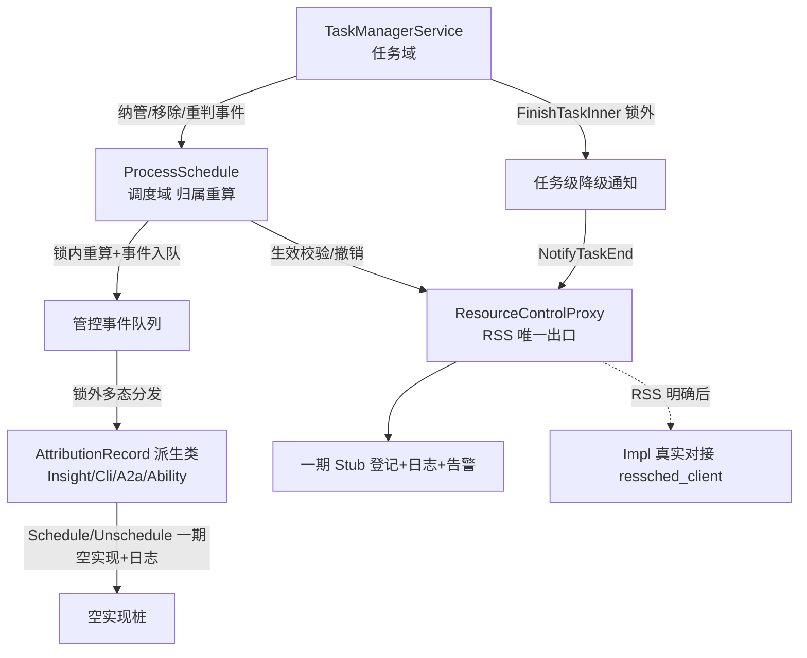
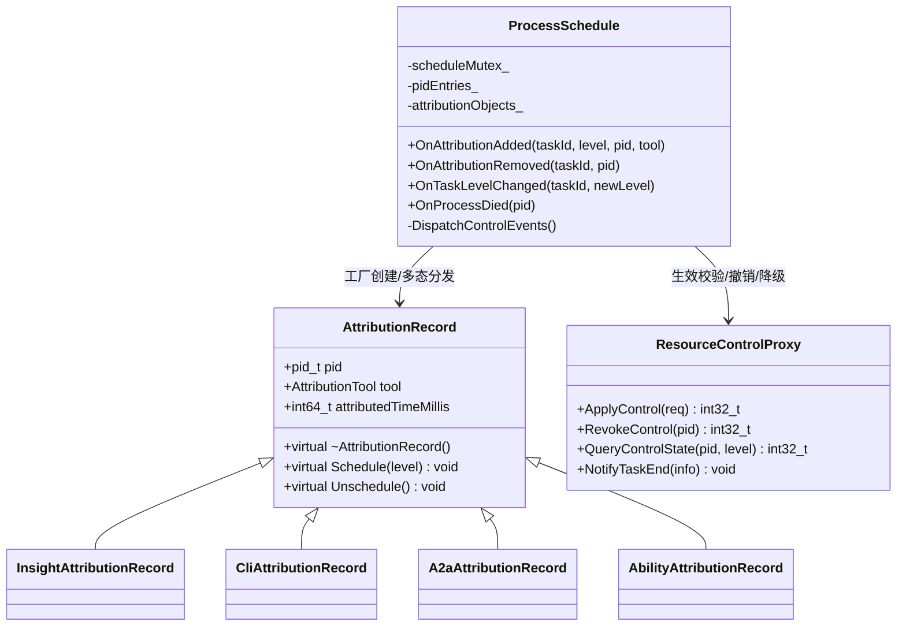
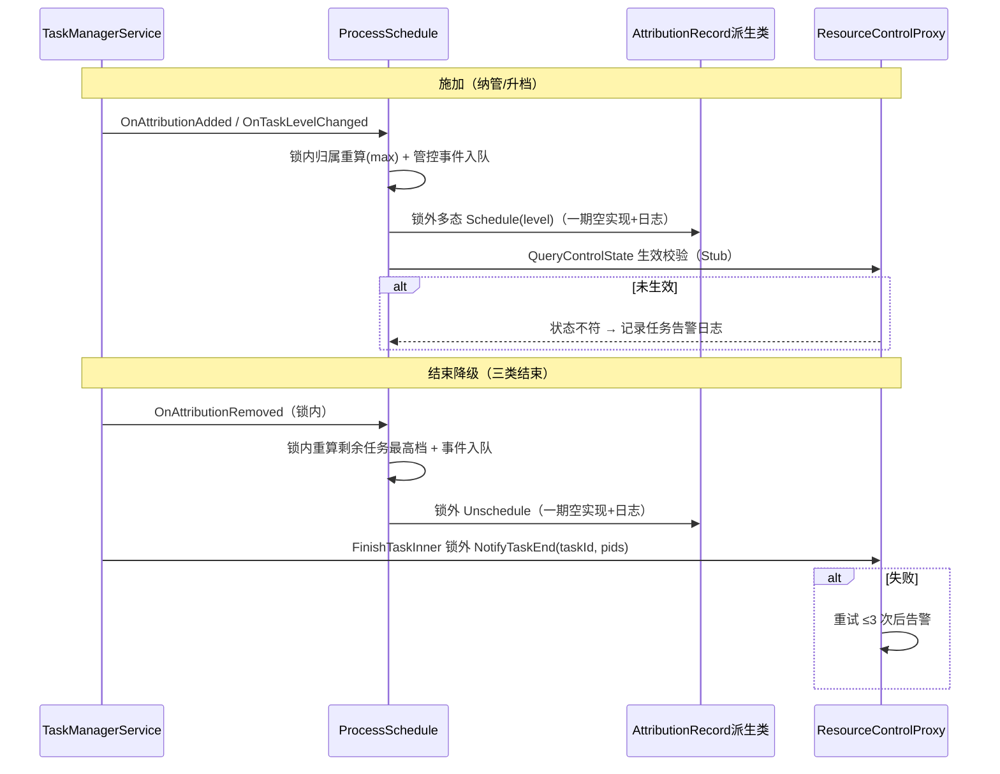

# 架构设计

> 确认目标仓和模块的架构约束、关键设计决策、Spec 拆分方向。本设计为复杂度"标准"的完整设计。

## 设计元数据

| 字段 | 内容 |
|------|------|
| Design ID | DESIGN-20260914692272 |
| 关联需求 | `proposal.md`（Approved） |
| 关联 Epic | FEAT-AI-TASK-MGR-001（RR 30096095） |
| 目标 Feature | FEAT-AI-TASK-MGR-001（20260914692272） |
| 复杂度 | 标准 |
| 目标版本 | OpenHarmony-7.1-Release |
| Owner | yangzk |
| 状态 | Approved（yangzk，2026-11-16） |

## 需求基线

> 需求基线详见 proposal.md 与 spec.md。设计阶段额外强调的要点：

| 项 | 补充说明 |
|----|----------|
| 验收范围 | 本需求仅验证**调度是否生效**（生效校验环）；后台锁屏可执行、避让/功耗基线对比等端到端验收由后续专门需求承载 |
| 多态调度约束（需求方确认） | 不同类型 AttributionTool（INSIGHT/CLI/A2A/ABILITY）调度方案不同；ProcessSchedule 不做类型区分、提供统一调度能力；从 AttributionRecord 派生各工具派生类实现各自调度；**一期各派生类调度为空实现 + 关键路径日志** |
| 管控数量 | 管控资源数量限制由前端纳管通道承载（TASK_MAX_ATTRIBUTIONS_PER_TASK=1000，common.h:47），本需求不做管控数量限制 |
| 内部接口 | NotifyTaskEnd 等内部接口不在 proposal/spec 体现，在本设计「内部接口定义」具体设计 |
| 归属合并复用 | 双向索引/max 合并/降级重算/死亡清理由 20260914692273 已交付（process_schedule.cpp），本需求在其事件流上接入管控施加/撤销，不推倒重来 |

## 上下文和现状

### 涉及仓和模块

| 仓库 | 补充架构说明 |
|------|-------------|
| openharmony/ability_ability_runtime | 变更主体仓。services/appmgr 为 SA 501（AppManagerService）所在，属 AGENTS.md 标记 🔴 高风险目录，改动需编译 + 全量单测验证；本设计最小侵入 20260914692273 已交付的 task_mgr 值语义数据模型 |
| resource_schedule_service | 仅只读勘察 RSS 冻结/调度分组/Qos/speed 接口语义；本仓不改代码，经 ResourceControlProxy 对接（Impl 期） |

### 代码事实基线

> 源码基线：openharmony/ability_ability_runtime master（本工作区，2026-11-16 核实）。

| 代码引用（文件:行/符号） | 已验证事实 | 关联架构规则 | 对本设计的约束 | 验证来源/可信度 |
|-------------------------|------------|--------------|----------------|-----------------|
| `services/appmgr/include/task_mgr/attribution_record.h:31-50` `AttributionTool`/`AttributionRecord` | AttributionTool 五值枚举（UNKNOWN/INSIGHT/CLI/A2A/ABILITY）；AttributionRecord 为值语义结构体（pid/tool/attributedTimeMillis），无可变虚函数 | OH-ARCH-LAYERING | 多态基类改造点；派生类按 tool 枚举一一对应，新增工具类型仅追加派生类 | 源码，高 |
| `services/appmgr/include/task_mgr/task_record.h:52` `attributions` | `std::map<AttributionId, AttributionRecord> attributions` 值语义存储，dump 经 `AttributionsToString`（task_manager_service.cpp:102）渲染 | OH-ARCH-LAYERING | task_mgr 值语义基类存储保持不变（dump/注册零改动）；多态对象由 process_schedule 工厂持有，避免高风险区大规模值→指针重构 | 源码，高 |
| `services/appmgr/src/task_mgr/process_schedule.cpp:41-65,173-189` `OnAttributionAdded`/`ApplyControlLocked`/`RevokeControlLocked` | 事件入口携带 (taskId, taskLevel, pid, tool)；施加/撤销当前为 scheduleMutex_ 锁内日志桩 | OH-ARCH-LAYERING | 多态调度分发与代理层接入点；现有"锁内打日志"须改为"锁内重算+事件、锁外分发"以满足锁内不下发约束 | 源码，高 |
| `services/appmgr/src/task_mgr/task_manager_service.cpp:233-296` `FinishTaskInner` | 任务结束统一入口：锁内收集 managedPids→tasks_.erase→遍历调 OnAttributionRemoved（:273）；锁外调 `NotifyTaskFinished(taskId, userId, reason)`（:294）；三类触发 FINISHED_BY_CALLER(:185)/TIMEOUT(:299)/CREATOR_DIED(:418) | OH-ARCH-LAYERING | 双通道降级挂载点：进程级撤销复用 OnAttributionRemoved；任务级 NotifyTaskEnd 挂在锁外（NotifyTaskFinished 同源，三类结束全覆盖） | 源码，高 |
| `services/appmgr/src/task_mgr/task_manager_service.cpp:405-444` `FinishTasksByCreatorInner`/`OnProcessDied` | 创建者死亡经 FinishTasksByCreatorInner 触发 FinishTaskInner；进程死亡经 ProcessSchedule::OnProcessDied(:444) 清理索引 | OH-ARCH-LAYERING | 死亡清理复用既有挂点，本需求不新增死亡钩子 | 源码，高 |
| `services/appmgr/include/task_mgr/common.h:26-47` 常量 | 档位 TASK_PRIORITY_LOW/MEDIUM/HIGH=100/200/300；TASK_TIMEOUT_PARAM=persist.sys.appms.taskmanager.task_timeout；TASK_MAX_ATTRIBUTIONS_PER_TASK=1000 | OH-ARCH-ERROR-LOG | 档位数值口径沿用；系统参数命名沿用 persist.sys.appms.taskmanager.* 前缀；管控数量上限属前端纳管，不在本需求 | 源码，高 |
| `services/appmgr/src/task_mgr/task_manager_service.cpp:514-522` `GetTimeoutSeconds` | 系统参数读取封装 GetIntParameter + 默认值兜底 + 非法值回退 | OH-ARCH-ERROR-LOG | 无（调度管控策略写死代码里，不再动态读参数） | 源码，高 |
| `services/appmgr/BUILD.gn:173` | external_deps 已含 `"resource_schedule_service:ressched_client"` | OH-ARCH-COMPONENT-BUILD | RSS 交互通道依赖现成，代理层 Impl 期可直接使用，无需新增依赖 | 构建配置，高 |

**基线规则：** 设计结论与代码事实冲突时，先确认目标版本和分支；未验证内容标记待验证，不进入 Approved 设计约束；execution-plan 文件范围必须可追溯到本表。

### 调用链层级分析

| 层 | 模块 | 职责 | 修改类型 |
|----|------|------|----------|
| 系统服务（任务域） | services/appmgr/src/task_mgr/task_manager_service.cpp | 任务生命周期；FinishTaskInner 锁外新增任务级降级通知挂点 | 修改 |
| 系统服务（调度域） | services/appmgr/src/task_mgr/process_schedule.{h,cpp} | 归属重算→管控事件→锁外多态分发 Schedule/Unschedule、生效校验、双通道降级编排 | 修改 |
| 系统服务（调度多态） | services/appmgr/include/task_mgr/attribution_record.h + src/task_mgr/attribution_record.cpp | AttributionRecord 多态基类 + 4 派生类 + 工厂（一期空实现+日志） | 修改/新增 |
| 系统服务（代理层） | services/appmgr/include/task_mgr/resource_control_proxy.h + src/task_mgr/resource_control_proxy.cpp（新增） | RSS 唯一出口：ApplyControl/RevokeControl/QueryControlState/NotifyTaskEnd 语义接口 + Stub 骨架 | 新增 |
| 外部依赖（resourceschedule） | ressched_client（ResSchedClient） | RSS 冻结/调度分组/Qos/speed 接口 | 只读消费（Impl 期） |
| 测试 | test/unittest/process_schedule_test/ | 多态分发/映射/降级/生效校验用例 | 新增/修改 |

**检查项：**
- [x] 调用链每一层都已覆盖（任务域→调度域→多态/代理层→RSS）
- [x] 每层职责边界清晰，无跨层违规调用
- [x] 每层修改类型明确

### 适用架构规则

| Rule ID | 适用原因 | 设计结论 | 验证方式 |
|---------|----------|----------|----------|
| OH-ARCH-LAYERING | 涉及服务层内部模块划分与多态分发 | 调度逻辑驻留 process_schedule/代理层服务侧；多态经基类指针分发，ProcessSchedule 不 switch 工具类型 | 代码评审 |
| OH-ARCH-SUBSYSTEM | 涉及跨子系统（ability→resourceschedule） | 对 RSS 的调用一律经 ResourceControlProxy 唯一出口；不得绕过代理层直连 ressched_client | 依赖检查/代码评审 |
| OH-ARCH-IPC-SAF | 涉及跨进程（AppMS→RSS） | 复用 ressched_client 既有 IPC；不新增 IAppMgr 事务码、不改既有 IPC 序列化；内部接口为进程内 C++ 接口 | 集成测试 |
| OH-ARCH-API-LEVEL | 无对外 API 变更 | 无 Public/System API 变更；内部接口为进程内 C++，不暴露 d.ts | API 评审 N/A |
| OH-ARCH-COMPONENT-BUILD | 新增源文件 | appmgr BUILD.gn 内新增 resource_control_proxy 源文件；ressched_client 依赖已具备（:173）；不新增部件 | 构建验证 |
| OH-ARCH-ERROR-LOG | 错误码/日志 | 无新增对外错误码；管控/降级/生效校验关键路径日志遵循 20260914692442 统一 TAG 规范 | 单测/hilog |

### 既有模式复用

| 模式 | 参考代码（文件:行/符号） | 适用架构规则 | 必须复用的约定 | 本设计的复用方式 | 偏差及理由 | 关联 Task |
|------|-------------------------|--------------|----------------|------------------|------------|-----------|
| 记录表+互斥锁并发 | `process_schedule.cpp:47` `scheduleMutex_`/`std::lock_guard` | OH-ARCH-LAYERING | 锁保护索引更新；锁内不调用外部 | 锁内重算+事件入队、锁外分发（对现有锁内打日志的强化） | 现网锁内仅打日志，本设计将下发移出锁外 | TASK-3 |
| 单例+事件入口 | `process_schedule.cpp:26` `GetInstance` | OH-ARCH-LAYERING | 单例事件入口风格 | ResourceControlProxy 同风格单例 | 无 | TASK-1 |
| 任务级通知通道 | `task_manager_service.cpp:294` `NotifyTaskFinished` | OH-ARCH-LAYERING | 锁外发送任务级通知 | NotifyTaskEnd 挂在同一锁外区域 | 无 | TASK-3 |

## 不涉及项承接

| 维度 | 设计结论 |
|------|----------|
| 性能（proposal=否） | 省略（不承载性能功耗指标，端到端验收由后续需求承载） |
| 安全与权限（proposal=否） | 省略（不新增鉴权点与管控数量限制，无新增安全面；不展开安全基础检查） |
| 兼容性（proposal=是） | 无 taskId 场景零新增管控动作；AttributionRecord 加虚函数不改变 task_mgr 值语义存储与 dump 行为；无持久化数据 |
| API/SDK（proposal=否） | 无对外 API；内部接口为进程内 C++，见「内部接口定义」 |
| IPC/跨进程（proposal=是） | 复用 ressched_client 既有 IPC；不新增 IAppMgr 事务码；内部接口不跨进程 |
| 构建与部件（proposal=是） | appmgr BUILD.gn 新增源文件；ressched_client 依赖已具备；不新增部件，bundle.json 不变 |
| 国际化/无障碍、数据迁移（proposal=否） | 省略 |

## 关键设计决策

| 决策 ID | 问题 | 推荐方案 | 探索过的替代方案 | 取舍理由 | 影响 |
|---------|------|----------|-----------------|------|------|
| ADR-1 | 多态调度如何落地 | AttributionRecord 改为多态基类，派生 Insight/Cli/A2a/Ability 四类；**具体调度策略写死在各派生 record 里**：各派生 record 的 Schedule/Unschedule/NotifyTaskEnd 硬编码各自调度管控方案，经 ResourceControlProxy 按 (taskId, pid) 对实施管控；ProcessSchedule 仅做归属索引/effectiveLevel 合并/事件通知（不做调度策略编排，不调 proxy）；被移除 record 暂存 endedRecords_，任务级降级亦由 record 承载；task_mgr 值语义基类存储保持不变 | A：task_mgr attributions 全量改 shared_ptr 多态存储（高风险区值→指针大改，放弃）；B：ProcessSchedule 统一编排调度策略/调 proxy（需求方 2026-11-16 明确"不用 process_schedule 做调度策略，写死在派生 record 里"，放弃）；C：ProcessSchedule 内 switch(tool) 分发（违背"不做区分"约束，放弃） | 满足需求方多态与"调度管控下沉 record"约束；ProcessSchedule 回归归属索引+事件通知的纯粹职责；统一术语"调度管控" | attribution_record.h/.cpp、process_schedule、resource_control_proxy |
| ADR-2 | RSS 对接方式 | ResourceControlProxy 代理层语义接口（ApplyControl/RevokeControl/QueryControlState/NotifyTaskEnd）+ 一期 Stub（内存登记+日志+告警+探测开关默认关，不持久化），Impl 占位编译期二选一 | 直连 ressched_client（RSS 设计未定、团队主导，耦合难替换，放弃） | 代理隔离使 RSS 明确后替换零波及上层；Stub 先行不阻塞交付 | resource_control_proxy 新增 |
| ADR-3 | 调度管控策略管理 | 调度管控策略直接硬编码在代码里：各派生 record 的 Schedule/Unschedule 内写死 level→freeze/schedGroup/qos/speed 策略组合（ControlRequest.policy），不引入 ScheduleMapping 动态读策略；占位取值随性能功耗评审定稿在代码内调整（不改接口与架构） | 系统参数外置映射表 + ScheduleMapping 动态加载（需求方 2026-11-16 明确"ScheduleMapping 也不要了，不用动态读策略，调度管控直接写在代码里"，放弃） | 调度管控与 record 内聚、无配置依赖、无映射 fail-safe 分支；一期空实现+日志 | attribution_record.cpp、resource_control_proxy |
| ADR-4 | 生效保障 | 施加后生效校验环：经 ResourceControlProxy::QueryControlState 查询调度/冻结状态，未生效记录任务告警日志；一期 Stub 下查询亦为日志桩 | 尽力而为不校验（锁屏核心场景失效不可观测，放弃） | 管控失效需可观测，满足 AC-5.1 | process_schedule + 代理层 |
| ADR-5 | 结束降级 | 双通道：进程级撤销/按剩余任务最高优先级重算（复用 OnAttributionRemoved）+ 任务级 NotifyTaskEnd（挂 FinishTaskInner 锁外，三类结束全覆盖）；两通道串行，失败重试 ≤3 次后告警 | 仅进程级（RSS 侧按任务建立的策略残留，放弃） | 防任务级策略残留，满足 AC-5.2 | process_schedule + task_manager_service 挂点 |
| ADR-6 | 线程模型 | 锁内（scheduleMutex_）仅做归属重算+管控事件入队；锁外统一出队分发 Schedule/Unschedule、生效校验、NotifyTaskEnd | 锁内直接调用 Schedule/RSS（跨锁顺序+长时间持锁，违背"锁内不下发"约束，放弃） | 满足 spec 架构约束"锁内不下发"；消除与 tasksMutex_ 的锁顺序风险 | process_schedule 重构事件分发 |
| ADR-7 | 一期交付边界 | 各派生类 Schedule/Unschedule 空实现+关键路径日志；ResourceControlProxy Stub；生效校验/降级为日志留痕桩；RSS 真实对接另立变更 | 直接对接 RSS 真实接口（RSS 设计未明确，放弃） | 匹配需求方"一期空实现+日志"要求；开源 master 无 RSS 消费插件，Stub 日志为基线 | 全部新增模块 |

## 设计骨架

### 骨架范围

| 骨架项 | 目标 | 不包含 | 验证方式 |
|--------|------|--------|----------|
| 多态骨架 | AttributionRecord 基类 + 4 派生类 + 工厂；Schedule/Unschedule 空实现+日志 | 真实 RSS 调度 | 编译 + 多态分发单测 |
| 代理层骨架 | ResourceControlProxy 语义接口 + Stub（登记+日志+探测开关默认关） | 真实 RSS 调用 | 编译 + Stub 动作断言 |

### 骨架 Spec 拆分

| Task ID | 目标 | 受影响文件 | AC |
|---------|------|------------|-----|
| TASK-SKELETON-1 | 多态基类+派生+工厂骨架 | attribution_record.h/.cpp | WHEN 编译 THEN 工厂按 tool 产出对应派生类且多态可调 |

## 后续 Task 拆分

| Task ID | 目标 | 受影响文件 | 依赖 |
|---------|------|------------|------|
| TASK-1 | ResourceControlProxy 代理层骨架 + 多态派生类（一期空实现+日志） | resource_control_proxy.{h,cpp}（新）、attribution_record.{h,cpp}、BUILD.gn、test/unittest/process_schedule_test/ | design/spec Approved |
| TASK-2 | 调度管控策略写死 + 档位施加/撤销（process_schedule 事件→多态分发） | process_schedule.{h,cpp}、attribution_record.{h,cpp}、BUILD.gn、test/unittest/process_schedule_test/ | TASK-1 |
| TASK-3 | 双通道降级 + 生效校验环 + 锁外分发 | process_schedule.{h,cpp}、task_manager_service.cpp（FinishTaskInner 锁外挂点）、resource_control_proxy、test/unittest/process_schedule_test/ | TASK-2 |

## API 签名、Kit 与权限

### 新增 API

无 Public/System API 新增。内部接口（进程内 C++，非 IPC、不暴露 d.ts）见下「内部接口定义」。

### 变更/废弃 API

无。

### 内部接口定义

> 以下为进程内 C++ 接口（services/appmgr 内部），不跨进程、不暴露 SDK；经 ResourceControlProxy 与 RSS 的跨进程交互复用 ressched_client 既有 IPC。

```cpp
// resource_control_proxy.h —— RSS 唯一出口（进程内语义接口，被派生 record 使用实施调度管控）
enum class ControlAction : int32_t { APPLY = 0, REVOKE = 1 };

struct ControlRequest {
    std::string taskId;          // 任务标识（管控按 taskId+pid 一对）
    int32_t callerPid = -1;      // 任务创建者 pid
    int32_t callerUid = -1;      // 任务创建者 uid
    int32_t managedPid = -1;     // 纳管进程 pid
    int32_t managedUid = -1;     // 纳管进程 uid
    AttributionTool managedType = AttributionTool::UNKNOWN;  // INSIGHT/CLI/A2A/ABILITY
    int32_t level = 0;           // 100(LOW)/200(MEDIUM)/300(HIGH)，取 max 合并后 effectiveLevel
    ControlAction action = ControlAction::APPLY;
};

struct TaskEndInfo {
    std::string taskId;          // 结束任务标识
    std::vector<pid_t> pids;     // 该任务纳管进程清单
};

class ResourceControlProxy {
public:
    static ResourceControlProxy &GetInstance();
    // 施加 (taskId,pid) 对管控（含生效校验：施加后经 QueryControlState 复核，未生效告警）
    int32_t ApplyControl(const ControlRequest &req);
    // 撤销 (taskId,pid) 对管控（进程级降级）
    int32_t RevokeControl(const std::string &taskId, pid_t managedPid);
    // 生效校验查询（按对返回档位；Stub 期返回登记值+日志）
    int32_t QueryControlState(const std::string &taskId, pid_t managedPid, int32_t &level);
    // 任务级降级：通知 RSS 清理任务级策略
    void NotifyTaskEnd(const TaskEndInfo &info);
};
// Stub（一期，默认）/ Impl（RSS 明确后）编译期二选一
```

```cpp
// attribution_record.h —— 多态调度管控（具体调度策略写死派生 record，一期空实现+关键路径日志）
struct AttributionRecord {
    pid_t pid = -1;
    AttributionTool tool = AttributionTool::UNKNOWN;
    int64_t attributedTimeMillis = 0;
    virtual ~AttributionRecord() = default;
    virtual void Schedule(const std::string &taskId, int32_t level);    // 基类默认空实现+日志（内联）
    virtual void Unschedule(const std::string &taskId);                 // 基类默认空实现+日志（内联）
    virtual void NotifyTaskEnd(const std::string &taskId, const std::vector<pid_t> &pids);  // 基类默认空实现+日志（内联）
};
// 派生类写死各自调度管控：Schedule/Unschedule/NotifyTaskEnd 调 proxy 按 (taskId,pid) 对实施管控
struct InsightAttributionRecord : AttributionRecord { 三方法 override（调 proxy）; };
struct CliAttributionRecord : AttributionRecord { 三方法 override（调 proxy）; };
struct A2aAttributionRecord : AttributionRecord { 三方法 override（调 proxy）; };
struct AbilityAttributionRecord : AttributionRecord { 三方法 override（调 proxy）; };
// 工厂：按 tool 创建派生对象，UNKNOWN 返回基类
std::shared_ptr<AttributionRecord> CreateAttributionRecord(AttributionTool tool);
```

## 构建系统影响

### BUILD.gn 变更

```
文件路径: services/appmgr/BUILD.gn
变更说明: 源文件列表新增 src/task_mgr/resource_control_proxy.cpp；attribution_record.cpp 扩展多态实现
变更说明: ressched_client 依赖已具备（:173），无需新增 external_deps

文件路径: test/unittest/process_schedule_test/BUILD.gn
变更说明: 新增多态分发/映射/降级/生效校验单测源文件
```

### bundle.json 变更

无（不新增部件，features 不变）。

---

## 可选设计扩展

### 架构图



### 类图



| 类型/接口 | 现有代码引用或 New | 关系 | 关键职责/签名 | 关联 ADR | 关联 Task |
|-----------|--------------------|------|---------------|----------|-----------|
| `AttributionRecord` | `attribution_record.h:43`（修改为多态基类） | 基类 | 数据 + virtual Schedule/Unschedule（空实现+日志） | ADR-1 | TASK-1 |
| `Insight/Cli/A2a/AbilityAttributionRecord` | New | 派生 | 各自 override 调度（一期空实现+日志） | ADR-1 | TASK-1 |
| `CreateAttributionRecord` | New | 工厂 | 按 tool 创建派生对象 | ADR-1 | TASK-1 |
| `ProcessSchedule` | `process_schedule.h:43`（修改） | 组合/分发 | 重算 + 锁外多态分发 + 生效校验 + 降级编排 | ADR-4/5/6 | TASK-2/3 |
| `ResourceControlProxy` | New | 单例代理 | RSS 唯一出口语义接口 + Stub | ADR-2 | TASK-1 |

### 时序设计



### 状态归属与不变量

#### 状态归属

| State ID | 状态/资源 | 唯一 Owner | 存储/Key/Index | 创建与初始化 | 读取/更新方 | 清理/恢复/回滚触发 | 并发模型 | 代码事实/规则来源 |
|----------|-----------|------------|-------------------|------------|-------------|--------------------|----------|-------------------|
| STATE-1 | 归属索引/档位缓存（effectiveLevel） | process_schedule | taskToPids_/pidEntries_（scheduleMutex_ 保护） | 纳管事件创建条目 | 只读：dump/管控分发 | 进程死亡/任务结束移除重算 | 互斥锁 | `process_schedule.cpp:47` + OH-ARCH-LAYERING |
| STATE-2 | 多态调度对象 | process_schedule | attributionObjects_（key=taskId+pid，scheduleMutex_ 保护） | 纳管事件工厂创建 | 锁外分发只读使用 | 移除/死亡时随索引清理 | 锁内创建/清理，锁外只读调用 | ADR-1/6 |
| STATE-3 | 管控登记（代理层） | ResourceControlProxy | 内存登记表（{taskId,pid,action,level,timestamp,result}） | ApplyControl 时登记 | 生效校验/重启重放只读 | 任务结束/进程死亡清理 | 代理层内部锁 | ADR-2 |

#### 不变量追溯

| Invariant ID | State ID / 范围 | 必须始终成立的约束 | 关联 AC | 关联 Task | 验证方式与通过标准 | 违反时处理 |
|--------------|------------------|--------------------|---------|-----------|--------------------|------------|
| INV-1 | STATE-1 | effectiveLevel(pid) == max(该 pid 全部存活纳管任务档位)（沿用 20260914692273） | AC-5.1、AC-5.2 | TASK-2/3 | 多任务×多进程矩阵单测断言合并/降级序列 | 事件重算修正 |
| INV-2 | STATE-1/2 | 管控事件分发在 scheduleMutex_ 锁外执行；锁内仅重算+入队 | AC-5.1、AC-5.2 | TASK-3 | 并发单测 + 锁顺序评审（锁内无 Schedule/RSS 调用） | 重构分发路径 |
| INV-3 | STATE-3 | 施加后必经生效校验；未生效必产生任务告警日志 | AC-5.1 | TASK-3 | 未生效注入用例断言告警日志输出 | 补生效校验环 |
| INV-4 | STATE-1/3 | 任务结束（三类触发）必触发进程级撤销 + 任务级 NotifyTaskEnd；全部结束进程完全恢复 | AC-5.2 | TASK-3 | 三类结束×续管矩阵单测；失败注入重试≤3告警断言 | 补降级通道 |
| INV-6 | STATE-1 | 无 taskId 进程无任何新增管控动作 | AC-5.3 | TASK-2 | 无纳管进程回归断言无管控事件 | 移除误分发 |

### 线程与并发模型

| 操作 | State ID / 竞争对象 | 发起线程 | 回调线程 | 跨进程边界 | 同步/所有权机制 | 锁顺序/重入约束 | 关联不变量 |
|------|---------------------|----------|----------|------------|----------------|----------------|------------|
| 纳管/重判重算 | STATE-1/2 / scheduleMutex_ | Binder（任务事件） | 同线程 | 否 | 互斥锁；锁内仅重算+入队 | 锁内不调 Schedule/RSS；锁外分发 | INV-1/2 |
| 管控分发/生效校验 | STATE-2/3 | 事件线程（锁外） | 同线程 | 是（Impl 期 AppMS→RSS） | 锁外执行；代理层内部锁 | 不持有 scheduleMutex_ 调 RSS | INV-2/3 |
| 任务结束降级 | STATE-1/3 | Binder/超时/死亡线程 | 锁外 | 是（Impl 期） | 进程级锁内重算；任务级锁外 NotifyTaskEnd | FinishTaskInner 锁外调 NotifyTaskEnd | INV-4 |

**并发场景：**

| 场景 | 竞争对象 | 保护机制 | 预期行为 | 关联 AC/Task | 验证方式 |
|------|----------|----------|----------|-------------|----------|
| 重算与分发并发 | STATE-1/2 | 锁内重算入队、锁外分发 | 分发不重入锁；无管控空窗 | AC-5.1 / TASK-3 | 并发单测 |
| 结束与升档并发 | STATE-1/3 | 锁内串行重算；锁外按事件序分发 | 降级不被后续升档覆盖 | AC-5.2 / TASK-3 | 时序断言单测 |
| 生效校验失败 | STATE-3 | 校验结果驱动告警 | 未生效告警可检索 | AC-5.1 / TASK-3 | 故障注入 |
| 无 taskId 进程调度 | STATE-1 | 无归属条目则不产生管控事件 | 无新增管控动作，行为与现网一致（INV-6） | AC-5.3 / TASK-2 | 无纳管回归断言 |

### 资源所有权矩阵

| 资源 / State ID | 创建方 | 持有方（Owner） | 借用/只读消费者 | 销毁触发 | 实际释放 | 异常回收 | 关联不变量 |
|-----------------|--------|----------------|-----------------|----------|----------|----------|------------|
| 多态调度对象 / STATE-2 | 工厂（纳管事件） | process_schedule | 锁外分发只读 | 移除/死亡 | process_schedule 锁内清理 | 死亡通知链兜底 | INV-2 |
| 管控登记 / STATE-3 | ResourceControlProxy（ApplyControl） | ResourceControlProxy | 生效校验/重放只读 | 任务结束/死亡 | 代理层清理 | 服务重启随进程退出 | INV-3/4 |

### 测试性设计

| 测试层级 | 测试目标 | Mock 策略 | 验证方式 |
|----------|----------|-----------|----------|
| 单元测试 | 多态工厂按 tool 产出派生类、分发不 switch；写死策略断言（level→策略组合硬编码）；生效校验告警；双通道降级矩阵；重试≤3 | ResourceControlProxy Stub 断言动作序列；生效校验失败注入 | `run -t UT -tp ability_runtime` |
| 集成测试 | 纳管/结束/重判全链路事件流；三类结束降级；dump 复核归属与生效状态 | 真实任务链路 + Stub 代理层；既有 dump 调试钩子 | 集成用例 + hidumper + hilog |
| XTS | N/A（无 Public/System API 变更） | N/A | N/A |

## 风险和开放问题

| 项 | 类型 | 影响 | 处理方式 | Owner |
|----|------|------|----------|-------|
| 调度管控策略取值评审延迟 | 外部 | 中（策略取值占位，评审定稿后在代码内调整，不改接口与架构） | 策略写死代码里、占位先行，评审定稿后在代码内调整取值 | yangzk |
| RSS 设计变化致代理层返工 | 架构 | 中 | 语义接口抽象+Stub 先行；不兼容时回设计评审 | yangzk |
| 开源 master 无 RSS 消费插件 | 测试 | 高（端到端假成功） | Stub 动作日志为 master 基线；端到端验证前置产品环境 | yangzk |
| AttributionRecord 加虚函数对值语义的影响 | 架构 | 低 | 基类仍值语义可拷贝；task_mgr 存基类值无切片；派生对象仅 process_schedule 持有 | yangzk |
| 锁外分发与重算的事件一致性 | 架构 | 中 | 锁内重算+入队保证事件序；并发单测+时序断言 | yangzk |

## 设计审批

- [x] 需求基线已确认，设计覆盖 P0/P1 AC（AC-5.1/5.2/5.3）
- [x] 不涉及项已承接，N/A 和展开项都有结论（性能/安全省略）
- [x] 涉及仓和模块职责清楚
- [x] 调用链层级分析完整，每层覆盖到位
- [x] 涉及既有实现时，代码事实基线使用文件:行/符号引用，且每项事实已转化为设计约束
- [x] 已检索并记录既有模式复用（参数读取/锁并发/单例/任务通知）
- [x] 适用架构规则已识别并形成设计结论
- [x] 分层和子系统边界合规（代理层唯一出口）
- [x] 命中类/接口关系触发条件时，类图与代码事实、ADR、Task 一致
- [x] 涉及状态/资源/并发时，状态 Owner 唯一，生命周期、恢复和锁/消息模型无冲突
- [x] 每项 `INV-*` 均关联 AC、Task 和可执行验证方式，状态机/资源/并发章节引用一致
- [x] API 变更有签名、权限、错误码和兼容性说明（无对外 API；内部接口已定义）
- [x] BUILD.gn/bundle.json 影响明确
- [x] 设计输出和后续 Task 拆分明确（TASK-1/2/3）
- [x] 关键设计决策有理由和影响说明（ADR-1~7）
- [x] 风险和开放问题有 Owner

**结论:** 通过（候选，待需求方评审确认）
