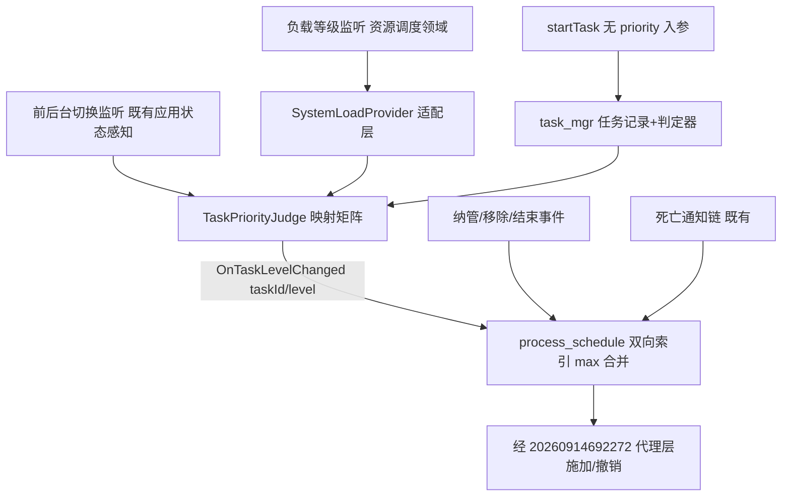
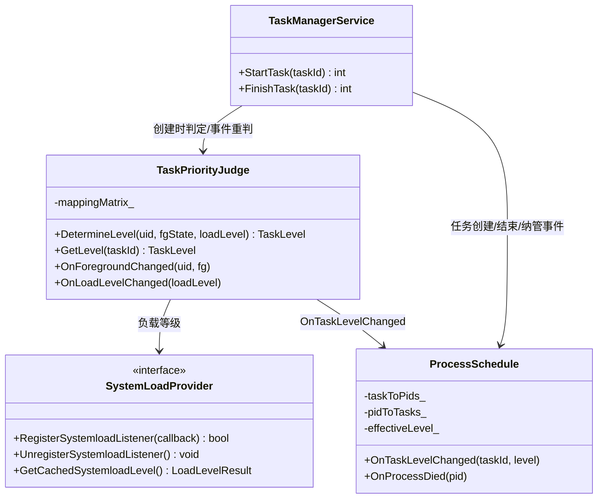
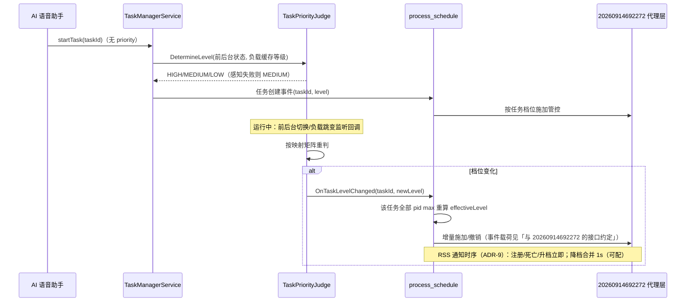

# 架构设计

> 确认目标仓和模块的架构约束、关键设计决策、Spec 拆分方向。本设计为复杂度"标准"的完整设计。

## 设计元数据

| 字段 | 内容 |
|------|------|
| Design ID | DESIGN-20260914692273 |
| 关联需求 | `proposal.md`（Approved） |
| 关联 Epic | FEAT-AI-TASK-MGR-001（RR 30096095） |
| 目标 Feature | FEAT-AI-TASK-MGR-001（20260914692273） |
| 复杂度 | 标准 |
| 目标版本 | OpenHarmony-7.1-Release |
| Owner | yangzk |
| 状态 | Approved（yangzk，2026-11-05） |

## 需求基线

> 需求基线详见 proposal.md。设计阶段额外强调的要点：

| 项 | 补充说明 |
|----|----------|
| startTask 入参变更 | 本需求消费 20260914692191 交付的任务生命周期与 taskId 归因主键，承载 startTask 移除 priority 入参；鉴权、taskId 规格、错误码沿用 |
| 档位机制边界 | 档位定义与 RSS 施加/撤销由 20260914692272 承载；**交付顺序：本需求先交付，对 RSS 代理层的施加/撤销调用在本需求内留空（空实现桩，日志留痕），20260914692272 交付后接入**；本需求负责归属合并与重算及事件流输出 |
| 档位抖动处理 | 第一线防抖为判定器"档位不变不重算"（ADR-6）；合并窗口防抖在 20260914692272 的 RSS 代理边界处理（通知时序策略见 ADR-9），风险 R3 随之移交 |
| dump 能力 | 本需求实现任务 dump 基本字段（任务档位/归属/effectiveLevel/豁免摘要/判定器缓存，端到端确认状态用）；正式 DFX 观测面（事件/全景/日志规范）由 20260914692442 后续承载 |
| DFX 观测面 | dump 字段布局沿用 20260914692191 已固定框架（task_manager_service.cpp:426-447 占位注释：field layout fixed so scripts can rely on it），本需求填充取值 |

## 上下文和现状

### 涉及仓和模块

| 仓库 | 补充架构说明 |
|------|-------------|
| openharmony/ability_ability_runtime | 变更主体仓。services/appmgr 为 SA 501（AppManagerService）所在，属 AGENTS.md 标记 🔴 高风险目录（影响所有应用进程），改动需编译 + 全量单测验证；frameworks/ets/ani 与 frameworks/js/napi 为公共绑定层（🟡）。服务层与框架层经 interfaces/inner_api 的 IPC 接口解耦 |
| openharmony/interface_sdk-js | 仅 d.ts 声明变更提审（api/@ohos.app.agent.taskManager.d.ts），本仓只读参考 |

### 代码事实基线

> 源码基线：openharmony/ability_ability_runtime master（本工作区，2026-11-04 核实）。

| 代码引用（文件:行/符号） | 已验证事实 | 关联架构规则 | 对本设计的约束 | 验证来源/可信度 |
|-------------------------|------------|--------------|----------------|-----------------|
| `frameworks/ets/ets/@ohos.app.agent.taskManager.ets:21-25,29` `TaskPriority`/`startTask` | 公共声明：`startTask(taskId: string, priority?: TaskPriority): Promise<void>`，枚举 LOW=100/MEDIUM=200/HIGH=300，priority 缺省按 MEDIUM | OH-ARCH-API-LEVEL | 目标签名 `startTask(taskId: string)`；TaskPriority 不再导出；@since 26.2.0 不变 | 源码，高 |
| `interfaces/inner_api/app_manager/include/appmgr/app_mgr_interface.h:1330` `IAppMgr::StartTask` | IPC 接口签名 `StartTask(const std::string &taskId, int32_t priority)` | OH-ARCH-IPC-SAF | startTask 签名变更点（前置分析稿写"ITaskManager IDL"，经核实本仓实际承载为 IAppMgr，无 ITaskManager IDL）；其余 IAppMgr 接口与序列化不动 | 源码，高 |
| `interfaces/inner_api/app_manager/include/appmgr/app_mgr_ipc_interface_code.h:172` | START_TASK = 147 | OH-ARCH-IPC-SAF | 事务码不变，仅消息体移除 priority 字段 | 源码，高 |
| `interfaces/inner_api/app_manager/src/appmgr/app_mgr_stub.cpp:2735-2740` `HandleStartTask` | Stub 反序列化 taskId(String16)+priority(Int32) 后调 StartTask | OH-ARCH-IPC-SAF | 消息体同步移除 priority 读/写 | 源码，高 |
| `services/appmgr/src/task_mgr/task_manager_service.cpp:125-136,150-184,500-506` `StartTask`/`StartTaskInner`/`CheckParam` | 创建链路：CheckParam（taskId 1~256 字节且 priority∈{100,200,300}，否则 401）→ 上限 10（TASK_MAX_ACTIVE_TASKS，common.h:41，超限 ERR_INVALID_OPERATION）→ 重复 taskId 返 ERR_TASK_ALREADY_EXISTS | OH-ARCH-ERROR-LOG | priority 校验移除后，档位改由判定器同步产出；上限与重复校验保留 | 源码+单测，高 |
| `services/appmgr/include/task_mgr/common.h:26-44` | 档位常量 LOW=100/MEDIUM=200/HIGH=300/DEFAULT=MEDIUM；taskId 1~256；超时默认 600s（persist.sys.appms.taskmanager.task_timeout 可配）；并发上限 10；单任务纳管上限 1000 | OH-ARCH-ERROR-LOG | 档位数值口径沿用；并发基线已有常量与系统参数先例 | 源码，高 |
| `services/appmgr/include/task_mgr/task_record.h:41-44` + `task_manager_service.cpp:153` | TaskRecord 含 priority 字段；记录表由 `ffrt::mutex`（tasksMutex_）保护 | OH-ARCH-LAYERING | 判定器与任务记录同锁域；档位写入 TaskRecord | 源码，高 |
| `services/appmgr/include/app_death_recipient.h:27-29,62` `AppDeathRecipient::OnRemoteDied` | 既有进程死亡通知链（IRemoteObject::DeathRecipient） | OH-ARCH-LAYERING | 死亡清理最小挂点，不新增侵入钩子 | 源码，高 |
| `services/appmgr/include/app_state_observer_manager.h:70,127` + `interfaces/inner_api/app_manager/include/appmgr/application_state_observer_stub.h:43` `OnForegroundApplicationChanged(AppStateData)` | 既有应用前后台状态感知与通知链（含 AbilityStateData/abilityState 维度） | OH-ARCH-LAYERING | 判定器前后台输入直接复用注册监听，不新增感知链路 | 源码，高 |
| `services/appmgr/src/task_mgr/task_manager_service.cpp:426-447` `DumpActiveTasks` | dump 字段框架已固定（priority/creator/managed processes/**sched level [-]**/remain timeout/create time + **Exemption summary: total=0** 占位；注释声明 field layout fixed so scripts can rely on it） | OH-ARCH-ERROR-LOG | 本需求填充 sched level 与豁免摘要取值，不改字段布局 | 源码，高 |
| `services/appmgr/include/task_mgr/attribution_record.h:26-31` `AttributionTool` | 纳管类型枚举 UNKNOWN/INSIGHT(1)/CLI(2)/A2A(3)/ABILITY(4) | OH-ARCH-ERROR-LOG | RSS 事件载荷"纳管进程类型"取值映射：UIAbility=ABILITY、CLI=CLI、Agent=A2A、意图=INSIGHT | 源码，高 |
| `frameworks/js/napi/task_manager/js_task_manager.cpp:65` `OnStartTask` | NAPI 绑定：解析 taskId（1~256），末位函数作为异步回调（与 OnFinishTask 同款 `lastParam` 解析）；异步调 AppMgrClient::StartTask | OH-ARCH-LAYERING | 移除 priority 解析；多余入参照 finishTask 口径忽略（不做 401 拒绝） | 源码，高 |
| `frameworks/ets/ani/task_manager/src/ets_task_manager.cpp:86-115` `NativeStartTask` | ANI 绑定：aniPriority 枚举项解析后调 AppMgrClient::StartTask | OH-ARCH-LAYERING | 同步移除 priority 参数 | 源码，高 |
| `interfaces/inner_api/ability_manager/include/ability_manager_errors.h:309,1206` | ERR_NOT_SYSTEM_APP（2097209）、ERR_TASK_ALREADY_EXISTS（2099501） | OH-ARCH-ERROR-LOG | 错误码值不变；对外 202/16000301 映射沿用 20260914692191 | 源码，高 |

**基线规则：**

- 设计结论与代码事实冲突时，先确认目标版本和分支；不得直接忽略现状。
- 只在注释、README 或二手资料中出现而未被源码/测试验证的内容，标记为待验证，不进入 Approved 设计约束。
- execution-plan 的文件范围必须能追溯到本表、调用链分析或明确的新建文件决策。

### 调用链层级分析

| 层 | 模块 | 职责 | 修改类型 |
|----|------|------|----------|
| SDK 声明（interface_sdk-js） | api/@ohos.app.agent.taskManager.d.ts | startTask 公共声明 | 修改（移除 priority 入参与 TaskPriority 导出） |
| ETS 框架（本仓） | frameworks/ets/ets/@ohos.app.agent.taskManager.ets | startTask 框架实现与 native 声明 | 修改 |
| ANI/NAPI 绑定（本仓） | frameworks/ets/ani/task_manager/、frameworks/js/napi/task_manager/ | JS 接口到 AppMgrClient 的绑定 | 修改 |
| IPC 客户端/服务端（本仓） | interfaces/inner_api/app_manager（IAppMgr Proxy/Stub） | startTask 跨进程传输 | 修改（仅 StartTask 消息体） |
| 系统服务（本仓） | services/appmgr（AppMgrService → TaskManagerService） | 任务创建/结束生命周期与记录 | 修改（接入判定器） |
| 系统服务（本仓） | services/appmgr/src/task_mgr/（新增 TaskPriorityJudge/SystemLoadProvider） | 优先级判定与动态重判 | 新增 |
| 系统服务（本仓） | services/appmgr/src/process_schedule/（新增） | 归属双向索引、max 合并、降级重算、豁免幂等、死亡清理、索引 dump 区段 | 新增 |
| 外部依赖（resourceschedule） | ressched_client（ResSchedSystemloadNotifierClient / ResSchedClient） | 融合档位监听与查询（SystemloadLevel 0~7） | 只读消费（external_deps） |
| 相邻需求（不在本仓修改） | 20260914692272 RSS 代理层；20260914692442 DFX | 档位施加/撤销（含 ADR-9 合并窗）；dump 与日志正式规范 | 只读消费 |

**检查项：**
- [x] 调用链每一层都已覆盖（从最上层到最底层）
- [x] 每层职责边界清晰，无跨层违规调用
- [x] 每层修改类型明确

**模块划分依据：** process_schedule 与 task_mgr 同级（services/appmgr/src/ 下）的原因：①状态域/锁域分离——task_mgr 为任务生命周期域（20260914692191 owner，tasksMutex_ 锁域），process_schedule 为进程归属域（STATE-2 独立锁域），两者不变量与并发模型不同；②与 20260914692272 同模块（前置分析既定）——RSS 管控代理层后续放入 process_schedule，独立目录使其交付时不侵入 task_mgr；③结构对称与构建边界——与 app_running_manager/task_mgr 同级符合 appmgr 目录惯例，独立源文件集合便于 BUILD.gn 管理。

### 适用架构规则

| Rule ID | 适用原因 | 设计结论 | 验证方式 |
|---------|----------|----------|----------|
| OH-ARCH-LAYERING | 涉及框架层→服务层调用 | 判定器/归属合并均在 appmgr 服务层；框架层仅做参数透传变更，无业务逻辑下沉或上侵 | 代码评审 |
| OH-ARCH-IPC-SAF | 涉及 IPC 消息变更 | 仅 START_TASK(147) 消息体移除 priority 字段；同版本客户端/服务端同步发布，无跨版本序列化兼容负担；其余 IAppMgr 接口不动 | 集成测试（新签名调用） |
| OH-ARCH-API-LEVEL | 涉及 System API 变更 | startTask 保持 System（@systemapi）、@since 26.2.0 不变；TaskPriority 由 System 级导出转为内部定义 | API 评审/d.ts diff |
| OH-ARCH-COMPONENT-BUILD | 新增 process_schedule 源文件 | 在 appmgr 既有 BUILD.gn 内新增源文件与单测 target；不新增部件；bundle.json 不变 | 构建验证 |
| OH-ARCH-ERROR-LOG | 错误码/日志 | 错误码值沿用（202/16000301/401）；判定/重判/合并/清理关键路径日志遵循 20260914692442 统一 TAG 规范 | 单测/hilog |

### 既有模式复用

| 模式 | 参考代码（文件:行/符号） | 适用架构规则 | 必须复用的约定 | 本设计的复用方式 | 偏差及理由 | 关联 Task |
|------|-------------------------|--------------|------------------|------------------|------------|-----------|
| 记录表+互斥锁并发 | `task_manager_service.cpp:153` `ffrt::mutex`/`std::lock_guard` | OH-ARCH-LAYERING | 锁保护记录表更新；事件在锁域内处理 | 判定器与 process_schedule 各自锁域沿用同一锁风格 | 无 | TASK-2/4/5 |
| 系统参数可配项 | `task_manager_service.cpp:514-522` `GetTimeoutSeconds`（GetIntParameter + 默认值兜底） | OH-ARCH-ERROR-LOG | parameter 读取封装 + 非法值回默认 | 并发任务数上限等可配项读取沿用 | 无 | TASK-4 |
| 双向索引状态管理 | `services/appmgr/include/app_running_manager.h:517-518` `runningRecordMapMutex_`/`appRunningRecordMap_` | OH-ARCH-LAYERING | 索引结构与互斥锁保护更新风格 | process_schedule 双向索引（taskToPids_/pidToTasks_）参照 | 无 | TASK-4 |
| 死亡通知链 | `app_death_recipient.h:27-29` `OnRemoteDied` | OH-ARCH-LAYERING | DeathRecipient 回调挂点 | 死亡清理最小挂点 | 无 | TASK-6 |
| 前后台状态监听 | `app_state_observer_manager.h:127` `NotifyAppStateObservers` / `application_state_observer_stub.h:43` | OH-ARCH-LAYERING | 注册监听 + 回调驱动 | 判定器前后台输入 | 无 | TASK-5 |
| 参数校验与错误码 | `task_manager_service.cpp:500-506` `CheckParam` | OH-ARCH-ERROR-LOG | 参数校验失败返 INVALID_PARAMETERS_ERR | startTask 仅 taskId 非法时 401；多余入参照 finishTask 忽略 | 无 | TASK-3 |
| 系统负载监听（resourceschedule，已源码核实 2026-11-05） | `resource_schedule_service/ressched/interfaces/innerkits/ressched_client/include/res_sched_systemload_notifier_client.h:25,29` `ResSchedSystemloadNotifierClient::OnSystemloadLevel(int32_t)`；`res_sched_client.h:111,118,141` `RegisterSystemloadNotifier/UnRegisterSystemloadNotifier/GetSystemloadLevel`；`res_value.h:603-612` `SystemloadLevel`（0~7）；GN target `ressched_client`（ressched_client/BUILD.gn:116） | OH-ARCH-SUBSYSTEM | 注册/注销配对；回调线程不直接加业务锁 | SystemLoadProvider 默认实现按此接入；appmgr BUILD.gn `external_deps += [ "resource_schedule_service:ressched_client" ]` | 需求方提供的接口说明与源码一致；档位枚举实际定义在 res_value.h（非 res_type.h），以实现侧为准 | TASK-2 |

## 不涉及项承接

| 维度 | 设计结论 |
|------|----------|
| 性能（proposal=是） | ≤10 并发任务基线沿用 `TASK_MAX_ACTIVE_TASKS`（common.h:41）+ 系统参数可配；判定/重判为事件驱动低频调用，无轮询；NFR 指标见 spec.md 非功能性需求 |
| 兼容性（proposal=是） | 版本内变更，@since 26.2.0 不变；IPC 同版本同步；无持久化数据 |
| API/SDK（proposal=是） | 见「API 签名、Kit 与权限」与 ADR-8 |
| IPC/跨进程（proposal=是） | 仅 START_TASK 消息体变更；无新增跨进程接口 |
| 构建与部件（proposal=是） | appmgr BUILD.gn 内新增源文件；不新增部件；bundle.json 不变 |
| 安全与权限（proposal=否） | 省略（不新增鉴权点，沿用 20260914692191 系统应用校验） |
| 国际化/无障碍、数据迁移（proposal=否） | 省略 |

## 关键设计决策

| 决策 ID | 问题 | 推荐方案 | 探索过的替代方案 | 取舍理由 | 影响 |
|---------|------|----------|-----------------|------|------|
| ADR-1 | 多任务归属合并算法 | max 合并 + 事件驱动增量重算（锁域内） | 全量重算（每次事件重算全部进程档位，O(进程×任务)） | 增量重算 O(变更任务数)，10 并发基线下开销恒定；锁域内无竞态 | process_schedule 重算路径 |
| ADR-2 | 死亡清理实现 | 复用既有死亡通知链挂点（AppDeathRecipient） | 独立监控进程状态（新增轮询/独立观察者） | 最小侵入（appmgr 为 🔴 高风险目录）；既有链延迟已满足 ≤1s | TASK-6 |
| ADR-3 | 豁免幂等设计 | pid 维度引用计数（幂等键=taskId+pid+豁免类型） | 任务维度标志位（任务结束即释放，不管其他任务） | 同进程多任务场景下正确合并/释放，防误杀/泄漏 | 豁免申请/释放路径 |
| ADR-4 | 判定器归属 | task_mgr 内新增 TaskPriorityJudge，与任务记录同一锁域 | 判定逻辑并入 process_schedule | 档位是任务属性，owner 与任务记录一致；process_schedule 仅消费事件，合并职责单一 | 模块边界 |
| ADR-5 | 映射矩阵形态与取值 | 编译期常量默认矩阵：**前台=HIGH（与负载无关）；后台 × 融合档位 0~4（低负载）=MEDIUM；后台 × 融合档位 5~7（高负载）=LOW** | 系统参数在线可配 | 无配置时行为确定；矩阵调整走版本迭代（避免运行期口径漂移）；前台不区分负载可保证交互关键路径最高响应 | 判定器实现 |
| ADR-6 | 动态重判触发模型 | 事件驱动：前后台切换监听回调 + 融合档位跳变监听回调；档位变化才触发下游重算 | 周期全量重判（定时扫描） | 开销低、时延即时；档位不变不重算（第一线防抖）；注册监听模型无轮询 | TASK-5 |
| ADR-7 | 系统负载获取 | SystemLoadProvider 适配层抽象；默认实现基于资源调度 ressched_client 接入**性能功耗热融合档位**（已源码核实：`ResSchedSystemloadNotifierClient::OnSystemloadLevel` 监听 + `GetSystemloadLevel` 查询兜底，`SystemloadLevel` 0~7 定义于 res_value.h:603-612）；测试桩返回固定档位 | 判定器直接调用资源调度接口 | 融合档位由热系统当前热档位、CPU 负载档位与叠加场景综合决策（资源调度领域口径）；适配层隔离变化、可测 | TASK-2 |
| ADR-8 | startTask 变更范围 | IAppMgr StartTask 消息体、Stub/Proxy、NAPI/ANI/ETS 绑定与 d.ts 同步移除 priority 与 TaskPriority 导出，内部枚举值 100/200/300 保留 | 保留入参静默忽略 | 需求明确不再由调用方指定；静默忽略产生误导语义 | TASK-1/3 |
| ADR-9 | RSS 通知时序策略（需求方确认基线，防抖第二线在 20260914692272 RSS 代理边界实现） | **立即路径**：注册纳管 APPLY、进程死亡 REVOKE、档位上升（effectiveLevel 提高）；**合并路径**：注销纳管（主动）、前后台状态变化、融合档位变化导致的档位下降，**合并 1s 窗口**后统一通知 RSS；窗口到期按当前状态重算（非合并事件队列）；**1s 窗口可配/可注入**（系统参数） | 全部立即（RSS 施加/撤销风暴）；全部延迟（建立链路时延）；仅按事件类型切分（助手切前台升 HIGH 慢 1s 的反例） | 建立链路要快、释放/变更要稳；升档立即不引起抖动（稳定上升），抖动来自降档往复；死亡立即保护 spec AC-6.3 ≤1s 与豁免无泄漏。本需求 process_schedule 对内重算始终同步立即（INV-2 与 dump 一致），仅对 RSS 输出按该契约 | 20260914692272 接口约定 |
| ADR-10 | dump 能力承载 | 本需求扩展既有 DumpActiveTasks 框架（task_manager_service.cpp:426-447，字段布局已固定）填充任务自身判定档位；**新增 `--psched` subCmd**（OPTION_KEY + Dump 分发先例 app_mgr_service.cpp:58、1030-1032）承载归属索引/effectiveLevel/豁免摘要/判定器缓存区段；仅端到端确认状态用 | 等待 20260914692442 统一实现 | 前置分析已固定字段布局且脚本可依赖；DFX 正式观测面仍归 20260914692442 | TASK-3/4/6（dump 填充随对应能力落地） |

## 设计骨架

### 骨架范围

| 骨架项 | 目标 | 不包含 | 验证方式 |
|--------|------|--------|----------|
| API/接口骨架 | `startTask(taskId: string): Promise<void>` 签名与 TaskPriorityJudge::DetermineLevel 接口 | 完整判定/合并业务逻辑 | 编译/API 快照（d.ts diff） |
| 模块骨架 | services/appmgr/src/process_schedule/ 目录与 BUILD.gn target | 复杂策略实现 | 构建通过 |
| 测试骨架 | test/unittest/task_mgr/ 与 test/unittest/process_schedule/ 目录与 fixture | 全场景用例 | 最小用例通过 |

### 骨架 Spec 拆分

| Task ID | 目标 | 受影响文件 | AC |
|---------|------|------------|-----|
| TASK-SKELETON-1 | 接口骨架：startTask 新签名 + 判定器接口定义 | interface_sdk-js d.ts、task_mgr/ 头文件 | WHEN 编译 THEN 新签名与接口可见 |
| TASK-SKELETON-2 | 模块骨架：process_schedule 目录与构建接入 | services/appmgr/src/process_schedule/、BUILD.gn | WHEN 构建 THEN target 编译通过 |

## 后续 Task 拆分

> 本节为 design 输出到 Plan 阶段的衔接；详细文件边界、步骤与验证在 execution-plan.md 维护。

| Task ID | 目标 | 受影响文件 | 依赖 |
|---------|------|------------|------|
| TASK-1 | API 声明文件变更（d.ts） | interface_sdk-js api/@ohos.app.agent.taskManager.d.ts | 无 |
| TASK-2 | 优先级判定器（映射矩阵+感知+兜底） | services/appmgr/src/task_mgr/（task_priority_judge.*、system_load_provider.*）、test/unittest/task_mgr/ | 任务记录模块（20260914692191，已合入） |
| TASK-3 | startTask 接口变更与判定接入（IAppMgr IPC/NAPI/ANI/Service） | interfaces/inner_api/app_manager、services/appmgr/src/app_mgr_service.cpp、services/appmgr/src/task_mgr/、frameworks/ets/ets、frameworks/ets/ani/task_manager/、frameworks/js/napi/task_manager/、test/integration/ | TASK-1、TASK-2 |
| TASK-4 | 双向索引 + max 合并 + 幂等 + 并发上限 + 索引 dump 区段（RSS 施加/撤销调用留空桩） | services/appmgr/src/process_schedule/、test/unittest/process_schedule/ | TASK-3；20260914692272 管控代理层（本需求先交付，调用留空） |
| TASK-5 | 动态重判与档位传播 | services/appmgr/src/task_mgr/、services/appmgr/src/process_schedule/、test/unittest/task_mgr/ | TASK-3、TASK-4 |
| TASK-6 | 进程死亡清理挂点 + 死亡相关 dump/豁免摘要填充 | services/appmgr/（AppDeathRecipient 挂点）、test/integration/ | TASK-4 |

## API 签名、Kit 与权限

### 新增 API

无新增接口。

### 变更/废弃 API

| 原有 API | 变更类型 | 新 API | 迁移说明 |
|----------|----------|--------|----------|
| `startTask(taskId: string, priority?: TaskPriority): Promise<void>` | 变更（参数移除） | `startTask(taskId: string): Promise<void>` | 调用方移除 priority 实参；多传被忽略（档位由系统判定）；@since 26.1.0 不变 |
| `TaskPriority`（LOW=100/MEDIUM=200/HIGH=300） | 废弃（不再对外暴露） | 内部档位定义（取值 100/200/300 保留） | 调用方不再引用该枚举 |

> Kit：@kit.AbilityKit（AgentRuntime）；@systemapi、@stagemodelonly、@syscap SystemCapability.Ability.AgentRuntime.Core、d.ts 位置 interface_sdk-js api/@ohos.app.agent.taskManager.d.ts 均沿用 20260914692191。

## 构建系统影响

### BUILD.gn 变更

```
文件路径: services/appmgr/BUILD.gn
变更说明: appmgr 源文件列表新增 process_schedule/ 源文件；新增 test/unittest/process_schedule/ 单测 target
变更说明: external_deps 新增 "resource_schedule_service:ressched_client"（融合档位监听接入，ADR-7）

文件路径: services/appmgr/include/task_mgr/ 与 src/task_mgr/ 既有 target
变更说明: 新增 task_priority_judge.*、system_load_provider.* 源文件
```

### bundle.json 变更

无（不新增部件，features 不变）。

---

## 可选设计扩展

### 架构图



### 类图



| 类型/接口 | 现有代码引用或 New | 关系 | 关键职责/签名 | 关联 ADR | 关联 Task |
|-----------|--------------------|------|---------------|----------|-----------|
| `TaskManagerService` | `services/appmgr/src/task_mgr/task_manager_service.cpp` | 现有（修改） | 任务生命周期；StartTask 接入判定器 | ADR-4/8 | TASK-3 |
| `TaskPriorityJudge` | New | 新增 | 映射矩阵判定/动态重判/兜底 MEDIUM | ADR-4/5/6/7 | TASK-2/5 |
| `SystemLoadProvider` | New | 新增（接口+默认实现+测试桩） | 负载等级监听适配 | ADR-7 | TASK-2 |
| `ProcessSchedule` | New | 新增 | 双向索引、max 合并、幂等、死亡清理 | ADR-1/2/3 | TASK-4/5/6 |

### 时序设计



### 状态归属与不变量

#### 状态归属

| State ID | 状态/资源 | 唯一 Owner | 存储/Key/Index | 创建与初始化 | 读取/更新方 | 清理/恢复/回滚触发 | 并发模型 | 代码事实/规则来源 |
|----------|-----------|------------|-------------------|------------|-------------|--------------------|----------|-------------------|
| STATE-1 | 任务档位 | task_mgr / TaskPriorityJudge | TaskRecord.priority（tasksMutex_ 保护） | startTask 创建时判定（初值=判定档位） | 只读消费者：process_schedule（OnTaskLevelChanged 事件 + GetLevel 查询） | 任务结束清理 | 互斥锁（与任务记录同锁域） | `task_record.h:42-44`、`task_manager_service.cpp:153` + OH-ARCH-LAYERING |
| STATE-2 | 归属双向索引与档位缓存 | process_schedule | taskToPids_ / pidToTasks_ / effectiveLevel_（互斥锁保护） | 纳管事件创建条目 | 只读消费者：RSS 代理层（施加/撤销查询） | 进程死亡/任务结束移除并重算 | 互斥锁 | 参照 `app_running_manager` 记录管理 + OH-ARCH-LAYERING |
| STATE-3 | 系统负载融合档位缓存（SystemloadLevel 0~7） | SystemLoadProvider 默认实现 | 当前档位缓存（OnSystemloadLevel 回调更新；GetSystemloadLevel 查询兜底） | 注册监听成功时初始化（未知按"不可用"） | 只读消费者：TaskPriorityJudge | 服务停止注销监听 | 回调线程写、判定线程读，经锁/原子保护 | ADR-7 |

#### 不变量追溯

| Invariant ID | State ID / 范围 | 必须始终成立的约束 | 关联 AC | 关联 Task | 验证方式与通过标准 | 违反时处理 |
|--------------|------------------|--------------------|---------|-----------|--------------------|------------|
| INV-1 | STATE-1 | 任务档位 ∈ {HIGH(300), MEDIUM(200), LOW(100)}，任一时刻等于映射矩阵求值结果：**前台=HIGH；后台 × 融合档位 0~4=MEDIUM；后台 × 融合档位 5~7=LOW**；感知不可用时为 MEDIUM | AC-6.5/6.6/6.7 | TASK-2 | 判定矩阵单测（前台×低/高负载、后台×低/高负载四组合 + 边界档位 4/5）+ 兜底用例，断言档位精确相等 | 感知失败按兜底档位，任务正常创建/存续 |
| INV-2 | STATE-2 | effectiveLevel(pid) == max(该 pid 全部存活纳管任务的当前档位) | AC-6.1/6.2/6.7 | TASK-4/5 | 多任务×多进程矩阵单测，断言合并/降级序列 | 事件重算修正 |
| INV-3 | STATE-2 | 豁免按幂等键（taskId+pid+豁免类型）不重复施加；任务结束/降档后按剩余任务重算，无泄漏 | AC-6.1/6.4 | TASK-4 | 幂等/引用计数单测 | 引用计数归零释放 |
| INV-4 | STATE-1/2 | 动态重判档位不变时不触发下游重算（无管控抖动） | AC-6.7 | TASK-5 | 防抖断言用例（档位不变→无 OnTaskLevelChanged） | 跳过传播 |
| INV-5 | STATE-2 | 纳管进程死亡后 ≤1s 内移除索引并释放豁免，任务不自动结束 | AC-6.3 | TASK-6 | 集成时延打点 + 任务存续断言 | 既有通知链 + 任务超时兜底 |

### 线程与并发模型

| 操作 | State ID / 竞争对象 | 发起线程 | 回调线程 | 跨进程边界 | 同步/所有权机制 | 锁顺序/重入约束 | 关联不变量 |
|------|---------------------|----------|----------|------------|----------------|----------------|------------|
| startTask 创建+判定 | STATE-1 / tasksMutex_ | Binder（应用调用） | 同线程同步判定 | 是 | 互斥锁（tasksMutex_） | 锁内不调用 RSS（避免跨锁顺序） | INV-1 |
| 动态重判事件处理 | STATE-1 / 判定器状态 | 监听回调线程 | 同线程 | 否 | 互斥锁（任务记录同锁域） | 重判事件串行处理，不并发重入 | INV-1/4 |
| 归属重算 | STATE-2 / process_schedule 锁域 | 事件线程（任务事件/重判传播/死亡通知） | 同线程 | 否（死亡通知来自 Binder 线程） | 互斥锁 | 锁内不回调 task_mgr | INV-2/3/5 |

**并发场景：**

| 场景 | 竞争对象 | 保护机制 | 预期行为 | 关联 AC/Task | 验证方式 |
|------|----------|----------|----------|-------------|----------|
| 10 并发任务创建/纳管/结束 | STATE-1/2 | 各自互斥锁 | 无档位错配、无豁免泄漏 | AC-6.4 / TASK-4 | 并发单测（矩阵用例） |
| 重判与纳管并发 | STATE-1→STATE-2 事件序 | 锁域内处理 + 事件串行 | 重算不引入管控空窗 | AC-6.7 / TASK-5 | 并发单测 + 时序断言 |
| 重判档位不变 | STATE-1 | 档位比较后再传播 | 不触发下游重算（INV-4） | AC-6.7 / TASK-5 | 防抖断言用例 |
| 同进程多任务豁免申请 | STATE-2 引用计数 | 幂等键去重 + 引用计数 | 不重复施加、按剩余任务重算（INV-3） | AC-6.1/6.4 / TASK-4 | 幂等/引用计数单测 |
| 纳管进程死亡并发结束 | STATE-2 索引 | 锁域内移除 + 重算 | 索引移除、豁免释放、任务存续（INV-5） | AC-6.3 / TASK-6 | 集成用例 + 时延打点 |

### 资源所有权矩阵

| 资源 / State ID | 创建方 | 持有方（Owner） | 借用/只读消费者 | 销毁触发 | 实际释放 | 异常回收 | 关联不变量 |
|-----------------|--------|----------------|-----------------|----------|----------|----------|------------|
| 任务档位 / STATE-1 | TaskPriorityJudge（startTask 判定） | task_mgr（TaskRecord） | process_schedule（事件+查询） | 任务结束 | TaskManagerService 记录清理 | 任务超时/创建者死亡收口（20260914692191） | INV-1/4 |
| 归属索引与档位缓存 / STATE-2 | process_schedule（纳管事件） | process_schedule | RSS 代理层（施加/撤销查询） | 进程死亡/任务结束 | process_schedule 锁域内移除+重算 | 死亡通知链兜底（≤1s） | INV-2/5 |
| 豁免引用计数 / STATE-2 | process_schedule（豁免申请） | process_schedule | RSS 代理层 | 任务结束/降档/进程死亡 | 引用计数归零释放 | 任务结束按剩余任务重算 | INV-3 |

### 接口参数规约

| 接口 | 参数 | 类型 | 合法范围 | 非法处理 | 边界说明 |
|------|------|------|----------|----------|----------|
| startTask | taskId | string | 1~256 字符（UTF-8 字节） | Promise 拒绝（401） | 归因主键，存活期全局唯一；跨应用互不可见 |
| startTask | （额外入参） | — | 无 | 多传 priority 等额外入参被忽略（同 finishTask 口径） | 版本内变更无兼容负担 |

### 与 20260914692272 的接口约定（事件载荷与通知时序）

> 本需求经 process_schedule 向 20260914692272 RSS 代理层输出管控事件；施加/撤销机制由其承载，本节固化跨需求契约。**交付顺序（需求方确认）：本需求先交付，process_schedule → RSS 的施加/撤销调用在本需求内留空（空实现桩 + 关键路径日志留痕，事件流正常产出），20260914692272 交付后接入真实施加/撤销。**

**事件载荷（每纳管进程/任务一对施加/撤销）**：

| 字段 | 类型 | 取值 | 说明 |
|------|------|------|------|
| callerPid | int32 | AI 语音助手进程 pid | 调用方（任务创建者） |
| callerUid | int32 | AI 语音助手 uid | 调用方 |
| managedPid | int32 | 纳管进程 pid | 归属对象 |
| managedUid | int32 | 纳管进程 uid | 归属对象 |
| managedType | enum | UIAbility / CLI / Agent / 意图 | 映射本仓 `AttributionTool`：ABILITY / CLI / A2A / INSIGHT（attribution_record.h:26-31） |
| level | int32 | 100（LOW）/ 200（MEDIUM）/ 300（HIGH） | 任务判定档位（取最高档后的 effectiveLevel） |
| action | enum | APPLY（施加）/ REVOKE（撤销） | 施加=新建/升档归属；撤销=降档/任务结束/进程死亡 |

**通知时序（ADR-9，需求方确认基线；合并窗防抖在 20260914692272 实现）**：

| 触发 | 时序 | 说明 |
|------|------|------|
| 注册纳管 APPLY | 立即通知 | 新负载建立管控链路，时延敏感 |
| 进程死亡 REVOKE | 立即通知 | 系统驱动注销，保护 spec AC-6.3 ≤1s 与豁免无泄漏（INV-5） |
| 档位上升（effectiveLevel 提高） | 立即通知 | 反例防护：助手切前台升 HIGH 不慢 1s；升档稳定不引起抖动 |
| 档位下降（注销纳管/前后台变化/融合档位变化导致） | 合并 1s 窗口后统一通知 | 窗口到期按当前状态重算一次（非合并事件队列）；窗口可配/可注入 |

> 边界约束：process_schedule 对内重算（effectiveLevel/索引/豁免）始终同步立即，保证 INV-2/3/5 与本需求 dump 一致；1s 合并仅作用于对 RSS 的通知输出。

### Dump 设计

> 目的：端到端确认任务档位、归属与管控状态。**仅用于状态确认**；正式 DFX 观测面（事件/全景/日志规范）由 20260914692442 后续承载。前置分析已固定字段布局（task_manager_service.cpp:426-447 注释：field layout fixed so scripts can rely on it），本需求**只填充取值、不改布局**。

**承载与入口**：`--task` 承载任务记录区段（含任务自身判定档位）；**`--task psched` 子命令**承载进程调度归属区段（避免全部集中在 --task 裸输出，未知子命令与多余参数沿用 --task 的报错口径）。分发沿用既有 dump 模式：`DumpTask()` 内新增 `psched` 子命令分支（先例：`register`/`unregister`，app_mgr_service.cpp），usage 文案同步追加。

**区段分配**：

| 区段 | 内容 | 入口 | 填充 Task |
|------|------|------|-----------|
| TaskManager active tasks | 既有字段（taskId/priority/creator/managed processes/remain timeout/create time）+ 任务自身判定档位（sched level 任务维度） | `--task` | 20260914692191（已交付）/TASK-3 |
| 归属索引 | taskToPids_ / pidToTasks_ 双向索引 | `--task psched` | TASK-4 |
| effectiveLevel | 各 managed pid 的实际管控档位（max 合并结果） | `--task psched` | TASK-4 |
| Exemption summary | 豁免总数与按 pid 引用计数明细（类型维度随 20260914692272 扩展，当前单类型以 CPU 占位标签渲染） | `--task psched` | TASK-4/TASK-6 |
| Judge state | 调用方进程前台 Ability 计数表（pid 维度）、融合档位缓存当前值、监听注册状态 | `--task psched` | TASK-2/TASK-5 |

**dump 输出示例（目标形态）**：

`hidumper -s 501 --task`：
```
TaskManager active tasks: total=2
      task ID #ai-assistant-task-1
        priority [HIGH(300)]
        creator uid [20010001] pid [3268] bundle [com.example.aiassistant]
        managed processes [pid:4312(ability) pid:4401(cli)]
        sched level [task:HIGH(300)]
        remain timeout [512s]
        create time [2026-11-04 10:15:03]
      task ID #ai-assistant-task-2
        priority [LOW(100)]
        creator uid [20010001] pid [3268] bundle [com.example.aiassistant]
        managed processes [pid:4312(ability)]
        sched level [task:LOW(100)]
        remain timeout [231s]
        create time [2026-11-04 10:16:47]
```

`hidumper -s 501 --task psched`：
```
ProcessSchedule index: tasks=2 pids=2
      task #ai-assistant-task-1 -> pids [4312 4401]
      task #ai-assistant-task-2 -> pids [4312]
      pid 4312 -> tasks [ai-assistant-task-1 ai-assistant-task-2] effectiveLevel [HIGH(300)]
      pid 4401 -> tasks [ai-assistant-task-1] effectiveLevel [HIGH(300)]
Exemption summary: total=3
      pid:4312 count:2 keys:[task-1+4312+CPU task-2+4312+CPU]
      pid:4401 count:1 keys:[task-1+4401+CPU]
Judge state:
      foreground ability counts [pid:3268 count:1]
      cached systemload level [2]
      load listener [registered]
```

> 示例说明：pid 4312 被 task-1(HIGH) 与 task-2(LOW) 共同纳管，effectiveLevel=HIGH(300)，体现 max 合并；task-2 自身档位 LOW 但进程档位取最高。该示例同时是 AC-6.1 的端到端确认依据。

### 测试性设计

| 测试层级 | 测试目标 | Mock 策略 | 验证方式 |
|----------|----------|-----------|----------|
| 单元测试 | 判定矩阵/兜底（含融合档位边界 4/5）、归属矩阵/降级/幂等/上限、动态重判/防抖 | SystemLoadProvider 测试桩返回固定融合档位；前后台状态构造输入 | `run -t UT -tp ability_runtime` |
| 集成测试 | 新签名 startTask 全链路、死亡清理 ≤1s、任务存续、dump 端到端确认、归属/降级/重判代表场景 | 真实依赖（系统应用 demo）；**纳管操作先行使用既有 dump 调试钩子**（`DumpRegisterManagedProcess`，task_manager_service.cpp:450，master 已交付；真实纳管通道 20260914692192/193/194 交付后补充真实通道用例）；hidumper dump 核对 | 集成用例 + hidumper dump + hilog |
| XTS | N/A（System API 无 XTS 面） | N/A | N/A |

## 风险和开放问题

| 项 | 类型 | 影响 | 处理方式 | Owner |
|----|------|------|----------|-------|
| 系统负载信息获取接口 | 外部依赖 | 高（判定输入） | **已关闭**：融合档位接入方式已确认（ressched_client 监听+查询，ADR-7）；实现时以 resourceschedule 仓头文件复核 | yangzk |
| 重算遗漏（事件顺序异常） | 架构 | 中 | 锁域内处理 + 矩阵单测（多任务×多进程组合） | yangzk |
| 死亡清理延迟 | 架构 | 中 | 既有通知链（≤1s）+ 任务超时兜底（20260914692191）；死亡事件按 ADR-9 立即通知 RSS | yangzk |
| 档位抖动（负载/状态在边界波动） | 架构 | 中 | **第一线**：判定器档位不变不重算（ADR-6）；**第二线（20260914692272，ADR-9 需求方确认基线）**：RSS 通知合并 1s 窗——注册/死亡/升档立即，降档合并 1s（窗口可配，到期按当前状态重算） | yangzk |
| 负载监听注册/回调失败 | 架构 | 中 | Provider 返回"不可用"语义 → 兜底 MEDIUM + 关键路径日志 | yangzk |
| startTask 变更与 interface_sdk-js d.ts 跨仓联调 | 进度 | 中 | d.ts PR 与 appmgr 变更同评审闭环 | yangzk |

## 设计审批

- [x] 需求基线已确认，设计覆盖 P0/P1 AC
- [x] 不涉及项已承接，N/A 和展开项都有结论
- [x] 涉及仓和模块职责清楚
- [x] 调用链层级分析完整，每层覆盖到位
- [x] 涉及既有实现时，代码事实基线使用文件:行/符号引用，且每项事实已转化为设计约束
- [x] 已检索并记录既有模式复用；无 prior art 时有检索范围和理由
- [x] 适用架构规则已识别并形成设计结论
- [x] 分层和子系统边界合规
- [x] 命中类/接口关系触发条件时，类图与代码事实、ADR、Task 一致
- [x] 涉及状态/资源/并发时，状态 Owner 唯一，生命周期、恢复和锁/消息模型无冲突
- [x] 每项 `INV-*` 均关联 AC、Task 和可执行验证方式，状态机/资源/并发章节引用一致
- [x] API 变更有签名、权限、错误码和兼容性说明
- [x] BUILD.gn/bundle.json 影响明确
- [x] 设计输出和后续 Task 拆分明确
- [x] 关键设计决策有理由和影响说明
- [x] 风险和开放问题有 Owner

**结论:** 通过（候选，待需求方评审确认）
