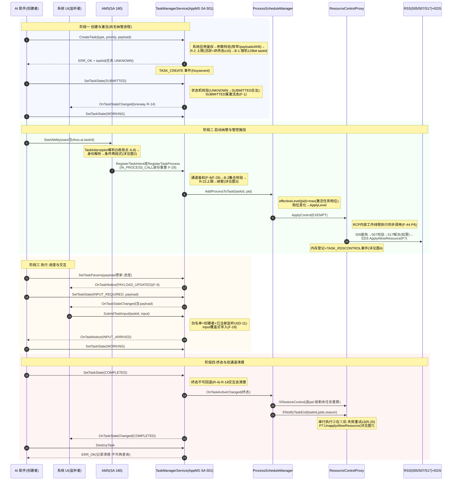
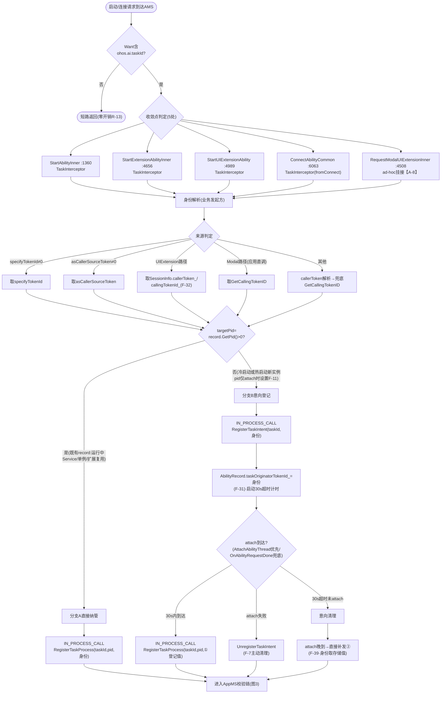
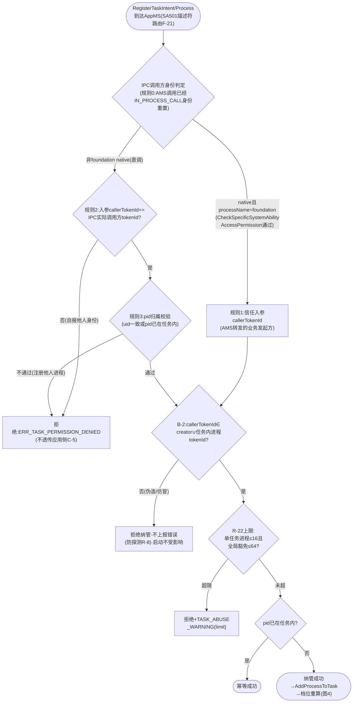
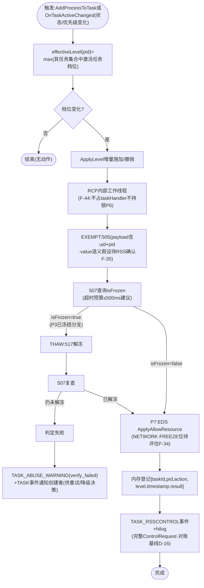
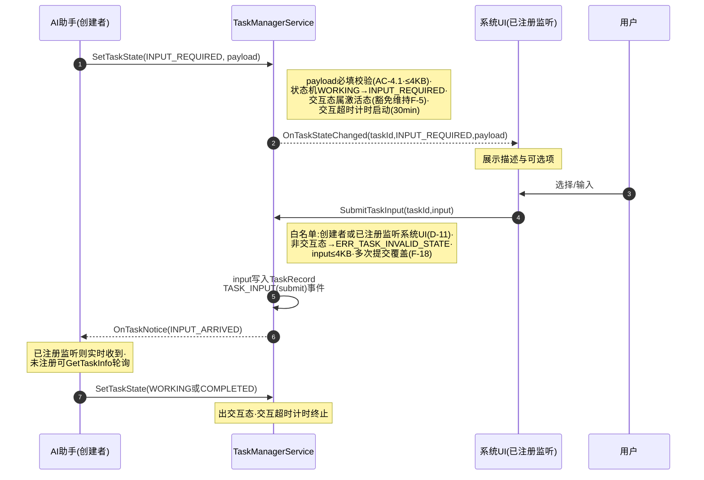
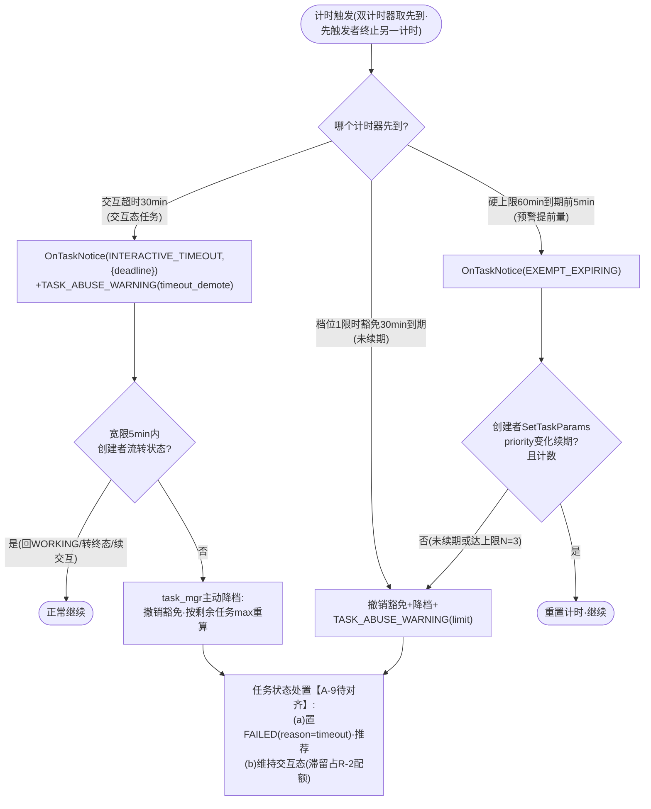
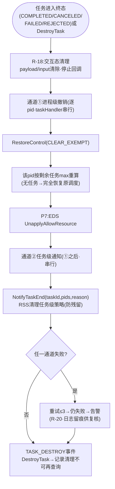
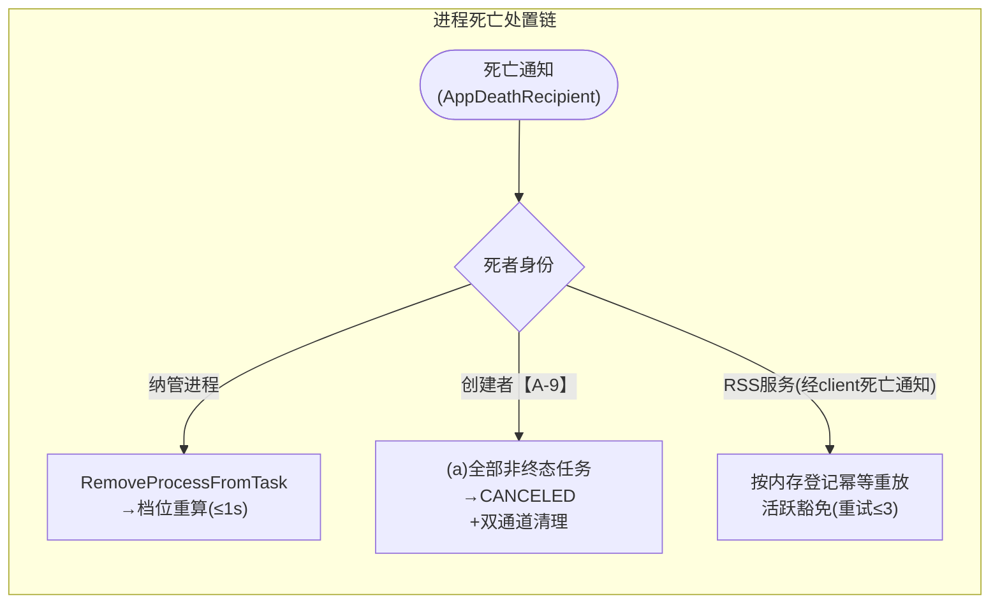

# 详细流程图集（AI 任务管理机制）

> 生成：2026-08-26 · 依据：design.md（十七轮评审后状态，F-1~F-46 全部修复）
> 约定：图中标注规则（R-x）/发现（F-x）/决策（D-x）出处；**A-8（拦截器混合方案）/A-9（滞留任务处置）为待用户对齐项，图中以【A-8】【A-9】标记**；Mermaid 渲染于 GitCode/GitLab markdown 预览。

## 图 0：流程图索引

| 图 | 流程 | 类型 | 关键决策点 |
|----|------|------|-----------|
| 图 1 | 任务生命周期主流程（端到端） | 时序图 | 创建→激活→纳管→管控→交互→终态→清理 |
| 图 2 | 启动链路拦截与条件两段式纳管 | 决策流程图 | 5 收敛点/身份解析/targetPid 分支/attach 补注册 |
| 图 3 | 通道鉴权与 B-2 校验（AppMS 侧） | 决策流程图 | 规则 0~4/集合校验/上限/幂等 |
| 图 4 | 档位计算与豁免施加（P3 生效校验环） | 决策流程图 | 档位合并/505→507→517/EDS P7/线程模型 |
| 图 5 | INPUT/AUTH 交互传达（HITL） | 时序图 | payload 下发/白名单回传/INPUT_ARRIVED |
| 图 6 | 超时处置与续期（F-5 两段式+双计时器） | 决策流程图 | 交互超时/限时豁免/硬上限/续期 N=3 |
| 图 7 | 任务结束双通道清理 | 决策流程图 | 进程级撤销→任务级通知/重试 |
| 图 8 | 异常场景处置矩阵 | 表+流程 | 进程死亡/创建者死亡/RSS 重启/AppMS 重启 |

---

## 图 1：任务生命周期主流程（端到端时序）

**分步说明**

| 步骤 | 参与方 | 动作 | 依据 | 失败路径 |
|------|--------|------|------|----------|
| 1 | AI→TMS | CreateTask | R-1/R-2/B-1 | 非系统应用→ERR_TASK_PERMISSION_DENIED；参数非法→ERR_INVALID_PARAM；达上限→ERR_TASK_LIMIT_EXCEEDED |
| 2 | AI→TMS | SetTaskState(SUBMITTED) | R-3/状态机表 | 非法流转→ERR_TASK_INVALID_STATE_TRANSITION |
| 3 | AI→AMS | StartAbility(want+taskId) | R-7/R-13 | 无 taskId→原路径零开销 |
| 4 | AMS→TMS | 意向/进程注册（IN_PROCESS_CALL） | F-29 规则 0 | 通道鉴权/B-2 失败→拒绝纳管，启动不受影响（R-8） |
| 5 | TMS→PS | AddProcessToTask | ADR-5 | R-22 超限→拒绝+告警 |
| 6 | PS→RCP→EXT | 施加豁免+生效校验+EDS | R-19/P3/P7 | 未生效→告警+TASK 事件（图 4） |
| 7 | AI→TMS | SetTaskParams(payload) | F-9 | payload 超限→ERR_INVALID_PARAM |
| 8 | UI→TMS | SubmitTaskInput | R-17/D-11 | 白名单外→ERR_TASK_PERMISSION_DENIED；非交互态→ERR_TASK_INVALID_STATE |
| 9 | AI→TMS | SetTaskState(COMPLETED) | R-4/R-9 | — |
| 10 | PS→RCP | 双通道清理 | R-20 | 失败重试≤3+告警（图 7） |

---

## 图 2：启动链路拦截与条件两段式纳管（决策流程）

**分步说明**

| 步骤 | 动作 | 依据 | 备注 |
|------|------|------|------|
| 1 | Want 解析 taskId | R-13 | 无 taskId 短路，不产生任何副作用 |
| 2 | 收敛点判定 | F-22/D-20 | 4 点走 TaskInterceptor（A-8 待评审），Modal 单点 ad-hoc |
| 3 | 身份解析 | F-32/C-2 | UIExtension 必须取 SessionInfo（GetCallingTokenID=sceneboard 必被 B-2 拒） |
| 4 | targetPid 判定 | F-11 | pid 仅 attach 时设置（ability_record.cpp:1096，全库唯一路径） |
| 5a | 分支 A 直接纳管 | ADR-3 | 既有 record 场景，一次动作 |
| 5b | 分支 B 意向登记 | ADR-3/F-31 | 身份存入 AbilityRecord（新增字段） |
| 6 | attach 补注册 | §5.4.2 | 身份取①登记值（非 attach 现场 GetCallingTokenID，§5.3.1⑧） |
| 7 | attach 失败清理 | F-7 | 避免意向残留 30s |
| 8 | attach 晚于超时 | F-39 | 直接补发②（pid 已就绪，重发①无意义） |

---

## 图 3：通道鉴权与 B-2 校验（AppMS 侧）

**分步说明**

| 步骤 | 判定 | 依据 | 攻击面闭环 |
|------|------|------|-----------|
| 0 | 通道身份 | F-29 规则 0 | 不包装则 attach/代理启动链路断裂（身份透传机制） |
| 1 | foundation native 信任 | F-29 规则 1 | 裸 IsSACall 可被其他进程 native SA 绕过，故必须 processName 校验 |
| 2 | 入参=实际身份 | F-8 规则 2 | 杜绝系统应用直调自报 creatorTokenId |
| 3 | pid 归属 | F-8 规则 3 | 防注册他人进程骗取豁免 |
| 4 | B-2 集合 | R-8/B-2 | taskId 伪造（B-1 随机性）+ 非信任链身份 |
| 5 | 上限 | R-22 | 链式纳管膨胀/全局豁免滥用 |

---

## 图 4：档位计算与豁免施加（P3 生效校验环）

**分步说明**

| 步骤 | 动作 | 依据 | 备注 |
|------|------|------|------|
| 1 | 档位合并 | ADR-5/R-10 | 多任务归属按 max |
| 2 | 增量动作 | R-11 | 同 pid 同类型豁免幂等（幂等键 taskId+pid+类型，计数在 process_schedule） |
| 3 | 线程模型 | F-44/P6 | 同步调用移出串行线程，结果回投 taskHandler |
| 4 | 施加顺序 | P3 | 固定 EXEMPT→507→THAW→507 复查 |
| 5 | EDS 联动 | P7/F-30 | 依赖 standby_innerkits（plan 已列）；native 免权限 |
| 6 | 登记+事件 | D-16/R-19 | 内存登记仅活跃任务（重放+撤销重试依据）；审计走日志 |
| 7 | 失败处置 | §6.1.1-2 | 施加失败告警+事件（撤销失败才重试≤3，见图 7） |

---

## 图 5：INPUT/AUTH 交互传达（HITL）

**分步说明**

| 步骤 | 动作 | 依据 | 失败路径 |
|------|------|------|----------|
| 1 | 进入交互态 | R-16 | payload 缺失→ERR_INVALID_PARAM |
| 2 | 回调携带 payload | R-14 | 监听者死亡自动移除（DeathRecipient） |
| 3 | 回传 input | R-17/D-11 | 白名单外→ERR_TASK_PERMISSION_DENIED（AC-4.4） |
| 4 | 通知创建者 | D-11 | 未注册监听→轮询兜底 |
| 5 | 流转出交互态 | R-17 | 任务被取消/销毁→R-18 清理不再回调 |

---

## 图 6：超时处置与续期（F-5 两段式+双计时器）

**分步说明**

| 步骤 | 动作 | 依据 | 备注 |
|------|------|------|------|
| 1 | 双计时器取先到 | F-5/§6.1 | 交互态同时存在交互超时与豁免计时，先到者处置即终止另一计时 |
| 2 | 限期处置通知 | F-5 第 1 步 | 创建者注册监听则实时感知宽限窗口 |
| 3 | 宽限后降档 | F-5 第 2 步 | 后续助手回 WORKING 时经 P3 分支重新施加 |
| 4 | 滞留任务处置 | F-43/A-9 | **待用户对齐**：(a) 窄口径系统流转（触碰 D-6 边界）；(b) 接受滞留 |
| 5 | 续期 | R-21/D-13 | 仅 priority 变化触发（payload-only 不续期）；N=3 已确认 |
| 6 | 各参数 | §6.1 | 30/5/30/60/5min 与 N=3 均已确认（2026-08-26），persist.sys.appms.taskmanager.* 可调（F-37） |

---

## 图 7：任务结束双通道清理

**分步说明**

| 步骤 | 动作 | 依据 | 备注 |
|------|------|------|------|
| 1 | 交互态清理 | R-18 | 在状态机终态处理中同步完成 |
| 2 | 进程级撤销 | R-9/R-20 | 多任务归属按剩余最高档继续管控（AC-5.4） |
| 3 | 任务级通知 | R-20/§6.4 | ②在①之后串行执行 |
| 4 | 失败重试 | R-20 | ≤3 次后告警，日志留痕（对账基线=动作日志序列） |

---

## 图 8：异常场景处置矩阵

| # | 场景 | 检测机制 | 处置流程 | 依据 |
|---|------|----------|----------|------|
| 1 | 纳管进程死亡 | AppMS 既有 AppDeathRecipient 链 | RemoveProcessFromTask → 释放豁免 → 档位按剩余任务重算（延迟 ≤1s） | R-12 |
| 2 | 创建者进程死亡 | 复用 AppDeathRecipient（创建者 uid/tokenId 已知） | 【A-9 待对齐】(a) 该创建者全部非终态任务置 CANCELED + 双通道清理（推荐）；(b) 任务滞留（占配额，创建者重启可恢复） | F-43 |
| 3 | RSS（SA 1901）重启 | suspend_manager_base_client 内置死亡通知 | 按内存登记幂等重放全部活跃豁免（重放失败重试 ≤3+告警）；二期 push observer 漂移检测 | P4 |
| 4 | AppMS/foundation 重启 | — | foundation 重启清理全部应用进程，任务记录（内存态）与 RSS 侧豁免随进程消亡同亡，无孤儿豁免 | C-1 |
| 5 | master 无 freezer 执行插件 | — | 505/517/520 上报被丢弃、507 恒 false（假成功）——模块级验证以 Stub 动作日志断言为唯一基线；端到端验证前置=产品含执行插件 | P1/F-23 |
| 6 | 意向超时（30s 未 attach） | task_mgr 定时器 | 意向清理；attach 晚到直接补发② | F-39 |
| 7 | attach 失败（进程启动失败） | attach 失败回调 | 主动 UnregisterTaskIntent | F-7 |
| 8 | 监听者死亡 | DeathRecipient | 注册表自动移除，不再派发 | R-14 |

---

## 附：与既有三张 SVG 的关系

| 文件 | 定位 | 关系 |
|------|------|------|
| architecture_overview.svg | 对外总览（背景/方案/修改点） | 宏观视图，不体现步骤 |
| module_design.svg | 三模块类图式设计 | 静态结构 |
| task_flow.svg | 泳道时序简图 | 主流程简化版 |
| **本文档** | **分步详细流程（含决策分支/失败路径/规则追溯）** | 十七轮评审后全量细化，含图 2~图 8 七个 SVG 未覆盖的流程 |

*本文档为设计文档的流程视图补充；机制细节以 design.md 为准，冲突时以 design.md 为准并回改本文档。*
