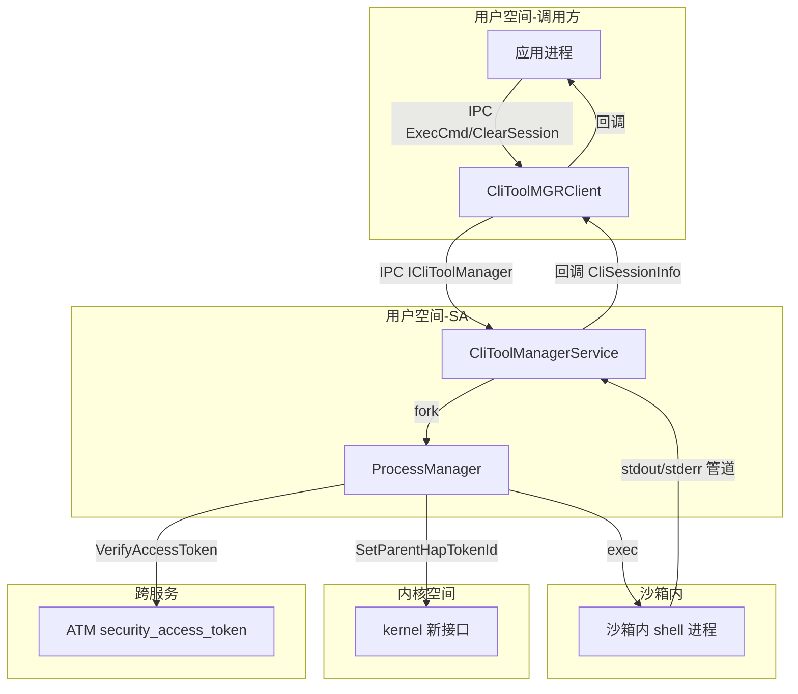

# 威胁模型分析

## 变更范围概述

> 来自 proposal.md 的变更摘要，说明安全相关背景。

| 属性 | 值 |
|------|-----|
| 变更名称 | cli SA 沙箱 shell 命令执行与会话管理（FEAT-003-1） |
| 复杂度 | 标准 |
| 安全/权限维度 | 是 |
| 敏感数据处理 | 否（tokenId 为系统内部身份标识，非用户敏感数据） |

## 数据流图

### 信任边界说明

| 边界类型 | 边界描述 | 跨越的交互 |
|---------|----------|-----------|
| 进程边界 | 应用进程 ↔ CliToolManagerService SA | IPC ExecCmd/ClearSession/QuerySession/SendMessage |
| 用户态↔内核态 | ProcessManager ↔ kernel | SetParentHapTokenId 内核新接口调用 |
| 沙箱内外 | 沙箱内 shell ↔ CliToolManagerService | stdout/stderr 管道回收；stdin 注入 |
| 跨服务 | CliToolManagerService ↔ ATM | VerifyAccessToken 跨服务调用 |

## STRIDE 威胁分析

### ExternalEntity[应用进程]

| 威胁类型 | 威胁场景 | 影响 | 可能性 | 现有控制 | 建议控制 | 优先级 | 关联 AC/Task |
|---------|----------|------|--------|----------|----------|--------|-------------|
| Spoofing | 非法调用方冒充合法应用调用 ExecCmd | High | Med | 调用方身份/tokenId 校验 | 强化 IPC 调用方校验 | P1 | AC-1.1/AC-2.1/TASK-3 |

### Process[CliToolManagerService]

| 威胁类型 | 威胁场景 | 影响 | 可能性 | 现有控制 | 建议控制 | 优先级 | 关联 AC/Task |
|---------|----------|------|--------|----------|----------|--------|-------------|
| Elevation | 沙箱内 shell 进程以错误父身份运行 | High | Low | SetParentHapTokenId 固定顺序（先 ATM 后内核） | 保持顺序约束+审计 | P1 | AC-1.1/TASK-3 |
| DoS | 大量并发 session 耗尽资源 | Med | Med | 64KB 输出缓冲截断 | session 数量上限（后续） | P2 | TASK-2 |
| Tampering | sessionId 篡改操作他人 session | High | Low | sessionId 由系统生成 | 加强 sessionId 校验归属 | P2 | AC-2.3/TASK-4 |

### Store[(session 记录)]

| 威胁类型 | 威胁场景 | 影响 | 可能性 | 现有控制 | 建议控制 | 优先级 | 关联 AC/Task |
|---------|----------|------|--------|----------|----------|--------|-------------|
| Tampering | 并发清理竞态导致重复 kill/管道损坏 | Med | Med | TryClaimCleanup 原子认领 | 保持 CAS 不变量 | P1 | AC-2.3/TASK-2 |
| DoS | 输出无限累积导致 OOM | Med | Med | 64KB 缓冲上限截断 | 保持上限 | P2 | TASK-2 |

### Flow[IPC/管道]

| 威胁类型 | 威胁场景 | 影响 | 可能性 | 现有控制 | 建议控制 | 优先级 | 关联 AC/Task |
|---------|----------|------|--------|----------|----------|--------|-------------|
| Tampering | IPC payload 篡改 cmd/policy | High | Low | Parcel 序列化 | IPC 校验完整性 | P2 | TASK-1 |
| Info Disclosure | 输出含敏感信息泄露给非归属方 | Med | Low | sessionId 归属校验 | 输出脱敏 | P2 | TASK-2 |

## 威胁汇总

| 优先级 | 威胁数量 | 威胁 ID 列表 | 处理要求 |
|--------|----------|-------------|----------|
| P0 | 0 | - | - |
| P1 | 3 | TH-001(Spoofing)、TH-002(Elevation)、TH-003(并发清理) | 本次变更应解决或制定明确计划 |
| P2 | 4 | DoS(session/输出)、Tampering(sessionId/IPC)、Info Disclosure | 可后续优化或接受风险 |

### 高优先级威胁详细说明

#### TH-001: 非法调用方冒充合法应用调用 ExecCmd

**威胁类型**: Spoofing
**目标元素**: ExternalEntity[应用进程]
**攻击场景**: 非法进程通过 IPC 直接调用 CliToolManagerService ExecCmd，冒充合法应用执行任意 shell 命令
**影响**: 任意命令在应用沙箱内执行，可窃取/破坏数据
**验证方法**: 非法调用方调用 ExecCmd 应返回 ERR_PERMISSION_DENIED
**缓解措施**: IPC 调用方身份校验 + tokenId 校验（TASK-3 PermissionUtil::VerifyAccessToken）

#### TH-002: 沙箱内 shell 以错误父身份运行

**威胁类型**: Elevation
**目标元素**: Process[CliToolManagerService]/Shell
**攻击场景**: tokenId 设置顺序错误或缺失，沙箱进程以过高权限父身份运行
**影响**: 权限提升
**验证方法**: fork 后 parentHapTokenId 被正确设置（内核侧验证）
**缓解措施**: 固定顺序——先 ATM VerifyAccessToken 再 SetParentHapTokenId（TASK-3）

#### TH-003: 并发清理竞态导致重复 kill/管道损坏

**威胁类型**: Tampering
**目标元素**: Store[session 记录]
**攻击场景**: ClearSession 与进程退出并发，多个 owner 同时 kill/关管道
**影响**: 资源损坏/双重释放
**验证方法**: 并发 ClearSession 仅一个 owner 执行
**缓解措施**: TryClaimCleanup 原子 CAS 认领（TASK-2）

---

## 法规合规检查

### 个人信息保护法

| 检查项 | 要求 | 状态 | 证据/措施 | 关联 AC/Task |
|--------|------|------|-----------|-------------|
| 最小必要原则 | 仅收集功能必需的数据 | ✅ | 仅执行命令，不收集个人信息 | - |
| 知情同意 | 明确告知用户并获得同意 | N/A | 系统能力，非用户数据收集 | - |
| 匿名化/去标识化 | 提供技术方案 | N/A | 不涉及个人信息 | - |
| 用户权利 | 支持访问/更正/删除 | N/A | 不涉及 | - |
| 数据处理规则 | 公开处理规则 | N/A | 不涉及 | - |

### 数据安全法

| 检查项 | 要求 | 状态 | 证据/措施 | 关联 AC/Task |
|--------|------|------|-----------|-------------|
| 数据分类分级 | 按敏感度分类并保护 | ✅ | tokenId 为系统内部标识，非敏感数据 | TASK-3 |
| 数据出境安全 | 评估并通过 | N/A | 无数据出境 | - |

### 网络安全法

| 检查项 | 要求 | 状态 | 证据/措施 | 关联 AC/Task |
|--------|------|------|-----------|-------------|
| 等级保护 | 满足对应等级保护要求 | ✅ | 遵循 OHOS 安全模型 | TASK-3 |
| 关键信息基础设施 | 特殊保护措施 | N/A | 不适用 | - |

### GDPR（如适用）

| 检查项 | 要求 | 状态 | 证据/措施 | 关联 AC/Task |
|--------|------|------|-----------|-------------|
| Lawful Basis | 明确处理法律依据 | N/A | 不涉及个人数据 | - |
| Data Subject Rights | 支持用户权利请求 | N/A | 不涉及 | - |
| DPIA | 高风险处理需做评估 | N/A | 不涉及 | - |

### 合规差距汇总

| 法规 | 差距项 | 影响 | 缓解计划 | 关联 Task |
|------|--------|------|----------|-----------|
| - | 无合规差距 | - | - | - |

## 风险与缓解

| 风险/威胁 ID | 类型 | 可能性 | 影响 | 缓解措施 | 验证方法 | 关联 Task | 状态 |
|-------------|------|--------|------|----------|----------|-----------|------|
| TH-001 | Spoofing | Med | High | IPC 身份+tokenId 校验 | 非法调用返回权限错误 | TASK-3 | Done |
| TH-002 | Elevation | Low | High | tokenId 固定顺序 | 内核侧验证 | TASK-3 | Done |
| TH-003 | Tampering | Med | Med | TryClaimCleanup CAS | 并发清理唯一 owner | TASK-2 | Done |

## 安全验证计划

| 验证项 | 验证方法 | 预期结果 | 关联 Task |
|--------|----------|----------|-----------|
| 未授权调用 | 非法调用方 ExecCmd | 返回 ERR_PERMISSION_DENIED | TASK-3 |
| tokenId 链路 | 内核侧验证 parentHapTokenId | 已正确设置 | TASK-3 |
| 并发清理 | 并发 ClearSession | 唯一 owner | TASK-2 |

## 安全建议

### 设计阶段建议

- tokenId 设置顺序固定并代码注释约束。
- session 状态机显式建模，清理用原子认领。

### 实现阶段建议

- IPC 调用方身份校验不可绕过。
- 输出缓冲上限防 OOM。

### 测试阶段建议

- 覆盖未授权调用、并发清理、超时、输出超限场景。

## 附录：威胁建模方法论

### STRIDE 方法论

STRIDE 是微软开发的威胁建模方法，涵盖六大威胁类型：

- **Spoofing（伪装）**: 攻击者冒充合法用户或组件
- **Tampering（篡改）**: 数据或代码被未授权修改
- **Repudiation（抵赖）**: 用户否认其操作
- **Information Disclosure（信息泄露）**: 敏感信息暴露给未授权方
- **Denial of Service（拒绝服务）**: 服务可用性被破坏
- **Elevation of Privilege（权限提升）**: 攻击者获得更高权限

### DFD 元素与威胁对应

| DFD 元素 | 适用威胁类型 |
|---------|-------------|
| External Entity | Spoofing, Repudiation |
| Process | Spoofing, Tampering, Repudiation, Information Disclosure, DoS, Elevation |
| Data Store | Tampering, Information Disclosure, DoS |
| Data Flow | Spoofing, Tampering, Repudiation, Information Disclosure, DoS |
