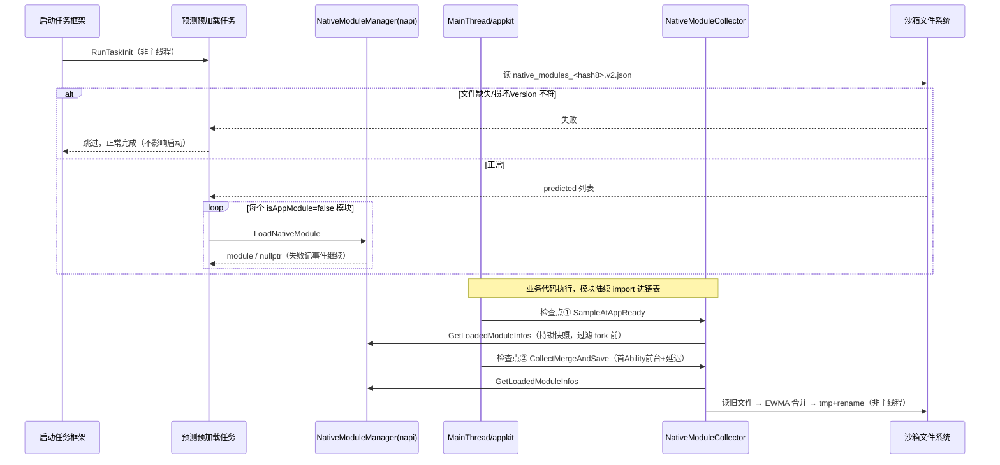
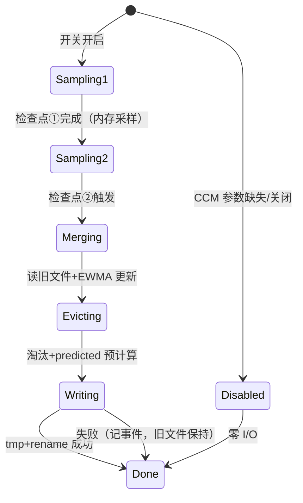

# 架构设计

> 确认目标仓和模块的架构约束、关键设计决策、Spec 拆分方向。
> 用户可见行为与 AC 以 spec.md 为准，本文档只描述实现路径，不发明行为。

## 设计元数据

| 字段 | 内容 |
|------|------|
| Design ID | DESIGN-draft-20260728 |
| 关联需求 | `proposal.md`（基线 v1.0，2026-07-28 冻结） |
| 关联 Epic | 无 |
| 目标 Feature | draft-20260728 |
| 复杂度 | 标准 |
| 目标版本 | 引用 proposal.target_release（OpenHarmony-7.1-Release） |
| Owner | yangzk |
| 状态 | Reviewing |

## 需求基线

> 需求基线详见 proposal.md。以下仅列出设计阶段需要额外强调的要点。

| 项 | 补充说明（如需） |
|----|------------------|
| Q-1 消费方 = 启动框架预加载系统 so | 消费侧限定 predicted 中 isAppModule=false 的系统模块；应用模块预加载不在本期 |
| Q-4 不计入 preload 模块 | 需要 fork 前快照机制区分"fork 前已加载"与"fork 后显式 import" |
| 自反馈回路（风险表） | 消费方预加载的模块不得计为应用真实 import 命中，需要加载计数区分 |
| Q-2 CCM 参数缺省关闭 | 开关读取结果本轮启动内缓存，避免重复读参 |

## 上下文和现状

### 涉及仓和模块

> 仓、模块、当前职责、影响类型详见 proposal.md"影响范围"。本节补充设计层面的架构现状。

| 仓库 | 补充架构说明 |
|------|-------------|
| arkui/napi | `module_manager/NativeModuleManager` 为进程内单例，模块链表（head/tailNativeModule_）私有且有内部锁保护；`NativeModule` 节点含 `refCount` 字段（native_module_manager.h:68）。本仓为 ability_runtime 的既有编译依赖（js_runtime.cpp 等已引用其头文件） |
| ability_runtime | 启动流程：AppSpawn fork → MainThread::Attach → HandleLaunchApplication → Runtime::Create → PerformAppReady（APP_STATE_READY）；`app_startup` 提供启动任务编排框架，`PreloadSystemSoStartupTask`（preload_system_so_startup_task.cpp:77）已示范"非主线程 + LoadNativeModule 预加载系统 so + 故障事件上报"模式；`ETSRuntime::PreFork/PostFork` 为 fork 前后锚点；`Context::GetCacheDir()`（context_impl.cpp:167）提供沙箱 cache 路径 |

### 调用链层级分析

| 层 | 模块 | 职责 | 修改类型 |
|----|------|------|----------|
| NAPI 库（arkui/napi） | NativeModuleManager | 模块注册/加载管理；新增已加载模块枚举接口 | 修改 |
| 框架层-运行时（ability_runtime） | ETSRuntime（PreFork/PostFork） | fork 前模块快照记录 | 修改 |
| 框架层-appkit（ability_runtime） | native_module_collector（新增） | 双检查点采样、EWMA 合并、原子写盘、开关判定 | 新增 |
| 框架层-appkit（ability_runtime） | application_impl / main_thread | 检查点①②触发接入 | 修改 |
| 框架层-app_startup（ability_runtime） | 预测预加载启动任务（新增） | 启动早期读 predicted、预加载系统 so、故障上报 | 新增 |

**检查项：**
- [x] 调用链每一层都已覆盖（NAPI 库 → 运行时 → appkit → app_startup；无服务层/内核层变更）
- [x] 每层职责边界清晰，无跨层违规调用（全部为用户态应用进程内调用，框架层 → NAPI 库为既有编译期依赖方向）
- [x] 每层修改类型明确

### 适用架构规则

| Rule ID | 适用原因 | 设计结论 | 验证方式 |
|---------|----------|----------|----------|
| OH-ARCH-LAYERING | 涉及层级调用 | 应用进程内：appkit → 运行时 → NAPI 库，单向向下，无反向依赖、无跨层跳转 | 架构评审/依赖检查 |
| OH-ARCH-SUBSYSTEM | 跨子系统（元能力 → ArkUI/NAPI） | 允许：napi 为 ability_runtime 既有编译依赖（bundle.json 已声明），仅新增头文件接口使用 | 代码评审/依赖检查 |
| OH-ARCH-IPC-SAF | 是否跨进程 | 不涉及：进程内闭环，无 IPC/SAF | 集成测试 |
| OH-ARCH-API-LEVEL | 涉及 API 变更 | 仅 InnerAPI（C++ 内部接口）；无 Public/System API、无 d.ts、无 SysCap、无权限 | API 评审 |
| OH-ARCH-COMPONENT-BUILD | 涉及构建 | 两仓各新增/修改源文件与 BUILD.gn；bundle.json 无变更（依赖关系不变） | 构建验证 |
| OH-ARCH-ERROR-LOG | 涉及错误码/日志 | 复用 AAFwkTag（JSRUNTIME/STARTUP/APP 等）HiLog；故障复用 EventReport::SendLaunchFrameworkEvent(STARTUP_TASK_ERROR) 模式 | 单测/hilog |

## 不涉及项承接

> proposal.md 已完成 N/A 判定。本节仅对 proposal 中标记为"涉及"且需展开设计的维度给出结论。

| 维度 | 设计结论 |
|------|----------|
| 性能 | 开关判定结果进程内缓存；两次采样为持锁遍历链表的纯内存操作；合并+写盘投递非主线程，每轮启动至多 1 次；预加载在非主线程启动任务中执行 |
| 安全与权限 | 见「可选设计扩展 → 安全基础检查」（proposal 判定 = 是） |
| 兼容性 | 文件格式带 version 字段；解析失败/版本不符丢弃重建；开关缺省关闭保证存量行为不变 |
| API/SDK | 仅新增 InnerAPI（见「API 签名、Kit 与权限」） |
| 构建与部件 | 见「构建系统影响」：BUILD.gn 新增源文件，无 bundle.json 变更 |
| 数据迁移 | 新增文件无历史数据；version 演进策略：不兼容变更递增后缀（.vN.json），旧版本文件按"version 不符"路径丢弃重建 |

## 关键设计决策

| 决策 ID | 问题 | 推荐方案 | 探索过的替代方案 | 取舍理由 | 影响 |
|---------|------|----------|-----------------|----------|------|
| ADR-1 | 采集方式 | 检查点快照拉取：新增枚举接口，检查点一次性拉取链表快照（proposal 方案探索 A-1） | A-2 加载路径逐条钩子（热路径每次加载有开销，放弃）；A-3 服务侧集中采集（需 IPC、越沙箱，放弃） | 零热路径侵入；失败不影响启动；实现面最小 | napi 仓新增接口（跨仓依赖） |
| ADR-2 | preload 模块排除（Q-4） | PreFork 时记录链表现有模块 key 集合（fork 前快照），采样时过滤快照内模块 | 计数偏移法（fork 前记录节点数，fork 后跳过前 N 个——unload 会错位，脆弱放弃）；按 isAppModule 过滤（fork 后也会加载系统模块，误伤放弃） | key 集合精确、对 unload/load 乱序鲁棒；内存代价小（仅 key 列表） | ETSRuntime::PreFork/PostFork 各加一处调用 |
| ADR-3 | 自反馈回路：消费方预加载不计命中 | NativeModuleInfo 携带 loadCount（=NativeModule.refCount 快照）；消费方本轮预加载集合 P 内存记录；命中判定：m ∈ 链表 且（m ∉ P 或 m.loadCount 较上轮增量 > 本轮 P 中预加载次数） | 接受自我强化（误判永不淘汰，放弃）；在 import 路径加埋点计数（侵入热路径，违反 ADR-1，放弃） | 旁路可读数据即可区分，不侵入加载路径 | 依赖 napi refCount 语义确认（风险表 RSK-2）；命中判定逻辑入 collector |
| ADR-4 | 写盘时机 | 检查点②（首个 UIAbility 前台 + 延迟）单次写盘；检查点①仅内存采样 | 双次写盘（①+②各一次，I/O 翻倍且①的内容必然被②覆盖，放弃）；进程退出时写（异常退出丢数据且退出路径不可靠，放弃） | ②覆盖启动关键+懒加载最全；每轮 1 次 I/O；崩溃丢单轮样本对 EWMA 影响可忽略 | 采样数据需在①②之间进程内持有 |
| ADR-5 | 预加载消费接入形态 | 新增独立启动任务（参照 PreloadSystemSoStartupTask 模式）：启动早期读文件、过滤系统模块、逐个 LoadNativeModule | 扩展 PreloadSystemSoStartupTask 配置源（其配置为静态 ohmUrl 列表，与动态文件源语义不同，混淆配置体系，放弃）；MainThread 直接调用（无任务编排与依赖管理能力，阻塞主线程风险，放弃） | 复用启动任务框架的非主线程执行、依赖编排、故障事件上报模式；动静态预加载源解耦 | app_startup 新增任务类型与注册 |
| ADR-6 | EWMA 参数 | α=0.4、阈值 0.5、淘汰 16 轮/0.05、上限 1024 为缺省值，支持系统参数调优 | 编译期常量（beta 标定需改代码重出版本，放弃） | beta 期按命中率上报标定参数，量产固化 | 参数读取与开关共用 CCM 通道 |

## 设计骨架

### 骨架范围

| 骨架项 | 目标 | 不包含 | 验证方式 |
|--------|------|--------|----------|
| API/接口骨架 | napi 仓 NativeModuleInfo 结构 + GetLoadedModuleInfos 签名 | EWMA、写盘、预加载逻辑 | 编译通过 + 空实现单测 |
| 模块骨架 | ability_runtime collector 类骨架（开关判定/路径拼接） + 启动任务类型注册 | 合并算法、故障注入 | 构建通过 |
| 测试骨架 | test/unittest 新测试 target + fixture（临时沙箱目录） | 全场景用例 | 最小用例通过 |

### 骨架 Spec 拆分

| Task ID | 目标 | 受影响文件 | AC |
|---------|------|------------|-----|
| TASK-SKELETON-1 | napi 枚举接口骨架（结构 + 签名 + 空实现） | arkui/napi module_manager/native_module_manager.h/.cpp | WHEN 调用 GetLoadedModuleInfos THEN 返回空列表且不报错（spec 接口场景 #2） |

## 后续 Task 拆分

> design.md 以 proposal.md 和已批准的 spec.md 为上游输入。本节描述 design 输出到 Plan 阶段的衔接信息。

| Task ID | 目标 | 受影响文件 | 依赖 |
|---------|------|------------|------|
| TASK-1 | napi 枚举接口实现（持锁遍历、深拷贝、含 loadCount）+ 接口单测 | arkui/napi module_manager/native_module_manager.{h,cpp} | TASK-SKELETON-1 |
| TASK-2 | collector 骨架：CCM 开关判定、cacheDir 路径与防冲突文件名、进程哈希 | ability_runtime frameworks/native/appkit/app/native_module_collector.{h,cpp} | design.md + spec.md Approved |
| TASK-3 | EWMA 合并引擎：读旧文件、命中/遗漏更新、淘汰、predicted 预计算、原子写盘 | 同 TASK-2 | TASK-1（快照结构）、TASK-2 |
| TASK-4 | 双检查点接入：PerformAppReady 采样、首 UIAbility 前台+延迟合并写盘 | frameworks/native/appkit/app/application_impl.cpp、main_thread.cpp 等 | TASK-3 |
| TASK-5 | PreFork 快照排除（ADR-2） | frameworks/native/runtime/ets_runtime.cpp | TASK-3 |
| TASK-6 | 预测预加载启动任务（ADR-5）：读文件、过滤系统模块、LoadNativeModule、故障上报 | frameworks/native/appkit/app_startup/ | TASK-2 |
| TASK-7 | 自反馈区分（ADR-3）：loadCount 命中判定 | native_module_collector.{h,cpp} | TASK-1、TASK-3、TASK-6 |
| TASK-8 | CCM 参数接入（开关 + EWMA 调优参数） | native_module_collector.{h,cpp} 等 | TASK-2 |
| TASK-9 | TDD 用例齐套（spec 验证映射 VM-1~VM-11）+ beta 命中率上报 | test/unittest/native_module_collector_test/ 等 | TASK-3~TASK-8 |

## API 签名、Kit 与权限

> 承接 spec.md"API 变更分析"。

### 新增 API

| API 签名 | 类型 | Kit | d.ts 位置 | 权限要求 | SysCap |
|----------|------|-----|-----------|----------|--------|
| `void OHOS::NativeModuleManager::GetLoadedModuleInfos(std::vector<NativeModuleInfo>& infos)` | InnerApi | 无（C++ 内部接口，头文件 arkui/napi module_manager/native_module_manager.h） | 无 | -（进程内调用） | - |
| `struct OHOS::NativeModuleInfo { std::string name; std::string moduleName; std::string fileName; int32_t version; uint32_t loadCount; bool isAppModule; bool moduleLoaded; }` | InnerApi | 同上 | 无 | - | - |

实现约束：持模块管理器内部锁遍历链表；先清空 infos 再填充；字符串深拷贝（内部节点可能随 UnloadNativeModule 失效）；loadCount 取 NativeModule.refCount 快照。

### 变更/废弃 API

无。

## 构建系统影响

### BUILD.gn 变更

```
文件路径: foundation/ability/ability_runtime/frameworks/native/appkit/app/BUILD.gn
变更说明: sources 新增 native_module_collector.cpp（既有 target 内，napi 头文件依赖已存在，无需新增 deps）
```

```
文件路径: foundation/ability/ability_runtime/frameworks/native/appkit/app_startup/BUILD.gn（或所属 BUILD.gn）
变更说明: sources 新增预测预加载启动任务源文件
```

```
文件路径: foundation/arkui/napi/module_manager/BUILD.gn
变更说明: 无新增源文件（native_module_manager.cpp 内实现）；如拆新文件则 sources 新增
```

```
文件路径: foundation/ability/ability_runtime/test/unittest/BUILD.gn（按仓内 TDD target 惯例）
变更说明: 新增 native_module_collector_test 测试 target
```

### bundle.json 变更

无。napi 为 ability_runtime 既有依赖，不新增 component、不修改依赖关系。

---

## 可选设计扩展

### 架构图

```
应用进程（每轮启动）
┌──────────────────────────────────────────────────────────────────┐
│ [app_startup] 预测预加载任务（启动早期，非主线程）                  │
│   读 cacheDir/.ohos.ability_runtime/native_modules_<hash8>.v2.json│
│   → predicted 中 isAppModule=false → LoadNativeModule 预加载      │
│                                                                    │
│ [runtime] ETSRuntime::PreFork ──记录 fork 前模块快照──┐            │
│                                                        │            │
│ 业务 import → ArkNativeEngine → [napi] NativeModuleManager 链表   │
│                                                        │            │
│ [appkit] 检查点① PerformAppReady：采样（过滤 fork 前快照）          │
│ [appkit] 检查点② 首Ability前台+延迟：补采                            │
│   → EWMA 合并（loadCount 区分消费方预加载）→ 淘汰 → predicted       │
│   → 非主线程原子写同一 JSON 文件（每轮 ≤1 次）                       │
└──────────────────────────────────────────────────────────────────┘
```

### 数据流/控制流

| 步骤 | 调用方 | 被调用方 | 数据/接口 | 说明 |
|------|--------|----------|-----------|------|
| 1 | 预测预加载任务 | 文件系统 | 读 JSON（不存在/损坏→跳过） | 启动早期，非主线程 |
| 2 | 预测预加载任务 | NativeModuleManager | LoadNativeModule(系统模块) | 单模块失败记事件继续 |
| 3 | ETSRuntime::PreFork | NativeModuleManager | GetLoadedModuleInfos → 记录 key 快照 | fork 前 |
| 4 | 应用 JS/ETS 代码 | ArkNativeEngine → NativeModuleManager | import / requireNapi | 既有行为，不改动 |
| 5 | application_impl（检查点①） | collector | SampleAtAppReady() | 内存采样，过滤 fork 前快照 |
| 6 | main_thread（检查点②） | collector | CollectMergeAndSave() | 补采 → 合并 → 投递非主线程写盘 |
| 7 | collector | 文件系统 | tmp 写 + rename | 每轮 ≤1 次 |

### 时序设计



### 数据模型设计

内存结构（collector 侧）：

```cpp
struct ModuleStat {
    std::string fileName;       // so 路径
    bool isAppModule = false;
    float score = 0.0f;         // EWMA 评分 [0,1]
    uint32_t hits = 0;          // 累计命中轮数
    uint32_t lastSeenLaunch = 0;// 最后命中启动序号
    uint8_t firstStage = 0;     // 0=app_ready, 1=late
};
// 全量状态：std::map<std::string /*moduleName*/, ModuleStat>
```

持久化格式（native_modules_<processHash8>.v2.json，与 spec R-11 命名一致）：

```json
{
  "version": 2,
  "bundleName": "com.example.app",
  "processName": "com.example.app",
  "appVersionCode": 1000000,
  "launchIndex": 42,
  "updatedAt": 1753507200000,
  "scenario": "launcher",
  "predicted": ["ohos.hilog", "entry"],
  "modules": [
    { "moduleName": "ohos.hilog", "fileName": "/system/lib64/module/libhilog.z.so",
      "isAppModule": false, "score": 0.98, "hits": 41,
      "lastSeenLaunch": 42, "firstStage": "app_ready" }
  ]
}
```

**存储方案：**

| 数据类型 | 存储方式 | 位置 | 生命周期 |
|----------|----------|------|----------|
| 模块评分状态 + 预测集 | JSON 文件（tmp+rename 原子写） | `<cacheDir>/.ohos.ability_runtime/native_modules_<processHash8>.v2.json`，权限 0600 | 持久化；允许被缓存清理，清理后冷启动重建 |
| fork 前模块快照 | 进程内存（key 集合） | ETSRuntime 持有 | 进程生命周期 |
| 本轮消费方预加载集合 P | 进程内存 | 预加载任务 → collector | 本轮启动内 |

### 算法与状态机

每轮启动的 collector 状态机：



EWMA 合并伪代码（spec R-3/R-4/R-5/R-9 的实现侧）：

```cpp
// 输入：本轮集合 S（已过滤 fork 前模块，带 loadCount）、
//       本轮消费方预加载集合 P（含各模块预加载次数）、
//       历史 stats（map<moduleName, ModuleStat>）、launchIndex n
for (m in S) {
    if (m in P && (m.loadCount - prevLoadCount[m]) <= P[m].preloadTimes) {
        continue;  // 仅被消费方预加载、无真实 import 证据：本轮不更新（spec R-9）
    }
    stats[m].score = ALPHA + (1 - ALPHA) * stats[m].score;   // 命中奖励
    stats[m].hits++; stats[m].lastSeenLaunch = n;
}
for (m in stats 但 m 不在 S) {
    stats[m].score = (1 - ALPHA) * stats[m].score;           // 遗漏衰减
}
// 淘汰：score < 0.05 或 n - lastSeenLaunch >= 16；总量 > 1024 按 score 升序淘汰
// predicted = { m | score >= 0.5 }，随文件预计算输出
```

### 测试性设计

| 测试层级 | 测试目标 | Mock 策略 | 验证方式 |
|----------|----------|-----------|----------|
| 单元测试 | collector 合并/淘汰/重建/原子写/命名/开关 | 临时目录作沙箱；注入构造的 ModuleStat 与快照列表；模拟损坏 JSON/权限失败 | `run -t UT -ts native_module_collector_test` |
| 单元测试 | napi 枚举接口 | 注册构造模块后调接口验证快照一致性与深拷贝 | napi 仓对应 UT |
| 单元测试 | 预加载任务 | Mock 文件内容与 LoadNativeModule 结果（成功/失败/缺失） | 同上 UT target |
| 集成测试 | 端到端：启动 demo 应用两轮，验证文件内容与 predicted 收敛 | 真实设备、debug 构建开开关 | 设备实测 + 比对 /proc/self/maps |

### 线程与并发模型

| 操作 | 发起线程 | 回调线程 | 跨进程边界 | 线程安全 | 重入约束 |
|------|----------|----------|------------|----------|----------|
| GetLoadedModuleInfos | 任意（采样：主线程） | 同步返回 | 否 | 模块管理器内部锁 | 允许重入 |
| 检查点①/②采样 | 主线程 | — | 否 | 快照为值拷贝，无共享状态 | 每轮启动各 1 次 |
| 合并 + 写盘 | 非主线程（任务投递） | — | 否 | 与读旧文件同线程串行；多进程由文件名哈希隔离 | 每轮启动 ≤1 次，禁止并发写同一文件 |
| 预加载任务 | 启动任务线程（非主线程） | 任务完成回调 | 否 | 只读文件；LoadNativeModule 自身线程安全 | 每轮启动 ≤1 次 |

**并发场景：**

| 场景 | 竞争对象 | 保护机制 | 预期行为 |
|------|----------|----------|----------|
| 采样与模块加载并发 | 模块链表 | 管理器内部锁 | 快照一致（含或不含某模块，无字段撕裂） |
| 写盘与下一轮读文件 | 同一 JSON 文件 | tmp+rename 原子替换 | 读者要么读到旧版要么新版，无残缺 |
| 多进程应用并发采集 | 沙箱目录 | 文件名含进程哈希，各写各的 | 互不覆盖 |
| 开关参数读取与启动热路径 | 系统参数 | 首轮判定后进程内缓存 | 不重复读参 |

### 安全基础检查

> proposal「不涉及项确认」的「安全与权限」= 是，本节展开。

#### 信任边界交叉分析

| 边界类型 | 跨越的交互 | 风险 | 约束 |
|---|---|---|---|
| 用户态/内核态 | 仅标准文件 I/O（open/write/rename/chmod） | 低 | 路径全部由框架内部拼接，不接受外部输入 |
| 沙箱内外 | 写本进程应用沙箱 cacheDir | 低 | 禁止跨沙箱路径；路径源自 Context::GetCacheDir，不拼接外部输入，无路径穿越面 |
| 本地/远程 | 无网络交互 | 无 | — |
| 不同 SELinux 域 | 应用进程域内读写自身沙箱 | 低 | 不越域；无需新增 SELinux 策略 |

#### 基础安全要求

| 检查项 | 结论 | 说明/措施 |
|---|---|---|
| 加密算法(OH 推荐) | N/A | 数据非敏感，不加密 |
| 密钥管理 | N/A | 不涉及 |
| 随机数 | N/A | 进程哈希用 FNV-1a（非安全用途，仅文件命名隔离） |
| 输入验证 | 是 | 读文件时校验 JSON 结构、version 字段、条目数上限（1024）、单字段长度上限（防畸形文件撑爆内存）；任一不满足按损坏丢弃重建 |
| 错误处理 | 是 | 采集/写盘/预加载失败均只记录日志与故障事件，不阻断启动（spec 架构约束） |
| 配置 | 是 | CCM 参数缺省关闭；参数读取失败按关闭处理 |
| 敏感数据处理(传输/存储/日志) | 是 | 内容仅模块名/路径/版本/统计计数（公开信息）；文件 0600 + 隐藏目录；日志不打印完整 JSON 内容 |

### 深度威胁分析(如需)

未产出 threat-model.md。判据核对：无敏感用户数据（模块路径为公开信息）、无网络暴露、无认证授权变更、非关键基础设施、写盘限于自身沙箱——不命中高风险判据，安全基础检查已覆盖。

## 风险和开放问题

| 项 | 类型 | 影响 | 处理方式 | Owner |
|----|------|------|----------|-------|
| RSK-1 napi 仓接口合入排期/形态分歧 | 架构/API | 高（阻塞 TASK-1/3/7） | 尽早与 napi owner 对齐本设计接口签名；备选：ability_runtime 侧以 dlopen 弱符号探测解耦（仅兜底） | yangzk + napi owner |
| RSK-2 refCount 语义未确认（cache 命中是否递增、Unload 后复位行为） | API | 中（影响 ADR-3 命中判定精度） | napi 仓确认；若语义不满足，降级方案：消费方预加载模块本轮一律不更新（不计命中也不衰减），牺牲少量精度 | yangzk + napi owner |
| RSK-3 CCM 参数名与下发通道未定 | 构建/配置 | 中 | design 评审时与 CCM/参数管理 owner 确认参数命名规范；读取失败按关闭处理 | yangzk |
| RSK-4 强场景分化应用预测准确度上限 | 架构 | 低 | beta 命中率上报标定；演进方向：scenario 分桶 | yangzk |

## 设计审批

- [x] 需求基线已确认，设计覆盖 P0/P1 AC（TASK-1~9 覆盖 spec AC-1.1~AC-4.2）
- [x] 不涉及项已承接，N/A 和展开项都有结论
- [x] 涉及仓和模块职责清楚
- [x] 调用链层级分析完整，每层覆盖到位
- [x] 适用架构规则已识别并形成设计结论
- [x] 分层和子系统边界合规（进程内闭环，无 IPC/越域）
- [x] API 变更有签名、权限、错误码和兼容性说明（InnerAPI，无错误码）
- [x] BUILD.gn/bundle.json 影响明确
- [x] 设计输出和后续 Task 拆分明确（TASK-SKELETON-1 + TASK-1~9）
- [x] 关键设计决策有理由和影响说明（ADR-1~6）
- [x] 风险和开放问题有 Owner（RSK-1~4）

**结论:** 通过（自评，待 Owner 评审确认）
