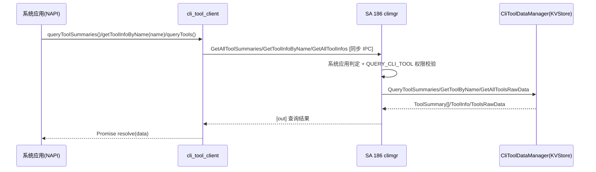
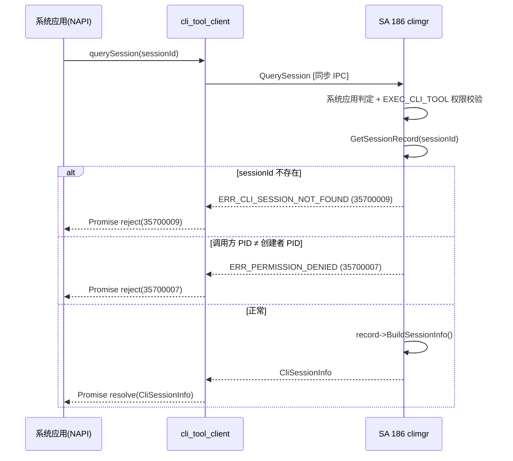
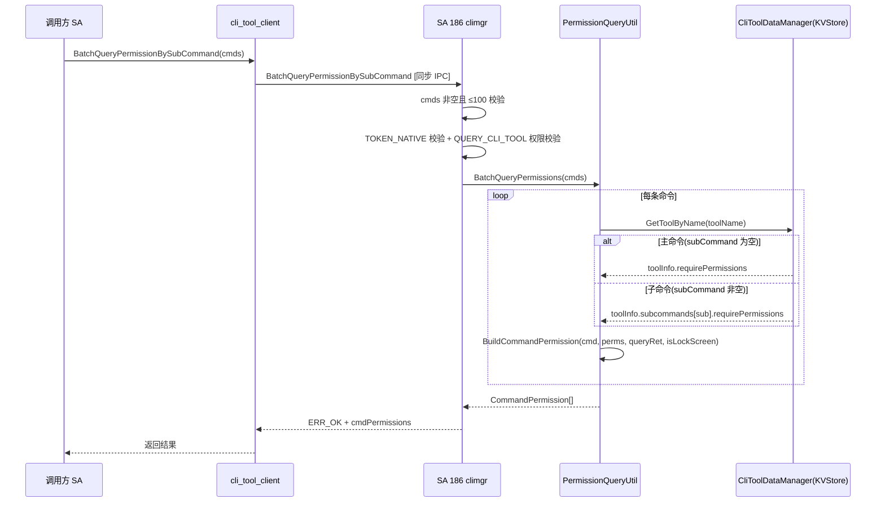

# 架构设计

> 本设计承接 `proposal.md`（条件通过）与 `spec.md`（Draft），固化 CLI 工具查询接口的架构约束、关键设计决策与模块影响。设计 AC ⊆ spec AC，不发明新行为。

## 设计元数据

| 字段 | 内容 |
|------|-----|
| Design ID | DESIGN-CLI-014 |
| 关联需求 | `proposal.md`（REQ-014） |
| 关联 Epic | 无（独立特性） |
| 目标 Feature | FEAT-CLI-014 |
| 复杂度 | 标准 |
| 目标版本 | OpenHarmony-7.0 |
| Owner | 待确认 |
| 状态 | Draft |

## 需求基线

> 需求基线详见 proposal.md。以下仅列出设计阶段需额外强调的要点。

| 项 | 补充说明 |
|----|----------|
| 系统应用 + QUERY_CLI_TOOL（工具查询） | 安全边界由 SA 186 入口统一执行，不在 NAPI 层做权限判定 |
| 系统应用 + EXEC_CLI_TOOL + PID 归属（会话查询） | 会话查询须额外校验调用方 PID 与会话创建者 PID 一致 |
| SA-only + QUERY_CLI_TOOL（批量权限查询） | 批量查询不做系统应用判定，仅校验 TOKEN_NATIVE |
| KVStore 只读查询 | 查询不修改数据；KVStore 未就绪返回 ERR_KVSTORE_NOT_READY/ERR_NO_INIT |

## 上下文和现状

### 涉及仓和模块

| 仓库 | 补充架构说明 |
|------|-------------|
| foundation/ability/ability_runtime | 服务层（services/）与 SDK 层（interfaces/kits/）解耦；cli_tool_framework 自成子系统，经 IDL 生成 IPC Stub/Proxy；服务侧依赖 `services/common` 的权限/日志/事件上报设施 |

### 调用链层级分析

| 层 | 模块 | 职责 | 修改类型 |
|----|------|------|----------|
| NAPI | `frameworks/js/napi/cli_tool_manager` | JS↔C++ 绑定：参数解析、同步校验、Promise/异步回调派发 | 修改（既有实现，固化契约） |
| InnerAPI/IPC | `interfaces/cli_tool`（IDL 生成） | `ICliToolManager` Proxy/Stub、Parcelable 数据结构（ToolSummary/ToolInfo/SubCommandInfo/CliSessionInfo/Command/CommandPermission） | 修改（既有实现，固化契约） |
| InnerAPI/IPC（客户端） | `interfaces/cli_tool/include/cli_tool_mgr_client.h` | `CliToolMGRClient` 单例：封装 IPC 调用、SA 按需拉起、DeathRecipient | 修改（既有实现，固化契约） |
| 服务 | `services/climgr` | SA 186 服务端：权限校验、KVStore 查询、会话查找、权限批量查询 | 修改（既有实现，固化契约） |
| 服务/数据 | `services/climgr/src/cli_tool_data_manager.cpp` | KVStore 工具注册表：只读查询方法（GetAllTools/GetAllToolsRawData/GetToolByName/QueryToolSummaries） | 修改（既有实现，固化契约） |
| 服务/工具 | `services/climgr/src/permission_query_util.cpp` | 批量权限查询工具类：逐命令查 KVStore | 修改（既有实现，固化契约） |
| 服务/公共 | `services/common`、`cli_tool_framework/services/common` | 权限工具（PermissionUtil::VerifyAccessToken）、HiLog 标签 | 不变（复用） |
| SA 注册 | `cli_tool_framework/etc/profile/aimgr.cfg` + `aimgr_trust.json` | SA 186 注册到 samgr（进程 aimgr，ondemand） | 不变 |

**检查项：**
- [x] 调用链每一层都已覆盖（NAPI→InnerAPI/IPC→服务→数据→SA 注册）
- [x] 每层职责边界清晰，无跨层违规（NAPI 不直接调 services 内部；服务不反向依赖 NAPI）
- [x] 每层修改类型明确

### 适用架构规则

| Rule ID | 适用原因 | 设计结论 | 验证方式 |
|---------|----------|----------|----------|
| OH-ARCH-LAYERING | NAPI→InnerAPI/IPC→服务 三层调用 | 调用方向自上而下；服务不反向依赖 NAPI；框架层不直接引用 services 内部头文件 | 依赖检查/代码评审 |
| OH-ARCH-SUBSYSTEM | 单子系统 ability 内闭环 | 不跨子系统调用 | 代码评审 |
| OH-ARCH-IPC-SAF | 跨进程经 SA 186 | 同步 IPC（查询返回 [out] 参数）；客户端按需拉起 SA | 集成测试 |
| OH-ARCH-API-LEVEL | 新增 System API + Inner API | System 级需 `ohos.permission.QUERY_CLI_TOOL`/`EXEC_CLI_TOOL` + 系统应用限定；Inner API 仅 TOKEN_NATIVE | API 评审/XTS |
| OH-ARCH-COMPONENT-BUILD | 复用既有 component/parts | 无新增 component；BUILD.gn 无新增源文件 | 构建验证 |
| OH-ARCH-ERROR-LOG | 错误码 | 错误码 357000xx 区间 | 单测 |

## 不涉及项承接

| 维度 | 设计结论 |
|------|----------|
| 安全与权限 | 入口在 SA 做「系统应用 + 权限」双校验；会话查询额外校验 PID 归属；批量查询仅限 SA。详见「安全基础检查」 |
| API/SDK | 新增 4 System API + 1 Inner API；签名/d.ts/权限见「API 签名、Kit 与权限」 |
| IPC/跨进程 | 同步 IPC（查询方法返回 [out] 参数）；客户端按需拉起 SA，失败回 35700000。详见「时序设计」 |

## 关键设计决策

| 决策 ID | 问题 | 推荐方案 | 探索过的替代方案 | 取舍理由 | 影响 |
|---------|------|----------|-----------------|------|------|
| ADR-1 | 工具元数据查询承载位置 | SA 186（aimgr）集中承载，KVStore 存储 | 备选1：应用进程直接读 KVStore（放弃，沙箱不可达+绕过权限）；备选2：独立 SA（放弃，复用 aimgr 更内聚） | KVStore 在 aimgr 进程沙箱内，应用不可直接访问；集中到 SA 统一安全边界与数据访问控制 | 服务端查询方法集中在 climgr |
| ADR-2 | 全量工具数据传输优化 | raw data 共享内存（ToolsRawData） | 备选1：逐项 Parcel 序列化（放弃，大列表序列化开销大）；备选2：文件共享（放弃，复杂且不安全） | raw data 经共享内存传输，减少一次序列化拷贝 | GetAllToolInfos 使用 ToolsRawData 类型 |
| ADR-3 | 会话查询权限模型 | EXEC_CLI_TOOL + PID 归属校验 | 备选1：QUERY_CLI_TOOL（放弃，会话查询与执行同属操作链，用 EXEC_CLI_TOOL 更语义一致）；备选2：不校验 PID（放弃，会话状态泄漏给非创建者） | 会话查询是执行操作链的一部分；PID 归属防止跨应用会话状态泄漏 | QuerySession 使用 EXEC_CLI_TOOL + IsSessionOwner |
| ADR-4 | 批量权限查询调用方限制 | 仅 TOKEN_NATIVE（SA-only） | 备选1：系统应用也可调（放弃，系统应用可直接用 GetToolInfoByName 获取权限）；备选2：无限制（放弃，安全风险） | 批量查询为 SA 预检场景设计；HAP 可用 GetToolInfoByName 获取同等信息 | BatchQueryPermissionBySubCommand 校验 TOKEN_NATIVE |
| ADR-5 | 批量查询结果模型 | 逐命令独立返回 queryRet，不因单条失败中断整批 | 备选1：任一失败即整批返回错误（放弃，SA 预检需完整结果）；备选2：仅返回成功项（放弃，丢失失败信息） | SA 预检需完整权限画像；逐命令 queryRet 让调用方自行处理 | CommandPermission 含 queryRet 字段 |

## 设计骨架

### 骨架范围

| 骨架项 | 目标 | 不包含 | 验证方式 |
|--------|------|--------|----------|
| API/接口骨架 | 5 个查询方法签名、数据模型 | 完整业务逻辑 | 编译 + API 快照 |
| 模块骨架 | NAPI 入口、IDL 接口、climgr 服务查询方法、KVStore 数据管理 | 复杂策略调优 | 构建通过 |
| 测试骨架 | tool_info_test/tool_summary_test/permission_query_util_test | 全场景 | 最小用例通过 |

### 骨架 Spec 拆分

| Task ID | 目标 | 受影响文件 | AC |
|---------|------|------------|-----|
| TASK-SKELETON-1 | 建立接口/数据结构骨架 | `interfaces/cli_tool/` | WHEN 编译 THEN IDL/Parcelable 生成通过 |

## 后续 Task 拆分

| Task ID | 目标 | 受影响文件 | 依赖 |
|---------|------|------------|------|
| TASK-Q-001 | 正常查询链路（工具摘要/详情/全量）契约验证 | `cli_tool_manager_service.cpp`/`cli_tool_data_manager.cpp` | design + spec Approved |
| TASK-Q-002 | 权限/非系统应用异常路径验证 | `cli_tool_manager_service.cpp`/`cli_tool_mgr_client.cpp` | TASK-Q-001 |
| TASK-Q-003 | NAPI 参数同步校验验证 | `js_cli_manager.cpp` | TASK-Q-001 |
| TASK-Q-004 | 会话查询（正常/不存在/PID归属）验证 | `cli_tool_manager_service.cpp` | TASK-Q-001 |
| TASK-Q-005 | 批量权限查询全路径验证 | `permission_query_util.cpp`/`cli_tool_manager_service.cpp` | TASK-Q-001 |
| TASK-Q-006 | SA 不可用恢复路径验证 | `cli_tool_mgr_client.cpp` | TASK-Q-002 |

## API 签名、Kit 与权限

### 新增 API

| API 签名 | 类型 | Kit | d.ts 位置 | 权限要求 | SysCap |
|----------|------|-----|-----------|----------|--------|
| `queryToolSummaries(): Promise<ToolSummary[]>` | System | CliToolKit | `cli_tool_framework/interfaces/.../*.d.ts`（待确认） | `ohos.permission.QUERY_CLI_TOOL` + 系统应用 | 待确认 |
| `getToolInfoByName(toolName: string): Promise<ToolInfo>` | System | CliToolKit | 同上 | `ohos.permission.QUERY_CLI_TOOL` + 系统应用 | 待确认 |
| `queryTools(): Promise<ToolInfo[]>` | System | CliToolKit | 同上 | `ohos.permission.QUERY_CLI_TOOL` + 系统应用 | 待确认 |
| `querySession(sessionId: string): Promise<CliSessionInfo>` | System | CliToolKit | 同上 | `ohos.permission.EXEC_CLI_TOOL` + 系统应用 + 会话创建者 | 待确认 |
| `BatchQueryPermissionBySubCommand(cmds, cmdPermissions): int32_t` | Inner API | N/A（C++） | `cli_tool_mgr_client.h` | `ohos.permission.QUERY_CLI_TOOL` + TOKEN_NATIVE | N/A |

### 变更/废弃 API

无。

## 构建系统影响

### BUILD.gn 变更

```
文件路径: cli_tool_framework/interfaces/cli_tool/BUILD.gn
变更说明: 无新增源文件；IDL 接口与 cli_tool_client 库既有，固化契约不改构建。
```
```
文件路径: cli_tool_framework/services/climgr/BUILD.gn
变更说明: 无新增源文件；climgr SA 库既有，固化契约不改构建。
```
```
文件路径: cli_tool_framework/frameworks/js/napi/cli_tool_manager/BUILD.gn
变更说明: 无新增源文件；NAPI 模块既有，固化契约不改构建。
```

### bundle.json 变更

无新增 component；复用既有 `ability_runtime` part。`cli_tool_mgr_client.h` 已在 `build.inner_kits` 声明。

---

## 可选设计扩展

### 架构图

```
[系统应用/NAPI query*] → [cli_tool_client Proxy] →（IPC 同步）→ [SA 186 climgr 查询方法]
                                                          ↓
                                           [PermissionUtil: 系统应用 + 权限校验]
                                                          ↓
                                           [CliToolDataManager: KVStore 只读查询]
                                                          ↓
                                           [返回 [out] 参数: ToolSummary[]/ToolInfo/ToolInfo[]/CliSessionInfo]
                                                        OR
                                           [PermissionQueryUtil: 逐命令查 KVStore → CommandPermission[]]
```

### 数据流/控制流

| 步骤 | 调用方 | 被调用方 | 数据/接口 | 说明 |
|------|--------|----------|-----------|------|
| 1 | NAPI | cli_tool_client | `GetAllToolSummaries`/`GetToolInfoByName`/`GetAllToolInfos`/`QuerySession` | 解析参数建 IPC 调用 |
| 2 | cli_tool_client | SA 186 | `ICliToolManager::GetAllToolSummaries` 等（同步 IPC） | 拉起 SA（按需）并 IPC |
| 3 | SA 186 | PermissionUtil | VerifyAccessToken | 系统应用 + QUERY_CLI_TOOL/EXEC_CLI_TOOL |
| 4a | SA 186 | CliToolDataManager | GetAllTools/GetToolByName/QueryToolSummaries/GetAllToolsRawData | KVStore 查询 |
| 4b | SA 186 | SessionRecord | GetSessionRecord + BuildSessionInfo | 会话查找（QuerySession 路径） |
| 4c | SA 186 | PermissionQueryUtil | BatchQueryPermissions | 逐命令查 KVStore（BatchQuery 路径） |
| 5 | SA 186 | [out] 参数 | 返回查询结果 | 同步 IPC 返回 |
| 6 | cli_tool_client | NapiAsyncTask | Resolve/Reject | 派发到 JS Promise |

### 时序设计







### 测试性设计

| 测试层级 | 测试目标 | Mock 策略 | 验证方式 |
|----------|----------|-----------|----------|
| 单元测试 | Parcelable 编解码（ToolInfo/ToolSummary/SubCommandInfo/CliSessionInfo/Command/CommandPermission） | 无 mock | `tool_info_test`/`tool_summary_test`/`sub_command_info_test`/`cli_session_info` test |
| 单元测试 | 客户端错误码与返回数据 | Mock `ICliToolManager` | `cli_tool_mgr_client_test` |
| 单元测试 | 批量权限查询逻辑 | Mock `CliToolDataManager` | `permission_query_util_test` |
| 单元测试 | 服务端权限校验与 KVStore 查询 | Mock KVStore | `cli_tool_mgr_service_test` |
| 集成测试 | 正常查询链路 | 真实 SA + 测试数据 | `cli_tool_mgr_service_test` |

### 异常传播时序图

| 异常场景 | 触发层 | 传播路径 | 最终处理 |
|----------|--------|----------|----------|
| 非系统应用 | SA 入口 | SA→Client→NAPI | reject 35700008 |
| 缺权限 | SA 入口 | SA→Client→NAPI | reject 35700007 |
| 工具不存在 | SA KVStore 查询 | SA→Client→NAPI | reject 35700005 |
| 会话不存在 | SA 会话查找 | SA→Client→NAPI | reject 35700009 |
| 非会话创建者 | SA PID 校验 | SA→Client→NAPI | reject 35700007 |
| 命令列表空/超限 | SA 入口 | SA→Client | 返回 35700002 |
| 非 SA 调用批量查询 | SA 入口 | SA→Client | 返回 35700011 |
| SA 不可用 | 客户端 | cli_tool_client→NAPI | reject 35700000 |

### 资源所有权矩阵

| 资源 | 创建方 | 持有方 | 销毁触发 | 实际释放 |
|------|--------|--------|----------|----------|
| KVStore 句柄 | CliToolDataManager | 单例 | 进程退出 | 析构 |
| 工具元数据 | CliToolDataManager（从 JSON 配置加载） | KVStore | 配置变更/进程退出 | SyncToolNames |
| 查询结果内存 | SA（IPC [out] 分配） | Client（接收后拷贝） | Client 回调完成 | 局部变量析构 |
| raw data 共享内存 | SA（ToolsRawData/FunctionsRawData） | Client（RawDataCpy 拷贝） | Client 回调完成 | 析构 |

### 接口参数规约

| 接口 | 参数 | 类型 | 合法范围 | 非法处理 | 边界说明 |
|------|------|------|----------|----------|----------|
| queryToolSummaries | — | — | 无参数 | — | — |
| getToolInfoByName | toolName | string | 非空 + 已注册 | 空/非串→同步抛错；未注册→reject 35700005 | — |
| queryTools | — | — | 无参数 | — | — |
| querySession | sessionId | string | 非空 + 本应用创建 | 空/非串→同步抛错；不存在→reject 35700009；非创建者→reject 35700007 | — |
| BatchQueryPermissionBySubCommand | cmds | Command[] | 非空且 ≤100 | 空/>100→返回 35700002 | MAX_QUERY_CMDS_SIZE=100 |

### 线程与并发模型

| 操作 | 发起线程 | 回调线程 | 跨进程边界 | 线程安全 | 重入约束 |
|------|----------|----------|------------|----------|----------|
| query*(NAPI) | JS 主线程 | NapiAsyncTask | 是（IPC） | NAPI 异步任务串行化 | 允许并发调用 |
| SA 查询方法 | Binder 线程 | 同 | 是 | KVStore 互斥锁 kvStorePtrMutex_ 保护 | 允许并发查询 |
| BatchQuery | Binder 线程 | 同 | 是 | KVStore 互斥锁保护 | 逐命令串行查 |

**并发场景：**

| 场景 | 竞争对象 | 保护机制 | 预期行为 |
|------|----------|----------|----------|
| 多调用方并发查询工具 | KVStore 读取 | kvStorePtrMutex_ 互斥 | 串行读取，结果一致 |
| 查询与工具加载并发 | KVStore 初始化 | toolsLoaded_ 原子标志 + 互斥 | 懒加载 EnsureToolsLoaded 保证一次初始化 |
| 会话查询与清理并发 | sessionRecords_ 表 | sessionsMutex_ 互斥 | 查询时 session 不存在→35700009 |

## DFX 设计

### DFX 故障模式分析

未命中知识库，不涉及。

### 安全基础检查

> proposal「安全与权限」= 是，本节必填。

#### 信任边界交叉分析

| 边界类型 | 跨越的交互 | 风险 | 约束 |
|---|---|---|---|
| 应用/SA | NAPI→IPC→SA 186 | 跨进程调用方伪装 | 系统应用判定 + 权限校验在 SA 入口执行 |
| SA/数据 | SA→KVStore | KVStore 数据篡改 | KVStore 在 aimgr 进程沙箱内，应用不可直接访问 |
| 应用/会话 | 会话查询 PID 校验 | 跨应用会话状态泄漏 | IsSessionOwner 校验 callerPid 与 record->callerPid 一致 |
| SA/SA | 批量权限查询 TOKEN_NATIVE 校验 | 非 SA 伪装调用 | AccessTokenKit::GetTokenTypeFlag 校验 TOKEN_NATIVE |

#### 基础安全要求

| 检查项 | 结论 | 说明/措施 |
|---|---|---|
| 加密算法(OH 推荐) | N/A | 查询不涉及加密 |
| 密钥管理 | N/A | 不涉及密钥 |
| 随机数 | N/A | 查询不涉及随机数 |
| 输入验证 | 强制 | toolName/sessionId 非空校验；cmds 非空且 ≤100 校验 |
| 错误处理 | 错误码化 | 357000xx 区间，不泄漏内部栈 |
| 配置 | 系统配置 | KVStore 路径由 aimgr.cfg 固定 |
| 敏感数据处理 | 不存储敏感数据 | 工具元数据不含用户敏感数据；日志不打印完整 Schema 明文 |

### 深度威胁分析(如需)

> 命中高风险判据评估：查询接口涉及权限校验和会话状态访问，但无网络暴露、无认证授权变更、无敏感数据存储、无合规强约束。会话 PID 归属校验防止跨应用状态泄漏。判定为不升级独立 threat-model.md。

## 风险和开放问题

| 项 | 类型 | 影响 | 处理方式 | Owner |
|----|------|------|----------|-------|
| 目标版本/Owner 未确认 | 进度 | 基线无法冻结为「通过」 | 需求方/SIG 确认 | 待确认 |
| d.ts 位置/SysCap 未确认 | API | 影响 @since 与 SysCap 声明 | API 评审 | 待确认 |
| KVStore 未初始化时查询失败 | 可靠性 | 返回 ERR_KVSTORE_NOT_READY/ERR_NO_INIT | 懒加载 EnsureToolsLoaded 已缓解 | — |
| queryTools raw data 序列化兼容性 | 兼容性 | ToolsRawData 格式变更影响跨版本 | 不修改格式；固化既有契约 | — |

## 设计审批

- [x] 需求基线已确认，设计覆盖 P0/P1 AC（AC-1.1–AC-5.6）
- [x] 不涉及项已承接，N/A 和展开项都有结论
- [x] 涉及仓和模块职责清楚
- [x] 调用链层级分析完整，每层覆盖到位
- [x] 适用架构规则已识别并形成设计结论
- [x] 分层和子系统边界合规
- [x] API 变更有签名、权限、错误码和兼容性说明
- [x] BUILD.gn/bundle.json 影响明确（无新增源文件，固化契约）
- [x] 设计输出和后续 Task 拆分明确
- [x] 关键设计决策有理由和影响说明
- [x] 风险和开放问题有 Owner（部分待确认）

**结论:** 条件通过（待 Owner 复核后转「通过」）
