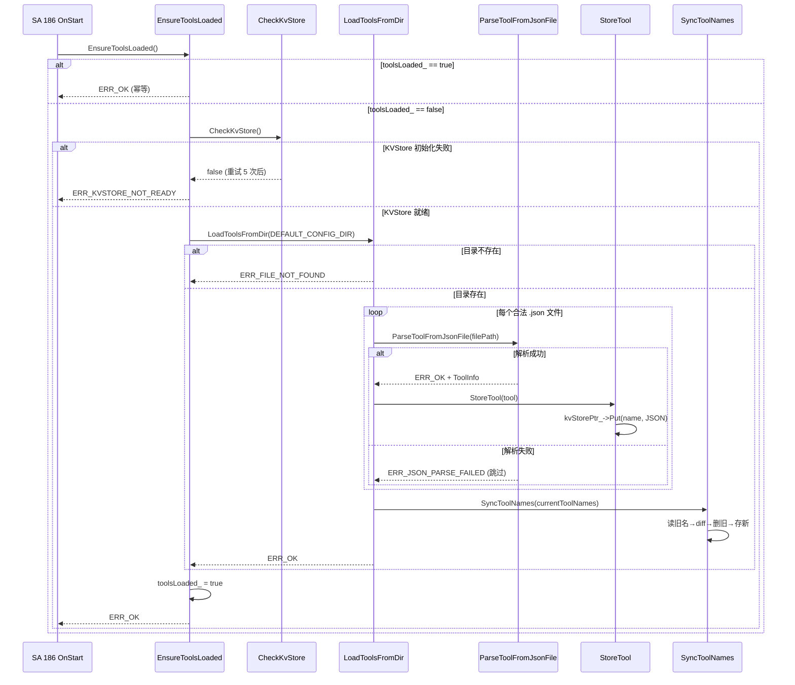

# 架构设计

> 本设计承接 `proposal.md`（条件通过）与 `spec.md`（Draft），固化 CLI 工具注册（OnStart 配置加载与 KVStore 同步）的架构约束、关键设计决策与模块影响。设计 AC ⊆ spec AC，不发明新行为。

## 设计元数据

| 字段 | 内容 |
|------|-----|
| Design ID | DESIGN-CLI-015 |
| 关联需求 | `proposal.md`（REQ-015） |
| 关联 Epic | 无（独立特性） |
| 目标 Feature | FEAT-CLI-015 |
| 复杂度 | 标准 |
| 目标版本 | OpenHarmony-7.0 |
| Owner | 待确认 |
| 状态 | Draft |

## 需求基线

> 需求基线详见 proposal.md。以下仅列出设计阶段需额外强调的要点。

| 项 | 补充说明 |
|----|----------|
| 配置目录 `/system/bin/cli_tool/configs` | 系统级只读分区，SA 须有读权限 |
| 工具名 `ohos-`/`hms-` 前缀 | 防止非系统工具注册 |
| 懒加载原子标志 `toolsLoaded_` | `EnsureToolsLoaded` 幂等保证 |
| KVStore `SINGLE_VERSION` + `S2` + `EL1` | 非加密、非同步、单版本 |
| `AllCliToolNames` 索引 key | 记录所有工具名列表，用于增删同步 |

## 上下文和现状

### 涉及仓和模块

| 仓库 | 补充架构说明 |
|------|-------------|
| foundation/ability/ability_runtime | cli_tool_framework 自成子系统；配置加载在 SA 进程（aimgr）内完成；KVStore 在 aimgr 进程沙箱内 |

### 调用链层级分析

| 层 | 模块 | 职责 | 修改类型 |
|----|------|------|----------|
| SA 生命周期 | `services/climgr/src/cli_tool_manager_service.cpp` | `OnStart()` 调用 `Init()`→`EnsureToolsLoaded()`→`Publish()`→`DelayUnloadTask()` | 修改（既有实现，固化契约） |
| 数据管理 | `services/climgr/src/cli_tool_data_manager.cpp` | `EnsureToolsLoaded`/`LoadToolsFromDir`/`ParseToolFromJsonFile`/`StoreTool`/`SyncToolNames`/`CheckKvStore`/`RestoreKvStore` | 修改（既有实现，固化契约） |
| 数据结构 | `interfaces/cli_tool/src/tool_info.cpp` | `ParseFromJson`/`ValidateName`/`ValidateExecutablePath`/`ValidateRequirePermissions`/`ParseToJson` | 修改（既有实现，固化契约） |
| 数据结构 | `interfaces/cli_tool/src/sub_command_info.cpp` | `ParseFromJson`/`Validate` | 修改（既有实现，固化契约） |
| 配置 | `cli_tool_framework/etc/profile/aimgr.cfg` | init 创建 `/data/service/el1/public/database/aimgr/cli_tool` 目录 | 不变 |
| SA 注册 | `cli_tool_framework/etc/profile/aimgr_trust.json` | SA 186（进程 aimgr） | 不变 |

**检查项：**
- [x] 调用链每一层都已覆盖（SA 生命周期→数据管理→数据结构→配置）
- [x] 每层职责边界清晰
- [x] 每层修改类型明确

### 适用架构规则

| Rule ID | 适用原因 | 设计结论 | 验证方式 |
|---------|----------|----------|----------|
| OH-ARCH-LAYERING | SA 生命周期→数据管理→数据结构 三层 | 调用方向自上而下；数据管理不反向依赖 SA 生命周期 | 依赖检查/代码评审 |
| OH-ARCH-SUBSYSTEM | 单子系统 ability 内闭环 | 不跨子系统调用 | 代码评审 |
| OH-ARCH-COMPONENT-BUILD | 复用既有 component/parts | 无新增 component | 构建验证 |
| OH-ARCH-ERROR-LOG | 错误码 | 35700004/35700014/35700015/35700016/35700018 | 单测 |

## 不涉及项承接

| 维度 | 设计结论 |
|------|----------|
| 安全与权限 | 工具名前缀校验（ohos-/hms-）+ 路径绝对校验 + 权限去重。详见「安全基础检查」 |
| IPC/跨进程 | 加载在 SA 进程内完成，无 IPC |

## 关键设计决策

| 决策 ID | 问题 | 推荐方案 | 探索过的替代方案 | 取舍理由 | 影响 |
|---------|------|----------|-----------------|------|------|
| ADR-1 | 加载时机 | SA OnStart 中加载 | 备选1：首次查询时懒加载（放弃，首次查询延迟高且需并发保护）；备选2：独立 init 脚本加载（放弃，与 SA 生命周期解耦导致时序问题） | OnStart 加载保证 Publish 前数据就绪；后续查询零延迟 | EnsureToolsLoaded 在 Publish 前调用 |
| ADR-2 | 加载幂等性 | 原子标志 toolsLoaded_ | 备选1：每次重载（放弃，重复 I/O）；备选2：文件 mtime 比较（放弃，复杂且 KVStore 已有数据） | toolsLoaded_=true 后直接返回，不重复加载 | 单例 + 原子标志 |
| ADR-3 | 单文件失败容错 | 逐文件独立处理，失败跳过不中断 | 备选1：任一失败即中止（放弃，单文件错误导致全部不可用）；备选2：两阶段（先全解析再全写入，放弃，内存占用高） | 逐文件 try 解析+存储，失败记录日志跳过 | LoadToolsFromDir 逐文件循环 |
| ADR-4 | 增删同步策略 | diff 旧名集合 vs 当前名集合 | 备选1：全量删除+全量写入（放弃，无变更工具不必要重写）；备选2：不删旧工具（放弃，KVStore 累积垃圾） | diff 后仅删除已不存在的工具，已存在工具覆盖更新 | SyncToolNames 读 AllCliToolNames→diff→delete→put |
| ADR-5 | KVStore 初始化重试 | 5 次×100ms | 备选1：无重试（放弃，init 创建目录可能有时序延迟）；备选2：无限重试（放弃，阻塞 SA 启动） | 500ms 总重试窗口平衡可靠性与启动延迟 | CheckKvStore 重试逻辑 |
| ADR-6 | 数据损坏恢复 | DATA_CORRUPTED 时删除+重建 | 备选1：不恢复（放弃，KVStore 不可用）；备选2：仅删除不重建（放弃，后续操作无 store） | 删除损坏 KVStore 后重新创建，后续操作使用新 store | RestoreKvStore |

## 设计骨架

### 骨架范围

| 骨架项 | 目标 | 不包含 | 验证方式 |
|--------|------|--------|----------|
| 数据管理骨架 | EnsureToolsLoaded/LoadToolsFromDir/StoreTool/SyncToolNames | 复杂边界调优 | 构建通过 |
| 数据结构骨架 | ToolInfo::ParseFromJson/ValidateName 等 | — | 编译+单测 |
| 测试骨架 | cli_tool_data_manager_test/tool_info_test | 全场景 | 最小用例通过 |

## 后续 Task 拆分

| Task ID | 目标 | 受影响文件 | 依赖 |
|---------|------|------------|------|
| TASK-R-001 | 正常加载链路+幂等性验证 | cli_tool_data_manager/cli_tool_manager_service | design + spec Approved |
| TASK-R-002 | 配置目录不存在+加载失败容错验证 | cli_tool_manager_service/cli_tool_data_manager | TASK-R-001 |
| TASK-R-003 | JSON 解析与字段校验验证 | tool_info/sub_command_info | TASK-R-001 |
| TASK-R-004 | 单文件失败容错+增删同步验证 | cli_tool_data_manager | TASK-R-001 |
| TASK-R-005 | KVStore 不可用+数据损坏恢复验证 | cli_tool_data_manager | TASK-R-001 |

## API 签名、Kit 与权限

无 API 变更。本特性为内部实现行为固化。

## 构建系统影响

### BUILD.gn 变更

```
文件路径: cli_tool_framework/services/climgr/BUILD.gn
变更说明: 无新增源文件；climgr SA 库既有，固化契约不改构建。
```
```
文件路径: cli_tool_framework/interfaces/cli_tool/BUILD.gn
变更说明: 无新增源文件；ToolInfo/SubCommandInfo 既有，固化契约不改构建。
```

### bundle.json 变更

无新增 component；复用既有 `ability_runtime` part。

---

## 可选设计扩展

### 架构图

```
[SA 186 OnStart]
    ↓
[Init() — SIGCHLD handler + IOMonitor]
    ↓
[EnsureToolsLoaded()]
    ↓ toolsLoaded_==false
[CheckKvStore() — 重试 5 次 × 100ms]
    ↓ kvStorePtr_ != nullptr
[LoadToolsFromDir("/system/bin/cli_tool/configs")]
    ↓ opendir → 遍历 .json 文件
[ParseToolFromJsonFile()]
    ↓ ifstream → BOM 去除 → json::parse → ToolInfo::ParseFromJson (字段校验)
[StoreTool() — kvStorePtr_->Put(name, JSON)]
    ↓
[SyncToolNames() — 读 AllCliToolNames → diff → delete 旧 → put 新]
    ↓ toolsLoaded_ = true
[Publish() — SA 注册到 samgr]
    ↓
[DelayUnloadTask()]
```

### 数据流/控制流

| 步骤 | 调用方 | 被调用方 | 数据/接口 | 说明 |
|------|--------|----------|-----------|------|
| 1 | OnStart | EnsureToolsLoaded | — | 检查 toolsLoaded_ |
| 2 | EnsureToolsLoaded | CheckKvStore | GetSingleKvStore | 重试 5 次初始化 KVStore |
| 3 | EnsureToolsLoaded | LoadToolsFromDir | opendir | 打开配置目录 |
| 4 | LoadToolsFromDir | ParseToolFromJsonFile | ifstream+json::parse | 逐文件解析 |
| 5 | ParseToolFromJsonFile | ToolInfo::ParseFromJson | 字段校验 | 名称/路径/权限/Schema 校验 |
| 6 | LoadToolsFromDir | StoreTool | kvStorePtr_->Put | 写入 KVStore |
| 7 | LoadToolsFromDir | SyncToolNames | Get+Delete+Put | 增删同步+更新索引 |
| 8 | OnStart | Publish | — | SA 注册 |

### 时序设计



### 测试性设计

| 测试层级 | 测试目标 | Mock 策略 | 验证方式 |
|----------|----------|-----------|----------|
| 单元测试 | ToolInfo 解析与校验 | 无 mock | `tool_info_test` |
| 单元测试 | SubCommandInfo 解析与校验 | 无 mock | `sub_command_info_test` |
| 单元测试 | KVStore 加载/同步/恢复 | Mock KVStore（`mock_single_kv_store.h`） | `cli_tool_data_manager_test` |
| 单元测试 | OnStart 调用链 | Mock 数据管理器 | `cli_tool_mgr_service_test` |

### 异常传播时序图

| 异常场景 | 触发层 | 传播路径 | 最终处理 |
|----------|--------|----------|----------|
| 配置目录不存在 | LoadToolsFromDir | EnsureToolsLoaded→OnStart | 返回 ERR_FILE_NOT_FOUND；SA 继续启动 |
| KVStore 初始化失败 | CheckKvStore | EnsureToolsLoaded→OnStart | 返回 ERR_KVSTORE_NOT_READY；SA 继续启动 |
| JSON 文件非法 | ParseToolFromJsonFile | LoadToolsFromDir | 返回 ERR_JSON_PARSE_FAILED；跳过该文件 |
| 字段校验失败 | ToolInfo::ParseFromJson | ParseToolFromJsonFile→LoadToolsFromDir | 返回 false→ERR_JSON_PARSE_FAILED；跳过该文件 |
| StoreTool Put 失败 | StoreTool | LoadToolsFromDir | 返回 -1；记录日志；继续 |
| KVStore DATA_CORRUPTED | RestoreKvStore | 查询方法 | 删除+重建；后续操作用新 store |
| SyncToolNames 索引写入失败 | SyncToolNames | LoadToolsFromDir | 返回 -1；记录日志；不影响已加载工具 |

### 资源所有权矩阵

| 资源 | 创建方 | 持有方 | 销毁触发 | 实际释放 |
|------|--------|--------|----------|----------|
| KVStore 句柄 | GetKvStore | CliToolDataManager 单例 | 进程退出/析构 | CloseKvStore |
| 配置目录 DIR | opendir | LoadToolsFromDir | 遍历完成 | closedir |
| 文件 ifstream | ParseToolFromJsonFile | 局部 | 解析完成 | file.close() |
| AllCliToolNames 索引 | SyncToolNames | KVStore | 下次 Sync 覆盖 | Put 覆盖 |
| toolsLoaded_ 标志 | EnsureToolsLoaded | 单例 | 进程退出 | 析构 |

### 接口参数规约

| 接口 | 参数 | 类型 | 合法范围 | 非法处理 | 边界说明 |
|------|------|------|----------|----------|----------|
| EnsureToolsLoaded | — | — | 无参数 | — | 幂等 |
| LoadToolsFromDir | dirPath | string | 存在的目录路径 | 不存在→ERR_FILE_NOT_FOUND | 仅 .json 后缀 |
| ParseToolFromJsonFile | filePath | string | 存在的 .json 文件路径 | 不存在→ERR_FILE_NOT_FOUND；空文件→ERR_JSON_PARSE_FAILED | BOM 自动去除 |
| StoreTool | tool | ToolInfo | Validate 通过 | Put 失败→返回 -1 | — |
| SyncToolNames | currentToolNames | string[] | 当前加载的工具名列表 | KVStore 不可用→ERR_KVSTORE_NOT_READY | diff 删除旧工具 |

### 线程与并发模型

| 操作 | 发起线程 | 线程安全 | 重入约束 |
|------|----------|----------|----------|
| OnStart | SA 主线程 | — | samgr 保证 OnStart 单线程调用 |
| EnsureToolsLoaded | OnStart 线程 | toolsLoaded_ 原子标志保证幂等 | 多次调用安全（仅一次加载） |
| LoadToolsFromDir | OnStart 线程 | kvStorePtrMutex_ 保护 StoreTool | — |
| KVStore 操作 | 多线程（Binder+OnStart） | kvStorePtrMutex_ 互斥 | 查询与加载不并发冲突 |

**并发场景：**

| 场景 | 竞争对象 | 保护机制 | 预期行为 |
|------|----------|----------|----------|
| 加载与查询并发 | KVStore 读取 | kvStorePtrMutex_ 互斥 | 串行访问；加载时查询等待锁 |
| 重复 OnStart | toolsLoaded_ | 原子标志 | 仅首次加载 |
| KVStore 初始化与查询 | kvStorePtr_ | kvStorePtrMutex_ 互斥 | 查询时 CheckKvStore 保证已初始化 |

## DFX 设计

### DFX 故障模式分析

未命中知识库，不涉及。

### 安全基础检查

> proposal「安全与权限」= 是，本节必填。

#### 信任边界交叉分析

| 边界类型 | 跨越的交互 | 风险 | 约束 |
|---|---|---|---|
| 只读分区/KVStore | 配置文件→KVStore | 非法工具注册 | 工具名 ohos-/hms- 前缀校验+路径绝对校验+权限去重 |
| 文件系统/进程 | ifstream 读取 | 路径遍历 | 配置目录固定为系统级路径 |
| KVStore/查询 | KVStore 读取 | 数据不一致 | kvStorePtrMutex_ 互斥保护 |

#### 基础安全要求

| 检查项 | 结论 | 说明/措施 |
|---|---|---|
| 输入验证 | 强制 | JSON 字段全链路校验（名称前缀/路径绝对/权限去重/Schema 类型） |
| 错误处理 | 错误码化 | 357000xx 区间 |
| 配置 | 系统配置 | 配置目录固定为系统只读分区 |
| 敏感数据处理 | 不存储敏感数据 | 工具元数据不含用户敏感数据 |

### 深度威胁分析(如需)

> 无网络暴露、无认证授权变更、无敏感数据存储。判定为不升级独立 threat-model.md。

## 风险和开放问题

| 项 | 类型 | 影响 | 处理方式 | Owner |
|----|------|------|----------|-------|
| 目标版本/Owner 未确认 | 进度 | 基线无法冻结为「通过」 | 需求方/SIG 确认 | 待确认 |
| KVStore 初始化时序依赖 init | 可靠性 | init 创建目录可能晚于 SA 拉起 | CheckKvStore 重试 5 次 | — |
| 配置目录只读权限 | 部署 | SA 须有配置目录读权限 | aimgr.cfg 权限配置 | — |

## 设计审批

- [x] 需求基线已确认，设计覆盖 P0/P1 AC（AC-1.1–AC-3.6）
- [x] 不涉及项已承接
- [x] 涉及仓和模块职责清楚
- [x] 调用链层级分析完整
- [x] 适用架构规则已识别并形成设计结论
- [x] 分层和子系统边界合规
- [x] BUILD.gn/bundle.json 影响明确（无新增源文件）
- [x] 设计输出和后续 Task 拆分明确
- [x] 关键设计决策有理由和影响说明
- [x] 风险和开放问题有 Owner（部分待确认）

**结论:** 条件通过（待 Owner 复核后转「通过」）
