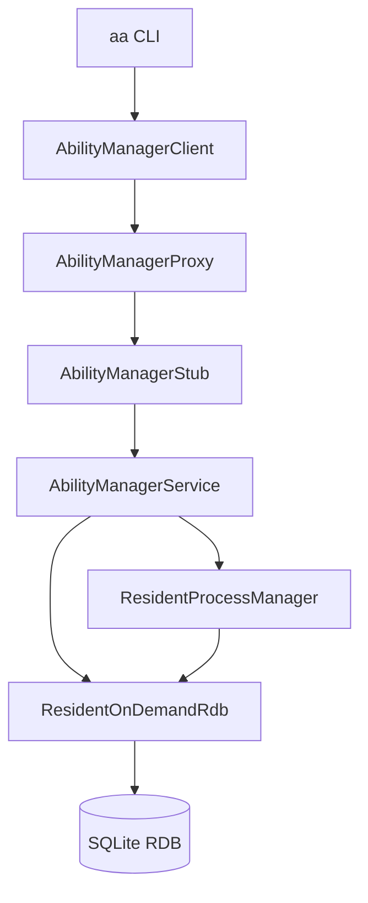
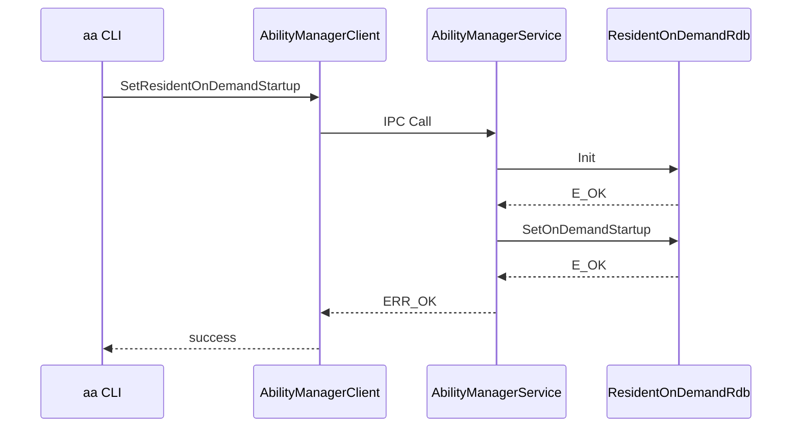

# Design

## 需求基线摘要

- 按需启动配置持久化：使用 SQLite RDB 存储，表名 resident_on_demand
- 权限控制：仅允许 SA、Shell、SystemApp 调用设置接口
- 命令行工具：扩展现有 aa 工具，添加 set-on-demand 命令

## 设计约束

1. 调用方向：aa → AbilityManagerClient → AbilityManagerService → ResidentOnDemandRdb
2. IPC 使用 OpenHarmony 标准框架，新增 IPC 接口码
3. 数据存储使用系统集成的 SQLite RDB

## 非目标

- 运行时动态启停进程
- 跨设备配置同步
- 图形化配置界面

## 方案概述

采用分层架构设计，通过 IPC Stub/Proxy 模式实现跨进程通信，使用 SQLite RDB 实现配置持久化。在 ResidentProcessManager 启动常驻进程前检查配置，跳过已配置为按需启动的应用。

## 架构图

## 模块影响

| 子系统 | 仓库 | 模块/路径 | 影响类型 |
|--------|------|-----------|---------|
| ability_runtime | foundation/ability/ability_runtime | services/abilitymgr/src/rdb | 新增 |
| ability_runtime | foundation/ability/ability_runtime | services/abilitymgr/include/rdb | 新增 |
| ability_runtime | foundation/ability/ability_runtime | interfaces/inner_api/ability_manager | 修改 |
| ability_runtime | foundation/ability/ability_runtime | tools/aa | 修改 |

## 关键设计决策

| 决策 ID | 问题 | 推荐方案 | 备选方案 | 选择理由 |
|---------|------|----------|----------|---------|
| ADR-1 | 配置存储方案 | SQLite RDB | 配置文件、Preferences | RDB 支持持久化、事务、索引 |
| ADR-2 | 权限控制粒度 | 服务层校验 | 客户端校验 | 服务层校验无法被绕过 |
| ADR-3 | 启动检查时机 | ResidentProcessManager 启动时检查 | 系统启动脚本 | 在进程管理器中检查可访问 RDB |

## 时序设计

## 风险与缓解

| 风险 | 可能性 | 影响 | 缓解措施 |
|------|--------|------|----------|
| 数据库初始化失败 | 低 | 高 | 添加 fallback 逻辑，OnOpen 时创建表 |
| IPC 调用超时 | 低 | 中 | 使用标准 IPC 框架，设置合理超时 |
| 配置丢失 | 低 | 高 | RDB 支持持久化，定期 checkpoint |

## 验证思路

| 验证场景 | 方法 | 通过标准 |
|----------|------|----------|
| 配置写入 | 执行 aa set-on-demand | 返回 success |
| 配置持久化 | 重启后查询数据库 | 配置存在 |
| 启动跳过 | 检查 hilog | 跳过已配置应用 |