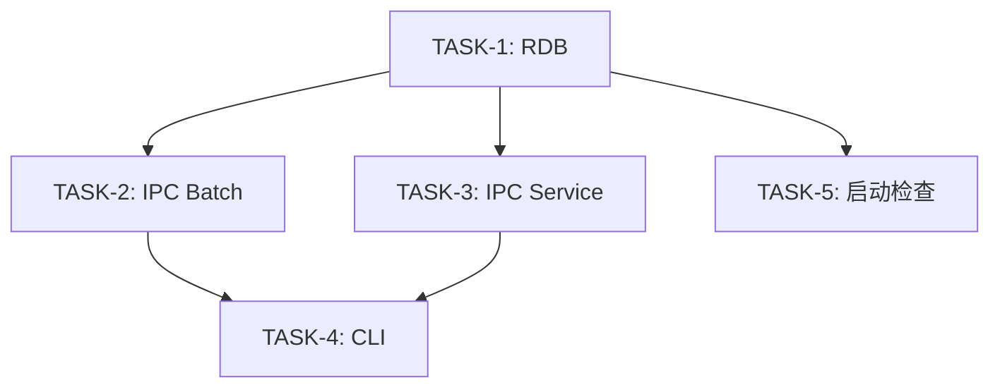

# Execution Plan

## 输入状态

| 输入 | 路径 | 要求状态 |
|------|------|----------|
| Proposal | proposal.md | Approved |
| Design | design.md | Approved |
| Spec | spec.md | Approved |

## 执行原则

- **Spec 权威：** 若实现细节与 `spec.md` 的 AC、错误码或兼容性声明冲突，先更新 spec/design，再继续实现。
- **测试/证据先行：** 每个 Task 先写失败测试；无法单测的集成行为必须先写明可复现证据缺口。
- **任务小型化：** 一个 Task 只覆盖一个独立闭环。
- **文件边界：** Task 只修改 `Files` 表列出的文件。
- **证据回填：** Task 完成后必须回填 `spec.md` 代码映射。

## AC 到 Task 追溯

| AC | 来源 | Task | 验证方式 | 覆盖？ |
|----|------|------|----------|--------|
| AC-1.1 | US-1 | TASK-4 | 功能测试 | ✅ |
| AC-1.2 | US-1 | TASK-4 | 功能测试 | ✅ |
| AC-1.3 | US-1 | TASK-4 | 功能测试 | ✅ |
| AC-1.4 | US-1 | TASK-3 | 安全测试 | ✅ |
| AC-2.1 | US-2 | TASK-5 | 集成测试 | ✅ |
| AC-2.2 | US-2 | TASK-5 | 集成测试 | ✅ |
| AC-2.3 | US-2 | TASK-1 | 集成测试 | ✅ |
| AC-3.1 | US-3 | TASK-2 | 功能测试 | ✅ |
| AC-3.2 | US-3 | TASK-2 | 功能测试 | ✅ |

## 实现边界

**必须实现：**
- RDB 数据管理类 ResidentOnDemandRdb
- IPC 接口 SetResidentOnDemandStartup / SetResidentOnDemandStartupBatch
- 命令行 aa set-on-demand 命令
- 启动时按需启动检查逻辑

**可后置：** 无

**不建议延后：** 无

## 禁止项

- 每个 AC 必须有明确的验证方式。
- 不得修改 Task 列出范围外的文件。
- 不得在未通过验证时标记 Task 完成。

## Task 依赖

## Task 列表

| TASK ID | 目标 | 文件范围 | AC 映射 | 前置依赖 | 完成判据 | 验证命令 |
|---------|------|----------|---------|----------|----------|---------|
| TASK-1 | 实现 RDB 数据管理类 | resident_on_demand_rdb.h/cpp | AC-2.3 | design.md Approved | 编译+单测通过 | hb build |
| TASK-2 | 实现 IPC 批量接口 | ability_manager_interface.h, ipc_interface_code.h, proxy.cpp, stub.cpp | AC-3.1, AC-3.2 | TASK-1 | 编译+单测通过 | hb build |
| TASK-3 | 实现服务层方法 | ability_manager_service.cpp, ability_manager_client.cpp | AC-1.4 | TASK-2 | 编译通过 | hb build |
| TASK-4 | 实现命令行完整逻辑 | ability_command.h/cpp | AC-1.1, AC-1.2, AC-1.3 | TASK-3 | 编译+功能测试通过 | aa set-on-demand |
| TASK-5 | 修改常驻进程启动检查 | resident_process_manager.cpp | AC-2.1, AC-2.2 | TASK-1 | 编译+集成测试通过 | hilog 验证 |

## Task 详情

### TASK-1: 实现 RDB 数据管理类

**目标：** 实现 ResidentOnDemandRdb 类，支持配置的 CRUD 操作和持久化存储。

**AC 映射：** AC-2.3

**前置依赖：** design.md Approved

**非目标：** 不涉及 IPC 和 CLI

**状态所有权：** 无

**只读上下文**

| 路径 | 读取目的 |
|------|----------|
| services/abilitymgr/include/rdb/rdb_data_manager.h | 参考 RDB 数据管理框架 |

**Files**

| 操作 | 文件 | 说明 |
|------|------|------|
| 新增 | services/abilitymgr/include/rdb/resident_on_demand_rdb.h | 头文件 |
| 新增 | services/abilitymgr/src/rdb/resident_on_demand_rdb.cpp | 实现 |

**Steps**

- [x] 创建 ResidentOnDemandRdb 类定义
- [x] 实现 Init 方法，创建数据库表
- [x] 实现 GetOnDemandStartup 方法
- [x] 实现 SetOnDemandStartup 方法
- [x] 实现 SetOnDemandStartupBatch 方法
- [x] 编译验证
- [x] 单元测试验证

**Verification**

| Command / Evidence | Expected Result | Actual Result |
|--------------------|-----------------|---------------|
| hb build ability_runtime | 编译成功 | ✅ Pass |
| 单元测试 | 测试通过 | ✅ Pass |

### TASK-2: 实现 IPC 批量接口

**目标：** 新增 IPC 接口码和方法，支持批量配置。

**AC 映射：** AC-3.1, AC-3.2

**前置依赖：** TASK-1 完成

**Files**

| 操作 | 文件 | 说明 |
|------|------|------|
| 修改 | interfaces/inner_api/ability_manager/include/ability_manager_interface.h | 接口声明 |
| 修改 | interfaces/inner_api/ability_manager/include/ability_manager_ipc_interface_code.h | IPC 码 |
| 修改 | services/abilitymgr/src/ability_manager_proxy.cpp | Proxy 实现 |
| 修改 | services/abilitymgr/src/ability_manager_stub.cpp | Stub 实现 |

**Verification**

| Command / Evidence | Expected Result | Actual Result |
|--------------------|-----------------|---------------|
| hb build | 编译成功 | ✅ Pass |

### TASK-3: 实现服务层方法

**目标：** 在 AbilityManagerService 中实现权限校验和业务逻辑。

**AC 映射：** AC-1.4

**前置依赖：** TASK-2 完成

**Files**

| 操作 | 文件 | 说明 |
|------|------|------|
| 修改 | services/abilitymgr/src/ability_manager_service.cpp | 服务实现 |
| 修改 | services/abilitymgr/src/ability_manager_client.cpp | 客户端实现 |

**Verification**

| Command / Evidence | Expected Result | Actual Result |
|--------------------|-----------------|---------------|
| hb build | 编译成功 | ✅ Pass |

### TASK-4: 实现命令行完整逻辑

**目标：** 扩展 aa 工具，添加 set-on-demand 命令。

**AC 映射：** AC-1.1, AC-1.2, AC-1.3

**前置依赖：** TASK-3 完成

**Files**

| 操作 | 文件 | 说明 |
|------|------|------|
| 修改 | tools/aa/include/ability_command.h | 命令声明 |
| 修改 | tools/aa/src/ability_command.cpp | 命令实现 |

**Verification**

| Command / Evidence | Expected Result | Actual Result |
|--------------------|-----------------|---------------|
| aa set-on-demand -b com.test -e 1 | success | ✅ Pass |
| aa set-on-demand -b com.test -e 0 | success | ✅ Pass |
| aa set-on-demand -b "" -e 1 | error | ✅ Pass |

### TASK-5: 修改常驻进程启动检查

**目标：** 在 ResidentProcessManager 启动时检查按需启动配置。

**AC 映射：** AC-2.1, AC-2.2

**前置依赖：** TASK-1 完成

**Files**

| 操作 | 文件 | 说明 |
|------|------|------|
| 修改 | services/abilitymgr/src/resident_process/resident_process_manager.cpp | 启动检查 |

**Verification**

| Command / Evidence | Expected Result | Actual Result |
|--------------------|-----------------|---------------|
| hilog | skip auto launch | ✅ Pass |

## Review Gates

| Gate | When | Required Evidence | Blocks Next Step |
|------|------|-------------------|------------------|
| Gate-Final | 所有 Task 完成后 | 端到端证据、代码映射回填 | 已通过 |

## 代码范围映射

| TASK ID | 文件 | 操作 |
|--------|------|------|
| TASK-1 | resident_on_demand_rdb.h | 新增 |
| TASK-1 | resident_on_demand_rdb.cpp | 新增 |
| TASK-2 | ability_manager_interface.h | 修改 |
| TASK-2 | ability_manager_ipc_interface_code.h | 修改 |
| TASK-2 | ability_manager_proxy.cpp | 修改 |
| TASK-2 | ability_manager_stub.cpp | 修改 |
| TASK-3 | ability_manager_service.cpp | 修改 |
| TASK-3 | ability_manager_client.cpp | 修改 |
| TASK-4 | ability_command.h | 修改 |
| TASK-4 | ability_command.cpp | 修改 |
| TASK-5 | resident_process_manager.cpp | 修改 |