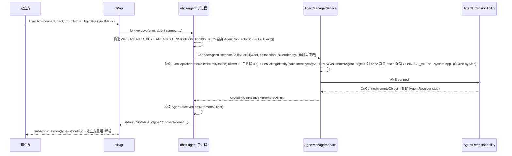
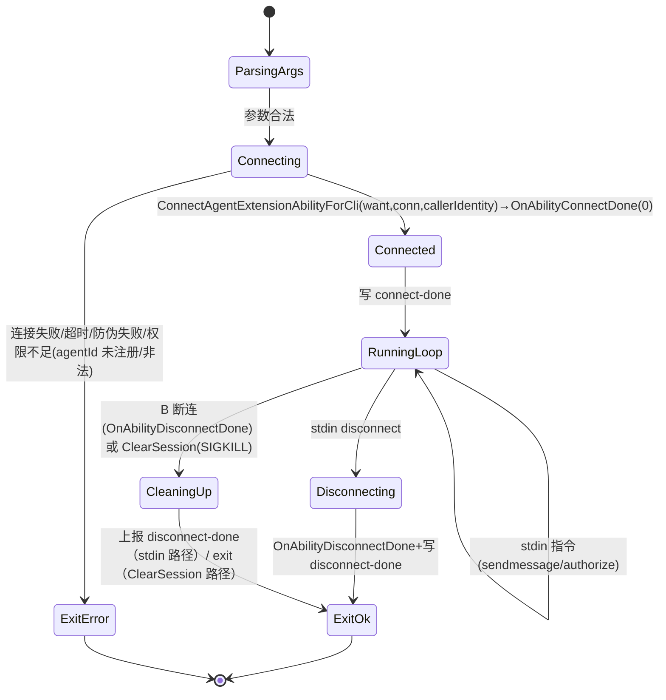

# 架构设计

> 确认目标仓和模块的架构约束、关键设计决策、Spec 拆分方向。复杂度：标准。
> 本版据 codecheck 报告（codecheck_report_ohos-agent-cli_20260825.md）修订：采用 ForCli 接口+callerIdentity 传播（替代 IsCliToolToken 放行/两阶段 preflight）、修事件契约失真、整改文档一致性。

## 设计元数据

| 字段 | 内容 |
|------|------|
| Design ID | DESIGN-20260825-001 |
| 关联需求 | `proposal.md`（FEAT-20260825-001） |
| 关联 Epic | Agent |
| 目标 Feature | FEAT-20260825-001 |
| 复杂度 | 标准 |
| 目标版本 | 7.0 |
| Owner | yangxuguang-huawei |
| 状态 | Approved |

## 需求基线

> 详见 proposal.md。设计阶段需额外强调：

| 项 | 补充说明 |
|----|----------|
| 连接范围 | 仅 `AgentCardType::APP`，走 `ConnectStandardAgentExtensionAbility` 标准路径（非 LOW_CODE 共享 host） |
| 运行模型 | connect 子命令长驻；**长驻/background 由 cliMgr 既有 yield-time 机制承担（ADR-10，yield 部分零改动）**；callerIdentity 注入需 tool_util.cpp 新增 env（ADR-9 env 注入在 callerIdentity 场景恢复采用，非零改动）；connect-done/OnData 等经 stdout 文本流 JSON-line 回流（ADR-7）；sendmessage/authorize=stdin 协议；disconnect=stdin 走正常流程；ClearSession=SIGKILL 兜底 |
| connect 单阶段 | CLI 调 `ConnectAgentExtensionAbilityForCli(want, connection, callerIdentity)` 直连（ForCli 内联 ResolveConnectAgentTarget + enforce APP，无 preflight；`GetAgentCardTypeForConnect` 不再用于 CLI connect）；Want 必含 `AGENTID_KEY`，agentId 须预注册为 APP（O-12） |
| 双向通道 | 见下方「双向通道方向（最终结论）」 |
| authorize 语义 | CLI 仅透传 opaque data（调 `IAgentReceiver::Authorize`），decision/resource 与 ack 由 Agent 侧定义（O-5/O-6 已关闭） |
| 调用方配额 | 调用方最多连 5 个不同 Agent（并发）——由 agentmgr 既有 `AdmitStandardAgentConnectionLocked`+`MAX_AGENT_CONNECTIONS_PER_CALLER=5`（keyed by callerUid+agentId，disconnect 释放）保证；CLI 路径自动适用，不跳过配额；callerUid=app A uid（O-4）→ 与 JS 路径共享配额桶，不绕过。无需新增逻辑 |

## 双向通道方向（最终结论，以代码为准）

> `iagent_receiver.h`/`iagent_connector.h` 头文件注释方向与代码相反（O-7，Stage 3 顺手修正，非行为变更）。以下为代码核实结论：

- **host → agent（CLI → B）**：接口 `IAgentReceiver`，方法 `SendData(connectorProxy, data)` **两参数**；CLI 持 `AgentReceiverProxy`（包装 `OnAbilityConnectDone` 的 remoteObject），B 实现 `AgentReceiverStub`。证据：`js_agent_receiver_proxy.cpp:66 iface_cast<IAgentReceiver>`。
- **agent → host（B → CLI）**：接口 `IAgentConnector`，方法 `SendData(data)` **一参数**；CLI 实现 `AgentConnectorStub`，B 持 `AgentConnectorProxy`。证据：`js_agent_connector_stub_impl.h:17 extends AgentConnectorStub`。

## 上下文和现状

### 涉及仓和模块

| 仓库 | 补充架构说明 |
|------|-------------|
| ability_runtime/tools/ohos-agent（新） | 镜像 tools/ohos-aa 范式；ohos_cli_executable + ohos-agent.json；长驻 connect 子进程 |
| ability_runtime/cli_tool_framework | session 编排（ExecTool/SendMessage/SubscribeSession/ClearSession/IOMonitor/yield-time）；json 注册消费 + callerIdentity env 注入需 tool_util.cpp 新增（ADR-10 复用既有 yield 机制 yield 部分零改动；ADR-9 env 注入在 callerIdentity 场景恢复采用，非废弃） |
| ability_runtime/agent_runtime_framework/services/agentmgr | connect/disconnect 路径新增 ForCli 接口（ConnectAgentExtensionAbilityForCli/DisconnectAgentExtensionAbilityForCli）+ IsCliToolToken+CCM 特性门禁（**非绕过**：防伪 GetHapTokenInfo(callerIdentity.token).uid==CLI 子进程 uid；SetCallingIdentity(callerIdentity=appA)→对 appA 真实 token 强制 CONNECT_AGENT+system-app+前台，no bypass）；既有 3 个 Validate 函数原样（非 CLI 路径） |
| ability_runtime/agent_runtime_framework/interfaces/kits/native/agent_extension/connection | 只读消费 IAgentConnector/IAgentReceiver/AgentConnectorProxy/AgentReceiverStub（不改；头注释 O-7 待修） |
| ability_runtime/agent_runtime_framework/interfaces/inner_api | 新增 2 个 additive ForCli InnerAPI：ConnectAgentExtensionAbilityForCli(want,connection,String callerIdentity)+DisconnectAgentExtensionAbilityForCli(connection,String callerIdentity)（向后兼容，无序列化格式破坏）；其余只读消费 AgentManagerClient |
| sa_profile + selinux | ohos-agent 跑 **claw_cli 域**（`type claw_cli, normal_hap_attr, hap_domain`，type.te:14）；**绝大多数 binder/samgr 规则由 normal_hap_attr 继承已覆盖**（sa_aimgr_climgr/sa_foundation_abilityms get、claw_cli→aimgr/foundation binder、normal_hap_attr↔normal_hap_attr / system_core_hap_attr→normal_hap_attr inbound）。**唯一潜在缺口**：B 宿主为 system_basic_hap 时 `system_basic_hap_attr→normal_hap_attr:binder` 仅有 transfer 无 call（需补 call IF agent 宿主为 system_basic）。见 P2-3 |

### 适用架构规则

| Rule ID | 适用原因 | 设计结论 | 验证方式 |
|---------|----------|----------|----------|
| OH-ARCH-LAYERING | CLI 子进程经 inner_api（AgentManagerClient）连服务，经 kits/native 接口连对端 | 调用方向：CLI→agentmgr（inner_api）+ CLI↔AgentExtensionAbility（kits/native IPC）；不越层 | 依赖检查/代码评审 |
| OH-ARCH-SUBSYSTEM | 复用 cli_tool_framework session 模型 | json 注册消费 + 既有 yield 复用 + callerIdentity env 注入（tool_util.cpp 新增），不反向依赖 cli_tool 内部 | 代码评审 |
| OH-ARCH-IPC-SAF | 双向 IPC（IAgentReceiver/IAgentConnector）+ cliMgr↔子进程 stdin/stdout 管道 | IPC 复用既有接口描述符；序列化格式不变 | 集成测试 |
| OH-ARCH-API-LEVEL | 无 Public/System API 变更 | N/A | — |
| OH-ARCH-COMPONENT-BUILD | 新增 ohos_cli_executable 部件 + json 注册 | BUILD.gn + ohos-agent.json；install 到 /system/bin/cli_tool/{executable,configs} | 构建验证 |
| OH-ARCH-ERROR-LOG | connect 失败/断连/超时上报 | 复用既有错误码；新增 HiSysEvent 需评估（默认不新增已发布事件） | 单测/hilog |

## 不涉及项承接

| 维度 | 设计结论 |
|------|----------|
| 性能 | 长驻 session 受 MAX_TIMEOUT=1800s + cliMgr 并发上限约束；无新性能指标 |
| 安全与权限 | cliMgr 入口门禁（系统应用+EXEC_CLI_TOOL）；agentmgr 新增 **CLI 专用 ForCli 接口**（ConnectAgentExtensionAbilityForCli/DisconnectAgentExtensionAbilityForCli，IsCliToolToken+CCM 门禁=特性开关，**非绕过**）：cliMgr 用 ResetCallingIdentity 捕获 app A 身份串→env `ohos_cli_callerIdentity`→ohos-agent getenv→ForCli 入参（String callerIdentity，不入 Want）；agentmgr 防伪（callerIdentity 的 token.uid==CLI 子进程 uid=app A uid，setresuid+cap-drop 不可伪造）+app A 真实 CONNECT_AGENT/system-app/前台（对 callerIdentity 的 token）+ SetCallingIdentity(appA)→:438 捕获 appA→AMS AgentCallerIdentityScope 还原 appA→B 侧 CheckCallPermission+visibility 见 appA HAP token→端到端通。既有 3 个 Validate 函数原样（非 CLI 路径）；CLI 走 ForCli。IsSessionOwner |
| 兼容性 | 新增工具 + ForCli InnerAPI（additive，向后兼容）；cli_tool_framework callerIdentity env 注入新增（非零改动）；非 CLI 行为不变；无 SubCommandInfo/Parcelable/d.ts 变更，向后兼容 |
| IPC/跨进程 | 见双向通道方向 + ADR-4 + 数据流章节 |
| 构建与部件 | 见构建系统影响章节 |

## 关键设计决策

| 决策 ID | 问题 | 推荐方案 | 探索过的替代方案 | 取舍理由 | 影响 |
|---------|------|----------|-----------------|------|------|
| ADR-1 | 工具形态 | 独立 `ohos-agent` 二进制（镜像 ohos-aa，单 connect 子命令，长驻默认） | 复用 ohos-aa 新增 connect（放弃：ohos-aa main 一次性 60s CommandTimer+_exit，长驻需 retrofit，职责混淆）；复用 aa（同前） | 长驻+stdin+stdout 与一次性能力管理是不同关注点；独立二进制使长驻为默认语义 | 新增一个二进制 + selinux 域（同 ohos-aa） |
| ADR-2 | 运行模型 | connect=ExecTool 长驻 session；sendmessage/authorize=SendMessage(sessionId)→stdin；disconnect=stdin 走正常流程→disconnect-done；ClearSession=SIGKILL 兜底→exit | REPL（放弃）；单次（放弃：无法维持 IAbilityConnection） | IAbilityConnection 为进程内存对象，跨进程不可传；cliMgr 有 SendMessage/SubscribeSession/ClearSession + yield 完整原语 | 子命令仅 connect；其余为 session 操作 |
| ADR-3 | 双向通道接口归属 | host→agent=`IAgentReceiver`（`SendData(connectorProxy,data)` 两参数，CLI 持 `AgentReceiverProxy`，B 实现 `AgentReceiverStub`）；agent→host=`IAgentConnector`（`SendData(data)` 一参数，CLI 实现 `AgentConnectorStub`，B 持 `AgentConnectorProxy`） | 按头文件注释（放弃：注释方向与代码相反，已核实） | 证据见「双向通道方向」 | CLI 实现 AgentConnectorStub + 持 AgentReceiverProxy |
| ADR-4 | host stub 交付给对端 | 复用 Want 键 `AGENTEXTENSIONHOSTPROXY_KEY`：CLI 把自身 `AgentConnectorStub->AsObject()` 写入 connect Want，经 agentmgr→AMS→B.OnConnect，B 用 `want.GetRemoteObject` 读回包 `AgentConnectorProxy` | 经 connect-IPC reply 回传（放弃）；首次调用捎带（放弃：B 无法主动首调） | runtime-agnostic（纯 Want marshalling），JS host 已用此路径 | CLI 构造 connect Want 时写该键 |
| ADR-5（**最终修订 2026-08-28，ForCli 接口+callerIdentity 传播**）| IsCliToolToken+CCM=特性开关；ForCli 接口传播 appA 真实身份端到端 | 经多轮核实：CLI 子进程 token= TOKEN_SHELL（非 appA HAP token），鉴权 tokenId-based→既看不到 appA 的 CONNECT_AGENT（claw ticket 亦不携带），且 AMS B 侧能力鉴权（CheckCallPermission+visibility）经 AgentCallerIdentityScope 还原 callerIdentity（=agentmgr :438 捕获的 IPC caller）→CLI 路径下=CLI 子进程 token→B 侧 fail。身份串格式（sid+"<"+zero20(token)+zero20(realPid)+pidUid）用内部常量（PID_LEN/ACCESS_TOKEN_MAX_LEN）非公开 ipc_core 头→agentmgr 无法从 tokenId 构造。故解法：cliMgr（其 caller=appA）ResetCallingIdentity 捕获 appA 身份串→env→ohos-agent getenv→ForCli 入参（String callerIdentity，非入 Want）；agentmgr SetCallingIdentity(callerIdentity)（保存的串，格式无关）→:438 捕获=appA→AMS 还原 appA→B 侧见 appA。防伪：GetHapTokenInfo(callerIdentity.token).uid==CLI 子进程 uid（appA uid，不可伪造）。CLI 路径无 preflight（只允许 APP 类型，ForCli 内联 resolve+enforce APP）。 | 原 option F 纯 IsCliToolToken 放行（**废弃**：跳过安全且 B 侧仍 fail）；「CONNECT_AGENT 经 ticket 原样通过」（**废弃**：CLI token 不携带 appA 权限） | 证据：tool_util.cpp:191/206、sandbox_manager.cpp:1210、claw_token_info_manager.cpp:260、agent_manager_service.cpp:438/RequestStandardAgentConnect、ability_manager_service.cpp:6087(AMS VerifyAgentConnectRequest)+AgentCallerIdentityScope::ApplyIfNeeded、binder_invoker.cpp ResetCallingIdentity 串格式+PID_LEN/ACCESS_TOKEN_MAX_LEN 内部非公开 | TASK-6 单测：ForCli 防伪(uid 一致性)+appA 权限/前台+AMS 还原 appA(B 侧见 appA token)；真机联调 |

> **P0-1 已闭环（定论，读 claw_sandbox token 铸造到底）**：`IsCliToolToken=TRUE` 确认——claw_sandbox `:990 InitCliToken` 无条件调（type:"cli" 亦调）→ `ToolTokenInfoManager::InitCliToken`→`CreateToolTokenId(ToolTokenType::CLI)`（:186 `tokenType=(type==CLI)?TOKEN_SHELL:TOKEN_HAP`=TOKEN_SHELL）→ `CreateAndRegisterTokenId(tokenType,0,0,1)` 第4参 `toolFlag=1`（`accesstoken_id_manager.cpp:117` 签名确认）→ `SetAccessToken`（:1026 type!="shell" 用 `tokenIdEx.tokenIDEx`）写子进程。`IsCliToolToken`=`toolFlag==1 && type==TOKEN_SHELL`→TRUE。v3 报告"倾向失败"误判（漏看 InitCliToken 铸造）已纠正。`IsCliToolToken` **成立**（作为 ForCli 特性门禁，非绕过）；采用 **ForCli 接口+callerIdentity 传播**（替代 **(F) 纯 IsCliToolToken 放行**——放行会跳过安全且 B 侧仍 fail）。**前台可校验**（callerIdentity 传播 appA pid→SetCallingIdentity 后 GetCallingPid=appA pid→复用 ValidateConnectCallerForeground），O-13 化解。 |
| ADR-6 | stdin/stdout 协议 | JSON-line：每条 SendMessage inputText = 一个 JSON 对象 + `\n`；stdout 每行一 JSON 事件 | 文本标签（放弃）；protobuf（放弃） | IOMonitor 两端不分帧（stdin 原样写、stdout 按 4096 块回调），分帧责任落协议层 | 子进程需行缓冲 + 跨块重组；消费方同样需跨块重组+JSON 解析 |
| ADR-7 | 事件承载契约 | 自定义事件（connect-done/OnData/OnAuthorize/disconnect-done/error）编码在 **stdout 文本流的 JSON-line 内**；cliMgr 事件类型固定 stdout/stderr/exit/error 四类、`eventSchemas` 运行时不消费；消费方收 type=stdout 的 CliToolEvent（eventData=裸字节块≤4096），**自行跨块按 \n 重组→解析 JSON→按 event 字段分派**。event 名非 cliMgr 事件类型 | 扩展 CliToolEvent.type（放弃：框架固定四类，改框架超范围） | io_monitor.cpp HandleReadableFd 按块回调裸字节，不分帧 | 消费端按行解析；ohos-agent.json eventSchemas 为声明契约 |
| ADR-10 | 长驻/background 处理（ADR-9 env 注入恢复采用，协同） | 复用 cliMgr **既有 yield-time 机制**：ExecTool 以 `background=true`（首选）或 `background=false + yieldMs=Y` 启动；若 `background=false` 且运行超 `yieldMs`，cliMgr `HandleProcessYieldTimeout`(:128) 自动 `SetBackground(true)` + `DispatchExecToolReplyEvent` 回流 session info，**不 kill**，session 继续后台运行；后续 stdout 经 SubscribeSession 增量交付。证据：`exec_options.h:32-33`(background/yieldMs)、`cli_tool_manager_service.cpp:500`(!background&&yieldMs!=0→PostExecToolTask)、`:128 HandleProcessYieldTimeout` | ADR-9 env 注入（在 callerIdentity 场景恢复采用：tool_util.cpp 新增 callerIdentity env 注入 ohos_cli_callerIdentity）；拒绝 background=false（废弃：yield 已优雅降级，无需拒绝） | yield 部分零改动；callerIdentity env 注入为 tool_util.cpp 新增（非零改动），范围自洽；既有机制经 ohos-aa 先例可用 | 调用方按 background=true 或 background=false+yieldMs=Y 调用；callerIdentity env 注入（ohos_cli_callerIdentity）；无沙箱 config 依赖。**误用兜底**：connect 支持路径=background=true（AC-1）；若误用 background=false 须显式带 yieldMs>0 触发 yield 安全网（AC-12），否则 background=false+yieldMs=0 将跑至 MAX_TIMEOUT 被 kill（EX-2，未支持误用）。ohos-agent.json connect subcommand 声明推荐 yieldMs（如 5s）供调用方参考（声明性，cliMgr 不强制默认；yield 部分零改动） |
| ADR-11 | connect 握手 | **废弃（被 ADR-5 最终修订取代）**：原两阶段 preflight | 单阶段 `ConnectAgentExtensionAbilityForCli(want, connection, callerIdentity)` 直连（ForCli 内联 `ResolveConnectAgentTarget`+enforce APP，无 preflight；`GetAgentCardTypeForConnect` 不再用于 CLI connect） | 原 ADR-11 两阶段 preflight 因 ADR-5 ForCli callerIdentity 传播而废弃；Want 必含 `AGENTID_KEY` 非空，agentId 须预注册为 `AgentCardType::APP`（O-12） | TASK-2 改单阶段 + Want 契约 |

## 设计骨架

### 骨架范围

| 骨架项 | 目标 | 不包含 | 验证方式 |
|--------|------|--------|----------|
| 工具骨架 | tools/ohos-agent 目录 + BUILD.gn + ohos-agent.json + OhosAgentShellCommand 空壳 + main（connect 不装 60s 定时器） | connect 完整逻辑 | 构建通过 + `ohos-agent connect --help` |
| 连接骨架 | RunAsConnect + 单阶段 ConnectAgentExtensionAbilityForCli(want,connection,callerIdentity) + IAbilityConnection + OnAbilityConnectDone（取 AgentReceiverProxy）+ AgentConnectorStub | stdin 协议 + 完整事件上报 | connect 能建连并打印 connect-done |
| session 协议骨架 | stdin 行读取 + JSON 解析 + stdout JSON-line 事件写入 | authorize/agent-invoked 完整语义 | sendmessage 能触发 AgentReceiverProxy->SendData |

### 骨架 Spec 拆分

| Task ID | 目标 | 受影响文件 | AC |
|---------|------|------------|-----|
| TASK-SKEL-1 | 工具骨架 + main + connect 子命令空壳 | tools/ohos-agent/{BUILD.gn,ohos-agent.json,src/main.cpp,src/ohos_agent_command.cpp,include/ohos_agent_command.h} | WHEN 构建 THEN 产出 ohos-agent；WHEN `ohos-agent connect --help` THEN 输出帮助 |
| TASK-SKEL-2 | 单阶段 connect + IAbilityConnection + 双向 proxy/stub + Want 键交付 | src/agent_connection.cpp/.h（新） | WHEN connect THEN ConnectAgentExtensionAbilityForCli(want,connection,callerIdentity)→OnAbilityConnectDone 取得 AgentReceiverProxy、AgentConnectorStub 就绪 |
| TASK-SKEL-3 | stdin/stdout JSON-line 协议 + 事件上报 + 长驻循环 | src/session_protocol.cpp/.h（新） | WHEN SendMessage(sendmessage) THEN 调 AgentReceiverProxy->SendData；WHEN B 回调 THEN stdout JSON-line |

## 后续 Task 拆分

| Task ID | 目标 | 受影响文件 | 依赖 |
|---------|------|------------|------|
| TASK-1 | 工具骨架 + main + connect 空壳 + BUILD/json + selinux 确认（主要靠 normal_hap_attr 继承；潜在 system_basic call 缺口待确认 agent 宿主 hap 级别） | tools/ohos-agent/*, base/security/selinux_adapter（确认） | design+spec Approved |
| TASK-2 | 单阶段 connect（ConnectAgentExtensionAbilityForCli(want,connection,callerIdentity)）+ IAbilityConnection + 双向 proxy/stub + Want 键交付 | tools/ohos-agent/src/agent_connection.* | TASK-1 |
| TASK-3 | stdin/stdout JSON-line 协议 + CommandLoop REPL（poll stdin+self-pipe, JSON 解析分派）+ 事件上报 + 60s CommandTimer 跳过 | tools/ohos-agent/src/session_protocol.*, src/main.cpp | TASK-2 |
| TASK-4 | agentmgr ForCli 接口（ConnectAgentExtensionAbilityForCli/DisconnectAgentExtensionAbilityForCli）+ IsCliToolToken+CCM 特性门禁（非绕过：防伪 GetHapTokenInfo(callerIdentity.token).uid==CLI 子进程 uid；SetCallingIdentity(callerIdentity=appA)→对 appA 真实 token 强制 CONNECT_AGENT+system-app+前台，no bypass）+ CCM 开关 gate | agent_runtime_framework/services/agentmgr/src/agent_manager_service.cpp, services/common/* | TASK-1 |
| TASK-5 | disconnect 正常流程 + ClearSession 兜底 + 子进程死亡清理 | tools/ohos-agent/src/agent_connection.* | TASK-2,TASK-3 |
| TASK-6 | 测试（单测 connect 单阶段/协议/ForCli 防伪(uid 一致性)+appA 权限/前台+AMS 还原 appA(B 侧见 appA token) + 集成 connect→sendmessage→disconnect；IsCliToolToken=true 断言 O-11；头注释修正 O-7） | tools/ohos-agent/tests/*, agentmgr 单测, kits/native/connection 头注释 | TASK-1~5 |

## API 签名、Kit 与权限

> 新增 2 个 additive ForCli InnerAPI（ConnectAgentExtensionAbilityForCli/DisconnectAgentExtensionAbilityForCli，向后兼容），无 Public/System API 变更。其余只读消费：

| 消费接口 | 类型 | 来源 | 用途 |
|----------|------|------|------|
| `AgentManagerClient::ConnectAgentExtensionAbilityForCli(want,connection,String callerIdentity)` | InnerAPI（新增 additive） | agent_runtime_framework/interfaces/inner_api | CLI connect（传 callerIdentity，防伪+appA 权限） |
| `AgentManagerClient::DisconnectAgentExtensionAbilityForCli(connection,String callerIdentity)` | InnerAPI（新增 additive） | 同上 | CLI disconnect（传 callerIdentity） |
| `IAgentReceiver`/`AgentReceiverProxy` | kits/native | .../agent_extension/connection | host→agent（CLI→B），`SendData(connectorProxy,data)` 两参数 |
| `IAgentConnector`/`AgentConnectorStub` | kits/native | 同上 | agent→host（B→CLI），`SendData(data)` 一参数 |
| `CliToolMGRClient::ExecTool/SendMessage/SubscribeSession/ClearSession` | InnerAPI | cli_tool_framework/interfaces/cli_tool | session 编排（调用方侧，非 CLI 子进程）；yield-time 机制既内置 |

## 构建系统影响

### BUILD.gn 变更

```
文件路径: tools/ohos-agent/BUILD.gn（新增）
变更说明: ohos_cli_executable("ohos-agent") + ohos_agent_cli_source_set（复用 tools/aa/src/shell_command.cpp 基建）；cli_config_file="ohos-agent.json"；install_enable=true；install_images=["system"]；subsystem_name="ability";part_name="ability_runtime"
```

### ohos-agent.json 变更（新增）

```
文件路径: tools/ohos-agent/ohos-agent.json（新增）
内容: name=ohos-agent; executablePath=/system/bin/cli_tool/executable/ohos-agent; hasSubCommand=true;
  subcommands.connect={ inputSchema:{bundleName,abilityName,moduleName,agentId}, outputSchema, requirePermissions:["ohos.permission.CONNECT_AGENT"] };
  eventSchemas={ connect-done, OnData, OnAuthorize, disconnect-done, error }（声明契约，运行时框架不消费，见 ADR-7）
```

### sa_profile / selinux

```
文件路径: base/security/selinux_adapter（claw_cli.te 已有规则，**主要靠 normal_hap_attr 继承，多数无需新增**）
变更说明: claw_cli 域声明带 `normal_hap_attr`（type.te:14），继承 hap 级宽泛规则，**绝大多数已覆盖**：
  - sa_aimgr_climgr:samgr_class get ✅（normal_hap.te:28 `allow normal_hap_attr sa_aimgr_climgr:samgr_class{get}`）
  - sa_foundation_abilityms:samgr_class get ✅（base/te/normal_hap.te:86）
  - 出站 claw_cli→aimgr/foundation/samgr binder ✅（claw_cli.te:58/50/46 + normal_hap.te:32）
  - 入站 B(normal_hap)→claw_cli ✅（base/te/normal_hap.te:65 `allow normal_hap_attr normal_hap_attr:binder{call transfer}`）
  - 入站 B(system_core_hap)→claw_cli ✅（system_core_hap.te:16 `allow system_core_hap_attr normal_hap_attr:binder{call transfer}`）
  **唯一潜在缺口**：B 宿主为 system_basic_hap 时，`system_basic_hap_attr→normal_hap_attr:binder` 仅有 transfer（bundlemanager:26 等），**无 call** → B 调 claw_cli 的 AgentConnectorStub(SendData/Authorize) 需 call。IF agent 宿主可为 system_basic，需补 `allow system_basic_hap_attr normal_hap_attr:binder { call };`（或 `allow system_basic_hap_attr claw_cli:binder{call}`）。**需确认 AgentExtensionAbility 宿主 hap 级别**——若仅 normal/system_core，则零新增规则。CCM 开关 `const.product.ohos_agent_cli.enabled` 镜像 `kiosk_manager` 范式（`OHOS::system::GetParameter`）gate 工具注册消费与 agentmgr ForCli 特性门禁。
```

> cli_tool_framework：callerIdentity env 注入需 tool_util.cpp 新增（非零改动）；ADR-10 复用既有 yield 机制（yield 部分零改动）；ADR-9 env 注入在 callerIdentity 场景恢复采用（非废弃）。

## 可选设计扩展

### 架构图

```
[CLI 调用方(HAP/框架)]
   │ CliToolMGRClient::ExecTool(ohos-agent,connect,background=true | background=false+yieldMs=Y) / SendMessage / SubscribeSession / ClearSession
   ▼
[cliMgr (CliToolManagerService, SA)] ──fork+execvp──▶ [ohos-agent connect 子进程 (A)]
                                                            │ 1) AgentManagerClient::ConnectAgentExtensionAbilityForCli(want,conn,callerIdentity) (单阶段直连, inner_api IPC)
                                                            ▼
                                                      [AgentManagerService (agentmgr, SA 185)] ──AMS connect──▶ [AgentExtensionAbility (B, APP 类型, agentId 预注册)]
                                                            ▲                                                              │
                                                            │  OnAbilityConnectDone: remoteObject = B 的 IAgentReceiver stub
                                                            │  CLI 持 AgentReceiverProxy(→B); CLI 实现 AgentConnectorStub(B→CLI)
                                                            │  CLI 的 AgentConnectorStub->AsObject() 经 Want AGENTEXTENSIONHOSTPROXY_KEY 交付 B
                                                            └────────────── 双向 IPC ─────────────────────────────────────┘
```

### 数据流/控制流

| 步骤 | 调用方 | 被调用方 | 数据/接口 | 说明 |
|------|--------|----------|-----------|------|
| 1 | 建立方 | cliMgr | ExecTool(connect,args,background=true 或 background=false+yieldMs=Y,timeout≤1800) | fork 子进程；若 background=false+yieldMs=Y，超时后 yield 自动转后台（ADR-10） |
| 2 | CLI 子进程 | agentmgr | ConnectAgentExtensionAbilityForCli(want,connection,callerIdentity) | 单阶段直连：ForCli 防伪(GetHapTokenInfo(callerIdentity.token).uid==CLI 子进程 uid)+SetCallingIdentity(callerIdentity=appA)+ResolveConnectAgentTarget(AGENTID_KEY+预注册 APP 校验) |
| 3 | agentmgr | AMS→B | 对 appA 真实 token 强制 CONNECT_AGENT+system-app+前台(no bypass)→:438 捕获 appA→AMS AgentCallerIdentityScope 还原 appA→ConnectStandardAgentExtensionAbility+SetDeathHandler | B 侧见 appA HAP token；remoteObject 回到 CLI |
| 4 | agentmgr→AMS→B | B | OnConnect 返回 B 的 IAgentReceiver stub | remoteObject 回到 CLI |
| 5 | CLI 子进程 | stdout | connect-done JSON-line | IOMonitor 按块回调 type=stdout→SubscribeSession→建立方跨块重组+JSON 解析得 `{"type":"connect-done",...}` |
| 6 | 建立方 | cliMgr | SendMessage(sessionId,{op:sendmessage,data}) | 写 CLI stdin（受 4MB/4096 队列上限 + 30s 写超时） |
| 7 | CLI 子进程 | B | AgentReceiverProxy->SendData(cliStub,data) | host→agent（两参数） |
| 8 | B | CLI 子进程 | AgentConnectorProxy->SendData(data) | agent→host（一参数） |
| 9 | CLI 子进程 | stdout | OnData JSON-line | 经 stdout 文本流回流建立方 |
| 10 | 建立方 | cliMgr | SendMessage(sessionId,{op:disconnect}) 或 ClearSession | 触发断连 |
| 11 | CLI 子进程 | agentmgr | DisconnectAgentExtensionAbilityForCli→OnAbilityDisconnectDone | disconnect-done JSON-line→退出（stdin 路径）；ClearSession=SIGKILL→exit 事件 |

### 时序设计（connect 单阶段握手）



### 数据模型设计（stdin/stdout JSON-line）

**stdin 协议（每条 SendMessage inputText = 一行 JSON）：**

```json
{"op":"sendmessage","data":"<string>"}
{"op":"authorize","data":"<string>"}
{"op":"disconnect","reason":"<string>"}
```
- 分帧：调用方在 inputText 末尾追加单个 `\n`；data 内换行必须 JSON 转义；子进程单行 ≤200KB（`MAX_LINE_BYTES=200*1024`，对齐 IPC 单条约定 `dataobs MAX_DATA_SIZE`，超限 error(fatal=true) 退出）；cliMgr pending 队列总量 4MB 为另一层。
- 子进程按 `\n` 切行 + 跨 4096 块重组（行缓冲）。

**stdout 事件 schema（每行一 JSON，写入 ohos-agent.json eventSchemas 作声明契约）：**

```json
{"type":"connect-done","status":"ok|fail","agentId":"<id>","errCode":"","errMsg":""}
{"type":"OnData","data":"<string>"}
{"type":"OnAuthorize","data":"<string>"}
{"type":"disconnect-done","reason":"user|peer|timeout|error"}
{"type":"error","errCode":"","errMsg":"","fatal":false}
```
- **消费方契约（ADR-7）**：建立方经 `SubscribeSession` 收到 `type=stdout` 的 `CliToolEvent`，其 `eventData` 为裸字节块（≤4096，不分帧）；需跨块按 `\n` 重组行→解析每行 JSON→按 `event` 字段分派。`event` 名非 cliMgr 事件类型（框架固定 stdout/stderr/exit/error 四类）。
- `agent-invoked` 语义（O-2）：`IAgentReceiver::AgentInvoked` 实为 host→agent 方向（host 通知 B 低码 agent 被调用），与原 B→caller 假设不符；APP 类型是否需要该事件待 Stage 3 确认。

### 算法与状态机（CLI 子进程 session）



### 命令循环（CommandLoop）实现

connect 握手成功后，子进程进入**阻塞式命令 REPL**：读 stdin JSON-line、分派、循环至 disconnect/EOF/B 断连。无论 stdin 是 cliMgr 管道（app A 经 `SendMessage` 喂命令）还是直接 hdc shell 终端（人手敲），同一套读取-分派代码成立。

**主循环（poll 驱动，单线程）：**

```
poll(stdin_fd, selfpipe_rfd_, ...)   // self-pipe 供 Binder 线程唤醒（B 断连）
loop:
  poll 就绪 →
    stdin 可读：按 \n 行缓冲读一行（跨 4096 块重组）→ 解析 JSON：
      op=sendmessage → AgentReceiverProxy->SendData(myStub, data)   // host→agent 两参数
      op=authorize   → AgentReceiverProxy->Authorize(myStub, data)
      op=disconnect  → AgentManagerClient::DisconnectAgentExtensionAbility；等 OnAbilityDisconnectDone；写 disconnect-done；break
      解析失败       → 写 {"type":"error","fatal":false}；忽略该行，继续
    selfpipe 可读 → B 已断连（Binder 线程触发）→ 写 disconnect-done；break
```

**关键点：**
- `poll(stdin + self-pipe read fd)`：主线程阻塞读 stdin，但能被 self-pipe（pipe2 自唤醒管道）唤醒以处理 B 主动断连（`OnAbilityDisconnectDone` 在 Binder 线程触发 self-pipe 写）。
- **分帧**：每条命令 = 一行 JSON + `\n`；cliMgr `SendMessage` 原样写 inputText 不加 `\n`，故调用方须在 inputText 末尾带 `\n`；直接 shell 由终端回车提供；子进程按 `\n` 切行 + 跨 4096 块重组。
- **60s CommandTimer 跳过**：`main.cpp` 对 `operation==connect` 不装 XCollie 60s 定时器、不 `_exit` 即返（长驻语义）；其他子命令（如 help）保持 ohos-aa 一次性行为。
- **stdout 串行化**：主线程（命令结果）与 Binder 线程（B→CLI 回调 `OnData`/`OnAuthorize`）并发写 stdout → mutex 串行化。

### 线程与并发模型

| 操作 | 发起线程 | 回调线程 | 跨进程边界 | 线程安全 | 重入约束 |
|------|----------|----------|------------|----------|----------|
| stdin 读取循环 | 子进程主线程 | — | 是(cliMgr 写) | 单线程读 | 禁止重入 |
| OnAbilityConnectDone/OnAbilityDisconnectDone | Binder 线程 | — | 是(agentmgr) | 锁保护 proxy/stub | 与 stdin loop 跨线程 |
| AgentConnectorStub::OnSendData(B→CLI) | Binder 线程 | — | 是(B) | 锁保护 stdout 写 | 与 stdin loop 跨线程 |
| stdout 事件写入 | Binder 线程 + 主线程 | — | 否 | mutex 串行化写 | — |

**并发场景：** stdin loop（主线程，poll(stdin+self-pipe read fd)）与 B→CLI 回调（Binder 线程）并发写 stdout/访问 proxy → 用 mutex 串行化；`OnAbilityDisconnectDone`（B 断连）在 Binder 线程触发 self-pipe 写唤醒主线程 → 写 disconnect-done 退出；若主线程正处理 `disconnect` 时 OnAbilityDisconnectDone 到达 → 状态机标志位 + 锁防重入。

### 异常传播时序图

| 异常场景 | 触发层 | 传播路径 | 最终处理 |
|----------|--------|----------|----------|
| ForCli connect 失败（agentId 未注册/非法/防伪失败/权限不足） | agentmgr | ResolveConnectAgentTarget 返回 INVALID_PARAMETERS_ERR/ERR_INVALID_AGENT_CARD_ID；防伪/权限失败返回对应错误码 | 子进程写 connect-done(fail)→ExitError |
| connect 失败（B 不存在/无权限） | agentmgr | OnAbilityConnectDone(非0) | stdout connect-done(fail) JSON-line→建立方；子进程 ExitError |
| background=false+yieldMs 到点 | cliMgr | HandleProcessYieldTimeout→SetBackground(true)+DispatchExecToolReplyEvent | session 继续后台运行（不 kill），建立方收 session info；后续 stdout 经 SubscribeSession 增量交付 |
| stdin 写超时/队列满 | cliMgr | io_monitor SendMessage 30s 超时(INPUT_WRITE_TIMEOUT_MS)或 4MB/4096 队列满 | NotifyInputReply(false)→SendMessage 回调失败 |
| B 主动断连 | B | B→CLI OnAbilityDisconnectDone | stdout disconnect-done JSON-line→建立方；子进程 ExitOk |
| ClearSession 强制终止 | cliMgr | Killpg(SIGKILL)→ReaperLoop | 子进程被杀；建立方经 SubscribeSession 收 exit 事件；agent 侧 caller-death 清理（无 disconnect-done） |
| CLI 子进程崩溃 | CLI 子进程 | cliMgr ReaperLoop 回收 | session COMPLETED/FAILED；建立方收 exit 事件；agent 侧 caller-death 清理 |
| 超时(timeout>1800) | cliMgr | HandleProcessTimeout→Killpg | session CANCELLING；建立方收 "session timed out" error |
| stdin 非法 JSON | CLI 子进程 | 本地解析失败 | stdout error(fatal=false) JSON-line；忽略该条，继续 loop |
| disconnect 被拒 | CLI 子进程 | DisconnectAgentExtensionAbilityForCli ret≠0（鉴权失败/入参问题） | stdout error(fatal=false) "disconnect-failed"；会话不结束、循环继续，调用方可重发 |

### 资源所有权矩阵

| 资源 | 创建方 | 持有方 | 销毁触发 | 实际释放 | 异常回收 |
|------|--------|--------|----------|----------|----------|
| IAbilityConnection 对象(A) | CLI 子进程 | CLI 子进程 | disconnect/进程退出 | DisconnectAgentExtensionAbility | cliMgr Killpg+agentmgr caller-death |
| AgentReceiverProxy(→B) | CLI 子进程(OnAbilityConnectDone) | CLI 子进程 | OnAbilityDisconnectDone | 置空+析构 | B 死亡→stub 死亡通知 |
| AgentConnectorStub(B→CLI) | CLI 子进程 | CLI 子进程(经 Want 交付 B) | 进程退出 | 析构 | B 侧 proxy 失效 |
| cliMgr session | cliMgr | cliMgr | 子进程 exit/ClearSession | RemoveSessionRecord | ReaperLoop 兜底 |

## 风险和开放问题（统一表）

| 编号 | 问题 | 类型 | 影响 | 状态/处理 | Owner |
|------|------|------|------|-----------|-------|
| O-1 已解决 | agentmgr CLI 特性门禁 `IsCliToolToken`+CCM | 安全 | 中 | **已解决**：claw_sandbox `InitCliToken` 铸 TOKEN_SHELL+toolFlag=1（`CreateToolTokenId`→TOKEN_SHELL、`CreateAndRegisterTokenId(...,toolFlag=1)`）→ 子进程 `IsCliToolToken=TRUE`（定论，见 ADR-5）。采用 ForCli 接口+callerIdentity 传播（IsCliToolToken+CCM 作特性门禁，非绕过：防伪+对 appA 真实 token 强制 CONNECT_AGENT/system-app/前台） | — |
| O-2 | agent-invoked 事件方向（host→agent，APP 是否需要） | 设计 | 低 | 待 Stage 3 确认是否需要 | 需求方 |
| O-3 | ForCli connect 路径 CLI 是否触发 ResolveConnectAgentTarget | 设计 | 中 | **已解决**：ForCli 内联 ResolveConnectAgentTarget+enforce APP（单阶段，无 preflight；ADR-11 已废弃被 ADR-5 取代） | — |
| O-4 已解决 | CLI callerUid/userId | 安全 | 中 | **已解决**：claw_sandbox 以 config_.uid（app A uid）运行 CLI 子进程 → agentmgr `GetCallingUid()`=app A uid → `callerUserId=callerUid/200000` 正确（uid 来自进程非 token；token 虽 TOKEN_SHELL 但进程 uid=app A）。`originalIdentity`（`ResetCallingIdentity`）转发身份 | — |
| O-5 | authorize 的 decision/resource 语义 | 设计 | 中 | **已解决**：CLI 仅透传 opaque data（调 IAgentReceiver::Authorize），语义归 Agent 侧 | — |
| O-6 | authorize 是否需同步 ack | 设计 | 中 | **已解决**：CLI 不阻塞等 ack；ack 由 Agent 决定 | — |
| O-7 | iagent_receiver.h/iagent_connector.h 头注释反向 | 文档 | 低 | Stage 3 顺手修正（非行为变更），TASK-6 | Agent |
| O-11 | IsCliToolToken 触发由 ohos-aa 先例推断→直接验证 | 验证 | 低 | TASK-6 单测/联调加断言确认 ohos-agent 子进程 IsCliToolToken=true | Agent |
| O-12 | AgentCard 预注册依赖（agentId 须在 AgentCardMgr 注册为 APP） | 前置 | 中 | CLI 须确保目标 agentId 已注册为 AgentCardType::APP（D-9） | 需求方/Agent |
| **P2-3** | selinux：主要靠 normal_hap_attr 继承已覆盖 | 安全/构建 | 低 | claw_cli 带 normal_hap_attr（type.te:14）→ 继承 hap 级规则：sa_aimgr_climgr/sa_foundation_abilityms get、出站→aimgr/foundation、入站 normal/system_core_hap→claw_cli **均已覆盖**。**唯一潜在缺口**：B=system_basic_hap→claw_cli 仅有 transfer 无 call（bundlemanager:26）；IF agent 宿主为 system_basic 需补 `allow system_basic_hap_attr normal_hap_attr:binder{call}`。需确认 agent 宿主 hap 级别 | sepolicy owner |
| P3-5 | spec 失败信号措辞（connect-done 非失败判据） | 文档 | 低 | 失败信号=exit(exitCode≠0)/NOT_FOUND；connect-done 仅信息性。见 spec | Agent |
| O-13（**最终修订 2026-08-28**）| 前台可校验（callerIdentity 含 appA pid→SetCallingIdentity 后 GetCallingPid=appA pid→复用 ValidateConnectCallerForeground） | 安全 | 中 | 经 callerIdentity 传播 appA 身份后，GetCallingPid=appA pid（callerIdentity 串中的 pid，cliMgr 捕获时 appA 的 pid）→复用既有 ValidateConnectCallerForeground（GetRunningProcessInfoByPid(appA pid)→前台态）。原 O-13（pid/token 不可达）被 callerIdentity 机制化解。注：当前为单 pid 检查（appA 主进程 pid）；「任一进程前台」多进程边案为已知限制（可后补 GetForegroundApplications+uid 严格化）。 | 需求方 |
| — | ~~目标发行版本未指定~~ | 进度 | 低 | 已确认：7.0（需求号 20260528392515） | yangxuguang-huawei |
| **IH-1** | Killpg 可靠性依赖 claw_sandbox setsid 建立进程组 | 继承/地基 | 中 | claw_sandbox 源不在本仓（外部二进制 `/system/bin/claw_sandbox`，本仓 grep `setpgid/setsid` 零命中），不可核实其是否 setsid。cliMgr `Killpg` 依赖进程组存在。登记为“不可核实的前置依赖”——不据仓外未核实代码判定已解决，须 claw_sandbox 侧确认。 | claw_sandbox owner |
| **IH-2** | fork→execvp 非 async-signal-safe（`cli_tool_framework/.../process_manager.cpp` 子进程内 malloc/HiLog） | 继承/地基 | 低 | fork 后 execvp 前若 async-signal-safe 违例在多线程 fork 场景有理论死锁风险。地基侧（cli_tool_framework）已知限制，本仓不改；建立方设 ExecTool 超时兑底。 | cli_tool_framework owner |
| **IH-3** | cliMgr SA 死亡时 `ClearAllEvent` 不 reject pending `EventReplyCallback`（`cli_event_reply_manager.cpp:41-45`）→建立方 `ExecTool(connect)` reply Promise 永挂 | 继承/地基 | 中 | spec RC-2 已提及；本表补登记。建立方客户端须设 connect 超时兑底，不依赖 cliMgr reply。 | cli_tool_framework owner / 建立方 |
| **IH-4** | exitCode 存原始 waitpid status（`session_record.cpp`）数值语义错（如 256 非 1）但不打掉 BR-12 ≠0 判据 | 继承/地基 | 低 | `session_record.cpp` 存原始 waitpid status 而非 exit code；数值语义错但不影响 BR-12「exitCode≠0」失败判据（256≠0 仍判失败）。地基侧已知限制；建立方勿按 exitCode 精确值判定，只判 ≠0。 | cli_tool_framework owner |

> 已废弃：O-9、O-10（沙箱 env-policy）——由 ADR-10（yield 机制）+ callerIdentity env 注入替代。ADR-9 env 注入在 callerIdentity 场景恢复采用（非废弃）；callerIdentity env 注入需 tool_util.cpp 新增（非零改动）。

## 设计审批

- [x] 需求基线已确认，设计覆盖 P0/P1 AC
- [x] 不涉及项已承接，N/A 和展开项都有结论
- [x] 涉及仓和模块职责清楚（cli_tool_framework callerIdentity env 注入新增，yield 复用零改动）
- [x] 适用架构规则已识别并形成设计结论
- [x] 分层和子系统边界合规
- [x] API 变更：新增 2 个 additive ForCli InnerAPI（向后兼容），无 Public/System API 变更
- [x] BUILD.gn/bundle.json 影响明确（cli_tool_framework callerIdentity env 注入新增，yield 复用零改动）
- [x] 设计输出和后续 Task 拆分明确
- [x] 关键设计决策有理由和影响说明
- [x] 风险和开放问题有 Owner

**结论:** Approved（ADR-9 env 注入在 callerIdentity 场景恢复采用；ADR-10 yield 复用；ADR-11 两阶段 preflight 废弃被 ADR-5 最终修订 ForCli 取代；**P0-1 已闭环**：IsCliToolToken=TRUE 定论、采用 ForCli 接口+callerIdentity 传播（替代 (F) 放行）、O-1/O-4 已解决、O-13 前台经 callerIdentity 可校验；O-3/O-5/O-6 已解决；P3-5 已修。**P2-3 selinux 需新增 claw_cli 域规则**（实现期，非 Stage 2 阻塞）。无技术阻塞；Stage 2 已批准 2026-08-25，Stage 3 已实现）
