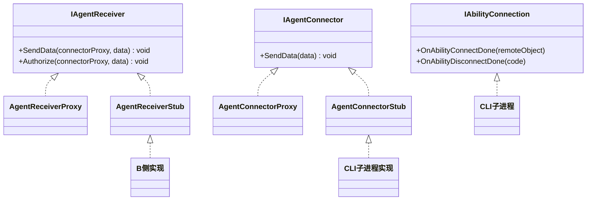
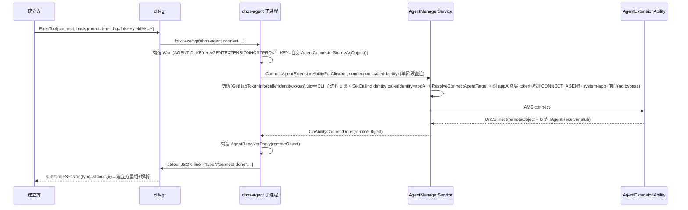
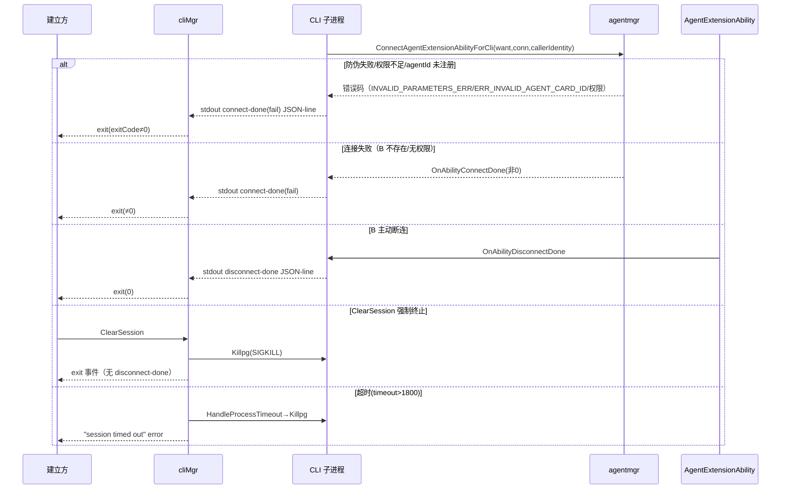

# 架构设计

> 确认目标仓和模块的架构约束、关键设计决策、Spec 拆分方向。复杂度：标准。
> 本版据 codecheck 报告修订：采用 ForCli 接口+callerIdentity 传播（替代 IsCliToolToken 放行/两阶段 preflight）、修事件契约失真、整改文档一致性。
> codecheck 报告（gitignored，位于 `<REPO>/.ignore/`）：`codecheck_report_ohos-agent-cli_20260831.md`（18 findings, all addressed）、`codecheck_report_rebuttal_ohos-agent-cli_20260831.md`（18 disposed）、`codecheck_resolution_ohos-agent-cli_20260828.md`、`codecheck_findings_triage_ohos-agent-cli_20260831.md`。

## 设计元数据

| 字段 | 内容 |
|------|------|
| Design ID | DESIGN-20260528392515 |
| 关联需求 | `proposal.md` |
| 关联 Epic | Agent |
| 目标 Feature | issue-16055 |
| 复杂度 | 标准 |
| 目标版本 | OpenHarmony-7.0-Release（committed） |
| Owner | yangxuguang-huawei |
| 状态 | Approved |

## 需求基线

> 需求基线详见 proposal.md。以下仅列出设计阶段需要额外强调的要点。

| 项 | 补充说明 |
|----|----------|
| 连接范围 | 仅 `AgentCardType::APP`，走 `ConnectStandardAgentExtensionAbility` 标准路径（非 LOW_CODE 共享 host） |
| 运行模型 | connect 子命令长驻；**长驻/background 由 cliMgr 既有 yield-time 机制承担（ADR-10，yield 部分零改动）**；callerIdentity 注入需 tool_util.cpp 新增 env（ADR-9 env 注入在 callerIdentity 场景恢复采用，非零改动）；connect-done/OnData 等经 stdout 文本流 JSON-line 回流（ADR-7）；sendData/authorize=stdin 协议；disconnect=stdin 走正常流程；ClearSession=SIGKILL 兜底 |
| connect 单阶段 | CLI 调 `ConnectAgentExtensionAbilityForCli(want, connection, callerIdentity)` 直连（ForCli 内联 ResolveConnectAgentTarget + enforce APP，无 preflight；`GetAgentCardTypeForConnect` 不再用于 CLI connect）；Want 必含 `AGENTID_KEY`，agentId 须预注册为 APP（O-12） |
| 双向通道 | 见下方「双向通道方向（最终结论）」 |
| authorize 语义 | CLI 仅透传 opaque data（调 `IAgentReceiver::Authorize`），decision/resource 与 ack 由 Agent 侧定义（O-5/O-6 已关闭） |
| 调用方配额 | 调用方最多连 5 个不同 Agent（并发）——由 agentmgr 既有 `AdmitStandardAgentConnectionLocked`+`MAX_AGENT_CONNECTIONS_PER_CALLER=5`（keyed by callerUid+agentId，disconnect 释放）保证；CLI 路径自动适用，不跳过配额；callerUid=app A uid（O-4）→ 与 JS 路径共享配额桶，不绕过。无需新增逻辑 |

## 上下文和现状

### 涉及仓和模块

> 仓、模块、当前职责、影响类型详见 proposal.md"影响范围"。本节补充设计层面的架构现状。

| 仓库 | 补充架构说明 |
|------|-------------|
| ability_runtime/tools/ohos-agent（新） | 镜像 tools/ohos-aa 范式；ohos_cli_executable + ohos-agent.json；长驻 connect 子进程 |
| ability_runtime/cli_tool_framework | session 编排（ExecTool/SendMessage/SubscribeSession/ClearSession/IOMonitor/yield-time）；json 注册消费 + callerIdentity env 注入需 tool_util.cpp 新增（ADR-10 复用既有 yield 机制 yield 部分零改动；ADR-9 env 注入在 callerIdentity 场景恢复采用，非废弃） |
| ability_runtime/agent_runtime_framework/services/agentmgr | connect/disconnect 路径新增 ForCli 接口（ConnectAgentExtensionAbilityForCli/DisconnectAgentExtensionAbilityForCli）+ IsCliToolToken+CCM 特性门禁（**非绕过**：防伪 GetHapTokenInfo(callerIdentity.token).uid==CLI 子进程 uid；SetCallingIdentity(callerIdentity=appA)→对 appA 真实 token 强制 CONNECT_AGENT+system-app+前台，no bypass）；既有 3 个 Validate 函数原样（非 CLI 路径） |
| ability_runtime/agent_runtime_framework/interfaces/kits/native/agent_extension/connection | 只读消费 IAgentConnector/IAgentReceiver/AgentConnectorProxy/AgentReceiverStub（不改；头注释 O-7 待修） |
| ability_runtime/agent_runtime_framework/interfaces/inner_api | 新增 2 个 additive ForCli InnerAPI：ConnectAgentExtensionAbilityForCli(want,connection,String callerIdentity)+DisconnectAgentExtensionAbilityForCli(connection,String callerIdentity)（向后兼容，无序列化格式破坏）；其余只读消费 AgentManagerClient |
| sa_profile + selinux | ohos-agent 跑 **claw_cli 域**（`type claw_cli, normal_hap_attr, hap_domain`，type.te:14）；**绝大多数 binder/samgr 规则由 normal_hap_attr 继承已覆盖**（sa_aimgr_climgr/sa_foundation_abilityms get、claw_cli→aimgr/foundation binder、normal_hap_attr↔normal_hap_attr / system_core_hap_attr→normal_hap_attr inbound）。**唯一潜在缺口**：B 宿主为 system_basic_hap 时 `system_basic_hap_attr→normal_hap_attr:binder` 仅有 transfer 无 call（需补 call IF agent 宿主为 system_basic）。见 P2-3 |

### 代码事实基线

> 只记录已由源码验证的事实。引用使用 `文件:行号` 或 `文件:符号`。每条事实落成具体设计约束，并关联适用架构规则。

| 代码引用（文件:行/符号） | 已验证事实 | 关联架构规则 | 对本设计的约束 | 验证来源/可信度 |
|-------------------------|------------|--------------|-----------------|-----------------|
| `agent_runtime_framework/.../connection/src/js_agent_receiver_proxy.cpp:66 / iface_cast<IAgentReceiver>` | host→agent 方向：CLI 持 `AgentReceiverProxy`（包装 `OnAbilityConnectDone` 的 remoteObject），B 实现 `AgentReceiverStub`；`IAgentReceiver::SendData(connectorProxy, data)` **两参数** | OH-ARCH-IPC-SAF | CLI 必须实现 `AgentConnectorStub` + 持 `AgentReceiverProxy`；两参数签名不可改 | 源码，高 |
| `agent_runtime_framework/.../connection/include/js_agent_connector_stub_impl.h:17 / extends AgentConnectorStub` | agent→host 方向：CLI 实现 `AgentConnectorStub`，B 持 `AgentConnectorProxy`；`IAgentConnector::SendData(data)` **一参数** | OH-ARCH-IPC-SAF | CLI 实现 `AgentConnectorStub` 接收 B→CLI 回调（OnData/OnAuthorize） | 源码，高 |
| `agent_runtime_framework/.../connection/include/iagent_receiver.h` / `iagent_connector.h` 头文件注释 | 头注释方向与代码相反（O-7）：注释称 host→agent=IAgentConnector，代码实际 host→agent=IAgentReceiver | OH-ARCH-ERROR-LOG | 以代码为准；Stage 3 顺手修正头注释（非行为变更），TASK-6 | 源码，高 |
| `cli_tool_framework/.../tool_util.cpp:191/206` | cliMgr（其 caller=appA）可用 `ResetCallingIdentity` 捕获 appA 身份串；callerIdentity env 注入需 tool_util.cpp 新增（非零改动） | OH-ARCH-SUBSYSTEM | cli_tool_framework callerIdentity env 注入为新增改动，范围自洽；不反向依赖 cli_tool 内部 | 源码，高 |
| `base/security/selinux_adapters/sandbox_manager.cpp:1210` | claw_sandbox 以 `config_.uid`（app A uid）运行 CLI 子进程；进程 uid=app A uid（token 虽 TOKEN_SHELL 但进程 uid=app A） | OH-ARCH-IPC-SAF | agentmgr `GetCallingUid()`=app A uid；`callerUserId=callerUid/200000` 正确（O-4） | 源码，高 |
| `claw_token_info_manager.cpp:260` / `claw_sandbox:990 InitCliToken` | claw_sandbox `InitCliToken` 无条件调（type:"cli" 亦调）→ `ToolTokenInfoManager::InitCliToken` | OH-ARCH-IPC-SAF | CLI 子进程 token 铸造路径已确认（见下条） | 源码，高 |
| `CreateToolTokenId(ToolTokenType::CLI):186` / `accesstoken_id_manager.cpp:117 CreateAndRegisterTokenId(...,toolFlag=1)` / `SetAccessToken:1026` | `tokenType=(type==CLI)?TOKEN_SHELL:TOKEN_HAP`=TOKEN_SHELL；`CreateAndRegisterTokenId(tokenType,0,0,1)` 第4参 `toolFlag=1`；`SetAccessToken` 写子进程。`IsCliToolToken`=`toolFlag==1 && type==TOKEN_SHELL`→TRUE | OH-ARCH-IPC-SAF | `IsCliToolToken` **成立**（作为 ForCli 特性门禁，非绕过）；CLI 子进程 token=TOKEN_SHELL（非 appA HAP token）→ 鉴权 tokenId-based 看不到 appA 的 CONNECT_AGENT | 源码，高 |
| `agent_runtime_framework/services/agentmgr/src/agent_manager_service.cpp:438 / RequestStandardAgentConnect` | agentmgr `:438` 捕获 IPC caller（`callerIdentity`）→ 经 AMS `AgentCallerIdentityScope` 还原 caller | OH-ARCH-IPC-SAF | CLI 路径下：若不传播 appA，:438 捕获=CLI 子进程 token→B 侧 fail；故需 ForCli callerIdentity 传播 appA | 源码，高 |
| `ability_manager_service.cpp:6087 / VerifyAgentConnectRequest` + `AgentCallerIdentityScope::ApplyIfNeeded` | AMS B 侧能力鉴权（CheckCallPermission+visibility）经 `AgentCallerIdentityScope` 还原 callerIdentity | OH-ARCH-IPC-SAF | 经 callerIdentity 传播 appA 后，:438 捕获=appA→AMS 还原 appA→B 侧见 appA HAP token（端到端通） | 源码，高 |
| `binder_invoker.cpp ResetCallingIdentity 串格式` + `PID_LEN`/`ACCESS_TOKEN_MAX_LEN` | 身份串格式（sid+"<"+zero20(token)+zero20(realPid)+pidUid）用内部常量（PID_LEN/ACCESS_TOKEN_MAX_LEN）非公开 ipc_core 头 | OH-ARCH-IPC-SAF | agentmgr 无法从 tokenId 构造身份串；故 callerIdentity 以 String 入参（cliMgr 捕获的串，格式无关），非入 Want | 源码，高 |
| `cli_tool_framework/.../exec_options.h:32-33` | `background`/`yieldMs` 字段；`!background && yieldMs!=0`→PostExecToolTask | OH-ARCH-SUBSYSTEM | 复用 cliMgr 既有 yield-time 机制；yield 部分零改动 | 源码，高 |
| `cli_tool_framework/.../cli_tool_manager_service.cpp:500` / `:128 HandleProcessYieldTimeout` | `!background&&yieldMs!=0`→PostExecToolTask；超 yieldMs → `HandleProcessYieldTimeout` 自动 `SetBackground(true)` + `DispatchExecToolReplyEvent` 回流 session info，**不 kill** | OH-ARCH-SUBSYSTEM | yield 已优雅降级，无需拒绝 background=false；后续 stdout 经 SubscribeSession 增量交付 | 源码，高 |
| `base/security/selinux/.../type.te:14` | `type claw_cli, normal_hap_attr, hap_domain`；claw_cli 继承 normal_hap_attr | OH-ARCH-COMPONENT-BUILD | 绝大多数 binder/samgr 规则由 normal_hap_attr 继承已覆盖 | 源码，高 |
| `base/te/normal_hap.te:28` / `:32` / `:65` / `:86` / `claw_cli.te:58/50/46` / `system_core_hap.te:16` | sa_aimgr_climgr/sa_foundation_abilityms get ✅；出站 claw_cli→aimgr/foundation/samgr binder ✅；入站 B(normal_hap)→claw_cli ✅；入站 B(system_core_hap)→claw_cli ✅ | OH-ARCH-COMPONENT-BUILD | 多数规则已覆盖（见 P2-3） | 源码，高 |
| `bundlemanager:26` | `system_basic_hap_attr→normal_hap_attr:binder` 仅有 transfer，**无 call** | OH-ARCH-COMPONENT-BUILD | B=system_basic_hap→claw_cli 的 AgentConnectorStub(SendData/Authorize) 需 call；IF agent 宿主可为 system_basic，需补 call 规则（P2-3） | 源码，中 |
| `cli_tool_framework/.../cli_event_reply_manager.cpp:41-45` | cliMgr SA 死亡时 `ClearAllEvent` 不 reject pending `EventReplyCallback`→建立方 `ExecTool(connect)` reply Promise 永挂 | OH-ARCH-ERROR-LOG | 建立方客户端须设 connect 超时兑底，不依赖 cliMgr reply（IH-3） | 源码，高 |
| `cli_tool_framework/.../session_record.cpp` | exitCode 存原始 waitpid status（如 256 非 1）而非 exit code | OH-ARCH-ERROR-LOG | 数值语义错但不影响「exitCode≠0」失败判据（256≠0 仍判失败）；建立方只判 ≠0（IH-4） | 源码，高 |
| `io_monitor.cpp HandleReadableFd` | 按块回调裸字节（不分帧），≤4096 | OH-ARCH-IPC-SAF | IOMonitor 两端不分帧（stdin 原样写、stdout 按 4096 块回调），分帧责任落协议层（ADR-6/ADR-7） | 源码，高 |
| 既有常量 `MAX_AGENT_CONNECTIONS_PER_CALLER=5`（`agent_connect_manager.cpp:33`）/ `MAX_LOW_CODE_AGENTS_PER_HOST=100`（`:34`）/ `AdmitStandardAgentConnectionLocked`（`:243`，强制于 `callerQuotas_[callerUid]` 单一账本：新 `quotaKey` 且 `callerQuota.size()>=5` 拒绝，否则 `callerQuota[quotaKey]++`）/ `AdmitLowCodeAgentLocked`（`:255`，`session.agents.size()>=100` 拒绝，LOW_CODE 独立宿主计数，不与 APP 标准路径共享）/ `RegisterStandardAgentConnection`（`:368`） | 调用方最多连 5 个不同 Agent（keyed by callerUid+agentId，disconnect 释放）；LOW_CODE 另有每宿主 100 实例上限（CLI=APP 不触及 LOW_CODE 路径） | OH-ARCH-SUBSYSTEM | CLI 路径自动适用配额，不跳过；callerUid=app A uid→与 JS 路径共享配额桶。ForCli 不得直接引用 `callerQuotas_`/`Admit*`/`Release*`/`MAX_AGENT*`/`MAX_LOW_CODE*`，须经 `ConnectStandardAgentExtensionAbility` 委托 | 源码，高 |
| 既有常量 `MAX_TIMEOUT=1800s` / `INPUT_WRITE_TIMEOUT_MS=30s` / `MAX_LINE_BYTES=200*1024` / 队列上限 4MB/4096 | cliMgr 超时/写超时/行上限/队列总量 | OH-ARCH-ERROR-LOG | 长驻 session 受 1800s 上限；SendMessage 30s 写超时；子进程内部 lineBuf≤200KB（design 级内部上限，非公共合约=sendMessage 10240）；pending 队列 4MB | 源码，高 |
| `cli_tool_framework/.../tool_util.cpp:183/209 GenerateSandboxConfig` / `:223/243 GenerateCmdSandboxConfig` / `base/accesscontrol/sandbox_manager/modules/claw_sandbox/src/sandbox_manager.cpp:1005/:1901/:1959` | ExecTool 路径 `GenerateSandboxConfig`（:183）注入 `envConfig["ohos_cli_callerIdentity"]=callerIdentity`（:209，+callerBundleName/Uid/TokenId，经 `ResetCallingIdentity/SetCallingIdentity` 捕获 appA 实例身份）；ExecCmd 路径 `GenerateCmdSandboxConfig`（:223）用 `config["env"]=param.env`（:243，调用方自传，**不注入 callerIdentity**，无 ResetCallingIdentity dance）。claw_sandbox `:1005 AddCliBinaryInvokerTokenFlag`+ioctl 对称应用 CLI-tool token flag（两路径均经 claw_sandbox，`IsCliToolToken` 门禁对称成立）；`:1959/:1901` 忠实 setenv config.env 给子进程 | OH-ARCH-IPC-SAF | execCmd 子进程 `getenv("ohos_cli_callerIdentity")` 返 null（`ohos_agent_command.cpp:131`/`session_protocol.cpp:93`）→ForCli `SetCallingIdentity("")` 身份链断（防伪 uid 比对/AMS 还原失据）；token-flag 非额外阻断（对称）。故 ohos-agent connect 契约路径仅为 execTool（spec R-35）；execCmd 不在受支持范围 | 源码，高 |
| `cli_tool_framework/.../cli_tool_manager_service.cpp:904-910 ValidateSessionLimit` / `:1067`(ExecTool)/`:1099`(ExecCmd) / `services/common/src/ccm_util.cpp:33-40 GetCliConcurrencyLimit`+`:24 MAX_CLI_QUANTITY` / `services/common/include/ccm_util.h:24 DEFAULT_MAX_CLI_QUANTITY=8` / `cli_error_code.h:33 ERR_SESSION_LIMIT_EXCEEDED=35700001` / `napi cli_manager_error_utils.cpp:46`+`include/cli_manager_error_utils.h:31 ERROR_REACH_LIMIT=35600031` | `ValidateSessionLimit` 读 `CcmUtil::GetCliConcurrencyLimit()`（CCM `const.sys.cli.limit_maximum_concurrency_quantity`，默认 8）→与全局 `sessionRecords_.size()`（跨所有调用方、不分 caller 的全局存活会话数；1 会话=1 工具进程）比对，`>=cliQuantity` 返 `ERR_SESSION_LIMIT_EXCEEDED=35700001`；ExecTool/ExecCmd 入口 spawn 前均调（早拒）；napi 映射为公共 `ERROR_REACH_LIMIT=35600031`（"Maximum number of processes has been reached"） | OH-ARCH-SUBSYSTEM | 并发进程上限=CCM `const.sys.cli.limit_maximum_concurrency_quantity`（默认 8，可配，cliMgr 既有边界，非性能）；与每调用方 Agent 连接配额=5（agentmgr-side `AdmitStandardAgentConnectionLocked`，connect-done(fail)）是**不同层、不同计数单位**的两道边界：35600031=cliMgr 全局会话上限（入口早拒），配额=5=agentmgr 每调用方（spec R-11） | 源码，高 |

**基线规则：**

- 设计结论与代码事实冲突时，先确认目标版本和分支；不得直接忽略现状。
- 只在注释、README 或二手资料中出现而未被源码/测试验证的内容，标记为待验证，不进入 Approved 设计约束。
- execution-plan 的文件范围必须能追溯到本表、调用链分析或明确的新建文件决策。

### 调用链层级分析

> 从最上层到最底层逐层扫描调用链路。

| 层 | 模块 | 职责 | 修改类型 |
|----|------|------|----------|
| 调用方（HAP/框架） | Caller | 经 `CliToolMGRClient::ExecTool/SendMessage/SubscribeSession/ClearSession` 编排 session；设 background/yieldMs/timeout；捕获 appA callerIdentity | 新增（调用侧） |
| cli_tool_framework（胶水） | CliToolManagerService（SA）+ tool_util | fork+execvp 子进程；stdin/stdout 管道；yield-time；callerIdentity env 注入（tool_util.cpp 新增）；IOMonitor 按块回调 | 修改（callerIdentity env 注入新增；yield 复用零改动） |
| CLI 子进程（胶水） | ohos-agent connect | 构造 Want（AGENTID_KEY + AGENTEXTENSIONHOSTPROXY_KEY）；调 ForCli connect；持 AgentReceiverProxy；实现 AgentConnectorStub；stdin/stdout JSON-line 协议；poll 长驻循环 | 新增 |
| inner_api | AgentManagerClient | 新增 `ConnectAgentExtensionAbilityForCli`/`DisconnectAgentExtensionAbilityForCli`（additive InnerAPI，向后兼容） | 新增 |
| 服务 | AgentManagerService（agentmgr, SA 185） | ForCli 防伪+SetCallingIdentity(callerIdentity=appA)+ResolveConnectAgentTarget+enforce APP+对 appA 真实 token 强制 CONNECT_AGENT/system-app/前台（no bypass）；:438 捕获 appA→AMS 还原 | 新增（ForCli 路径）+ 既有 Validate 原样 |
| 服务 | AbilityManagerService（AMS） | `VerifyAgentConnectRequest`+`AgentCallerIdentityScope::ApplyIfNeeded` 还原 callerIdentity→B 侧 CheckCallPermission+visibility 见 appA HAP token | 复用（不改） |
| kits/native（接口） | iagent_receiver/iagent_connector + proxy/stub | host↔agent 双向 IPC 接口描述符 | 复用（不改；头注释 O-7 待修） |
| AgentExtensionAbility（B） | APP 类型 host | OnConnect 返回 IAgentReceiver stub；持 AgentConnectorProxy；SendData/Authorize 回调 CLI | 复用（不改） |
| sa_profile + selinux | claw_cli 域 | ohos-agent 跑 claw_cli（normal_hap_attr 继承） | 修改（潜在 call 缺口 P2-3） |

**检查项：**

- [x] 调用链每一层都已覆盖（从最上层到最底层）
- [x] 每层职责边界清晰，无跨层违规调用（CLI→agentmgr 经 inner_api；CLI↔B 经 kits/native IPC；不越层）
- [x] 每层修改类型明确

### 适用架构规则

| Rule ID | 适用原因 | 设计结论 | 验证方式 |
|---------|----------|----------|----------|
| OH-ARCH-LAYERING | CLI 子进程经 inner_api（AgentManagerClient）连服务，经 kits/native 接口连对端 | 调用方向：CLI→agentmgr（inner_api）+ CLI↔AgentExtensionAbility（kits/native IPC）；不越层 | 依赖检查/代码评审 |
| OH-ARCH-SUBSYSTEM | 复用 cli_tool_framework session 模型 | json 注册消费 + 既有 yield 复用 + callerIdentity env 注入（tool_util.cpp 新增），不反向依赖 cli_tool 内部 | 代码评审 |
| OH-ARCH-IPC-SAF | 双向 IPC（IAgentReceiver/IAgentConnector）+ cliMgr↔子进程 stdin/stdout 管道 | IPC 复用既有接口描述符；序列化格式不变 | 集成测试 |
| OH-ARCH-API-LEVEL | 无 Public/System API 变更 | N/A | — |
| OH-ARCH-COMPONENT-BUILD | 新增 ohos_cli_executable 部件 + json 注册 | BUILD.gn + ohos-agent.json；install 到 /system/bin/cli_tool/{executable,configs} | 构建验证 |
| OH-ARCH-ERROR-LOG | connect 失败/断连/超时上报 | 复用既有错误码；新增 HiSysEvent 需评估（默认不新增已发布事件） | 单测/hilog |

### 既有模式复用

| 模式 | 参考代码（文件:行/符号） | 适用架构规则 | 必须复用的约定 | 本设计的复用方式 | 偏差及理由 | 关联 Task |
|------|-------------------------|--------------|------------------|------------------|------------|-----------|
| CLI 工具范式 | `tools/ohos-aa/`（单二进制 + ohos-aa.json + shell_command 基建） | OH-ARCH-COMPONENT-BUILD | ohos_cli_executable + cli_config_file + install_images=["system"] + subsystem/part 名；main 不装 60s 定时器（connect 长驻例外） | 镜像：tools/ohos-agent 目录复用 tools/aa/src/shell_command.cpp 基建；connect 子命令不装 60s CommandTimer | main 对 `operation==connect` 跳过 60s 定时器（长驻语义）；其他子命令保持 ohos-aa 一次性行为 | TASK-1 |
| session 编排 | `cli_tool_framework/.../cli_tool_manager_service.cpp:500/:128` + `exec_options.h:32-33` | OH-ARCH-SUBSYSTEM | ExecTool/SendMessage/SubscribeSession/ClearSession/IOMonitor/yield-time；background/yieldMs 字段；`HandleProcessYieldTimeout` 自动 SetBackground | 复用既有 yield-time（yield 部分零改动）；调用方按 background=true 或 background=false+yieldMs=Y 调用 | callerIdentity env 注入为 tool_util.cpp 新增（非零改动），范围自洽 | TASK-1/TASK-3 |
| 双向 IPC proxy/stub | `.../connection/src/js_agent_receiver_proxy.cpp:66` + `.../js_agent_connector_stub_impl.h:17` | OH-ARCH-IPC-SAF | host→agent=IAgentReceiver（两参 SendData）；agent→host=IAgentConnector（一参 SendData） | CLI 持 AgentReceiverProxy + 实现 AgentConnectorStub | 头注释方向反（O-7），Stage 3 顺手修正，非行为变更 | TASK-2 |
| Want 键交付 stub | `AGENTEXTENSIONHOSTPROXY_KEY`（JS host 已用此路径）+ `AGENTID_KEY` | OH-ARCH-IPC-SAF | CLI 把自身 `AgentConnectorStub->AsObject()` 写入 connect Want；B 用 `want.GetRemoteObject` 读回包 AgentConnectorProxy | 直接复用（runtime-agnostic，纯 Want marshalling） | 无 | TASK-2 |
| agentmgr 配额 | `AdmitStandardAgentConnectionLocked`+`MAX_AGENT_CONNECTIONS_PER_CALLER=5` | OH-ARCH-SUBSYSTEM | keyed by callerUid+agentId，disconnect 释放 | CLI 路径自动适用（callerUid=app A uid，与 JS 路径共享配额桶） | 无 | TASK-4 |
| 身份传播 | `binder_invoker.cpp ResetCallingIdentity/SetCallingIdentity` + agentmgr `:438` + AMS `AgentCallerIdentityScope` | OH-ARCH-IPC-SAF | 身份串格式无关传播；:438 捕获→AMS 还原 | cliMgr 捕获 appA 串→env→ForCli 入参→agentmgr SetCallingIdentity | 身份串内部常量非公开，故以 String 入参（非入 Want）；防伪用 GetHapTokenInfo(callerIdentity.token).uid==CLI 子进程 uid | TASK-4 |

### 双向通道方向（最终结论，以代码为准）

> `iagent_receiver.h`/`iagent_connector.h` 头文件注释方向与代码相反（O-7，Stage 3 顺手修正，非行为变更）。以下为代码核实结论：

- **host → agent（CLI → B）**：接口 `IAgentReceiver`，方法 `SendData(connectorProxy, data)` **两参数**；CLI 持 `AgentReceiverProxy`（包装 `OnAbilityConnectDone` 的 remoteObject），B 实现 `AgentReceiverStub`。证据：`js_agent_receiver_proxy.cpp:66 iface_cast<IAgentReceiver>`。
- **agent → host（B → CLI）**：接口 `IAgentConnector`，方法 `SendData(data)` **一参数**；CLI 实现 `AgentConnectorStub`，B 持 `AgentConnectorProxy`。证据：`js_agent_connector_stub_impl.h:17 extends AgentConnectorStub`。

## 不涉及项承接

> proposal.md 已完成 N/A 判定。本节仅对 proposal 中标记为"涉及"且需展开设计的维度给出结论。

| 维度 | 设计结论 |
|------|----------|
| 性能 | 长驻 session 受 MAX_TIMEOUT=1800s + cliMgr 并发上限约束；无新性能指标 |
| 安全与权限 | cliMgr 入口门禁（系统应用+EXEC_CLI_TOOL）；agentmgr 新增 **CLI 专用 ForCli 接口**（ConnectAgentExtensionAbilityForCli/DisconnectAgentExtensionAbilityForCli，IsCliToolToken+CCM 门禁=特性开关，**非绕过**）：cliMgr 用 ResetCallingIdentity 捕获 app A 身份串→env `ohos_cli_callerIdentity`→ohos-agent getenv→ForCli 入参（String callerIdentity，不入 Want）；agentmgr 防伪（callerIdentity 的 token.uid==CLI 子进程 uid=app A uid，setresuid+cap-drop 不可伪造）+app A 真实 CONNECT_AGENT/system-app/前台（对 callerIdentity 的 token）+ SetCallingIdentity(appA)→:438 捕获 appA→AMS AgentCallerIdentityScope 还原 appA→B 侧 CheckCallPermission+visibility 见 appA HAP token→端到端通。既有 3 个 Validate 函数原样（非 CLI 路径）；CLI 走 ForCli。IsSessionOwner |
| 兼容性 | 新增工具 + ForCli InnerAPI（additive，向后兼容）；cli_tool_framework callerIdentity env 注入新增（非零改动）；非 CLI 行为不变；无 SubCommandInfo/Parcelable/d.ts 变更，向后兼容 |
| IPC/跨进程 | 见双向通道方向 + ADR-4 + 数据流章节 |
| 构建与部件 | 见构建系统影响章节 |

## 关键设计决策

> 每个关键决策记录推荐方案、替代方案及取舍理由。

| 决策 ID | 问题 | 推荐方案 | 探索过的替代方案 | 取舍理由 | 影响 |
|---------|------|----------|-----------------|------|------|
| ADR-1 | 工具形态 | 独立 `ohos-agent` 二进制（镜像 ohos-aa，单 connect 子命令，长驻默认） | 复用 ohos-aa 新增 connect（放弃：ohos-aa main 一次性 60s CommandTimer+_exit，长驻需 retrofit，职责混淆）；复用 aa（同前） | 长驻+stdin+stdout 与一次性能力管理是不同关注点；独立二进制使长驻为默认语义 | 新增一个二进制 + selinux 域（同 ohos-aa） |
| ADR-2 | 运行模型 | connect=ExecTool 长驻 session；sendData/authorize=SendMessage(sessionId)→stdin；disconnect=stdin 走正常流程→disconnect-done；ClearSession=SIGKILL 兜底→exit | REPL（放弃）；单次（放弃：无法维持 IAbilityConnection） | IAbilityConnection 为进程内存对象，跨进程不可传；cliMgr 有 SendMessage/SubscribeSession/ClearSession + yield 完整原语 | 子命令仅 connect；其余为 session 操作 |
| ADR-3 | 双向通道接口归属 | host→agent=`IAgentReceiver`（`SendData(connectorProxy,data)` 两参数，CLI 持 `AgentReceiverProxy`，B 实现 `AgentReceiverStub`）；agent→host=`IAgentConnector`（`SendData(data)` 一参数，CLI 实现 `AgentConnectorStub`，B 持 `AgentConnectorProxy`） | 按头文件注释（放弃：注释方向与代码相反，已核实） | 证据见「双向通道方向」 | CLI 实现 AgentConnectorStub + 持 AgentReceiverProxy |
| ADR-4 | host stub 交付给对端 | 复用 Want 键 `AGENTEXTENSIONHOSTPROXY_KEY`：CLI 把自身 `AgentConnectorStub->AsObject()` 写入 connect Want，经 agentmgr→AMS→B.OnConnect，B 用 `want.GetRemoteObject` 读回包 `AgentConnectorProxy` | 经 connect-IPC reply 回传（放弃）；首次调用捎带（放弃：B 无法主动首调） | runtime-agnostic（纯 Want marshalling），JS host 已用此路径 | CLI 构造 connect Want 时写该键 |
| ADR-5（**最终修订 2026-08-28，ForCli 接口+callerIdentity 传播**）| IsCliToolToken+CCM=特性开关；ForCli 接口传播 appA 真实身份端到端 | 经多轮核实：CLI 子进程 token= TOKEN_SHELL（非 appA HAP token），鉴权 tokenId-based→既看不到 appA 的 CONNECT_AGENT（claw ticket 亦不携带），且 AMS B 侧能力鉴权（CheckCallPermission+visibility）经 AgentCallerIdentityScope 还原 callerIdentity（=agentmgr :438 捕获的 IPC caller）→CLI 路径下=CLI 子进程 token→B 侧 fail。身份串格式（sid+"<"+zero20(token)+zero20(realPid)+pidUid）用内部常量（PID_LEN/ACCESS_TOKEN_MAX_LEN）非公开 ipc_core 头→agentmgr 无法从 tokenId 构造。故解法：cliMgr（其 caller=appA）ResetCallingIdentity 捕获 appA 身份串→env→ohos-agent getenv→ForCli 入参（String callerIdentity，非入 Want）；agentmgr SetCallingIdentity(callerIdentity)（保存的串，格式无关）→:438 捕获=appA→AMS 还原 appA→B 侧见 appA。防伪：GetHapTokenInfo(callerIdentity.token).uid==CLI 子进程 uid（appA uid，不可伪造）。CLI 路径无 preflight（只允许 APP 类型，ForCli 内联 resolve+enforce APP）。 | 原 option F 纯 IsCliToolToken 放行（**废弃**：跳过安全且 B 侧仍 fail）；「CONNECT_AGENT 经 ticket 原样通过」（**废弃**：CLI token 不携带 appA 权限） | 证据：tool_util.cpp:191/206、sandbox_manager.cpp:1210、claw_token_info_manager.cpp:260、agent_manager_service.cpp:438/RequestStandardAgentConnect、ability_manager_service.cpp:6087(AMS VerifyAgentConnectRequest)+AgentCallerIdentityScope::ApplyIfNeeded、binder_invoker.cpp ResetCallingIdentity 串格式+PID_LEN/ACCESS_TOKEN_MAX_LEN 内部非公开 | TASK-6 单测：ForCli 防伪(uid 一致性)+appA 权限/前台+AMS 还原 appA(B 侧见 appA token)；真机联调 |
| ADR-6 | stdin/stdout 协议 | 自定界 JSON 值（self-delimiting）：inputText = 一个 JSON 值，`\n` 为可选空白非必要；cliMgr 原样写不追加 `\n`，ohos-agent 经 nlohmann SAX 结构化解析在 JSON 值闭合时派发；stdout 每 event 追加 `\n` | 文本标签（放弃）；protobuf（放弃） | IOMonitor 两端不分帧（stdin 原样写、stdout 按 4096 块回调），分帧责任落协议层 | 子进程经 SAX 结构化解析 + 跨块累积重组；消费方按 `\n` 重组或自定界解析+JSON 解析 |
| ADR-7 | 事件承载契约 | 自定义事件（connect-done/OnData/OnAuthorize/disconnect-done/error）编码在 **stdout 文本流的 JSON-line 内**；cliMgr 事件类型固定 stdout/stderr/exit/error 四类、`eventSchemas` 运行时不消费；消费方收 type=stdout 的 CliToolEvent（eventData=裸字节块≤4096），**自行跨块按 \n 重组→解析 JSON→按 event 字段分派**。event 名非 cliMgr 事件类型 | 扩展 CliToolEvent.type（放弃：框架固定四类，改框架超范围） | io_monitor.cpp HandleReadableFd 按块回调裸字节，不分帧 | 消费端按行解析；ohos-agent.json eventSchemas 为声明契约 |
| ADR-8 | 调用方配额 | 复用 agentmgr 既有配额链路（keyed by callerUid+agentId，disconnect 释放）：APP/ATOMIC_SERVICE 配额键由 `BuildStandardQuotaKey`（`agent_manager_service.cpp:831`，`key.hostKey=BuildAgentHostKey(want,callingUid)`/`key.agentId=agentId`/`key.isLowCode=false`）构造→`RegisterStandardAgentConnection`（`:563`）→`AdmitStandardAgentConnectionLocked`（`agent_connect_manager.cpp:243/368`）以 `callerQuotas_[callerUid]` 进程级唯一账本强制（`callerQuota.size()>=5` 拒绝 `ERR_MAX_AGENT_CONNECTIONS_REACHED`，否则 `callerQuota[quotaKey]++`；同一 `agentId` 重复连接不新增槽位）；常量 `MAX_AGENT_CONNECTIONS_PER_CALLER=5`（`:33`）。LOW_CODE 另有每宿主 100 实例上限（`MAX_LOW_CODE_AGENTS_PER_HOST=100`（`:34`）+`AdmitLowCodeAgentLocked`（`:255`，`session.agents.size()>=100` 拒绝），LOW_CODE 须同时占调用方 1 槽，不与 APP 标准路径共享宿主计数）——CLI 仅连 APP 不触及。ForCli 路径：`ConnectAgentExtensionAbilityForCli`（`agent_manager_service.cpp:413`）经 `SetCallingIdentity`（`:418-420`）+anti-spoof（`:421-429`，token uid==`cliToolUid`）后于 `:440` 取 `callerUid`，于 `:468` 委托既有 `ConnectStandardAgentExtensionAbility`（`:395`），复用同一 `BuildStandardQuotaKey`/`RegisterStandardAgentConnection`/`AdmitStandardAgentConnectionLocked`，不得另设 ForCli 专用账本或独立上限；JS/ETS 路径（`ConnectAgentExtensionAbility`→`ValidateConnectAgentPermission`（`:709`）→`ConnectStandardAgentExtensionAbility`（`:395`）→`BuildStandardQuotaKey`（`:536/831`）→`RegisterStandardAgentConnection`（`:563`）→`AdmitStandardAgentConnectionLocked`（`agent_connect_manager.cpp:368/243`））原样，ForCli 计入 `callerQuotas_[appA_uid]` 与 JS 共享。`agent_connect_manager.{cpp,h}`/`agent_connect_manager_types.{cpp,h}` 的配额常量/`Admit*`/`Release*`/`callerQuotas_` 语义不得为 ForCli 改动 | 新增 CLI 专用配额逻辑（放弃：重复造轮子，且与 JS 路径不一致；ForCli 直接引用 `callerQuotas_`（放弃：破坏既有账本唯一性，绕过风险）） | 既有机制已满足语义；CLI 子进程 uid=app A uid（O-4） | 无新增配额逻辑 |
| ADR-9 | callerIdentity env 注入 | cliMgr（caller=appA）用 `ResetCallingIdentity` 捕获 appA 身份串→注入 env `ohos_cli_callerIdentity`→ohos-agent 子进程 getenv→ForCli 入参（String callerIdentity） | 把 callerIdentity 入 Want（放弃：Want 经 B 侧可见，且身份串含 token 不宜入 Want）；cliMgr 直接调 ForCli（放弃：cliMgr 不持有 AgentManagerClient 语义边界） | env 注入复用 cli_tool_framework 既有 env 范式；callerIdentity 串格式无关，agentmgr SetCallingIdentity 直接用 | tool_util.cpp 新增 env 注入（非零改动）；ADR-10 yield 复用协同 |
| ADR-10 | 长驻/background 处理（ADR-9 env 注入恢复采用，协同） | 复用 cliMgr **既有 yield-time 机制**：ExecTool 以 `background=true`（首选）或 `background=false + yieldMs=Y` 启动；若 `background=false` 且运行超 `yieldMs`，cliMgr `HandleProcessYieldTimeout`(:128) 自动 `SetBackground(true)` + `DispatchExecToolReplyEvent` 回流 session info，**不 kill**，session 继续后台运行；后续 stdout 经 SubscribeSession 增量交付。证据：`exec_options.h:32-33`(background/yieldMs)、`cli_tool_manager_service.cpp:500`(!background&&yieldMs!=0→PostExecToolTask)、`:128 HandleProcessYieldTimeout` | ADR-9 env 注入（在 callerIdentity 场景恢复采用：tool_util.cpp 新增 callerIdentity env 注入 ohos_cli_callerIdentity）；拒绝 background=false（废弃：yield 已优雅降级，无需拒绝） | yield 部分零改动；callerIdentity env 注入为 tool_util.cpp 新增（非零改动），范围自洽；既有机制经 ohos-aa 先例可用 | 调用方按 background=true 或 background=false+yieldMs=Y 调用；callerIdentity env 注入（ohos_cli_callerIdentity）；无沙箱 config 依赖。**误用兜底**：connect 支持路径=background=true（AC-1）；若误用 background=false 须显式带 yieldMs>0 触发 yield 安全网（AC-12），否则 background=false+yieldMs=0 将跑至 MAX_TIMEOUT 被 kill（R-23，未支持误用）。ohos-agent.json connect subcommand 声明推荐 yieldMs（如 5s）供调用方参考（声明性，cliMgr 不强制默认；yield 部分零改动） |
| ADR-11 | connect 握手 | **废弃（被 ADR-5 最终修订取代）**：原两阶段 preflight | 单阶段 `ConnectAgentExtensionAbilityForCli(want, connection, callerIdentity)` 直连（ForCli 内联 `ResolveConnectAgentTarget`+enforce APP，无 preflight；`GetAgentCardTypeForConnect` 不再用于 CLI connect） | 原 ADR-11 两阶段 preflight 因 ADR-5 ForCli callerIdentity 传播而废弃；Want 必含 `AGENTID_KEY` 非空，agentId 须预注册为 `AgentCardType::APP`（O-12） | TASK-2 改单阶段 + Want 契约 |

> **P0-1 已闭环（定论，读 claw_sandbox token 铸造到底）**：`IsCliToolToken=TRUE` 确认——claw_sandbox `:990 InitCliToken` 无条件调（type:"cli" 亦调）→ `ToolTokenInfoManager::InitCliToken`→`CreateToolTokenId(ToolTokenType::CLI)`（:186 `tokenType=(type==CLI)?TOKEN_SHELL:TOKEN_HAP`=TOKEN_SHELL）→ `CreateAndRegisterTokenId(tokenType,0,0,1)` 第4参 `toolFlag=1`（`accesstoken_id_manager.cpp:117` 签名确认）→ `SetAccessToken`（:1026 type!="shell" 用 `tokenIdEx.tokenIDEx`）写子进程。`IsCliToolToken`=`toolFlag==1 && type==TOKEN_SHELL`→TRUE。v3 报告"倾向失败"误判（漏看 InitCliToken 铸造）已纠正。`IsCliToolToken` **成立**（作为 ForCli 特性门禁，非绕过）；采用 **ForCli 接口+callerIdentity 传播**（替代 **(F) 纯 IsCliToolToken 放行**——放行会跳过安全且 B 侧仍 fail）。**前台可校验**（callerIdentity 传播 appA pid→SetCallingIdentity 后 GetCallingPid=appA pid→复用 ValidateConnectCallerForeground），O-13 化解。

## 设计骨架

### 骨架范围

| 骨架项 | 目标 | 不包含 | 验证方式 |
|--------|------|--------|----------|
| 工具骨架 | tools/ohos-agent 目录 + BUILD.gn + ohos-agent.json + OhosAgentShellCommand 空壳 + main（connect 不装 60s 定时器） | connect 完整逻辑 | 构建通过 + `ohos-agent connect --help` |
| 连接骨架 | RunAsConnect + 单阶段 ConnectAgentExtensionAbilityForCli(want,connection,callerIdentity) + IAbilityConnection + OnAbilityConnectDone（取 AgentReceiverProxy）+ AgentConnectorStub | stdin 协议 + 完整事件上报 | connect 能建连并打印 connect-done |
| session 协议骨架 | stdin 自定界 JSON 解析（BoundarySax）+ stdout JSON-line 事件写入 | authorize/agent-invoked 完整语义 | sendData 能触发 AgentReceiverProxy->SendData |

### 骨架 Spec 拆分

| Task ID | 目标 | 受影响文件 | AC |
|---------|------|------------|-----|
| TASK-SKEL-1 | 工具骨架 + main + connect 子命令空壳 | tools/ohos-agent/{BUILD.gn,ohos-agent.json,src/main.cpp,src/ohos_agent_command.cpp,include/ohos_agent_command.h} | WHEN 构建 THEN 产出 ohos-agent；WHEN `ohos-agent connect --help` THEN 输出帮助 |
| TASK-SKEL-2 | 单阶段 connect + IAbilityConnection + 双向 proxy/stub + Want 键交付 | src/agent_connection.cpp/.h（新） | WHEN connect THEN ConnectAgentExtensionAbilityForCli(want,connection,callerIdentity)→OnAbilityConnectDone 取得 AgentReceiverProxy、AgentConnectorStub 就绪 |
| TASK-SKEL-3 | stdin/stdout JSON-line 协议 + 事件上报 + 长驻循环 | src/session_protocol.cpp/.h（新） | WHEN SendMessage(sendData) THEN 调 AgentReceiverProxy->SendData；WHEN B 回调 THEN stdout JSON-line |

## 后续 Task 拆分

> design.md 以 proposal.md 和已批准的 spec.md 为上游输入。本节描述 design 输出到 Plan 阶段的衔接信息。

| Task ID | 目标 | 受影响文件 | 依赖 |
|---------|------|------------|------|
| TASK-1 | 工具骨架 + main + connect 空壳 + BUILD/json + selinux 确认（主要靠 normal_hap_attr 继承；潜在 system_basic call 缺口待确认 agent 宿主 hap 级别） | tools/ohos-agent/*, base/security/selinux_adapter（确认） | design.md + spec.md Approved |
| TASK-2 | 单阶段 connect（ConnectAgentExtensionAbilityForCli(want,connection,callerIdentity)）+ IAbilityConnection + 双向 proxy/stub + Want 键交付 | tools/ohos-agent/src/agent_connection.* | TASK-1 |
| TASK-3 | stdin/stdout JSON-line 协议 + CommandLoop REPL（poll stdin+self-pipe, JSON 解析分派）+ 事件上报 + 60s CommandTimer 跳过 | tools/ohos-agent/src/session_protocol.*, src/main.cpp | TASK-2 |
| TASK-4 | agentmgr ForCli 接口（ConnectAgentExtensionAbilityForCli/DisconnectAgentExtensionAbilityForCli）+ IsCliToolToken+CCM 特性门禁（非绕过：防伪 GetHapTokenInfo(callerIdentity.token).uid==CLI 子进程 uid；SetCallingIdentity(callerIdentity=appA)→对 appA 真实 token 强制 CONNECT_AGENT+system-app+前台，no bypass）+ CCM 开关 gate | agent_runtime_framework/services/agentmgr/src/agent_manager_service.cpp, services/common/* | TASK-1 |
| TASK-5 | disconnect 正常流程 + ClearSession 兜底 + 子进程死亡清理 | tools/ohos-agent/src/agent_connection.* | TASK-2,TASK-3 |
| TASK-6 | 测试（单测 connect 单阶段/协议/ForCli 防伪(uid 一致性)+appA 权限/前台+AMS 还原 appA(B 侧见 appA token) + 集成 connect→sendData→disconnect；IsCliToolToken=true 断言 O-11；头注释修正 O-7） | tools/ohos-agent/tests/*, agentmgr 单测, kits/native/connection 头注释 | TASK-1~5 |

## API 签名、Kit 与权限

> 新增 2 个 additive ForCli InnerAPI（ConnectAgentExtensionAbilityForCli/DisconnectAgentExtensionAbilityForCli，向后兼容），无 Public/System API 变更。其余只读消费：

### 新增 API

| API 签名 | 类型 | Kit | d.ts 位置 | 权限要求 | SysCap |
|----------|------|-----|-----------|----------|--------|
| `AgentManagerClient::ConnectAgentExtensionAbilityForCli(want, connection, String callerIdentity)` | InnerAPI（新增 additive） | AgentRuntime（agent_runtime_framework/interfaces/inner_api） | -（内部接口无 d.ts） | `ohos.permission.CONNECT_AGENT`（对 callerIdentity 的 appA 真实 token 强制，no bypass） | - |
| `AgentManagerClient::DisconnectAgentExtensionAbilityForCli(connection, String callerIdentity)` | InnerAPI（新增 additive） | 同上 | - | 同上（防伪一致性） | - |

### 变更/废弃 API

| 原有 API | 变更类型 | 新 API | 迁移说明 |
|----------|----------|--------|----------|
| `AgentManagerClient::ConnectAgentExtensionAbility`（既有） | 不变（CLI 不走此路径） | `ConnectAgentExtensionAbilityForCli`（新增并列） | 非 CLI 路径行为不变；CLI 走 ForCli。additive，向后兼容，无序列化格式破坏 |
| `IAgentReceiver::SendData(connectorProxy, data)`（既有两参数） | 不变 | - | host→agent 方向，CLI 持 AgentReceiverProxy 复用 |
| `IAgentConnector::SendData(data)`（既有一参数） | 不变 | - | agent→host 方向，CLI 实现 AgentConnectorStub 复用 |
| `CliToolMGRClient::ExecTool/SendMessage/SubscribeSession/ClearSession` | 不变（复用） | - | session 编排（调用方侧，非 CLI 子进程）；yield-time 机制既内置 |

### 只读消费接口

| 消费接口 | 类型 | 来源 | 用途 |
|----------|------|------|------|
| `IAgentReceiver`/`AgentReceiverProxy` | kits/native | .../agent_extension/connection | host→agent（CLI→B），`SendData(connectorProxy,data)` 两参数 |
| `IAgentConnector`/`AgentConnectorStub` | kits/native | 同上 | agent→host（B→CLI），`SendData(data)` 一参数 |
| `CliToolMGRClient::ExecTool/SendMessage/SubscribeSession/ClearSession` | InnerAPI | cli_tool_framework/interfaces/cli_tool | session 编排（调用方侧，非 CLI 子进程）；yield-time 机制既内置 |

## 构建系统影响

### BUILD.gn 变更

```
文件路径: tools/ohos-agent/BUILD.gn（新增）
变更说明: ohos_cli_executable("ohos-agent") + ohos_agent_cli_source_set（复用 tools/aa/src/shell_command.cpp 基建）；cli_config_file="ohos-agent.json"；install_enable=true；install_images=["system"]；subsystem_name="ability";part_name="ability_runtime"
```

### ohos-agent.json 变更（新增）

```
文件路径: tools/ohos-agent/ohos-agent.json（新增）
内容: name=ohos-agent; executablePath=/system/bin/cli_tool/executable/ohos-agent; hasSubCommand=true;
  subcommands.connect={ inputSchema:{bundleName,abilityName,moduleName,agentId}, outputSchema, requirePermissions:["ohos.permission.CONNECT_AGENT"] };
  eventSchemas={ connect-done, OnData, OnAuthorize, disconnect-done, error }（声明契约，运行时框架不消费，见 ADR-7）
```

### bundle.json 变更

新增 component `ability_runtime` 下 ohos-agent 部件（ohos_cli_executable），依赖 cli_tool_framework、agent_runtime_framework（inner_api）、selinux 域 claw_cli。

### sa_profile / selinux

```
文件路径: base/security/selinux_adapter（claw_cli.te 已有规则，**主要靠 normal_hap_attr 继承，多数无需新增**）
变更说明: claw_cli 域声明带 `normal_hap_attr`（type.te:14），继承 hap 级宽泛规则，**绝大多数已覆盖**：
  - sa_aimgr_climgr:samgr_class get ✅（normal_hap.te:28 `allow normal_hap_attr sa_aimgr_climgr:samgr_class{get}`）
  - sa_foundation_abilityms:samgr_class get ✅（base/te/normal_hap.te:86）
  - 出站 claw_cli→aimgr/foundation/samgr binder ✅（claw_cli.te:58/50/46 + normal_hap.te:32）
  - 入站 B(normal_hap)→claw_cli ✅（base/te/normal_hap.te:65 `allow normal_hap_attr normal_hap_attr:binder{call transfer}`）
  - 入站 B(system_core_hap)→claw_cli ✅（system_core_hap.te:16 `allow system_core_hap_attr normal_hap_attr:binder{call transfer}`）
  **唯一潜在缺口**：B 宿主为 system_basic_hap 时，`system_basic_hap_attr→normal_hap_attr:binder` 仅有 transfer（bundlemanager:26 等），**无 call** → B 调 claw_cli 的 AgentConnectorStub(SendData/Authorize) 需 call。IF agent 宿主可为 system_basic，需补 `allow system_basic_hap_attr normal_hap_attr:binder { call };`（或 `allow system_basic_hap_attr claw_cli:binder{call}`）。**需确认 AgentExtensionAbility 宿主 hap 级别**——若仅 normal/system_core，则零新增规则。CCM 开关 `const.product.ohos_agent_cli.enabled` 镜像 `kiosk_manager` 范式（`OHOS::system::GetParameter`）gate 工具注册消费与 agentmgr ForCli 特性门禁。
```

> cli_tool_framework：callerIdentity env 注入需 tool_util.cpp 新增（非零改动）；ADR-10 复用既有 yield 机制（yield 部分零改动）；ADR-9 env 注入在 callerIdentity 场景恢复采用（非废弃）。

---

## 可选设计扩展

### 架构图

```
[CLI 调用方(HAP/框架)]
   │ CliToolMGRClient::ExecTool(ohos-agent,connect,background=true | background=false+yieldMs=Y) / SendMessage / SubscribeSession / ClearSession
   ▼
[cliMgr (CliToolManagerService, SA)] ──fork+execvp──▶ [ohos-agent connect 子进程 (A)]
                                                            │ 1) AgentManagerClient::ConnectAgentExtensionAbilityForCli(want,conn,callerIdentity) (单阶段直连, inner_api IPC)
                                                            ▼
                                                      [AgentManagerService (agentmgr, SA 185)] ──AMS connect──▶ [AgentExtensionAbility (B, APP 类型, agentId 预注册)]
                                                            ▲                                                              │
                                                            │  OnAbilityConnectDone: remoteObject = B 的 IAgentReceiver stub
                                                            │  CLI 持 AgentReceiverProxy(→B); CLI 实现 AgentConnectorStub(B→CLI)
                                                            │  CLI 的 AgentConnectorStub->AsObject() 经 Want AGENTEXTENSIONHOSTPROXY_KEY 交付 B
                                                            └────────────── 双向 IPC ─────────────────────────────────────┘
```

### 类图



| 类型/接口 | 现有代码引用或 New | 关系 | 关键职责/签名 | 关联 ADR | 关联 Task |
|-----------|--------------------|------|---------------|----------|-----------|
| `IAgentReceiver` | `iagent_receiver.h`（既有） | host→agent 接口 | `SendData(connectorProxy, data)` 两参数 | ADR-3 | TASK-2 |
| `AgentReceiverProxy` | `js_agent_receiver_proxy.cpp:66`（既有） | 实现 IAgentReceiver；CLI 持有 | 包装 OnAbilityConnectDone 的 remoteObject | ADR-3 | TASK-2 |
| `AgentReceiverStub` | `agent_receiver_stub.h`（既有） | 实现 IAgentReceiver；B 实现 | host→agent 接收端 | ADR-3 | TASK-2 |
| `IAgentConnector` | `iagent_connector.h`（既有） | agent→host 接口 | `SendData(data)` 一参数 | ADR-3 | TASK-2 |
| `AgentConnectorProxy` | `agent_connector_proxy.cpp`（既有） | 实现 IAgentConnector；B 持有 | agent→host 发起端 | ADR-3 | TASK-2 |
| `AgentConnectorStub` | `js_agent_connector_stub_impl.h:17`（既有） | 实现 IAgentConnector；CLI 实现 | agent→host 接收端（OnData/OnAuthorize） | ADR-3 | TASK-2 |
| `IAbilityConnection` | 框架既有 | CLI 实现 | `OnAbilityConnectDone`/`OnAbilityDisconnectDone` | ADR-2/ADR-4 | TASK-2 |
| `AgentManagerClient::ConnectAgentExtensionAbilityForCli` | New（inner_api） | CLI→agentmgr | `(want, connection, String callerIdentity)` | ADR-5/ADR-11 | TASK-4 |

### 数据流/控制流

| 步骤 | 调用方 | 被调用方 | 数据/接口 | 说明 |
|------|--------|----------|-----------|------|
| 1 | 建立方 | cliMgr | ExecTool(connect,args,background=true 或 background=false+yieldMs=Y,timeout≤1800) | fork 子进程；若 background=false+yieldMs=Y，超时后 yield 自动转后台（ADR-10） |
| 2 | CLI 子进程 | agentmgr | ConnectAgentExtensionAbilityForCli(want,connection,callerIdentity) | 单阶段直连：ForCli 防伪(GetHapTokenInfo(callerIdentity.token).uid==CLI 子进程 uid)+SetCallingIdentity(callerIdentity=appA)+ResolveConnectAgentTarget(AGENTID_KEY+预注册 APP 校验) |
| 3 | agentmgr | AMS→B | 对 appA 真实 token 强制 CONNECT_AGENT+system-app+前台(no bypass)→:438 捕获 appA→AMS AgentCallerIdentityScope 还原 appA→ConnectStandardAgentExtensionAbility+SetDeathHandler | B 侧见 appA HAP token；remoteObject 回到 CLI |
| 4 | agentmgr→AMS→B | B | OnConnect 返回 B 的 IAgentReceiver stub | remoteObject 回到 CLI |
| 5 | CLI 子进程 | stdout | connect-done JSON-line | IOMonitor 按块回调 type=stdout→SubscribeSession→建立方跨块重组+JSON 解析得 `{"type":"connect-done",...}` |
| 6 | 建立方 | cliMgr | SendMessage(sessionId,{op:sendData,data}) | 写 CLI stdin（受 4MB/4096 队列上限 + 30s 写超时） |
| 7 | CLI 子进程 | B | AgentReceiverProxy->SendData(cliStub,data) | host→agent（两参数） |
| 8 | B | CLI 子进程 | AgentConnectorProxy->SendData(data) | agent→host（一参数） |
| 9 | CLI 子进程 | stdout | OnData JSON-line | 经 stdout 文本流回流建立方 |
| 10 | 建立方 | cliMgr | SendMessage(sessionId,{op:disconnect}) 或 ClearSession | 触发断连 |
| 11 | CLI 子进程 | agentmgr | DisconnectAgentExtensionAbilityForCli→OnAbilityDisconnectDone | disconnect-done JSON-line→退出（stdin 路径）；ClearSession=SIGKILL→exit 事件 |

### 时序设计（connect 单阶段握手）



### 数据模型设计（stdin/stdout JSON-line）

**stdin 协议（每条 sendMessage inputText = 一个自定界 JSON 值，`\n` 可选）：**

```json
{"op":"sendData","data":"<string>"}
{"op":"authorize","data":"<string>"}
{"op":"disconnect","reason":"<string>"}
```

- 分帧：自定界 JSON 值，调用方**无需**追加 `\n`（`\n` 为可选空白）；data 内换行必须 JSON 转义；子进程内部 `MAX_LINE_BYTES=200*1024` 防 lineBuf 无界增长（design 级内部上限；超限 error(fatal=false) 丢弃该超长行 + `lineBuf.clear()` + continue，会话不结束、内存有界；经 cliManager `sendMessage` 公共路径 message 不超 10240，超 10240 已在 IPC 层被 35600033 拦截走不到 ohos-agent，故 200KB 仅 direct-shell/pipe 可达——单条坏行不应击杀长驻会话）；cliMgr pending 队列总量 4MB 为另一层。
- 子进程经 nlohmann SAX 结构化解析在 JSON 值闭合时即派发（支持多值拼接与 pretty-print，无需分隔符）；跨 4096 块在内部 lineBuf 累积重组。

**stdout 事件 schema（每行一 JSON，写入 ohos-agent.json eventSchemas 作声明契约）：**

```json
{"type":"connect-done","status":"ok|fail","agentId":"<id>","errCode":"","errMsg":""}
{"type":"OnData","data":"<string>"}
{"type":"OnAuthorize","data":"<string>"}
{"type":"disconnect-done","reason":"user|peer|timeout|error"}
{"type":"error","errCode":"","errMsg":"","fatal":false}
```

- **消费方契约（ADR-7）**：建立方经 `SubscribeSession` 收到 `type=stdout` 的 `CliToolEvent`，其 `eventData` 为裸字节块（≤4096，不分帧）；需跨块按 `\n` 重组行→解析每行 JSON→按 `event` 字段分派。`event` 名非 cliMgr 事件类型（框架固定 stdout/stderr/exit/error 四类）。
- `agent-invoked` 语义（O-2）：`IAgentReceiver::AgentInvoked` 实为 host→agent 方向（host 通知 B 低码 agent 被调用），与原 B→caller 假设不符；APP 类型是否需要该事件待 Stage 3 确认。

### 状态归属与不变量

#### 状态归属

| State ID | 状态/资源 | 唯一 Owner | 存储/Key/Index | 创建与初始化 | 读取/更新方 | 清理/恢复/回滚触发 | 并发模型 | 代码事实/规则来源 |
|----------|-----------|------------|-------------------|------------|-------------|--------------------|----------|-------------------|
| STATE-1 | CLI session 连接对象（IAbilityConnection + AgentReceiverProxy + AgentConnectorStub） | CLI 子进程 | 进程内成员 | ConnectAgentExtensionAbilityForCli→OnAbilityConnectDone 创建 proxy；AgentConnectorStub 构造时创建 | 主线程（stdin loop）+ Binder 线程（B 回调） | disconnect/进程退出/ClearSession(SIGKILL) | 线程封闭 + mutex | `agent_connection.*` / OH-ARCH-IPC-SAF |
| STATE-2 | cliMgr session 记录 | cliMgr | sessionId keyed | ExecTool fork 时创建 | cliMgr + 建立方（SubscribeSession） | 子进程 exit/ClearSession→RemoveSessionRecord | cliMgr 单线程 + ReaperLoop 兜底 | `session_record.cpp` / OH-ARCH-SUBSYSTEM |
| STATE-3 | callerIdentity 串 | cliMgr→env→CLI 子进程→ForCli 入参 | env `ohos_cli_callerIdentity` | cliMgr ResetCallingIdentity 捕获 appA | CLI 子进程 getenv（只读） | 单次传递，无持久化 | 单向传递 | `tool_util.cpp:191/206` / OH-ARCH-IPC-SAF |
| STATE-4 | agentmgr caller 上下文（:438 捕获） | agentmgr | IPC caller | ForCli SetCallingIdentity(callerIdentity=appA) 后 :438 捕获=appA | agentmgr + AMS（还原） | connect 完成后恢复 | IPC 线程 | `agent_manager_service.cpp:438` / OH-ARCH-IPC-SAF |
| STATE-5 | 调用方配额桶（`callerQuotas_[callerUid]`，keyed by callerUid+agentId via `BuildStandardQuotaKey`） | agentmgr | `callerQuotas_` map（进程级唯一） | ConnectStandardAgentExtensionAbility→RegisterStandardAgentConnection→AdmitStandardAgentConnectionLocked（ForCli 经 `:468` 委托同一链路，`callerUid`=还原后 appA uid） | agentmgr | disconnect→Release* 释放槽位 | 锁 | `agent_connect_manager.cpp:243/368`（`AdmitStandardAgentConnectionLocked`）+`:33`（`MAX_AGENT_CONNECTIONS_PER_CALLER=5`）+`:831`（`BuildStandardQuotaKey`）/ OH-ARCH-SUBSYSTEM |

#### 不变量追溯

| Invariant ID | State ID / 范围 | 必须始终成立的约束 | 关联 AC | 关联 Task | 验证方式与通过标准 | 违反时处理 |
|--------------|------------------|--------------------|---------|-----------|--------------------|------------|
| INV-1 | STATE-1/STATE-5 | 同一 callerUid+agentId 最多一个有效连接（≤5，`callerQuota.size()>=5` 拒绝 `ERR_MAX_AGENT_CONNECTIONS_REACHED`，`callerQuota[quotaKey]++`）；disconnect 释放配额槽位；ForCli 与 JS 共享 `callerQuotas_[appA_uid]` 桶，不得另设账本 | AC-14 | TASK-4 | 单测 `AdmitStandardAgentConnectionLocked` 拒绝第 6 个不同 Agent connect（返回 `ERR_MAX_AGENT_CONNECTIONS_REACHED`）；CLI 与 JS 共享 callerUid 桶 | 拒绝连接，返回 `ERR_MAX_AGENT_CONNECTIONS_REACHED` |
| INV-2 | STATE-1 | OnAbilityDisconnectDone 后不得再回调 OnData/OnAuthorize；proxy 置空 | AC-disconnect | TASK-5 | 单测断连后无残留回调 | 清理+告警 |
| INV-3 | STATE-3/STATE-4 | callerIdentity 的 token.uid 必须等于 CLI 子进程 uid（appA uid），否则防伪失败 | AC-ForCli防伪 | TASK-4 | 单测 GetHapTokenInfo(callerIdentity.token).uid==CLI 子进程 uid 断言 | 拒绝 connect |
| INV-4 | STATE-1 | stdout 写入 mutex 串行化（主线程+Binder 线程不交错） | AC-OnData | TASK-3 | 并发测试/TSAN | 串行化 |
| INV-5 | STATE-1 | 主线程 poll(stdin+self-pipe) 可被 Binder 线程 self-pipe 写唤醒处理 B 断连 | AC-disconnect | TASK-3 | 单测 B 断连触发主线程退出 | self-pipe 唤醒 |
| INV-6 | STATE-2 | exitCode≠0 即判失败（无论原始 waitpid status 数值） | AC-fail | TASK-6 | 单测 256→失败 | 按 ≠0 判失败 |

### 算法与状态机（CLI 子进程 session）


| 转移 | 触发条件 | Guard | 状态变化/副作用 | 关联不变量 | 异常与恢复 | 验证方式 |
|------|----------|-------|-----------------|------------|------------|----------|
| ParsingArgs → Connecting | 参数合法 | Want 必含 AGENTID_KEY 非空 | STATE-1 初始化 | INV-1 | 参数非法→ExitError | 单测 |
| Connecting → Connected | OnAbilityConnectDone(0) | 防伪通过+appA 权限/前台 | STATE-1 proxy 创建；STATE-5 配额占用 | INV-3 | 连接失败/超时/防伪失败→ExitError | 单测/集成 |
| Connected → RunningLoop | 写 connect-done | - | STATE-1 进入 poll 循环 | INV-4/INV-5 | - | 单测 |
| RunningLoop → RunningLoop | stdin sendData/authorize | - | AgentReceiverProxy->SendData/Authorize | INV-4 | 解析失败→error(fatal=false) 继续 | 单测 |
| RunningLoop → Disconnecting | stdin disconnect | - | DisconnectAgentExtensionAbilityForCli | INV-2 | ret≠0→error(fatal=false) 循环继续 | 单测 |
| RunningLoop → CleaningUp | B 断连(OnAbilityDisconnectDone) 或 ClearSession(SIGKILL) | - | STATE-1 proxy 置空 | INV-2/INV-5 | stdin 路径写 disconnect-done；ClearSession 路径被杀 | 单测/集成 |
| Disconnecting → ExitOk | OnAbilityDisconnectDone+写 disconnect-done | - | STATE-1 释放；STATE-5 配额释放 | INV-1/INV-2 | - | 单测 |
| CleaningUp → ExitOk | 上报 disconnect-done/exit | - | STATE-2 RemoveSessionRecord | INV-1 | - | 集成 |

### 命令循环（CommandLoop）实现

connect 握手成功后，子进程进入**阻塞式命令 REPL**：读 stdin JSON-line、分派、循环至 disconnect/EOF/B 断连。无论 stdin 是 cliMgr 管道（app A 经 `SendMessage` 喂命令）还是直接 hdc shell 终端（人手敲），同一套读取-分派代码成立。

**主循环（poll 驱动，单线程）：**

```
poll(stdin_fd, selfpipe_rfd_, ...)   // self-pipe 供 Binder 线程唤醒（B 断连）
loop:
  poll 就绪 →
    stdin 可读：累积到 lineBuf，经 BoundarySax 自定界解析（JSON 值闭合即派发，跨 4096 块重组）→ 分派：
      op=sendData → AgentReceiverProxy->SendData(myStub, data)   // host→agent 两参数
      op=authorize   → AgentReceiverProxy->Authorize(myStub, data)
      op=disconnect  → AgentManagerClient::DisconnectAgentExtensionAbility；等 OnAbilityDisconnectDone；写 disconnect-done；break
      解析失败       → 写 {"type":"error","fatal":false}；忽略该行，继续
    selfpipe 可读 → B 已断连（Binder 线程触发）→ 写 disconnect-done；break
```

**关键点：**

- `poll(stdin + self-pipe read fd)`：主线程阻塞读 stdin，但能被 self-pipe（pipe2 自唤醒管道）唤醒以处理 B 主动断连（`OnAbilityDisconnectDone` 在 Binder 线程触发 self-pipe 写）。
- **分帧**：每条命令 = 一个自定界 JSON 值（`\n` 可选空白）；cliMgr `sendMessage` 原样写 inputText 不追加 `\n`，故调用方**无需**追加 `\n`（多个值可直接拼接亦派发；data 内换行用 JSON 转义）；ohos-agent 经 SAX 结构化解析在 JSON 值闭合时派发，支持多值拼接与 pretty-print；直接 shell 由终端回车提供（`\n` 亦为可选空白）。
- **60s CommandTimer 跳过**：`main.cpp` 对 `operation==connect` 不装 XCollie 60s 定时器、不 `_exit` 即返（长驻语义）；其他子命令（如 help）保持 ohos-aa 一次性行为。
- **stdout 串行化**：主线程（命令结果）与 Binder 线程（B→CLI 回调 `OnData`/`OnAuthorize`）并发写 stdout → mutex 串行化。

### 测试性设计

| 测试层级 | 测试目标 | Mock 策略 | 验证方式 |
|----------|----------|-----------|----------|
| 单元测试 | connect 单阶段握手 + IAbilityConnection + 双向 proxy/stub + Want 键交付 | Mock AgentManagerClient（ForCli）/ AgentReceiverStub | `tools/ohos-agent/tests/*`；断言 ConnectAgentExtensionAbilityForCli 入参 + OnAbilityConnectDone 取得 AgentReceiverProxy |
| 单元测试 | stdin/stdout JSON-line 协议 + CommandLoop（poll stdin+self-pipe, JSON 解析分派）+ 60s 跳过 | Mock stdin/stdout 管道；注入 B 回调 | 断言 sendData→AgentReceiverProxy->SendData；B 回调→stdout JSON-line；B 断连→self-pipe 唤醒→disconnect-done |
| 单元测试 | ForCli 防伪（uid 一致性）+ appA 权限/前台 + AMS 还原 appA（B 侧见 appA token） | Mock GetHapTokenInfo/SetCallingIdentity；Mock AMS AgentCallerIdentityScope | agentmgr 单测；断言 GetHapTokenInfo(callerIdentity.token).uid==CLI 子进程 uid；对 appA 真实 token 强制 CONNECT_AGENT/system-app/前台 |
| 单元测试 | IsCliToolToken=true 断言（O-11）+ 头注释修正（O-7） | 直接验证子进程 token | 断言 IsCliToolToken=TRUE（toolFlag==1 && type==TOKEN_SHELL） |
| 集成测试 | connect→sendData→disconnect 端到端 | 真实依赖（agentmgr + B stub） | connect 能建连并打印 connect-done；sendData 触发 AgentReceiverProxy->SendData；disconnect 正常退出 |
| XTS | N/A（无 Public/System API 变更） | N/A | N/A |

### 异常传播时序图

> 覆盖所有异常/恢复规则（EX/RC）的反向传播链路。



> **错误事件 errCode 闭合集合**（来自 `session_protocol.cpp` + `ohos_agent_command.cpp`，fatal=false 可恢复会话不结束循环继续可重发；fatal=true 不可恢复 emit error(fatal=true) 后 CliToolEvent{EXIT} exitCode=1 querySession 返回 FAILED）：
> - fatal=false（可恢复）：bad-json、unknown-op、bad-data、no-receiver（防御性守卫）、send-failed/authorize-failed、200KB 超限、disconnect-failed
> - fatal=true（不可恢复）：poll-error（poll 失败）、stdin-read-error（read stdin 失败）、wakeup-pipe-failed（pipe2 失败，无 wakeup 管道无法长驻，RunAsConnect 在循环入口前致命退出）

### no-receiver 不可达性分析

> no-receiver（receiver proxy 为 null）在错误处理表中标注 fatal=false，但在正常连接成功流程下**不可达**，为防御性守卫（应对潜在逻辑缺陷，非运行期常态）。补充此分析以避免误以为 receiver 可在运行期变空。

- **receiver 来源**：由 `OnAbilityConnectDone` 经 `iface_cast<IAgentReceiver>(remoteObject)` 取得（`js_agent_receiver_proxy.cpp:66`）。
- **CR-1 修复保证**：`connect-done(ok)` 等价 receiver 非空。`OnAbilityConnectDone` 中 `if (ok && proxy == nullptr) { ok = false; }`，当 `remoteObject==null` 或 `iface_cast` 返回 null 时 `ok=false` → `CONNECT_RESULT_PROXY_NULL=-2` → `connect-done(fail)` + `exitCode=1` → `RunAsConnect` 判失败，`RunCommandLoop` **不进入**（见 CR-1）。
- **生命周期**：`RunCommandLoop` 持 receiver 的 `sptr` const 引用（调用方 `RunAsConnect` 栈帧持有，循环期间存活），循环中不可变为 null。
- **结论**：no-receiver 在正常连接成功流程下不可达，为防御性守卫。
- **对端销毁**（agent 进程死亡）→ binder proxy 变 dead binder（仍为非 null `sptr`）→ `SendData` 返 `DEAD_OBJECT`（ret≠0）→ emit `send-failed`(fatal=false)，**非** no-receiver。
- 故 no-receiver 标注 fatal=false 已正确（代码 fatal=false）；本段补充其不可达性说明。

| 异常场景 | 触发层 | 传播路径 | 最终处理 |
|----------|--------|----------|----------|
| ForCli connect 失败（agentId 未注册/非法/防伪失败/权限不足） | agentmgr | ResolveConnectAgentTarget 返回 INVALID_PARAMETERS_ERR/ERR_INVALID_AGENT_CARD_ID；防伪/权限失败返回对应错误码 | 子进程写 connect-done(fail)→ExitError |
| connect 失败（B 不存在/无权限） | agentmgr | OnAbilityConnectDone(非0) | stdout connect-done(fail) JSON-line→建立方；子进程 ExitError |
| background=false+yieldMs 到点 | cliMgr | HandleProcessYieldTimeout→SetBackground(true)+DispatchExecToolReplyEvent | session 继续后台运行（不 kill），建立方收 session info；后续 stdout 经 SubscribeSession 增量交付 |
| stdin 写超时/队列满 | cliMgr | io_monitor SendMessage 30s 超时(INPUT_WRITE_TIMEOUT_MS)或 4MB/4096 队列满 | NotifyInputReply(false)→SendMessage 回调失败 |
| B 主动断连 | B | B→CLI OnAbilityDisconnectDone | stdout disconnect-done JSON-line→建立方；子进程 ExitOk |
| ClearSession 强制终止 | cliMgr | Killpg(SIGKILL)→ReaperLoop | 子进程被杀；建立方经 SubscribeSession 收 exit 事件；agent 侧 caller-death 清理（无 disconnect-done） |
| CLI 子进程崩溃 | CLI 子进程 | cliMgr ReaperLoop 回收 | session COMPLETED/FAILED；建立方收 exit 事件；agent 侧 caller-death 清理 |
| 超时(timeout>1800) | cliMgr | HandleProcessTimeout→Killpg | session CANCELLING；建立方收 "session timed out" error |
| bad-json（不可解析/非 JSON object，含单行超 200KB 内部上限） | CLI 子进程 | nlohmann SAX 解析失败/解析结果非 object | stdout error(errCode=bad-json, fatal=false) JSON-line；丢弃该行 + `lineBuf.clear()` + continue，会话不结束、循环继续，可重发 |
| unknown-op（合法 JSON 但 op 不属于 {sendData,authorize,disconnect}） | CLI 子进程 | op 未识别 | stdout error(errCode=unknown-op, fatal=false) JSON-line；忽略该行，继续 loop |
| bad-data（sendData/authorize 缺 data 字段或 data 非字符串） | CLI 子进程 | data 缺失/类型错 | stdout error(errCode=bad-data, fatal=false) JSON-line；忽略该行，继续 loop |
| no-receiver（receiver proxy 为 null，防御性守卫，见下「no-receiver 不可达性分析」） | CLI 子进程 | proxy==nullptr | stdout error(errCode=no-receiver, fatal=false) JSON-line；防御性守卫，正常连接成功流程不可达 |
| send-failed / authorize-failed（SendData/Authorize ret 不等于 0，含对端销毁的 dead binder 返 DEAD_OBJECT） | CLI 子进程 | RPC ret≠0 | stdout error(errCode=send-failed/authorize-failed, fatal=false) JSON-line；会话不结束、循环继续，可重发 |
| 200KB 超限（lineBuf > MAX_LINE_BYTES=200*1024） | CLI 子进程 | lineBuf 超 200KB | stdout error(errCode=bad-json, fatal=false) JSON-line；drop 该超长行 + `lineBuf.clear()` + continue，会话不结束、内存有界（drop+continue 保障内存有界） |
| disconnect-failed（disconnect RPC ret 不等于 0，Q1 不标 Disconnecting，可重试） | CLI 子进程 | DisconnectAgentExtensionAbilityForCli ret≠0（鉴权失败/入参问题） | stdout error(errCode=disconnect-failed, fatal=false) JSON-line；会话不结束、循环继续，调用方可重发 |

### 资源所有权矩阵

> 明确资源的完整生命周期：谁创建、谁持有、谁触发销毁、谁实际释放、异常时谁回收。

| 资源 / State ID | 创建方 | 持有方（Owner） | 借用/只读消费者 | 销毁触发 | 实际释放 | 异常回收 | 关联不变量 |
|-----------------|--------|----------------|-----------------|----------|----------|----------|------------|
| IAbilityConnection 对象(A) / STATE-1 | CLI 子进程 | CLI 子进程 | - | disconnect/进程退出 | DisconnectAgentExtensionAbility | cliMgr Killpg+agentmgr caller-death | INV-1/INV-2 |
| AgentReceiverProxy(→B) / STATE-1 | CLI 子进程(OnAbilityConnectDone) | CLI 子进程 | - | OnAbilityDisconnectDone | 置空+析构 | B 死亡→stub 死亡通知 | INV-2 |
| AgentConnectorStub(B→CLI) / STATE-1 | CLI 子进程 | CLI 子进程(经 Want 交付 B) | B 持 AgentConnectorProxy | 进程退出 | 析构 | B 侧 proxy 失效 | INV-2 |
| cliMgr session / STATE-2 | cliMgr | cliMgr | 建立方(SubscribeSession) | 子进程 exit/ClearSession | RemoveSessionRecord | ReaperLoop 兜底 | INV-6 |
| callerIdentity 串 / STATE-3 | cliMgr | cliMgr→env→CLI | CLI 子进程 getenv（只读） | 单次传递 | 无持久化 | - | INV-3 |
| agentmgr caller 上下文 / STATE-4 | agentmgr(ForCli SetCallingIdentity) | agentmgr | AMS(还原) | connect 完成后恢复 | 恢复 IPC caller | - | INV-3 |
| 调用方配额桶 / STATE-5 | agentmgr | agentmgr | - | disconnect | AdmitStandardAgentConnectionLocked 释放 | caller-death 清理 | INV-1 |

### 接口参数规约

> ForCli InnerAPI 参数规约。

| 接口 | 参数 | 类型 | 合法范围 | 非法处理 | 边界说明 |
|------|------|------|----------|----------|----------|
| `ConnectAgentExtensionAbilityForCli` | want | Want | 必含 `AGENTID_KEY` 非空；agentId 须预注册为 `AgentCardType::APP`；可选含 `AGENTEXTENSIONHOSTPROXY_KEY`=自身 AgentConnectorStub->AsObject() | 缺 AGENTID_KEY/agentId 未注册/非 APP → INVALID_PARAMETERS_ERR/ERR_INVALID_AGENT_CARD_ID；调用方 5 槽已满（`callerQuota.size()>=5`）→ ERR_MAX_AGENT_CONNECTIONS_REACHED（经 `:468` 委托 `ConnectStandardAgentExtensionAbility`→`AdmitStandardAgentConnectionLocked` 返回） | agentId 预注册前置（O-12）；配额由既有链路强制 |
| `ConnectAgentExtensionAbilityForCli` | connection | IAbilityConnection | 非空 | 空 → 拒绝 | - |
| `ConnectAgentExtensionAbilityForCli` | callerIdentity | String | cliMgr 经 ResetCallingIdentity 捕获的 appA 身份串（格式无关）；GetHapTokenInfo(callerIdentity.token).uid==CLI 子进程 uid | 防伪失败（uid 不一致）→ 拒绝；空串→拒绝 | 身份串含 token/pid/uid，非公开 ipc_core 常量格式，agentmgr 直接 SetCallingIdentity 用 |
| `DisconnectAgentExtensionAbilityForCli` | connection | IAbilityConnection | 非空（与 connect 同一对象） | 空/不匹配 → 拒绝 | ret≠0 时 error(fatal=false)，会话不结束 |
| `DisconnectAgentExtensionAbilityForCli` | callerIdentity | String | 同 connect | 防伪失败 → 拒绝 | - |
| `IAgentReceiver::SendData` | connectorProxy | IAgentConnector | 非空（CLI 的 AgentConnectorStub） | 空 → 忽略/错误 | host→agent 两参数 |
| `IAgentReceiver::SendData` | data | string | ≤200KB（MAX_LINE_BYTES） | 超限 → error(fatal=false) 丢弃该超长行 + `lineBuf.clear()` + continue，会话不结束、内存有界 | data 内换行 JSON 转义 |
| `IAgentConnector::SendData` | data | string | ≤200KB | 超限 → error(fatal=false) 丢弃该超长行 + `lineBuf.clear()` + continue，会话不结束、内存有界 | agent→host 一参数 |
| SendMessage inputText | inputText | string | 自定界 JSON 值（`\n` 可选非必要）；cliMgr 内部 lineBuf ≤200KB（`MAX_LINE_BYTES`，design 级防无界增长）；pending 队列总量 4MB | 写超时 30s/队列满 → NotifyInputReply(false) | cliMgr 原样写不分帧 |
| ExecTool | background | bool | true 或 false（false 须配 yieldMs>0） | background=false+yieldMs=0 → 跑至 MAX_TIMEOUT 被 kill（R-23，未支持误用） | AC-1/AC-12 |
| ExecTool | yieldMs | int | >0（如 5000） | background=false+yieldMs=0 无 yield 安全网 | ohos-agent.json 声明推荐 yieldMs（声明性） |
| ExecTool | timeout | int | ≤1800（MAX_TIMEOUT） | 超时 → HandleProcessTimeout→Killpg | - |

### 线程与并发模型

| 操作 | State ID / 竞争对象 | 发起线程 | 回调线程 | 跨进程边界 | 同步/所有权机制 | 锁顺序/重入约束 | 关联不变量 |
|------|---------------------|----------|----------|------------|----------------|----------------|------------|
| stdin 读取循环 | STATE-1 | 子进程主线程 | — | 是(cliMgr 写) | 线程封闭单线程读 | 禁止重入 | INV-5 |
| OnAbilityConnectDone/OnAbilityDisconnectDone | STATE-1 | Binder 线程 | — | 是(agentmgr) | 锁保护 proxy/stub；OnAbilityDisconnectDone 触发 self-pipe 写 | 与 stdin loop 跨线程 | INV-2/INV-5 |
| AgentConnectorStub::OnSendData(B→CLI) | STATE-1 | Binder 线程 | — | 是(B) | 锁保护 stdout 写 | 与 stdin loop 跨线程 | INV-4 |
| stdout 事件写入 | STATE-1 | Binder 线程 + 主线程 | — | 否 | mutex 串行化写 | — | INV-4 |
| callerIdentity 传递 | STATE-3/STATE-4 | cliMgr→env→CLI→agentmgr | — | 是（env 跨 fork；ForCli IPC） | 单向传递；agentmgr SetCallingIdentity 后 IPC 线程捕获 | 单次 | INV-3 |
| 配额占用/释放 | STATE-5 | agentmgr | — | 是（IPC） | AdmitStandardAgentConnectionLocked 锁 | keyed by callerUid+agentId | INV-1 |

**并发场景：**

| 场景 | 竞争对象 | 保护机制 | 预期行为 | 关联 AC/Task | 验证方式 |
|------|----------|----------|----------|-------------|----------|
| stdin loop 与 B→CLI 回调并发写 stdout | stdout/proxy | mutex 串行化 | 不交错 | AC-OnData / TASK-3 | 并发测试/TSAN |
| OnAbilityDisconnectDone 在主线程处理 disconnect 时到达 | STATE-1 状态机标志位 | 标志位 + 锁防重入 | 不重入 disconnect | AC-disconnect / TASK-5 | 故障注入 |
| B 断连唤醒阻塞在 poll(stdin) 的主线程 | 主线程 | self-pipe（pipe2 自唤醒管道） | 主线程 poll 返回→写 disconnect-done 退出 | AC-disconnect / TASK-3 | 单测 self-pipe 唤醒 |

### 安全基础检查

> proposal「不涉及项确认」的「安全与权限」= 是（单一触发源），故本节必填。

#### 信任边界交叉分析

| 边界类型 | 跨越的交互 | 风险 | 约束 |
|---|---|---|---|
| 用户态/内核态 | CLI 子进程经 IPC（inner_api/kits/native）连 agentmgr/AMS/B | 普通 IPC 鉴权 | 经 PermissionVerification/既有 Validate；CLI 走 ForCli |
| 沙箱内外 | claw_sandbox 以 config_.uid（app A uid）运行 CLI 子进程；子进程 setresuid+cap-drop | CLI 子进程 token=TOKEN_SHELL（非 appA HAP token）→看不到 appA 权限 | ForCli callerIdentity 传播 appA；防伪 GetHapTokenInfo(callerIdentity.token).uid==CLI 子进程 uid |
| 本地/远程 | cliMgr↔CLI 子进程 stdin/stdout 管道；cliMgr↔建立方 IPC | 管道内容=JSON-line（调用方可控）；stdin 非法 JSON→error(fatal=false) 忽略 | 协议层分帧+JSON 解析容错；MAX_LINE_BYTES 限长 |
| 不同 SELinux 域 | claw_cli（normal_hap_attr 继承）↔ aimgr/foundation/B 域 | B=system_basic_hap→claw_cli 仅有 transfer 无 call | P2-3：IF agent 宿主为 system_basic 需补 call 规则 |

#### 基础安全要求

| 检查项 | 结论 | 说明/措施 |
|---|---|---|
| 加密算法(OH 推荐) | N/A | 本特性不涉及加密算法；stdin/stdout JSON-line 明文（本地管道，沙箱内） |
| 密钥管理 | N/A | 不涉及密钥 |
| 随机数 | N/A | 不涉及随机数 |
| 输入验证 | 是 | stdin JSON 解析容错（非法→error(fatal=false) 忽略该行继续）；MAX_LINE_BYTES≤200KB 超限 error(fatal=false) drop 该行继续、会话不结束、内存有界（drop+continue 保障内存有界）；Want 必含 AGENTID_KEY 非空；agentId 须预注册为 APP（O-12）；callerIdentity 防伪（uid 一致性） |
| 错误处理 | 是 | connect-done(fail)/disconnect-done/error JSON-line 回流；exitCode≠0 判失败（IH-4 数值语义错但不影响判据）；建立方须设 connect 超时兑底（IH-3 cliMgr SA 死亡 reply 永挂） |
| 配置 | 是 | CCM 开关 `const.product.ohos_agent_cli.enabled`（镜像 kiosk_manager 范式）gate 工具注册消费与 agentmgr ForCli 特性门禁；ohos-agent.json 声明契约 |
| 敏感数据处理(传输/存储/日志) | 是 | callerIdentity 串含 token/pid/uid（敏感）：经 env（沙箱内）→ForCli 入参（IPC）传播，不入 Want（Want 经 B 侧可见）；agentmgr SetCallingIdentity 用后恢复；日志不得打印完整身份串 |

> **防伪核心（ADR-5）**：callerIdentity 的 token.uid 必须等于 CLI 子进程 uid（appA uid，setresuid+cap-drop 不可伪造）；agentmgr SetCallingIdentity(callerIdentity=appA) 后对 appA 真实 token 强制 CONNECT_AGENT+system-app+前台（no bypass）；既有 3 个 Validate 函数原样（非 CLI 路径），CLI 走 ForCli。callerIdentity 无绕过路径。

### 深度威胁分析(如需)

> 本特性命中「认证授权」高风险判据（callerIdentity 跨进程身份传播+防伪），但 **未产出独立 `threat-model.md`**。理由：安全模型已通过 3 轮 codecheck 验证（`.ignore/codecheck_report_ohos-agent-cli_20260831.md` 18 findings all addressed、`codecheck_report_rebuttal_ohos-agent-cli_20260831.md` 18 disposed、`codecheck_resolution_ohos-agent-cli_20260828.md`、`codecheck_findings_triage_ohos-agent-cli_20260831.md`），防伪/权限/前台/身份传播链路已在 ADR-5 与安全基础检查中固化。若后续评审要求，再由 `ohos-security-threat-model` skill 产出 `.codespec/changes/issue-16055-agent-cli/threat-model.md`（STRIDE + 合规）。

## 风险和开放问题

| 编号 | 问题 | 类型 | 影响 | 状态/处理 | Owner |
|------|------|------|------|-----------|-------|
| O-1 已解决 | agentmgr CLI 特性门禁 `IsCliToolToken`+CCM | 安全 | 中 | **已解决**：claw_sandbox `InitCliToken` 铸 TOKEN_SHELL+toolFlag=1（`CreateToolTokenId`→TOKEN_SHELL、`CreateAndRegisterTokenId(...,toolFlag=1)`）→ 子进程 `IsCliToolToken=TRUE`（定论，见 ADR-5）。采用 ForCli 接口+callerIdentity 传播（IsCliToolToken+CCM 作特性门禁，非绕过：防伪+对 appA 真实 token 强制 CONNECT_AGENT/system-app/前台） | — |
| O-2 | agent-invoked 事件方向（host→agent，APP 是否需要） | 设计 | 低 | 待 Stage 3 确认是否需要 | 需求方 |
| O-3 | ForCli connect 路径 CLI 是否触发 ResolveConnectAgentTarget | 设计 | 中 | **已解决**：ForCli 内联 ResolveConnectAgentTarget+enforce APP（单阶段，无 preflight；ADR-11 已废弃被 ADR-5 取代） | — |
| O-4 已解决 | CLI callerUid/userId | 安全 | 中 | **已解决**：claw_sandbox 以 config_.uid（app A uid）运行 CLI 子进程 → agentmgr `GetCallingUid()`=app A uid → `callerUserId=callerUid/200000` 正确（uid 来自进程非 token；token 虽 TOKEN_SHELL 但进程 uid=app A）。`originalIdentity`（`ResetCallingIdentity`）转发身份 | — |
| O-5 | authorize 的 decision/resource 语义 | 设计 | 中 | **已解决**：CLI 仅透传 opaque data（调 IAgentReceiver::Authorize），语义归 Agent 侧 | — |
| O-6 | authorize 是否需同步 ack | 设计 | 中 | **已解决**：CLI 不阻塞等 ack；ack 由 Agent 决定 | — |
| O-7 | iagent_receiver.h/iagent_connector.h 头注释反向 | 文档 | 低 | Stage 3 顺手修正（非行为变更），TASK-6 | Agent |
| O-11 | IsCliToolToken 触发由 ohos-aa 先例推断→直接验证 | 验证 | 低 | TASK-6 单测/联调加断言确认 ohos-agent 子进程 IsCliToolToken=true | Agent |
| O-12 | AgentCard 预注册依赖（agentId 须在 AgentCardMgr 注册为 APP） | 前置 | 中 | CLI 须确保目标 agentId 已注册为 AgentCardType::APP（D-9） | 需求方/Agent |
| P2-3 | selinux：主要靠 normal_hap_attr 继承已覆盖 | 安全/构建 | 低 | claw_cli 带 normal_hap_attr（type.te:14）→ 继承 hap 级规则：sa_aimgr_climgr/sa_foundation_abilityms get、出站→aimgr/foundation、入站 normal/system_core_hap→claw_cli **均已覆盖**。**唯一潜在缺口**：B=system_basic_hap→claw_cli 仅有 transfer 无 call（bundlemanager:26）；IF agent 宿主为 system_basic 需补 `allow system_basic_hap_attr normal_hap_attr:binder{call}`。需确认 agent 宿主 hap 级别 | sepolicy owner |
| P3-5 | spec 失败信号措辞（connect-done 非失败判据） | 文档 | 低 | 失败信号=exit(exitCode≠0)/NOT_FOUND；connect-done 仅信息性。见 spec | Agent |
| O-13（**最终修订 2026-08-28**）| 前台可校验（callerIdentity 含 appA pid→SetCallingIdentity 后 GetCallingPid=appA pid→复用 `ValidateConnectCallerForeground`（`agent_manager_service.cpp:583/:746/:882`）） | 安全 | 中 | 经 callerIdentity 传播 appA 身份后，GetCallingPid=appA pid（callerIdentity 串中的 pid，cliMgr 捕获时 appA 的 pid）→复用既有 `ValidateConnectCallerForeground`（`:583/:746/:882`，GetRunningProcessInfoByPid(appA pid)→前台态）。原 O-13（pid/token 不可达）被 callerIdentity 机制化解。注：当前为单 pid 检查（appA 主进程 pid）；「任一进程前台」多进程边案为已知限制（可后补 GetForegroundApplications+uid 严格化）。 | 需求方 |
| — | ~~目标发行版本未指定~~ | 进度 | 低 | 已确认：OpenHarmony-7.0-Release（需求号 20260528392515） | yangxuguang-huawei |
| IH-1 | Killpg 可靠性依赖 claw_sandbox setsid 建立进程组 | 继承/地基 | 中 | claw_sandbox 源不在本仓（外部二进制 `/system/bin/claw_sandbox`，本仓 grep `setpgid/setsid` 零命中），不可核实其是否 setsid。cliMgr `Killpg` 依赖进程组存在。登记为"不可核实的前置依赖"——不据仓外未核实代码判定已解决，须 claw_sandbox 侧确认。 | claw_sandbox owner |
| IH-2 | fork→execvp 非 async-signal-safe（`cli_tool_framework/.../process_manager.cpp` 子进程内 malloc/HiLog） | 继承/地基 | 低 | fork 后 execvp 前若 async-signal-safe 违例在多线程 fork 场景有理论死锁风险。地基侧（cli_tool_framework）已知限制，本仓不改；建立方设 ExecTool 超时兑底。 | cli_tool_framework owner |
| IH-3 | cliMgr SA 死亡时 `ClearAllEvent` 不 reject pending `EventReplyCallback`（`cli_event_reply_manager.cpp:41-45`）→建立方 `ExecTool(connect)` reply Promise 永挂 | 继承/地基 | 中 | spec R-34 已提及；本表补登记。建立方客户端须设 connect 超时兑底，不依赖 cliMgr reply。 | cli_tool_framework owner / 建立方 |
| IH-4 | exitCode 存原始 waitpid status（`session_record.cpp`）数值语义错（如 256 非 1）但不打掉 R-20 ≠0 判据 | 继承/地基 | 低 | `session_record.cpp` 存原始 waitpid status 而非 exit code；数值语义错但不影响 R-20「exitCode≠0」失败判据（256≠0 仍判失败）。地基侧已知限制；建立方勿按 exitCode 精确值判定，只判 ≠0。 | cli_tool_framework owner |

> 已废弃：O-9、O-10（沙箱 env-policy）——由 ADR-10（yield 机制）+ callerIdentity env 注入替代。ADR-9 env 注入在 callerIdentity 场景恢复采用（非废弃）；callerIdentity env 注入需 tool_util.cpp 新增（非零改动）。

## 设计审批

- [x] 需求基线已确认，设计覆盖 P0/P1 AC
- [x] 不涉及项已承接，N/A 和展开项都有结论
- [x] 涉及仓和模块职责清楚（cli_tool_framework callerIdentity env 注入新增，yield 复用零改动）
- [x] 调用链层级分析完整，每层覆盖到位
- [x] 涉及既有实现时，代码事实基线使用文件:行/符号引用，且每项事实已转化为设计约束
- [x] 已检索并记录既有模式复用；无 prior art 时有检索范围和理由
- [x] 适用架构规则已识别并形成设计结论
- [x] 分层和子系统边界合规
- [x] 命中类/接口关系触发条件时，类图与代码事实、ADR、Task 一致
- [x] 涉及状态/资源/并发时，状态 Owner 唯一，生命周期、恢复和锁/消息模型无冲突
- [x] 每项 `INV-*` 均关联 AC、Task 和可执行验证方式，状态机/资源/并发章节引用一致
- [x] API 变更：新增 2 个 additive ForCli InnerAPI（向后兼容），无 Public/System API 变更；有签名、权限、错误码和兼容性说明
- [x] BUILD.gn/bundle.json 影响明确（cli_tool_framework callerIdentity env 注入新增，yield 复用零改动）
- [x] 设计输出和后续 Task 拆分明确
- [x] 关键设计决策有理由和影响说明
- [x] 风险和开放问题有 Owner

**结论:** Approved（ADR-9 env 注入在 callerIdentity 场景恢复采用；ADR-10 yield 复用；ADR-11 两阶段 preflight 废弃被 ADR-5 最终修订 ForCli 取代；**P0-1 已闭环**：IsCliToolToken=TRUE 定论、采用 ForCli 接口+callerIdentity 传播（替代 (F) 放行）、O-1/O-4 已解决、O-13 前台经 callerIdentity 可校验；O-3/O-5/O-6 已解决；P3-5 已修。**P2-3 selinux 需新增 claw_cli 域规则**（实现期，非 Stage 2 阻塞）。无技术阻塞；Stage 2 已批准 2026-08-25，Stage 3 已实现）
