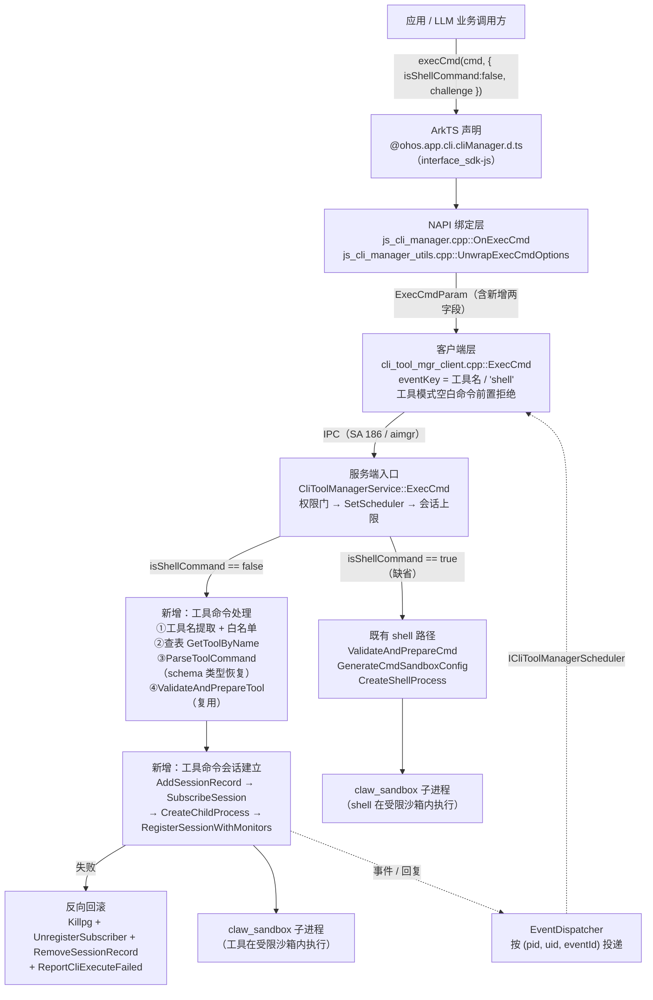
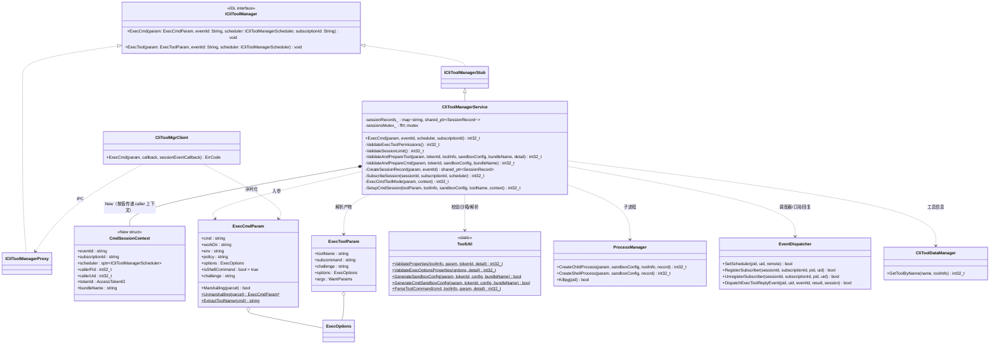
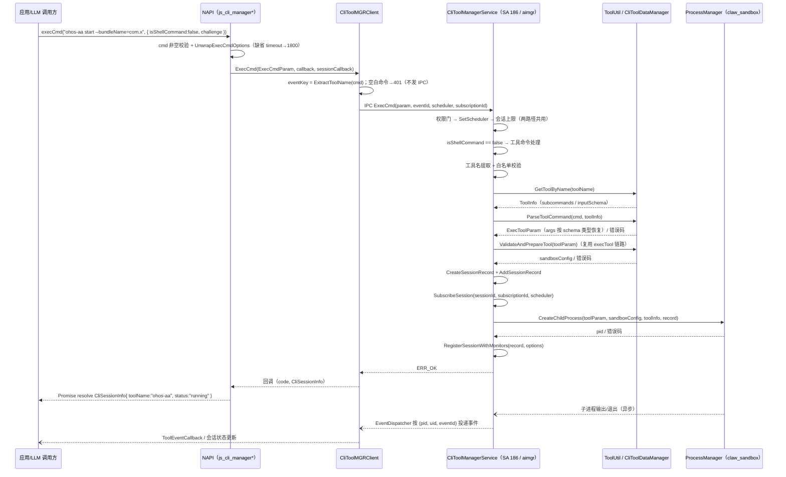
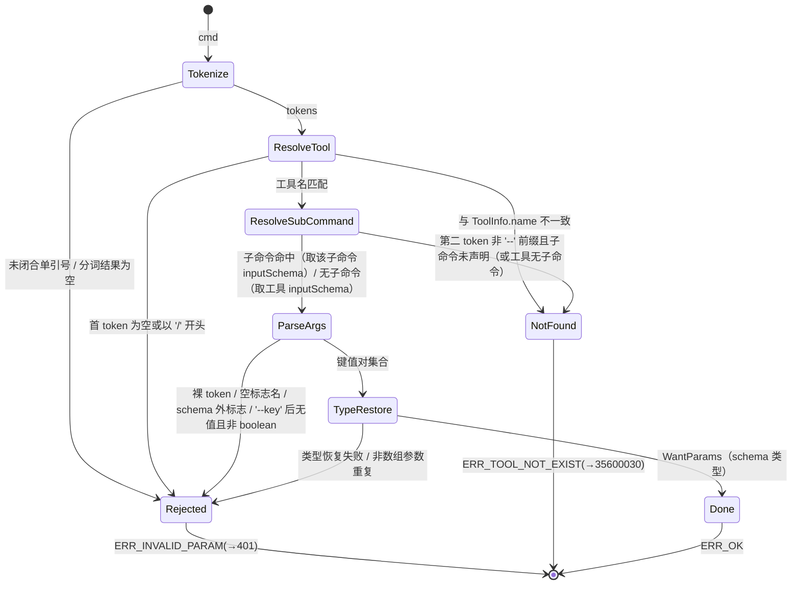
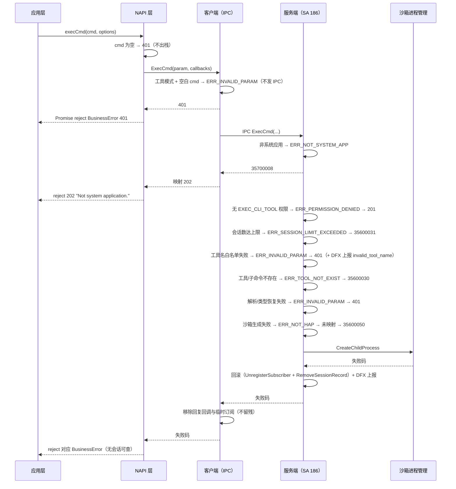

# 架构设计

> 上游输入：`proposal.md`（Approved，2026-09-09，baseline_digest `3db9de16…a0e9`）+ `spec.md`（AC-1.1..AC-1.10、R-1..R-17、BF-1..BF-6）。本文只给实现路径与架构约束，不发明 spec 之外的行为。

## 设计元数据

| 字段 | 内容 |
|------|------|
| Design ID | DESIGN-20260626000935 |
| 关联需求 | `.codespec/changes/issue-16082-execcmd-clitool/proposal.md` |
| 关联 Epic | 无（独立特性） |
| 目标 Feature | 20260626000935（execCmd 工具命令模式） |
| 复杂度 | 标准 |
| 目标版本 | OpenHarmony-7.1-Release（引用 `proposal.target_release.id`） |
| Owner | CLI 工具框架负责人（团队级） |
| 状态 | Draft |

## 需求基线

> 需求基线详见 `proposal.md`。以下仅列设计阶段需额外强调的要点。

| 项 | 补充说明（如需） |
|----|------------------|
| 复用而非新建安全链路 | 工具命令模式必须复用 `execTool` 的权限门、schema 校验与沙箱生成，不新增权限、不新增沙箱形态（proposal 目标 3 / spec R-1、架构约束「权限校验不得绕过」） |
| shell 路径零回退 | 缺省与显式 shell 模式的行为必须与既有 shell 路径逐位一致，分流点不得改变既有校验次序（spec R-3、AC-1.2/AC-1.10） |
| IPC 只可尾部追加 | `ExecCmdParam` 新增字段只能追加在既有字段之后，读取失败必须回退默认值，不引入版本协商（spec R-11/R-12、AC-1.8） |
| 不支持语法必须显式拒绝 | 短标志/前缀参数/条件标志/双引号/反斜杠转义一律 401，禁止静默忽略或按字符串兜底传给工具（spec R-8） |
| Q-S1 结论：`workDir`/`env`/`policy` 在工具模式不生效 | 需求方 2026-09-09 确认为预期行为，`.d.ts` 不区分模式 → 设计**不**为工具路径接入这三项，也不新增声明标注（spec R-16 / BF-3） |
| Q-S2 结论：`timeout` 双默认路径按现状 | 传 options 对象未传 `timeout` → 1800s；不传 options → 0（不限时）。设计沿用既有 NAPI 缺省填充逻辑，不统一两条路径（spec R-17 / BF-2） |
| 错误码零新增 | 全部复用既有内部码与对外码映射，不新增、不改写数值（proposal 禁止项 / spec「API 与错误码事实」） |

## 上下文和现状

### 涉及仓和模块

> 仓、模块、当前职责、影响类型详见 `proposal.md`「影响范围」。本节补充设计层面的架构现状。

| 仓库 | 补充架构说明 |
|------|-------------|
| ability_runtime（`cli_tool_framework`） | CLI 工具框架为 SA 186（进程 `aimgr`，库 `libclimgr.z.so`，`services/sa_profile/186.json`），分层为 NAPI 绑定（`frameworks/js/napi/cli_tool_manager`）→ 客户端与 IPC 数据（`interfaces/cli_tool`）→ 服务端（`services/climgr`）→ 沙箱子进程。IDL 位于 `interfaces/cli_tool/ICliToolManager.idl`，`ExecCmdParam` 已声明为 `sequenceable`，故字段追加不需要改 IDL 接口签名。服务侧命令执行有两条既有路径：`ExecTool`（结构化工具参数）与 `ExecCmd`（shell 字符串），两者共用权限门、会话记录、事件分发与进程管理设施。 |
| interface_sdk-js | `api/@ohos.app.cli.cliManager.d.ts` 与 `zh-cn/api/@ohos.app.cli.cliManager.d.ts` 为 System API 声明双份，模块标注 `@systemapi`、`@stagemodelonly`、`@syscap SystemCapability.Ability.AgentRuntime.Core`、`@since 26.0.0 dynamiconly`。声明交付为跨仓 PR（proposal R-1 / spec Q-S3），不在本仓构建产物内。 |

### 代码事实基线

> 引用使用 `文件:行` 并附稳定符号名（行号可能随改动漂移）。下表只登记**既有**事实；本特性新增的类/方法/字段在「关键设计决策」「类图」「数据模型设计」中以 `New` 标注。

| 代码引用（文件:行/符号） | 已验证事实 | 关联架构规则 | 对本设计的约束 | 验证来源/可信度 |
|-------------------------|------------|--------------|----------------|-----------------|
| `cli_tool_framework/interfaces/cli_tool/ICliToolManager.idl:21,34` | `sequenceable ExecCmdParam..OHOS.CliTool.ExecCmdParam;`；`void ExecCmd([in] ExecCmdParam param, [in] String eventId, [in] ICliToolManagerScheduler scheduler, [in] String subscriptionId)` | OH-ARCH-IPC-SAF | 字段追加不需修改 IDL 接口签名；`ExecCmd` 已带 `subscriptionId`，工具模式可直接复用会话订阅入参 | 源码，高 |
| `interfaces/cli_tool/include/exec_cmd_param.h:29-43 / ExecCmdParam` | 既有成员为 `cmd`、`workDir`、`env`、`policy`、`options`（`ExecOptions`），继承 `Parcelable`，提供 `Marshalling`/`Unmarshalling` | OH-ARCH-IPC-SAF | 新增成员只能追加在 `options` 之后；`Unmarshalling` 返回裸指针（`new`），新增字段的缺省回退必须在返回前完成，不得改变所有权语义 | 源码，高 |
| `interfaces/cli_tool/src/exec_cmd_param.cpp:22-52 / ExecCmdParam::Marshalling` | 既有写入序为 `WriteString(cmd) → workDir → env → policy → WriteParcelable(&options)`，任一失败即 `return false` | OH-ARCH-IPC-SAF | 新增字段写入必须置于 `options` 之后（Parcel 尾部），并保持「写失败即整体失败」的既有约定 | 源码，高 |
| `interfaces/cli_tool/src/exec_cmd_param.cpp:55-85 / ExecCmdParam::Unmarshalling` | 既有读取在 `ReadParcelable<ExecOptions>()` 失败时 `return nullptr`；成功路径直接返回对象 | OH-ARCH-IPC-SAF | 尾部新增字段的读取失败**不得**返回 `nullptr`，必须先置默认值再返回对象，才能实现旧客户端兼容（spec R-11） | 源码，高 |
| `interfaces/cli_tool/include/exec_options.h:30-38 / ExecOptions` | `background = false`、`yieldMs = 0`、`timeout = 0` 为原生默认值 | OH-ARCH-ERROR-LOG | 不传 options 对象时 `timeout = 0`（不限时）；工具模式沿用同一 `ExecOptions`，不新增字段（spec R-17 / BF-2） | 源码，高 |
| `services/climgr/src/cli_tool_manager_service.cpp:891 / CliToolManagerService::ValidateExecToolPermissions` | 先 `IsSystemAppByFullTokenID` → `ERR_NOT_SYSTEM_APP`，再 `PermissionUtil::VerifyAccessToken(tokenId, "ohos.permission.EXEC_CLI_TOOL")` → `ERR_PERMISSION_DENIED` | OH-ARCH-LAYERING / 安全 | 权限门是 `ExecCmd`/`ExecTool` 共用的单一入口，分流点必须在其之后，工具模式不得另建权限判定（spec R-14） | 源码，高 |
| `services/climgr/src/cli_tool_manager_service.cpp:906-915 / CliToolManagerService::ValidateSessionLimit` | 会话数上限来自 `CcmUtil::GetInstance().GetCliConcurrencyLimit()`，在 `sessionsMutex_` 保护下比较 `sessionRecords_.size()` | OH-ARCH-LAYERING | 上限校验对两条路径共用且先于分流；工具模式不得绕过或另设上限（spec R-13） | 源码，高 |
| `services/common/include/ccm_util.h:24` + `services/common/src/ccm_util.cpp:24,33-47` | `DEFAULT_MAX_CLI_QUANTITY = 8`；系统参数 `const.sys.cli.limit_maximum_concurrency_quantity`，非法值（≤0）回退默认 | OH-ARCH-COMPONENT-BUILD | 上限属既有配置面，本设计不新增配置项（spec AC-1.9） | 源码，高 |
| `services/climgr/src/cli_tool_manager_service.cpp:917-936 / CliToolManagerService::ValidateAndPrepareTool` | 依次执行 `GetToolByName` → `ToolUtil::ValidateProperties` → `ToolUtil::GenerateSandboxConfig`，失败分别返回 `ERR_TOOL_NOT_EXIST` / 校验错误 / `ERR_NOT_HAP` | OH-ARCH-LAYERING / 安全 | 工具命令模式必须整体复用该函数（含沙箱生成），不得拆解或跳过其中任一步（spec 架构约束「沙箱执行不得绕过」） | 源码，高 |
| `services/climgr/src/cli_tool_manager_service.cpp:938-953 / CliToolManagerService::ValidateAndPrepareCmd` | shell 路径校验为 `ValidateExecOptionsProperties` + `GenerateCmdSandboxConfig` | OH-ARCH-LAYERING | shell 路径校验链保持原样，分流不得改变其行为（spec R-3） | 源码，高 |
| `services/climgr/src/cli_tool_manager_service.cpp:955-989 / CliToolManagerService::SetupAndStartSession` | `execTool` 的会话建立序为 `CreateSessionRecord → CreateChildProcess → AddSessionRecord → RegisterSessionWithMonitors →（失败）Killpg + RemoveSessionRecord` | OH-ARCH-LAYERING | 与 shell 路径的「先订阅后创建进程」次序不同；工具命令模式需明确采用哪一套（见 ADR-4） | 源码，高 |
| `services/climgr/src/cli_tool_manager_service.cpp:1088-1165 / CliToolManagerService::ExecCmd` | 既有入口序为 权限门 → `EventDispatcher::SetScheduler`（失败 `ERR_NO_INIT`）→ 会话上限 → 取 `tokenId`/`bundleName` → shell 逻辑（`ValidateAndPrepareCmd` → `SessionRecord{toolName="shell"}` → `AddSessionRecord` → `SubscribeSession` → `CreateShellProcess` → `RegisterSessionWithMonitors` → `RegisterAppStateObserver` → `background` 时回复） | OH-ARCH-LAYERING | 分流点唯一合理位置是「取 caller 上下文之后、shell 逻辑之前」，以保证权限门/调度器/上限三项对两路径共用（spec BF-4） | 源码，高 |
| `services/climgr/src/cli_tool_manager_service.cpp:1492-1510 / CliToolManagerService::CreateSessionRecord` | 以 `ExecToolParam` 为入参构造 `SessionRecord`：`sessionId = GenerateCliSessionId(param.toolName, record)`、`toolName = param.toolName`、`timeoutMs = options.timeout * COEFFICIENT`、状态置 `RUNNING` | OH-ARCH-LAYERING | 工具命令模式只要产出 `ExecToolParam` 即可直接复用该函数，无需新增会话记录构造路径 | 源码，高 |
| `services/climgr/src/cli_tool_manager_service.cpp:396,430,488,1566 / AddSessionRecord, RemoveSessionRecord, RegisterSessionWithMonitors, SubscribeSession` | 会话容器 `sessionRecords_` 由 `sessionsMutex_` 保护；`SubscribeSession(sessionId, subscriptionId, scheduler)` 独立于进程创建；监控注册失败需 `Killpg` + 移除记录 | OH-ARCH-LAYERING | 工具模式回滚必须按反向顺序撤销已完成的步骤（订阅、记录、进程组），不得留残（spec R-15） | 源码，高 |
| `services/climgr/src/tool_util.cpp:59-91 / ToolUtil::ValidateProperties` | 先校验子命令存在性（`ERR_TOOL_NOT_EXIST`），再 `ValidateExecOptionsProperties`，最后 `ValidateInputSchemaProperties` | OH-ARCH-ERROR-LOG | 工具模式把解析结果装入 `ExecToolParam` 后即可获得与 `execTool` 完全一致的参数/选项校验（spec R-9） | 源码，高 |
| `services/climgr/src/tool_util.cpp:93-114 / ToolUtil::ValidateExecOptionsProperties` | `timeout < 0 \|\| yieldMs < 0` → 401；`timeout > MAX_TIMEOUT(1800)` → 401；`!background && yieldMs > timeout * 1000` → 401 | OH-ARCH-ERROR-LOG | 两条路径共用同一阈值常量，工具模式不得另设阈值（spec R-9） | 源码，高 |
| `services/climgr/src/tool_util.cpp:187-219 / ToolUtil::GenerateSandboxConfig` | 工具路径沙箱配置只注入调用方身份（`ohos_cli_callerBundleName`/`callerUid`/`callerTokenId`），不含 `workdir`/`policy`/调用方 `env` | 安全 / OH-ARCH-SUBSYSTEM | 工具模式沿用该函数即为 Q-S1 结论的落地：三项属性不接入工具路径（spec R-16 / BF-3） | 源码，高 |
| `services/climgr/src/tool_util.cpp:221-241 / ToolUtil::GenerateCmdSandboxConfig` | shell 路径写入 `policy`、`workdir`（非空时）、`env` | 安全 | shell 路径沙箱语义保持不变，分流不得改用工具沙箱函数（spec R-3） | 源码，高 |
| `services/climgr/src/tool_util.cpp:284 / ToolUtil::TransferToCmdParam`、`services/climgr/include/tool_util.h:50-113` | 既有 `WantParams → execArgs` 转换与 schema 类型校验工具齐备（`ValidateParamType`/`ValidateArrayType`/`Is*Type`） | OH-ARCH-LAYERING | 命令解析只需产出 `AAFwk::WantParams`，其后转换与类型校验全部复用，无需新增执行参数拼装逻辑 | 源码，高 |
| `services/climgr/include/process_manager.h:42,45,48 / ProcessManager::CreateChildProcess, CreateShellProcess, Killpg` | 工具子进程创建以 `ExecToolParam` + 沙箱配置 + `ToolInfo` + `SessionRecord` 为入参；shell 子进程以 `ExecCmdParam` 为入参；`Killpg(pid)` 用于失败回收 | OH-ARCH-LAYERING / 安全 | 工具模式产出 `ExecToolParam` 与 `ToolInfo` 后可直接调用 `CreateChildProcess`，不得改走 `CreateShellProcess` | 源码，高 |
| `services/climgr/include/event_dispatcher.h:91,95,98,107 / EventDispatcher::SetScheduler, RegisterSubscriber, UnregisterSubscriber, DispatchExecToolReplyEvent` | 调度器按 `(callerPid, callerUid)` 注册；订阅按 `(sessionId, subscriptionId, callerPid, callerUid)`；回复事件按 `(pid, uid, eventId)` 投递 | OH-ARCH-LAYERING | 工具模式的 eventKey/订阅/回复全部沿用既有分发设施，回滚时按同键反注册（spec R-15） | 源码，高 |
| `interfaces/cli_tool/src/cli_tool_mgr_client.cpp:74-115 / CliToolMGRClient::ExecCmd` | 客户端先 `EnsureSchedulerStubCreated` → 取 proxy（失败 `GET_CLI_TOOL_MGR_SERVICE_FAILED`）→ 以 `eventKey` 注册回复回调与临时订阅 → `proxy->ExecCmd(...)`，失败时移除回调与订阅 | OH-ARCH-LAYERING | `eventKey` 是回调路由键：shell 用固定串，工具模式需按工具名取值才能与 `execTool` 语义一致（见 ADR-2）；新增的入参前置校验应放在 proxy 调用之前 | 源码，高 |
| `frameworks/js/napi/cli_tool_manager/src/js_cli_manager.cpp:104,192-227 / JSCliManager::ExecCmd, OnExecCmd` | JS 入口校验 `argc ≥ 1` 且 `cmd` 非空（否则 401），`argv[1]` 为对象时才解 options，随后 `DispatchCliCmd` 并按错误码 reject | OH-ARCH-API-LEVEL | 新增两个可选属性只能在 `UnwrapExecCmdOptions` 内按「属性存在才解」的既有模式接入，缺省时保持 `ExecCmdParam` 成员默认值 | 源码，高 |
| `frameworks/js/napi/cli_tool_manager/src/js_cli_manager_utils.cpp:155-217 / UnwrapExecOptions` | 逐属性 `napi_has_named_property` → `napi_get_named_property` → `Unwrap*FromJS2`；**提供 options 对象但未提供 `timeout` 时置 `options.timeout = MAX_TIMEOUT(1800)`** | OH-ARCH-API-LEVEL | Q-S2 结论落地：工具模式必然带 options 对象 → 缺省 1800；不得为实现「统一默认值」而修改该函数（会影响 `execTool`） | 源码，高 |
| `frameworks/js/napi/cli_tool_manager/src/js_cli_manager_utils.cpp:219-365 / UnwrapExecCmdOptions` | 既有解包序为 `workDir → env → policy → callback`，末尾复用 `UnwrapExecOptions`；任一失败 `ThrowInvalidParamError` 并返回 false | OH-ARCH-API-LEVEL | 新增属性解包须沿用同一「存在才解 + 失败即抛 401」模式，且插入位置不得破坏 `UnwrapExecOptions` 的末尾复用 | 源码，高 |
| `frameworks/js/napi/cli_tool_manager/include/cli_manager_error_utils.h:25-35` + `src/cli_manager_error_utils.cpp:40-59,77,94` | 对外码枚举 `201/202/401/35600030/35600031/35600050`；内部码 → 对外码为静态映射表，未命中回退 `ERROR_INNER` | OH-ARCH-ERROR-LOG | 工具模式只需返回既有内部码即可获得正确对外码，禁止新增映射项或改数值（spec 错误码事实表） | 源码，高 |
| `interfaces/cli_tool/include/cli_error_code.h:33,38,43,48,53,63,68` | `ERR_SESSION_LIMIT_EXCEEDED=35700001`、`ERR_INVALID_PARAM=35700002`、`ERR_NOT_HAP=35700003`、`ERR_NO_INIT=35700004`、`ERR_TOOL_NOT_EXIST=35700005`、`ERR_PERMISSION_DENIED=35700007`、`ERR_NOT_SYSTEM_APP=35700008` | OH-ARCH-ERROR-LOG | 覆盖本特性全部失败场景，无需新增错误码 | 源码，高 |
| `services/common/include/cli_event_report.h:71-108 / ReportCliExecuteFailed, GetFailureReason` | 既有 CLI 执行失败上报入口，按 `bundleName`/`cliName`/失败原因分类上报；`GetFailureReason(errorCode)` 将内部码转为原因串 | OH-ARCH-ERROR-LOG | 工具模式失败点复用该上报，不新增 `hisysevent.yaml` 事件定义（AGENTS.md 硬约束） | 源码，高 |
| `services/climgr/include/session_record.h:33-64 / SessionType, SessionState, SessionRecord` | `SessionType{CLI, SKILL}`、`SessionState{SPAWNING, RUNNING, CANCELLING, COMPLETED, FAILED}`；`state_` 为 `std::atomic`；含 `stdin/stdout/stderr` 管道与 `timeoutMs` | OH-ARCH-LAYERING | 工具命令会话即 `SessionType::CLI`，不新增会话类型与状态枚举值（避免影响既有状态消费方） | 源码，高 |
| `interface/sdk-js:api/@ohos.app.cli.cliManager.d.ts:85-155,398-415` | `ExecCmdOptions` 既有 7 个可选属性（`timeout` 标注 `@default 1800`）；`execCmd` 的 `@throws` 仅列 201/202/35600031/35600050 | OH-ARCH-API-LEVEL | 新增两属性须沿用同一标注组；`@throws` 须补 401 与 35600030；依 Q-S1 结论不为 `workDir`/`env`/`policy` 增加模式差异说明 | 已发布声明，高 |

**基线规则：**

- 设计结论与代码事实冲突时，先确认目标版本和分支；不得直接忽略现状。
- 只在注释、README 或二手资料中出现而未被源码/测试验证的内容，标记为待验证，不进入 Approved 设计约束。
- `execution-plan.md` 的文件范围必须能追溯到本表、调用链分析或明确的新建文件决策。

### 调用链层级分析

| 层 | 模块 | 职责 | 修改类型 |
|----|------|------|----------|
| ArkTS 声明层 | `interface/sdk-js:api/@ohos.app.cli.cliManager.d.ts`（中英） | 对外声明 `ExecCmdOptions` 属性与 `execCmd` 错误面 | 修改（跨仓交付） |
| NAPI 绑定层 | `cli_tool_framework/frameworks/js/napi/cli_tool_manager`（`js_cli_manager.cpp`、`js_cli_manager_utils.cpp`） | JS 参数校验与解包、可选属性缺省值、错误码转 `BusinessError` | 修改 |
| 客户端/IPC 数据层 | `cli_tool_framework/interfaces/cli_tool`（`exec_cmd_param.h/.cpp`、`cli_tool_mgr_client.cpp`） | 参数字段与序列化、eventKey 路由、前置入参校验、proxy 调用 | 修改 |
| 服务端入口层 | `cli_tool_framework/services/climgr`（`cli_tool_manager_service.cpp`：`ExecCmd`） | 权限门、调度器注册、会话上限、模式分流 | 修改 |
| 服务端工具命令处理层 | `cli_tool_framework/services/climgr`（`cli_tool_manager_service.cpp`：工具命令处理与会话建立；`tool_util.cpp`：命令解析） | 工具名提取与白名单、工具查表、命令分词与 schema 类型恢复、复用校验/沙箱、会话建立与回滚 | 新增 |
| 既有能力层（复用，不改） | `ValidateAndPrepareTool`、`GenerateSandboxConfig`、`CreateSessionRecord`、`SubscribeSession`、`RegisterSessionWithMonitors`、`ProcessManager::CreateChildProcess`、`EventDispatcher`、`CliToolDataManager` | 权限/schema 校验、沙箱配置、会话与订阅、子进程、事件分发、工具信息 | 不修改 |
| 沙箱执行层 | `claw_sandbox` 子进程（经 `ProcessManager`） | 在受限沙箱内执行工具 | 不修改 |

**检查项：**
- [x] 调用链每一层都已覆盖（ArkTS 声明 → NAPI → 客户端/IPC → 服务端入口 → 工具命令处理 → 既有能力 → 沙箱）
- [x] 每层职责边界清晰，无跨层违规调用（NAPI 不直接触达服务端内部；服务端不反向依赖 NAPI；框架层经 `interfaces/cli_tool` 客户端接口访问 SA）
- [x] 每层修改类型明确

### 适用架构规则

| Rule ID | 适用原因 | 设计结论 | 验证方式 |
|---------|----------|----------|----------|
| OH-ARCH-LAYERING | 变更跨 NAPI / 客户端 / 服务端三层 | 调用方向单向向下：NAPI → 客户端（`CliToolMGRClient`）→ IPC → 服务端；工具命令解析与校验全部落在服务端，客户端只做「空白命令」这类无需工具信息的前置校验，避免把安全判定下沉到不可信侧 | 架构评审 + 单测（VM-5 客户端前置校验、VM-2 服务端成功路径） |
| OH-ARCH-SUBSYSTEM | 复用 `services/climgr` 既有能力，且沙箱由 `ProcessManager` 拉起 | 不新增子系统依赖、不调用 `services/abilitymgr` 或 `services/appmgr` 内部方法；工具信息只经 `CliToolDataManager` 单例获取 | 依赖检查（BUILD.gn 无新增 deps） + 代码评审 |
| OH-ARCH-IPC-SAF | SA 186 的 `ExecCmd` 跨进程接口数据面变更 | IDL 接口签名不变（`ExecCmdParam` 为 `sequenceable`）；字段只追加在 Parcel 尾部；反序列化对缺失尾部字段回退默认值且不失败；不引入版本协商字段 | IPC 兼容单测（VM-9） |
| OH-ARCH-API-LEVEL | 新增 System API 属性 + `@throws` 补充 | 保持 `@systemapi` + `@stagemodelonly` + `@syscap SystemCapability.Ability.AgentRuntime.Core` + `@since 26.0.0 dynamiconly` 标注组；权限沿用 `ohos.permission.EXEC_CLI_TOOL`，不新增权限；中英 `.d.ts` 同步 | API 评审 + 声明双份 diff 核对 |
| OH-ARCH-COMPONENT-BUILD | 是否新增源文件/构建目标 | 全部改动落在既有源文件与既有测试目标内，**无新增源文件、无新增 BUILD.gn 目标、无新增第三方依赖**（详见「构建系统影响」） | 构建验证 `./build.sh --product-name <product> --build-target ability_runtime` |
| OH-ARCH-ERROR-LOG | 新增拒绝路径 + 命令含敏感信息 | 复用既有内部码与映射表，不新增错误码数值；新增失败点复用 `ReportCliExecuteFailed` + `GetFailureReason`，不新增 `hisysevent.yaml` 事件；`cmd` 一律 `%{private}s` 输出，`challenge` 不入日志 | 单测断言错误码 + hilog 抽查（Release 构建不可见原文） |

### 既有模式复用

| 模式 | 参考代码（文件:行/符号） | 适用架构规则 | 必须复用的约定 | 本设计的复用方式 | 偏差及理由 | 关联 Task |
|------|-------------------------|--------------|------------------|------------------|------------|-----------|
| 权限门 | `cli_tool_manager_service.cpp:891 / ValidateExecToolPermissions` | OH-ARCH-LAYERING / 安全 | 系统应用判定先于权限判定；错误码 `ERR_NOT_SYSTEM_APP` / `ERR_PERMISSION_DENIED` | 直接复用（分流点在其后） | 无 | TASK-3 |
| 会话上限 | `cli_tool_manager_service.cpp:906 / ValidateSessionLimit` | OH-ARCH-LAYERING | `sessionsMutex_` 保护下比较；上限来自 CCM 配置 | 直接复用（分流点在其后） | 无 | TASK-3 |
| 工具校验 + 沙箱生成 | `cli_tool_manager_service.cpp:917 / ValidateAndPrepareTool` → `tool_util.cpp:59 / ValidateProperties`、`tool_util.cpp:187 / GenerateSandboxConfig` | 安全 / OH-ARCH-SUBSYSTEM | 查表 → 参数/选项/schema 校验 → 沙箱配置生成，三步不可拆解 | 直接复用（解析结果装入 `ExecToolParam` 后调用） | 无 | TASK-3 |
| 会话建立与回滚 | shell 路径 `ExecCmd`（`cli_tool_manager_service.cpp:1088-1165`）：`AddSessionRecord → SubscribeSession → Create*Process → RegisterSessionWithMonitors`，各步失败反向撤销 | OH-ARCH-LAYERING | 「先订阅后创建进程」；失败时 `Killpg` + `UnregisterSubscriber` + `RemoveSessionRecord` | 组合复用：工具模式采用 shell 路径的次序（而非 `SetupAndStartSession` 的次序），理由见 ADR-4 | 与 `execTool` 的 `SetupAndStartSession` 次序不同：工具模式需保证 `subscriptionId` 生效前不产生进程输出，否则早期事件丢失 | TASK-4 |
| 会话记录构造 | `cli_tool_manager_service.cpp:1492 / CreateSessionRecord` | OH-ARCH-LAYERING | 以 `ExecToolParam` 为入参；`sessionId` 由 `GenerateCliSessionId(toolName, record)` 生成 | 直接复用 | 无 | TASK-4 |
| 事件路由键（eventKey） | `cli_tool_mgr_client.cpp:93`（shell 用固定串 `"shell"`）+ `execTool` 按工具名注册回调 | OH-ARCH-LAYERING | 回复/事件回调按 eventKey 匹配 | 扩展：工具模式 eventKey 取命令首 token（工具名） | 无（与 `execTool` 语义对齐，见 ADR-2） | TASK-2 |
| NAPI 可选属性解包 | `js_cli_manager_utils.cpp:219-365 / UnwrapExecCmdOptions`（`has_named_property` → `get` → `Unwrap*FromJS2` → 失败 `ThrowInvalidParamError`） | OH-ARCH-API-LEVEL | 「属性存在才解、解失败即抛 401、缺省保留 C++ 默认值」 | 直接复用（两个新属性按同模式接入） | 无 | TASK-1 |
| 错误码映射 | `cli_manager_error_utils.cpp:40-59,77,94` | OH-ARCH-ERROR-LOG | 内部码 → 对外码静态映射，未命中回退 `ERROR_INNER` | 直接复用，返回既有内部码 | 无 | TASK-3, TASK-4 |
| DFX 失败上报 | `cli_event_report.h:71-108 / ReportCliExecuteFailed, GetFailureReason` | OH-ARCH-ERROR-LOG | 按 `bundleName`/`cliName`/原因分类上报，不新增事件定义 | 直接复用于工具模式各失败点 | 新增原因串 `"invalid_tool_name"`（既有原因枚举不足），不改 `hisysevent.yaml` 结构 | TASK-3 |
| 单测 fixture 与 mock | `test/unittest/cli_tool_mgr_service_test/mock/src/ipc_skeleton.cpp:32,37`（caller pid/fullTokenId）、`test/unittest/cli_tool_mgr_service_test/permission_util_mock.cpp:20`（`PermissionUtil::VerifyAccessToken`）、`test/unittest/cli_tool_mgr_service_test/cli_tool_mgr_service_test.cpp:80,104`（`IsPermissionGateResult` 断言助手 + `CliToolManagerServiceTest` fixture）、`test/unittest/common_mock/climgr/include/process_manager.h:26,30`（`CreateChildProcess`/`Killpg` mock）、`test/unittest/tool_util_test/tool_util_test.cpp:82-86`（`ToolUtilTest` fixture）、`test/unittest/exec_cmd_param_test/exec_cmd_param_test.cpp:40`（Parcel 往返用例范式） | OH-ARCH-COMPONENT-BUILD | 服务侧以 mock 替换 `IPCSkeleton`/`AccessToken`/`PermissionUtil`/`ProcessManager`/`EventDispatcher`/`CliToolDataManager`；解析与序列化用纯函数级断言 | 直接复用既有 fixture 与 mock，新增用例挂在既有测试目标 | 无 | TASK-5, TASK-6, TASK-7 |

> **检索范围与结论：** 命令字符串解析（分词 + schema 驱动类型恢复）在 `cli_tool_framework` 内**无 prior art**——既有 `ExpandArgsFromJson`（`tool_util.cpp:914`）解析的是 JSON 串而非命令行语法，`TransferToCmdParam`（`tool_util.cpp:284`）只做 `WantParams → execArgs` 单向转换。故解析器为新增纯函数（ADR-5），但其**输出契约**（`AAFwk::WantParams` + schema 类型）与既有 `ValidateInputSchemaProperties` 完全对齐，不新建校验体系。

## 不涉及项承接

> `proposal.md` 已完成 N/A 判定。本节仅对标记「涉及」的维度给出设计结论。

| 维度 | 设计结论 |
|------|----------|
| 安全与权限 | 展开「安全基础检查」章节：权限门复用（不新增权限、不绕过 `PermissionVerification` 体系内的 `PermissionUtil::VerifyAccessToken`）；新增攻击面仅工具名注入，由白名单缓解；沙箱形态不变；`cmd` 日志脱敏、`challenge` 不入日志。深度威胁分析不产出（理由见该章节） |
| 兼容性 | IPC 只尾部追加 + 缺省回退（ADR-1）；System API 只增可选属性、缺省即既有行为（ADR-7）；`.d.ts` `@throws` 补充为文档级变更，不影响运行时（ADR-6）；新旧混布双向结论见「数据模型设计」与 spec R-11/R-12 |
| API/SDK | 新增两属性签名、标注组、Kit、权限与 `.d.ts` 落点见「API 签名、Kit 与权限」；参数合法范围与非法处理见「接口参数规约」 |
| IPC/跨进程 | `ExecCmdParam` 字段序与序列化/反序列化约定见「数据模型设计」；IDL 不变；`subscriptionId`/`eventId`/`scheduler` 三入参沿用既有 `ExecCmd` 接口，不新增 IPC 方法 |
| 性能 / 构建与部件 / 国际化与无障碍 / 数据迁移 | N/A 承接：解析为单次 O(n) 分词且仅在工具模式触发，无常驻结构与热路径开销；无新增源文件/构建目标/第三方依赖；无 UI 与用户可感知字符串；无持久化数据格式变更 |

## 关键设计决策

| 决策 ID | 问题 | 推荐方案 | 探索过的替代方案 | 取舍理由 | 影响 |
|---------|------|----------|-----------------|------|------|
| ADR-1 | IPC 如何承载 `isShellCommand` 与 `challenge` 而不破坏跨版本兼容 | 在 `ExecCmdParam` 既有字段之后**尾部追加**两个成员，`Marshalling` 末尾写入、`Unmarshalling` 末尾读取且**读取失败即置默认值并成功返回**（`true` / `""`） | ①新增 IPC 接口方法 `ExecCmdV2`（放弃：IDL 与 proxy/stub 双份维护，且旧接口仍需保留，接口面翻倍）；②引入版本协商字段（放弃：proposal 明确不引入，且协商字段本身也要面对同样的兼容问题）；③把模式标识塞进既有 `policy` 字符串（放弃：语义污染、破坏 `policy` 的既有取值契约） | 尾部追加是 Parcel 唯一可双向兼容的扩展位；旧客户端不写 → 新服务端回退 shell；新客户端写 → 旧服务端读完 `options` 即返回，残留数据不触发解析失败 | `exec_cmd_param.h/.cpp`；IDL 不变；spec R-11/R-12、AC-1.8 |
| ADR-2 | 工具命令模式的回调路由键（eventKey）如何取值 | 客户端以命令首 token（工具名）作为 eventKey；shell 模式保持固定串 `"shell"` | ①固定串 `"tool"`（放弃：与 `execTool` 的按工具名路由不一致，同进程内并发调用不同工具时回调无法区分）；②用完整 `cmd` 作键（放弃：键含参数与空格，易变且可能泄露命令内容到日志） | 与 `execTool` 语义对齐，回调与订阅按工具维度匹配；工具名提取逻辑与服务端共用同一函数，避免两端不一致 | `cli_tool_mgr_client.cpp`、`ExecCmdParam` 新增静态提取函数；spec AC-1.1 |
| ADR-3 | 工具命令路径的校验与沙箱是否独立实现 | 复用 `ValidateAndPrepareTool`（查表 + `ValidateProperties` + `GenerateSandboxConfig`），解析阶段只负责把命令字符串翻译成 `ExecToolParam` | ①独立实现工具模式校验与沙箱生成（放弃：重复安全代码，任何遗漏都直接扩大命令执行攻击面）；②在客户端/NAPI 侧解析后直接调用 `execTool`（放弃：校验下沉到不可信侧，服务端无法统一把关，且各语言绑定需重复实现） | 「解析新增、校验复用」把新增代码限制在无安全语义的纯函数内，安全决策点数量不变 | `cli_tool_manager_service.cpp`、`tool_util.cpp`；spec 架构约束「权限/沙箱不得绕过」 |
| ADR-4 | 会话建立次序：沿用 shell 路径还是 `execTool` 的 `SetupAndStartSession` | 采用 shell 路径次序：`AddSessionRecord → SubscribeSession → CreateChildProcess → RegisterSessionWithMonitors`，各步失败按反向顺序回滚 | ①直接复用 `SetupAndStartSession`（放弃：其序为「创建进程 → 加记录 → 注册监控」，且不接受客户端传入的 `subscriptionId`，工具模式的自动订阅会在进程已输出后才建立，早期事件丢失）；②先创建进程再补订阅（放弃：同上，且失败回滚需额外杀进程） | `ExecCmd` 接口已带 `subscriptionId`，语义要求订阅在进程产生输出前就绪；与 shell 路径同序也便于两路径共用回滚心智模型 | `cli_tool_manager_service.cpp`；spec R-1/R-15、INV-2/INV-3 |
| ADR-5 | 命令解析器放在哪一层、以什么形态实现 | 服务端 `ToolUtil` 的**静态纯函数**：`cmd + ToolInfo → ExecToolParam`（内部分四阶段：分词 → 工具名/子命令 → 标志解析 → 类型恢复），失败返回既有内部码 + `detail` 原因串 | ①放在 NAPI 层（放弃：见 ADR-3②）；②放在客户端 `cli_tool_mgr_client`（放弃：客户端拿不到 `ToolInfo`/schema，无法做类型恢复与子命令校验）；③新增独立解析类（放弃：与既有 `ToolUtil` 的 schema 校验工具族割裂，增加维护面） | 解析需要 schema，只有服务端有；纯函数形态便于单测直接断言，无需拉起 SA 或 mock IPC | `tool_util.h/.cpp`；spec R-7/R-8、BF-5/BF-6、VM-6/VM-7 |
| ADR-6 | `.d.ts` 的 `@throws` 是否补充 401 与 35600030 | 补充：工具命令模式引入参数无效与工具不存在两类可观察错误，声明必须与运行时错误面一致 | ①不补充，仅靠运行时错误码（放弃：调用方无法从声明得知需处理这两类错误，违背声明即契约）；②为工具模式新增独立 API（放弃：proposal 明确统一入口，且会让 shell/工具两套声明并存） | 声明与运行时一致是 System API 的硬约束；补充属文档级变更，不影响既有调用方 | `interface/sdk-js` 中英双份（跨仓，spec Q-S3）；spec API 变更分析 |
| ADR-7 | 新增属性的缺省值与缺省行为如何保证「零回退」 | `isShellCommand` 默认 `true`（C++ 成员初值 + NAPI「属性存在才解」+ IPC 缺省回退三处一致）；`challenge` 默认 `""`（原值透传，服务端不生成） | ①默认 `false`（放弃：既有调用方全部被切到工具命令模式，直接回退）；②只在 NAPI 层设默认、IPC 层不设（放弃：非 NAPI 调用方（InnerAPI 直连）会拿到未定义模式） | 三处默认值一致才能保证任意入口的缺省行为都是 shell；`challenge` 不生成是因为其语义是调用方身份凭据，服务端生成会造成信任混淆 | `exec_cmd_param.h`、`js_cli_manager_utils.cpp`；spec R-3/R-11、INV-5 |
| ADR-8 | `ExecCmdOptions.workDir`/`env`/`policy` 在工具模式是否接入 | **不接入**（Q-S1 结论）：工具路径继续走 `GenerateSandboxConfig`，其沙箱配置只含调用方身份标识 | ①把三项透传进工具沙箱（放弃：需求方结论为「不区分即可」，且需扩 `ExecToolParam` 字段并影响 `execTool` 的既有语义）；②工具模式下检测到三项非空即报 401（放弃：会让既有调用方在切换模式时被迫改代码，违背零改造目标） | 保持既有工具沙箱语义不变，改动面最小；行为差异由 spec R-16 与本设计显式记录，避免后续误判为缺陷 | `tool_util.cpp`（不改）、`cli_tool_manager_service.cpp`；spec R-16/BF-3、VM-13 |

## 设计骨架

### 骨架范围

| 骨架项 | 目标 | 不包含 | 验证方式 |
|--------|------|--------|----------|
| API/接口骨架 | `ExecCmdOptions` 两个可选属性的声明（中英 `.d.ts`）+ `ExecCmdParam` 两个新成员与静态工具名提取函数签名 | 完整解析与分流逻辑 | 声明双份 diff 核对 + 编译通过 |
| 模块骨架 | NAPI 解包接入点、客户端 eventKey 与前置校验接入点、服务端分流点与两个新增私有方法签名、`ToolUtil` 解析函数签名 | 分词/类型恢复细节、回滚分支 | 构建通过（无新增 BUILD.gn 目标） |
| 测试骨架 | 四类既有测试目标内新增用例的 fixture 接入（服务侧 mock、解析纯函数、序列化往返、客户端前置校验） | 全场景覆盖 | 最小用例（缺省 shell 分流 + 一条工具模式拒绝路径）通过 |

### 骨架 Spec 拆分

| Task ID | 目标 | 受影响文件 | AC |
|---------|------|------------|-----|
| TASK-SKELETON-1 | 打通「声明 → NAPI → 客户端 → IPC → 服务端分流」的空骨架：新字段可传递、缺省为 shell 模式、工具模式入口可被命中并返回既有内部码 | `interface/sdk-js:api/@ohos.app.cli.cliManager.d.ts`(+`zh-cn`)、`exec_cmd_param.h/.cpp`、`js_cli_manager_utils.cpp`、`cli_tool_mgr_client.cpp`、`cli_tool_manager_service.h/.cpp` | WHEN 调用方不传模式标识 THEN 命令按 shell 路径执行且结果与既有行为一致（AC-1.2）；WHEN 声明工具命令模式 THEN 请求进入工具命令处理入口（AC-1.1 骨架可达） |

## 后续 Task 拆分

> design 输出到 Plan 阶段的衔接信息；精确文件清单与 AC→Task 追溯由 `execution-plan.md` 持有。

| Task ID | 目标 | 受影响文件 | 依赖 |
|---------|------|------------|------|
| TASK-1 | NAPI 层：两个可选属性按既有模式解包，缺省保留 C++ 默认值；解包失败抛 401 | `cli_tool_framework/frameworks/js/napi/cli_tool_manager/src/js_cli_manager_utils.cpp` | design.md + spec.md Approved |
| TASK-2 | IPC 数据层与客户端：`ExecCmdParam` 尾部追加成员 + 序列化/反序列化缺省回退 + 工具名提取静态函数；客户端 eventKey 按模式取值、工具模式下空白命令前置拒绝 | `cli_tool_framework/interfaces/cli_tool/include/exec_cmd_param.h`、`src/exec_cmd_param.cpp`、`src/cli_tool_mgr_client.cpp` | TASK-1 |
| TASK-3 | 服务端命令解析：`ToolUtil` 新增命令解析静态函数（分词 → 工具名/子命令 → 标志 → schema 类型恢复），仅支持长标志子集与单引号，其余显式拒绝 | `cli_tool_framework/services/climgr/include/tool_util.h`、`src/tool_util.cpp` | TASK-2 |
| TASK-4 | 服务端分流与会话建立：`ExecCmd` 增加分流点；新增工具命令处理与会话建立两个私有方法（含 caller 上下文聚合结构）、白名单校验、复用 `ValidateAndPrepareTool`、按 ADR-4 次序建立会话并反向回滚、失败点接入既有 DFX 上报 | `cli_tool_framework/services/climgr/include/cli_tool_manager_service.h`、`src/cli_tool_manager_service.cpp` | TASK-3 |
| TASK-5 | 解析层单测：四种长标志写法、单引号含空格值、子命令 schema、未知标志/未知子命令/空命令，以及四条拒绝分支（裸 token、未闭合引号、非数组重复标志、类型恢复失败） | `cli_tool_framework/test/unittest/tool_util_test/tool_util_test.cpp` | TASK-3 |
| TASK-6 | 服务侧与客户端单测：工具模式成功路径、工具名非法、工具不存在、会话上限、缺省与显式 shell 分流、会话建立失败回滚、options 语义（`workDir`/`env`/`policy` 不生效、缺省 `timeout`）、客户端空白命令拒绝 | `cli_tool_framework/test/unittest/cli_tool_mgr_service_test/cli_tool_mgr_service_test.cpp`、`cli_tool_mgr_client_test/cli_tool_mgr_client_test.cpp` | TASK-4 |
| TASK-7 | IPC 兼容单测：尾部字段缺省回退、完整往返一致、工具名提取边界 | `cli_tool_framework/test/unittest/exec_cmd_param_test/exec_cmd_param_test.cpp` | TASK-2 |
| TASK-8 | 跨仓声明交付：中英 `.d.ts` 新增两属性（沿用既有标注组）+ `execCmd` 的 `@throws` 补 401 与 35600030；依 Q-S1 结论不加模式差异说明 | `interface/sdk-js:api/@ohos.app.cli.cliManager.d.ts`、`zh-cn/api/@ohos.app.cli.cliManager.d.ts` | TASK-1（主仓实现定稿后提交声明 PR，spec Q-S3） |

## API 签名、Kit 与权限

> 承接 `spec.md`「API 变更分析」，给出签名、权限与 `.d.ts` 落点。

### 新增 API

| API 签名 | 类型 | Kit | d.ts 位置 | 权限要求 | SysCap |
|----------|------|-----|-----------|----------|--------|
| `ExecCmdOptions.isShellCommand?: boolean`（默认 `true`） | System | AbilityKit | `interface/sdk-js:api/@ohos.app.cli.cliManager.d.ts`（`ExecCmdOptions` 内，紧随既有属性）+ `zh-cn/api/@ohos.app.cli.cliManager.d.ts` | `ohos.permission.EXEC_CLI_TOOL`（沿用 `execCmd` 既有权限，不新增） | `SystemCapability.Ability.AgentRuntime.Core` |
| `ExecCmdOptions.challenge?: string`（默认 `""`） | System | AbilityKit | 同上 | 同上 | 同上 |
| `static std::string ExecCmdParam::ExtractToolName(const std::string &cmd)`（New，C++ 内部） | InnerAPI | — | 无 `.d.ts`（部件内接口） | — | — |
| `static int32_t ToolUtil::ParseToolCommand(const std::string &cmd, const ToolInfo &toolInfo, ExecToolParam &param, std::string &detail)`（New，C++ 内部） | InnerAPI | — | 无 `.d.ts`（部件内接口） | — | — |

> 两个 C++ 内部接口的落点与签名在此冻结，供 `execution-plan.md` 直接引用；标注组沿用既有：`@systemapi`、`@stagemodelonly`、`@since 26.0.0 dynamiconly`、`@syscap SystemCapability.Ability.AgentRuntime.Core`。

### 变更/废弃 API

| 原有 API | 变更类型 | 新 API | 迁移说明 |
|----------|----------|--------|----------|
| `function execCmd(cmd: string, execCmdOptions?: ExecCmdOptions): Promise<CliSessionInfo>` | 变更（签名不变，行为扩展 + `@throws` 补 401/35600030） | 签名不变 | 既有调用无需迁移；使用工具命令模式的调用方需在 `catch` 中处理 401 与 35600030 |
| `void ICliToolManager.ExecCmd([in] ExecCmdParam param, [in] String eventId, [in] ICliToolManagerScheduler scheduler, [in] String subscriptionId)` | 变更（IDL 签名不变，`ExecCmdParam` 序列化尾部追加两字段） | 签名不变 | 无需迁移；旧客户端不写尾部字段时服务端回退 shell 模式 |
| 废弃 API | 无 | — | — |

## 构建系统影响

### BUILD.gn 变更

```
文件路径: 无变更
变更说明: 本设计的全部改动落在既有源文件与既有测试目标内，无新增源文件、无新增编译目标、无新增 deps。
         涉及既有目标：libclimgr（services/climgr）、cli_tool 接口库（interfaces/cli_tool）、
         NAPI 模块（frameworks/js/napi/cli_tool_manager）、既有单测目标
         （tool_util_test / cli_tool_mgr_service_test / cli_tool_mgr_client_test / exec_cmd_param_test）。
         若实现阶段确需新增源文件，必须先回到本节补记 BUILD.gn 变更（AGENTS.md「不要跳过 BUILD.gn 更新」）。
```

### bundle.json 变更

无变更：不新增 component、不修改部件依赖关系、不新增第三方依赖（`nlohmann::json` 为 `tool_util.cpp` 既有依赖，命令解析复用其解析 schema，不引入新库）。

---

## 可选设计扩展

### 架构图

> 跨模块（NAPI / 客户端 / 服务端 / 沙箱）+ 跨仓（声明），故必填。



### 类图

> 涉及 IPC `interface → proxy → stub → impl` 数据面与跨模块组合关系，故必填。只冻结需要稳定的关系与关键签名。



| 类型/接口 | 现有代码引用或 New | 关系 | 关键职责/签名 | 关联 ADR | 关联 Task |
|-----------|--------------------|------|---------------|----------|-----------|
| `ICliToolManager`（IDL） | `interfaces/cli_tool/ICliToolManager.idl:34` | 接口（proxy/stub 生成源） | `ExecCmd(param, eventId, scheduler, subscriptionId)`，签名不变 | ADR-1 | TASK-2 |
| `ExecCmdParam` | `interfaces/cli_tool/include/exec_cmd_param.h:29-43` | `Parcelable`，被客户端与服务端共用 | 新增 `isShellCommand = true`、`challenge`；新增 `static std::string ExtractToolName(const std::string &)` | ADR-1, ADR-2 | TASK-2 |
| `ExecToolParam` | `interfaces/cli_tool/include/exec_tool_param.h:30-37` | 解析产物载体（不修改） | `toolName`/`subcommand`/`challenge`/`options`/`args`，无 `workDir`/`env`/`policy` 字段 → Q-S1 结论的结构根据 | ADR-3, ADR-8 | TASK-3 |
| `CliToolManagerService` | `services/climgr/src/cli_tool_manager_service.cpp:1088`（`ExecCmd`） | 继承 `ICliToolManagerStub` | 新增分流点 + 两个私有方法：`int32_t ExecCmdToolMode(const ExecCmdParam &, CmdSessionContext)`、`int32_t SetupCmdSession(const ExecToolParam &, const ToolInfo &, const std::string &, const std::string &, const CmdSessionContext &)` | ADR-3, ADR-4 | TASK-4 |
| `CmdSessionContext` | New（`services/climgr/include/cli_tool_manager_service.h` 内嵌套 struct） | 被 `CliToolManagerService` 按值持有/传递 | 聚合单次调用的 caller 上下文（eventId、subscriptionId、scheduler、pid/uid、tokenId、bundleName），避免两个新方法出现 8+ 参数列表 | ADR-4 | TASK-4 |
| `ToolUtil` | `services/climgr/include/tool_util.h:50-113` | 静态工具族 | 新增 `static int32_t ParseToolCommand(const std::string &cmd, const ToolInfo &toolInfo, ExecToolParam &param, std::string &detail)`；复用 `ValidateProperties`/`GenerateSandboxConfig` | ADR-5 | TASK-3 |
| `CliToolMGRClient` | `interfaces/cli_tool/src/cli_tool_mgr_client.cpp:74` | 客户端入口 | eventKey 按模式取值；工具模式下空白命令前置拒绝（不发 IPC） | ADR-2 | TASK-2 |
| `ProcessManager` / `EventDispatcher` / `CliToolDataManager` | `process_manager.h:42,45,48` / `event_dispatcher.h:91,95,98,107` / `cli_tool_data_manager.h` | 被服务端组合调用（不修改） | 子进程创建与回收、调度器与订阅管理、工具信息查询 | ADR-3, ADR-4 | TASK-4 |
| NAPI 解包族 | `js_cli_manager_utils.cpp:155,219` | 自由函数（模块内） | `UnwrapExecCmdOptions` 内新增两属性解包；`UnwrapExecOptions` 不修改（保护 `execTool` 的缺省 `timeout` 语义） | ADR-7 | TASK-1 |

### 数据流/控制流

| 步骤 | 调用方 | 被调用方 | 数据/接口 | 说明 |
|------|--------|----------|-----------|------|
| 1 | 应用/业务 | NAPI `OnExecCmd` | `cmd: string`、`ExecCmdOptions` | 校验 `cmd` 非空（否则 401）；`argv[1]` 为对象时解 options |
| 2 | NAPI | `UnwrapExecCmdOptions` | `ExecCmdParam` | 既有属性 + 新增两属性按「存在才解」；末尾复用 `UnwrapExecOptions`（未传 `timeout` 且传了 options → 1800） |
| 3 | NAPI | `CliToolMGRClient::ExecCmd` | `ExecCmdParam`、回调 | eventKey = 模式 ? 工具名 : `"shell"`；工具模式下空白命令 → `ERR_INVALID_PARAM`（不发 IPC）；注册回复回调与临时订阅 |
| 4 | 客户端 | 服务端 `ExecCmd`（IPC） | Parcel（尾部含新增两字段） | 反序列化缺尾部字段 → `isShellCommand = true`、`challenge = ""` |
| 5 | 服务端入口 | `ValidateExecToolPermissions` → `SetScheduler` → `ValidateSessionLimit` | caller token / pid / uid | 三项对两路径共用，任一失败立即返回既有内部码 |
| 6 | 服务端入口 | 分流判定 | `param.isShellCommand` | `true` → 既有 shell 路径（不变）；`false` → 步骤 7 |
| 7 | 工具命令处理 | `ExecCmdParam::ExtractToolName` + 白名单 | 工具名 | 空或含白名单外字符 → `ERR_INVALID_PARAM` + DFX 上报，不查表、不建进程 |
| 8 | 工具命令处理 | `CliToolDataManager::GetToolByName` | `ToolInfo`（含 `hasSubCommand`/`subcommands`/`inputSchema`） | 未注册 → `ERR_TOOL_NOT_EXIST` |
| 9 | 工具命令处理 | `ToolUtil::ParseToolCommand` | `cmd` + `ToolInfo` → `ExecToolParam` + `detail` | 分词 → 子命令 → 标志 → schema 类型恢复；任一失败 → `ERR_INVALID_PARAM` / `ERR_TOOL_NOT_EXIST` |
| 10 | 工具命令处理 | 装配 | `toolParam.options = param.options`、`toolParam.challenge = param.challenge` | 只搬运 `options` 与 `challenge`；`workDir`/`env`/`policy` 不搬运（ADR-8） |
| 11 | 工具命令处理 | `ValidateAndPrepareTool` | `ExecToolParam` → 沙箱配置 | 复用 `execTool` 链路：子命令/选项/schema 校验 + `GenerateSandboxConfig` |
| 12 | 会话建立 | `CreateSessionRecord` → `AddSessionRecord` → `SubscribeSession` → `CreateChildProcess` → `RegisterSessionWithMonitors` | `SessionRecord`、沙箱配置、`ToolInfo` | 严格按序；任一步失败进入步骤 13 |
| 13 | 会话建立 | 回滚 | `Killpg` / `UnregisterSubscriber` / `RemoveSessionRecord` + `ReportCliExecuteFailed` | 只撤销已完成的步骤，反向顺序；不留残会话与孤儿进程组 |
| 14 | 服务端 | `EventDispatcher` → 客户端 scheduler | `CliSessionInfo`、事件 | 成功时按 eventId 回复会话信息；`background` 为真时立即回复后台化结果 |

### 时序设计



### 数据模型设计

> 无持久化数据（proposal「数据迁移」= 否）。本节只定义跨进程数据结构与序列化契约。

```typescript
// ArkTS 声明（interface/sdk-js:api/@ohos.app.cli.cliManager.d.ts，中英双份）
interface ExecCmdOptions {
  workDir?: string;                 // 既有：仅 shell 模式生效（ADR-8 / spec R-16）
  env?: Record<string, string>;     // 既有：仅 shell 模式生效
  background?: boolean;             // 既有，@default false
  yieldMs?: long;                   // 既有，@default 0
  timeout?: long;                   // 既有，@default 1800
  policy?: string;                  // 既有：仅 shell 模式生效
  callback?: ToolEventCallback;     // 既有
  isShellCommand?: boolean;         // New，@default true：false → 工具命令模式
  challenge?: string;               // New，@default ""：原值透传给工具进程
}
```

```cpp
// C++ 侧（cli_tool_framework/interfaces/cli_tool/include/exec_cmd_param.h）
class ExecCmdParam : public Parcelable {
public:
    std::string cmd;                 // 既有
    std::string workDir;             // 既有
    std::string env;                 // 既有
    std::string policy;              // 既有
    ExecOptions options;             // 既有
    bool isShellCommand = true;      // New：默认值即「零回退」保证（ADR-7）
    std::string challenge;           // New：默认空串
    bool Marshalling(Parcel &parcel) const;
    static ExecCmdParam *Unmarshalling(Parcel &parcel);
    static std::string ExtractToolName(const std::string &cmd);  // New（ADR-2）
};
```

**序列化契约（Parcel 字段序，冻结）：**

| 序号 | 字段 | 写入 | 读取失败处理 | 兼容性含义 |
|------|------|------|--------------|-----------|
| 1 | `cmd` | `WriteString` | `return nullptr`（既有约定） | 既有字段，不可改序 |
| 2 | `workDir` | `WriteString` | `return nullptr` | 同上 |
| 3 | `env` | `WriteString` | `return nullptr` | 同上 |
| 4 | `policy` | `WriteString` | `return nullptr` | 同上 |
| 5 | `options` | `WriteParcelable` | `return nullptr` | 同上 |
| 6 | `isShellCommand`（New） | `WriteBool` | 置 `true` 后**成功返回** | 旧客户端不写 → 新服务端按 shell 执行（spec R-11） |
| 7 | `challenge`（New） | `WriteString` | 置 `""` 后**成功返回** | 同上；新客户端 → 旧服务端时该字段与 6 均不被读取，Parcel 残留数据不触发失败（spec R-12） |

**存储方案：**

| 数据类型 | 存储方式 | 位置 | 生命周期 |
|----------|----------|------|----------|
| 命令字符串、解析产物、沙箱配置 | 内存（进程内临时对象） | 服务端单次调用栈 + `SessionRecord` | 单次调用/会话级，会话结束即释放 |
| 会话记录 | 内存 map（`sessionRecords_`，`sessionsMutex_` 保护） | 服务端 | 会话级；进程退出即消失，无持久化 |
| 工具注册信息 | 既有 KVStore/配置（`CliToolDataManager`，本设计不修改） | 既有 | 既有生命周期 |

### 状态归属与不变量

#### 状态归属

| State ID | 状态/资源 | 唯一 Owner | 存储/Key/Index | 创建与初始化 | 读取/更新方 | 清理/恢复/回滚触发 | 并发模型 | 代码事实/规则来源 |
|----------|-----------|------------|-------------------|------------|-------------|--------------------|----------|-------------------|
| STATE-1 | 命令模式标识（`isShellCommand`） | `ExecCmdParam`（随调用传递，服务端入口消费一次） | Parcel 尾部字段 6 | NAPI 解包时按「属性存在才解」写入；缺省 `true`；IPC 缺省回退 `true` | 只读：服务端分流判定 | 随 `ExecCmdParam` 对象析构 | 值语义，单次调用内不变；无共享 | `exec_cmd_param.h:29-43`（既有成员）+ ADR-1/ADR-7 |
| STATE-2 | 认证标识（`challenge`） | 调用方（生成）→ `ExecCmdParam`/`ExecToolParam`（搬运） | Parcel 尾部字段 7 | NAPI 解包，缺省 `""` | 只读：服务端搬运到 `ExecToolParam`，再由 `ProcessManager` 传入沙箱 | 随参数对象析构；不持久化、不入日志 | 值语义；不跨会话共享 | `exec_tool_param.h:30-37` + spec R-2 |
| STATE-3 | 会话记录（工具命令会话） | `CliToolManagerService` | `sessionRecords_[sessionId]`，`sessionId = GenerateCliSessionId(toolName, record)` | 会话建立第 1 步创建并置 `SessionState::RUNNING` | 读：查询/事件分发/超时与 IO 监控；写：状态迁移与输出追加 | 正常：进程退出后按既有生命周期收尾；异常：建立失败即 `RemoveSessionRecord` | `sessionsMutex_`（`ffrt::mutex`）保护容器；`state_` 为 `std::atomic` | `cli_tool_manager_service.cpp:396,430,1492`、`session_record.h:33-64,112` |
| STATE-4 | 事件订阅与调度器 | `EventDispatcher` | 订阅键 `(sessionId, subscriptionId, callerPid, callerUid)`；调度器键 `(callerPid, callerUid)` | 入口 `SetScheduler`；会话建立第 2 步 `SubscribeSession` | 读写：`EventDispatcher` 自身 | 异常：进程创建或监控注册失败 → `UnregisterSubscriber`；会话结束 → 既有清理路径 | `EventDispatcher` 内部锁（既有） | `event_dispatcher.h:91,95,98,107`、`cli_tool_manager_service.cpp:1566` |
| STATE-5 | 工具子进程（进程组） | `ProcessManager`（创建）/ `SessionRecord.processId`（记账） | `record->processId`、管道 fd 三元组 | 会话建立第 3 步 `CreateChildProcess` | 读：IO 监控、超时任务、reaper | 异常：监控注册失败 → `Killpg` + 反注册 + 移除记录；超时 → 既有超时处理路径 | 创建在 Binder 线程，回收在 reaper；`processId` 被回收后置 `-1` 防止 pid 复用误判 | `process_manager.h:42,48`、`cli_tool_manager_service.cpp:488,1258,1274` |

#### 不变量追溯

| Invariant ID | State ID / 范围 | 必须始终成立的约束 | 关联 AC | 关联 Task | 验证方式与通过标准 | 违反时处理 |
|--------------|------------------|--------------------|---------|-----------|--------------------|------------|
| INV-1 | STATE-1 | 缺省模式恒为 shell：NAPI 成员初值、NAPI 解包缺省、IPC 反序列化缺省三处必须同为 `true`，任一入口未声明模式都不得进入工具命令路径 | AC-1.2, AC-1.8, AC-1.10 | TASK-1, TASK-2, TASK-6, TASK-7 | 单测：不传 options / 传 options 不含该属性 / Parcel 只写到 `options` 三种入口，均断言走 shell 路径且结果与既有行为一致（VM-8、VM-9） | 拒绝进入工具路径，按 shell 执行（保守回退） |
| INV-2 | STATE-3, STATE-4 | 订阅先于进程创建：`SubscribeSession` 成功返回之前不得调用 `CreateChildProcess` | AC-1.1 | TASK-4, TASK-6 | 单测 + 代码评审：断言会话建立次序；`subscriptionId` 提供的回调能收到进程最早期输出（VM-2） | 若次序被破坏，早期事件丢失 → 视为实现缺陷，回滚设计并重做 |
| INV-3 | STATE-3, STATE-4, STATE-5 | 失败不留残：会话建立任一步失败后，`sessionRecords_` 中不得存在该 `sessionId`，订阅不得残留，已创建的进程组必须被终止 | AC-1.1 | TASK-4, TASK-6 | 故障注入单测：分别令订阅、进程创建、监控注册失败，断言返回对应错误码且查询不到会话、无孤儿进程组（VM-12） | 反向顺序回滚（`Killpg` → `UnregisterSubscriber` → `RemoveSessionRecord`）+ DFX 失败上报 |
| INV-4 | STATE-5 | 白名单前不落地：工具名未通过白名单校验前，不得查表、不得生成沙箱配置、不得创建任何进程 | AC-1.3 | TASK-4, TASK-6 | 安全单测：注入含 `/`、`.`、`;`、`$`、空格 的工具名，断言返回 401 且 mock 的进程创建/查表调用次数为 0（VM-3） | 立即返回 `ERR_INVALID_PARAM` + 上报原因 `invalid_tool_name` |
| INV-5 | STATE-2 | `challenge` 只搬运不生成：服务端不得生成、改写、校验其内容，也不得写入日志 | AC-1.1 | TASK-1, TASK-2, TASK-4 | 代码评审 + 单测：断言透传前后值相同；hilog 抽查 Release 构建日志不含 `challenge` 值 | 视为安全缺陷，立即修正 |
| INV-6 | STATE-1..STATE-5 | 权限门与会话上限先于分流：`ValidateExecToolPermissions`、`SetScheduler`、`ValidateSessionLimit` 必须在模式判定之前完成，两条路径共用同一结果 | AC-1.1, AC-1.9 | TASK-4, TASK-6 | 单测：非系统应用 / 无权限 / 会话达上限三种前置条件下，工具模式与 shell 模式返回相同错误码（VM-1、VM-10） | 返回既有内部码（202/201/35600031 对外），不进入任一路径 |
| INV-7 | 解析产物 | 解析输出必须可被既有校验消费：`ParseToolCommand` 产出的 `ExecToolParam.args` 只含 schema `properties` 中的键，且值类型与 schema 声明一致；无法恢复类型时必须失败而非降级为字符串 | AC-1.6, AC-1.7 | TASK-3, TASK-5 | 单测：四种长标志写法 + 单引号值断言类型正确；未知标志、类型不匹配、非数组重复、裸 token、未闭合引号断言 401（VM-6、VM-7） | 返回 `ERR_INVALID_PARAM` + `detail` 原因串，不产出半解析结果 |

### 算法与状态机

**命令解析（新增纯函数，四阶段，任一阶段失败即返回既有内部码）：**



| 转移 | 触发条件 | Guard | 状态变化/副作用 | 关联不变量 | 异常与恢复 | 验证方式 |
|------|----------|-------|-----------------|------------|------------|----------|
| Tokenize → ResolveTool | 分词成功且非空 | 仅单引号成对出现；空格/制表符为分隔符；引号内分隔符不切分 | 产出 `tokens`，单引号被剥离 | INV-7 | 未闭合引号 → `ERR_INVALID_PARAM`，无副作用 | `tool_util_test`（VM-6/VM-7） |
| ResolveTool → ResolveSubCommand | 首 token 与 `ToolInfo.name` 一致 | 首 token 非空且不以 `/` 开头 | 写入 `param.toolName` | INV-4, INV-7 | 不一致 → `ERR_TOOL_NOT_EXIST`；空/斜杠开头 → `ERR_INVALID_PARAM` | 同上 |
| ResolveSubCommand → ParseArgs | 第二 token 是 `--` 前缀（无子命令）或命中 `toolInfo.subcommands` | 工具声明了子命令时才允许裸 token 作为子命令 | 选定 `inputSchema` 与参数起始下标（1 或 2） | INV-7 | 未声明 → `ERR_TOOL_NOT_EXIST` | 同上 |
| ParseArgs → TypeRestore | 全部 token 均为合法标志形态 | `--key=value` / `--key value` / `--flag`（schema boolean）/ `--flag false` / `--help`（恒允许） | 产出 `map<key, vector<value>>`（重复键聚合） | INV-7 | 裸 token、空标志名、schema 外标志、非 boolean 缺值 → `ERR_INVALID_PARAM` | 同上 |
| TypeRestore → Done | 每个键的值可恢复为 schema 声明类型 | array 类型走数组转换；非 array 类型不允许重复键 | 写入 `param.args`（`AAFwk::WantParams`） | INV-7 | 恢复失败或非法重复 → `ERR_INVALID_PARAM` | 同上 |

**会话状态机（沿用既有 `SessionState`，不新增枚举值）：**

| 转移 | 触发条件 | Guard | 状态变化/副作用 | 关联不变量 | 异常与恢复 | 验证方式 |
|------|----------|-------|-----------------|------------|------------|----------|
| （无）→ RUNNING | 会话记录创建成功 | 权限门/上限/解析/校验全部通过 | `AddSessionRecord`；`timeoutMs = options.timeout * COEFFICIENT` | INV-2, INV-6 | 创建失败 → `ERR_NO_INIT`（对外 35600050） | 服务侧单测（VM-2/VM-12） |
| RUNNING → RUNNING | 订阅成功、子进程创建成功、监控注册成功 | 严格按序 | `SubscribeSession` → `CreateChildProcess` → `RegisterSessionWithMonitors`；`background` 为真时立即回复后台化结果 | INV-2, INV-3 | 任一步失败 → 反向回滚并保持「无会话」终态 | 故障注入单测（VM-12） |
| RUNNING → COMPLETED / FAILED | 子进程退出（既有 reaper 与 IO 监控路径） | 既有逻辑，本设计不修改 | 既有收尾与事件投递 | — | 超时 → 既有 `HandleProcessTimeout` 路径 | 既有用例回归 |

### 测试性设计

| 测试层级 | 测试目标 | Mock 策略 | 验证方式 |
|----------|----------|-----------|----------|
| 单元测试（解析层） | 分词、子命令解析、标志解析、schema 类型恢复、全部拒绝分支 | 无需 mock：`ToolUtil::ParseToolCommand` 为纯函数，`ToolInfo` 与 `inputSchema` 直接构造 | `run -t UT -ts tool_util_test` |
| 单元测试（序列化层） | Parcel 往返一致、尾部字段缺省回退、工具名提取边界 | 直接构造 `Parcel`，模拟旧客户端只写既有字段 | `run -t UT -ts exec_cmd_param_test` |
| 单元测试（服务层） | 分流正确性、白名单拒绝、工具不存在、会话上限、成功路径、失败回滚、options 语义 | 复用既有 fixture：`mock/src/ipc_skeleton.cpp`（caller pid/uid/token）、`mock/src/accesstoken_kit.cpp`（系统应用判定）、`permission_util_mock.cpp`（权限校验）、`common_mock/climgr/*`（`CliToolDataManager`、`ProcessManager`、`EventDispatcher`、`IoMonitor`） | `run -t UT -ts cli_tool_mgr_service_test` |
| 单元测试（客户端层） | eventKey 取值、工具模式空白命令前置拒绝（不发 IPC）、回调与订阅注册/清理 | 复用 `mock/include/mock_cli_tool_mgr_service.h`、`mock_cli_tool_mgr_scheduler_recipient` | `run -t UT -ts cli_tool_mgr_client_test` |
| 集成/整机 | 真实已注册工具的端到端执行与事件回调、`.d.ts` 声明与运行时错误面一致 | 无 mock（整机 SA + 沙箱） | `run -t UT -tp ability_runtime` + 手工场景（spec 接口规格行为场景 1/9/11） |
| XTS | System API 声明合规（新增属性标注组、`@throws` 完整性） | N/A | API 评审 + XTS（若该模块已纳入） |

> **可测试性约束（供实现遵守）：** ①解析逻辑必须是可独立调用的静态纯函数，不得依赖 SA 实例或 IPC；②会话建立的四个步骤必须可被 mock 分别置失败，否则 INV-3 无法验证；③白名单校验必须在查表与进程创建之前，否则 INV-4 的「调用次数为 0」断言无法成立。

### 异常传播时序图



| 异常场景 | 触发层 | 传播路径 | 最终处理 |
|----------|--------|----------|----------|
| `cmd` 为空串 | NAPI | 不出栈，直接抛 `BusinessError` | reject 401 |
| 工具模式下 `cmd` 纯空白 | 客户端 | 不发 IPC，直接返回内部码 → NAPI 映射 | reject 401 |
| 非系统应用 / 无权限 | 服务端入口（分流前） | 内部码 → 客户端 → NAPI 映射 | reject 202 / 201，无会话 |
| 会话数达上限 | 服务端入口（分流前） | 同上 | reject 35600031 |
| 工具名非法（白名单） | 服务端工具命令处理 | 同上 + DFX 上报 | reject 401，无进程创建 |
| 工具/子命令不存在 | 服务端工具命令处理 | 同上 + DFX 上报 | reject 35600030 |
| 命令语法/类型非法 | 服务端解析 | 同上 + `detail` 原因串 | reject 401 |
| `ExecOptions` 越界 | 服务端校验（复用） | 同上 | reject 401（`timeout = 1800` 为合法边界） |
| 沙箱生成失败 | 服务端校验（复用） | `ERR_NOT_HAP` 未映射 → 回退 | reject 35600050 |
| 订阅/进程/监控失败 | 服务端会话建立 | 反向回滚 + DFX 上报 → 内部码 | reject 对应码（未映射回退 35600050），无残留会话与孤儿进程组 |
| IPC 不可用 / 服务未起 | 客户端 | `GET_CLI_TOOL_MGR_SERVICE_FAILED` → 映射 | reject 35600050 |
| 旧客户端 → 新服务端 | IPC 反序列化 | 尾部字段读取失败 → 置默认值并成功返回 | 按 shell 模式执行，无错误 |
| 新客户端 → 旧服务端 | IPC 反序列化 | 旧服务端读完 `options` 即返回，残留数据不报错 | 调用不崩溃，但按 shell 语义执行（兼容不等价，需同版本配套） |

### 资源所有权矩阵

| 资源 / State ID | 创建方 | 持有方（Owner） | 借用/只读消费者 | 销毁触发 | 实际释放 | 异常回收 | 关联不变量 |
|-----------------|--------|----------------|-----------------|----------|----------|----------|------------|
| `ExecCmdParam`（含 STATE-1/2） | NAPI 解包 | 调用栈（值语义） | 客户端序列化、服务端分流与解析 | 调用返回 | 自动析构 | 无需回收（无裸资源） | INV-1, INV-5 |
| `ExecToolParam`（解析产物） | 服务端解析 | 服务端调用栈 | 校验、沙箱生成、进程创建 | 会话建立返回 | 自动析构（`args` 为 `WantParams`，引用计数） | 解析失败时不产出半结果 | INV-7 |
| 会话记录（STATE-3） | 服务端会话建立 | `CliToolManagerService::sessionRecords_` | 查询接口、IO 监控、超时任务、事件分发 | 会话终结（既有路径）/ 建立失败 | `RemoveSessionRecord` | 建立任一步失败即移除；reaper 发现空记录时清理并告警 | INV-3 |
| 事件订阅与调度器（STATE-4） | `EventDispatcher`（`SetScheduler` / `SubscribeSession`） | `EventDispatcher` | 事件投递路径 | 会话终结 / 建立失败 | `UnregisterSubscriber`（按同键） | 进程创建或监控注册失败时反注册；客户端侧 IPC 失败时移除临时订阅与回复回调 | INV-2, INV-3 |
| 子进程与管道（STATE-5） | `ProcessManager::CreateChildProcess` | `SessionRecord.processId` + 管道 fd | IO 监控、reaper | 进程退出 / 建立失败 | 既有 reaper 与 fd 关闭路径 | 监控注册失败 → `Killpg(processId)`；回收后 `processId` 置 `-1` 防 pid 复用误判 | INV-3 |
| 沙箱配置字符串 | `GenerateSandboxConfig` | 服务端调用栈 | `CreateChildProcess` | 会话建立返回 | 自动析构 | 无需回收；不落盘、不入日志 | INV-5 |

### 接口参数规约

| 接口 | 参数 | 类型 | 合法范围 | 非法处理 | 边界说明 |
|------|------|------|----------|----------|----------|
| `execCmd` | `cmd` | `string` | 非空；工具模式下首个空白分隔 token 须满足白名单（字母数字 ∪ `-` ∪ `_`） | 空串 → NAPI 抛 401；纯空白 → 客户端拒 401（不发 IPC）；首 token 非法 → 服务端拒 401 | 无长度上限校验（与既有 `execTool`/`execCmd` 一致，proposal Q-4 结论）；实际受 Parcel 单次传输与 `execve` 参数上限约束 |
| `execCmd` | `options.isShellCommand` | `boolean` | `true` / `false` | 非布尔类型 → NAPI 抛 401 | 缺省 `true`；三处默认值必须一致（INV-1） |
| `execCmd` | `options.challenge` | `string` | 任意字符串（含空串） | 非字符串类型 → NAPI 抛 401 | 缺省 `""`；服务端不校验内容、不生成、不入日志（INV-5） |
| `execCmd` | `options.timeout` | `long`（秒） | `0..1800` | `< 0` 或 `> 1800` → 401 | 传 options 未传该字段 → 1800；完全不传 options → 0（不限时）；`1800` 为合法边界（ADR-8 之外的 Q-S2 结论） |
| `execCmd` | `options.yieldMs` | `long`（毫秒） | `≥ 0` | `< 0` → 401；`background === false` 且 `> timeout × 1000` → 401 | `0` = 不提前后台化；`timeout = 0` 且 `yieldMs > 0` 必然被拒；`yieldMs == timeout × 1000` 为合法边界 |
| `execCmd` | `options.background` | `boolean` | `true` / `false` | 非布尔 → 401 | 缺省 `false`；`true` 时会话立即后台化并按既有语义回复 |
| `execCmd` | `options.workDir` / `env` / `policy` | `string` / `Record` / `string` | 既有约束 | 类型非法 → 401 | **工具模式下不生效**（ADR-8 / spec R-16）；shell 模式下写入沙箱配置 |
| `execCmd` | `options.callback` | `ToolEventCallback` | 合法可调用对象 | 非法回调 → 401 | 提供则自动订阅；工具模式订阅在进程创建前完成（INV-2） |
| `ExecCmdParam`（InnerAPI） | `isShellCommand` / `challenge` | `bool` / `string` | Parcel 尾部字段 6/7 | 读取失败 → 置默认值并成功返回（不得 `nullptr`） | 字段序冻结，只可尾部追加（ADR-1） |
| `ToolUtil::ParseToolCommand`（InnerAPI） | `cmd` / `toolInfo` / `param` / `detail` | `const string&` / `const ToolInfo&` / `ExecToolParam&` / `string&` | 仅长标志子集 + 单引号 | 返回 `ERR_INVALID_PARAM` 或 `ERR_TOOL_NOT_EXIST`，并写 `detail` 原因串 | `--help` 恒允许；重复标志仅在 schema 为 array 时合法 |

### 线程与并发模型

| 操作 | State ID / 竞争对象 | 发起线程 | 回调线程 | 跨进程边界 | 同步/所有权机制 | 锁顺序/重入约束 | 关联不变量 |
|------|---------------------|----------|----------|------------|----------------|----------------|------------|
| `execCmd` 调用（含工具模式分流） | STATE-1/2（值语义，无竞争） | 调用方 JS 线程 → NAPI 异步任务 | NAPI 异步任务线程 → 调用方 JS 线程 | 是（Binder） | 参数按值传递；异步任务持有回调 | 无锁；不得在 Binder 回调中重入服务接口 | INV-1 |
| 服务端入口校验（权限门/调度器/上限） | `sessionRecords_`、调度器表 | Binder 线程 | — | 是 | `sessionsMutex_` 保护 `sessionRecords_.size()` 比较；`EventDispatcher` 内部锁 | 先取 `sessionsMutex_` 再释放，不得跨调用持有；禁止在持锁时发起 IPC | INV-6 |
| 命令解析 | 无共享状态（纯函数） | Binder 线程 | — | 否 | 线程封闭（栈对象） | 无锁 | INV-7 |
| 会话建立（记录/订阅/进程/监控） | STATE-3/4/5 | Binder 线程 | — | 否（进程创建为本进程 fork/exec） | `sessionsMutex_` 保护容器增删；`SubscribeSession` 与 `CreateChildProcess` 严格有序 | 不得在持有 `sessionsMutex_` 时调用 `CreateChildProcess`（避免长阻塞）；回滚按反向顺序取锁 | INV-2, INV-3 |
| 事件投递与会话回复 | STATE-4 | 服务端 IO 监控/ffrt 任务线程 | 客户端 scheduler（Binder 回调）→ 调用方 JS 线程 | 是 | `EventDispatcher` 按 `(pid, uid, eventId)` 投递；客户端按 eventKey 匹配回调 | 投递路径不得持有服务端会话锁 | INV-2 |
| 子进程回收与超时处理 | STATE-5、STATE-3 | reaper 线程 / ffrt 延时任务 | — | 否 | 既有路径；`processId` 回收后置 `-1` | 与本设计新增路径共用既有锁约定，不新增锁 | INV-3 |

**并发场景：**

| 场景 | 竞争对象 | 保护机制 | 预期行为 | 关联 AC/Task | 验证方式 |
|------|----------|----------|----------|-------------|----------|
| 多调用方并发发起工具命令 | `sessionRecords_`、会话上限计数 | `sessionsMutex_` | 达到上限（默认 8）后新调用一律 35600031，两路径表现一致 | AC-1.9 / TASK-4, TASK-6 | 服务侧单测（预置记录至上限后调用，VM-10） |
| 会话建立中途失败与并发查询交错 | STATE-3/4/5 | 反向回滚 + 容器锁 | 失败会话对查询接口不可见；不留孤儿进程组与残留订阅 | AC-1.1 / TASK-4, TASK-6 | 故障注入单测（VM-12） |
| 同一调用方并发执行不同工具 | 客户端 eventKey → 回调路由 | eventKey 取工具名 + 既有回调注册表 | 各调用的回复与事件按工具名正确匹配，不串话 | AC-1.1 / TASK-2, TASK-6 | 客户端单测 + 集成场景（行为场景 1） |
| 旧客户端与新服务端混布 | Parcel 尾部字段 | 缺省回退 | 旧客户端一律按 shell 执行，无崩溃、无错误码 | AC-1.8 / TASK-2, TASK-7 | 序列化单测（VM-9） |

### 安全基础检查

> `proposal.md`「不涉及项确认」→「安全与权限」= 是，故本节必填。

#### 信任边界交叉分析

| 边界类型 | 跨越的交互 | 风险 | 约束 |
|---|---|---|---|
| 跨进程（IPC/Binder） | 应用进程 → SA 186（`aimgr`）：`ExecCmd(ExecCmdParam, eventId, scheduler, subscriptionId)` | 调用方伪造模式标识或工具名以获取非预期执行能力；Parcel 尾部字段被构造为异常值 | 权限门（系统应用 + `ohos.permission.EXEC_CLI_TOOL`）在分流前执行且两路径共用（INV-6）；反序列化对尾部字段只做「读取失败→默认值」，不接受任何来自 Parcel 的信任决策；`scheduler`/`subscriptionId` 仅用于事件路由，不参与鉴权 |
| 沙箱内外 | 服务进程 → `claw_sandbox` 子进程执行工具 | 命令字符串携带路径注入或命令拼接，逃逸出受控工具集 | 工具名白名单（字母数字 ∪ `-` ∪ `_`）在查表与进程创建之前（INV-4）；执行参数只能来自 schema `properties` 中声明的键，类型必须匹配（INV-7）；沙箱配置由既有 `GenerateSandboxConfig` 生成，不新增沙箱形态、不放宽既有约束 |
| 用户态/内核态 | 子进程创建（fork/exec）、管道、进程组终止 | 孤儿进程组、fd 泄漏、pid 复用误判 | 沿用既有 `ProcessManager` 与 reaper 路径；建立失败时 `Killpg` + fd 关闭；回收后 `processId` 置 `-1`（INV-3） |
| 不同 SELinux 域 | 服务域 → 沙箱域 | 权限传递不当导致工具获得调用方不具备的能力 | 不修改沙箱域配置与既有 `policy` 语义；工具模式下调用方 `policy` 不接入（ADR-8），执行环境由既有工具沙箱语义决定 |
| 认证标识透传 | 调用方 → `ExecCmdParam.challenge` → `ExecToolParam.challenge` → 工具进程 | 服务端伪造或改写身份凭据造成信任混淆；凭据泄漏到日志 | 服务端只搬运不生成不校验（INV-5）；`challenge` 不入日志；`cmd` 一律 `%{private}s` 输出 |

#### 基础安全要求

| 检查项 | 结论 | 说明/措施 |
|---|---|---|
| 加密算法(OH 推荐) | N/A | 本设计不涉及加密运算 |
| 密钥管理 | N/A | 不产生、不存储密钥；`challenge` 为调用方持有的认证标识，服务端只透传（INV-5） |
| 随机数 | N/A | 不生成随机数；`sessionId` 由既有 `GenerateCliSessionId` 规则生成，不承担安全职责 |
| 输入验证 | 符合 | 三层验证：NAPI 类型校验（属性存在才解、类型不符抛 401）→ 客户端空白命令前置拒绝 → 服务端白名单 + 工具查表 + schema 校验 + 类型恢复；不支持的语法显式拒绝而非忽略（spec R-4..R-8、INV-4/INV-7） |
| 错误处理 | 符合 | 复用既有内部码与映射，不通过错误信息回显命令内容或内部状态；失败点接入既有 `ReportCliExecuteFailed`，原因分类不含命令原文 |
| 配置 | 符合 | 缺省即最保守行为（`isShellCommand = true` → 既有 shell 语义，三处默认一致，INV-1）；会话上限沿用既有 CCM 配置（默认 8），非法配置值回退默认；不新增配置开关、无调试旁路 |
| 敏感数据处理(传输/存储/日志) | 符合 | 传输：`cmd`/`challenge` 仅经 Binder Parcel，不经网络；存储：不持久化，会话级内存对象；日志：`cmd` 使用 `%{private}s`（Release 自动脱敏），`challenge` 不打印，失败上报只带原因分类与工具名 |

#### 敏感数据处理

| 数据类型 | 处理场景 | 存储保护 | 传输保护 | 关联 AC |
|---------|----------|----------|----------|---------|
| 命令字符串（可能含文件路径、包名、账号等） | NAPI 入参、IPC 传输、服务端日志、DFX 上报 | 不持久化；调用结束即释放 | 仅本地 Binder；日志 `%{private}s` 脱敏；上报不含命令原文 | AC-1.1, AC-1.3 |
| `challenge`（access token 认证标识） | 调用方生成 → IPC → 工具进程 | 不持久化、不入日志 | 仅本地 Binder；服务端不生成、不改写、不校验内容 | AC-1.1 |
| 调用方身份（bundleName/uid/tokenId） | 沙箱配置注入、DFX 上报、会话记录 | 会话级内存 | 既有路径，不新增暴露面 | AC-1.1 |

### 深度威胁分析(如需)

**结论：不产出独立 `threat-model.md`。**

判据核对（`安全与权限` = 是，需再看高风险判据）：

| 高风险判据 | 命中？ | 依据 |
|---|---|---|
| 涉及敏感数据（PII/生物特征/位置/通讯录/支付） | 否 | 处理对象为命令字符串与调用方认证标识，不涉及上述个人数据类别；命令与 `challenge` 均不持久化、日志脱敏 |
| 新增网络接口/远程 API/云同步 | 否 | 纯本地 Binder IPC + 本地沙箱子进程，无网络暴露面 |
| 修改认证、授权、权限模型 | 否 | 权限门与权限项（`ohos.permission.EXEC_CLI_TOOL`）完全复用，不新增权限、不新增信任决策点；`challenge` 只透传不校验 |
| 法规合规要求 | 否 | 无个人数据处理与跨境传输 |
| 涉及关键安全组件（内核、安全框架） | 否 | 沙箱形态、SELinux 域、`ProcessManager` 与 `PermissionUtil` 均不修改 |

唯一新增攻击面为「工具名路径注入」，已由白名单 + 查表双重约束缓解（INV-4），属基础检查可覆盖范围。**重评触发条件**：后续若放开完整命令行语法（短标志/转义/引号扩展）、接入 `workDir`/`env`/`policy` 到工具沙箱、或引入远程工具调用，必须重新评估并产出 `threat-model.md`。

## 风险和开放问题

| 项 | 类型 | 影响 | 处理方式 | Owner |
|----|------|------|----------|-------|
| 跨仓 `.d.ts` 交付节奏与主仓实现不同步，导致对外声明与运行时错误面短期不一致（spec Q-S3） | API | 中 | TASK-8 在主仓实现定稿后提交声明 PR（中英双份 + `@throws` 补 401/35600030）；发布前核对声明与运行时错误面一致 | CLI 工具框架 + interface_sdk-js 声明仓维护者 |
| 白名单采用 `std::isalnum`，其结果依赖当前 C locale | 架构 | 低 | 服务端进程 locale 固定为 "C"；实现时以 `static_cast<unsigned char>` 规避 UB，并在单测中覆盖非 ASCII 字符被拒 | CLI 工具框架 |
| `ParseToolCommand` 与 `ValidateInputSchemaProperties` 的 schema 语义需保持一致（如 `--help` 例外、array 重复键） | 架构 | 中 | 解析阶段的键集合与类型恢复规则以既有 `ValidateProperties` 为准，解析产物再经同一校验函数二次把关（INV-7） | CLI 工具框架 |
| 工具模式与 `execTool` 的会话建立次序不同（ADR-4），后续维护者可能误改为统一次序而丢失早期事件 | 测试 | 中 | INV-2 显式登记 + 单测断言订阅先于进程创建；在实现处注明次序理由 | CLI 工具框架 |
| 新客户端 → 旧服务端「兼容但不等价」，调用方可能误在旧服务端使用工具模式 | API | 中 | 不引入版本协商（proposal 结论）；在 `.d.ts` 说明与 spec 兼容性声明中明确「工具命令模式要求客户端与服务端同版本配套」 | CLI 工具框架 |
| 命令字符串无长度上限（proposal Q-4 结论：暂时忽略） | 架构 | 低 | 与既有 `execTool`/`execCmd` 保持一致；实际受 Parcel 与 `execve` 上限约束；若后续出现超长命令导致的资源问题，再单独基线 | CLI 工具框架 |
| 新增行为的测试落点需在既有测试目标内新建用例（工具模式成功路径、失败回滚、显式 shell 模式、四条解析拒绝分支、options 语义），既有目标中无对应用例可改 | 测试 | 中 | TASK-5/6/7 按 spec 验证映射 VM-2/VM-7/VM-8/VM-12/VM-13 的入口与 Red 条件新建用例，不新增测试目标 | CLI 工具框架 |

## 设计审批

- [x] 需求基线已确认，设计覆盖 P0/P1 AC（AC-1.1..AC-1.10 全部出现在 ADR/INV/Task/验证条目中）
- [x] 不涉及项已承接，N/A 和展开项都有结论（见「不涉及项承接」）
- [x] 涉及仓和模块职责清楚（见「涉及仓和模块」+「调用链层级分析」）
- [x] 调用链层级分析完整，每层覆盖到位（声明 → NAPI → 客户端/IPC → 服务端入口 → 工具命令处理 → 既有能力 → 沙箱）
- [x] 涉及既有实现时，代码事实基线使用文件:行/符号引用，且每项事实已转化为设计约束（26 条事实，每条含约束列）
- [x] 已检索并记录既有模式复用；命令解析无 prior art，已记录检索范围与结论
- [x] 适用架构规则已识别并形成设计结论（LAYERING / SUBSYSTEM / IPC-SAF / API-LEVEL / COMPONENT-BUILD / ERROR-LOG）
- [x] 分层和子系统边界合规（无跨层违规、不触达其他 SA 内部方法）
- [x] 命中类/接口关系触发条件时，类图与代码事实、ADR、Task 一致（新增项标 New 并关联 ADR/Task）
- [x] 涉及状态/资源/并发时，状态 Owner 唯一，生命周期、恢复和锁/消息模型无冲突（STATE-1..5 + 资源所有权矩阵 + 线程与并发模型）
- [x] 每项 `INV-*` 均关联 AC、Task 和可执行验证方式，状态机/资源/并发章节引用一致（INV-1..INV-7）
- [x] API 变更有签名、权限、错误码和兼容性说明（「API 签名、Kit 与权限」+「数据模型设计」序列化契约 + spec 错误码事实表）
- [x] BUILD.gn/bundle.json 影响明确（均为无变更，并记录若新增源文件须回补）
- [x] 设计输出和后续 Task 拆分明确（TASK-SKELETON-1 + TASK-1..TASK-8）
- [x] 关键设计决策有理由和影响说明（ADR-1..ADR-8，每条含 2-3 个备选与取舍理由）
- [x] 风险和开放问题有 Owner（7 项，均指派 Owner）

**结论:** 通过（待设计评审确认；`design AC ⊆ spec AC`，未引入 spec 之外的行为）
