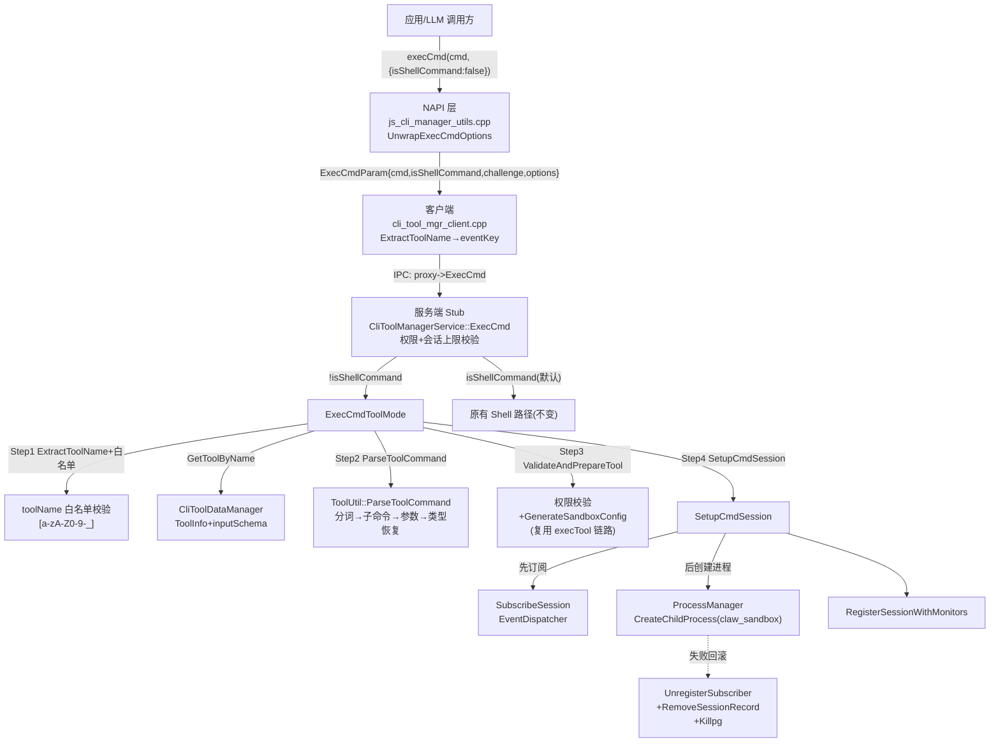
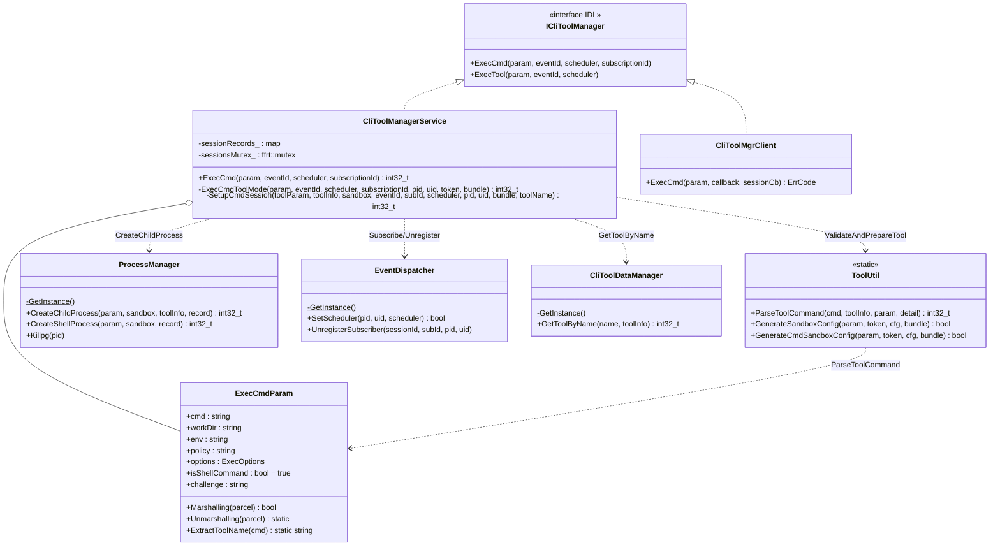
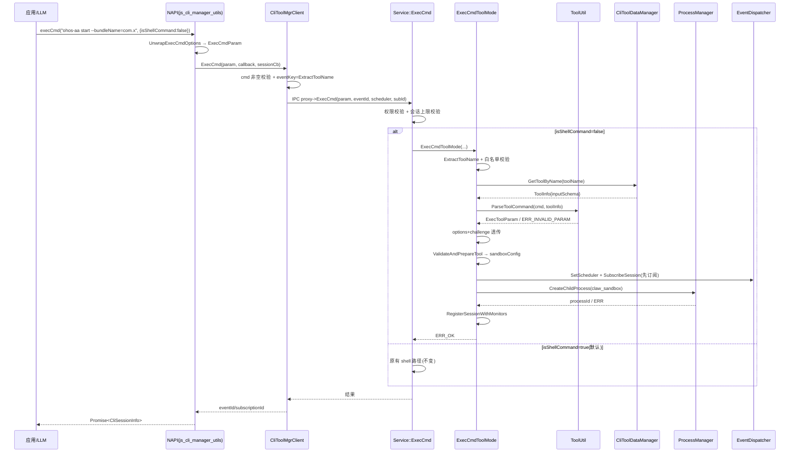

# Design

## 需求基线摘要

> 需求基线详见 proposal.md。以下仅列出设计阶段需额外强调的要点。

为 `execCmd` 增加工具命令模式（`isShellCommand=false`）：`cmd` 字符串被视为拼接好的工具命令，经与 `execTool` 相同的校验/沙箱/进程链路执行。设计阶段需强调：本变更复用既有 `execTool` 安全链路，不引入新的权限/沙箱逻辑；新增攻击面（toolName 路径注入）由白名单缓解；IPC 序列化追加尾部字段保证向后兼容。

## 代码事实基线

| 事实项 | 代码引用（文件:行） | 对设计的约束 |
|--------|-------------------|-------------|
| `ExecCmdParam` 既有 cmd/workDir/env/policy/options 字段，需追加 `isShellCommand=true`/`challenge`/`ExtractToolName` | `cli_tool_framework/interfaces/cli_tool/include/exec_cmd_param.h:29-43` | 两字段追加于 options 之后（尾部），默认 `isShellCommand=true` 保证旧客户端 shell 行为不变 |
| Marshalling 现序 `cmd→workDir→env→policy→options` | `cli_tool_framework/interfaces/cli_tool/src/exec_cmd_param.cpp:22-52` | 追加 `WriteBool(isShellCommand)`/`WriteString(challenge)` 于尾部，顺序固定不可调整（影响跨版本兼容） |
| Unmarshalling 现读至 options 结束 | `exec_cmd_param.cpp:55-97` | 尾部追加 ReadBool/ReadString，失败回退 `isShellCommand=true`/`challenge=""`，约束 IPC 兼容设计 |
| `ExecCmd` 既有权限校验+会话上限+shell 路径，需新增分流 | `cli_tool_framework/services/climgr/src/cli_tool_manager_service.cpp:1046-1073` | 分流点固定在 caller 信息获取之后、shell 逻辑之前；权限/会话上限校验对两路径共用 |
| `ExecCmdToolMode` 为新增私有方法 | `cli_tool_manager_service.cpp:1118-1164` | 四步顺序不可调换（解析依赖 toolInfo，沙箱依赖 toolParam） |
| `SetupCmdSession` 为新增私有方法 | `cli_tool_manager_service.cpp:1166-1214` | 「先订阅后创建进程」不变量，保证早期事件不丢失；每步失败回滚 |
| `ToolUtil::ParseToolCommand` 为新增静态方法 | `cli_tool_framework/services/climgr/include/tool_util.h:68-69` | schema 驱动类型恢复，返回 `ERR_INVALID_PARAM`/`ERR_TOOL_NOT_EXIST` |
| 既有错误码 `ERR_INVALID_PARAM=35700002`、`ERR_TOOL_NOT_EXIST=35700005`、`ERR_NO_INIT=35700004`、`ERR_SESSION_LIMIT_EXCEEDED=35700001` | `cli_tool_framework/interfaces/cli_tool/include/cli_error_code.h:38,48,53,33` | 内部码经 `cli_manager_error_utils` 映射为 JS 401/35600030/35600050/35600031 |
| `.d.ts` ExecCmdOptions 既有 workDir/env/background/yieldMs/timeout/policy/callback，execCmd `@throws` 现列 201/202/35600031/35600050 | `interface/sdk-js/api/@ohos.app.cli.cliManager.d.ts:85-180,420-437` | 需新增 `isShellCommand?`/`challenge?` 声明；`@throws` 需补 401 与 35600030（spec 接口变更分析已记录） |

## 设计约束

1. `ICliToolManager.idl` 的 `ExecCmd` 接口签名不变（`ExecCmdParam` 已是 sequenceable，字段追加无需改 IDL）
2. 既有 shell 路径（`isShellCommand=true`）行为完全不变，默认值在 NAPI 层与 IPC Unmarshalling 层一致
3. 工具命令路径必须复用 `ValidateAndPrepareTool`，不绕过 `PermissionVerification`、`GenerateSandboxConfig`
4. IPC Parcel 序列化字段顺序固定，新增字段只能追加在尾部
5. `param.cmd` 日志必须使用 `%{private}s` 脱敏
6. FA 模型不影响（本特性 `@stagemodelonly`）

## 非目标

- 不支持短标志（`-b`）、前缀参数、条件标志、双引号、反斜杠转义（列入后续迭代）
- 不变更 `execTool` 接口签名
- 不修改 `ICliToolManager.idl` 的 `ExecCmd` 签名
- 不新增第三方依赖
- 不新增 `templates` 配置与 `required` 校验（与 execTool 统一，暂不补齐）

## 方案概述

> 用 2-3 段描述整体技术路线，说明选择了什么架构模式、为什么。不要在此写实现细节。

在既有 `execCmd`（shell 路径）之上增加「工具命令路径」分流：当 `isShellCommand=false` 时，服务端 `ExecCmdToolMode` 将 `cmd` 字符串经 `ExtractToolName`→白名单校验→`GetToolByName`→`ParseToolCommand`（schema 驱动分词与类型恢复）→`ValidateAndPrepareTool`（复用 execTool 权限/沙箱链路）→`SetupCmdSession`（先订阅后创建子进程）完成执行。

选择「复用 execTool 链路」而非「独立实现」是为了避免重复造安全校验与进程管理代码，统一两路径的会话/沙箱/监控语义。IPC 兼容性通过「尾部追加字段 + Unmarshalling 失败回退默认值」保证，无需版本协商。

## 架构图

## 类图

## 模块影响

> 基础影响范围见 proposal.md。以下仅列出设计阶段识别的新增/变更模块及对应的设计决策关联。

| 子系统 | 仓库 | 模块/路径 | 影响类型 | 相关设计决策 |
|--------|------|-----------|---------|-------------|
| CLI 工具框架 | ability_ability_runtime | cli_tool_framework/interfaces/cli_tool（exec_cmd_param、cli_tool_mgr_client） | IPC 数据层新增字段+客户端校验 | DD-1（尾部追加兼容）、DD-2（eventKey 用 toolName） |
| CLI 工具框架 | ability_ability_runtime | cli_tool_framework/services/climgr（cli_tool_manager_service、tool_util） | 服务端分流+解析实现 | DD-3（复用 execTool 链路）、DD-4（先订阅后创建） |
| CLI 工具框架 | ability_ability_runtime | cli_tool_framework/frameworks/js/napi/cli_tool_manager | NAPI 解析新属性 | DD-1 |
| 公共 API | interface_sdk-js | api/@ohos.app.cli.cliManager.d.ts（中英） | API 声明+@throws 补充 | DD-5（@throws 补 401/35600030） |

## 实现入口

> 给执行 Agent 的代码接入点。优先引用现有入口、调用链和测试入口；不要让 Agent 自行扩大搜索范围。

| Entry Point | 代码引用（文件:行） | 当前职责 | 调用方 | 被调用方 | 预期变更 |
|-------------|-------------------|----------|--------|----------|----------|
| `ExecCmdParam` 字段+序列化 | exec_cmd_param.h:29-43 / exec_cmd_param.cpp:22-107 | IPC 参数载体 | NAPI/Client/Service | Parcel | 新增 isShellCommand/challenge/ExtractToolName 字段与尾部兼容序列化 |
| `UnwrapExecCmdOptions` | js_cli_manager_utils.cpp（UnwrapExecCmdOptions） | NAPI 层解析 ExecCmdOptions | OnExecCmd | ExecCmdParam | 新增解析 isShellCommand/challenge 属性（默认 true/""） |
| `CliToolMgrClient::ExecCmd` | cli_tool_mgr_client.cpp（ExecCmd 方法） | 客户端校验+eventKey+IPC 调用 | NAPI OnExecCmd | proxy->ExecCmd | 新增工具模式 cmd 非空校验+eventKey 用 ExtractToolName |
| `CliToolManagerService::ExecCmd` | cli_tool_manager_service.cpp:1046-1116 | 服务端入口：权限+会话上限+分流 | Stub OnRemoteRequest | ExecCmdToolMode/Shell | 新增 `!isShellCommand` 分流到 ExecCmdToolMode |
| `ExecCmdToolMode` | cli_tool_manager_service.cpp:1118-1164 | 工具命令路径四步 | ExecCmd | ParseToolCommand/ValidateAndPrepareTool/SetupCmdSession | 新增方法：ExtractToolName+白名单→ParseToolCommand→ValidateAndPrepareTool→SetupCmdSession |
| `SetupCmdSession` | cli_tool_manager_service.cpp:1166-1214 | 会话建立+进程创建+监控 | ExecCmdToolMode | ProcessManager/EventDispatcher | 新增方法：先订阅后创建进程+失败回滚 |
| `ToolUtil::ParseToolCommand` | tool_util.h:68-69 / tool_util.cpp:584+ | 命令字符串解析 | ExecCmdToolMode | Tokenize/ResolveSubCommand/ConvertParsedArgs | 新增静态方法：分词→子命令→参数→类型恢复 |
| `.d.ts` ExecCmdOptions/execCmd | @ohos.app.cli.cliManager.d.ts:85-180,420-437 | 公共 API 声明 | 应用开发者 | — | 新增 isShellCommand?/challenge? 声明；execCmd @throws 补 401/35600030 |

## 既有模式复用

| Pattern | 参考代码（文件:行） | 复用方式 | 适用 Task |
|---------|-------------------|----------|-----------|
| 权限/沙箱校验链路 | `ValidateAndPrepareTool`（execTool 既有调用） | 工具命令路径 Step3 直接调用，不复制校验逻辑 | ExecCmdToolMode 实现 |
| 会话建立顺序（先订阅后创建进程） | shell 路径 `cli_tool_manager_service.cpp:1092-1103` | SetupCmdSession 对齐 shell 路径的 Subscribe→Create 顺序 | SetupCmdSession 实现 |
| 错误码映射 | `cli_manager_error_utils.cpp:39-52` NATIVE_TO_BUSINESS_ERROR_MAP | 新增内部码复用既有映射表，无需新增 JS 错误码 | 错误处理 |
| Parcel 尾部兼容 | ExecOptions 既有 ReadParcelable 模式 | 新增字段 ReadBool/ReadString 失败回退默认值，与既有 parcel 读取容错一致 | IPC 序列化 |

## 关键设计决策

> 每个决策需包含问题、选择、备选方案和理由。决策 ≤ 3 个时可用紧凑表格。

| 决策 ID | 问题 | 推荐方案 | 备选方案 | 选择理由 |
|---------|------|----------|----------|---------|
| DD-1 | IPC 如何兼容新增 isShellCommand/challenge 字段 | 尾部追加 + Unmarshalling 失败回退默认值 | 版本协商字段 / 新增 IPC 接口 | 无需改 IDL 签名；旧客户端不写尾部字段时自动回退 shell 模式，行为不变（关联 AC-1.8） |
| DD-2 | 工具命令模式 eventKey 如何取值 | 用 `ExtractToolName(cmd)` 作为 eventKey | 固定 "tool" 字符串 | 与 execTool 一致按工具名分发事件回调；shell 路径仍用 "shell"（关联 AC-1.1） |
| DD-3 | 工具命令路径校验/沙箱是否独立实现 | 复用 `ValidateAndPrepareTool`（execTool 既有链路） | 独立实现校验+沙箱生成 | 避免重复造安全/进程管理代码，统一两路径会话语义；不绕过任何 PermissionVerification（关联 BR-2, AC-1.1） |
| DD-4 | 会话建立中订阅与进程创建顺序 | 先 SubscribeSession 后 CreateChildProcess | 先创建进程后订阅 | 保证早期事件不丢失（shell 路径同序）；失败时按反向回滚 UnregisterSubscriber+RemoveSessionRecord+Killpg（关联 BR-5, AC-1.1） |
| DD-5 | execCmd @throws 是否补充 401/35600030 | 补充 .d.ts @throws 列表 | 不补充（仅依赖运行时错误码） | 工具命令模式引入参数无效/工具不存在路径，@throws 须与运行时错误码一致，否则误导调用方（关联 AC-1.3/1.4/1.5/1.6） |
| DD-6 | toolName 路径注入如何防御 | 白名单 `[a-zA-Z0-9-_]` + `std::all_of` 校验 | 黑名单 / 正则 | 白名单最严格，拦截 `/`、`.`、`\`、空格、`;` `$` 等所有注入字符（关联 BR-1, AC-1.3） |

## 状态归属与不变量

- **Ownership**：`SessionRecord` 由 `CliToolManagerService` 创建并持有于 `sessionRecords_` map（key=sessionId）；`EventDispatcher` 持有 subscriber。不变量：每个 active session 必有唯一 sessionId 与 processId 一一对应；`SetupCmdSession` 失败时 sessionRecords_ 中不留孤儿记录（回滚保证）。验证方法：单测断言失败路径后 `QuerySession` 返回 NOT_FOUND。关联 AC-1.1/1.9, Task 见 execution-plan。
- **Lifecycle**：SessionRecord 状态 RUNNING→（COMPLETED|FAILED）；创建时机=SetupCmdSession Step1；清理触发=进程退出（WaitPid）/超时（PostExecToolTask）/clearSession；异常回滚=订阅失败→RemoveSessionRecord，进程创建失败→UnregisterSubscriber+RemoveSessionRecord，监控注册失败→Killpg+UnregisterSubscriber+RemoveSessionRecord。不变量：进程已创建则必有 subscriber 已注册（回滚顺序保证）。关联 AC-1.1, BR-5。
- **Concurrency**：`sessionRecords_` 由 `sessionsMutex_`（ffrt::mutex）保护；`EventDispatcher::SetScheduler`/subscribe 在 IPC 线程执行。不变量：对同一 sessionId 的 Subscribe/Create/Kill 串行化由调用链单线程上下文保证；`WaitPid` 遍历 sessionRecords_ 持锁。验证方法：并发会话上限单测。关联 AC-1.9。
- **Compatibility**：IPC Parcel 状态格式=`cmd→workDir→env→policy→options→isShellCommand→challenge`；新增两字段在尾部；旧客户端不写时 ReadBool/ReadString 失败回退 `isShellCommand=true`、`challenge=""`；API 默认行为：未传 isShellCommand 时 shell 路径不变。不变量：序列化顺序跨版本固定不可调。验证方法：IPC 兼容单测模拟旧 Parcel。关联 AC-1.2/1.8, BR-3/BR-4。

## DFX 设计

### DFX 故障模式分析

| 分析对象 | 故障模式 | 故障影响 | 故障原因 | 严酷度 | 恢复措施 | 关键日志 | 大数据打点事件 | 来源 |
|---------|----------|----------|----------|--------|----------|----------|----------------|------|

不涉及。

> 不涉及理由：知识库无匹配命中（ability_ability_runtime 的 `docs/dfx/fmea.yaml` 可达，但覆盖领域为 Ability 启动/Extension/AppSpawn 应用·子进程·Render 进程/意图框架/启动任务/URI 授权，无 CLI 工具执行、命令字符串解析、会话管理相关故障模式；interface_sdk-js 仓无 DFX 知识）
> 涉及仓库：ability_ability_runtime, interface_sdk-js

| 仓库 | 状态 | 理由 |
|------|------|------|
| ability_ability_runtime | READ | 知识库无命中 |
| interface_sdk-js | NO_DFX_KNOWLEDGE | 仓无 DFX 知识 |

## 安全基础检查

> 本节对涉及安全边界的变更进行基础安全检查。如不涉及安全场景，填写"不涉及"并说明理由。

### 信任边界交叉分析

> 识别跨信任边界的交互，明确权限管控机制。

| 交互类型 | 边界描述 | 通信双方 | 权限管控机制 | 关联 AC |
|---------|----------|----------|-------------|---------|
| 跨进程（IPC/Binder） | 应用进程 → CliToolManagerService（SA 186，aimgr 进程） | NAPI 客户端 proxy → 服务端 Stub | `ValidateExecToolPermissions` 校验 `ohos.permission.EXEC_CLI_TOOL` + 系统应用校验（`ValidateExecToolPermissions` 在分流前执行，两路径共用） | AC-1.1 |
| 跨安全层级（沙箱内外） | aimgr 服务进程 → claw_sandbox 子进程 | CliToolManagerService → ProcessManager::CreateChildProcess | `ValidateAndPrepareTool`→`GenerateSandboxConfig` 生成沙箱配置；子进程在受限沙箱执行 | AC-1.1 |
| 认证标识透传 | challenge（access token manager 唯一标识）跨 IPC 透传至工具进程 | 调用方 → ExecCmdParam.challenge → ExecToolParam.challenge → claw_sandbox | 服务端不生成/不校验 challenge，仅透传；challenge 来源与校验由 access token manager 与 claw_sandbox 负责 | AC-1.1 |

### 基础安全要求检查

> 检查常见安全违规项。对不合规项需说明风险和缓解措施。

| 检查项 | 检查结果 | 说明/措施 |
|--------|----------|-----------|
| 加密算法合规 | N/A | 本变更不涉及加密算法 |
| 密钥管理安全 | N/A | 不涉及密钥存储 |
| 随机数安全 | N/A | 不涉及随机数生成 |
| 输入验证完备 | ✅ | toolName 白名单 `[a-zA-Z0-9-_]` 拦截路径注入（`/`、`.`、`\`、空格、`;` `$` 等）；cmd 空白校验；ParseToolCommand 拒绝未知 flag/孤立值；schema 驱动类型恢复 |
| 错误处理安全 | ✅ | `param.cmd` 日志使用 `%{private}s`（Release 自动脱敏），防泄露文件路径等敏感信息；错误码不泄露内部状态 |
| 配置安全 | ✅ | 默认 `isShellCommand=true`（shell 模式），不传新属性时行为与改动前一致；无新增默认开放能力 |

> **安全参考**：推荐使用 AES-256/GCM、SHA-256、ECDSA P-256；禁止 MD5/SHA1/DES/RC4/硬编码密钥。

### 敏感数据处理（如适用）

> 识别敏感数据类型和处理场景，明确保护措施。

| 数据类型 | 处理场景 | 存储保护 | 传输保护 | 关联 AC |
|---------|----------|----------|----------|---------|
| 命令字符串（可能含文件路径） | 日志记录 ExecCmdToolMode 入参 | 不持久化 | 日志使用 `%{private}s` 脱敏（`ExecCmd` 入口 `cli_tool_manager_service.cpp:1092` 与 `ExecCmdToolMode` `cli_tool_manager_service.cpp:1164-1166`） | AC-1.1 |
| challenge（认证标识） | IPC 透传至工具进程 | 不持久化 | 仅 IPC Parcel 传输，不记入日志 | AC-1.1 |

### 深度威胁分析（如需）

本次变更仅需上述基础检查，未触发深度威胁分析（理由：1. 工具命令路径复用既有 `ValidateAndPrepareTool` 权限/沙箱链路，未新增认证授权逻辑；2. 无网络暴露面（纯本地 IPC + 本地子进程）；3. 唯一新增攻击面 toolName 路径注入已由白名单缓解；4. cmd 日志已 `%{private}s` 脱敏；5. challenge 仅透传不校验，不引入新信任决策点）。如后续扩展命令语法（短标志/转义）或引入远程工具调用，需重评。

## 时序设计

## 风险与缓解

| 风险 | 可能性 | 影响 | 缓解措施 |
|------|--------|------|----------|
| toolName 路径注入（`/`、`..`、`;`） | 中 | 高（任意命令执行） | 白名单 `[a-zA-Z0-9-_]` + `std::all_of` 校验（DD-6） |
| 订阅晚于进程创建导致早期事件丢失 | 中 | 中 | SetupCmdSession 先 Subscribe 后 CreateChildProcess（DD-4） |
| 旧客户端 IPC 不兼容（崩溃） | 低 | 高 | 尾部追加字段 + Unmarshalling 失败回退默认值（DD-1） |
| `challenge=""` 被 claw_sandbox 拒绝 | 未知 | 中 | 待确认（开放问题）；首版不改 challenge 透传逻辑 |
| ParseToolCommand 对带空格值解析错误 | 中 | 低 | 支持单引号包裹；双引号/转义列入后续迭代（BR-8） |
| execCmd @throws 文档与运行时不一致 | 高 | 中 | 补充 .d.ts @throws 401/35600030（DD-5） |
| 回滚不彻底遗留孤儿 subscriber/进程 | 低 | 中 | 失败路径严格按反序回滚 UnregisterSubscriber+RemoveSessionRecord+Killpg |

## 验证思路

| 验证场景 | 方法 | 通过标准 |
|----------|------|----------|
| 工具命令模式正常执行 | 单测 ExecCmdToolMode 调已注册工具 | CliSessionInfo.status=running, toolName 正确（AC-1.1） |
| 默认 shell 行为不变 | 回归测试不传 isShellCommand | 与改动前结果一致（AC-1.2） |
| toolName 注入拦截 | 安全测试注入 `/`/`.`/`;` | reject 401 且无进程（AC-1.3） |
| 工具不存在 | 单测未注册 toolName/子命令 | reject 35600030（AC-1.4） |
| 命令解析 4 种格式 | 单测 ParseToolCommand | 参数按 schema 类型恢复（AC-1.7） |
| IPC 旧客户端兼容 | 单测模拟旧 Parcel | 回退 shell 模式不崩溃（AC-1.8） |
| 会话上限 | 单测达上限后调用 | reject 35600031（AC-1.9） |
| 编译验证 | `./build.sh --product-name <product> --build-target abilityms` | 编译通过 |

> 兼容性验证详见 spec.md 兼容性声明章节。
