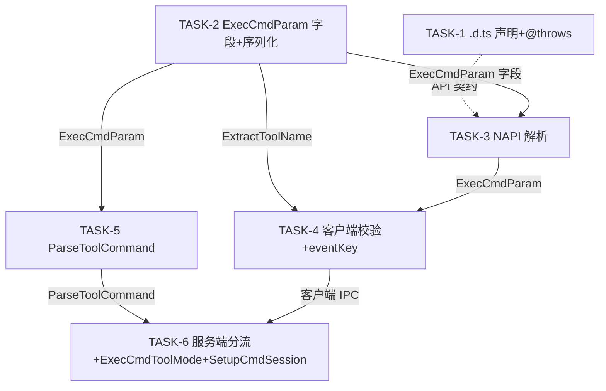

# Execution Plan

## 输入状态

| 输入 | 路径 | 要求状态 |
|------|------|----------|
| Proposal | proposal.md | Approved |
| Spec | spec.md | Approved |
| Design | design.md | Approved |

## 执行原则

- **Spec 权威：** 若实现细节与 `spec.md` 的 AC、错误码或兼容性声明冲突，先更新 spec/design，再继续实现。
- **测试/证据先行：** 每个 Task 先写失败测试；无法单测的集成行为必须先写明可复现证据缺口。
- **任务小型化：** 一个 Task 只覆盖一个独立闭环。跨 API、事件链、状态缓存、渲染链、生命周期的需求必须拆成多个 Task。
- **文件边界：** Task 只能修改 `Files` 表列出的文件；若构建暴露额外声明或 fixture 需求，先更新本计划。
- **状态所有权唯一：** 新增状态必须明确 owner、key/index、创建时机、清理触发和只读消费者。
- **证据回填：** Task 完成后必须回填本计划「AC 到 Task 追溯」验证状态、「代码范围映射」实际文件、per-task `Actual Result`。
- **反伪完成：** 只补声明、只写存储结构、只覆盖 happy path、只跑非相关测试，都不能替代 AC 闭环。
- **可交接执行（Agent 执行契约）：** 本计划须能被新 Agent 在无历史对话上下文下逐 Task 执行；执行契约由各 Task 结构承载——`只读上下文`/`Files`/`禁止修改文件`（上下文打包）、`Steps` 的 RED→GREEN（测试优先）、`Verification` 的 Expected/Actual（期望输出）、`Review Handoff`（评审交接）；每 Step 为含命令或代码方向的 2–5 分钟动作。

## AC 到 Task 追溯

| AC | 来源 | Task | 验证方式 | 验证状态（Pass/Fail/Blocked） |
|----|------|------|----------|----------------------------------|
| AC-1.1 | spec.md | TASK-2, TASK-3, TASK-5, TASK-6 | 单测 ExecCmdToolMode 正常执行返回 CliSessionInfo | Blocked |
| AC-1.2 | spec.md | TASK-3, TASK-2 | 回归测试：不传 isShellCommand 走 shell 路径 | Blocked |
| AC-1.3 | spec.md | TASK-6 | 安全测试：toolName 含 `/`/`.`/`;` reject 401 无进程 | Blocked |
| AC-1.4 | spec.md | TASK-6, TASK-5 | 单测：未注册 toolName/未知子命令 reject 35600030 | Blocked |
| AC-1.5 | spec.md | TASK-4 | 单测：纯空白 cmd reject 401 | Blocked |
| AC-1.6 | spec.md | TASK-5 | 单测：未知 flag reject 401 | Blocked |
| AC-1.7 | spec.md | TASK-5 | 单测：4 种长标志格式 + 单引号空格值按 schema 恢复 | Blocked |
| AC-1.8 | spec.md | TASK-2 | IPC 兼容单测：旧 Parcel 回退 shell 模式不崩溃 | Blocked |
| AC-1.9 | spec.md | TASK-6 | 单测：会话达上限 reject 35600031 | Blocked |
| AC-1.3/1.4/1.5/1.6（文档） | spec.md 接口变更分析 | TASK-1 | .d.ts execCmd @throws 含 401 与 35600030 | Pending |

> 状态说明：AC-1.1~1.9 对应实现与单测已合入本分支（HEAD `ba8e8b2694`，含 exec_cmd_param_test/tool_util_test/cli_tool_mgr_client_test/cli_tool_mgr_service_test 工具模式用例）；本工作区无构建与设备环境，UT 未实际执行，验证受阻（Blocked），需设备/CI 侧执行后改判。
> BR-6 偏差修复：`ExecCmd` 共享入口日志 cmd 原为 `%{public}s`，已修复为 `%{private}s`（cli_tool_manager_service.cpp:1092），工具命令模式 cmd 不再明文进入 Release 日志。

## 实现边界

**必须实现：** ExecCmdOptions.isShellCommand/challenge 声明；ExecCmdParam 字段+尾部兼容序列化；NAPI 解析；客户端 cmd 校验+eventKey；ParseToolCommand（分词→子命令→参数→类型恢复）；ExecCmdToolMode 四步+SetupCmdSession 先订阅后创建+回滚；execCmd @throws 补 401/35600030。

**可后置：** 短标志/双引号/反斜杠转义/templates 配置/required 校验（与 execTool 统一，列入后续迭代）。

**不建议延后：** execCmd @throws 补 401/35600030（TASK-1，公共 API 文档与运行时一致性，延后则调用方误处理错误）。

## 禁止项

- 每个 AC 必须有明确的验证方式。
- Agent 不得自行寻找未列出的上下文文件作为修改依据；需要新增上下文时先更新 Task。
- 不得修改 Task 列出范围外的文件。
- 不得在未通过验证时标记 Task 完成。
- 不得使用 `TBD`、`TODO`、`适当处理`、`补充测试`、`参考上文` 等不可执行占位描述。
- 不得修改 `ICliToolManager.idl` 的 ExecCmd 签名（ExecCmdParam 已 sequenceable）。
- 不得变更既有 shell 路径（isShellCommand=true 默认）行为。
- 不得为通过测试删除既有 HiSysEvent 事件或 `%{private}s` 日志脱敏。

## Task 依赖



## Task 列表

| TASK ID | 目标 | 文件范围 | AC 映射 | 前置依赖 | 完成判据 | 验证命令 | 状态 |
|---------|------|----------|---------|----------|----------|----------|------|
| TASK-1 | .d.ts ExecCmdOptions 声明 + execCmd @throws 补 401/35600030 | interface/sdk-js/api 与 zh-cn 的 @ohos.app.cli.cliManager.d.ts | AC-1.1, AC-1.3/1.4/1.5/1.6(文档) | 无 | isShellCommand?/challenge? 声明；execCmd @throws 含 401、35600030 | diff 检查 @throws 列表 | Pending |
| TASK-2 | ExecCmdParam 新增字段 + 尾部兼容序列化 + ExtractToolName | exec_cmd_param.h, exec_cmd_param.cpp | AC-1.1, AC-1.8 | 无 | 新增 isShellCommand/challenge/ExtractToolName；旧 Parcel 回退默认值 | exec_cmd_param_test | 已实现(验证受阻) |
| TASK-3 | NAPI 解析 isShellCommand/challenge | js_cli_manager_utils.cpp | AC-1.1, AC-1.2 | TASK-2 | UnwrapExecCmdOptions 解析两属性；默认 true | NAPI 模块编译 | 已实现(验证受阻) |
| TASK-4 | 客户端 cmd 非空校验 + eventKey=toolName | cli_tool_mgr_client.cpp | AC-1.1, AC-1.5 | TASK-2, TASK-3 | 工具模式 cmd 空白 reject 401；eventKey 用 ExtractToolName | cli_tool_mgr_client_test | 已实现(验证受阻) |
| TASK-5 | ParseToolCommand 分词→子命令→参数→类型恢复 | tool_util.h, tool_util.cpp | AC-1.6, AC-1.7, AC-1.4 | TASK-2 | 未知 flag reject；4 种长标志格式按 schema 恢复 | tool_util_test | 已实现(验证受阻) |
| TASK-6 | ExecCmd 分流 + ExecCmdToolMode 四步 + SetupCmdSession | cli_tool_manager_service.h, cli_tool_manager_service.cpp | AC-1.1, AC-1.3, AC-1.4, AC-1.9 | TASK-5, TASK-4 | 分流+白名单+GetToolByName+ParseToolCommand+ValidateAndPrepareTool+先订阅后创建+回滚 | cli_tool_mgr_service_test | 已实现(验证受阻) |

## Task 详情

### TASK-1: .d.ts ExecCmdOptions 声明 + execCmd @throws 补充

**目标：** 确认 `ExecCmdOptions.isShellCommand?`/`challenge?` 声明完整，并补齐 `execCmd` `@throws` 列表中的 401（参数无效）与 35600030（工具不存在）。

**AC 映射：** AC-1.1（API 面），AC-1.3/1.4/1.5/1.6（文档：@throws 与运行时错误码一致）

**前置依赖：** 无（声明文件为下游实现契约来源）

**非目标：** 不修改 execCmd 函数签名；不修改其他函数的 @throws；不新增声明文件。

**状态所有权：** 无（纯声明文档变更）。

**任务间接口：** Produces=`ExecCmdOptions.isShellCommand?: boolean`（默认 true）、`ExecCmdOptions.challenge?: string`（默认 ""）；Consumes=无。供 TASK-3 NAPI 解析对齐属性名。

**只读上下文**

| 路径 | 读取目的 |
|------|----------|
| spec.md `## API 规格定义` | 声明规格与 @throws 错误码集合 |
| interface/sdk-js/api/@ohos.app.cli.cliManager.d.ts | 既有声明格式（@kit/@syscap/@systemapi/@stagemodelonly/@since） |

**Files**

| 操作 | 文件 | 说明 |
|------|------|------|
| 修改 | interface/sdk-js/api/@ohos.app.cli.cliManager.d.ts | 新增 isShellCommand?/challenge? 声明；execCmd @throws 补 401 与 35600030 |
| 修改 | interface/sdk-js/zh-cn/api/@ohos.app.cli.cliManager.d.ts | 同上（中文版） |

**禁止修改文件**

| 文件/路径 | 原因 |
|-----------|------|
| ICliToolManager.idl | ExecCmd 签名不变（ExecCmdParam 已 sequenceable） |

**Steps**

- [ ] Step 1: 写失败测试或定义可复现证据缺口。

```text
证据缺口：工具命令模式经 cli_manager_error_utils 映射会产生 401（ERR_INVALID_PARAM）与 35600030（ERR_TOOL_NOT_EXIST），但 .d.ts execCmd @throws 仅列 201/202/35600031/35600050。复现：读 .d.ts 420-437 行 @throws 段，对照 spec.md 错误码定义表。
```

- [ ] Step 2: 运行验证，确认 RED 或证据缺口存在。

```bash
grep -n "@throws" interface/sdk-js/api/@ohos.app.cli.cliManager.d.ts | sed -n '/execCmd/,+8p'
```

Expected: execCmd 的 @throws 段无 401 与 35600030 行，证据缺口成立。

- [ ] Step 3: 做最小实现。

```text
在 execCmd 函数 @throws 段（35600031 前）补充两行（en + zh-cn 同步）：
  @throws { BusinessError } 401 - Invalid input parameter. The cmd is empty, the toolName contains
      invalid characters, or the command contains an unknown flag.
  @throws { BusinessError } 35600030 - No tool with the specified name exists.
zh-cn 版补充对应中文描述；如 isShellCommand?/challenge? 声明缺失，按 spec.md API 规格定义补齐（默认值注释 true/""）。
```

- [ ] Step 4: 运行聚焦验证，确认 GREEN。

```bash
grep -n "401\|35600030" interface/sdk-js/api/@ohos.app.cli.cliManager.d.ts interface/sdk-js/zh-cn/api/@ohos.app.cli.cliManager.d.ts
```

Expected: 两个文件 execCmd 段均含 401 与 35600030 @throws。

- [ ] Step 5: 如有必要，在保持 GREEN 的前提下重构（如环境可用，运行 oh-api-definition 校验声明格式，可选、不阻塞）。
- [ ] 回填本计划「AC 到 Task 追溯」验证状态、「代码范围映射」实际文件、per-task Actual Result。
- [ ] 回填本 Task 的 `Actual Result`。

**Anti-Fake Completion**

简单文档、配置或单文件变更仍填写 AC 和范围证据；不适用的状态生命周期项写 `N/A`。

| Check | Required Evidence |
|-------|-------------------|
| AC closed | 证明 .d.ts execCmd @throws 含 401/35600030，与 spec 错误码定义一致 |
| Scope respected | 证明仅修改 en/zh-cn 两个 .d.ts，未改 IDL/函数签名 |
| State lifecycle complete | N/A（纯声明文档） |

**Verification**

| Command / Evidence | Expected Result | Actual Result |
|--------------------|-----------------|---------------|
| grep @throws execCmd 段 | 含 201/202/401/35600030/35600031/35600050 | 待回填 |

**Review Handoff**

| Reviewer | Input |
|----------|-------|
| Spec Compliance | @throws 与 spec 错误码定义表完全一致；未改签名 |
| Code Quality | en/zh-cn 两文件同步；diff 仅增 @throws 行 |

### TASK-2: ExecCmdParam 字段 + 尾部兼容序列化 + ExtractToolName

**目标：** ExecCmdParam 新增 `isShellCommand=true`/`challenge`/`ExtractToolName`，Parcel 序列化追加尾部两字段，Unmarshalling 失败回退默认值保证旧客户端兼容。

**AC 映射：** AC-1.1（数据载体），AC-1.8（IPC 向后兼容）

**前置依赖：** 无

**非目标：** 不修改 ExecOptions 结构；不调整既有字段顺序；不改 IDL。

**状态所有权：** Compatibility 维度——IPC Parcel 状态格式 `cmd→workDir→env→policy→options→isShellCommand→challenge`，新增字段在尾部，旧客户端不写时回退 `isShellCommand=true`/`challenge=""`。owner=ExecCmdParam::Unmarshalling；清理=无（运行时临时对象）；只读消费者=Service::ExecCmd。验证方法：exec_cmd_param_test 模拟旧 Parcel。

**任务间接口：** Produces=`ExecCmdParam.isShellCommand`(bool,默认true)、`ExecCmdParam.challenge`(string,默认"")、`static ExecCmdParam::ExtractToolName(cmd)`；Consumes=无。供 TASK-3/4/5/6 使用。

**只读上下文**

| 路径 | 读取目的 |
|------|----------|
| exec_cmd_param.h / exec_cmd_param.cpp | 既有结构体与序列化实现 |
| spec.md BR-3/BR-4 | 默认值与字段顺序不变量 |

**Files**

| 操作 | 文件 | 说明 |
|------|------|------|
| 修改 | cli_tool_framework/interfaces/cli_tool/include/exec_cmd_param.h | 新增 isShellCommand/challenge 字段 + ExtractToolName 声明 |
| 修改 | cli_tool_framework/interfaces/cli_tool/src/exec_cmd_param.cpp | Marshalling 追加 WriteBool/WriteString；Unmarshalling 回退默认值；ExtractToolName 实现 |

**禁止修改文件**

| 文件/路径 | 原因 |
|-----------|------|
| ICliToolManager.idl | 签名不变 |
| exec_options.h | ExecOptions 结构不变 |

**Steps**

- [x] Step 1: 写失败测试或定义可复现证据缺口。

```text
测试 Unmarshalling_OldClientCompat（exec_cmd_param_test）：构造仅写到 options 的 Parcel，Unmarshalling 后断言 isShellCommand==true、challenge==""、不崩溃；测试 Marshalling_ToolModeFields：写入 isShellCommand=false/challenge="abc" 后 roundtrip，断言读回一致。
```

- [x] Step 2: 运行验证，确认 RED 或证据缺口存在。

```bash
run -t UT -ts exec_cmd_param_test
```

Expected: Unmarshalling_OldClientCompat 失败（实现前 Unmarshalling 无尾部默认值回退，字段无来源），或测试目标符号不存在导致编译失败。

- [x] Step 3: 做最小实现。

```text
exec_cmd_param.h 新增 `bool isShellCommand = true;`、`std::string challenge;` 与 `static std::string ExtractToolName(const std::string &cmd);` 声明；
exec_cmd_param.cpp Marshalling 在 options 之后追加 WriteBool(isShellCommand)、WriteString(challenge)（顺序固定）；
Unmarshalling 预设默认 isShellCommand=true/challenge="" 后依次 ReadBool/ReadString，读取失败即 return result（保留已读字段）；
ExtractToolName 用 find_first_not_of(" \t") 跳前导空白，截取至首个空白字符为止的 token。
```

- [ ] Step 4: 运行聚焦验证，确认 GREEN。

```bash
run -t UT -ts exec_cmd_param_test
```

Expected: 旧客户端兼容测试与字段 roundtrip 测试全部通过。

- [ ] Step 5: 如有必要，在保持 GREEN 的前提下重构。
- [x] 回填本计划「AC 到 Task 追溯」验证状态、「代码范围映射」实际文件、per-task Actual Result。
- [x] 回填本 Task 的 `Actual Result`。

**Anti-Fake Completion**

简单文档、配置或单文件变更仍填写 AC 和范围证据；不适用的状态生命周期项写 `N/A`。

| Check | Required Evidence |
|-------|-------------------|
| AC closed | AC-1.8 旧 Parcel 回退默认值不崩溃；AC-1.1 字段可承载工具模式数据 |
| Scope respected | 仅改 exec_cmd_param.h/.cpp |
| State lifecycle complete | Compatibility 状态格式不变量已验证 |

**Verification**

| Command / Evidence | Expected Result | Actual Result |
|--------------------|-----------------|---------------|
| run -t UT -ts exec_cmd_param_test | 通过 | 未执行：本工作区无构建/设备环境；实现与测试已在库（HEAD ba8e8b2694），代码走查确认 Unmarshalling 尾部回退逻辑存在（exec_cmd_param.cpp:86-96） |

**Review Handoff**

| Reviewer | Input |
|----------|-------|
| Spec Compliance | AC-1.8 覆盖；字段顺序与 BR-4 一致 |
| Code Quality | 尾部追加；ReadBool/ReadString 失败回退；ExtractToolName 跳前导空白 |

### TASK-3: NAPI 解析 isShellCommand/challenge

**目标：** `UnwrapExecCmdOptions` 解析 `isShellCommand`（可选默认 true）与 `challenge`（可选默认 ""）属性，填入 ExecCmdParam。

**AC 映射：** AC-1.1，AC-1.2（默认 true 行为不变）

**前置依赖：** TASK-2（ExecCmdParam 字段）、TASK-1（属性名契约）

**非目标：** 不改 OnExecCmd 调用结构（已有 UnwrapExecCmdOptions 调用）；不解析其他属性。

**状态所有权：** 无（纯参数解析，无新增运行时状态）。

**任务间接口：** Produces=ExecCmdParam 经 NAPI 填充后供客户端使用；Consumes=ExecCmdParam.isShellCommand/challenge（TASK-2）、属性名 isShellCommand/challenge（TASK-1）。

**只读上下文**

| 路径 | 读取目的 |
|------|----------|
| js_cli_manager_utils.cpp | 既有 UnwrapExecCmdOptions 解析 policy/callback 的模式 |
| spec.md BR-3 | 默认 true 不变量 |

**Files**

| 操作 | 文件 | 说明 |
|------|------|------|
| 修改 | cli_tool_framework/frameworks/js/napi/cli_tool_manager/src/js_cli_manager_utils.cpp | UnwrapExecCmdOptions 在 policy 后、callback 前新增 isShellCommand/challenge 解析 |

**禁止修改文件**

| 文件/路径 | 原因 |
|-----------|------|
| js_cli_manager.cpp | OnExecCmd 调用结构不变 |

**Steps**

- [x] Step 1: 写失败测试或定义可复现证据缺口。

```text
证据缺口：NAPI 层无法脱离 JS 运行时直接单测。复现：审查 js_cli_manager_utils.cpp 的 UnwrapExecCmdOptions，确认未解析 isShellCommand/challenge——工具模式传入 {isShellCommand:false} 时 ExecCmdParam 仍为默认 shell 行为。
```

- [x] Step 2: 运行验证，确认 RED 或证据缺口存在。

```bash
grep -n "isShellCommand" cli_tool_framework/frameworks/js/napi/cli_tool_manager/src/js_cli_manager_utils.cpp
```

Expected: 无命中，证据缺口存在（未解析新属性）。

- [x] Step 3: 做最小实现。

```text
UnwrapExecCmdOptions 在 policy 解析后、callback 前：napi_has_named_property 判断 "isShellCommand"/"challenge" 存在性，存在则分别用 UnwrapBoolFromJS2/UnwrapStringFromJS2 填充 ExecCmdParam；未传时保持默认 true/""。
```

- [ ] Step 4: 运行聚焦验证，确认 GREEN。

```bash
./build.sh --product-name <product> --build-target abilityms
```

Expected: NAPI 模块编译通过，无新增告警。

- [ ] Step 5: 如有必要，在保持 GREEN 的前提下重构。
- [x] 回填本计划「AC 到 Task 追溯」验证状态、「代码范围映射」实际文件、per-task Actual Result。
- [x] 回填本 Task 的 `Actual Result`。

**Anti-Fake Completion**

简单文档、配置或单文件变更仍填写 AC 和范围证据；不适用的状态生命周期项写 `N/A`。

| Check | Required Evidence |
|-------|-------------------|
| AC closed | AC-1.2 未传 isShellCommand 默认 true 行为不变 |
| Scope respected | 仅改 js_cli_manager_utils.cpp |
| State lifecycle complete | N/A |

**Verification**

| Command / Evidence | Expected Result | Actual Result |
|--------------------|-----------------|---------------|
| 编译 abilityms | 通过 | 未执行：本工作区无构建环境；解析代码已在库（js_cli_manager_utils.cpp:294-330，isShellCommand/challenge 均含默认值保护） |

**Review Handoff**

| Reviewer | Input |
|----------|-------|
| Spec Compliance | AC-1.2 默认值与 spec BR-3 一致 |
| Code Quality | 复用既有 UnwrapBool/UnwrapString 模式 |

### TASK-4: 客户端 cmd 非空校验 + eventKey=toolName

**目标：** `CliToolMgrClient::ExecCmd` 在工具命令模式下校验 cmd 非空（reject 401），eventKey 用 `ExtractToolName`（shell 用 "shell"）。

**AC 映射：** AC-1.1（eventKey），AC-1.5（cmd 空白 reject）

**前置依赖：** TASK-2（ExtractToolName），TASK-3（NAPI 填充的 ExecCmdParam 实例）

**非目标：** 不改 IPC 调用签名；不改回调注册逻辑。

**状态所有权：** 无。

**任务间接口：** Produces=客户端 ExecCmdParam 经校验后 IPC 发往服务端；Consumes=ExecCmdParam::ExtractToolName（TASK-2）、NAPI 填充的 ExecCmdParam 实例（TASK-3）。

**只读上下文**

| 路径 | 读取目的 |
|------|----------|
| cli_tool_mgr_client.cpp | 既有 ExecCmd 方法与 eventKey 逻辑 |
| spec.md AC-1.5 | cmd 空白校验要求 |

**Files**

| 操作 | 文件 | 说明 |
|------|------|------|
| 修改 | cli_tool_framework/interfaces/cli_tool/src/cli_tool_mgr_client.cpp | 工具模式 cmd 纯空白校验返回 ERR_INVALID_PARAM；eventKey=ExtractToolName |

**禁止修改文件**

| 文件/路径 | 原因 |
|-----------|------|
| cli_tool_mgr_client.h | 公共客户端接口不变 |

**Steps**

- [x] Step 1: 写失败测试或定义可复现证据缺口。

```text
cli_tool_mgr_client_test 新增 ExecCmd_EmptyCmdToolMode：构造 ExecCmdParam{cmd="   ", isShellCommand=false} 调用客户端 ExecCmd，断言返回 ERR_INVALID_PARAM（映射 401）；另断言工具模式 eventKey==ExtractToolName(cmd)、shell 模式 eventKey=="shell"。
```

- [x] Step 2: 运行验证，确认 RED 或证据缺口存在。

```bash
run -t UT -ts cli_tool_mgr_client_test
```

Expected: ExecCmd_EmptyCmdToolMode 失败（实现前客户端未对工具模式做 cmd 空白校验，请求直接进入 IPC）。

- [x] Step 3: 做最小实现。

```text
CliToolMgrClient::ExecCmd 入口新增：`!param.isShellCommand && param.cmd.find_first_not_of(" \t") == npos` 时返回 ERR_INVALID_PARAM；eventKey 取 `param.isShellCommand ? "shell" : ExecCmdParam::ExtractToolName(param.cmd)`。
```

- [ ] Step 4: 运行聚焦验证，确认 GREEN。

```bash
run -t UT -ts cli_tool_mgr_client_test
```

Expected: 空白 cmd 校验与 eventKey 测试通过。

- [ ] Step 5: 如有必要，在保持 GREEN 的前提下重构。
- [x] 回填本计划「AC 到 Task 追溯」验证状态、「代码范围映射」实际文件、per-task Actual Result。
- [x] 回填本 Task 的 `Actual Result`。

**Anti-Fake Completion**

简单文档、配置或单文件变更仍填写 AC 和范围证据；不适用的状态生命周期项写 `N/A`。

| Check | Required Evidence |
|-------|-------------------|
| AC closed | AC-1.5 空白 cmd reject 401 |
| Scope respected | 仅改 cli_tool_mgr_client.cpp |
| State lifecycle complete | N/A |

**Verification**

| Command / Evidence | Expected Result | Actual Result |
|--------------------|-----------------|---------------|
| run -t UT -ts cli_tool_mgr_client_test | 通过 | 未执行：本工作区无构建/设备环境；实现与测试已在库（空白校验 cli_tool_mgr_client.cpp:88-91、eventKey :93） |

**Review Handoff**

| Reviewer | Input |
|----------|-------|
| Spec Compliance | AC-1.5 覆盖 |
| Code Quality | eventKey 与 execTool 一致按工具名分发 |

### TASK-5: ParseToolCommand 分词→子命令→参数→类型恢复

**目标：** `ToolUtil::ParseToolCommand(cmd, toolInfo, param, detail)` 将拼接命令字符串解析为 ExecToolParam，schema 驱动类型恢复，拒绝未知 flag/孤立值。

**AC 映射：** AC-1.6（未知 flag reject），AC-1.7（4 种长标志格式 + 单引号空格值），AC-1.4（未知子命令→ERR_TOOL_NOT_EXIST）

**前置依赖：** TASK-2（ExecCmdParam/ExecToolParam 数据结构）

**非目标：** 不支持短标志/双引号/反斜杠转义/前缀参数/条件标志；不做 required 校验。

**状态所有权：** 无（纯解析，输出临时 ExecToolParam）。

**任务间接口：** Produces=`ToolUtil::ParseToolCommand(cmd, toolInfo, param, detail)→int32_t`（返回 ERR_OK/ERR_INVALID_PARAM/ERR_TOOL_NOT_EXIST，ExecToolParam 由引用参数填充为输出）；Consumes=`cmd` 字符串（来自 ExecCmdParam，TASK-2 间接经 TASK-6 传入）、ToolInfo.inputSchema（既有，来自 CliToolDataManager）。

**只读上下文**

| 路径 | 读取目的 |
|------|----------|
| tool_util.h / tool_util.cpp | 既有 ValidateProperties 等模式 |
| spec.md BR-8, EB-5, EB-6 | 语法约束与边界 |
| design.md 实现入口 | ParseToolCommand 四阶段调用链 |

**Files**

| 操作 | 文件 | 说明 |
|------|------|------|
| 修改 | cli_tool_framework/services/climgr/include/tool_util.h | 新增 ParseToolCommand 声明 |
| 修改 | cli_tool_framework/services/climgr/src/tool_util.cpp | TokenizeCommand/ResolveSubCommand/ParseArgTokens/ConvertParsedArgs 实现 |

**禁止修改文件**

| 文件/路径 | 原因 |
|-----------|------|
| cli_tool_data_manager.h | 数据管理接口不变 |

**Steps**

- [x] Step 1: 写失败测试或定义可复现证据缺口。

```text
tool_util_test 新增：ParseToolCommand_UnknownFlag（"ohos-aa start --unknownFlag=x"→ERR_INVALID_PARAM）；ParseToolCommand_LongFlagFormats（--key=value/--key value/--flag/--flag false 四种格式→按 schema string/boolean/integer/number 恢复）；ParseToolCommand_QuotedValue（--name 'hello world'→单值）；ParseToolCommand_UnknownSubcommand（第二 token 不在 subcommands→ERR_TOOL_NOT_EXIST）。
```

- [x] Step 2: 运行验证，确认 RED 或证据缺口存在。

```bash
run -t UT -ts tool_util_test
```

Expected: 上述测试失败（实现前 ParseToolCommand 未实现，符号缺失导致编译失败或断言失败）。

- [x] Step 3: 做最小实现。

```text
tool_util.h 新增 ParseToolCommand 静态声明；tool_util.cpp 实现 TokenizeCommand（空格/Tab 分隔，单引号包裹内容整体为一个值）→tokens[0]=toolName→ResolveSubCommand（匹配 toolInfo.subcommands，未定义则 ERR_TOOL_NOT_EXIST）→ParseArgTokens（--key=value/--key value/--flag/--flag false，孤立值报 ERR_INVALID_PARAM）→ConvertParsedArgs（schema 驱动 string/boolean/integer/number/array 类型恢复，未知 flag 报 ERR_INVALID_PARAM）。
```

- [ ] Step 4: 运行聚焦验证，确认 GREEN。

```bash
run -t UT -ts tool_util_test
```

Expected: 4 种格式解析、单引号空格值、未知 flag 拒绝、未知子命令测试全部通过。

- [ ] Step 5: 如有必要，在保持 GREEN 的前提下重构。
- [x] 回填本计划「AC 到 Task 追溯」验证状态、「代码范围映射」实际文件、per-task Actual Result。
- [x] 回填本 Task 的 `Actual Result`。

**Anti-Fake Completion**

简单文档、配置或单文件变更仍填写 AC 和范围证据；不适用的状态生命周期项写 `N/A`。

| Check | Required Evidence |
|-------|-------------------|
| AC closed | AC-1.6 未知 flag reject；AC-1.7 四格式+单引号按 schema 恢复；AC-1.4 未知子命令 |
| Scope respected | 仅改 tool_util.h/.cpp |
| State lifecycle complete | N/A |

**Verification**

| Command / Evidence | Expected Result | Actual Result |
|--------------------|-----------------|---------------|
| run -t UT -ts tool_util_test | 通过 | 未执行：本工作区无构建/设备环境；实现与测试已在库（ParseToolCommand tool_util.cpp:588-640，四格式/单引号/未知 flag 逻辑齐备） |

**Review Handoff**

| Reviewer | Input |
|----------|-------|
| Spec Compliance | AC-1.6/1.7/1.4 覆盖 |
| Code Quality | schema 驱动类型恢复；未知 flag 拒绝 |

### TASK-6: ExecCmd 分流 + ExecCmdToolMode + SetupCmdSession

**目标：** 服务端 `ExecCmd` 在权限/会话上限校验后分流 `!isShellCommand→ExecCmdToolMode`；ExecCmdToolMode 四步（ExtractToolName+白名单→ParseToolCommand→ValidateAndPrepareTool→SetupCmdSession）；SetupCmdSession 先订阅后创建进程+失败回滚。

**AC 映射：** AC-1.1（正常执行），AC-1.3（白名单拦截），AC-1.4（GetToolByName），AC-1.9（会话上限）

**前置依赖：** TASK-5（ParseToolCommand），TASK-4（客户端 IPC），TASK-2（ExecCmdParam/ExtractToolName）

**非目标：** 不修改 shell 路径；不改 ValidateAndPrepareTool；不改 ProcessManager。

**状态所有权：** Ownership——SessionRecord 由 CliToolManagerService 持有于 sessionRecords_（key=sessionId）；Lifecycle——RUNNING→COMPLETED/FAILED，创建=SetupCmdSession Step1，清理=WaitPid/超时/clearSession，回滚=订阅失败 RemoveSessionRecord/进程失败 UnregisterSubscriber+RemoveSessionRecord/监控失败 Killpg+UnregisterSubscriber+RemoveSessionRecord；Concurrency——sessionsMutex_ 保护 sessionRecords_；不变量=进程已创建必有 subscriber 已注册。验证方法：cli_tool_mgr_service_test 断言失败路径 QuerySession NOT_FOUND。

**任务间接口：** Produces=会话执行结果（CliSessionInfo）；Consumes=ExecCmdParam（TASK-2）、ExtractToolName（TASK-2）、ToolUtil::ParseToolCommand（TASK-5）、ValidateAndPrepareTool/ProcessManager/EventDispatcher（既有）。

**只读上下文**

| 路径 | 读取目的 |
|------|----------|
| cli_tool_manager_service.h / .cpp | 既有 ExecCmd shell 路径与 SetupCmdSession 顺序 |
| design.md 状态归属与不变量 | 回滚顺序不变量 |
| spec.md BR-1/BR-2/BR-5 | 白名单/复用校验/先订阅后创建 |

**Files**

| 操作 | 文件 | 说明 |
|------|------|------|
| 修改 | cli_tool_framework/services/climgr/include/cli_tool_manager_service.h | 新增 ExecCmdToolMode/SetupCmdSession 私有声明 |
| 修改 | cli_tool_framework/services/climgr/src/cli_tool_manager_service.cpp | ExecCmd 分流 + ExecCmdToolMode 四步 + SetupCmdSession 先订阅后创建+回滚 |

**禁止修改文件**

| 文件/路径 | 原因 |
|-----------|------|
| ICliToolManager.idl | 签名不变 |
| process_manager.* | 进程管理接口不变 |
| tool_util.* | TASK-5 范围 |

**Steps**

- [x] Step 1: 写失败测试或定义可复现证据缺口。

```text
cli_tool_mgr_service_test 新增：ExecCmdToolMode_NormalTool（调已注册工具→CliSessionInfo.status=running, toolName=ohos-aa）；ExecCmdToolMode_InvalidToolName（toolName 含 `/`/`.`/`;`→401 且无子进程创建）；ExecCmdToolMode_ToolNotExist（未注册→35600030）；ExecCmdToolMode_SessionLimit（会话达上限→35600031）；ExecCmd_ShellDefault 回归（不传 isShellCommand 走 shell 路径）。
```

- [x] Step 2: 运行验证，确认 RED 或证据缺口存在。

```bash
run -t UT -ts cli_tool_mgr_service_test
```

Expected: 工具命令模式测试失败（实现前 ExecCmd 不识别 isShellCommand 分流，工具命令走 shell 路径）。

- [x] Step 3: 做最小实现。

```text
ExecCmd 在 caller 信息获取后新增 `if (!param.isShellCommand) return ExecCmdToolMode(...)`（权限/会话上限校验两路径共用）；
ExecCmdToolMode 四步：Step1 ExtractToolName+std::all_of 白名单[a-zA-Z0-9-_]+GetToolByName；Step2 ParseToolCommand+options/challenge 透传；Step3 ValidateAndPrepareTool→sandboxConfig；Step4 SetupCmdSession；
SetupCmdSession：CreateRecord→SubscribeSession→CreateChildProcess→RegisterSessionWithMonitors，失败按反序回滚 UnregisterSubscriber+RemoveSessionRecord+Killpg；cmd 日志用 %{private}s。
补充修复（BR-6）：ExecCmd 共享入口日志 cmd 由 %{public}s 改为 %{private}s（cli_tool_manager_service.cpp:1092），堵住工具命令模式在分流前的明文日志泄露。
```

- [ ] Step 4: 运行聚焦验证，确认 GREEN。

```bash
run -t UT -ts cli_tool_mgr_service_test && ./build.sh --product-name <product> --build-target abilityms
```

Expected: 正常/白名单/工具不存在/会话上限/shell 回归测试通过，编译通过。

- [ ] Step 5: 如有必要，在保持 GREEN 的前提下重构。
- [x] 回填本计划「AC 到 Task 追溯」验证状态、「代码范围映射」实际文件、per-task Actual Result。
- [x] 回填本 Task 的 `Actual Result`。

**Anti-Fake Completion**

简单文档、配置或单文件变更仍填写 AC 和范围证据；不适用的状态生命周期项写 `N/A`。

| Check | Required Evidence |
|-------|-------------------|
| AC closed | AC-1.1 正常执行；AC-1.3 白名单拦截无进程；AC-1.4 GetToolByName 失败；AC-1.9 会话上限 |
| Scope respected | 仅改 cli_tool_manager_service.h/.cpp |
| State lifecycle complete | SessionRecord 创建/清理/回滚均覆盖；进程已创建必有 subscriber |

**Verification**

| Command / Evidence | Expected Result | Actual Result |
|--------------------|-----------------|---------------|
| run -t UT -ts cli_tool_mgr_service_test | 通过 | 未执行：本工作区无构建/设备环境；实现与测试已在库（分流 :1112-1115、ExecCmdToolMode :1160-1206、SetupCmdSession :1208-1256） |
| ./build.sh --product-name <product> --build-target abilityms | 编译通过 | 未执行：本工作区无构建环境 |
| grep -n "ExecCmd called" cli_tool_manager_service.cpp | 入口日志 cmd 使用 %{private}s | 已修复：原 %{public}s 改为 %{private}s（cli_tool_manager_service.cpp:1092），满足 BR-6 |
| 参数精简重构（入参≤5） | ExecCmdToolMode/SetupCmdSession 签名符合 ≤5 参数约定 | 已完成：新增私有嵌套结构 `CmdSessionContext`（eventId/subscriptionId/scheduler/callerPid/callerUid/tokenId/bundleName），ExecCmdToolMode 收敛为 2 参、SetupCmdSession 收敛为 5 参；行为等价（逻辑未变，仅参数分组），公共接口 ExecCmd 签名不变 |

**Review Handoff**

| Reviewer | Input |
|----------|-------|
| Spec Compliance | AC-1.1/1.3/1.4/1.9 覆盖；复用 ValidateAndPrepareTool 不绕权 |
| Code Quality | 先订阅后创建；回滚反序；cmd 用 %{private}s |

## Review Gates

| Gate | When | Required Evidence | Blocks Next Step |
|------|------|-------------------|------------------|
| Gate-1 | TASK-1（API 声明）完成后 | @throws 与 spec 错误码一致、属性名一致 | TASK-3 解析对齐 |
| Gate-2 | TASK-6（核心逻辑）完成后 | AC 覆盖、异常路径、兼容性、回归测试 | Gate-Final |
| Gate-Final（必选） | 集成/最终验证后 | 端到端证据、「AC 到 Task 追溯」验证状态、「代码范围映射」实际文件、Actual Result 全部回填 | 归档 |

## 代码范围映射

| TASK ID | 文件 | 操作 |
|--------|------|------|
| TASK-1 | interface/sdk-js/api/@ohos.app.cli.cliManager.d.ts | 修改（@throws 补 401/35600030） |
| TASK-1 | interface/sdk-js/zh-cn/api/@ohos.app.cli.cliManager.d.ts | 修改（同上中文） |
| TASK-2 | cli_tool_framework/interfaces/cli_tool/include/exec_cmd_param.h | 修改 |
| TASK-2 | cli_tool_framework/interfaces/cli_tool/src/exec_cmd_param.cpp | 修改 |
| TASK-3 | cli_tool_framework/frameworks/js/napi/cli_tool_manager/src/js_cli_manager_utils.cpp | 修改 |
| TASK-4 | cli_tool_framework/interfaces/cli_tool/src/cli_tool_mgr_client.cpp | 修改 |
| TASK-5 | cli_tool_framework/services/climgr/include/tool_util.h | 修改 |
| TASK-5 | cli_tool_framework/services/climgr/src/tool_util.cpp | 修改 |
| TASK-6 | cli_tool_framework/services/climgr/include/cli_tool_manager_service.h | 修改 |
| TASK-6 | cli_tool_framework/services/climgr/src/cli_tool_manager_service.cpp | 修改 |
