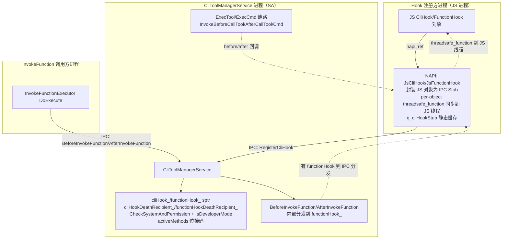

# Design

## 需求基线摘要

需求基线详见 proposal.md。设计阶段需强调：Hook 回调为同步 IPC，服务侧通过 `InvokeHookAsync`（condition_variable + 超时）同步等待回调结果；NAPI 层封装 JS 对象为 IPC Stub（`JsCliHook`/`JsFunctionHook`），通过 `napi_threadsafe_function` 同步分发到 JS 线程；每个 hook 类型独立 DeathRecipient；`activeMethods` 位掩码控制仅调用已实现的方法。

## 代码事实基线

| 事实项 | 代码引用（文件:行） | 对设计的约束 |
|--------|-------------------|-------------|
| CliToolManagerService 已有 Hook 存储成员 | `cli_tool_manager_service.h` hookMutex_/cliHook_/functionHook_/cliHookDeathRecipient_/functionHookDeathRecipient_ | 独立 DeathRecipient 按类型清除 |
| PermissionUtil 校验模式 | `cli_tool_manager_service.cpp` PermissionUtil::CheckSystemAndPermission | 系统应用 + 权限合一校验 |
| NAPI register/unregister Stub 缓存 | `js_cli_manager.cpp` g_cliHookStub / g_functionHookStub | register 同类型已存在则 reject 不 IPC |
| ValidateCliHookObject | `js_cli_manager.cpp` ValidateCliHookObject | 检查对象类型 + 至少一个可选方法为 function |
| activeMethods 位掩码 | `js_cli_manager.cpp` 0x01/0x02/0x04/0x08 (CLI), 0x01/0x02 (FUNC) | 传入服务侧控制回调调用 |
| IDL ICliHookInterface/IFunctionHookInterface | `interfaces/cli_tool/ICliHookInterface.idl` / `IFunctionHookInterface.idl` | 回调接口契约，[inout] 参数 |
| InvokeHookAsync 超时 | `cli_tool_manager_service.h` HOOK_TIMEOUT_SECONDS=6 | 服务侧 6s 超时返回原值 |
| NAPI stub 超时 | `js_cli_hook.h` 注释 5000ms | NAPI stub 5s 超时返回原值 |
| CleanupCliHookOnEnvDestroy | `js_cli_manager.cpp` napi_add_env_cleanup_hook | env 销毁自动 unregister |

## 设计约束

1. Hook 回调为同步 IPC：服务侧 `InvokeHookAsync` 使用 condition_variable + 6s 超时；NAPI stub 使用 threadsafe_function + 5s 超时。
2. 全部 hook 模式：回调返回值不影响 Hook 应用，修改后的 param/result 始终生效。
3. 失败式注册：同类型 Hook 已存在则返回 35600035。
4. 独立 DeathRecipient：cliHookDeathRecipient_ 仅清 cliHook_；functionHookDeathRecipient_ 仅清 functionHook_。
5. 三层安全门控：系统应用（202）→ 权限（201）→ 开发模式（35600034）。
6. NAPI Stub 缓存：register 同类型已存在则 reject 35600035 不 IPC；unregister 无 Stub 则 reject 35600036 不 IPC。
7. activeMethods 位掩码：NAPI 层计算并传入服务侧，仅调用已实现的方法。
8. unregister 对象校验：传入的 Hook 对象必须与注册时一致（`napi_strict_equals`）。
9. 无 Hook 时零开销：服务侧 `CheckCliHook`/`CheckFunctionHook` 返回 nullptr，直接返回。
10. 非开发模式时回调跳过：`CheckCliHook`/`CheckFunctionHook` 先检查 `IsDeveloperMode()`。

## 关键设计决策

| 决策 ID | 问题 | 方案 | 取舍理由 |
|---------|------|------|----------|
| ADR-1 | Hook 回调用独立 IPC 接口 | 独立 IPC 接口（ICliHookInterface/IFunctionHookInterface） | 与既有 ICliToolManager 模式一致，职责清晰 |
| ADR-2 | cliHook 方法命名 | 异名（BeforeCallTool/AfterCallTool/BeforeCallCmd/AfterCallCmd），JS 层加 on 前缀 | IDL 不支持重载 |
| ADR-3 | 回调参数包装 | ExecResultWrap{execResult} / FunctionResultWrap{result} 包装 | 统一 inout 语义，IDL sequenceable 支持 |
| ADR-4 | 单 Hook 还是多 Hook 链 | 单 Hook，失败式注册 | v1 场景单一，失败语义比覆盖语义更安全 |
| ADR-5 | 回调返回值语义 | 全部 hook 模式（修改始终生效） | 回调返回值不影响 Hook 应用 |
| ADR-6 | DeathRecipient 架构 | 每个类型独立 DeathRecipient（HookDeathRecipient 带 HookType） | 各自独立清除，职责清晰 |
| ADR-7 | 门控方式 | `system::GetBoolParameter("const.security.developermode.state", false)` 运行时判断 | 运行时灵活，非开发模式注册失败 + 回调跳过 |
| ADR-8 | NAPI 层设计 | JS 对象封装为 IRemoteStub（JsCliHook）+ per-object threadsafe_function + promise/future 同步分发 | 同步返回改写后数据，5s 超时兜底 |
| ADR-9 | 安全校验 | 系统应用 + `ohos.permission.REGISTER_AGENT_HOOK` 权限 | 三层门控，单一权限管控 Register/Unregister |
| ADR-10 | NAPI Stub 缓存 | 静态变量 g_cliHookStub/g_functionHookStub；register 同类型已存在则 reject 不 IPC | 避免 IPC 浪费 |
| ADR-11 | unregister 参数 | unregister 传入 Hook 对象，NAPI 层 napi_strict_equals 校验一致性 | 确保调用方传入正确的对象 |
| ADR-12 | activeMethods 位掩码 | NAPI 层 ValidateCliHookObject 计算 bitmask，传入服务侧 | 仅调用已实现的方法，避免无效 IPC |
| ADR-13 | 公共错误码映射 | 内部 357xxxx → NAPI 层 CreateCliJsErrorByNativeErr 转换为公共 356xxxx | 公共 API 兼容性 |
| ADR-14 | 环境清理 | napi_add_env_cleanup_hook 注册 CleanupCliHookOnEnvDestroy | env 销毁自动 unregister，防止资源泄漏 |

## 架构图



## NAPI Stub 设计

### Stub 类

```cpp
class JsCliHook : public CliHookInterfaceStub {
    napi_env env_;
    napi_ref callbackRef_;           // 持有 JS CliHook 对象引用
    napi_threadsafe_function tsfn_;  // per-object 1 个 tsfn
    std::atomic<bool> released_;
    std::mutex mutex_;

    enum class HookMethodType : uint8_t {
        BEFORE_CALL_TOOL,
        AFTER_CALL_TOOL,
        BEFORE_CALL_CMD,
        AFTER_CALL_CMD,
    };

    struct HookCallData {
        HookMethodType methodType;
        std::shared_ptr<ExecToolParam> toolParam;
        std::shared_ptr<ExecCmdParam> cmdParam;
        std::shared_ptr<ExecResultWrap> execResultWrap;
        std::shared_ptr<std::promise<void>> promise;
    };
};
```

### 同步回调分发

1. binder 线程收到 IPC → 打包 param + promise 到 CallData
2. `napi_call_threadsafe_function(tsfn, callData, napi_tsfn_blocking)` 入队
3. `promise->get_future().wait_for(5s)` 阻塞等待
4. JS 线程 CallJs：构造 JS param 对象 → `napi_call_function(jsCb, undefined, 1, [param])` → 解析返回值写回 C++ param → `promise.set_value()`
5. binder 线程恢复 → IPC 返回改写后数据
6. 超时（5s）或异常 → 返回原 param（未改写）

### Stub 缓存与 unregister

```cpp
static sptr<JsCliHook> g_cliHookStub = nullptr;
static std::mutex g_cliHookMutex;

// register: 检查缓存 → 已存在则 reject 35600035 不 IPC
if (g_cliHookStub != nullptr) {
    return RejectPromise(ERR_HOOK_ALREADY_REGISTERED);  // → 公共 35600035
}
// 创建 stub + IPC 注册 → 成功则 g_cliHookStub = stub

// unregister: 检查缓存 + 对象一致性
if (g_cliHookStub == nullptr) {
    return RejectPromise(ERR_HOOK_NOT_REGISTERED);  // → 公共 35600036
}
napi_strict_equals(env, argv[0], storedObj, &same);
if (!same) {
    return RejectPromise(ERR_INVALID_PARAM);  // → 公共 401
}
// IPC 注销 → 成功则 g_cliHookStub = nullptr
```

### ValidateCliHookObject

```cpp
bool ValidateCliHookObject(napi_env env, napi_value obj, uint32_t &activeMethods) {
    activeMethods = 0;
    // 检查 napi_typeof == napi_object
    // 遍历 4 个方法名，检查是否为 napi_function
    // {"onBeforeCallTool", 0x01}, {"onAfterCallTool", 0x02},
    // {"onBeforeCallCmd", 0x04}, {"onAfterCallCmd", 0x08}
    return activeMethods != 0;  // 至少一个方法为 function
}
```

## 服务侧 Hook 存储

```cpp
class CliToolManagerService {
    ffrt::mutex hookMutex_;
    sptr<ICliHookInterface> cliHook_;
    sptr<IFunctionHookInterface> functionHook_;
    uint32_t cliHookActiveMethods_ = 0;
    uint32_t functionHookActiveMethods_ = 0;
    sptr<IRemoteObject::DeathRecipient> cliHookDeathRecipient_;
    sptr<IRemoteObject::DeathRecipient> functionHookDeathRecipient_;
    bool isDeveloperMode_ = false;

    static constexpr uint32_t CLI_HOOK_BEFORE_CALL_TOOL = 1 << 0;
    static constexpr uint32_t CLI_HOOK_AFTER_CALL_TOOL  = 1 << 1;
    static constexpr uint32_t CLI_HOOK_BEFORE_CALL_CMD   = 1 << 2;
    static constexpr uint32_t CLI_HOOK_AFTER_CALL_CMD    = 1 << 3;
    static constexpr uint32_t FUNC_HOOK_BEFORE_INVOKE   = 1 << 0;
    static constexpr uint32_t FUNC_HOOK_AFTER_INVOKE    = 1 << 1;
    static constexpr int32_t HOOK_TIMEOUT_SECONDS = 6;

    bool IsDeveloperMode() const;
    sptr<ICliHookInterface> CheckCliHook(uint32_t flag);
    sptr<IFunctionHookInterface> CheckFunctionHook(uint32_t flag);
    template<typename HookFunc, typename ParamType>
    bool InvokeHookAsync(HookFunc &&hookFunc, ParamType &param);
};
```

## 数据流

### registerCliHook 流程

```
JS: registerCliHook(hook)
  → NAPI: argc 检查 (≥1) → 401 if missing
  → NAPI: ValidateCliHookObject (typeof object + 至少一个方法为 function) → 401 if invalid
  → NAPI: g_cliHookStub != null? → reject 35600035 (不 IPC)
  → NAPI: create JsCliHook stub (napi_ref + tsfn)
  → IPC: RegisterCliHook(stub, activeMethods)
  → Service: CheckSystemAndPermission(REGISTER_AGENT_HOOK) → 202/201 if fail
  → Service: IsDeveloperMode()? → no: reject 35600034
  → Service: cliHook_ != null? → reject 35600035
  → Service: save cliHook_ + activeMethods + AddDeathRecipient
  → NAPI: g_cliHookStub = stub + napi_add_env_cleanup_hook → resolve Promise
```

### unregisterCliHook 流程

```
JS: unregisterCliHook(hook)
  → NAPI: argc 检查 (≥1) → 401 if missing
  → NAPI: g_cliHookStub == null? → reject 35600036 (不 IPC)
  → NAPI: napi_strict_equals(hook, storedObj)? → no: reject 401
  → NAPI: IsSameEnv? → no: reject 401 (cross-thread not supported)
  → IPC: UnregisterCliHook(g_cliHookStub)
  → Service: CheckSystemAndPermission(REGISTER_AGENT_HOOK) → 202/201 if fail
  → Service: IsDeveloperMode()? → no: reject 35600034
  → Service: cliHook_->AsObject() == hook->AsObject()? → no: reject 35600036
  → Service: RemoveDeathRecipient + cliHook_ = nullptr
  → NAPI: stub->ReleaseResources() + g_cliHookStub = nullptr → resolve Promise
```

### Hook 回调流程（以 BeforeCallTool 为例）

```
Service: ExecTool(param)
  → CheckCliHook(CLI_HOOK_BEFORE_CALL_TOOL)
    → IsDeveloperMode()? no → return nullptr (跳过)
    → cliHook_ == null? → return nullptr (跳过)
    → activeMethods & CLI_HOOK_BEFORE_CALL_TOOL? no → return nullptr (跳过)
  → InvokeHookAsync([hook](ExecToolParam &p) { hook->BeforeCallTool(p); }, param)
    → IPC: BeforeCallTool(param) [inout]
    → NAPI Stub: binder 线程 → 打包 CallData → napi_call_threadsafe_function
    → JS 线程: CallJs → CreateJsExecToolParam → napi_call_function(jsCb, [param])
    → JS 回调返回改写后 param → 解析写回 C++ param → promise.set_value
    → 超时 6s (service) / 5s (NAPI stub) → 返回原 param
  → Service: 用改写后 param 执行（全部 hook 模式）
```

## 受影响文件

| 文件 | 变更类型 | 说明 |
|------|----------|------|
| `interfaces/cli_tool/ICliHookInterface.idl` | 新增 | 4 方法 BeforeCallTool/AfterCallTool/BeforeCallCmd/AfterCallCmd，[inout] 参数 |
| `interfaces/cli_tool/IFunctionHookInterface.idl` | 新增 | 2 方法 BeforeInvokeFunction/AfterInvokeFunction，[inout] 参数 |
| `interfaces/cli_tool/ICliToolManager.idl` | 修改 | 新增 RegisterCliHook/UnregisterCliHook/RegisterFunctionHook/UnregisterFunctionHook |
| `interfaces/cli_tool/include/exec_result_wrap.h` | 新增 | ExecResultWrap struct + Parcelable |
| `interfaces/cli_tool/src/exec_result_wrap.cpp` | 新增 | Marshalling/Unmarshalling |
| `interfaces/cli_tool/include/function_result_wrap.h` | 新增 | FunctionResultWrap struct + Parcelable |
| `interfaces/cli_tool/src/function_result_wrap.cpp` | 新增 | Marshalling/Unmarshalling |
| `interfaces/cli_tool/include/invoke_function_param.h` | 新增 | InvokeFunctionParam struct + Parcelable |
| `interfaces/cli_tool/src/invoke_function_param.cpp` | 新增 | Marshalling/Unmarshalling |
| `interfaces/cli_tool/include/invoke_function_result.h` | 新增 | InvokeFunctionResult struct + Parcelable |
| `interfaces/cli_tool/src/invoke_function_result.cpp` | 新增 | Marshalling/Unmarshalling |
| `interfaces/cli_tool/include/exec_cmd_param.h` | 修改 | 新增 execCmdOptions 字段 |
| `interfaces/cli_tool/src/exec_cmd_param.cpp` | 修改 | Marshalling/Unmarshalling 扩展 |
| `interfaces/cli_tool/include/cli_error_code.h` | 修改 | 新增 ERR_NOT_DEVELOPER_MODE/ERR_HOOK_ALREADY_REGISTERED/ERR_HOOK_NOT_REGISTERED |
| `interfaces/cli_tool/include/cli_tool_mgr_client.h` | 修改 | 新增 Register/Unregister Hook 代理方法 |
| `interfaces/cli_tool/src/cli_tool_mgr_client.cpp` | 修改 | 实现 Register/Unregister Hook IPC 调用 |
| `services/climgr/include/cli_tool_manager_service.h` | 修改 | 独立 DeathRecipient + activeMethods + CheckCliHook/CheckFunctionHook + InvokeHookAsync |
| `services/climgr/src/cli_tool_manager_service.cpp` | 修改 | 权限校验 + 独立 DeathRecipient + activeMethods 位掩码 + 回调分发 + 超时兜底 |
| `services/common/include/permission_util.h` | 修改 | 新增 CheckSystemAndPermission 工具方法 |
| `services/common/src/permission_util.cpp` | 修改 | 实现 CheckSystemAndPermission |
| `frameworks/js/napi/cli_tool_manager/include/js_cli_hook.h` | 新增 | JsCliHook Stub 类 |
| `frameworks/js/napi/cli_tool_manager/src/js_cli_hook.cpp` | 新增 | Stub 实现 + threadsafe_function + CallJs |
| `frameworks/js/napi/cli_tool_manager/include/js_cli_manager.h` | 修改 | 新增 RegisterCliHook/UnregisterCliHook 声明 |
| `frameworks/js/napi/cli_tool_manager/src/js_cli_manager.cpp` | 修改 | Stub 缓存 + ValidateCliHookObject + unregister 对象校验 + env cleanup |
| `frameworks/js/napi/cli_tool_manager/include/cli_manager_error_utils.h` | 新增 | CliManagerErrorCode 枚举 + CreateCliJsErrorByNativeErr |
| `frameworks/js/napi/cli_tool_manager/src/cli_manager_error_utils.cpp` | 新增 | 内部码→公共码映射 |
| `frameworks/js/napi/function_manager/include/js_function_hook.h` | 新增 | JsFunctionHook Stub 类 |
| `frameworks/js/napi/function_manager/src/js_function_hook.cpp` | 新增 | Stub 实现 + threadsafe_function + CallJs |
| `frameworks/js/napi/function_manager/include/js_function_manager.h` | 修改 | 新增 RegisterFunctionHook/UnregisterFunctionHook 声明 |
| `frameworks/js/napi/function_manager/src/js_function_manager.cpp` | 修改 | Stub 缓存 + ValidateFunctionHookObject + unregister 对象校验 |
| `frameworks/js/napi/function_manager/include/invoke_function_executor.h` | 修改 | DoExecute 调用 BeforeInvokeFunction/AfterInvokeFunction |
| `frameworks/js/napi/function_manager/src/invoke_function_executor.cpp` | 修改 | 实现 Hook 回调点 |
| `frameworks/js/napi/function_manager/include/invoke_function_callback_client.h` | 修改 | 适配 Hook 回调 |
| `frameworks/js/napi/function_manager/src/invoke_function_callback_client.cpp` | 修改 | 适配 Hook 回调 |
| `frameworks/js/napi/function_manager/include/js_function_manager_utils.h` | 修改 | 新增 Hook 相关工具函数 |
| `frameworks/js/napi/function_manager/src/js_function_manager_utils.cpp` | 修改 | 实现 Hook 相关工具函数 |
| `interface/sdk-js/api/@ohos.app.cli.cliManager.d.ts` | 修改 | 新增 registerCliHook/unregisterCliHook + @permission + @throws |
| `interface/sdk-js/api/@ohos.app.function.functionManager.d.ts` | 修改 | 新增 registerFunctionHook/unregisterFunctionHook + @permission + @throws |
| `interface/sdk-js/api/application/CliHook.d.ts` | 新增 | CliHook + ExecToolParam + ExecCmdParam + ExecResultWrap |
| `interface/sdk-js/api/application/FunctionHook.d.ts` | 新增 | FunctionHook + InvokeFunctionParam + FunctionResultWrap |
| `interface/sdk-js/kits/@kit.AbilityKit.d.ts` | 修改 | 导出上述 named export 类型 |
