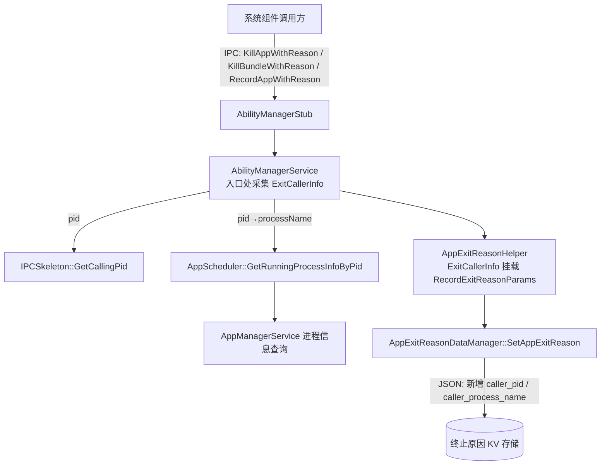
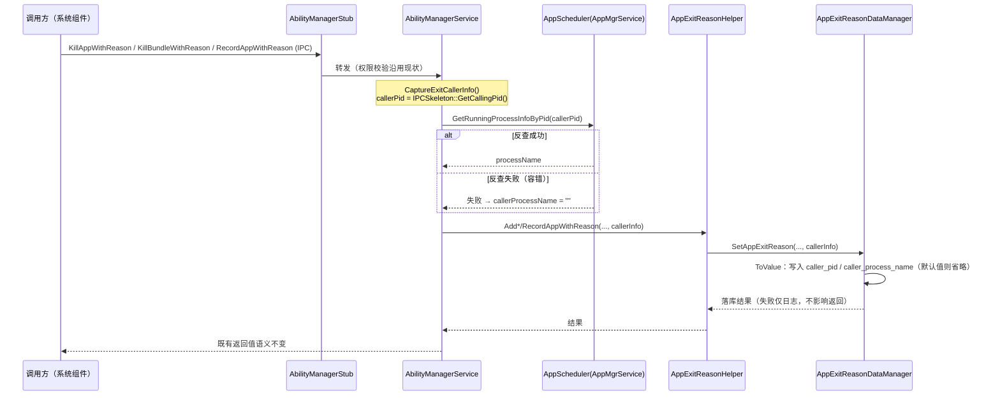

# Design

## 需求基线摘要

> 需求基线详见 proposal.md。以下仅列出设计阶段需额外强调的要点。

- 三个 AbilityManagerService inner 接口（`KillAppWithReason` / `KillBundleWithReason` / `RecordAppWithReason`）被调用时，服务端自动采集调用方 pid + processName 并随终止原因数据持久化（spec AC-1.1~1.3）。
- 调用方零改造：不改接口签名、不改 `ExitReasonCompability` IPC 序列化格式（BR-1）。
- 采集/记录失败必须容错，不影响终止主流程与返回值（BR-3）。
- 设计原则（用户要求）：**简洁**（最小签名改动、复用既有模式）、**高效**（低频路径、无新增锁与异步）、**安全**（服务端可信采集、防伪造、日志最小暴露）。

## 代码事实基线

| 事实项 | 代码引用（文件:行） | 对设计的约束 |
|--------|-------------------|-------------|
| 两处「Record the info of Caller」占位注释钩子 | services/abilitymgr/src/ability_manager_service.cpp:3848、:3919 | 采集点即现有占位注释位置（KillAppWithReason 定义于 :3846，KillBundleWithReason 于 :3916） |
| `RecordAppWithReason` 已使用 `IPCSkeleton::GetCallingUid()` 做权限判定 | services/abilitymgr/src/ability_manager_service.cpp:3958-3975（权限判定约 :3963） | 服务端从 IPC 上下文取调用方身份是既有模式，pid 采集同法复用 |
| `IPCSkeleton::GetCallingPid()` 语义：本地调用（同进程）回退 `getpid()` | foundation/communication/ipc/ipc/native/src/core/framework/source/ipc_skeleton.cpp:111-121 | 进程内调用（IN_PROCESS_CALL）时 callerPid 记为服务自身进程（spec BR-6） |
| 既有采集调用方 pid 模式 | services/abilitymgr/src/ability_connect_manager.cpp:3519 | 复用该调用模式，不发明新抽象 |
| 调用方进程名反查通道 | services/abilitymgr/include/app_scheduler.h:448（`GetRunningProcessInfoByPid`，内部经 AppMgrClient） | 复用既有进程信息查询，不新增查询接口（BR-4） |
| 终止原因记录参数结构体 `RecordExitReasonParams` | services/abilitymgr/include/app_exit_reason_helper.h:28-36 | 调用方信息挂载于该结构体，避免多层签名扩散 |
| 记录链路：Helper 入口 → `AddProcessExitReason` → `SetAppExitReason` | services/abilitymgr/src/app_exit_reason_helper.cpp（AddAppExitReason/AddBundleExitReason/RecordAppWithReasonInner/AddProcessExitReason） | 沿既有链路透传，不新增分支 |
| KV JSON 持久化与既有 key 常量 | services/abilitymgr/src/app_exit_reason_data_manager.cpp:35-55、:323（ToValue）、:353（FromValue） | 新增 JSON key 沿用 `JSON_KEY_*` 常量模式；读解析沿用 `contains + 类型校验` 容错模式（AC-1.6） |
| `RecordInvalidKillId` 仅通知 AppMgrService、不写 KV | services/abilitymgr/src/app_exit_reason_helper.cpp:611-621 | 非法原因路径无持久化记录，无需携带调用方信息（解决 spec E-5） |
| `ExitReason`/`ExitReasonCompability` 均为 Parcelable | interfaces/inner_api/ability_manager/include/exit_reason.h:43-61 | 禁止向其添加字段（序列化兼容风险），调用方信息独立建模 |
| `GetAppExitReason` 读回接口及调用方 | services/abilitymgr/include/app_exit_reason_data_manager.h:42；调用方 ability_manager_service.cpp:19408 与 test/unittest/app_exit_reason_data_manager_test | 读回扩展用默认参数保持调用方源码兼容 |

## 设计约束

1. 不修改三个接口签名与 `ExitReasonCompability`/`ExitReason` 的 Marshalling 格式（零 IPC 序列化兼容风险）。
2. 调用方 pid 只能取自服务端 IPC 上下文（`IPCSkeleton::GetCallingPid()`），禁止由请求参数携带（防伪造）。
3. 采集与反查在 IPC 请求线程同步完成（IPC 上下文是请求作用域，跨异步边界即失效）；结果按值向下传递。
4. 任何采集/反查/写入失败仅记日志，不改变主流程返回值（容错）。
5. 新增 JSON key 与既有 key 无命名冲突（已核对 app_exit_reason_data_manager.cpp:35-55 既有 key 集合）。
6. 日志中 callerPid 可 public 输出，callerProcessName 用 `%{private}s`（进程名不入明文日志）。

## 非目标

- 不为调用方信息新增对外查询/暴露接口（含 public/system/hidumper 新字段）。
- 不改造其他退出原因记录路径（崩溃、JS 错误、ANR、`RecordAppWithReasonByUserId/ByAccessTokenId` 等）携带调用方信息。
- 不实现上层大数据消费逻辑。
- 不修改 AppMgrService 侧行为（仅复用其进程信息查询）。

## 方案概述

在三个目标接口的服务入口处（现有占位注释位置）同步采集调用方信息：`IPCSkeleton::GetCallingPid()` 获取 pid，再经既有 `AppScheduler::GetRunningProcessInfoByPid` 反查进程名（失败记空）。采集结果封装为服务内部值类型 `ExitCallerInfo`（不参与 IPC 序列化），挂载到既有 `RecordExitReasonParams`，沿既有记录链路（Helper → AddProcessExitReason → AppExitReasonDataManager::SetAppExitReason）透传，最终以两个新 JSON key（`caller_pid` / `caller_process_name`）写入既有终止原因 KV 存储，与记录同生命周期。

选择该路线的理由：全部复用既有入口、链路与持久化通道，无新组件、无新锁、无新异步任务；采集在请求线程同步完成，天然规避 IPC 上下文跨线程失效问题；默认参数扩展签名，未接入路径（其他记录来源）行为完全不变。

## 架构图



## 类图

```mermaid
classDiagram
    class ExitCallerInfo {
        +int32_t callerPid = -1
        +std::string callerProcessName
    }
    class RecordExitReasonParams {
        +int32_t pid
        +std::string bundleName
        +int32_t uid
        +uint32_t accessTokenId
        +ExitReasonCompability exitReason
        +RunningProcessInfo processInfo
        +bool fromKillWithReason
        +ExitCallerInfo callerInfo
    }
    class AbilityManagerService {
        +KillAppWithReason(pid, exitReason) int32_t
        +KillBundleWithReason(bundleName, userId, appIndex, exitReason) int32_t
        +RecordAppWithReason(pid, uid, exitReason) int32_t
        -CaptureExitCallerInfo() ExitCallerInfo
    }
    class AppExitReasonHelper {
        +AddAppExitReason(..., callerInfo = {}) int32_t
        +AddBundleExitReason(..., callerInfo = {}) int32_t
        +RecordAppWithReason(pid, uid, exitReason, callerInfo = {}) int32_t
    }
    class AppExitReasonDataManager {
        +SetAppExitReason(..., callerInfo = {}) int32_t
        +GetAppExitReason(..., ExitCallerInfo* callerInfo = nullptr) int32_t
        -ConvertAppExitReasonInfoToValue(..., callerInfo) Value
        -ConvertAppExitReasonInfoFromValue(..., ExitCallerInfo& callerInfo) void
    }
    RecordExitReasonParams --> ExitCallerInfo
    AbilityManagerService --> AppExitReasonHelper : appExitReasonHelper_
    AppExitReasonHelper --> AppExitReasonDataManager : SetAppExitReason
```

## 模块影响

> 基础影响范围见 proposal.md。以下仅列出设计阶段识别的新增/变更模块及对应的设计决策关联。

| 子系统 | 仓库 | 模块/路径 | 影响类型 | 相关设计决策 |
|--------|------|-----------|---------|-------------|
| 元能力 | ability_runtime | services/abilitymgr/src/ability_manager_service.cpp（三接口入口） | 变更 | D1, D2 |
| 元能力 | ability_runtime | services/abilitymgr/include/app_exit_reason_helper.h、src/app_exit_reason_helper.cpp（记录链路透传） | 变更 | D1, D3 |
| 元能力 | ability_runtime | services/abilitymgr/include/app_exit_reason_data_manager.h、src/app_exit_reason_data_manager.cpp（KV 读写） | 变更 | D1, D4 |
| 元能力 | ability_runtime | interfaces/inner_api/ability_manager/include/exit_reason.h | 不修改（明确排除） | D1 |

## 实现入口

> 给执行 Agent 的代码接入点。优先引用现有入口、调用链和测试入口；不要让 Agent 自行扩大搜索范围。

| Entry Point | 代码引用（文件:行） | 当前职责 | 调用方 | 被调用方 | 预期变更 |
|-------------|-------------------|----------|--------|----------|----------|
| `AbilityManagerService::KillAppWithReason` | services/abilitymgr/src/ability_manager_service.cpp:3846（占位注释:3848） | 按 pid 终止应用并记录退出原因 | AbilityManagerStub（IPC） | AppExitReasonHelper::AddAppExitReason | 入口处调用 `CaptureExitCallerInfo()`，透传至 AddAppExitReason |
| `AbilityManagerService::KillBundleWithReason` | services/abilitymgr/src/ability_manager_service.cpp:3916（占位注释:3919） | 按包名终止应用并记录退出原因 | AbilityManagerStub（IPC） | AppExitReasonHelper::AddBundleExitReason | 同上，透传至 AddBundleExitReason |
| `AbilityManagerService::RecordAppWithReason` | services/abilitymgr/src/ability_manager_service.cpp:3958 | 记录退出原因（不终止） | AbilityManagerStub（IPC）/ 服务内部 | AppExitReasonHelper::RecordAppWithReason | 同上，透传至 RecordAppWithReason |
| `AbilityManagerService::CaptureExitCallerInfo`（新增私有方法） | 新增于 ability_manager_service.cpp/.h | — | 上述三入口 | IPCSkeleton::GetCallingPid；AppScheduler::GetRunningProcessInfoByPid | 新增：采集 pid + 容错反查进程名 |
| `AppExitReasonHelper` 三入口 | services/abilitymgr/include/app_exit_reason_helper.h:54-58 | 组装参数并落库 | AbilityManagerService | AddProcessExitReason | 追加默认参数 `const ExitCallerInfo &callerInfo = {}`，写入 `RecordExitReasonParams.callerInfo` |
| `RecordExitReasonParams` | services/abilitymgr/include/app_exit_reason_helper.h:28-36 | 记录参数聚合 | Helper 各入口 | AddProcessExitReason | 新增成员 `ExitCallerInfo callerInfo` |
| `AppExitReasonDataManager::SetAppExitReason` | services/abilitymgr/include/app_exit_reason_data_manager.h:38（实现 .cpp:131、:266 两处落库调用点） | 终止原因 KV 写入 | AppExitReasonHelper | ConvertAppExitReasonInfoToValue | 追加默认参数 `const ExitCallerInfo &callerInfo = {}` |
| `ConvertAppExitReasonInfoToValue` / `ConvertAppExitReasonInfoFromValue` | services/abilitymgr/src/app_exit_reason_data_manager.cpp:323 / :353 | JSON 序列化/反序列化 | SetAppExitReason / GetAppExitReason | nlohmann::json | 新增 `caller_pid` / `caller_process_name` 写入与容错解析 |
| `AppExitReasonDataManager::GetAppExitReason` | services/abilitymgr/include/app_exit_reason_data_manager.h:42 | 终止原因读回 | ability_manager_service.cpp:19408、UT | ConvertAppExitReasonInfoFromValue | 追加默认出参 `ExitCallerInfo *callerInfo = nullptr` |
| `ExitCallerInfo`（新增结构体） | 新增于 services/abilitymgr/include/app_exit_reason_data_manager.h（AbilityRuntime 命名空间） | — | 上述各点 | — | `int32_t callerPid = -1; std::string callerProcessName;` |

## 既有模式复用

| Pattern | 参考代码（文件:行） | 复用方式 | 适用 Task |
|---------|-------------------|----------|-----------|
| IPC 调用方身份采集 | services/abilitymgr/src/ability_connect_manager.cpp:3519（`IPCSkeleton::GetCallingPid()`）；ability_manager_service.cpp:3963（`IPCSkeleton::GetCallingUid()`） | CaptureExitCallerInfo 直接复用同一 API 与风格 | 服务入口采集 |
| JSON key 常量 + `contains`+类型校验解析 | services/abilitymgr/src/app_exit_reason_data_manager.cpp:35-55、:362-408 | 新增 `JSON_KEY_CALLER_PID` / `JSON_KEY_CALLER_PROCESS_NAME` 常量；解析沿用同一容错模式 | KV 读写 |
| 日志 | services/abilitymgr 既有 `TAG_LOG*(AAFwkTag::ABILITYMGR, ...)`；pid 用 `%{public}d`、进程名用 `%{private}s` | 采集失败/反查失败仅 WARN/ERROR 日志 | 全部 |
| UT 结构 | test/unittest/app_exit_reason_helper_test、test/unittest/app_exit_reason_data_manager_test、ability_manager_service_*_test | 新用例加入既有 suite，沿用其 mock 与断言风格 | 测试任务 |

## 关键设计决策

| 决策 ID | 问题 | 推荐方案 | 备选方案 | 选择理由 |
|---------|------|----------|----------|---------|
| D1 | 调用方信息如何建模与存储 | 新增服务内部值类型 `ExitCallerInfo`（非 Parcelable），以两个新 JSON key 持久化 | 扩展 `ExitReason`/`ExitReasonCompability` 结构体字段 | 二者均为 Parcelable 且参与跨进程序列化，加字段有 Marshalling 兼容风险；调用方信息仅服务内部使用，独立建模零风险（AC-1.1~1.6） |
| D2 | 调用方 pid 如何获取 | 服务端 `IPCSkeleton::GetCallingPid()` 自动采集 | 调用方通过参数显式传入 | 调用方零改造（BR-1）；内核/IPC 层提供的身份不可被调用方伪造（安全） |
| D3 | processName 获取时机 | 入口同步反查（`GetRunningProcessInfoByPid`），失败记空 | 读回时延迟解析 | IPC 上下文是请求作用域，异步即失效；且读回时调用方进程通常已退出，反查必然失败（AC-1.4） |
| D4 | 默认值与存储格式 | `callerPid = -1` 表示未记录；默认值时不写 JSON key（保持存储紧凑、存量格式不变形） | 恒写默认值 | 与既有 `killId = -1`、`subReason = -1` 缺省约定一致；存量记录与新默认记录形态一致，兼容判定单一（AC-1.6, AC-1.7） |

## 状态归属与不变量

- **Compatibility**
  - 格式约束：KV JSON 仅追加 `caller_pid` / `caller_process_name` 两个 key；`ExitReason`/`ExitReasonCompability` 的 Marshalling 不变。
  - 不变量：缺失新 key 的记录（存量或默认路径）读回时 `callerPid = -1`、`callerProcessName = ""`，既有字段读取结果不受影响；新字段不改变任何既有字段的读写语义。
  - 验证：AC-1.6 UT（旧格式值读回）+ 既有 data manager/helper 全量单测回归。
- **Ownership / Lifecycle**
  - Owner：调用方信息由终止原因 KV 记录持有，无独立缓存与独立生命周期；随既有 `DeleteAppExitReason` 等删除路径一并清除。
  - 不变量：不存在游离于终止原因记录之外的调用方信息副本。
  - 验证：既有删除类单测回归。
- **Concurrency**
  - 同步模型：采集在 IPC 请求线程同步完成、按值拷贝下传；不新增锁、不跨线程共享可变状态；KV 写入沿用既有 `PutAsync`。
  - 不变量：每条记录的调用方信息严格对应产生该记录的 IPC 请求（无串扰）。
  - 验证：AC-1.8 并发用例。
- **Performance**
  - 约束：每次目标接口调用新增一次进程名反查（对 AppMgrService 的同步 IPC）；该路径低频（系统主动终止/记录时触发），失败不重试。
  - 不变量：采集/反查失败不阻塞主流程（超时由既有 IPC 机制兜底）。
  - 验证：AC-1.4 容错用例；AC-1.9 现网抽样。

## DFX 设计

### DFX 故障模式分析

不涉及（无命中记录，下表为空；闭包见下）。

| 分析对象 | 故障模式 | 故障影响 | 故障原因 | 严酷度 | 恢复措施 | 关键日志 | 大数据打点事件 | 来源 |
|---------|----------|----------|----------|--------|----------|----------|----------------|------|

> 涉及仓库：ability_runtime
> 说明：`docs/dfx/fmea.yaml` 已读取（156 行），其触发条件均为启动/连接/意图执行/URI 授权类流程，与本变更的终止/记录接口调用方信息采集流程无语义匹配项。

| 仓库 | 状态 | 理由 |
|------|------|------|
| ability_runtime | READ | 知识库无命中 |

## 安全基础检查

### 信任边界交叉分析

| 交互类型 | 边界描述 | 通信双方 | 权限管控机制 | 关联 AC |
|---------|----------|----------|-------------|---------|
| 跨进程（IPC） | 调用方 → AbilityManagerService 终止/记录接口 | 系统组件 / 应用进程 → abilityms | 既有校验不变：SA kill 权限或 shell（Kill*），或 SA/shell/callingUid==uid（Record） | AC-1.5 |
| 跨进程（IPC） | abilityms → AppManagerService 进程信息反查 | abilityms → appms | 既有系统 SA 间通道，本变更不改动 | AC-1.1~1.4 |
| 信任边界内数据落库 | 调用方身份（服务端采集）→ 终止原因 KV | abilityms 内部 | 复用既有终止原因 KV 存储（同 store、同访问控制），不新增暴露面 | AC-1.1~1.6 |

调用方身份的可信性：pid 取自内核/IPC 框架（`IPCSkeleton::GetCallingPid()`），不由请求参数携带，调用方无法伪造（D2）。

### 基础安全要求检查

| 检查项 | 检查结果 | 说明/措施 |
|--------|----------|-----------|
| 加密算法合规 | N/A | 本变更不涉及加密 |
| 密钥管理安全 | N/A | 本变更不涉及密钥 |
| 随机数安全 | N/A | 本变更不涉及随机数 |
| 输入验证完备 | ✅ | 调用方 pid 来自内核/IPC 上下文而非外部输入；反查得到的 processName 经 nlohmann::json 序列化写入（JSON 转义由库保证）；读回解析沿用 `contains` + 类型校验 |
| 错误处理安全 | ✅ | 日志中 callerPid 以 `%{public}d` 输出、callerProcessName 以 `%{private}s` 输出；错误返回沿用既有错误码，不新增信息泄露 |
| 配置安全 | N/A | 无新增配置项，无开关变更 |

### 敏感数据处理（如适用）

| 数据类型 | 处理场景 | 存储保护 | 传输保护 | 关联 AC |
|---------|----------|----------|----------|---------|
| 系统进程身份（调用方 pid / 进程名） | 终止/记录时采集并随终止原因数据持久化 | 与既有终止原因数据同库同权限（系统内部数据，非用户个人数据）；不新增查询/暴露接口 | 仅在既有系统 SA 间通道传递（本进程内按值传递为主） | AC-1.1~1.6 |

### 深度威胁分析（如需）

本次变更仅需上述基础检查，未触发深度威胁分析（理由：不涉及用户个人敏感数据、不新增网络暴露面、不改变认证/授权机制、不触发合规项；调用方身份为系统内部维测数据且采集来源可信）。

## 时序设计



## 风险与缓解

| 风险 | 可能性 | 影响 | 缓解措施 |
|------|--------|------|----------|
| 调用方进程在反查前退出，processName 为空 | 中 | 低（归因仍有 pid） | 容错记空（AC-1.4）；覆盖率指标允许 ≥95%（AC-1.9） |
| 进程名反查 IPC 增加终止路径时延 | 低 | 低（低频路径） | 同步单次调用、失败不重试；现网抽样观察（AC-1.9） |
| 存量数据读回缺字段 | 确定存在 | 低 | 解析默认值兜底（AC-1.6 UT 覆盖） |
| 测试 mock 与签名不同步（helper/service 签名追加参数） | 中 | 编译失败 | 默认参数保持调用点兼容；执行计划中同步更新 test/unittest 下相关 mock 声明 |
| 新增 JSON key 与既有 key 冲突 | 低 | 数据错乱 | 已核对既有 key 集合（.cpp:35-55），采用 `caller_` 前缀命名 |

## 验证思路

| 验证场景 | 方法 | 通过标准 |
|----------|------|----------|
| 三接口记录调用方信息 | UT（mock IPC 调用方 + 数据读回断言） | AC-1.1~1.3 通过 |
| 反查失败容错 | UT（mock GetRunningProcessInfoByPid 失败） | AC-1.4 通过：pid 有值、name 空、返回值不变 |
| 权限失败 / 拦截路径行为不变 | UT | AC-1.5、AC-1.7 通过 |
| 存量数据兼容 | UT（旧格式 KV 值读回） | AC-1.6 通过 |
| 并发归属正确 | UT（双调用方并发） | AC-1.8 通过 |
| 现网覆盖率 | 设备抽样统计 | AC-1.9：含 caller pid 记录占比 ≥95% |
| 既有行为回归 | 全量 app_exit_reason_* 与 ability_manager_service_* 单测 | 无新增失败 |

> 兼容性验证详见 spec.md 兼容性声明章节。
