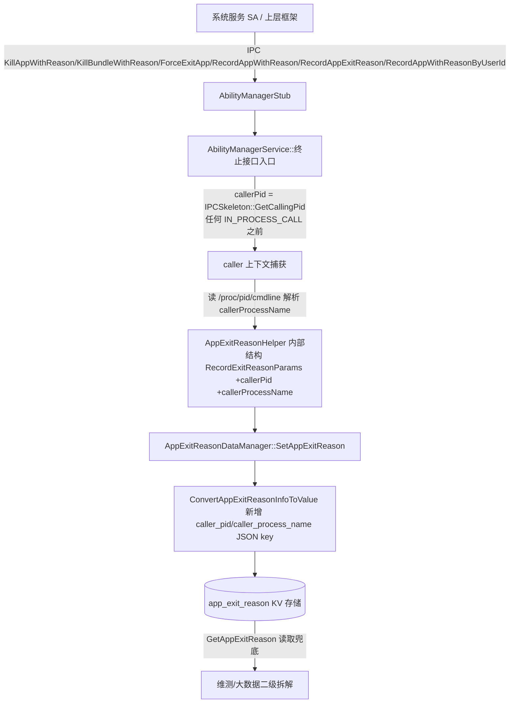
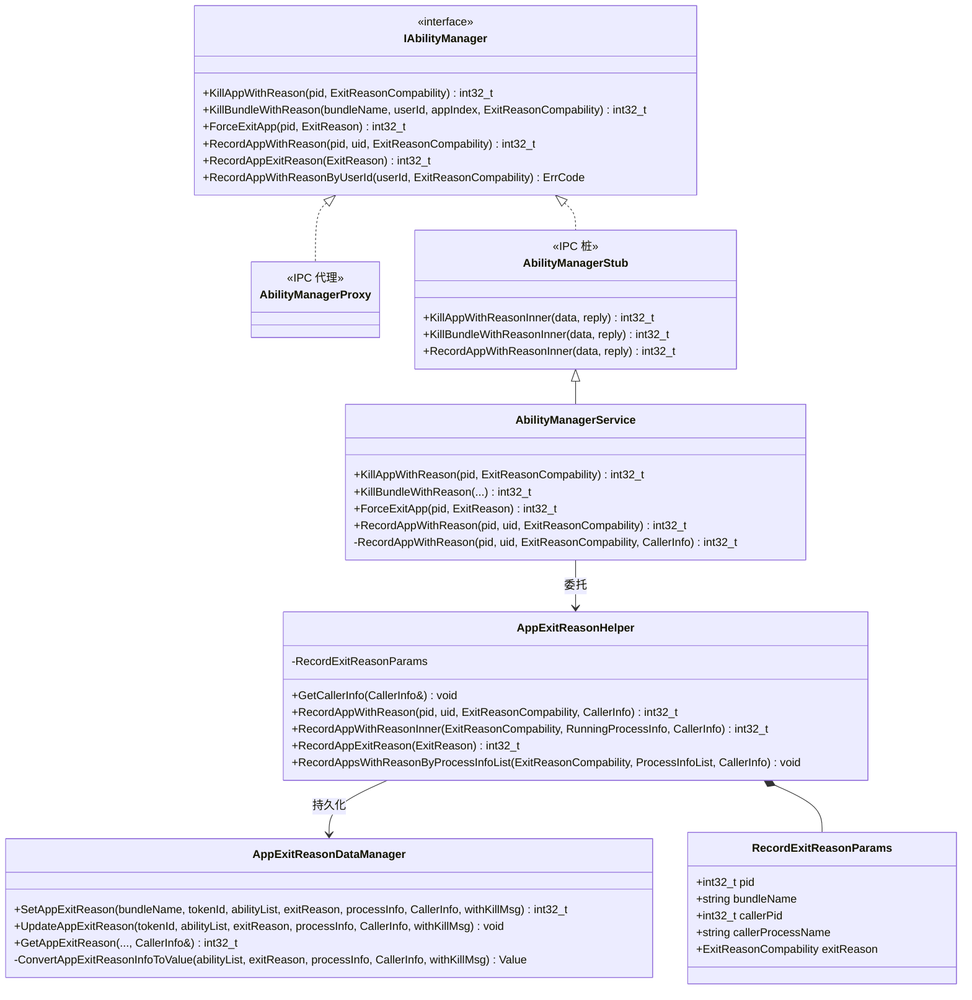

# Design

## 需求基线摘要

> 需求基线详见 proposal.md。以下仅列出设计阶段需额外强调的要点。

- 在既有终止应用接口（`KillAppWithReason` / `KillBundleWithReason` / `ForceExitApp` / `RecordAppWithReason` / `RecordAppExitReason` / `RecordAppWithReasonByUserId`）的退出原因持久化记录中新增调用方 pid + processname。
- 调用方 pid 在服务侧通过 `IPCSkeleton::GetCallingPid()` 自动获取，进程名经 `/proc/<pid>/cmdline` 解析（`AppScheduler::GetRunningProcessInfoByPid` 仅覆盖应用进程，对系统服务不可用）；**不修改 `ExitReason`/`ExitReasonCompability` 的 IPC 序列化字段**（保持跨版本/跨进程兼容）。
- **关键约束**：`IN_PROCESS_CALL` 宏会先 `IPCSkeleton::ResetCallingIdentity()`（`services/common/include/in_process_call_wrapper.h:21-27`），caller 捕获必须发生在任何 `IN_PROCESS_CALL` 之前；`ForceExitApp` 经 `IN_PROCESS_CALL` 委托 `RecordAppWithReason`，必须在自身入口捕获并经内部参数透传。
- best-effort：解析失败不阻塞终止流程、不新增错误码。
- 目标版本 7.1，关联 spec AC-1.1~1.9。

## 代码事实基线

| 事实项 | 代码引用（文件:行） | 对设计的约束 |
|--------|-------------------|-------------|
| 终止接口 IPC 层级 | `services/abilitymgr/include/ability_manager_proxy.h:1314-1335`、`ability_manager_stub.cpp:3820-3927` | 终止方法经 Proxy→Stub→Service；caller pid 须在 Service 侧（IPC 处理线程）获取 |
| `IN_PROCESS_CALL` 宏重置 calling identity | `services/common/include/in_process_call_wrapper.h:21-27`（先 `ResetCallingIdentity()` 再执行 wrapped call，事后恢复） | 宏内 `IPCSkeleton::GetCallingPid()` 返回 AMS 自身 pid；各入口捕获必须在任何 `IN_PROCESS_CALL` 之前完成 |
| `ForceExitApp` 经 `IN_PROCESS_CALL` 委托 `RecordAppWithReason` | `ability_manager_service.cpp:3841`（`IN_PROCESS_CALL(RecordAppWithReason(NO_PID, uid, ...))`） | **不能**依赖 `RecordAppWithReason` 内部捕获覆盖 `ForceExitApp`（宏内 identity 已重置，会记成 AMS 自身 pid）；`ForceExitApp` 须在自身入口捕获并经内部重载参数透传 |
| 既有 caller pid 获取先例 | `ability_manager_service.cpp:3804`（`auto callerPid = IPCSkeleton::GetCallingPid();` 仅日志） | 复用同一获取方式，差异：本次需持久化 |
| `RecordProcessExitReason(pid,uid,exitReason)` 仅允许 hiview/memmgr | `ability_manager_service.cpp:3799`（`HIVIEW_UID`/`MEMMGR_UID` 校验） | 该路径（crash/LMK 上报）不在本次 6 接口范围（proposal 非目标），不捕获 |
| 内部调用点归因语义 | `ability_manager_service.cpp:9418`（`UninstallAppInner` 直接调 `RecordAppWithReason`，无 `IN_PROCESS_CALL`）、`:10891`/`:10959`（`RemoveUserId` 经 `IN_PROCESS_CALL` 调 `RecordAppWithReasonByUserId`） | `:9418` 保留外层 BMS 的 IPC 上下文 → 记录归因到 BMS 进程；`:10891`/`:10959` identity 已重置 → 记录归因到 AMS 自身。两者均为"直接发起方"语义，可接受，需文档化 |
| 多条 record 路径汇聚点 | `app_exit_reason_helper.cpp:107/175/217/276/325/539/606` → `AppExitReasonDataManager::SetAppExitReason` | 持久化注入点选 `ConvertAppExitReasonInfoToValue`，单点扩展 JSON |
| 持久化 JSON 现有 key | `app_exit_reason_data_manager.cpp:48-55`（`pid`/`process_name`/`kill_id`/...） | 新增 `caller_pid`/`caller_process_name`，沿用既有命名风格（snake_case） |
| 读取侧兜底模式 | `app_exit_reason_data_manager.cpp:362-393`（`contains(key) && is_xxx` 后取值） | 新 key 读取复用同一兜底范式，保证旧记录向前兼容 |
| `GetAppExitReason` 读-改-写 | `app_exit_reason_data_manager.cpp:224-230`（命中 ability 后 `UpdateAppExitReason` 回写整条 JSON） | 回写不透传 caller 会静默丢失字段 → `GetAppExitReason` 需扩展 caller 出参并在回写时透传（DD-5、INV-5） |
| `GetRunningProcessInfoByPid` 仅覆盖应用进程 | `services/appmgr/src/app_running_manager.cpp:1104-1112`（`GetAppRunningRecordByPid` 查 AppRunningRecord，系统服务无记录） | **不可**用于系统服务进程名解析（本需求核心调用方恰为系统服务）；改用读取 `/proc/<pid>/cmdline` |
| cache 路径归属 | `app_exit_reason_data_manager.cpp:314`（`RecordSignalReason` 使用 `ExitCacheInfo`）、`exit_info_data_manager.h:29-34`（`ExitCacheInfo` 为内存态，存被终止进程信息） | cache 路径仅存在于信号路径/`RecordProcessExitReason(pid,uid)`，均不在本次 6 接口范围；6 接口在 IPC 线程同步写、不经过 cache，无回放归因风险 |
| `RecordExitReasonParams` 内部结构 | `app_exit_reason_helper.h:28-36`（已含 pid/bundleName/uid/accessTokenId/exitReason/processInfo/fromKillWithReason） | 扩展该内部 struct 携带 caller，不触碰 IPC 序列化 |
| 权限失败错误码 | `ability_manager_service.cpp:3855`/`:3926`（`return ERR_PERMISSION_DENIED`）、`:3984`（`return CHECK_PERMISSION_FAILED`） | `ERR_PERMISSION_DENIED` 为 c_utils 通用公共码（`BASE_ERR_OFFSET + EPERM` = 1），**不是** `CHECK_PERMISSION_FAILED`(2097177) 的别名；后者仅 `RecordAppWithReasonByUserId` 使用 |

## 设计约束

1. 不修改 `ExitReason`/`ExitReasonCompability` 的 `Marshalling`/`ReadFromParcel`（IPC 序列化格式不变，跨版本兼容）。
2. 不新增/不修改对外公共或系统 API 签名（proposal `API/SDK` = 否）。
3. 不新增错误码；caller 解析失败为 best-effort，不阻塞终止流程。
4. 不修改 `hisysevent.yaml` 已发布事件参数。
5. caller pid 取 IPC 直接对端（`IPCSkeleton::GetCallingPid()`），嵌套 IPC 不回溯原始发起方。
6. 新增 JSON key 向前兼容：旧记录缺失时读取侧按空/0 兜底。
7. caller 捕获必须在各入口的任何 `IN_PROCESS_CALL` 之前同步完成（宏会 `ResetCallingIdentity`，宏内取到的是 AMS 自身 pid）。
8. caller processname 解析不使用 `AppScheduler::GetRunningProcessInfoByPid`（仅覆盖应用进程），统一读 `/proc/<pid>/cmdline`。
9. caller 字段在读-改-写路径必须 round-trip：`GetAppExitReason`→`UpdateAppExitReason` 回写不得覆盖丢失（AC-1.9）。

## 非目标

- 追溯嵌套 IPC 链的原始发起方（本次不实现）。
- 修改调用方接口或要求调用方配合传参。
- 为 caller 信息新增 HiSysEvent 大数据打点（沿用既有退出原因持久化通道）。
- `RecordProcessExitReason(pid, uid)`（hiview/memmgr crash/LMK 上报）与 `RecordSignalReason` 信号路径的 caller 归因（不在本次 6 接口范围，随 proposal 非目标后置）。
- `RecordInvalidKillId` 无效记录附加 caller（签名不变，留待后续）。

## 方案概述

采用**"IPC 边界捕获 + 内部透传 + 单点持久化"**架构。在 `AbilityManagerService` 各终止接口 IPC 处理入口、**任何 `IN_PROCESS_CALL` 之前**捕获 `callerPid = IPCSkeleton::GetCallingPid()`，读取 `/proc/<callerPid>/cmdline` 解析 caller processname（对系统服务进程同样有效；`AppScheduler::GetRunningProcessInfoByPid` 仅覆盖应用进程，不可用）；`ForceExitApp` 在自身入口捕获后经内部重载参数传入 `RecordAppWithReason` 实现（IPC 入口签名不变）。caller 信息经既有内部结构 `RecordExitReasonParams`（及 `SetAppExitReason` 内部签名）透传至汇聚点 `AppExitReasonDataManager::ConvertAppExitReasonInfoToValue`，在该处为 JSON value 新增 `caller_pid`、`caller_process_name` 两个 key。读取侧 `ConvertAppExitReasonInfoFromValue` 按既有 `contains(key)&&is_xxx` 范式兜底读取，且 `GetAppExitReason` 扩展 caller 出参、经 `UpdateAppExitReason` 回写时透传，保证读-改-写不丢失。该方案不触碰 IPC 序列化层，blast radius 限定在服务侧 helper/data-manager 内部链路。

## 架构图



## 类图

> 变更涉及 IPC 接口层级（IAbilityManager→Proxy→Stub→Service）与 helper/data-manager 组合关系，钉死类骨架避免下游发明不一致抽象。**本次不新增类、不改继承体系**，仅在既有类的方法/结构体扩展内部字段。



## 模块影响

| 子系统 | 仓库 | 模块/路径 | 影响类型 | 相关设计决策 |
|--------|------|-----------|---------|-------------|
| 元能力 | ability_runtime | `services/abilitymgr/src/ability_manager_service.cpp`（6 个终止接口入口） | 扩展（行为） | DD-1：caller 在 IPC 边界捕获 |
| 元能力 | ability_runtime | `services/abilitymgr/include/app_exit_reason_helper.h`、`src/app_exit_reason_helper.cpp` | 扩展（内部结构/签名） | DD-2：经 `RecordExitReasonParams` 透传 |
| 元能力 | ability_runtime | `services/abilitymgr/src/app_exit_reason_data_manager.cpp`、`include/app_exit_reason_data_manager.h` | 扩展（持久化 JSON + 读取兜底） | DD-3：单点注入 `caller_pid`/`caller_process_name` |
| 元能力 | ability_runtime | `interfaces/inner_api/ability_manager/include/exit_reason.h` | **不变** | 不改 `ExitReason`/`ExitReasonCompability` 序列化（DD-1 约束） |

## 实现入口

| Entry Point | 代码引用（文件:行） | 当前职责 | 调用方 | 被调用方 | 预期变更 |
|-------------|-------------------|----------|--------|----------|----------|
| `AbilityManagerService::KillAppWithReason` | `ability_manager_service.cpp:3846` | 按 pid 终止应用并记录退出原因 | `AbilityManagerStub::KillAppWithReasonInner` | `AppExitReasonHelper::AddAppExitReason` | 入口（`IN_PROCESS_CALL(:3865)` 之前）捕获 caller，透传至 helper |
| `AbilityManagerService::KillBundleWithReason` | `ability_manager_service.cpp:3916` | 按 bundleName 终止并记录 | `AbilityManagerStub::KillBundleWithReasonInner` | `AppExitReasonHelper::AddBundleExitReason` | 入口（`IN_PROCESS_CALL(:3941)` 之前）捕获 caller，透传 |
| `AbilityManagerService::ForceExitApp` | `ability_manager_service.cpp:3813` | 强制退出（经 `IN_PROCESS_CALL` 委托 `RecordAppWithReason`） | aa 命令 / client | `RecordAppWithReason` | **自身入口（`:3841` `IN_PROCESS_CALL` 之前）捕获 caller**，经内部重载 `RecordAppWithReason(pid, uid, reason, callerInfo)` 透传；不得依赖委托链内捕获 |
| `AbilityManagerService::RecordAppWithReason` | `ability_manager_service.cpp:3958` | 记录退出原因 | `AbilityManagerStub::RecordAppWithReasonInner`、`ForceExitApp`（内部重载） | `AppExitReasonHelper::RecordAppWithReason` | IPC 入口捕获 caller 后调内部重载；IPC 签名不变 |
| `AbilityManagerService::RecordAppExitReason` | `ability_manager_service.cpp`（既有） | 记录退出原因（caller 自身） | `AbilityManagerStub::RecordAppExitReasonInner` | `AppExitReasonHelper::RecordAppExitReason`（单参，`app_exit_reason_helper.cpp:129`） | 入口捕获 caller 透传；helper 单参版内部已有 `IPCSkeleton::GetCallingUid/Pid`（`:135`/`:144`，无 `IN_PROCESS_CALL` 间隔，可直接捕获） |
| `AbilityManagerService::RecordAppWithReasonByUserId` | `ability_manager_service.cpp:3977` | 按 userId 批量记录 | `AbilityManagerStub::RecordAppWithReasonByUserIdInner`、`RemoveUserId`（`:10891`/`:10959`，经 `IN_PROCESS_CALL`） | `AppExitReasonHelper::RecordAppsWithReasonByProcessInfoList`（`app_exit_reason_helper.cpp:111`） | 入口捕获 caller 透传；内部 `IN_PROCESS_CALL` 调用时记录为 AMS 自身（语义可接受，文档化） |
| `AppExitReasonHelper::RecordAppWithReasonInner` | `app_exit_reason_helper.cpp:67` | 汇聚到 `SetAppExitReason` | service 层 | `AppExitReasonDataManager::SetAppExitReason` | 接收并透传 `CallerInfo` |
| `AppExitReasonDataManager::ConvertAppExitReasonInfoToValue` | `app_exit_reason_data_manager.cpp:323` | JSON 序列化（单点注入） | `SetAppExitReason`/`UpdateAppExitReason` | KV `PutAsync`/`Put` | 新增 2 个 JSON key |
| `AppExitReasonDataManager::ConvertAppExitReasonInfoFromValue` | `app_exit_reason_data_manager.cpp:353` | JSON 反序列化（读取兜底） | `GetAppExitReason` | — | 新增 2 key 兜底读取，经 `GetAppExitReason` 出参回传 |
| `AppExitReasonDataManager::GetAppExitReason` | `app_exit_reason_data_manager.cpp:196` | 读-改-写（命中 ability 后 `UpdateAppExitReason` 回写，`:224-230`） | `aa dump`/维测 | `UpdateAppExitReason` | 签名扩展 `CallerInfo` 出参；回写透传，防字段丢失（DD-5） |

## 既有模式复用

| Pattern | 参考代码（文件:行） | 复用方式 | 适用 Task |
|---------|-------------------|----------|-----------|
| caller pid 获取 | `ability_manager_service.cpp:3804` `IPCSkeleton::GetCallingPid()` | 同一 API、同一处理线程获取；必须在任何 `IN_PROCESS_CALL` 之前 | caller 捕获 Task |
| 进程名解析 | 读取 `/proc/<pid>/cmdline`（argv[0] basename） | 新增小工具函数（建议置于 `AppExitReasonHelper::GetCallerInfo`）；**不用** `GetRunningProcessInfoByPid`（仅覆盖应用进程） | caller processname Task |
| JSON key 命名 + 兜底读取 | `app_exit_reason_data_manager.cpp:48-55`、`362-393` | 新 key 沿用 snake_case；读取沿用 `contains(key) && is_xxx` 范式 | 持久化/读取 Task |
| best-effort 不阻塞 | `app_exit_reason_helper.cpp:90-92`（notify 失败仅 warn 不阻断） | caller 解析失败（返回非 `ERR_OK`，无异常）仅 warn，主流程返回原错误码 | 异常兜底 Task |

## 关键设计决策

| 决策 ID | 问题 | 推荐方案 | 备选方案 | 选择理由 |
|---------|------|----------|----------|---------|
| DD-1 | caller 信息捕获点选在哪一层？ | 在 `AbilityManagerService` 各终止接口入口、**任何 `IN_PROCESS_CALL` 之前**捕获（`IPCSkeleton::GetCallingPid()` + 读 `/proc/<pid>/cmdline`），经 `RecordExitReasonParams`/helper 参数内部透传；`ForceExitApp` 在自身入口捕获后经私有重载 `RecordAppWithReason(pid, uid, reason, callerInfo)` 传入（IPC 签名不变） | (a) 在 `RecordAppWithReason` 内部统一捕获覆盖 `ForceExitApp`；(b) 在 `ConvertAppExitReasonInfoToValue` 内直接读 `IPCSkeleton` | (a) 不可行：`ForceExitApp` 经 `IN_PROCESS_CALL`（`in_process_call_wrapper.h:21-27` 先 `ResetCallingIdentity`）委托，内部捕获会记成 AMS 自身 pid；(b) 在异步/内部线程取错值。入口捕获保证在 IPC 处理线程、identity 未被重置（关联 AC-1.3） |
| DD-2 | caller 信息如何透传到持久化点？ | 扩展既有内部结构 `RecordExitReasonParams`（`app_exit_reason_helper.h:28`）新增 `callerPid`/`callerProcessName`；helper 方法（`AddAppExitReason`/`AddBundleExitReason`/`RecordAppWithReason`/`RecordAppWithReasonInner`/`RecordAppExitReason`/`RecordAppsWithReasonByProcessInfoList`）与 `SetAppExitReason` 内部签名追加 `CallerInfo`（可默认 `{}`） | 在 `ExitReason` 结构加字段并走 IPC Parcel | 后者破坏 IPC 序列化兼容（AGENTS.md 禁止），且违背 proposal 非目标。内部结构/签名不跨 IPC，扩展安全 |
| DD-3 | 持久化格式如何兼容旧记录？ | JSON 新增 `caller_pid`、`caller_process_name`；读取侧 `contains(key)&&is_xxx` 兜底，缺失按 0/空 | 版本化 JSON schema、双写迁移 | 既有所有 key 均无版本化、采用 contains 兜底范式（`:362-393`）；新增 key 沿用同范式最简且向前兼容，无需数据迁移（关联 AC-1.8、BR-4） |
| DD-4 | caller processname 如何解析与兜底？ | 读取 `/proc/<callerPid>/cmdline`（argv[0] basename，截断至 ≤256 字节）；读取失败（进程已退出/不可读）时 `caller_process_name` 写空字符串、`caller_pid` 仍写实际 pid，不报错 | 用 `AppScheduler::GetRunningProcessInfoByPid` 解析 | `GetRunningProcessInfoByPid` 只查 `AppRunningRecord`（`app_running_manager.cpp:1104-1112`），系统服务进程（本需求核心调用方）无记录、进程名恒空，"≥95%" 成功标准不可达；`/proc/<pid>/cmdline` 对任意存活进程有效。归因核心是 pid，processname best-effort（关联 AC-1.2、1.5、1.6、BR-2） |
| DD-5 | 读-改-写如何避免 caller 字段丢失？ | `GetAppExitReason` 签名扩展 `CallerInfo` 出参：`ConvertAppExitReasonInfoFromValue` 读入 → 命中 ability 后 `UpdateAppExitReason(…, callerInfo)` 原值透传回写 | 回写时用默认空 `CallerInfo` | 后者在第一次查询命中后静默覆盖丢失 `caller_pid`/`caller_process_name`（`app_exit_reason_data_manager.cpp:224-230`），违反 AC-1.9/BR-5 |

## 状态归属与不变量

- **Ownership**：caller 信息所有权归属 `AbilityManagerService` 终止接口入口（捕获者），只读消费者为 `AppExitReasonHelper` → `AppExitReasonDataManager`。不变量 INV-1：`callerPid` 一经捕获在本次记录链路内不可变、不可被下游改写。验证：UT 断言持久化 JSON `caller_pid` == 入口 `IPCSkeleton::GetCallingPid()`（关联 AC-1.1）。
- **Lifecycle**：caller 信息生命周期 = 单次终止记录链路（捕获→透传→持久化）。6 个目标接口均在 IPC 线程同步写、不经过 `ExitCacheInfo`/cache 回放路径；cache 路径仅存在于 `RecordSignalReason`/`RecordProcessExitReason(pid,uid)`（本期非目标，该路径写默认空 caller，INV-3 本期不覆盖、随信号路径后置）。
- **Concurrency**：终止接口在 IPC 处理线程同步捕获 caller，`IPCSkeleton::GetCallingPid()` 线程本地有效。不变量 INV-2：caller 捕获必须在 IPC 处理线程、任何 `IN_PROCESS_CALL` 之前同步完成，禁止跨线程或宏内取 calling pid。验证：UT 断言 `ForceExitApp` 记录的 `caller_pid` ≠ AMS 自身 pid（关联 AC-1.3）。
- **Compatibility**：JSON value 新增 2 key，旧记录无此 key。不变量 INV-4：读取侧对缺失 key 必须按 0/空兜底，不报错、不破坏既有查询。验证：UT 读取无 caller key 的旧 JSON value（关联 AC-1.8、BR-4）。
- **Round-trip**：caller 字段在读-改-写路径往返不丢失。不变量 INV-5：`GetAppExitReason` 命中 ability 触发 `UpdateAppExitReason` 回写后，`caller_pid`/`caller_process_name` 与回写前一致。验证：UT 写入含 caller 记录 → 触发回写 → 再读断言不变（关联 AC-1.9、BR-5、DD-5）。

## DFX 设计

### DFX 故障模式分析

| 分析对象 | 故障模式 | 故障影响 | 故障原因 | 严酷度 | 恢复措施 | 关键日志 | 大数据打点事件 | 来源 |
|---------|----------|----------|----------|--------|----------|----------|---------|------|

不涉及。本变更业务流程为"应用终止并记录退出原因/调用方归因"，仓内 `docs/dfx/fmea.yaml` 覆盖范围为启动/连接/意图/进程孵化/启动任务/URI 授权，未定义应用终止或退出原因记录相关故障模式，知识库无命中。

> 涉及仓库：ability_runtime

| 仓库 | 状态 | 理由 |
|------|------|------|
| ability_runtime | READ | 知识库无命中 |

## 安全基础检查

不涉及。本次变更不跨新的信任边界：终止接口（`KillAppWithReason`/`KillBundleWithReason`/`ForceExitApp` 等）已有的 `PermissionVerification::IsSACall()`/`IsShellCall()`/`IsSupportSaKillPermission()`/`HIVIEW_UID`/`MEMMGR_UID` 权限校验不变更；caller pid/processname 通过既有 IPC 上下文（`IPCSkeleton::GetCallingPid()`）获取，不处理敏感数据（PII/凭证/密钥/生物特征），不引入新的认证/授权/加密机制。proposal `安全/权限` 维度判定为"否"，未触发安全基础检查章节与深度威胁分析。

## 时序设计

```mermaid
sequenceDiagram
    participant SA as 系统服务 SA / 上层框架
    participant Stub as AbilityManagerStub
    participant Svc as AbilityManagerService
    participant Helper as AppExitReasonHelper
    participant DM as AppExitReasonDataManager
    participant KV as app_exit_reason KV
    SA->>Stub: IPC KillAppWithReason(pid, exitReason)
    Stub->>Svc: KillAppWithReasonInner→KillAppWithReason
    Svc->>Svc: 权限校验(权限模型沿用既有)
    Svc->>Svc: 任何 IN_PROCESS_CALL 之前:<br>callerPid=GetCallingPid(); 读 /proc/callerPid/cmdline→callerProcessName
    Svc->>Helper: AddAppExitReason(..., CallerInfo{callerPid, callerProcessName})
    Helper->>Helper: RecordAppWithReasonInner(透传 CallerInfo)
    Helper->>DM: SetAppExitReason(..., CallerInfo)
    DM->>DM: ConvertAppExitReasonInfoToValue 新增 caller_pid/caller_process_name
    DM->>KV: PutAsync(key, value)
    Note over KV: 旧记录无 caller key，读取侧按 0/空 兜底
```

## 风险与缓解

| 风险 | 可能性 | 影响 | 缓解措施 |
|------|--------|------|----------|
| 捕获点误置于 `IN_PROCESS_CALL` 内 | 高 | `caller_pid` 记录为 AMS 自身 pid（错误归因，`ForceExitApp` 链路必现） | 设计约束 7：捕获必须在任何 `IN_PROCESS_CALL` 之前；`ForceExitApp` 走自身入口 + 私有重载（DD-1）；UT 断言 `caller_pid` ≠ AMS pid（AC-1.3） |
| 读-改-写覆盖丢失 caller 字段 | 高 | 首次 `GetAppExitReason` 命中后字段被覆盖为空（静默数据丢失） | DD-5：`GetAppExitReason` 扩展 caller 出参 + `UpdateAppExitReason` 透传回写；INV-5 round-trip UT（AC-1.9） |
| 嵌套 IPC 下 caller_pid 非原始发起方 | 中 | 归因停留在直接对端，无法二级拆解 | 本次明确取直接对端（spec EX-2、BR-3），非目标留后续；文档化 |
| 调用方进程已退出，`/proc/<pid>/cmdline` 不可读 | 中 | caller_process_name 缺失 | DD-4 兜底空字符串；caller_pid 仍准确；≥95% 成功标准允许（进程退出场景） |
| 持久化 JSON key 拼写/类型不一致 | 低 | 读取兜底失效 | 复用既有 contains 兜底范式；UT 覆盖旧记录读取（AC-1.8） |
| 扩展 helper/`SetAppExitReason` 签名影响多调用点 | 低 | 编译遗漏调用点 | 签名扩展用默认值参数（`CallerInfo = {}`），编译期定位全部调用点；内部路径（`RecordSignalReason`/`UpdateAppExitReason` 等）默认空 caller、行为不变 |
| 内部调用点归因语义误解 | 低 | `:9418` 记为 BMS、`:10891` 记为 AMS，与"原始发起方"预期不符 | 已在代码事实基线/BR-3 文档化"直接发起方"语义 |

## 验证思路

| 验证场景 | 方法 | 通过标准 |
|----------|------|----------|
| caller_pid 持久化（AC-1.1） | UT：mock SA 调 `KillAppWithReason`，读取 KV value | JSON `caller_pid` == SA pid |
| caller_process_name 持久化（AC-1.2） | UT：调 `KillBundleWithReason` | JSON 含 `caller_process_name` == cmdline 解析的进程名 |
| `ForceExitApp` 自身入口捕获（AC-1.3） | UT：调 `ForceExitApp` | `caller_pid` == 直接调用方且 ≠ AMS 自身 pid |
| 调用方进程已退出兜底（AC-1.5） | UT：mock `/proc/<pid>/cmdline` 不可读 | `caller_process_name` 空、`caller_pid` 准确、写入成功 |
| 解析失败不阻塞（AC-1.6） | UT：mock 解析返回非 `ERR_OK` | 终止返回原错误码、caller 字段空 |
| 旧记录向前兼容（AC-1.8） | UT：读取无 caller key 的旧 value | 按 0/空兜底、不报错 |
| 读-改-写不丢失（AC-1.9） | UT：写入含 caller → `GetAppExitReason` 命中回写 → 再读 | `caller_pid`/`caller_process_name` 不变 |
| 权限沿用（AC-1.7） | UT：无权限调用 | `Kill*`/`ForceExitApp` 返回 `ERR_PERMISSION_DENIED`(1)；`RecordAppWithReasonByUserId` 返回 `CHECK_PERMISSION_FAILED`(2097177) |

> 兼容性验证详见 spec.md 兼容性声明章节。
