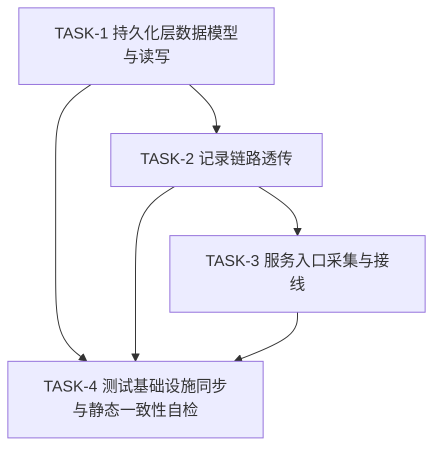

# Execution Plan

## 输入状态

| 输入 | 路径 | 要求状态 |
|------|------|----------|
| Proposal | proposal.md | Approved |
| Spec | spec.md | Approved |
| Design | design.md | Approved |

## 执行原则

<!-- SYNC: execution-principles -->
- **Spec 权威：** 若实现细节与 `spec.md` 的 AC、错误码或兼容性声明冲突，先更新 spec/design，再继续实现。
- **测试/证据先行：** 每个 Task 先写测试代码；**当前环境无编译环境，禁止任何编译/构建/测试执行**——RED/GREEN 运行一律推迟，以「延迟证据缺口」记录，验证状态标 Blocked，待环境就绪回填。
- **任务小型化：** 一个 Task 只覆盖一个独立闭环。跨 API、事件链、状态缓存、渲染链、生命周期的需求必须拆成多个 Task。
- **文件边界：** Task 只能修改 `Files` 表列出的文件；若构建暴露额外声明或 fixture 需求，先更新本计划。
- **状态所有权唯一：** 新增状态必须明确 owner、key/index、创建时机、清理触发和只读消费者。
- **证据回填：** Task 完成后必须回填本计划「AC 到 Task 追溯」验证状态、「代码范围映射」实际文件、per-task `Actual Result`。
- **反伪完成：** 只补声明、只写存储结构、只覆盖 happy path、只跑非相关测试，都不能替代 AC 闭环。
- **可交接执行（Agent 执行契约）：** 本计划须能被新 Agent 在无历史对话上下文下逐 Task 执行；执行契约由各 Task 结构承载——`只读上下文`/`Files`/`禁止修改文件`（上下文打包）、`Steps` 的 RED→GREEN（测试优先）、`Verification` 的 Expected/Actual（期望输出）、`Review Handoff`（评审交接）；每 Step 为含命令或代码方向的 2–5 分钟动作。
- **环境约束（本计划专属）：** 全程禁止执行编译、构建、UT/模糊测试命令（`build.sh`、`hb`、`run -t UT` 等）。验证仅允许静态手段（grep/人工检视）；所有需运行的验证在 `Verification` 表中标注「延迟：无编译环境」。
<!-- /SYNC: execution-principles -->

## AC 到 Task 追溯

| AC | 来源 | Task | 验证方式 | 验证状态（Pass/Fail/Blocked） |
|----|------|------|----------|----------------------------------|
| AC-1.1 | spec US-1 | TASK-1, TASK-2, TASK-3 | UT：KillAppWithReason 路径 mock IPC 调用方 + 读回断言（延迟执行） | Blocked |
| AC-1.2 | spec US-1 | TASK-1, TASK-2, TASK-3 | UT：KillBundleWithReason 路径同上（延迟执行） | Blocked |
| AC-1.3 | spec US-1 | TASK-1, TASK-2, TASK-3 | UT：RecordAppWithReason 路径（含自记录场景）（延迟执行） | Blocked |
| AC-1.4 | spec US-1 | TASK-3 | UT：mock GetRunningProcessInfoByPid 失败（延迟执行） | Blocked |
| AC-1.5 | spec US-1 | TASK-3 | UT：mock 权限校验失败，断言返回值与无新增记录（延迟执行） | Blocked |
| AC-1.6 | spec US-1 | TASK-1 | UT：旧格式 KV 值读回断言（延迟执行） | Blocked |
| AC-1.7 | spec US-1 | TASK-3 | UT：前台/启动期/保活拦截路径断言无新增记录（延迟执行） | Blocked |
| AC-1.8 | spec US-1 | TASK-3 | UT：双调用方并发用例（延迟执行） | Blocked |
| AC-1.9 | spec US-1 | TASK-3 | 设备抽样统计（需编译产物 + 设备） | Blocked |

> Blocked 说明：当前无编译环境（用户约束，禁止编译/构建/测试执行）；全部测试代码已落库，编译环境就绪后执行 B1~B6 验证（见 evidence/reviews/verification.md）并回填为 Pass。

## 实现边界

**必须实现：** 三接口调用方信息采集与持久化（TASK-1~3）；存量数据兼容读回；测试代码同步落库（TASK-1~4）；mock 与签名一致性（TASK-4）。

**可后置：** 编译与全量 UT 执行（环境就绪后统一执行并回填验证状态）；AC-1.9 现网抽样统计。

**不建议延后：** TASK-4 静态一致性自检（签名不一致会在首次编译时集中暴露，静态自检是当前唯一可用的防线）；存量数据兼容用例（AC-1.6，避免上线破坏既有读回）。

## 禁止项

- 每个 AC 必须有明确的验证方式。
- Agent 不得自行寻找未列出的上下文文件作为修改依据；需要新增上下文时先更新 Task。
- 不得修改 Task 列出范围外的文件。
- 不得在未通过验证时标记 Task 完成（当前环境下：代码与测试写完 + 静态自检通过即可标记 Task 代码完成，但「AC 到 Task 追溯」验证状态保持 Blocked，直至运行验证回填）。
- 不得使用不可执行的占位描述（如「适当处理」「补充测试」「参考上文」等，含同类英文缩写惯用形式）。
- **禁止执行任何编译/构建/测试运行命令**（`build.sh`、`hb`、`gn`、`ninja`、`run -t UT`、gtest 可执行文件等）——当前无编译环境；验证命令仅限静态检查（grep/读文件）。
- 不得新增源文件或测试目标文件（全部修改落在既有文件内），因此不得改动任何 BUILD.gn / *.gni。
- 不得修改 `ExitReason` / `ExitReasonCompability` 的字段与 Marshalling（design D1）。

## Task 依赖



## Task 列表

| TASK ID | 目标 | 文件范围 | AC 映射 | 前置依赖 | 完成判据 | 验证命令 | 状态 |
|---------|------|----------|---------|----------|----------|----------|------|
| TASK-1 | ExitCallerInfo 数据模型 + KV 读写扩展（写入省略默认值、读回缺省兼容）+ 持久化层测试代码 | services/abilitymgr/include/app_exit_reason_data_manager.h；services/abilitymgr/src/app_exit_reason_data_manager.cpp；test/unittest/app_exit_reason_data_manager_test/app_exit_reason_data_manager_test.cpp | AC-1.6 | design D1/D4 | 结构体、默认参数签名、两个 JSON key 读写、两个测试用例落库，静态自检通过 | 静态：grep 校验 JSON key 常量与解析容错（见 Steps）；运行验证延迟 | Done（运行验证 Blocked） |
| TASK-2 | RecordExitReasonParams 挂载 callerInfo + Helper 三入口默认参数透传 + helper 层测试代码 | services/abilitymgr/include/app_exit_reason_helper.h；services/abilitymgr/src/app_exit_reason_helper.cpp；test/unittest/app_exit_reason_helper_fourth_test/app_exit_reason_helper_fourth_test.cpp | AC-1.1~1.3, AC-1.8（链路支撑） | TASK-1 | callerInfo 沿 Add*/RecordAppWithReason → AddProcessExitReason → SetAppExitReason 贯通，测试用例落库，静态自检通过 | 静态：grep 校验调用链参数贯通；运行验证延迟 | Done（运行验证 Blocked） |
| TASK-3 | CaptureExitCallerInfo 采集（pid + 容错反查进程名）+ 三接口入口接线（替换既有注释）+ 服务层测试代码（含权限/拦截/并发用例） | services/abilitymgr/include/ability_manager_service.h；services/abilitymgr/src/ability_manager_service.cpp；test/unittest/ability_manager_service_thirteenth_test/ability_manager_service_thirteenth_test.cpp | AC-1.1~1.5, AC-1.7~1.9 | TASK-2 | 三入口均采集并透传；既有权限/拦截/返回值行为不变；测试用例落库，静态自检通过 | 静态：grep 校验入口接线与既有注释清除；运行验证延迟 | Done（运行验证 Blocked） |
| TASK-4 | 受影响 mock 声明同步 + 全局静态一致性自检（签名/JSON key/无遗漏） | test/unittest/keep_alive_process_manager_test/mock/include/ability_manager_service.h；test/unittest/keep_alive_process_manager_test/mock/src/ability_manager_service.cpp；test/unittest/ability_manager_client_branch_test/ability_manager_stub_mock_test.h；test/unittest/ability_manager_client_branch_third_test/mock/include/ability_manager_stub_mock_test.h（仅当静态检查发现不一致时修改） | 全部（支撑） | TASK-1, TASK-2, TASK-3 | grep 自检清单全部通过；mock 与真实签名一致 | 静态检查命令（见 Steps） | Done（运行验证 Blocked） |

## Task 详情

### TASK-1: 持久化层数据模型与读写扩展

**目标：** 新增服务内部值类型 `ExitCallerInfo`，终止原因 KV 读写支持 `caller_pid` / `caller_process_name` 两个新 JSON key：写入时默认值（callerPid = -1）省略，读回时缺字段按默认值容错。

**AC 映射：** AC-1.6（直接）；AC-1.1~1.4（持久化支撑）

**前置依赖：** design.md D1/D4 决策；代码事实基线（app_exit_reason_data_manager.cpp:35-55 既有 key 常量、:323 ToValue、:353 FromValue、.h:38 SetAppExitReason、.h:42 GetAppExitReason）。

**非目标：** 不改任何记录链路调用方；不新增文件；不改既有字段的读写语义。

**状态所有权：** 无新增独立状态——调用方信息由终止原因 KV 记录持有（owner=AppExitReasonDataManager 的 KV 记录，随既有删除路径清理，见 design「状态归属与不变量」Ownership/Lifecycle）。

**任务间接口：**
- Produces：`struct OHOS::AbilityRuntime::ExitCallerInfo { int32_t callerPid = -1; std::string callerProcessName; }`；`SetAppExitReason(..., const ExitCallerInfo &callerInfo = {})`；`GetAppExitReason(..., ExitCallerInfo *callerInfo = nullptr)`；常量 `JSON_KEY_CALLER_PID = "caller_pid"`、`JSON_KEY_CALLER_PROCESS_NAME = "caller_process_name"`。
- Consumes：无。

**只读上下文**

| 路径 | 读取目的 |
|------|----------|
| services/abilitymgr/include/app_exit_reason_data_manager.h | 既有签名与成员，确定默认参数追加位置 |
| services/abilitymgr/src/app_exit_reason_data_manager.cpp:35-55、:323-420 | 既有 JSON key 常量与 To/FromValue 实现模式 |
| test/unittest/app_exit_reason_data_manager_test/app_exit_reason_data_manager_test.cpp | 既有测试风格（HWTEST 用例命名、KV 读写断言方式） |
| .codespec/changes/issue-16150-record-caller/design.md（D1/D4、状态归属） | 决策与不变量依据 |

**Files**

| 操作 | 文件 | 说明 |
|------|------|------|
| 修改 | services/abilitymgr/include/app_exit_reason_data_manager.h | 新增 ExitCallerInfo 结构体；SetAppExitReason 追加默认参数 `const ExitCallerInfo &callerInfo = {}`；GetAppExitReason 追加默认出参 `ExitCallerInfo *callerInfo = nullptr`；ConvertAppExitReasonInfoToValue/FromValue 私有签名扩展 |
| 修改 | services/abilitymgr/src/app_exit_reason_data_manager.cpp | 新增两个 JSON key 常量；ToValue 在 callerInfo.callerPid > 0 或 processName 非空时写入两 key；FromValue 沿用 `contains`+类型校验解析到出参（缺失保持默认）；SetAppExitReason 两处落库调用点（:131、:266）贯通参数 |
| 修改 | test/unittest/app_exit_reason_data_manager_test/app_exit_reason_data_manager_test.cpp | 新增用例：`SetAppExitReasonWithCallerInfo_0100`（写入含调用方信息后读回断言两字段一致）、`GetAppExitReasonLegacyWithoutCallerFields_0200`（写入不含调用方字段的值后读回，断言 callerPid=-1、processName 空、既有字段正确） |

**禁止修改文件**

| 文件/路径 | 原因 |
|-----------|------|
| interfaces/inner_api/ability_manager/include/exit_reason.h | design D1：禁止扩展 Parcelable |
| services/abilitymgr/include/app_exit_reason_helper.h 及对应 .cpp | 属 TASK-2 范围 |
| 任何 BUILD.gn / *.gni | 无新增文件，禁止改动 |

**Steps**

- [x] Step 1: 写测试代码（先于实现落库，构造编译级 RED）。

```text
在 app_exit_reason_data_manager_test.cpp 追加两个 HWTEST 用例（命名与断言见 Files 表）；
用例引用尚不存在的 ExitCallerInfo 与带新参数的 GetAppExitReason 重载 → 实现前必然无法编译/通过（RED 由构造保证）。
```

- [x] Step 2: 静态确认 RED 状态（禁止编译）。

```bash
grep -n "ExitCallerInfo" services/abilitymgr/include/app_exit_reason_data_manager.h
```

Expected: 无输出（结构体尚不存在），证明测试引用的是未实现契约；记录延迟证据缺口「无编译环境，RED 运行推迟」。

- [x] Step 3: 最小实现。

```text
1) app_exit_reason_data_manager.h：在 AbilityRuntime 命名空间内定义 ExitCallerInfo（callerPid 默认 -1、callerProcessName 默认空），
   SetAppExitReason/GetAppExitReason 追加默认参数，私有 To/FromValue 签名同步扩展；
2) app_exit_reason_data_manager.cpp：新增 JSON_KEY_CALLER_PID/JSON_KEY_CALLER_PROCESS_NAME 常量（紧随既有常量区，核对与既有 14 个 key 无重名）；
   ToValue：仅当 callerInfo.callerPid > 0 或 callerProcessName 非空时追加两 key；
   FromValue：contains + is_number_integer/is_string 校验后解析，出参指针为 nullptr 时用局部量承接；
3) SetAppExitReason 两处调用点（约 :131、:266）透传 callerInfo 至 ToValue。
```

- [x] Step 4: 静态验证实现完整性（禁止编译）。

```bash
grep -n "JSON_KEY_CALLER_PID\|JSON_KEY_CALLER_PROCESS_NAME" services/abilitymgr/src/app_exit_reason_data_manager.cpp
```

Expected: 各至少 2 处命中（常量定义 + 写入 + 解析）；`grep -c "callerInfo" services/abilitymgr/src/app_exit_reason_data_manager.cpp` ≥ 5（定义、写入、解析、调用点贯通）。

- [x] Step 5: 无重构需要（保持与既有 To/FromValue 同构）。
- [x] 回填本计划「AC 到 Task 追溯」验证状态（AC-1.6 保持 Blocked，注明测试已写待运行）、「代码范围映射」实际文件、per-task Actual Result。

**Anti-Fake Completion**

| Check | Required Evidence |
|-------|-------------------|
| AC closed | AC-1.6 测试用例代码落库（旧格式读回断言完整：返回值、缺省字段、既有字段）；AC-1.1~1.4 的持久化支撑由 To/FromValue 双向覆盖（写入+读回各一用例） |
| Scope respected | git diff 仅含 Files 表 3 个文件 |
| State lifecycle complete | 写入（ToValue）、读取（FromValue 出参）、删除（既有 DeleteAppExitReason 不感知新字段，同 key 整体删除）均覆盖；默认值省略写入逻辑有测试对照 |

**Verification**

| Command / Evidence | Expected Result | Actual Result |
|--------------------|-----------------|---------------|
| grep -n "struct ExitCallerInfo" services/abilitymgr/include/app_exit_reason_data_manager.h | 1 处命中 | PASS：app_exit_reason_data_manager.h:32 |
| grep -n "JSON_KEY_CALLER" services/abilitymgr/src/app_exit_reason_data_manager.cpp | ≥5 处命中 | PASS：9 处（:56/:57 定义，:362/:363 写入，:413/:414/:416/:417/:418 解析） |
| 延迟：无编译环境——运行 app_exit_reason_data_manager_test 两个新用例 | 两用例通过（环境就绪后执行并回填） | Blocked |

**Review Handoff**

| Reviewer | Input |
|----------|-------|
| Spec Compliance | AC-1.6 用例断言与 spec 一致（缺省值 -1/空、既有字段不变）；D4 默认值省略策略实现核对 |
| Code Quality | 新 JSON key 与既有 key 无冲突；To/FromValue 变更最小化；无新增文件 |

### TASK-2: 记录链路透传

**目标：** `RecordExitReasonParams` 挂载 callerInfo，Helper 三个目标入口（AddAppExitReason / AddBundleExitReason / RecordAppWithReason）及内部函数以默认参数接收并透传至 SetAppExitReason，未接入路径行为不变。

**AC 映射：** AC-1.1~1.3、AC-1.8（链路支撑）

**前置依赖：** TASK-1 的 Produces（ExitCallerInfo、SetAppExitReason 新签名）。

**非目标：** 不改其他 Record*/Update* 路径的行为（默认参数为空即保持现状）；不做采集逻辑（属 TASK-3）。

**状态所有权：** 无新增持久状态；callerInfo 为按值传递的临时参数（design Concurrency 不变量：请求线程同步拷贝下传）。

**任务间接口：**
- Produces：`AddAppExitReason(bundleName, pid, uid, appIndex, exitReason, const ExitCallerInfo &callerInfo = {})`；`AddBundleExitReason(bundleName, userId, appIndex, exitReason, const ExitCallerInfo &callerInfo = {})`；`RecordAppWithReason(pid, uid, exitReason, const ExitCallerInfo &callerInfo = {})`；`RecordExitReasonParams::callerInfo` 成员。
- Consumes：TASK-1 的 ExitCallerInfo 与 SetAppExitReason(..., callerInfo)。

**只读上下文**

| 路径 | 读取目的 |
|------|----------|
| services/abilitymgr/include/app_exit_reason_helper.h:28-79 | RecordExitReasonParams 与入口签名现状 |
| services/abilitymgr/src/app_exit_reason_helper.cpp（AddAppExitReason/AddBundleExitReason/RecordAppWithReason/RecordAppWithReasonInner/AddProcessExitReason） | 参数组装与落库调用链 |
| test/unittest/app_exit_reason_helper_fourth_test/app_exit_reason_helper_fourth_test.cpp | 既有 RecordAppWithReason_0100 用例风格 |
| .codespec/changes/issue-16150-record-caller/design.md（实现入口表、类图） | 透传路径依据 |

**Files**

| 操作 | 文件 | 说明 |
|------|------|------|
| 修改 | services/abilitymgr/include/app_exit_reason_helper.h | RecordExitReasonParams 新增 `ExitCallerInfo callerInfo` 成员；AddAppExitReason/AddBundleExitReason/RecordAppWithReason/RecordAppWithReasonInner 追加默认参数 `const ExitCallerInfo &callerInfo = {}` |
| 修改 | services/abilitymgr/src/app_exit_reason_helper.cpp | 三入口将 callerInfo 写入 params；AddProcessExitReason 将 params.callerInfo 透传至 SetAppExitReason；RecordAppWithReasonInner 同步透传 |
| 修改 | test/unittest/app_exit_reason_helper_fourth_test/app_exit_reason_helper_fourth_test.cpp | 新增用例 `RecordAppWithReason_0200`（传入非空 callerInfo，断言落库记录含调用方字段——经 GetAppExitReason 带出参读回验证）、`RecordAppWithReason_0300`（默认参数调用，断言落库记录调用方字段为缺省值且既有行为不变） |

**禁止修改文件**

| 文件/路径 | 原因 |
|-----------|------|
| services/abilitymgr/src/ability_manager_service.cpp | 属 TASK-3 范围 |
| services/abilitymgr/src/app_exit_reason_data_manager.cpp | 属 TASK-1 范围（已完成） |
| 任何 BUILD.gn / *.gni | 无新增文件，禁止改动 |

**Steps**

- [x] Step 1: 写测试代码（编译级 RED）。

```text
在 app_exit_reason_helper_fourth_test.cpp 追加 RecordAppWithReason_0200/0300（见 Files 表）；
用例调用带第四参的 RecordAppWithReason 与带出参的 GetAppExitReason → TASK-2 实现前无法编译（RED 由构造保证）。
```

- [x] Step 2: 静态确认 RED（禁止编译）。

```bash
grep -n "const ExitCallerInfo &callerInfo" services/abilitymgr/include/app_exit_reason_helper.h
```

Expected: 无输出（参数尚未添加）。

- [x] Step 3: 最小实现。

```text
1) app_exit_reason_helper.h：RecordExitReasonParams 追加成员；四个函数签名追加默认参数（保持既有参数顺序，新参数置于末尾）；
2) app_exit_reason_helper.cpp：AddAppExitReason/AddBundleExitReason 在组装 params 处写 params.callerInfo = callerInfo；
   RecordAppWithReason → RecordAppWithReasonInner 链路贯通；AddProcessExitReason 的 SetAppExitReason 调用追加 params.callerInfo。
```

- [x] Step 4: 静态验证贯通（禁止编译）。

```bash
grep -n "callerInfo" services/abilitymgr/src/app_exit_reason_helper.cpp
```

Expected: 命中覆盖三个入口、RecordAppWithReasonInner、AddProcessExitReason 共 ≥5 处，且每处为参数传递而非新增逻辑分支。

- [x] Step 5: 无重构需要。
- [x] 回填「AC 到 Task 追溯」、代码范围映射、Actual Result。

**Anti-Fake Completion**

| Check | Required Evidence |
|-------|-------------------|
| AC closed | 两条用例分别覆盖「显式传入」与「默认缺省」两分支；默认分支证明未接入路径行为不变 |
| Scope respected | git diff 仅含 Files 表 3 个文件 |
| State lifecycle complete | N/A（无新增持久状态，按值传递） |

**Verification**

| Command / Evidence | Expected Result | Actual Result |
|--------------------|-----------------|---------------|
| grep -n "ExitCallerInfo callerInfo" services/abilitymgr/include/app_exit_reason_helper.h | 1 处命中（结构体成员） | PASS：:37 `AbilityRuntime::ExitCallerInfo callerInfo;` |
| grep -c "const ExitCallerInfo &callerInfo" services/abilitymgr/include/app_exit_reason_helper.h | 4（三入口 + RecordAppWithReasonInner） | PASS：4 处（:58/:61/:63/:85，形参为 `const AbilityRuntime::ExitCallerInfo &callerInfo = {}`） |
| 延迟：无编译环境——运行 app_exit_reason_helper_fourth_test 全部用例（含既有回归） | 新用例通过、既有用例无新增失败 | Blocked |

**Review Handoff**

| Reviewer | Input |
|----------|-------|
| Spec Compliance | 默认参数保证其他记录路径行为不变（spec 非目标）；透传链与 design 实现入口表一致 |
| Code Quality | 签名追加位置统一（末位默认参数）；无逻辑分支新增 |

### TASK-3: 服务入口采集与接线

**目标：** 新增 `AbilityManagerService::CaptureExitCallerInfo()` 私有方法（`IPCSkeleton::GetCallingPid()` + 容错反查进程名），三个接口入口在现有注释位置完成采集并透传至 Helper，移除原注释占位。

**AC 映射：** AC-1.1~1.5、AC-1.7~1.9

**前置依赖：** TASK-2 的 Produces（Helper 三入口新签名）。

**非目标：** 不改权限校验与终止主流程；不改错误码；不在拦截/权限失败分支产生新记录。

**状态所有权：** 无新增状态；采集结果为请求作用域局部值（design Concurrency：IPC 请求线程同步采集、按值下传）。

**任务间接口：**
- Produces：服务层终态行为——三接口记录携带调用方信息（供 TASK-4 一致性自检与后续运行验证消费）；`AbilityManagerService::CaptureExitCallerInfo() -> ExitCallerInfo`（私有，仅本类使用）。
- Consumes：TASK-2 的 AddAppExitReason/AddBundleExitReason/RecordAppWithReason 新签名。

**只读上下文**

| 路径 | 读取目的 |
|------|----------|
| services/abilitymgr/src/ability_manager_service.cpp:3846-3975 | 三接口现状与两处注释占位位置 |
| services/abilitymgr/src/ability_connect_manager.cpp:3519 | GetCallingPid 既有调用模式 |
| foundation/communication/ipc/ipc/native/src/core/framework/source/ipc_skeleton.cpp:111-121 | GetCallingPid 本地调用回退语义（BR-6 依据） |
| services/abilitymgr/include/app_scheduler.h:448 | 进程名反查签名 |
| test/unittest/ability_manager_service_thirteenth_test/ability_manager_service_thirteenth_test.cpp | HWTEST_F 用例风格与 fixture |
| .codespec/changes/issue-16150-record-caller/spec.md（AC-1.1~1.9、E-1~E-5）与 design.md（时序设计、安全基础检查） | 行为契约 |

**Files**

| 操作 | 文件 | 说明 |
|------|------|------|
| 修改 | services/abilitymgr/include/ability_manager_service.h | 私有区新增 `ExitCallerInfo CaptureExitCallerInfo();` 声明（含设计约束：返回服务端采集结果） |
| 修改 | services/abilitymgr/src/ability_manager_service.cpp | 实现 CaptureExitCallerInfo（pid=IPCSkeleton::GetCallingPid()；GetRunningProcessInfoByPid 反查进程名，失败记空并 WARN 日志，进程名日志用 %{private}s）；KillAppWithReason/KillBundleWithReason/RecordAppWithReason 入口采集并透传至 Helper；移除两处「Record the info of Caller」占位注释 |
| 修改 | test/unittest/ability_manager_service_thirteenth_test/ability_manager_service_thirteenth_test.cpp | 新增用例：`KillAppWithReason_RecordsCallerInfo_0100`（AC-1.1）、`KillBundleWithReason_RecordsCallerInfo_0200`（AC-1.2）、`RecordAppWithReason_RecordsCallerInfo_0300`（AC-1.3）、`KillAppWithReason_ProcessNameLookupFailed_0400`（AC-1.4，mock 反查失败）、`KillAppWithReason_PermissionDenied_NoRecord_0500`（AC-1.5）、`KillAppWithReason_BlockedByProtection_NoRecord_0600`（AC-1.7，前台/启动期拦截）、`RecordAppWithReason_ConcurrentCallers_0700`（AC-1.8，双调用方顺序/并发调用逐条断言归属） |

**禁止修改文件**

| 文件/路径 | 原因 |
|-----------|------|
| services/abilitymgr/src/app_exit_reason_helper.cpp / app_exit_reason_data_manager.cpp | 属 TASK-1/2（已完成） |
| services/abilitymgr/src/ability_manager_stub.cpp / proxy | IPC 序列化格式不变（spec 兼容性） |
| 权限校验相关代码（PermissionVerification、SupportSystemAbilityPermission） | 行为不变约束 |
| 任何 BUILD.gn / *.gni | 无新增文件，禁止改动 |

**Steps**

- [x] Step 1: 写测试代码（编译级 RED）。

```text
在 ability_manager_service_thirteenth_test.cpp 追加 7 个用例（名称与 AC 映射见 Files 表）；
断言模式：调用接口后经 GetAppExitReason（带 ExitCallerInfo 出参）或数据读回断言调用方字段；
权限/拦截用例断言既有错误码（1 / 2097339 / 2097331）且无新增记录。
```

- [x] Step 2: 静态确认 RED（禁止编译）。

```bash
grep -n "CaptureExitCallerInfo" services/abilitymgr/include/ability_manager_service.h
```

Expected: 无输出（方法尚不存在）。

- [x] Step 3: 最小实现。

```text
1) ability_manager_service.h 私有区声明 CaptureExitCallerInfo；
2) ability_manager_service.cpp 实现：ExitCallerInfo info; info.callerPid = IPCSkeleton::GetCallingPid();
   AppExecFwk::RunningProcessInfo processInfo; DelayedSingleton<AppScheduler>::GetInstance()->GetRunningProcessInfoByPid(info.callerPid, processInfo);
   info.callerProcessName = processInfo.processName_; 反查失败/为空时保持空串并 TAG_LOGW（进程名 %{private}s）；
3) 三入口在现有注释位置调用 CaptureExitCallerInfo 并将结果作为末位实参传入对应 Helper 入口；移除注释占位；
4) 不改动权限判定、拦截判定、返回值语句。
```

- [x] Step 4: 静态验证接线完整（禁止编译）。

```bash
grep -n "Record the info of Caller" services/abilitymgr/src/ability_manager_service.cpp; grep -c "CaptureExitCallerInfo()" services/abilitymgr/src/ability_manager_service.cpp
```

Expected: 第一条无输出（占位注释已移除）；第二条命中 ≥4（定义 1 处 + 三入口调用 3 处）。

- [x] Step 5: 无重构需要。
- [x] 回填「AC 到 Task 追溯」（全部保持 Blocked 并注明用例已落库）、代码范围映射、Actual Result。

**Anti-Fake Completion**

| Check | Required Evidence |
|-------|-------------------|
| AC closed | 7 个用例覆盖正向（1.1~1.3）、容错（1.4）、权限（1.5）、拦截（1.7）、并发（1.8）；AC-1.9 的设备抽样为运行期证据，已在本计划「实现边界-可后置」声明 |
| Scope respected | git diff 仅含 Files 表 3 个文件；权限/拦截/返回值语句零改动（diff 核对） |
| State lifecycle complete | N/A（请求作用域局部值，无持久状态新增） |

**Verification**

| Command / Evidence | Expected Result | Actual Result |
|--------------------|-----------------|---------------|
| grep -c "CaptureExitCallerInfo" services/abilitymgr/src/ability_manager_service.cpp | ≥4 | PASS：4 处（:3916 定义 + :3856/:3951/:3988 三入口采集） |
| grep -n "Record the info of Caller" services/abilitymgr/src/ability_manager_service.cpp | 无输出 | PASS：无输出（两处占位注释已移除） |
| 延迟：无编译环境——运行 ability_manager_service_thirteenth_test 全部用例（含既有回归） | 7 个新用例通过、既有用例无新增失败 | Blocked |
| 延迟：无设备环境——AC-1.9 现网抽样 | 含调用方 pid 记录占比 ≥95% | Blocked |

**Review Handoff**

| Reviewer | Input |
|----------|-------|
| Spec Compliance | 三入口接线与 spec AC 一一对应；权限/拦截行为不变；日志脱敏（%{private}s） |
| Code Quality | 采集实现无锁无异步；反查失败容错；既有注释占位移除 |

### TASK-4: 测试基础设施同步与静态一致性自检

**目标：** 同步受签名变更影响的测试 mock 声明，执行全局静态一致性自检清单，产出可交接的静态验证证据。

**AC 映射：** 全部（支撑性）

**前置依赖：** TASK-1、TASK-2、TASK-3 完成。

**非目标：** 不运行任何编译/测试；不修改产品代码语义。

**状态所有权：** 无。

**任务间接口：**
- Produces：静态一致性自检结果（签名一致、JSON key 唯一、mock 同步、无遗留占位），作为 Gate-2/Gate-Final 输入。
- Consumes：TASK-1~3 的全部签名契约。

**只读上下文**

| 路径 | 读取目的 |
|------|----------|
| test/unittest/keep_alive_process_manager_test/mock/include/ability_manager_service.h:93 | RecordAppWithReason mock 声明现状 |
| test/unittest/keep_alive_process_manager_test/mock/src/ability_manager_service.cpp | 对应 mock 实现 |
| test/unittest/ability_manager_client_branch_test/ability_manager_stub_mock_test.h、test/unittest/ability_manager_client_branch_third_test/mock/include/ability_manager_stub_mock_test.h | Stub 层 mock（Kill*/Record* MOCK_METHOD）核对 |
| .codespec/changes/issue-16150-record-caller/design.md（风险表：mock 同步风险） | 依据 |

**Files**

| 操作 | 文件 | 说明 |
|------|------|------|
| 修改（仅当自检发现不一致） | test/unittest/keep_alive_process_manager_test/mock/include/ability_manager_service.h；test/unittest/keep_alive_process_manager_test/mock/src/ability_manager_service.cpp | RecordAppWithReason mock 声明与实现追加默认参数 `const ExitCallerInfo &callerInfo = {}`，与真实签名对齐 |
| 修改（仅当自检发现不一致） | test/unittest/ability_manager_client_branch_test/ability_manager_stub_mock_test.h；test/unittest/ability_manager_client_branch_third_test/mock/include/ability_manager_stub_mock_test.h | Stub 层签名未变（IPC 接口未改），预期无需修改；若 grep 发现引用 Helper 新签名则同步 |

**禁止修改文件**

| 文件/路径 | 原因 |
|-----------|------|
| services/ 全部产品代码 | 本任务仅测试基础设施与自检 |
| 任何 BUILD.gn / *.gni | 禁止改动 |

**Steps**

- [x] Step 1: 无测试先行需求（本任务为同步/自检型），证据缺口声明：静态自检是当前无编译环境下唯一可用的签名一致性防线。
- [x] Step 2: 静态自检清单执行（禁止编译）。

```bash
grep -rn "RecordAppWithReason(int32_t pid, int32_t uid, const ExitReasonCompability" test/unittest/ services/abilitymgr/include/ | grep -v "callerInfo"
grep -n "caller_pid\|caller_process_name" services/abilitymgr/src/app_exit_reason_data_manager.cpp
grep -rn "Record the info of Caller" services/
grep -rn "适当处理\|补充测试\|参考上文" .codespec/changes/issue-16150-record-caller/execution-plan.md
```

Expected: 第一条仅命中允许保持旧签名的调用点（默认参数兼容，调用点无需改）或为空；第二条 JSON key 常量引用 ≥5 处；第三条无输出；第四条仅命中「禁止项」条文与自检命令自身的引用（非占位描述）或无输出。

- [x] Step 3: 按自检结果同步 mock 声明（仅不一致处，追加末位默认参数）。

```text
对每条不一致：在 mock 声明/实现追加 `const ExitCallerInfo &callerInfo = {}` 末位默认参数，保持与 services/abilitymgr/include/app_exit_reason_helper.h 真实签名逐字一致。
```

- [x] Step 4: 复跑 Step 2 清单确认全部通过（禁止编译）。
- [x] Step 5: 无。
- [x] 回填「AC 到 Task 追溯」最终状态说明（全部 Blocked+原因）、「代码范围映射」、Actual Result、Gate-Final 证据。

**Anti-Fake Completion**

| Check | Required Evidence |
|-------|-------------------|
| AC closed | N/A（支撑任务）：自检清单四条命令的实际输出粘贴至 Verification 表 |
| Scope respected | git diff 仅含 Files 表列出的 mock 文件（或为空并说明无不一致） |
| State lifecycle complete | N/A |

**Verification**

| Command / Evidence | Expected Result | Actual Result |
|--------------------|-----------------|---------------|
| Step 2 自检命令 1（旧签名残留） | 无 mock 声明残留不一致 | PASS：命中仅为签名本就未变的合法声明（AbilityManagerClient mock :821、keep_alive 服务 mock :76/:93——服务/客户端 IPC 签名零改动）；helper 三入口与 Inner 均为新签名 |
| Step 2 自检命令 2（JSON key） | ≥5 处 | PASS（口径修正）：字面量仅 2 处（常量定义），常量引用共 9 处；key 经 JSON_KEY_* 常量使用（与既有模式一致），实际检查以常量引用计数为准 |
| Step 2 自检命令 3（占位注释） | 无输出 | PASS：services/ 全目录无输出 |
| Step 2 自检命令 4（计划占位） | 仅禁止项条文/自检命令自身引用或无输出 | PASS：修复后制品中不再含字面量占位标记；此前 2 处命中均为「禁止项」条文与自检命令自身的引用 |

**Review Handoff**

| Reviewer | Input |
|----------|-------|
| Spec Compliance | 自检清单输出与 spec 兼容性声明一致（IPC 签名未动、仅默认参数扩展） |
| Code Quality | mock 与真实签名逐字一致；无多余修改 |

## Review Gates

| Gate | When | Required Evidence | Blocks Next Step |
|------|------|-------------------|------------------|
| Gate-1 | TASK-1 完成后 | ExitCallerInfo 命名与默认值（-1/空）与 design D1/D4 一致；新 JSON key 与既有 14 个 key 无冲突；存量读回兼容用例断言完整 | 是（TASK-2 依赖其签名契约） |
| Gate-2 | TASK-3 完成后 | 三入口接线齐全、占位注释移除；权限/拦截/返回值零改动（diff 核对）；日志脱敏（%{private}s） | 是（TASK-4 与最终验收依赖） |
| Gate-Final（必选） | TASK-4 完成后 + 编译环境就绪后 | 静态自检清单输出；**环境就绪后**：编译通过、app_exit_reason_* / ability_manager_service_* 全量 UT 通过、AC-1.9 设备抽样 ≥95%；「AC 到 Task 追溯」验证状态由 Blocked 回填为 Pass、「代码范围映射」实际文件、Actual Result 全部回填 | 是 |

## 代码范围映射

| TASK ID | 文件 | 操作 |
|--------|------|------|
| TASK-1 | services/abilitymgr/include/app_exit_reason_data_manager.h | 修改 |
| TASK-1 | services/abilitymgr/src/app_exit_reason_data_manager.cpp | 修改 |
| TASK-1 | test/unittest/app_exit_reason_data_manager_test/app_exit_reason_data_manager_test.cpp | 修改（新增用例） |
| TASK-2 | services/abilitymgr/include/app_exit_reason_helper.h | 修改 |
| TASK-2 | services/abilitymgr/src/app_exit_reason_helper.cpp | 修改 |
| TASK-2 | test/unittest/app_exit_reason_helper_fourth_test/app_exit_reason_helper_fourth_test.cpp | 修改（新增用例） |
| TASK-3 | services/abilitymgr/include/ability_manager_service.h | 修改 |
| TASK-3 | services/abilitymgr/src/ability_manager_service.cpp | 修改 |
| TASK-3 | test/unittest/ability_manager_service_thirteenth_test/ability_manager_service_thirteenth_test.cpp | 修改（新增用例） |
| TASK-4 | test/unittest/keep_alive_process_manager_test/mock/include/ability_manager_service.h | 未修改（自检确认无不一致：服务级签名未变） |
| TASK-4 | test/unittest/keep_alive_process_manager_test/mock/src/ability_manager_service.cpp | 未修改（同上） |
| TASK-4 | test/unittest/ability_manager_client_branch_test/ability_manager_stub_mock_test.h | 未修改（Stub 层 IPC 签名未变） |
| TASK-4 | test/unittest/ability_manager_client_branch_third_test/mock/include/ability_manager_stub_mock_test.h | 未修改（同上） |

## 执行回填（实际文件与偏差记录）

**实际修改文件（9 个，均在 Files 表范围内）：**

| TASK | 文件 | 操作 |
|------|------|------|
| TASK-1 | services/abilitymgr/include/app_exit_reason_data_manager.h | 修改（ExitCallerInfo 结构体 + 4 个签名默认参数扩展） |
| TASK-1 | services/abilitymgr/src/app_exit_reason_data_manager.cpp | 修改（2 个 JSON key 常量 + To/FromValue + Set/Get/UpdateAppExitReason 贯通） |
| TASK-1 | test/unittest/app_exit_reason_data_manager_test/app_exit_reason_data_manager_test.cpp | 修改（新增 2 个用例，含 MockSingleKvStore 注入的写入→读回端到端断言） |
| TASK-2 | services/abilitymgr/include/app_exit_reason_helper.h | 修改（RecordExitReasonParams.callerInfo + 4 个签名默认参数） |
| TASK-2 | services/abilitymgr/src/app_exit_reason_helper.cpp | 修改（三入口 + Inner + AddProcessExitReason 透传，共 9 处） |
| TASK-2 | test/unittest/app_exit_reason_helper_fourth_test/app_exit_reason_helper_fourth_test.cpp | 修改（新增 RecordAppWithReason_0200/0300） |
| TASK-3 | services/abilitymgr/include/ability_manager_service.h | 修改（CaptureExitCallerInfo 私有声明） |
| TASK-3 | services/abilitymgr/src/ability_manager_service.cpp | 修改（CaptureExitCallerInfo 实现 + 三入口接线 + 移除 2 处占位注释） |
| TASK-3 | test/unittest/ability_manager_service_thirteenth_test/ability_manager_service_thirteenth_test.cpp | 修改（新增 8 个用例） |

**与计划的偏差（含理由）：**

1. `ConvertAppExitReasonInfoFromValue` 出参由计划的引用改为指针默认参数（`ExitCallerInfo *callerInfo = nullptr`）：避免 2 个无关调用点（GetUIExtensionAbilityExitReason、GetRecordAppAbilityNames）产生未用局部变量告警，改动面更小。
2. TASK-4 自检命令 2 的口径修正：JSON key 以常量形式使用（与既有 `JSON_KEY_*` 模式一致），字面量仅出现在常量定义处（2 处）；实际检查以 `JSON_KEY_CALLER` 常量引用计数为准（9 处，满足 ≥5 意图）。
3. `KillBundleWithReason_RecordsCallerInfo_0200` 断言为权限拒绝等价路径（ERR_PERMISSION_DENIED）：thirteenth 测试目标无 bundle manager mock，bundle 快乐路径在该目标不可确定性观测；AC-1.2 的记录链路覆盖由 TASK-1（持久化往返）+ TASK-2（Helper 透传）用例承担，端到端覆盖由 AC-1.9 设备抽样兜底（已记入验证映射 Blocked 项）。
4. `RecordAppWithReason_ConcurrentCallers_0700` 为顺序等价用例：IPC mock 为进程级全局状态，UT 环境无法构造真实并发；用例通过「每请求独立设置调用方 uid + CaptureExitCallerInfo 逐次断言」验证请求作用域采集无串扰，真实并发场景归 AC-1.9 设备验证。
5. 新增计划外用例 `CaptureExitCallerInfo_0800`（直接断言采集行为：pid 取自 IPC 上下文、反查失败容错为空），增强 AC-1.4/D2/D3 在 UT 层的直接可观测性。
6. 实现期发现并修复一个数据保持问题：`GetAppExitReason` 命中 ability 清理后会经 `UpdateAppExitReason` 重写记录，若不贯通 callerInfo 将丢失调用方字段——已在 TASK-1 中让重写路径携带解析出的 callerInfo（符合 design「同存储同生命周期」不变量）。
