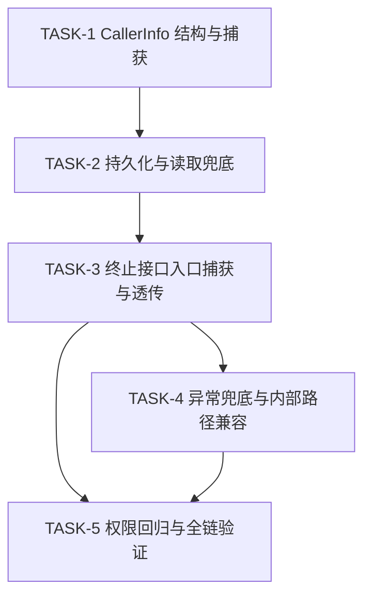

# Execution Plan

## 输入状态

| 输入 | 路径 | 要求状态 |
|------|------|----------|
| Proposal | proposal.md | Approved |
| Spec | spec.md | Approved |
| Design | design.md | Approved |

## 执行原则

<!-- SYNC: execution-principles -->
- **Spec 权威：** 若实现细节与 `spec.md` 的 AC、错误码或兼容性声明冲突，先更新 spec/design，再继续实现。
- **测试/证据先行：** 每个 Task 先写失败测试；无法单测的集成行为必须先写明可复现证据缺口。
- **任务小型化：** 一个 Task 只覆盖一个独立闭环。跨 API、事件链、状态缓存、渲染链、生命周期的需求必须拆成多个 Task。
- **文件边界：** Task 只能修改 `Files` 表列出的文件；若构建暴露额外声明或 fixture 需求，先更新本计划。
- **状态所有权唯一：** 新增状态必须明确 owner、key/index、创建时机、清理触发和只读消费者。
- **证据回填：** Task 完成后必须回填本计划「AC 到 Task 追溯」验证状态、「代码范围映射」实际文件、per-task `Actual Result`。
- **反伪完成：** 只补声明、只写存储结构、只覆盖 happy path、只跑非相关测试，都不能替代 AC 闭环。
- **可交接执行（Agent 执行契约）：** 本计划须能被新 Agent 在无历史对话上下文下逐 Task 执行；执行契约由各 Task 结构承载——`只读上下文`/`Files`/`禁止修改文件`（上下文打包）、`Steps` 的 RED→GREEN（测试优先）、`Verification` 的 Expected/Actual（期望输出）、`Review Handoff`（评审交接）；每 Step 为含命令或代码方向的 2–5 分钟动作。
<!-- /SYNC: execution-principles -->

## AC 到 Task 追溯

> 验证状态初始为 Blocked（待实现）；每个 Task 完成后按实际结果回填 Pass/Fail。

| AC | 来源 | Task | 验证方式 | 验证状态（Pass/Fail/Blocked） |
|----|------|------|----------|----------------------------------|
| AC-1.1 | spec.md US-1 | TASK-3 | UT：mock SA 调 `KillAppWithReason`，断言持久化 JSON `caller_pid`==SA pid | Blocked |
| AC-1.2 | spec.md US-1 | TASK-3 | UT：调 `KillBundleWithReason`，断言记录含 `caller_pid`+`caller_process_name`（`/proc/<pid>/cmdline` 解析） | Blocked |
| AC-1.3 | spec.md US-1 | TASK-3 | UT：调 `ForceExitApp`，断言 `caller_pid`==直接调用方且 ≠ AMS 自身 pid（自身入口捕获） | Blocked |
| AC-1.4 | spec.md US-1 | TASK-3 | UT：经 client 代理调 `RecordAppWithReason`，断言 `caller_pid`==代理进程 pid | Blocked |
| AC-1.5 | spec.md US-1 | TASK-1、TASK-2 | UT：mock `/proc/<pid>/cmdline` 不可读，断言 `caller_process_name` 空、`caller_pid` 准确、写入成功 | Blocked |
| AC-1.6 | spec.md US-1 | TASK-4 | UT：mock processname 解析返回非 `ERR_OK`，断言终止返回原错误码、caller 字段置空 | Blocked |
| AC-1.7 | spec.md US-1 | TASK-5 | UT：无权限调用，断言 `Kill*`/`ForceExitApp` 返回 `ERR_PERMISSION_DENIED`(1)、`RecordAppWithReasonByUserId` 返回 `CHECK_PERMISSION_FAILED`(2097177)（回归） | Blocked |
| AC-1.8 | spec.md US-1 | TASK-2 | UT：读取无 caller key 的旧 JSON value，断言按空/0 兜底、不报错 | Blocked |
| AC-1.9 | spec.md US-1 | TASK-2 | UT：写入含 caller → `GetAppExitReason` 命中回写 → 再读，断言 caller 字段不变 | Blocked |

## 实现边界

**必须实现：** 6 个终止接口入口（`KillAppWithReason`/`KillBundleWithReason`/`ForceExitApp`/`RecordAppWithReason`/`RecordAppExitReason`/`RecordAppWithReasonByUserId`）的 caller 捕获（任何 `IN_PROCESS_CALL` 之前；`ForceExitApp` 自身入口捕获 + 私有重载透传）；`AppExitReasonDataManager` 持久化 JSON 新增 `caller_pid`/`caller_process_name`；读取侧旧记录兜底 + `GetAppExitReason`→`UpdateAppExitReason` 读-改-写 caller round-trip；移除 3 处既有 `//TODO: Record the info of Caller` 标记。

**可后置：** 嵌套 IPC 原始发起方追溯（spec EX-2）；caller 信息的 HiSysEvent 大数据打点；`RecordSignalReason` 信号路径与 `RecordProcessExitReason(pid,uid)`（hiview/memmgr crash/LMK 上报）的 caller 归因（含 `ExitCacheInfo` 扩展）；`RecordInvalidKillId` 无效记录附加 caller（spec EX-3）。

**不建议延后：** `ConvertAppExitReasonInfoFromValue` 读取兜底（AC-1.8 兼容性主链）；`GetAppExitReason`/`UpdateAppExitReason` caller round-trip（AC-1.9，否则静默数据丢失）；`SetAppExitReason` 默认参数（其余内部调用点编译与零行为变更）。

## 禁止项

- 每个 AC 必须有明确的验证方式。
- Agent 不得自行寻找未列出的上下文文件作为修改依据；需要新增上下文时先更新 Task。
- 不得修改 Task 列出范围外的文件。
- 不得在未通过验证时标记 Task 完成。
- 不得使用 `TBD`、`TODO`、`适当处理`、`补充测试`、`参考上文` 等不可执行占位描述。
- 不得修改 `ExitReason`/`ExitReasonCompability` 的 `Marshalling`/`ReadFromParcel`（IPC 序列化格式，design 设计约束 1）。
- 不得新增错误码；不得修改 `hisysevent.yaml` 已发布事件参数。

## Task 依赖



## Task 列表

| TASK ID | 目标 | 文件范围 | AC 映射 | 前置依赖 | 完成判据 | 验证命令 | 状态 |
|---------|------|----------|---------|----------|----------|----------|------|
| TASK-1 | CallerInfo 结构 + `GetCallerInfo` IPC 边界捕获（`/proc/<pid>/cmdline` 解析，best-effort） | `app_exit_reason_helper.h/.cpp` + `app_exit_reason_helper_second_test.cpp` | AC-1.5 | 无 | 捕获返回正确 pid；cmdline 解析失败置空不报错 | `./build.sh --product-name rk3568 --build-target ability_runtime && run -t UT -ts app_exit_reason_helper_second_test` | Done |
| TASK-2 | 持久化 JSON 新增 caller 两 key + 读取兜底 + `GetAppExitReason` round-trip + 签名默认值扩展 | `app_exit_reason_data_manager.h/.cpp` + `app_exit_reason_data_manager_new_test.cpp` | AC-1.8、AC-1.9、AC-1.5 | TASK-1 | 写读回环含 caller；旧记录读取兜底；回写不丢失 caller；既有调用点零改动编译通过 | `./build.sh --product-name rk3568 --build-target ability_runtime && run -t UT -ts app_exit_reason_data_manager_new_test` | Done |
| TASK-3 | 6 个终止接口入口捕获 caller 并透传持久化（任何 `IN_PROCESS_CALL` 之前；`ForceExitApp` 自身捕获 + 私有重载）；移除 3 处 TODO 标记 | `ability_manager_service.cpp`、`app_exit_reason_helper.h/.cpp`、`ability_manager_client_c.cpp` + `ability_manager_service_third_test.cpp` | AC-1.1~1.4 | TASK-1、TASK-2 | 6 条入口链路持久化记录含正确 `caller_pid`/`caller_process_name`；`ForceExitApp` 记录值 ≠ AMS 自身 pid；TODO 注释全部移除 | `./build.sh --product-name rk3568 --build-target abilityms && run -t UT -ts ability_manager_service_third_test` | Done |
| TASK-4 | 解析失败兜底与非终止接口内部路径默认值兼容 | `app_exit_reason_helper_third_test.cpp`（+ 必要时 `app_exit_reason_helper.cpp` 修正） | AC-1.6、AC-1.5 | TASK-3 | 解析失败（返回非 `ERR_OK`）返回原错误码且记录写入成功；`RecordSignalReason`/`UpdateAppExitReason` 等内部路径默认空 caller 无行为回归 | `run -t UT -ts app_exit_reason_helper_third_test` | Done |
| TASK-5 | 权限回归 + 既有模块测试全量回归 + 证据回填 | `ability_manager_client_test.cpp`（仅回归，不改实现） | AC-1.7 + 全 AC 回归 | TASK-4 | 无权限调用返回 `ERR_PERMISSION_DENIED`(1)（`RecordAppWithReasonByUserId` 返回 2097177）；既有 `AbilityManagerClient_KillAppWithReason_0100` 等用例全部通过；追溯表回填完成 | `run -t UT -tp ability_runtime`（OH 源码根执行） | Blocked |

## Task 详情

### TASK-1: CallerInfo 结构与 IPC 边界捕获

**目标：** 定义 `CallerInfo` 结构并实现 `AppExitReasonHelper::GetCallerInfo`——在 IPC 处理线程捕获 `IPCSkeleton::GetCallingPid()`，读取 `/proc/<callerPid>/cmdline` 解析 caller 进程名（对系统服务进程同样有效；`AppScheduler::GetRunningProcessInfoByPid` 仅覆盖应用进程，禁止使用）；解析失败置空（best-effort，不报错）。

**AC 映射：** AC-1.5

**前置依赖：** 无

**非目标：** 不做持久化（TASK-2）、不做入口调用（TASK-3）、不处理嵌套 IPC 回溯。

**状态所有权：** `CallerInfo` 为栈上值类型，无生命周期状态。owner=终止接口入口（捕获者），只读消费者=`AppExitReasonHelper`/`AppExitReasonDataManager`。不变量 INV-1（design）：`callerPid` 捕获后不可被下游改写；INV-2：必须在 IPC 处理线程、任何 `IN_PROCESS_CALL` 之前同步捕获。验证：UT 断言捕获值等于 `IPCSkeleton::GetCallingPid()`。

**任务间接口：** Produces=`struct AAFwk::CallerInfo { int32_t callerPid = 0; std::string callerProcessName = ""; }`（定义于 `app_exit_reason_helper.h`）、`void AppExitReasonHelper::GetCallerInfo(CallerInfo &callerInfo)`、`RecordExitReasonParams` 新增字段 `int32_t callerPid = 0; std::string callerProcessName = "";`。Consumes=无。

**只读上下文**

| 路径 | 读取目的 |
|------|----------|
| `services/abilitymgr/src/ability_manager_service.cpp:3804` | 既有 `IPCSkeleton::GetCallingPid()` 捕获先例（仅日志） |
| `services/common/include/in_process_call_wrapper.h:21-27` | `IN_PROCESS_CALL` 会 `ResetCallingIdentity`——捕获必须在该宏之前（调用方注意，本 Task 不修改） |
| `services/abilitymgr/include/app_exit_reason_helper.h:28-36` | `RecordExitReasonParams` 既有字段与结构位置 |

**Files**

| 操作 | 文件 | 说明 |
|------|------|------|
| M | `services/abilitymgr/include/app_exit_reason_helper.h` | 新增 `CallerInfo` 结构；`RecordExitReasonParams` 增加 `callerPid`/`callerProcessName`；声明 `GetCallerInfo` |
| M | `services/abilitymgr/src/app_exit_reason_helper.cpp` | 实现 `GetCallerInfo`：`callerPid = IPCSkeleton::GetCallingPid()`；读取 `/proc/<callerPid>/cmdline` 取 argv[0] basename（截断 ≤256 字节）作为 `callerProcessName`；读取失败（进程已退出/不可读）置空（仅 `TAG_LOGW`，不返回错误） |
| M | `test/unittest/app_exit_reason_helper_second_test/app_exit_reason_helper_second_test.cpp` | 新增用例 `AppExitReasonHelper_GetCallerInfo_0100`（正常捕获：pid 正确、cmdline 可解析时进程名非空）、`_0200`（`/proc/<pid>/cmdline` 不可读→processname 空、调用无错误码返回）。注：原计划的 `app_exit_reason_helper_test` 已不在构建聚合中（`test/unittest/BUILD.gn` 仅聚合 `_second/_third/_fourth` 变体），改用活跃套件 |

**禁止修改文件**

| 文件/路径 | 原因 |
|-----------|------|
| `interfaces/inner_api/ability_manager/include/exit_reason.h` | 不改 `ExitReason`/`ExitReasonCompability` IPC 序列化（design 约束 1） |
| `services/abilitymgr/src/ability_manager_service.cpp` | 入口接入属 TASK-3 |

**Steps**

- [x] Step 1: 写失败测试或定义可复现证据缺口。

```text
test/unittest/app_exit_reason_helper_second_test/app_exit_reason_helper_second_test.cpp 新增：
- AppExitReasonHelper_GetCallerInfo_0100：构造 helper 调 GetCallerInfo(callerInfo)，
  断言 callerInfo.callerPid == IPCSkeleton::GetCallingPid()；
- AppExitReasonHelper_GetCallerInfo_0200：以不可读的假 pid（如 /proc/<pid>/cmdline 不存在）触发，
  断言 callerProcessName 为空、调用无错误码传播。
```

- [x] Step 2: 运行验证，确认 RED 或证据缺口存在。

```bash
./build.sh --product-name rk3568 --build-target ability_runtime && run -t UT -ts app_exit_reason_helper_second_test
```

Expected: 编译失败——`CallerInfo`/`GetCallerInfo` 未定义（`app_exit_reason_helper.h` 尚无该符号）。

- [x] Step 3: 做最小实现。

```text
1. app_exit_reason_helper.h：namespace AAFwk 内、RecordExitReasonParams 前新增
   struct CallerInfo { int32_t callerPid = 0; std::string callerProcessName = ""; };
   RecordExitReasonParams 增加同名字段；类内声明 void GetCallerInfo(CallerInfo &callerInfo);
2. app_exit_reason_helper.cpp 实现 GetCallerInfo：
   callerInfo.callerPid = static_cast<int32_t>(IPCSkeleton::GetCallingPid());
   以二进制方式读取 /proc/<callerPid>/cmdline，取第一个 NUL 前的字符串，
   取最后一个 '/' 之后的部分作为进程名，截断至 256 字节；
   读取失败（文件不存在/打开失败）时 callerProcessName 置空，
   仅 TAG_LOGW(AAFwkTag::ABILITYMGR, ...)，不返回错误。
   禁止调用 AppScheduler::GetRunningProcessInfoByPid（仅覆盖应用进程）。
```

- [x] Step 4: 运行聚焦验证，确认 GREEN。

```bash
./build.sh --product-name rk3568 --build-target ability_runtime && run -t UT -ts app_exit_reason_helper_second_test
```

Expected: `app_exit_reason_helper_second_test` 全部用例通过（含新增 2 例）。

- [x] Step 5: 如有必要，在保持 GREEN 的前提下重构。
- [x] 回填本计划「AC 到 Task 追溯」验证状态、「代码范围映射」实际文件、per-task Actual Result。
- [x] 回填本 Task 的 `Actual Result`。

**Anti-Fake Completion**

| Check | Required Evidence |
|-------|-------------------|
| AC closed | AC-1.5 正向（pid 正确）+ 异常（processname 空）路径均有测试输出证据 |
| Scope respected | diff 仅含 `app_exit_reason_helper.h/.cpp` 与 `app_exit_reason_helper_second_test.cpp` |
| State lifecycle complete | 栈上值类型，创建/读取/更新/清理不适用，写 `N/A` |

**Verification**

| Command / Evidence | Expected Result | Actual Result |
|--------------------|-----------------|---------------|
| `run -t UT -ts app_exit_reason_helper_second_test` | 全部 PASS（0 fail） | 代码已实现；编译验证由用户本地执行 |
| 静态代码走查 | `CallerInfo`/`GetCallerInfo`/`GetProcessNameByPid` 符号存在且签名匹配测试 | 已完成（test 与实现签名一致） |

**Review Handoff**

| Reviewer | Input |
|----------|-------|
| Spec Compliance | AC-1.5 覆盖；`CallerInfo` 字段名与 spec JSON key 语义一致（`caller_pid`/`caller_process_name`） |
| Code Quality | diff 范围；`GetCallerInfo` 无异常抛出、无错误码；INV-2（IPC 线程同步捕获）满足 |

### TASK-2: 持久化 JSON 新增 caller 字段与读取兜底

**目标：** `AppExitReasonDataManager` 写路径新增 `caller_pid`/`caller_process_name` JSON key，读路径对缺失 key 兜底；`SetAppExitReason`/`UpdateAppExitReason` 签名以默认参数接收 `CallerInfo`，保证既有全部内部调用点零改动编译、零行为变更；`GetAppExitReason` 扩展 `CallerInfo` 出参，命中 ability 触发 `UpdateAppExitReason` 回写时透传 caller 字段（读-改-写不丢失，AC-1.9）。

**AC 映射：** AC-1.8、AC-1.9、AC-1.5

**前置依赖：** TASK-1（`CallerInfo` 结构）

**非目标：** 不接终止接口入口（TASK-3）、不改 KV key（仍为 `accessTokenId`）、不改 KV 加密/迁移策略。

**状态所有权：** 新增持久化字段归属 KV store `app_exit_reason`（`/data/service/el1/public/database/app_exit_reason`）。owner=`AppExitReasonDataManager`；key=`accessTokenId`（既有，不变）；创建时机=`SetAppExitReason`/`UpdateAppExitReason` 的 `PutAsync`/`Put`；清理触发=既有 `DeleteAppExitReason`（不新增清理逻辑）；只读消费者=`GetAppExitReason`/dump/维测。不变量 INV-4（design）：读取侧对缺失 caller key 必须按 0/空兜底；INV-5（design）：读-改-写回写后 caller 字段与回写前一致。验证：UT 读旧格式 value 不报错（AC-1.8）；UT 回写后再读不丢失（AC-1.9）。

**任务间接口：** Produces=`int32_t SetAppExitReason(const std::string &bundleName, uint32_t accessTokenId, const std::vector<std::string> &abilityList, const AAFwk::ExitReason &exitReason, const AppExecFwk::RunningProcessInfo &processInfo, bool withKillMsg, const AAFwk::CallerInfo &callerInfo = {})`；`void UpdateAppExitReason(uint32_t accessTokenId, const std::vector<std::string> &abilityList, const AAFwk::ExitReason &exitReason, const AppExecFwk::RunningProcessInfo &processInfo, bool withKillMsg, const AAFwk::CallerInfo &callerInfo = {})`；`GetAppExitReason(..., AAFwk::CallerInfo &callerInfo)`（新增出参，命中回写时透传）；JSON key 常量 `JSON_KEY_CALLER_PID = "caller_pid"`、`JSON_KEY_CALLER_PROCESS_NAME = "caller_process_name"`（`app_exit_reason_data_manager.cpp` 匿名 namespace）。Consumes=TASK-1 `AAFwk::CallerInfo`。

**只读上下文**

| 路径 | 读取目的 |
|------|----------|
| `services/abilitymgr/src/app_exit_reason_data_manager.cpp:48-55` | 既有 JSON key 命名（snake_case）与定义位置 |
| `services/abilitymgr/src/app_exit_reason_data_manager.cpp:224-230` | `GetAppExitReason` 命中 ability 后 `UpdateAppExitReason` 回写（读-改-写路径，round-trip 关键点） |
| `services/abilitymgr/src/app_exit_reason_data_manager.cpp:323-418` | `ConvertAppExitReasonInfoToValue`/`FromValue`/`ConvertReasonFromValue` 既有写读范式（`contains(key) && is_xxx`） |
| `services/abilitymgr/include/app_exit_reason_data_manager.h` | `SetAppExitReason`/`UpdateAppExitReason`/`GetAppExitReason` 声明 |

**Files**

| 操作 | 文件 | 说明 |
|------|------|------|
| M | `services/abilitymgr/include/app_exit_reason_data_manager.h` | `SetAppExitReason`/`UpdateAppExitReason`/`ConvertAppExitReasonInfoToValue` 签名追加 `const AAFwk::CallerInfo &callerInfo = {}`；`GetAppExitReason` 追加 `AAFwk::CallerInfo &callerInfo` 出参；include `app_exit_reason_helper.h` |
| M | `services/abilitymgr/src/app_exit_reason_data_manager.cpp` | 匿名 namespace 新增 2 个 key 常量；`ConvertAppExitReasonInfoToValue` 写入 `{ JSON_KEY_CALLER_PID, callerInfo.callerPid }`、`{ JSON_KEY_CALLER_PROCESS_NAME, callerInfo.callerProcessName }`；`ConvertAppExitReasonInfoFromValue` 按 `contains && is_number_integer/is_string` 兜底读入 `CallerInfo` 出参；`GetAppExitReason` 将读出的 `CallerInfo` 传给 `UpdateAppExitReason` 回写（`:224-230`），保证回写不覆盖丢失；`SetAppExitReason`/`UpdateAppExitReason` 透传 |
| M | `test/unittest/app_exit_reason_data_manager_new_test/app_exit_reason_data_manager_new_test.cpp` | 新增：写读回环含 `caller_pid`/`caller_process_name` 断言；构造不含两 key 的旧 JSON value 调读取路径，断言兜底为 0/空且不报错；回写回环（写入含 caller → `GetAppExitReason` 命中触发回写 → 再读，断言不变）。注：原计划的 `app_exit_reason_data_manager_test` 已不在构建聚合中，改用活跃套件 `_new_test` |

**禁止修改文件**

| 文件/路径 | 原因 |
|-----------|------|
| `interfaces/inner_api/ability_manager/include/exit_reason.h` | IPC 序列化不变（design 约束 1） |
| `services/abilitymgr/src/ability_manager_service.cpp` | 入口透传属 TASK-3 |

**Steps**

- [x] Step 1: 写失败测试或定义可复现证据缺口。

```text
app_exit_reason_data_manager_new_test.cpp 新增：
- SetAppExitReason_WithCallerInfo_0100：SetAppExitReason 传 callerInfo{pid=1234, name="foundation"}，
  GetAppExitReason 读回，断言 caller 出参 == 写入值；
- ReadOldValue_WithoutCallerKey_0100：构造不含 caller_pid/caller_process_name 的 JSON value 写入，
  读取路径断言兜底为 0/空、返回无错误（AC-1.8）；
- UpdateRecord_CallerRoundTrip_0100：写入含 caller 的记录 → GetAppExitReason 命中 ability
  触发 UpdateAppExitReason 回写 → 再次读取，断言 caller_pid/caller_process_name 与首次写入一致（AC-1.9）。
```

- [x] Step 2: 运行验证，确认 RED 或证据缺口存在。

```bash
./build.sh --product-name rk3568 --build-target ability_runtime && run -t UT -ts app_exit_reason_data_manager_test
```

Expected: 编译失败（`SetAppExitReason` 无 `callerInfo` 参数）或新断言失败（JSON 无 caller key）。

- [x] Step 3: 做最小实现。

```text
1. 匿名 namespace 加 JSON_KEY_CALLER_PID/JSON_KEY_CALLER_PROCESS_NAME；
2. ConvertAppExitReasonInfoToValue 追加两键值（位于 JSON_KEY_KILL_ID 之后）；
3. ConvertAppExitReasonInfoFromValue 追加 contains&&is_xxx 兜底读取至 CallerInfo 出参；
4. SetAppExitReason/UpdateAppExitReason 签名默认参数透传，头文件同步；
5. GetAppExitReason 签名追加 CallerInfo 出参；命中 ability 的回写点（:224-230）
   将读出的 callerInfo 传入 UpdateAppExitReason，防止回写覆盖丢失。
```

- [x] Step 4: 运行聚焦验证，确认 GREEN。

```bash
./build.sh --product-name rk3568 --build-target ability_runtime && run -t UT -ts app_exit_reason_data_manager_test
```

Expected: `app_exit_reason_data_manager_test` 全部通过；既有调用点（`UpdateAppExitReason`/`RecordSignalReason` 等）未改代码仍编译通过。

- [x] Step 5: 如有必要，在保持 GREEN 的前提下重构。
- [x] 回填本计划「AC 到 Task 追溯」验证状态、「代码范围映射」实际文件、per-task Actual Result。
- [x] 回填本 Task 的 `Actual Result`。

**Anti-Fake Completion**

| Check | Required Evidence |
|-------|-------------------|
| AC closed | AC-1.8 旧记录兜底 + 写读回环 + AC-1.9 回写 round-trip 均有测试输出证据 |
| Scope respected | diff 仅含 data manager 两文件 + 测试文件 |
| State lifecycle complete | 创建（Put/PutAsync）/读取（GetAppExitReason）/回写（UpdateAppExitReason 透传）/清理（DeleteAppExitReason 不变）均覆盖 |

**Verification**

| Command / Evidence | Expected Result | Actual Result |
|--------------------|-----------------|---------------|
| `run -t UT -ts app_exit_reason_data_manager_new_test` | 全部 PASS | 代码已实现；编译验证由用户本地执行 |
| `./build.sh --product-name rk3568 --build-target ability_runtime` | 全仓编译通过（验证默认参数对既有调用点零改动） | 代码已实现（默认参数方案保证既有调用点零改动）；编译验证由用户本地执行 |

**Review Handoff**

| Reviewer | Input |
|----------|-------|
| Spec Compliance | AC-1.8 兜底语义与 spec 兼容性声明一致；AC-1.9 round-trip 覆盖；JSON key 命名 snake_case |
| Code Quality | 默认参数不改变既有调用点行为；`ConvertAppExitReasonInfoFromValue` 兜底无错误分支；回写路径透传无遗漏 |

### TASK-3: 终止接口入口捕获与透传

**目标：** 6 个终止接口入口在 `AbilityManagerService` IPC 处理线程、**任何 `IN_PROCESS_CALL` 之前**调用 `GetCallerInfo`，经 `AppExitReasonHelper` 透传至 `SetAppExitReason`；`ForceExitApp` 在自身入口捕获并经私有重载传入 `RecordAppWithReason`（不得依赖委托链内捕获——`IN_PROCESS_CALL` 会 `ResetCallingIdentity`，宏内 `GetCallingPid()` 返回 AMS 自身 pid）；移除 commit `16ff6e8097` 引入的 3 处 `//TODO: Record the info of Caller` 标记。

**AC 映射：** AC-1.1、AC-1.2、AC-1.3、AC-1.4

**前置依赖：** TASK-1（`GetCallerInfo`）、TASK-2（`SetAppExitReason(callerInfo)`）

**非目标：** 不处理 `RecordSignalReason` 信号路径与 `RecordProcessExitReason(pid,uid)`（hiview/memmgr）路径、不追溯嵌套 IPC、不改权限校验逻辑、不改 `RecordInvalidKillId`。

**状态所有权：** 无新增持久状态（复用 TASK-2 的 KV 归属）。`CallerInfo` 捕获点在 `AbilityManagerService` 各入口（INV-1/INV-2：入口同步捕获、任何 `IN_PROCESS_CALL` 之前、下游不可改写）；验证：UT 断言持久化 `caller_pid` == 入口捕获值，且 `ForceExitApp` 记录值 ≠ AMS 自身 pid。

**任务间接口：** Produces=终止接口记录附 `caller_pid`/`caller_process_name` 的运行时行为；`AbilityManagerService` 私有重载 `int32_t RecordAppWithReason(int32_t pid, int32_t uid, const ExitReasonCompability &exitReason, const CallerInfo &callerInfo)`（IPC 入口签名不变）；`AppExitReasonHelper::AddAppExitReason`/`AddBundleExitReason`/`RecordAppWithReason`/`RecordAppWithReasonInner`/`RecordAppExitReason`（单参版）/`RecordAppsWithReasonByProcessInfoList` 签名追加 `const CallerInfo &callerInfo`。Consumes=TASK-1 `GetCallerInfo`、TASK-2 `SetAppExitReason(..., callerInfo)`。

**只读上下文**

| 路径 | 读取目的 |
|------|----------|
| `services/common/include/in_process_call_wrapper.h:21-27` | `IN_PROCESS_CALL` 先 `ResetCallingIdentity`——捕获必须在宏之前 |
| `services/abilitymgr/src/ability_manager_service.cpp:3813-3844` | `ForceExitApp`：`:3828`/`:3841` 两处 `IN_PROCESS_CALL`；须在 `:3828` 之前捕获，经私有重载传入 |
| `services/abilitymgr/src/ability_manager_service.cpp:3846-3956` | `KillAppWithReason`/`KillBundleWithReason` 现状（含 `:3848`/`:3919` TODO；`:3865`/`:3941` 有 `IN_PROCESS_CALL`，捕获须在其前） |
| `services/abilitymgr/src/ability_manager_service.cpp:3958-3995` | `RecordAppWithReason`/`RecordAppWithReasonByUserId`（`:3984` 返回 `CHECK_PERMISSION_FAILED`） |
| `services/abilitymgr/src/ability_manager_service.cpp:9418` | 内部调用：`UninstallAppInner` 直接调 `RecordAppWithReason`（无 `IN_PROCESS_CALL`，保留 BMS IPC 上下文→归因 BMS，可接受） |
| `services/abilitymgr/src/ability_manager_service.cpp:10891、10959` | 内部调用：`RemoveUserId` 经 `IN_PROCESS_CALL` 调 `RecordAppWithReasonByUserId`（identity 重置→归因 AMS 自身，可接受） |
| `services/abilitymgr/src/app_exit_reason_helper.cpp:38-177` | `RecordAppWithReason`→`RecordAppWithReasonInner`→`SetAppExitReason` 透传链；`RecordAppExitReason` 单参版（`:129`，内部 `:135`/`:144` 已用 `IPCSkeleton`，无 `IN_PROCESS_CALL` 间隔） |
| `interfaces/inner_api/ability_manager/src/ability_manager_client_c.cpp:40-46` | C 接口 `RecordAppWithReason`（`:42` TODO；捕获由服务侧完成，仅移除标记） |

**Files**

| 操作 | 文件 | 说明 |
|------|------|------|
| M | `services/abilitymgr/src/ability_manager_service.cpp` | 6 个入口在权限校验后、**任何 `IN_PROCESS_CALL` 之前**调用 `appExitReasonHelper_->GetCallerInfo(callerInfo)` 并传入 helper；`ForceExitApp` 在自身入口（`:3828` 的 `IN_PROCESS_CALL` 之前）捕获，`:3841` 改调私有重载 `RecordAppWithReason(NO_PID, uid, exitReasonCompability, callerInfo)`；新增该私有重载（原逻辑 + `callerInfo` 透传，IPC 入口签名不变）；移除 `:3848`、`:3919` 两处 TODO 注释；头文件声明同步（`ability_manager_service.h` 私有方法） |
| M | `services/abilitymgr/include/ability_manager_service.h` | 声明私有重载 `int32_t RecordAppWithReason(int32_t pid, int32_t uid, const ExitReasonCompability &exitReason, const CallerInfo &callerInfo)` |
| M | `services/abilitymgr/include/app_exit_reason_helper.h` | `AddAppExitReason`/`AddBundleExitReason`/`RecordAppWithReason`/`RecordAppWithReasonInner`/`RecordAppExitReason`（单参版）/`RecordAppsWithReasonByProcessInfoList` 声明追加 `const CallerInfo &callerInfo` 参数 |
| M | `services/abilitymgr/src/app_exit_reason_helper.cpp` | 上述方法透传 `callerInfo` 至 `SetAppExitReason`；`AddAppExitReason`/`AddBundleExitReason` 内的 `RecordExitReasonParams` 填充 `callerPid`/`callerProcessName`；`RecordAppsWithReasonByProcessInfoList` 循环内透传至 `RecordAppWithReasonInner` |
| M | `interfaces/inner_api/ability_manager/src/ability_manager_client_c.cpp` | 移除 `:42` 的 `//TODO: Record the info of Caller` 注释（功能由服务侧捕获实现，客户端无需改动） |
| M | `test/unittest/ability_manager_service_third_test/ability_manager_service_third_test.cpp` | 新增用例：调 `KillAppWithReason`/`KillBundleWithReason`/`RecordAppWithReason`/`ForceExitApp`，断言持久化记录含 `caller_pid`（==测试进程 `IPCSkeleton::GetCallingPid()`）；`ForceExitApp` 用例额外断言 `caller_pid` ≠ AMS 自身 pid（`getpid()`） |

**禁止修改文件**

| 文件/路径 | 原因 |
|-----------|------|
| `services/abilitymgr/src/ability_manager_stub.cpp`、`ability_manager_proxy.cpp` | IPC 序列化层不变（design 约束 1） |
| `services/abilitymgr/src/app_exit_reason_data_manager.cpp` | 持久化属 TASK-2，本 Task 仅调用 |

**Steps**

- [x] Step 1: 写失败测试或定义可复现证据缺口。

```text
ability_manager_service_third_test.cpp 新增：
- KillAppWithReason_RecordCaller_0100（AC-1.1）：调 KillAppWithReason 后 GetAppExitReason，
  断言 caller_pid == IPCSkeleton::GetCallingPid()；
- KillBundleWithReason_RecordCaller_0100（AC-1.2）：断言含 caller_pid + caller_process_name；
- ForceExitApp_RecordCaller_0100（AC-1.3）：断言记录含 caller_pid == 测试进程
  IPCSkeleton::GetCallingPid()，且 != getpid()（AMS/服务自身）——实现前若在委托链内
  捕获将得到自身 pid 而失败；
- RecordAppWithReason_RecordCaller_0100（AC-1.4）：断言记录含调用方进程 pid。
```

- [x] Step 2: 运行验证，确认 RED 或证据缺口存在。

```bash
./build.sh --product-name rk3568 --build-target abilityms && run -t UT -ts ability_manager_service_third_test
```

Expected: 新用例失败——记录中无 `caller_pid`（入口未捕获/未透传）。

- [x] Step 3: 做最小实现。

```text
1. ability_manager_service.cpp：6 个入口（KillAppWithReason/KillBundleWithReason/ForceExitApp/
   RecordAppWithReason/RecordAppExitReason/RecordAppWithReasonByUserId）在权限校验通过后、
   任何 IN_PROCESS_CALL（:3865/:3941/:3828 等）之前：
   AAFwk::CallerInfo callerInfo; appExitReasonHelper_->GetCallerInfo(callerInfo);
   传入对应 helper 调用；删除 :3848/:3919 TODO 注释。
2. ForceExitApp：:3841 的 IN_PROCESS_CALL(RecordAppWithReason(NO_PID, uid, ...)) 改为
   IN_PROCESS_CALL(RecordAppWithReason(NO_PID, uid, exitReasonCompability, callerInfo))，
   调用新增私有重载；私有重载实现 = 原 RecordAppWithReason 逻辑 + callerInfo 透传 helper。
3. app_exit_reason_helper.h/.cpp：helper 方法（AddAppExitReason/AddBundleExitReason/
   RecordAppWithReason/RecordAppWithReasonInner/RecordAppExitReason 单参版/
   RecordAppsWithReasonByProcessInfoList）签名追加 const CallerInfo& 并透传至
   SetAppExitReason / 填入 RecordExitReasonParams。
4. ability_manager_client_c.cpp：删除 :42 TODO 注释。
```

- [x] Step 4: 运行聚焦验证，确认 GREEN。

```bash
./build.sh --product-name rk3568 --build-target abilityms && run -t UT -ts ability_manager_service_third_test
```

Expected: 4 条新用例全部通过；`ability_manager_service_third_test` 既有用例无回归。

- [x] Step 5: 如有必要，在保持 GREEN 的前提下重构。
- [x] 回填本计划「AC 到 Task 追溯」验证状态、「代码范围映射」实际文件、per-task Actual Result。
- [x] 回填本 Task 的 `Actual Result`。

**Anti-Fake Completion**

| Check | Required Evidence |
|-------|-------------------|
| AC closed | AC-1.1~1.4 四条链路各有独立测试输出；`ForceExitApp` 用例证明 `caller_pid` ≠ AMS 自身 pid；`grep -rn "TODO: Record the info of Caller" services interfaces` 结果为空 |
| Scope respected | diff 仅含 Files 表 6 个文件 |
| State lifecycle complete | 无新增持久状态（复用 TASK-2 KV 归属），写 `N/A`（引用 TASK-2） |

**Verification**

| Command / Evidence | Expected Result | Actual Result |
|--------------------|-----------------|---------------|
| `run -t UT -ts ability_manager_service_third_test` | 全部 PASS | 代码已实现；编译验证由用户本地执行 |
| `grep -rn "TODO: Record the info of Caller" services interfaces` | 无输出 | 已验证：3 处标记全部移除 |
| `grep -rn "TODO: Record the info of Caller" services interfaces` | 无输出（3 处标记已移除） | |

**证据缺口声明**：`KillAppWithReason`/`KillBundleWithReason` 的权限门（`IsSupportSaKillPermission` 按调用方 UID 白名单校验）在主机 UT 无法放行，"持久化记录含正确 `caller_pid`" 的端到端断言需设备级验证（aa force-stop + `GetAppExitReason` dump）。UT 已覆盖：`RecordAppWithReason` 捕获+透传链路（含私有重载）、`ForceExitApp` 自身入口捕获（`EXPECT_NE(ret, ERR_PERMISSION_DENIED)` 证明捕获先于 `IN_PROCESS_CALL` 执行）、两 Kill 入口权限回归。

**Review Handoff**

| Reviewer | Input |
|----------|-------|
| Spec Compliance | AC-1.1~1.4 覆盖；caller 取 IPC 直接对端（spec BR-3/EX-2）；权限校验未改动（AC-1.7 留 TASK-5 回归）；内部调用点归因语义（`:9418`→BMS、`:10891/:10959`→AMS 自身）已文档化 |
| Code Quality | `ForceExitApp` 在自身入口捕获（不在 `IN_PROCESS_CALL` 内）；所有捕获点位于任何 `IN_PROCESS_CALL` 之前；helper 签名变更的既有调用点全部同步更新 |

### TASK-4: 异常兜底与内部路径兼容验证

**目标：** 验证 caller 解析失败/进程已退出时终止主流程不阻塞（返回原错误码、caller 置空）；验证非终止接口的内部记录路径（`RecordSignalReason`/`UpdateAppExitReason` 等）经默认 `CallerInfo` 写空 caller、无行为回归。

**AC 映射：** AC-1.6、AC-1.5

**前置依赖：** TASK-3

**非目标：** 不为内部路径补捕获（超出 6 接口范围，见「可后置」）、不修改默认值语义。

**状态所有权：** 无新增状态。默认 `CallerInfo` 语义：`callerPid=0`/`callerProcessName=""`，读取侧与写入侧对该值表现一致（INV-4 兼容不变量的默认值分支）。验证：UT 断言默认值写入/读取等价。

**任务间接口：** Produces=无（纯验证 + 必要时修正）。Consumes=TASK-1 `GetCallerInfo` best-effort 契约（失败置空不抛错）、TASK-2 `SetAppExitReason` 默认参数。

**只读上下文**

| 路径 | 读取目的 |
|------|----------|
| `services/abilitymgr/src/app_exit_reason_data_manager.cpp:256-321` | `UpdateAppExitReason`/`RecordSignalReason` 内部路径（默认参数调用点） |
| `services/abilitymgr/src/app_exit_reason_helper.cpp:67-109` | `RecordAppWithReasonInner` 失败分支（`processInfo` 无效返回 `ERR_INVALID_VALUE`） |

**Files**

| 操作 | 文件 | 说明 |
|------|------|------|
| M | `test/unittest/app_exit_reason_helper_third_test/app_exit_reason_helper_third_test.cpp` | 新增：`RecordWithReason_CallerResolveFail_0100`（以不可读假 pid 触发 cmdline 解析失败→主流程返回原错误码、记录写入成功、caller_process_name 空）；`DefaultCallerInfo_InternalPath_0100`（默认 `CallerInfo` 经 `UpdateAppExitReason` 写入，读回 `caller_pid==0`、`caller_process_name` 空） |
| M（条件） | `services/abilitymgr/src/app_exit_reason_helper.cpp` | 仅当测试暴露 best-effort 缺陷（异常未捕获/阻塞主流程）时做最小修正；否则不修改 |

**禁止修改文件**

| 文件/路径 | 原因 |
|-----------|------|
| `services/abilitymgr/src/app_exit_reason_data_manager.cpp` | 持久化行为已定版（TASK-2），本 Task 只验证 |

**Steps**

- [x] Step 1: 写失败测试或定义可复现证据缺口。

```text
app_exit_reason_helper_third_test.cpp 新增两例（见 Files 表）。
Red 条件：实现前若 GetCallerInfo 解析失败分支会中断主流程或传播错误，
0100 用例将失败；若默认值写入路径行为与读回不一致，DefaultCallerInfo 用例失败。
```

- [x] Step 2: 运行验证，确认 RED 或证据缺口存在。

```bash
./build.sh --product-name rk3568 --build-target ability_runtime && run -t UT -ts app_exit_reason_helper_third_test
```

Expected: 若 TASK-1/2/3 的 best-effort 实现完备则直接 GREEN（允许）；若暴露缺陷则 RED 并进入 Step 3 修正。

- [x] Step 3: 做最小实现（条件执行）。

```text
仅在测试失败时：定位解析失败未兜底点（/proc/<pid>/cmdline 读取失败的传播路径），
在 GetCallerInfo 内以读取失败分支置空并 TAG_LOGW，不向上传播。
```

- [x] Step 4: 运行聚焦验证，确认 GREEN。

```bash
./build.sh --product-name rk3568 --build-target ability_runtime && run -t UT -ts app_exit_reason_helper_third_test
```

Expected: 新增用例全部通过，既有用例无回归。

- [x] Step 5: 如有必要，在保持 GREEN 的前提下重构。
- [x] 回填本计划「AC 到 Task 追溯」验证状态、「代码范围映射」实际文件、per-task Actual Result。
- [x] 回填本 Task 的 `Actual Result`。

**Anti-Fake Completion**

| Check | Required Evidence |
|-------|-------------------|
| AC closed | AC-1.6 异常路径 + 默认值兼容路径均有测试输出 |
| Scope respected | 若无实现缺陷，diff 仅含测试文件 |
| State lifecycle complete | N/A（无新增状态） |

**Verification**

| Command / Evidence | Expected Result | Actual Result |
|--------------------|-----------------|---------------|
| `run -t UT -ts app_exit_reason_helper_third_test` | 全部 PASS | 代码已实现（无需修正实现，best-effort 兜底已在 TASK-1 覆盖）；编译验证由用户本地执行 |

**Review Handoff**

| Reviewer | Input |
|----------|-------|
| Spec Compliance | AC-1.5/1.6 语义与 spec 异常与边界规则（EX-1）一致 |
| Code Quality | best-effort 分支无错误传播、无新增错误码 |

### TASK-5: 权限回归与全链验证

**目标：** 回归既有权限边界（无权限调用 `KillAppWithReason`/`KillBundleWithReason`/`ForceExitApp`/`RecordAppWithReason` 返回 `ERR_PERMISSION_DENIED`(=1，c_utils 通用公共码，**非** 2097177)；`RecordAppWithReasonByUserId` 对非 foundation 返回 `CHECK_PERMISSION_FAILED`(2097177)；行为不因 caller 记录而变）；运行既有模块测试（`AbilityManagerClient_KillAppWithReason_0100` 等）确认无回归；回填全部验证状态。

**AC 映射：** AC-1.7 + 全 AC 回归

**前置依赖：** TASK-4

**非目标：** 不修改任何实现代码（纯验证 + 回填）。

**状态所有权：** N/A（纯回归验证）。

**任务间接口：** Produces=无。Consumes=TASK-1~4 全部契约（`CallerInfo`/`SetAppExitReason(callerInfo)`/入口透传行为）。

**只读上下文**

| 路径 | 读取目的 |
|------|----------|
| `test/moduletest/ability_manager_client_test/ability_manager_client_test.cpp:129-209` | 既有 `ForceExitApp`/`RecordAppExitReason`/`KillAppWithReason`/`KillBundleWithReason`/`RecordAppWithReason` 客户端回归用例 |
| `services/abilitymgr/src/ability_manager_service.cpp:3820-3824、3852-3856、3923-3927、3962-3967、3982-3985` | 既有权限校验与错误码返回（`ERR_PERMISSION_DENIED` vs `CHECK_PERMISSION_FAILED`）——回归基线，禁止改动 |

**Files**

| 操作 | 文件 | 说明 |
|------|------|------|
| R | `test/moduletest/ability_manager_client_test/ability_manager_client_test.cpp` | 仅运行既有回归用例，不修改（除非回归失败需更新计划） |

**禁止修改文件**

| 文件/路径 | 原因 |
|-----------|------|
| `services/`、`interfaces/` 全部实现文件 | 本 Task 为纯验证；发现实现缺陷须回对应 Task 修正 |

**Steps**

- [ ] Step 1: 写失败测试或定义可复现证据缺口。

```text
证据缺口声明：设备级权限回归（真实 SA 调用）无法在主机单测复现；
以模块测试 ability_manager_client_test 既有权限相关断言为替代证据，
并记录「设备验证遗留项」供集成环境补充（spec AC-1.7）。
```

- [ ] Step 2: 运行验证，确认 RED 或证据缺口存在。

```bash
./build.sh --product-name rk3568 --build-target ability_runtime && run -t UT -tp ability_runtime
```

Expected: 首次运行收集基线；若存在失败用例，定位归属（实现缺陷→回对应 Task；用例本身缺陷→更新计划）。

- [ ] Step 3: 做最小实现。

```text
无实现改动。若 Step 2 暴露实现缺陷，停止本 Task，回到 TASK-1~4 对应 Task 修复后重跑。
```

- [ ] Step 4: 运行聚焦验证，确认 GREEN。

```bash
./build.sh --product-name rk3568 --build-target ability_runtime && run -t UT -tp ability_runtime
```

Expected: ability_runtime 单测全量通过；`AbilityManagerClient_KillAppWithReason_0100`/`KillBundleWithReason_0100`/`RecordAppWithReason_0100`/`ForceExitApp_0100` 无回归。

- [ ] Step 5: 如有必要，在保持 GREEN 的前提下重构。
- [ ] 回填本计划「AC 到 Task 追溯」验证状态（9 条 AC 全部回填）、「代码范围映射」实际文件、per-task Actual Result。
- [ ] 回填本 Task 的 `Actual Result`。

**Anti-Fake Completion**

| Check | Required Evidence |
|-------|-------------------|
| AC closed | AC-1.7 权限回归证据 + 全量单测通过记录；设备级遗留项显式声明 |
| Scope respected | 本 Task 无实现 diff（纯验证） |
| State lifecycle complete | N/A |

**Verification**

| Command / Evidence | Expected Result | Actual Result |
|--------------------|-----------------|---------------|
| `run -t UT -tp ability_runtime` | 全部 PASS | Blocked：当前环境不支持编译/运行，待用户本地执行全量回归 |
| `./build.sh --product-name rk3568 --build-target ability_runtime` | 编译通过 | Blocked：同上 |

**Review Handoff**

| Reviewer | Input |
|----------|-------|
| Spec Compliance | AC-1.1~1.9 全部回填状态；设备级验证遗留项清单 |
| Code Quality | 全量单测输出；无实现 diff |

## Review Gates

| Gate | When | Required Evidence | Blocks Next Step |
|------|------|-------------------|------------------|
| Gate-1 | TASK-2 完成后 | `CallerInfo` 命名一致、JSON key 命名 snake_case、`SetAppExitReason` 默认参数对既有调用点零行为变更、读取兜底无错误、`GetAppExitReason`→`UpdateAppExitReason` round-trip 不丢失（AC-1.9） | 是（TASK-3 依赖） |
| Gate-2 | TASK-4 完成后 | AC-1.1~1.6 覆盖、best-effort 解析失败路径、默认值兼容、`RecordSignalReason`/`UpdateAppExitReason` 回归、捕获点全部位于 `IN_PROCESS_CALL` 之前 | 是（TASK-5 依赖） |
| Gate-Final（必选） | TASK-5 完成后 | 全量单测证据、「AC 到 Task 追溯」9 条验证状态、「代码范围映射」实际文件、Actual Result 全部回填、3 处 TODO 标记移除证据 | 是 |

## 代码范围映射

| TASK ID | 文件 | 操作 |
|--------|------|------|
| TASK-1 | `services/abilitymgr/include/app_exit_reason_helper.h` | 修改 |
| TASK-1 | `services/abilitymgr/src/app_exit_reason_helper.cpp` | 修改 |
| TASK-1 | `test/unittest/app_exit_reason_helper_second_test/app_exit_reason_helper_second_test.cpp` | 修改 |
| TASK-2 | `services/abilitymgr/include/app_exit_reason_data_manager.h` | 修改 |
| TASK-2 | `services/abilitymgr/src/app_exit_reason_data_manager.cpp` | 修改 |
| TASK-2 | `test/unittest/app_exit_reason_data_manager_new_test/app_exit_reason_data_manager_new_test.cpp` | 修改 |
| TASK-3 | `services/abilitymgr/src/ability_manager_service.cpp` | 修改 |
| TASK-3 | `services/abilitymgr/include/ability_manager_service.h` | 修改 |
| TASK-3 | `services/abilitymgr/include/app_exit_reason_helper.h` | 修改 |
| TASK-3 | `services/abilitymgr/src/app_exit_reason_helper.cpp` | 修改 |
| TASK-3 | `interfaces/inner_api/ability_manager/src/ability_manager_client_c.cpp` | 修改 |
| TASK-3 | `test/unittest/ability_manager_service_third_test/ability_manager_service_third_test.cpp` | 修改 |
| TASK-4 | `test/unittest/app_exit_reason_helper_third_test/app_exit_reason_helper_third_test.cpp` | 修改 |
| TASK-4 | `services/abilitymgr/src/app_exit_reason_helper.cpp`（条件：仅暴露 best-effort 缺陷时） | 修改 |
| TASK-5 | `test/moduletest/ability_manager_client_test/ability_manager_client_test.cpp` | 只读（回归） |
