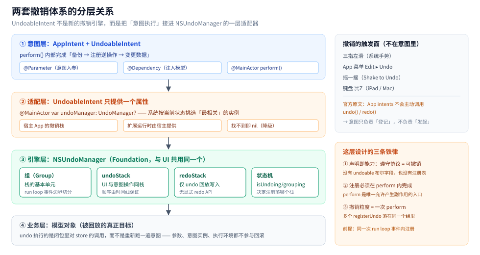
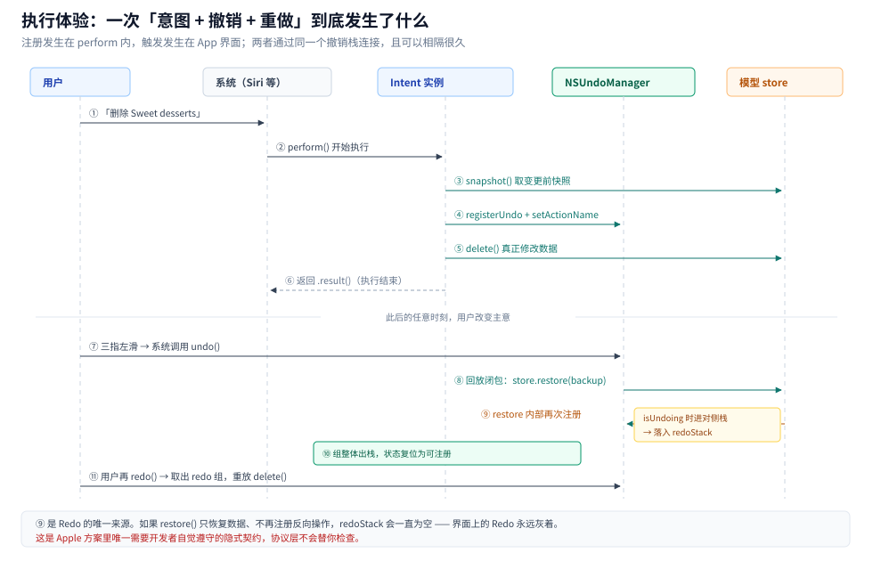
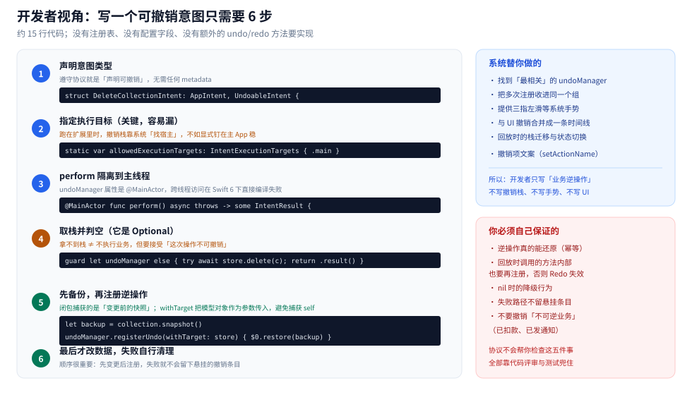
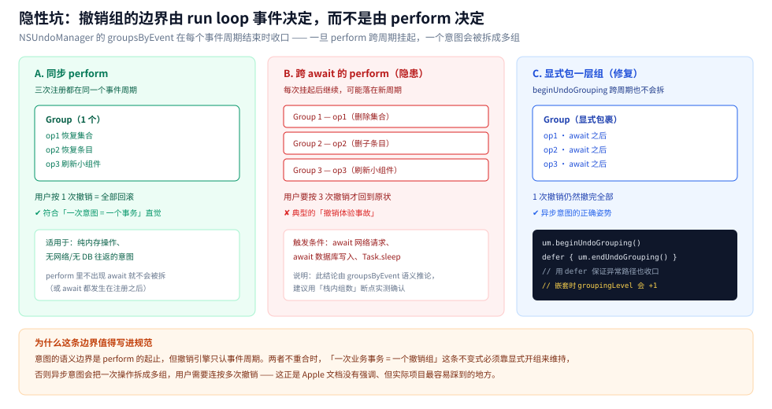

# iOS 撤销体系全景技术分析：从 NSUndoManager 到 UndoableIntent

> 分析对象：Foundation `NSUndoManager`（引擎）+ App Intents `UndoableIntent`（iOS 26+ 适配层）
> 性质说明：基于 Apple 官方文档、WWDC25 Session 275 与公开 API 语义还原，不涉及逆向工程；少量标注"推论"的结论给出了验证方法。
> 关联文档：本文是《iOS UndoManager 实现洞察报告》的续篇，补全意图层；与《HarmonyOS-IntentUndo-设计文档》互为参照。

---

## 0. TL;DR

1. **iOS 26 之前**，App Intents 没有撤销能力；意图执行产生的业务变更只能靠应用自己在模型层兜底。
2. **iOS 26 引入 `UndoableIntent`，但它不是新的撤销引擎**——它只提供一个 `undoManager: UndoManager?` 属性，把意图执行接入应用**已有的** `NSUndoManager`。
3. **没有 `onUndo()`、没有 `onRedo()`、没有 `undoable` 字段**：撤销 = 在 `perform()` 里向共享栈注册一条闭包；重做 = 完全依赖撤销回放时的对称注册，协议层连一个 API 都没给。
4. **意图与 UI 共用一条撤销时间线**，这是 Apple 有意为之——保证"UI 操作和意图操作按正确顺序撤销"。
5. 代价同样明确：**不可持久化**（内存栈）、**不可跨入口触发**（必须回到 App 界面手势/菜单）、**`undoManager` 可能为 nil**（静默降级）。

---

## 1. 全景：两套体系，一个引擎



理解这套体系的关键是分清四层职责：

| 层 | 角色 | 谁提供 |
|---|---|---|
| ① 意图层 | 业务事务（删除集合、下单） | 开发者（AppIntent 子类） |
| ② 适配层 | `undoManager` 属性注入 | 系统（UndoableIntent 协议） |
| ③ 引擎层 | 组、双栈、状态机、回放 | Foundation `NSUndoManager` |
| ④ 业务层 | 幂等的模型方法（`restore`、`delete`） | 开发者（模型对象） |

**`UndoableIntent` 本身没有任何撤销逻辑**。它做的事只有一件：在意图执行时，把"当前上下文中最相关的那份撤销栈"递到开发者手里。所有的撤销语义仍然由第 3、4 层承担——这也是为什么上一篇报告对 `NSUndoManager` 的分析（命令模式、双栈、对称注册）在意图层**逐字成立**。

---

## 2. 引擎层速览（承接前篇，只列与意图层相关的结论）

前篇已详细拆解，这里只回收意图层会用到的五条：

1. **栈的基本单元是组（Group）**，组的边界默认由 run loop 事件周期切分（`groupsByEvent`），不是由"一次函数调用"切分——这条在意图层会变成一个真实的坑（见 §7）。
2. **注册的落点由状态机决定**：`isUndoing == true` 时注册写入 redoStack，否则写入 undoStack。这是 Redo 免费的唯一来源。
3. **撤销执行 = 重新发送固化消息**（`target + selector + args`）**或执行闭包**，`withTarget` 把目标对象作为参数传回，避免闭包强捕获 `self`。
4. **新操作注册的瞬间，redoStack 整体清空**（历史分叉失效）。
5. **`setActionName` 决定撤销菜单上显示什么**；`setActionIsDiscardable:` 决定该组是否参与 `canUndo` 判定。

---

## 3. `UndoableIntent` 精确规格

### 3.1 协议定义

```swift
@available(iOS 26.0, macOS 26.0, tvOS 26.0, watchOS 26.0, visionOS 26.0, *)
public protocol UndoableIntent : AppIntent, PersistentlyIdentifiable, Sendable, SystemIntent {
    @MainActor var undoManager: UndoManager? { get }
}
```

平台可用性：iOS / iPadOS / Mac Catalyst / macOS / tvOS / visionOS / watchOS **26.0+**。

**整个协议只有这一个成员。** 官方对其行为的完整描述（文档原文要点）：

- 在 `perform()` 中用这个属性获取"适合注册可撤销操作的撤销管理器"；
- 系统"尽最大努力"根据 App 或扩展的当前状态找到合适的实例；**找不到时该属性为 `nil`**；
- 该撤销管理器**只能用来注册**撤销操作；
- **App 意图不会主动调用它的 `undo()` / `redo()`** ——撤销和重做由 App 响应菜单或界面交互来发起。

### 3.2 它在 add-on protocols 家族中的位置

`UndoableIntent` 是 App Intents 一组"附加行为协议"之一。注意它和 `CancellableIntent` 的语义边界——这是最容易混淆的一对：

| 协议 | 回调/属性 | 解决的问题 | 与撤销的关系 |
|---|---|---|---|
| `UndoableIntent` | `undoManager`（注册用） | **回滚已完成**的事务 | 就是本文主题 |
| `CancellableIntent` | `onCancel(reason:)` | **终止在途**任务（用户点取消 / 超时 / 系统回收资源） | 不是撤销；对象是"还没执行完的工作" |
| `LongRunningIntent` | `performBackgroundTask(options:operation:)` | 长任务后台执行时间与进度上报 | 无关 |
| `PredictableIntent` | `IntentPrediction` | 系统学习并建议意图 | 无关 |

> 命名启示：Apple 刻意把"取消（cancel）"和"撤销（undo）"分成两个协议、两个词。任何撤销设计里把回滚已完成事务的回调命名为 `onCancel`，都会与这一业界既有语义正面冲突。

### 3.3 能力声明的方式：协议一致性

对比两种声明风格：

```swift
// Apple：遵守协议即声明，无元数据、无注册表
struct DeleteCollectionIntent: AppIntent, UndoableIntent { ... }

// 我们在鸿蒙提案中的设计：配置字段 + 默认不可撤销
// insight_intent.json → { "undoable": true }
// executor 未实现 onUndo → 默认 code: -1，不入栈
```

两者等价，但适用条件不同：Apple 依赖 Swift 协议在**编译期**检查；`insight_intent.json` 是**运行期**解析的配置，必须允许"声明了但没实现"的状态存在。鸿蒙提案选字段式是合理的，但要在文档里写明这个差异的来源。

---

## 4. 执行链路逐跳拆解



### 4.1 注册侧（perform 内，一次执行完成）

按时间顺序，一次可撤销意图执行的六个动作：

1. **系统分发**：Siri / 快捷指令 / Spotlight / 小组件触发意图，系统决定在主 App 还是扩展进程执行（`allowedExecutionTargets` 可钉死在 `.main`）。
2. **注入撤销栈**：进入 `perform()` 后，`undoManager` 属性返回系统挑选的实例。挑选逻辑文档未公开，已知约束是：扩展里运行也能拿到宿主 App 的栈（WWDC 明确演示）；找不到则 `nil`。
3. **取快照**：`collection.snapshot()`——闭包将来要用的"变更前状态"必须在**变更发生前**取得。
4. **注册逆操作**：`registerUndo(withTarget:handler:)` 把闭包压入当前组；`setActionName` 设置撤销项文案。
5. **执行变更**：真正修改模型 / 网络 / 数据库。
6. **返回结果**：`.result()`；run loop 事件周期结束时组被收口（或被显式 `endUndoGrouping` 收口）。

**注册与变更的先后顺序有两种流派**，语义差异值得写清楚：

- **先注册后变更**（WWDC 示例的写法）：即使变更抛错，撤销条目已入栈——但此刻数据没变，撤销会执行一次"多余的恢复"。若 `restore` 幂等则无害。
- **先变更后注册**（本文推荐）：变更抛错时根本不注册，**失败路径天然零污染**；缺点是若变更"部分成功"，快照可能已过期。

两者都对，但**必须选定一种写进团队规范**，混用是 bug 来源。

### 4.2 触发侧重放（可能发生在数分钟后）

用户三指左滑（或菜单 / 摇一摇 / ⌘Z）→ 系统沿响应链找到撤销栈 → 调用 `undo()`。`NSUndoManager` 内部依次：

1. 若存在未关闭的顶层组，先自动收口；
2. 取 undoStack 顶组，置 `isUndoing = true`；
3. **倒序**回放组内操作（后注册的先撤销，保证依赖顺序）；
4. 回放期间每个操作如果再次 `registerUndo`，因状态机路由落入 redoStack；
5. 组整体迁移完毕，状态复位。

Redo 镜像执行 `redo()`：取 redoStack 顶组回放，操作再次反向注册回 undoStack。

### 4.3 Redo 的隐式契约（整条链路最脆弱的一环）

 redoStack 的内容**完全**来自第 4.2 节第 4 步——即**撤销回放时，被调用的模型方法自己再次注册**。以示例中的 `store.restore(_:)` 为例：

```swift
extension CollectionStore {
    func restore(_ backup: CollectionBackup) {
        // ① 恢复数据
        collections.insert(backup.collection, at: backup.index)
        // ② 必须再注册"恢复的逆操作"（即重新删除），否则 Redo 失效
        undoManager?.registerUndo(withTarget: self) { store in
            store.deleteWithoutConfirmation(backup.collection)
        }
    }
}
```

协议层不会检查这一条。`restore()` 若只恢复数据不注册，界面上 Redo 永远置灰，且**没有任何报错**——这与前篇报告"开发者最常踩的坑"完全同构，只是在意图层它藏得更深：意图代码看起来完全正确，坑在模型方法里。

---

## 5. 开发者体验：从零写一个可撤销意图



生产级完整示例（含本文推荐的全部防御性写法）：

```swift
struct DeleteCollectionIntent: AppIntent, UndoableIntent {
    static let title: LocalizedStringResource = "删除集合"

    // 钉在主 App 执行：撤销栈稳定可得，不依赖系统"找宿主"
    static var allowedExecutionTargets: IntentExecutionTargets { .main }

    @Parameter var collection: CollectionEntity
    @Dependency var store: CollectionStore

    @MainActor
    func perform() async throws -> some IntentResult {
        // ④ 判空降级：拿不到栈 ≠ 不执行，但要接受"这次不可撤销"
        guard let um = undoManager else {
            try await store.delete(collection)
            return .result()
        }

        let backup = collection.snapshot()          // ⑤ 变更前快照

        // 显式成组：防止 await 把一次意图拆成多个撤销组（见 §7 坑 1）
        um.beginUndoGrouping()
        defer { um.endUndoGrouping() }              // defer 保证异常路径也收口

        do {
            try await store.delete(collection)      // ⑥ 先变更
            um.registerUndo(withTarget: store) {    // ⑦ 后注册（失败零污染）
                $0.restore(backup)                  //    restore 内部再注册 → Redo
            }
            um.setActionName("删除\(collection.name)")
            WidgetCenter.shared.reloadTimelines(ofKind: "CollectionsWidget")
        } catch {
            throw error                             // 未注册即未污染栈
        }
        return .result()
    }
}
```

**开发者实际要写的"撤销代码"只有 3 行**（备份、注册、命名），其余全是常规意图逻辑。以下是必须遵守的五条编码契约，协议不会替你检查任何一条：

1. **逆操作必须幂等**——用户可能触发多次撤销，回放也可能被打断后重放；
2. **回放调用的模型方法内部必须再注册**（Redo 契约，§4.3）；
3. **`undoManager` 为 nil 时行为要定义清楚**——照常执行并接受不可撤销，还是拒绝执行，是产品决策不是技术细节；
4. **失败路径不留悬挂条目**——先变更后注册，或 catch 里 `removeAllActions(withTarget:)`（注意它是**粗粒度**的，会连带删除该 target 的其他待撤销操作，只在独占场景使用）；
5. **不可逆业务（已扣款、已发通知）不要注册撤销**——要么前置确认，要么走"补偿事务"而不是撤销。

---

## 6. 执行体验：运行时行为边界

### 6.1 与 UI 共栈：顺序保证的来源与代价

WWDC 原文：系统给意图"最相关"的撤销管理器，"确保 App 在 UI 和 App Intents 中的撤销操作保持同步，从而按照正确的顺序撤销"。

- **来源**：UI 编辑和意图变更落在**同一条时间线**上。用户改了字段 → 跑了意图 → 又改了字段，三步在同一个栈里按发生顺序排列，连续按撤销会按逆序精确回放。这是**任何"意图层独立建栈"的方案都做不到的**。
- **代价**：意图的撤销项会与用户的手工编辑交错。若意图执行后触发自动同步、缓存刷新等"非用户操作"且这些操作也注册了撤销，栈就被污染——要用 `disableUndoRegistration` 区间包裹这些后台变更。

### 6.2 nil 降级的三种真实场景

| 场景 | 原因 | 表现 |
|---|---|---|
| 纯后台执行 | 无 UI 事件循环，系统找不到合适的栈 | `undoManager == nil` |
| 宿主进程已死且未恢复 | 扩展执行时宿主来不及拉起 | 同上 |
| 平台裁剪 | watchOS 等空间的限制 | 同上 |

设计含义：**撤销能力必须被视为"尽力而为"（best-effort）**。任何依赖"撤销一定可用"的业务流程（如"删除前不确认，反正能撤"）都是错的。

### 6.3 并发约束

`undoManager` 属性标注 `@MainActor`。Swift 6 严格并发下，从非主线程访问直接编译失败；`perform` 若要触碰它，要么整个函数 `@MainActor`，要么注册段 `MainActor.run { }` 包裹。后台模式意图（`supportedModes = .background`）天然拿不到栈，与 6.2 第一行对应。

### 6.4 一个 Apple 没有解决的场景：凌晨三点的自动化

快捷指令可以在无人交互时自动执行意图。此时撤销条目会照常入栈，但**没有任何用户会去撤销它**，它只是占据栈深（`levelsOfUndo`），还可能把用户手工编辑的撤销项挤出栈。缓解手段：

- 自动化触发的意图不注册撤销（用 `isForegroundRequest` 之类的运行时判据分流——以实际 API 为准）；
- 或注册时标记 `setActionIsDiscardable(true)`，让栈满时可优先淘汰。

---

## 7. 坑位清单（按踩中概率排序）




| # | 坑 | 后果 | 对策 |
|---|---|---|---|
| 1 | **跨 `await` 的 perform 被拆成多个撤销组**（groupsByEvent 按 run loop 事件收口，而异步挂起可能跨周期） | 用户要按 N 次撤销才能撤掉一次意图 | 显式 `beginUndoGrouping` + `defer end`；用"栈内组数"断言写单测 |
| 2 | **`restore` 不再注册** | Redo 静默失效，无任何报错 | 把"回放方法必须对称注册"写进 code review 清单 |
| 3 | **Swift 6 下跨线程访问 `undoManager`** | 编译失败（严格并发）或运行时未定义 | `perform` 标 `@MainActor`，或注册段 `MainActor.run` |
| 4 | **失败路径的悬挂撤销条目** | 撤销一个"从未发生"的变更 | 先变更后注册；或 catch 清理（注意 `removeAllActions(withTarget:)` 的粗粒度） |
| 5 | **后台自动化污染栈** | 撤销项爆炸、手工编辑被挤出栈 | §6.4 的分流或 discardable |
| 6 | **扩展里执行、宿主拉起失败** | `undoManager == nil` 撤销能力消失 | `allowedExecutionTargets = .main` 钉死 |
| 7 | **闭包强捕获大对象** | 撤销栈内存放大（整篇文本、整棵树） | 快照用增量结构（range + 文本片段），对齐 UITextView 做法 |
| 8 | **依赖"撤销一定可用"的产品流程** | nil 场景下流程断裂 | 撤销是 best-effort，关键操作仍需确认 |
| 9 | **意图撤销与 UI 撤销顺序错乱的自作主张** | 自建意图栈后两者时间线分裂 | 不要自建栈；让意图接入共享栈 |
| 10 | **把 `onCancel` 当撤销用** | 与 `CancellableIntent` 语义冲突，用户按取消触发回滚 | 两个概念、两个词、两条链路 |

> 坑 1 的说明：该结论由 `groupsByEvent` 的公开语义推论，Apple 文档未针对 async perform 明说。验证方法：在 perform 前后断言 `undoManager.groupingLevel` 与栈内组数，分别在含/不含 `await` 的两个用例下对比。

---

## 8. 设计评价：Apple 为什么不给 `onUndo()` / `onRedo()`

把问题反过来看更清楚。假如 Apple 提供：

```swift
// 假想 API（实际不存在）
protocol UndoableIntent {
    func undo(params, result) async throws   // 意图级撤销回调
    func redo(params, result) async throws
}
```

会遇到三个无法绕过的问题：

1. **顺序无法保证**。意图回调产生的撤销记录如果放在独立的意图栈里，它和 UI 编辑栈是两条时间线，连续撤销时无法交错回放——Apple 用共享栈换来的是"正确顺序"这个撤销体验的底线。
2. **回滚凭据要跨进程**。意图可能在扩展进程执行，`params + result` 若作为撤销凭据回传，需要新增跨进程通道；而闭包注册全部发生在应用进程内，**零 IPC**。
3. **自动求逆在意图层不成立**。意图是黑盒业务（网络 + DB + 副作用），框架无法推导逆操作；而闭包注册把"求逆"的责任显式交还给开发者，与 `NSUndoManager` 一脉相承。

**但这套选择的边界也很清晰**，下表逐项对照我们在鸿蒙侧的 IntentUndo 提案：

| 维度 | Apple `UndoableIntent` | 鸿蒙 IntentUndo 提案 | 评注 |
|---|---|---|---|
| 能力声明 | 协议一致性（编译期） | `undoable` 字段 + 实现探测（运行期） | 等价，各自适配语言特性 |
| 撤销凭据 | 闭包捕获快照（内存对象） | `(params, executeResult)` 可序列化 | 各有取舍，见下 |
| 撤销栈 | **共享** NSUndoManager 单时间线 | 意图层独立双栈 + 模型层嵌套 | **需吸收 Apple 的共享栈思想**（§9 修正 2） |
| Redo | 无 API，靠对称注册（隐式契约） | 显式 `onRedo`（黑盒业务无法自动求逆） | 我们的显式方案更适合跨进程意图 |
| 持久化 | 无（内存栈，杀进程即丢） | `ToJsonString` 落盘，跨会话撤销 | 我们的结构性优势 |
| 撤销触发面 | App 界面手势 / 菜单 | 小艺 / 卡片 / 跨设备 / 应用内 | 我们的结构性优势 |
| 取消在途任务 | `CancellableIntent.onCancel` | 提案中的 `onCancel`（语义冲突） | **须改名 `onUndo`** |

**闭包 vs 凭据的本质权衡**：闭包赢在表达力——任意逆操作、零序列化成本、天然覆盖"恢复到列表第 N 项"这类位置敏感操作；凭据赢在生命周期——可落盘、可跨进程、可在 executor 被回收后凭 `srcEntry` 重建执行环境。Apple 选择闭包是因为它只需要覆盖"App 活着 + 用户在界面旁"的场景；一旦目标包含跨会话、跨设备、跨入口，闭包就不够了。**两个方案不是优劣关系，而是覆盖域不同的互补关系。**

---

## 9. 对 IntentUndo 提案的五条修正

1. **`onCancel` 改名 `onUndo`**。Apple 已把 `onCancel` 占用为"取消在途任务"语义（`CancellableIntent`），沿用旧名会让任何读过 App Intents 文档的评审者产生第一秒的误读。
2. **放弃"意图层独立双栈"，改为挂接共享时间线**。意图撤销组应作为模型层撤销栈中的一种组类型存在（凭据作为组 payload），或引入全局单调序号合并两条栈。理由即 §6.1：独立栈无法保证 UI 操作与意图操作的撤销顺序。
3. **`onRedo` 保留，但规范要写清它是"显式求逆"而非"对称注册"**。跨进程意图做不到 Apple 式的对称注册，这是显式回调存在的理由；同时规范应注明"能安全委托 `onExecute` 的意图，`onRedo` 只需一行"。
4. **撤销组边界要绑定"意图执行起止"，而非事件回调边界**。Apple 的坑 1（await 拆组）在鸿蒙侧不存在对应物——这是意图天然事务边界的红利，应作为设计优点写进提案与 Apple 方案对照。
5. **增加 best-effort 条款**。撤销可用性不设硬保证（executor 回收、跨设备环境缺失、凭据超限），产品流程不得依赖"撤销一定成功"；这与 Apple 的 `nil` 降级哲学一致。

---

## 10. 参考来源

- Apple Developer：*UndoableIntent*、*UndoableIntent.undoManager*（含平台可用性与行为约束原文）
- Apple Developer：*App Intents updates*（2026-06 更新页，UndoableIntent / CancellableIntent / LongRunningIntent 条目）
- WWDC25 Session 275 *Explore new advances in App Intents*（三指左滑演示、共享栈与顺序保证原文、多选 API）
- Apple Developer：*Adopting App Intents to support system experiences*（`UpdateFavoriteIntent` 示例、`allowedExecutionTargets`）
- 前篇报告：*iOS UndoManager 实现洞察报告*（引擎层机制：命令模式、双栈、分组、消息转发）
- 推论性结论（§7 坑 1）已标注验证方法，其余机制描述均有官方文档或 WWDC 原文支撑
