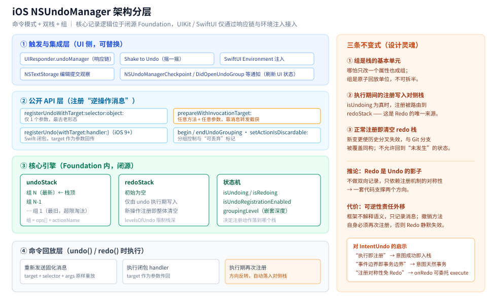
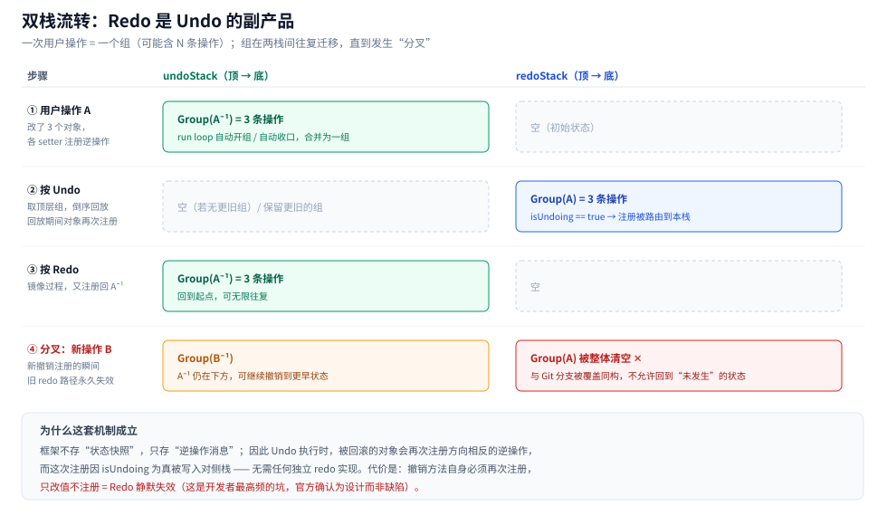
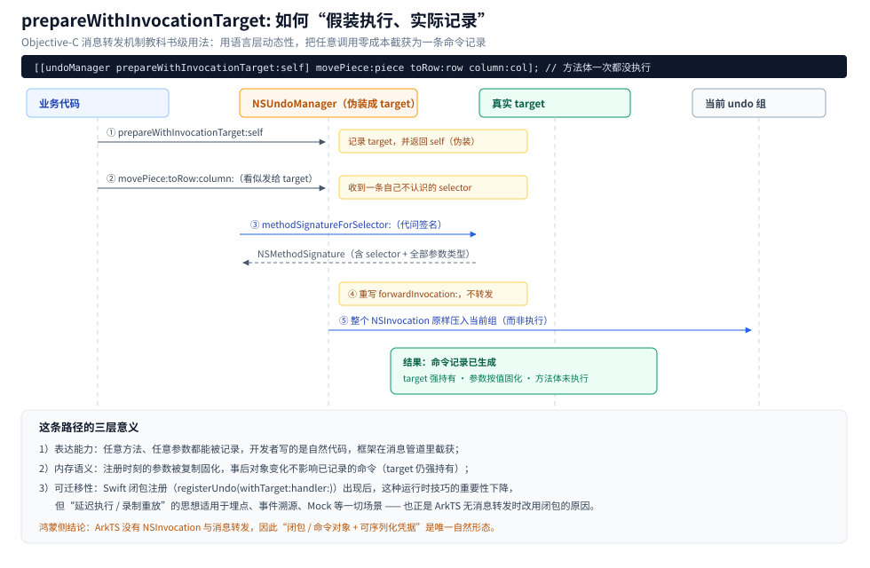
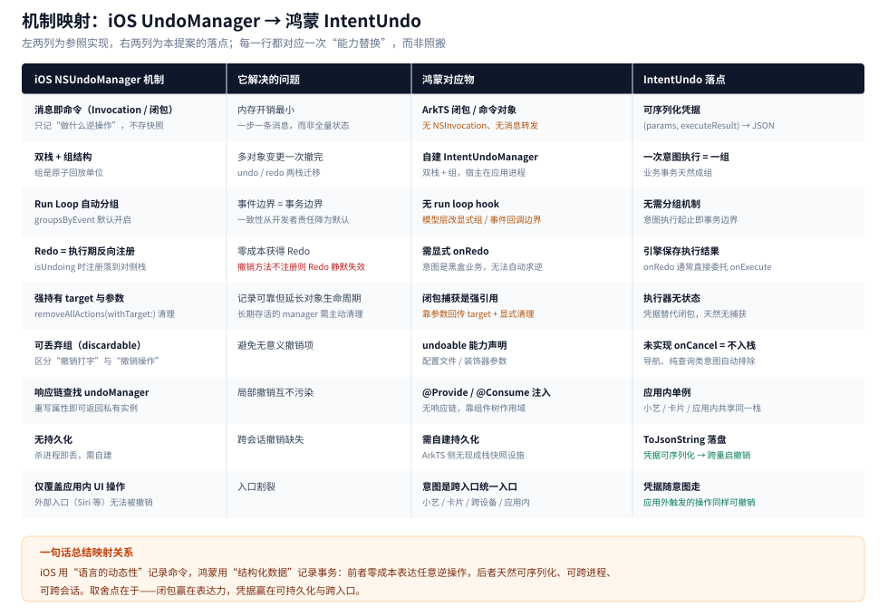

# 参考实现分析：iOS NSUndoManager 的撤销架构

> 定位：本文是 IntentUndo（[proposal.md](../proposal.md)）的**参照实现分析**，用于说明本提案中每个设计选择的出处与取舍。
> 对象：Foundation 框架 `NSUndoManager`（Swift 名 `UndoManager`），iOS 3.0+，至今仍是 UIKit / SwiftUI 文本编辑体系的标准撤销方案。
> 说明：Darwin 上 `NSUndoManager` 为闭源实现（`swift-corelibs-foundation` 仅含 Darwin overlay 薄壳，核心逻辑在闭源 Foundation 层）。本文的机制描述基于 Apple 官方架构文档 + Objective-C 消息转发语义 + 开源生态交叉验证，不涉及任何逆向工程。

## 1. 一句话概括

**`NSUndoManager` 是一个基于命令（Command）模式的双栈消息记录器——每个撤销操作不是状态快照，而是一条被延迟发送、参数被固化的"逆向消息"；Redo 不是独立机制，而是 Undo 的副产品。**

支撑这句话的四个设计：

1. **消息即命令**：注册撤销时记录 `target + selector + arguments`（或 Swift 闭包），执行撤销即重新发送这条消息。
2. **双栈结构**：undo / redo 两栈存放的单元都是"操作组（Undo Group）"，撤销/重做时组在两栈间来回迁移。
3. **事件边界自动分组**：`groupsByEvent` 把同一次 run loop 事件内的所有变更打包成一组，一次 Undo 全部回滚。
4. **Redo = Undo 的 Undo**：执行撤销时被回滚对象会反向注册，此时 manager 处于 undoing 状态，注册被路由到 redo 栈——无需任何独立的 redo 实现。

## 2. 架构分层

Apple 把 `NSUndoManager` 放在 **Foundation**（而非 AppKit/UIKit）层，是刻意的决策：撤销能力不依赖 UI，命令行工具、网络库（"撤销一次请求" = 发一条使其失效的新请求）、分布式对象都能复用。这决定了它的抽象必须足够低层：**只记录"消息"，不解释"语义"**。



三层职责边界清晰：集成层（响应链、摇一摇、文本观察、SwiftUI 环境）可替换；API 层只负责"把逆操作登记进栈"；引擎层只维护组、栈与状态机。**没有任何一层承担"业务语义"**——这正是它能被 Foundation 承载的原因。

演进时间线：

| 时间 | 关键节点 |
|---|---|
| NeXTSTEP 时代 | 随 Foundation 诞生，`NSInvocation` 注册为主流 |
| iOS 3.0 | 引入 iOS，`UIResponder.undoManager` 打通响应链 |
| iOS 5 | 新增 `setActionIsDiscardable:`（可丢弃组） |
| iOS 9+ | 新增 Swift 闭包注册 `registerUndo(withTarget:handler:)` |
| Swift 6 | 标注 `@MainActor` 隔离，闭包 handler 同样隔离 |
| SwiftUI | 通过 `@Environment(\.undoManager)` 注入 |

### 2.1 数据结构（概念还原）

```
UndoManager
├── undoStack: [UndoGroup]        // 底部最旧，顶部最新（LIFO）
│     └── UndoGroup: [UndoOperation] + actionName + isDiscardable
│           └── UndoOperation = { target(强持有), selector, args } 或 { closure }
├── redoStack: [UndoGroup]        // 初始为空
├── groupingLevel / groupsByEvent / levelsOfUndo
└── state: isUndoing / isRedoing / isUndoRegistrationEnabled
```

关键语义：**栈的基本单元是组，不是单条操作**；哪怕只改一个属性也必须成组；组支持嵌套，`groupingLevel` 反映嵌套深度；`levelsOfUndo` 超限时从栈底淘汰最旧组。

## 3. 双栈流转与"分叉即失效"



"清空 redo 栈"的时机是经典设计：**新变更使历史分叉失效**，与 Git 分支被覆盖的逻辑同构——绝不能允许 redo 回到一个"从未发生过"的状态。

## 4. 三种注册 API 与消息转发

### 4.1 Selector 式（最古老）

```objc
- (void)updateScore:(NSNumber *)score {
    [undoManager registerUndoWithTarget:self
                               selector:@selector(updateScore:)
                                 object:myMovie.score];   // 注册的是"旧值"
    [undoManager setActionName:@"Update Score"];
    myMovie.score = score;
}
```

只能带一个参数。内部把 `(target, selector, object)` 打包成轻量命令，执行时做一次普通消息发送。典型用法是把 setter 设计成幂等重放函数。

### 4.2 Invocation 式：`prepareWithInvocationTarget:`



```objc
[[undoManager prepareWithInvocationTarget:self] movePiece:piece toRow:row column:col];
```

这行代码**看似调用了 `movePiece:toRow:column:`，实际根本没调用**：`prepareWithInvocationTarget:` 记录 target 后返回 manager 自己（伪装成目标）；后续"对目标的调用"实际发给 manager；manager 不认识该 selector，运行时兜底先问 `methodSignatureForSelector:`（manager 重写为向真实 target 代问签名），再调 `forwardInvocation:`（manager 重写为把整个 `NSInvocation` 吞下压栈，而非转发执行）。

于是"任意方法 + 任意参数"被零成本截获成一条命令记录。这是**用语言层的动态性实现框架层的记录器**。

### 4.3 Closure 式（iOS 9+）

```swift
undoManager.registerUndo(withTarget: self) { target in
    target.value = oldValue
}
```

闭包捕获什么、做什么完全自由；`withTarget` 的意义是**把 target 作为参数回传**，避免闭包强捕获 self 造成循环引用。

### 4.4 铁律：撤销方法自身必须再次注册

框架不存状态快照，Redo 完全依赖撤销执行过程中的**反向注册**。最健壮的写法是把"改值 + 注册"收敛进一个对称方法：

```swift
func setProperty(_ newValue: String, undoManager: UndoManager?) {
    let oldValue = property
    undoManager?.registerUndo(withTarget: self) { [weak undoManager] target in
        target.setProperty(oldValue, undoManager: undoManager)  // 递归对称
    }
    property = newValue
}
```

## 5. 系统集成：响应链、摇一摇、文本系统

- **响应链定位**：`UIResponder.undoManager` 沿 `firstResponder → 视图 → 视图控制器 → UIWindow` 向上查找，链尾由 window 返回全局默认 manager。想实现"局部撤销"的视图重写该属性返回私有实例即可，互不污染。
- **摇一摇**：系统捕获 motion 事件 → 沿响应链找 manager → 弹系统对话框展示 `undoActionName` → 用户确认后 `undo()`。开发者零代码获得 UI。
- **文本系统**：`UITextView` 观察 `NSTextStorage` 的 `processEditing` 提交周期，每次提交注册 `replaceCharacters(in:with:)` 逆操作（记录旧 range + 旧字符串，**而非全文快照**）；打字停顿超过阈值、插入点移动、非打字编辑（粘贴/剪切/听写）触发新组；相邻字符插入在组内 **coalesce**，所以输入 "Hello world" 是一个撤销组而非十一个。
- **UI 联动**：靠 `NSUndoManagerCheckpoint`、`DidOpenUndoGroup`、`WillUndoChange/WillRedoChange` 等通知刷新按钮状态与菜单文案。

**反模式警示**（以文本全局替换为例）：不手动包组时，Replace All 命中 N 处会产生 N 个组，用户要按 N 次撤销——文本编辑类应用最典型的撤销体验事故。

## 6. 工程细节与坑位清单

| # | 细节 | 后果 / 对策 |
|---|---|---|
| 1 | **target 与参数被强持有** | undo 栈延长对象生命周期，持有大对象有内存放大效应；对象销毁前应 `removeAllActions(withTarget:)` |
| 2 | **非线程安全** | 所有操作须在主线程（`@MainActor`）；后台变更需 hops 回主线程注册 |
| 3 | **redo 栈清空时机** | 新注册即清空，无法"分叉后回到另一条时间线"——设计而非缺陷 |
| 4 | **`undo()` 自动收口** | 调用时若有未关闭的顶层组会先自动关闭再撤销整组；嵌套组用 `undoNestedGroup` |
| 5 | **disableUndoRegistration** | 加载文档、服务端同步等"非用户操作"必须用禁用区间包裹，否则污染栈 |
| 6 | **参数按值固化** | 注册时刻的参数即被复制（Invocation 语义），事后对象变化不影响已记录命令 |
| 7 | **无持久化** | 栈在内存，杀进程即丢；跨会话撤销需自建 |

## 7. 为什么是命令模式，而不是 Memento（快照）

| 维度 | Memento 快照 | Command 逆操作（NSUndoManager 的选择） |
|---|---|---|
| 内存 | 每步存全量/增量快照 | 只存"一条消息 + 少量参数" |
| 实现成本 | 要求对象可序列化 | 要求存在可逆方法 |
| 组合操作 | 天然（还原状态） | 需分组机制（用组解决） |
| Redo | 另存 redo 快照 | 免费获得（反向注册） |

对 UI 编辑场景，"对象就在内存里、setter 天然幂等"，命令模式几乎总是更省内存。代价是**把"可逆性"责任转移给模型层**——Apple 不可能替开发者知道"逆操作是什么"。

## 8. 与 IntentUndo 的机制映射



由上图可推出对本提案的 5 条直接影响：

1. **"执行即注册" → 意图成功即入栈**：iOS 靠使用者自觉调用 `registerUndo`，IntentUndo 改为框架在 `onExecute` 成功（`code == 0`）时自动入栈，把一致性从开发者责任降级为框架默认值。
2. **"事件边界即事务边界" → 意图天然是事务**：iOS 必须靠 run loop hook 猜边界，意图本身有明确的起止，因此**不需要分组机制**，`一次意图执行 = 一个撤销组`。
3. **"注册对称性免 Redo" → `onRedo` 可委托 `onExecute`**：iOS 的 Redo 免费来自对称注册；意图是黑盒业务（网络/DB/跨页面）无法自动求逆，因此显式提供 `onRedo`，但引擎回传原 `executeResult`，使绝大多数场景只需一行委托。
4. **"discardable" → `undoable` 声明 + 未实现 `onCancel` 即不入栈**：导航、纯查询类意图不应产生撤销项，这与 iOS 区分"撤销打字"和"撤销操作"是同一诉求。
5. **"无持久化" → 凭据可序列化落盘**：iOS 的栈是内存对象且 target 是对象引用，天然不可持久化；IntentUndo 的组是纯数据（`intentName + srcEntry + params + executeResult`），借助 `InsightIntentExecuteResult::ToJsonString()` 可直接落盘，从而支持**跨会话撤销**——这是闭包式方案做不到的能力。

此外，iOS 无法覆盖应用外入口（Siri 触发的操作不在应用内栈里），而意图可由小艺、服务卡片、跨设备触发，凭据随意图流动，**撤销能力因此首次覆盖全入口**——这是本提案相对 iOS 方案的结构性收益。

## 9. 参考来源

- Apple 官方文档：*UndoManager*、*Undo Architecture*（Registering Undo Operations 章节）
- NSHipster：*NSUndoManager*（NSInvocation 转发机制解析）
- Apple Devpedia：*Undo Manager*（响应链与默认 window manager）
- Swift Forums：*Redo broken for UndoManager?*（redo 依赖反向注册的设计确认）
- 社区实践：文本视图分组 / coalescing / 禁用注册区间；Ghostty `ExpiringUndoManager`（target 生命周期管理）
- 源码说明：`swift-corelibs-foundation` 中 Undo 实现仅存 Darwin overlay 薄壳，核心逻辑闭源；本文不做反编译，仅基于公开语义还原
