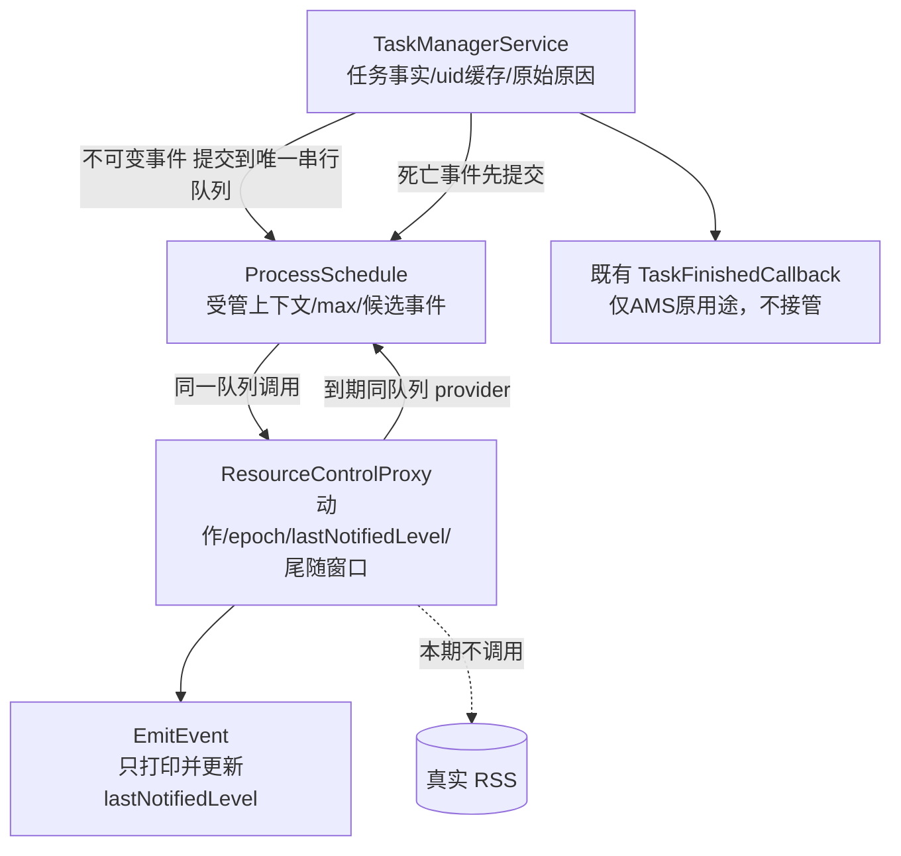
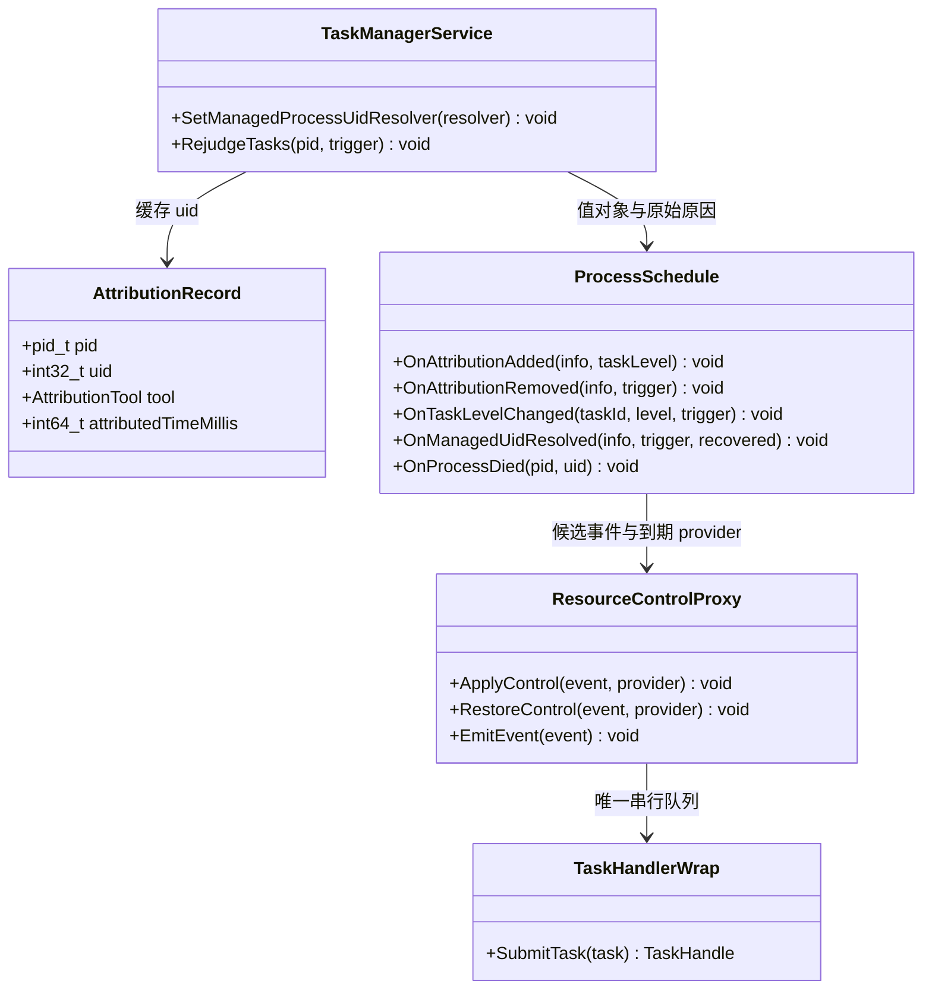
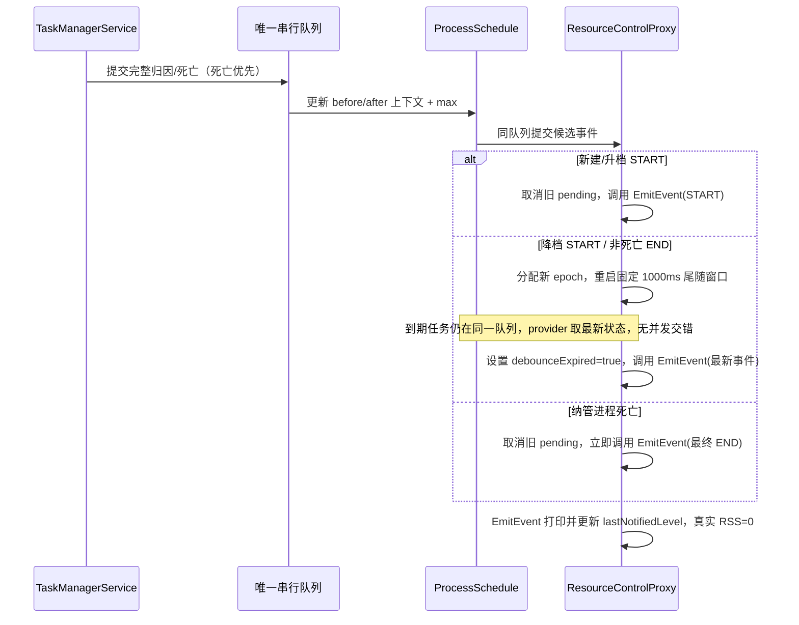
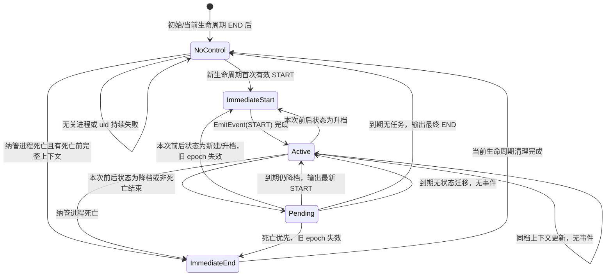

# 架构设计

> 实现范围严格限定为 Approved spec.md 的 AC-5.1～AC-5.6。真实 RSS 调控、性能功耗、资源配额、动态策略和独立 `NotifyTaskEnd` 均不进入实现范围。

## 设计元数据

| 字段 | 内容 |
|------|------|
| Design ID | DESIGN-20260914692272 |
| 关联需求 | `proposal.md`（Approved） |
| 关联 Epic | FEAT-AI-TASK-MGR-001（RR 30096095） |
| 目标 Feature | FEAT-AI-TASK-MGR-001（20260914692272） |
| 复杂度 | 标准 |
| 目标版本 | OpenHarmony-7.1-Release |
| Owner | yangzk |
| 状态 | Approved（yangzk 授权连续完成实现与检视，2026-11-16） |

## 需求基线

| 项 | 补充说明 |
|----|----------|
| 功能验收边界 | 只验证调度决策、事件载荷、动作、时序和兼容性；ResourceControlProxy 的真实冻结/分组/QoS/speed 调用均为空实现 |
| 受管工具范围 | 本期仅 CLI 与新增 VIRTUAL_SCREEN_ABILITY 产生调度管控事件；ABILITY、A2A、INSIGHT 不参与 effectiveLevel、代理事件或防抖。先在受管集合内取 max，再以 VIRTUAL_SCREEN_ABILITY > CLI 作为同档主类型/策略优先级；新类型实际纳管通道由需求方后续补充 |
| 事件上下文 | 每次重算记录纳管 pid/uid、全部受管任务及各自创建者 pid/uid、受管工具集合、变化前后 effectiveLevel、动作和原始触发原因；合并事件另带窗口到期事实 |
| uid 获取与失败 | 登记时直接按 pid 查询并缓存进 AttributionRecord；相关重算及结束/死亡前重试。持续失败只告警不输出，不拒绝既有纳管，也不输出残缺 START/END |
| 动作方向 | 只由本次前后纳管状态与 previousEffectiveLevel → effectiveLevel 决定；lastNotifiedLevel 仅记录最近已输出档位，不参与升降方向判断 |
| 生命周期 | 最终 END 只结束当前生命周期；之后重新纳管开启新生命周期并允许立即 START。每个候选事件和窗口分配全局单调 epoch，旧 epoch 不得覆盖新状态 |
| 防抖边界 | ResourceControlProxy 使用固定 1000ms 尾随窗口，降档及非死亡结束进入窗口，新建/升档和死亡立即处理；到期在同一串行队列中取最新状态 |
| 死亡顺序 | 创建者兼纳管进程死亡时先向串行队列投递死亡事件，再执行既有创建者任务清理，避免先删死亡快照 |
| 任务完成回调 | 不接管或扩展 AMS 现有 TaskFinishedCallback；本特性沿用 FinishTaskInner → OnAttributionRemoved 直接清理链，不新增 NotifyTaskEnd |
| 安全与权限、性能 | 按 proposal 均为 N/A，不展开专项章节 |

## 上下文和现状

### 涉及仓和模块

| 仓库 | 补充架构说明 |
|------|-------------|
| openharmony/ability_ability_runtime | 变更仅限 services/appmgr 的任务调度实现及对应测试。TaskManagerService 提供任务事实，ProcessSchedule 维护归属，ResourceControlProxy 负责时序和日志出口 |
| abilitykit_public/abilitykit_sdd | 只读参考 Task Flow 规格与并发/架构规则，不修改知识库 |
| resource_schedule_service | 本期不读取、不修改、不调用真实实现；ResourceControlProxy 仅预留未来固化策略的出口 |

### 代码事实基线

| 代码引用（文件:行/符号） | 已验证事实 | 关联架构规则 | 对本设计的约束 | 验证来源/可信度 |
|-------------------------|------------|--------------|----------------|-----------------|
| `services/appmgr/src/task_mgr/process_schedule.cpp:32-39 / MergeLevel` | effectiveLevel 当前按同一 pid 全部任务档位取 max，未按受管工具过滤 | OH-ARCH-LAYERING | 先过滤为 CLI 与 VIRTUAL_SCREEN_ABILITY，再在受管集合内取 max；同档主类型按 VIRTUAL_SCREEN_ABILITY > CLI | 源码，高 |
| `process_schedule.cpp:48-55 / OnAttributionAdded` | 同一 `(taskId,pid)` 重复归因只增加 taskRefs 并提前返回，未保存工具集合 | OH-ARCH-ERROR-LOG | 按工具维护引用；新增工具只更新上下文，不额外发事件 | 源码，高 |
| `process_schedule.cpp:67-74,134-171 / OnAttributionRemoved / RemoveAttributionLocked` | 注销只传 taskId/pid，无法知道被移除工具 | OH-ARCH-API-LEVEL | 注销载荷必须带被删记录的工具和 uid，按工具递减并归零擦除 | 源码，高 |
| `process_schedule.cpp:76-101 / OnTaskLevelChanged` | merged 不变时不传播，变化时立即调用占位 Apply | OH-ARCH-ERROR-LOG | 不变档集合变化只写上下文；事件方向由本次前后状态决定 | 源码，高 |
| `process_schedule.cpp:104-131 / OnProcessDied` | 找不到 pid entry 会直接返回；现有清理不影响其他 pid | OH-ARCH-LAYERING | 死亡事件必须先于创建者任务归因清理入队，确保死亡快照存在且只输出一个最终 END | 源码，高 |
| `process_schedule.cpp:155-162 / RemoveAttributionLocked` | 最后归因移除会删除 pid entry | OH-ARCH-LAYERING | 不能依赖后续死亡入口补找 entry；必须调整死亡投递顺序，而非新增虚假补偿事件 | 源码，高 |
| `process_schedule.cpp:173-188 / ApplyControlLocked / RevokeControlLocked` | 当前占位日志只有 pid 与 old/new level，且在 scheduleMutex_ 内打印 | OH-ARCH-ERROR-LOG、P5-3.5 | 归属变更、候选生成、代理时序和日志全部转入同一串行队列，不在调用线程锁内直接执行代理 | 源码，高 |
| `services/appmgr/include/task_mgr/task_record.h:41-53 / TaskRecord` | 已保存 creatorUid/creatorPid 和全部 AttributionRecord | OH-ARCH-LAYERING | 创建者身份从任务记录构造并缓存，不能改用后续 IPC 调用者 | 源码，高 |
| `services/appmgr/include/task_mgr/attribution_record.h:26-49 / AttributionTool / AttributionRecord` | 当前枚举为 UNKNOWN/INSIGHT/CLI/A2A/ABILITY，注释要求只追加不重排；记录无纳管 uid | OH-ARCH-API-LEVEL | 末尾追加 VIRTUAL_SCREEN_ABILITY，不改变既有枚举值；记录仅扩展 uid 缓存字段。ABILITY 本身不产生调度管控事件，新类型实际纳管通道后续补充 | 源码，高 |
| `services/appmgr/src/task_mgr/task_manager_service.cpp:197-230 / StartTaskInner` | 创建时记录 IPC 获取的 creatorUid/creatorPid | OH-ARCH-LAYERING | 注册入口一次构造完整归因，后续使用缓存 | 源码，高 |
| `task_manager_service.cpp:233-293 / FinishTaskInner` | 结束原因分 caller/timeout/creatorDied；当前仅收集 managedPids 后逐个移除 | OH-ARCH-ERROR-LOG | 结束事件必须映射并保留三种原始原因，直接沿用该清理链 | 源码，高 |
| `task_manager_service.cpp:303-312 / OnProcessDied` | 当前先 FinishTasksByCreatorInner，再清理全部归因并调 ProcessSchedule::OnProcessDied | OH-ARCH-LAYERING | 调整为先向串行队列投递死亡事件，再执行这两步既有任务记录清理 | 源码，高 |
| `task_manager_service.cpp:325-342 / RejudgeTasks` | 前台和负载入口共用重判路径，当前未向 ProcessSchedule 传原因 | OH-ARCH-ERROR-LOG | 两个入口分别传 FOREGROUND_CHANGED 与 SYSTEM_LOAD_CHANGED | 源码，高 |
| `task_manager_service.cpp:625-656 / RegisterManagedProcessInner` | 登记在 tasksMutex_ 内保存 tool 并调用 ProcessSchedule | P5-3.1、P5-3.5 | uid 查询移到锁外；任务记录更新与事件提交只传不可变值，不在锁内执行代理 | 源码，高 |
| `task_manager_service.cpp:662-684 / UnregisterManagedProcessInner` | 注销能读取被删记录的 pid/tool，但当前只向下传 pid | OH-ARCH-API-LEVEL | 擦除前保留完整 AttributionRecord，连同原始原因下传 | 源码，高 |
| `task_manager_service.cpp:776-783 / NotifyTaskFinished` | 现有 callback 只接收 taskId/userId，不接收 reason 或完整归因 | OH-ARCH-LAYERING | 不用该 callback 形成调度事件；调度清理仍由 FinishTaskInner 直接下传完整快照和 reason | 源码，高 |
| `services/abilitymgr/src/ability_manager_service.cpp:581-584 / SetTaskFinishedCallback` | AMS 已注册唯一任务完成回调用于自身缓存清理 | OH-ARCH-LAYERING | 不覆盖、不接管、不多播该回调；本特性只复用 FinishTaskInner 的直接调度清理链 | 源码，高 |
| `test/unittest/task_manager_service_test/task_manager_service_test.cpp:1559-1574 / OnProcessDiedCleanup_1100` | 已有死亡清理后同一 pid 再次归因成功用例 | OH-ARCH-ERROR-LOG | 最终 END 只能终止当前生命周期，重新纳管必须允许新生命周期 START | 源码+测试，高 |
| `services/appdfr/src/appfreeze_util.cpp:133-157 / AppfreezeUtil::GetUidByPid` | 同仓已有读取 `/proc/<pid>/status` 的 `Uid:` 行先例，失败返回 -1 | OH-ARCH-SUBSYSTEM | 只在 appmgr 内复用解析模式，不新增 appdfr 依赖；失败按已确认策略处理 | 源码，高；只读先例 |
| `services/appmgr/src/task_mgr/task_manager_service.cpp:137-146,750-773 / TimerCallback / StartTimeoutTimer / ReleaseTimeoutContext` | 既有 FFRT 定时器采用 deadline 防陈旧触发、非阻塞启动和锁外停止 | OH-ARCH-ERROR-LOG、P5-1.7 | 防抖采用全局单调 epoch 防陈旧回调；不在锁内停止 timer 或调用代理 | 源码，高 |
| `services/common/src/task_handler_wrap.cpp:70-85,147-170 / CreateQueueHandler / SubmitTask` | 串行队列和延时任务已有统一入口，任务以 std::function 投递 | OH-ARCH-LAYERING | 归属事件、到期回调与日志共用同一队列；队列只负责顺序执行，不负责替代 epoch 校验 | 源码，高 |
| `test/unittest/process_schedule_test/process_schedule_test.cpp:43-68 / ResetSchedule / ProcessScheduleTest` | 已有归属、降档、死亡、重复引用和不变档测试 fixture | OH-ARCH-COMPONENT-BUILD | 新用例复用同一目录和 fixture，增加队列 drain、事件记录和 uid/时钟注入 | 源码+BUILD.gn，高 |

**基线规则：**

- 不改变任务创建者、任务档位、前端纳管上限、IAppMgr 序列化和 AMS 现有任务完成回调。
- 不直接复用 appdfr 源码或引入新仓依赖，仅复用 `/proc` 解析模式。
- execution-plan 的新增/修改文件必须能追溯到上表、下述 ADR 或明确的测试决策。

### 调用链层级分析

| 层 | 模块 | 职责 | 修改类型 |
|----|------|------|----------|
| 任务生命周期服务 | TaskManagerService | 创建者/结束原因/归因事实；锁外查询并缓存 uid，按既有顺序提交不可变事件 | 修改 |
| 进程归属调度 | ProcessSchedule | 在串行队列维护 task↔pid、创建者、工具引用、effectiveLevel 和前后快照，产出候选事件 | 修改 |
| 调度出口与防抖 | ResourceControlProxy | 在同一串行队列决定立即/尾随合并、维护 lastNotifiedLevel/pending，独立 EmitEvent 输出日志 | 新增 |
| 异步基础设施 | TaskHandlerWrap / FFRT | 承载唯一串行流水线及延时任务 | 复用，不修改 |
| 任务完成回调 | TaskFinishedCallback（AMS 已有） | 继续只承担 AMS 自身任务缓存清理，本特性不接管 | 不修改 |
| 测试 | process_schedule_test / task_manager_service_test | 队列 drain、事件记录、uid resolver 和可控延时注入 | 新增/修改 |
| 外部 RSS | Resource Schedule Service | 本期不调用，真实对接后续在 ResourceControlProxy 内固化 | 不修改 |

**检查项：**
- [x] 任务事实、进程归属、调度出口、异步基础设施和测试层均已覆盖。
- [x] 服务层单向依赖为 TaskManagerService → ProcessSchedule → ResourceControlProxy → 日志，无反向业务依赖。
- [x] 不修改 Public/System API、d.ts、PermissionVerification 或既有 IAppMgr 序列化。

### 适用架构规则

| Rule ID | 适用原因 | 设计结论 | 验证方式 |
|---------|----------|----------|----------|
| OH-ARCH-LAYERING | 任务事实、进程归属和调度出口职责不同 | 三类各自单一职责，单向不可变值传递，不共享可变对象指针 | 类图与依赖审查 |
| OH-ARCH-SUBSYSTEM | appdfr 有 uid 查询先例，但不属于授权修改范围 | 只在 appmgr 内实现同等解析，不建立 appdfr 依赖 | GN 依赖检查 |
| OH-ARCH-IPC-SAF | 后续可能存在真实 RSS 跨进程调用，本期为空实现 | 不新增 Binder 事务码或 Parcel 格式；真实 IPC 只能复用同一串行出口 | mock 零调用 + 集成测试 |
| OH-ARCH-API-LEVEL | 只涉及内部类型和内部接口 | 无 Public/System API；内部接口仅限 appmgr，不改变任务/归因既有 InnerAPI 行为 | API diff 审查 |
| OH-ARCH-COMPONENT-BUILD | appmgr 新增代理源文件和测试源文件 | 只修改既有 BUILD.gn，不新增部件或 bundle.json 依赖 | `ability_runtime_test` 构建 |
| OH-ARCH-ERROR-LOG | 完整事件、原因、陈旧回调和 uid 失败需要可定位 | 所有候选与抑制原因均可检索，不新增公开错误码 | 单测 + hilog |
| P5-3.5 / P5-4.1 | 现有 tasksMutex_ → scheduleMutex_ 锁序及异步回调 | 代理、provider 和 timer 不再于调用线程执行；同一串行队列内不再嵌套业务锁 | 并发测试/锁序评审 |

### 既有模式复用

| 模式 | 参考代码（文件:行/符号） | 适用架构规则 | 必须复用的约定 | 本设计的复用方式 | 偏差及理由 | 关联 Task |
|------|-------------------------|--------------|----------------|------------------|------------|-----------|
| `/proc` uid 解析 | `services/appdfr/src/appfreeze_util.cpp:133-157 / GetUidByPid` | OH-ARCH-SUBSYSTEM | 读取 `Uid:` 行，失败返回 -1 并告警 | 在 appmgr 登记路径实现同等查询与测试注入 | 不调用 appdfr；查询移到 tasksMutex_ 外 | TASK-1 |
| 陈旧定时器防护 | `task_manager_service.cpp:137-146,750-773 / TimeoutContext` | OH-ARCH-ERROR-LOG、P5-1.7 | 启动时捕获上下文，回调先核对陈旧性 | 使用全局单调 epoch，旧回调只读校验后退出 | 采用逻辑取消，不锁内停止旧 timer；旧回调自然到期释放 | TASK-1 |
| 串行任务队列 | `services/common/src/task_handler_wrap.cpp:70-85,147-170 / CreateQueueHandler / SubmitTask` | OH-ARCH-LAYERING | 使用既有串行队列和延时任务，不自建线程 | 归属、候选、到期、EmitEvent 全部进入同一队列 | 队列顺序仍需 epoch 防止旧生命周期事件 | TASK-1 |
| 任务直接清理链 | `task_manager_service.cpp:233-293,776-783 / FinishTaskInner / NotifyTaskFinished` | OH-ARCH-LAYERING | FinishTaskInner 已逐个移除调度归因；callback 只接收 taskId/userId | 直接在该链下传完整快照和原始 reason | 不接管 AMS callback，避免多播与载荷扩容 | TASK-1 |
| 调度测试 fixture | `test/unittest/process_schedule_test/process_schedule_test.cpp:43-68` | OH-ARCH-COMPONENT-BUILD | 复用 ResetSchedule 和既有测试对象 | 增加队列 drain、事件记录、uid resolver、可控延时 | 新计时测试不依赖真实 1s sleep | TASK-1 |

## 不涉及项承接

| 维度 | 设计结论 |
|------|----------|
| 兼容性 | 既有 TaskRecord、任务创建/结束、归因上限和 IAppMgr 序列化不变；未纳管或无关进程不创建事件，重新纳管开启新生命周期 |
| IPC/跨进程 | 本期不新增 Binder 接口或真实 RSS 调用。ResourceControlProxy 只定义内部隔离边界，未来真实策略在该类内固化 |
| 构建与部件 | 仅 appmgr 既有 target 和 process_schedule_test 既有 target 增加源文件；不新增部件、不修改 bundle.json |
| 性能、安全与权限、国际化/无障碍、数据迁移 | 按 proposal 均为 N/A，不展开；无动态配置、无持久化迁移 |

## 关键设计决策

| 决策 ID | 问题 | 推荐方案 | 探索过的替代方案 | 取舍理由 | 影响 |
|---------|------|----------|-----------------|----------|------|
| ADR-1 | 纳管 uid 如何获取、缓存与重试 | 登记前直接读 `/proc/<pid>/status` 并写入 AttributionRecord.uid；每次相关重算及结束/死亡前采用“收集→锁外重查→按 attributionId 回写”重试 | 仅查 AppRunningRecord（可信通道可能无记录）；每次重算直接查（死亡后不可查且易锁内 IO）；首次失败即拒绝纳管（改变兼容行为） | 满足缓存要求并覆盖全部通道，且持续失败只告警不输出残缺事件 | TASK-1 数据模型与失败路径 |
| ADR-1 | 多创建者、多工具及受管过滤如何表达 | 每 pid 仅保存 CLI 与 VIRTUAL_SCREEN_ABILITY 的任务上下文；先在受管集合内取 max，再以 VIRTUAL_SCREEN_ABILITY > CLI 作为同档主类型/策略优先级；ABILITY/A2A/INSIGHT 直接忽略 | 全部任务参与 max（会把不管控工具带入管控）；按类型先选再 max（低类型高优先级会被误丢弃）；全部任务上下文都上报（数据量大且越界） | 事件载荷只含受管集合，同时保留异常重叠下的正确档位与必要溯源 | TASK-1 受管过滤与快照 |
| ADR-2 | 如何消除业务重排、升降方向误判、TOCTOU 和递归重入 | 任务记录修改与非阻塞 SubmitTask 在同一 tasksMutex_ 临界区完成，保证业务顺序=入队顺序；归属、候选、pending 到期、provider、EmitEvent 全部进入同一串行队列；方向只看前后状态；Apply/Restore 与 EmitEvent 分离 | 记录修改后再解锁提交（注册/结束可重排）；多锁+异步 provider（检查后可被立即事件插入）；按 lastNotifiedLevel 判升档（漏升档）；队列回调同名 Apply/Restore（递归） | 单流水线没有并发交错窗口，顺序可证明且出口不递归 | TASK-1 主架构 |
| ADR-4 | 如何处理最终 END 后重新纳管及旧事件 | 每次候选/窗口分配全局单调 epoch；最终 END 只结束当前生命周期，重新纳管用新 epoch 并立即 START | 永久禁止 pid 后续事件（破坏已有重复归因）；每 pid generation 从 1 重启（ABA） | 同时满足兼容性和旧事件隔离，测试重置也不回退 epoch | TASK-1 生命周期与并发 |
| ADR-5 | 防抖窗口采用何种形式 | ResourceControlProxy 维护 per-pid 固定 1000ms 尾随窗口；新可合并变化重启窗口，到期在同一队列取最新状态 | 全部立即（抖动）；固定起点不重启（连续变化时输出中间态）；全量延迟（新建/升档/死亡变慢） | 连续抖动压成一次最新输出，立即路径不受窗口影响 | TASK-1 pending 与到期 |
| ADR-6 | 创建者兼纳管进程死亡如何避免丢失立即 END | OnProcessDied 先向串行队列提交死亡事件，再执行 FinishTasksByCreatorInner 和 RemoveManagedProcessFromAllTasksInner | 保持现有先删归因顺序（后续 OnProcessDied 找不到 entry）；增加 tombstone 事后补事件（复杂且可能重复） | 死亡快照在处理前不被删除，且后续普通移除自然幂等 | TASK-1 死亡顺序调整 |
| ADR-7 | 是否保留独立 NotifyTaskEnd | 不保留；本特性只沿用 FinishTaskInner 直接清理链，AMS 现有 TaskFinishedCallback 不接管、不扩展 | 扩展 callback 多播并增加完整上下文（改动大且影响 AMS）；新增独立接口（重复通道） | 接口最小、无重复清理，原始 reason 仍由直接链保留 | TASK-1 任务结束集成 |
| ADR-8 | 策略、窗口与代理失败边界 | 固定 1000ms；Apply/Restore 只决策，EmitEvent 只打印；真实 RSS 调用为 0 | 系统参数动态读取（明确排除）；本期直接真实对接（超范围）；队列回调再次 Apply/Restore（递归） | 满足空实现验收，避免配置漂移和递归重入 | TASK-1 构建与 mock |
| ADR-9 | timer/队列失败如何处理 | 主路径延时任务失败时保留 pending 并用另一种既有定时入口武装一次；仍失败只告警不伪造到期，后续候选重试 | 失败后立即输出（违反 1000ms）；静默丢弃 pending（永久丢事件且不可见）；自造线程等待（扩大并发面） | 不输出错误时间事件，失败可诊断，且不在正常运行路径引入额外线程 | TASK-1 故障注入与恢复 |

## 设计骨架

### 骨架范围

| 骨架项 | 目标 | 不包含 | 验证方式 |
|--------|------|--------|----------|
| API/接口骨架 | AttributionRecord.uid、ScheduleTrigger/Action、TaskScheduleContext、ProcessScheduleEvent、Apply/Restore/EmitEvent | 完整状态机和真实 RSS | 编译与接口快照 |
| 模块骨架 | 单串行队列、ProcessSchedule 上下文、ResourceControlProxy 空实现 | 尾随窗口、重试和全部异常场景 | `process_schedule_test` 最小用例 |
| 测试骨架 | 队列 drain、事件记录、uid resolver、可控延时 | 全量矩阵 | 构建后先确认现有能力产生 Red |

### 骨架 Spec 拆分

| Task ID | 目标 | 受影响文件 | AC |
|---------|------|------------|-----|
| TASK-SKELETON-1 | 建立内部数据模型、单串行队列、空代理与测试记录入口 | attribution_record.h/.cpp、process_schedule.h/.cpp、resource_control_proxy.h/.cpp、对应测试与 BUILD.gn | WHEN 构造候选事件 THEN 能编译并记录完整字段，真实 RSS 调用计数为 0（AC-5.1、AC-5.5） |

## 后续 Task 拆分

> 本设计为一个完整功能闭环，使用一张 Task Card 管理实现与验证，避免在设计未批准前拆分相互依赖的并行改动。具体文件边界、步骤和证据由 execution-plan.md 展开。

| Task ID | 目标 | 受影响文件 | 依赖 |
|---------|------|------------|------|
| TASK-1 | 完成 uid 缓存、完整上下文、单串行流水线、ResourceControlProxy 尾随合并与空实现、死亡优先、既有任务链集成和全部验证 | services/appmgr/include/task_mgr、services/appmgr/src/task_mgr、services/appmgr/BUILD.gn、test/unittest/process_schedule_test、test/unittest/task_manager_service_test | proposal.md + spec.md + design.md Approved |

**Task 内顺序：** 数据模型与测试 Red → 单队列归属与动作 → 代理尾随窗口与独立 EmitEvent → TaskManagerService 触发原因/uid 重试/死亡优先 → 构建和全量相关回归。

## API 签名、Kit 与权限

> 以下均为 appmgr 服务内部 C++ 类型，不是 Public/System API，不生成 d.ts，不新增 Binder 事务码或权限项。具体名称仅在本 design 中冻结，不回写 proposal/spec。

### 新增内部数据模型

```cpp
struct ScheduleAttributionInfo {
    std::string taskId;
    pid_t creatorPid = -1;
    int32_t creatorUid = -1;
    AttributionRecord attribution;  // pid/tool/uid/attributedTimeMillis
};

struct TaskScheduleContext {
    std::string taskId;
    pid_t creatorPid = -1;
    int32_t creatorUid = -1;
    int32_t taskLevel = 0;
    std::set<AttributionTool> tools;
};

struct ProcessScheduleEvent {
    uint64_t epoch = 0;
    ScheduleAction action = ScheduleAction::START;
    ScheduleTrigger trigger = ScheduleTrigger::ATTRIBUTION_ADDED;
    bool debounceExpired = false;
    bool uidRecovered = false;
    pid_t managedPid = -1;
    int32_t managedUid = -1;
    int32_t previousEffectiveLevel = 0;
    int32_t effectiveLevel = 0;
    AttributionTool previousPrimaryTool = AttributionTool::UNKNOWN;
    AttributionTool currentPrimaryTool = AttributionTool::UNKNOWN;
    std::vector<TaskScheduleContext> previousTasks;
    std::vector<TaskScheduleContext> currentTasks;
};
```

`AttributionRecord` 仅新增 `int32_t uid = -1`，表示归因目标进程 uid。`TaskScheduleContext.tools` 只允许 CLI 与 VIRTUAL_SCREEN_ABILITY；ABILITY、A2A、INSIGHT 不进入受管快照。`taskLevel` 保留该任务当前档位，供主类型计算与校验。`previousTasks/currentTasks` 按 taskId 排序，受管工具集合按枚举值排序。`previousPrimaryTool/currentPrimaryTool` 均由对应快照先取 max(taskLevel)，同档再按 VIRTUAL_SCREEN_ABILITY > CLI 得出；空受管集合为 UNKNOWN。仅主类型变化而 effectiveLevel 不变时不额外发事件，但 pending provider 与下一次实际事件必须使用最新主类型。`epoch` 由进程级全局单调分配器生成，任何清理、END 或测试 Reset 都不得回退。

`ScheduleTrigger` 至少包含：`ATTRIBUTION_ADDED`、`ATTRIBUTION_REMOVED`、`TASK_FINISHED`、`TASK_TIMEOUT`、`CREATOR_DIED`、`MANAGED_PROCESS_DIED`、`FOREGROUND_CHANGED`、`SYSTEM_LOAD_CHANGED`。`debounceExpired` 独立表达窗口到期，`uidRecovered` 独立表达重试成功，均不得覆盖原始 trigger。

### 新增/调整内部接口

| 接口 | 语义 | 同步/所有权与失败约束 |
|------|------|------------------------|
| `AttributionTool` | 末尾追加 `VIRTUAL_SCREEN_ABILITY = 5`；仅 `CLI` 与该新类型属于受管工具，ABILITY/A2A/INSIGHT 不纳入 | 枚举只追加不重排；本期只用于调度过滤与测试，新类型实际纳管通道后续补充 |
| `ProcessSchedule::IsControlledTool(AttributionTool tool)` | 判定是否纳入 effectiveLevel、代理事件和防抖 | 仅返回 `tool == CLI || tool == VIRTUAL_SCREEN_ABILITY`；其他类型直接忽略且不产生事件 |
| `TaskManagerService::SetManagedProcessUidResolver(std::function<int32_t(pid_t)> resolver)` | 设置按 pid 查询 uid 的解析器；生产默认 `/proc` 实现，测试注入 | 查询在 tasksMutex_ 外执行；失败返回 -1，不改变既有纳管结果 |
| `ProcessSchedule::OnAttributionAdded(const ScheduleAttributionInfo &info, int32_t taskLevel)` | 向串行队列提交新增归因并更新完整上下文 | 每任务/工具分别计数；仅新建或升档产生 START 候选，其他只写上下文 |
| `ProcessSchedule::OnAttributionRemoved(const ScheduleAttributionInfo &info, ScheduleTrigger trigger)` | 向串行队列提交被删记录，形成降档/END 候选或仅更新上下文 | 携带原始 trigger；重复移除按已有记录幂等处理 |
| `ProcessSchedule::OnTaskLevelChanged(const std::string &taskId, int32_t newLevel, ScheduleTrigger trigger)` | 重算该任务全部 pid 的 effectiveLevel 与候选事件 | merged 不变只写上下文；前台与负载原因分别传入 |
| `ProcessSchedule::OnManagedUidResolved(const ScheduleAttributionInfo &info, ScheduleTrigger trigger, bool recovered)` | 在串行队列更新重试成功的 uid 并重新评估被抑制事件 | uid 必须为正；原始 trigger 保留，recovered 只作附加事实 |
| `ProcessSchedule::OnProcessDied(pid_t pid, int32_t uid)` | 向串行队列优先提交死亡事件，以死亡 uid 补齐并立即清理/输出最终 END | 后续普通移除幂等；新归因分配新 epoch；其他 pid 不受影响 |
| `ResourceControlProxy::ApplyControl(const ProcessScheduleEvent &event, const EventProvider &provider)` | 处理 START 候选；新建/升档立即，降档进入尾随窗口 | 当前只决策，不直接作为日志出口；provider 在同一队列执行 |
| `ResourceControlProxy::RestoreControl(const ProcessScheduleEvent &event, const EventProvider &provider)` | 处理 END 候选；死亡立即，其他结束进入尾随窗口 | 当前只决策；最后移除后旧生命周期不再产生后续事件 |
| `ResourceControlProxy::EmitEvent(const ProcessScheduleEvent &event)` | 仅打印完整事件并更新 lastNotifiedLevel 与 lastNotifiedPrimaryTool | 不再调用 Apply/Restore，不触发防抖，不调用真实 RSS |

`EventProvider` 的准确类型为：

```cpp
using EventProvider = std::function<std::optional<ProcessScheduleEvent>(
    const ProcessScheduleEvent &windowStart, ScheduleTrigger latestTrigger)>;
```

它只在 ResourceControlProxy 的到期任务中、同一串行队列上执行，返回 `std::nullopt` 表示当前无候选或字段不完整。返回事件必须包含最新 effectiveLevel 与 currentPrimaryTool。窗口到期由代理在取得返回值后设置 `debounceExpired=true`，再调用独立的 `EmitEvent`。

### 变更/废弃 API

| 原有 API | 变更类型 | 新 API | 迁移说明 |
|----------|----------|--------|----------|
| `ProcessSchedule::OnAttributionAdded(taskId, taskLevel, pid, tool)` | 内部签名扩展 | `OnAttributionAdded(ScheduleAttributionInfo, taskLevel)` | 仓内调用点同步改为值对象，无跨版本兼容负担 |
| `ProcessSchedule::OnAttributionRemoved(taskId, pid)` | 内部签名扩展 | `OnAttributionRemoved(ScheduleAttributionInfo, ScheduleTrigger)` | 注销前保存完整记录与原始原因，按工具递减 |
| `ProcessSchedule::OnTaskLevelChanged(taskId, newLevel)` | 内部签名扩展 | 增加 ScheduleTrigger 参数 | 前台/负载分别传值 |
| `ProcessSchedule::OnProcessDied(pid)` | 内部签名扩展 | `OnProcessDied(pid, uid)` | 复用死亡事件已有 uid，并调整为死亡事件先提交 |
| `TaskManagerService::RejudgeTasks(pid)` | 内部签名扩展 | `RejudgeTasks(pid, trigger)` | 前台与负载入口分别传原始原因，不新增同名 TaskManagerService::OnTaskLevelChanged |

## 构建系统影响

### BUILD.gn 变更

```
文件路径: services/appmgr/BUILD.gn
变更说明: 新增 src/task_mgr/resource_control_proxy.cpp；process_schedule.cpp 与 task_manager_service.cpp 修改；不新增外部依赖。

文件路径: test/unittest/process_schedule_test/BUILD.gn
变更说明: 新增 resource_control_proxy.cpp 与 resource_control_proxy_test.cpp；复用现有 process_schedule_test target。

文件路径: test/unittest/task_manager_service_test/BUILD.gn（如现有 target 需要显式列出新增代理实现）
变更说明: 按现有源文件聚合方式补齐 resource_control_proxy.cpp 和 uid 重试测试，不新增 target。

文件路径: test/unittest/{ams_service_app_spawn_client_test,ams_service_event_drive_test,cache_process_manager_second_test,app_mgr_service_inner_seventh_test,app_mgr_service_event_handler_test,ams_service_startup_test,ams_app_workflow_test,app_mgr_service_inner_eighth_test,ams_recent_app_list_test,app_mgr_service_inner_ninth_test,app_mgr_service_inner_tenth_test,ams_service_load_ability_process_test}/BUILD.gn、test/moduletest/common/ams/BUILD.gn
变更说明: 13 个直接聚合 process_schedule.cpp 的既有目标同步补入 resource_control_proxy.cpp，避免缺少代理定义；不新增 target 或公开依赖。
```

### bundle.json 变更

无。不新增 component、部件或仓间依赖。

---

## 可选设计扩展

### 架构图



### 类图



| 类型/接口 | 现有代码引用或 New | 关系 | 关键职责/签名 | 关联 ADR | 关联 Task |
|-----------|--------------------|------|---------------|----------|-----------|
| TaskManagerService | `task_manager_service.h:32-64,188-207` | 修改：事实生产者 | uid 查询/缓存、完整归因与原始原因传递；RejudgeTasks(pid, trigger) | ADR-1/2/6/7 | TASK-1 |
| AttributionRecord | `attribution_record.h:31-49` | 修改：增加 uid 缓存 | pid/tool/uid/attributedTimeMillis；不改变工具枚举 | ADR-1 | TASK-1 |
| ProcessSchedule | `process_schedule.h:43-104` | 修改：受管归属与候选事件 | 单队列维护 task↔pid、受管任务/创建者/工具引用、受管集合 max、前后快照；过滤 ABILITY/A2A/INSIGHT | ADR-1/3/4/6 | TASK-1 |
| ResourceControlProxy | New：`services/appmgr/include/task_mgr/resource_control_proxy.h` | 新增：时序和出口 | ApplyControl/RestoreControl 决策，EmitEvent 独立输出，epoch/pending | ADR-2/4/5/8/9 | TASK-1 |
| TaskHandlerWrap | `services/common/include/task_handler_wrap.h:67-97` | 复用：唯一串行基础设施 | SubmitTask 承载归属、到期和 EmitEvent | ADR-2/5/9 | TASK-1 |
| TaskFinishedCallback | `task_manager_service.h:188-207` | 复用但不接管：AMS 原清理 | 仅 taskId/userId；本特性不通过它形成调度事件 | ADR-7 | TASK-1 |

### 数据流/控制流

| 步骤 | 调用方 | 被调用方 | 数据/接口 | 说明 |
|------|--------|----------|-----------|------|
| 1 登记 | 各纳管通道 | TaskManagerService | AttributionRecord | 先在锁外解析 uid，再保存完整记录；失败保留 -1 并告警 |
| 2 重算 | TaskManagerService | ProcessSchedule 串行队列 | ScheduleAttributionInfo、taskLevel、trigger | 每次重算先生成 before/after 上下文，再判断是否产生候选事件 |
| 3 候选 | ProcessSchedule | ResourceControlProxy 同一队列 | ProcessScheduleEvent、EventProvider | 新建/升档 START、降档 START、最终 END；uid 不完整被抑制 |
| 4 时序 | ResourceControlProxy | pending / 到期任务 | epoch、lastNotifiedLevel、固定 1000ms | 立即候选直接 Emit；合并候选重启尾随窗口，到期同队列取最新状态 |
| 5 出口 | ResourceControlProxy | EmitEvent | 不可变事件 | 只打印并更新 lastNotifiedLevel；真实 RSS 调用为 0 |
| 6 任务结束 | TaskManagerService | ProcessSchedule / AMS 既有 callback | 完整快照与 reason / taskId、userId | 调度事件走直接清理链；AMS callback 保持原用途，不接管 |
| 7 死亡 | TaskManagerService | ProcessSchedule 串行队列 | pid/uid | 先提交死亡事件，再执行创建者任务和纳管归因清理，确保立即 END 不丢失 |

### 时序设计



### 数据模型设计

| 数据类型 | 存储方式 | 位置 | 生命周期 |
|----------|----------|------|----------|
| AttributionRecord.uid | 内存字段 | TaskRecord.attributions | 登记写入；重试成功更新；注销/任务结束/死亡随记录清理 |
| pid 归属上下文 | `pidEntries_` + `taskToPids_` | ProcessSchedule 串行队列 | 仅 CLI 与 VIRTUAL_SCREEN_ABILITY 创建；每受管任务保存创建者/工具引用/档位；ABILITY/A2A/INSIGHT 不进入 | 新增/移除/重判/uid 重试更新；最后受管任务移除或死亡清理 |
| lastNotifiedLevel / lastNotifiedPrimaryTool | 每 pid 内存值 | ResourceControlProxy 串行队列 | 仅在 EmitEvent 后更新；START 记当前 effectiveLevel/currentPrimaryTool，END 记 0/UNKNOWN；仅主类型变化不更新；uid 失败时不更新 |
| pending window | 每 pid epoch + 最新候选 previous 快照 + 最新原因 + 定时任务 | ResourceControlProxy 串行队列 | 可合并事件创建/重启；立即事件/死亡/无变化/到期逻辑取消 |
| 投递事件与 epoch | 不可变事件值 + 全局单调分配器 | 串行队列与回调捕获 | 队列接收至 EmitEvent 完成；任何 Reset/END/重新纳管不回退 |

**存储方案：** 全部为进程内存态，不持久化、不做数据迁移。窗口起始 `previousTasks` 与 `previousEffectiveLevel` 必须对应同一快照；`currentTasks` 与最新 `effectiveLevel` 必须对应另一快照，禁止交叉拼接。

### 状态归属与不变量

#### 状态归属

| State ID | 状态/资源 | 唯一 Owner | 存储/Key/Index | 创建与初始化 | 读取/更新方 | 清理/恢复/回滚触发 | 并发模型 | 代码事实/规则来源 |
|----------|-----------|------------|----------------|--------------|-------------|--------------------|----------|-------------------|
| STATE-1 | 任务归因及 uid 缓存 | TaskManagerService | `tasks_[taskId].attributions` / attributionId | 登记时锁外解析 uid 后写入；失败初值 -1 | TaskManagerService 读取/重试更新；ProcessSchedule 只读值副本 | 注销、任务结束、死亡；重试成功覆盖 -1 | tasksMutex_；解析在锁外，按 attributionId 回写防旧记录覆盖 | `task_record.h:41-53` + ADR-1 |
| STATE-2 | 受管上下文与 effectiveLevel | ProcessSchedule 串行队列 | `pidEntries_[pid]`、`taskToPids_[taskId]` | 首个 CLI 或 VIRTUAL_SCREEN_ABILITY 归因创建；每受管任务保存创建者/工具引用/档位 | 仅串行队列读写；dump/候选事件只读快照 | 受管工具归零、最后受管任务移除、死亡；异常事件保持最近一致状态 | 单队列线程封闭；dump 只加读锁 | `process_schedule.cpp:32-65` + ADR-1/3 |
| STATE-3 | 已通知档位/主类型与 pending window | ResourceControlProxy 串行队列 | `lastNotifiedLevel[pid]`、`lastNotifiedPrimaryTool[pid]`、`pending[pid].epoch` | START 写 effectiveLevel/currentPrimaryTool，END 写 0/UNKNOWN；可合并事件创建 pending | 仅串行队列更新；到期 provider 同队列读最新快照 | 立即事件、死亡、无变化、到期、timer 失败 | 单队列线程封闭，无 proxyMutex_ 嵌套 | ADR-2/4/5/9 |
| STATE-4 | 串行事件、epoch 与 timer 资源 | ResourceControlProxy + TaskHandlerWrap/FFRT | 全局单调 epoch、队列任务、不可变事件值 | 候选事件/窗口创建时分配 epoch 并捕获值 | 队列消费者只读执行；陈旧回调只读 epoch 后退出 | 日志完成、到期自然释放、服务进程退出 | 队列串行；不持业务锁等待回调 | `task_handler_wrap.cpp:70-85` + ADR-2/4/9 |

#### 不变量追溯

| Invariant ID | State ID / 范围 | 必须始终成立的约束 | 关联 AC | 关联 Task | 验证方式与通过标准 | 违反时处理 |
|--------------|------------------|--------------------|---------|-----------|--------------------|------------|
| INV-1 | STATE-1、STATE-2 | 每个有效事件均含 managedPid/managedUid、全部受管 taskId、各受管创建者 pid/uid、受管工具集合、前后 effectiveLevel、动作和原始原因；END 保留变化前完整受管上下文，ABILITY/A2A/INSIGHT 不得混入 | AC-5.1 | TASK-1 | 字段矩阵 + 多创建者/受管工具组合/最后结束用例；任一字段缺失或含不管控工具即失败 | uid/身份不完整时抑制事件并告警，禁止输出残缺事件 |
| INV-2 | STATE-2 | effectiveLevel == max(全部存活受管任务档位)，每受管任务工具引用总数与归因子数一致；每快照按 taskLevel 取 max，同档主类型 VIRTUAL_SCREEN_ABILITY > CLI；ABILITY/A2A/INSIGHT 不影响 | AC-5.1 | TASK-1 | CLI 与 VIRTUAL_SCREEN_ABILITY 组合、其他工具叠加、重复添加/部分移除/全部移除矩阵；max 与受管集合精确一致，Virtual LOW+CLI HIGH 主类型为 CLI，同为 HIGH 主类型为 VIRTUAL_SCREEN_ABILITY | 按被删记录修复引用；未知/重复移除幂等忽略并记录 |
| INV-3 | STATE-2、STATE-3 | 仅受管任务、受管工具集合或主类型变化且 effectiveLevel 与开始/结束状态不变时，不产生代理事件；ABILITY/A2A/INSIGHT 变化不影响受管快照和已通知状态，pending 与后续事件使用最新主类型和最新受管集合 | AC-5.1 | TASK-1 | 新增同档/低档受管、工具增减、非最高受管任务移除、Virtual 与 CLI 同档切换及不管控工具变化；事件计数不增且后续上下文与主类型最新 | 禁止 Apply/Restore，仅写上下文日志 |
| INV-4 | STATE-3 | 新建/升档立即 START，死亡立即 END；方向只由前后状态决定，lastNotifiedLevel 不参与方向判断；降档/非死亡结束固定 1000ms 且不读动态参数 | AC-5.2、AC-5.3 | TASK-1 | HIGH→LOW pending→MEDIUM/HIGH、pending END 中 LOW 重新纳管；均立即 START；到期动作正确且参数读取为 0 | 立即事件使旧 pending 失效；timer 失败只告警并保留重试机会 |
| INV-5 | STATE-3、STATE-4 | 任一 pid 同时最多一个有效 pending；epoch 全局单调且回调只接受当前 epoch；到期同队列取最新状态，不得输出旧快照 | AC-5.3 | TASK-1 | 连续变化、升档打断、死亡打断、到期与死亡相邻、取消后重建及 PID 重用；无重复/旧事件 | 旧 epoch 逻辑取消并自然释放；不得提交旧事件 |
| INV-6 | STATE-2、STATE-3 | 有受管任务时降档 START，最后移除/死亡才 END；最终 END 只终止当前生命周期，重新纳管用新 epoch 并允许 START，其他 pid 不受影响 | AC-5.4、AC-5.4 | TASK-1 | 最高档结束、次高续管、最后移除、死亡、死亡后重新归因及无关 pid 矩阵；动作与计数精确一致 | 依据最终状态修正动作；重复死亡/移除幂等，旧 epoch 事件拒绝 |
| INV-7 | STATE-3、STATE-4 | Apply/Restore 只做时序决策，EmitEvent 只打印并更新 lastNotifiedLevel；真实冻结/分组/QoS/speed/查询/恢复/重试调用数为 0 | AC-5.5 | TASK-1 | 接口调用序列无递归；代理日志断言 + 真实接口 mock 零调用 | 禁止新增真实调用；不以 lastNotifiedLevel 宣称真实效果 |
| INV-8 | STATE-1、STATE-2、STATE-3 | uid<0 时不输出残缺事件且不更新 lastNotifiedLevel；重试保留原始 trigger；持续失败只告警不输出，死亡优先使用死亡 uid | AC-5.6 | TASK-1 | 首次失败→无后续重算→Finish/Timeout/Death、重试成功、持续失败及死亡补偿矩阵；无残缺事件且原因不丢 | 保留既有纳管并告警；终态仍失败仅清理，不伪造 START/END |

### 算法与状态机



| 转移 | 触发条件 | Guard | 状态变化/副作用 | 关联不变量 | 异常与恢复 | 验证方式 |
|------|----------|-------|-----------------|------------|------------|----------|
| NoControl → ImmediateStart | 新生命周期首次 START 或 uid 重试成功 | managedUid、创建者和工具完整；本次前后状态为未纳管→纳管 | 分配新 epoch，EmitEvent(START) | INV-1、INV-7、INV-8 | 身份不完整保持 NoControl；队列失败只告警不更新 lastNotifiedLevel | VM-1、VM-4、VM-8 |
| NoControl → ImmediateEnd | 纳管进程死亡 | 死亡前完整上下文可用；死亡 uid 或缓存有效 | 立即 EmitEvent(最终 END)，后续普通移除幂等 | INV-1、INV-6、INV-8 | 持续 uid 失败只告警不输出残缺事件 | VM-2、VM-4、VM-7 |
| Active → ImmediateStart | 本次 previous < current，或 pending END 中重新纳管 | 方向只看前后状态，不看 lastNotifiedLevel 大小 | 取消旧 pending，立即输出最新 START | INV-3、INV-4、INV-5、INV-6 | 旧回调按 epoch 丢弃 | VM-4、VM-6 |
| Active → Pending | 本次 previous > current，或最后移除且仍有已通知档位 | 可合并 START/END 且身份完整 | 固定 1000ms 尾随窗口，保存最新候选 previous 快照和最新原因 | INV-4、INV-5、INV-6 | 新可合并变化重启窗口；timer 失败告警 | VM-5、VM-6 |
| Pending → ImmediateStart | 窗口内新建/升档 | 本次 previous < current，或未纳管→纳管 | 旧 pending 逻辑取消并立即输出 START，包括 LOW→MEDIUM/HIGH | INV-4、INV-5、INV-6 | 旧回调自然到期无事件 | VM-4、VM-6 |
| Pending → ImmediateEnd | 窗口内死亡 | 死亡 uid 或缓存有效 | 旧 pending 逻辑取消，立即输出最终 END | INV-1、INV-5、INV-6、INV-8 | 清理幂等，不影响其他 pid | VM-2、VM-4、VM-7 |
| Pending → Active/NoControl | 窗口到期 | 当前 epoch 匹配；provider 同队列返回最新状态 | 降档 START、最终 END 或无迁移无事件 | INV-4、INV-5、INV-6 | 陈旧回调只读退出；最新上下文仍完整 | VM-5、VM-6、VM-7 |

### 测试性设计

| 测试层级 | 测试目标 | Mock 策略 | 验证方式 |
|----------|----------|-----------|----------|
| 单元测试 | 受管字段、多创建者/受管工具组合、受管过滤、无事件集合变化、最终动作和 lastNotifiedLevel | 事件记录测试替身；uid resolver 返回固定值/-1；队列 drain 后断言 | `process_schedule_test`，VM-1/2/3/7/9 |
| 单元测试 | Virtual LOW + CLI HIGH 先 max 得 HIGH、同档 Virtual 主类型优先，以及 ABILITY/A2A/INSIGHT 不产生事件或影响 | 构造受管/不管控组合；对比代理事件与受管快照 | `process_schedule_test`，VM-1/2/3；ABILITY 本身零事件 |
| 单元测试 | HIGH→LOW pending→MEDIUM/HIGH、pending END 中 LOW 重新纳管、连续变化、陈旧回调、到期与死亡相邻、取消后重建/PID 重用 | 可控延时与队列 drain；EventProvider 在串行队列返回真实最新状态 | `process_schedule_test`，VM-4/5/6，禁止真实 sleep |
| 单元测试 | 创建者=self-managed 死亡、uid 首次失败无后续重算后 Finish/Timeout/Death、重试成功与持续失败 | `/proc` 解析器成功/失败序列；死亡 uid 补偿；真实 RSS mock | `process_schedule_test` + `task_manager_service_test`，VM-1/2/8 |
| 单元测试 | timer 主/备武装失败、队列失败、EmitEvent 不递归、lastNotifiedLevel 仅在出口更新 | 定时入口故障注入；代理调用序列记录 | `resource_control_proxy_test`，VM-5/8；不得伪造到期 |
| 构建回归 | 既有任务/归因/死亡/上限行为不变 | 运行既有 process_schedule_test 与 task_manager_service_test | 在 `/code` 执行 `./build.sh --product-name rk3568 --ccache --build-target ability_runtime_test --no-prebuilt-sdk --gn-args use_thin_lto=false` |
| 集成验证 | 真实 hidumper 上下文与关键日志核对；不验收真实 RSS 效果 | 使用系统应用和既有 dump 调试钩子，真实 RSS 效果 N/A | 实现后真机复测；模拟器验证仅覆盖代理事件/日志，复测命令和证据在 plan 回填 |
| XTS | N/A：无 Public/System API 或 CAPI 变化 | N/A | N/A |

### 接口参数规约

| 接口 | 参数 | 类型 | 合法范围 | 非法处理 | 边界说明 |
|------|------|------|----------|----------|----------|
| uid resolver | pid | pid_t | >0 | 返回 -1 并告警，抑制不完整事件；不拒绝纳管 | 查询在 tasksMutex_ 外，缓存后使用 |
| OnAttributionAdded / Removed | info | ScheduleAttributionInfo | taskId 1~256 字节；pid/creatorPid>0；uid/creatorUid>0；受管 tool ∈ CLI/VIRTUAL_SCREEN_ABILITY；ABILITY/A2A/INSIGHT 仅忽略不纳入 | 字段不完整时仅告警，不输出代理事件；未知/重复移除幂等忽略 | 工具按记录分别计数，不更改既有上层校验 |
| OnTaskLevelChanged | newLevel | int32_t | LOW(100)/MEDIUM(200)/HIGH(300) | 非法值仅告警，不更新候选输出 | merged 不变只写上下文 |
| Apply/Restore | event | ProcessScheduleEvent | managedUid>0；effectiveLevel ∈ {0,100,200,300}；epoch 单调且快照与对应档位/主类型一致 | 不完整或矛盾事件仅告警，不进入 EmitEvent | previousEffectiveLevel=0 仅用于新生命周期首次 START；空受管集合主类型为 UNKNOWN |
| EventProvider | windowStart、latestTrigger | 回调值，返回 `std::optional<ProcessScheduleEvent>` | 只能在同一串行队列执行并返回最新完整状态；无候选返回 `std::nullopt` | 无法取得完整状态时放弃本次输出并告警 | 到期调用，禁止跨线程访问无锁共享状态 |
| pending window | epoch、delay | uint64_t、int64_t | epoch 全局单调；delay 固定 1000ms | 不匹配即陈旧回调，无事件 | 不使用系统参数，不持久化；Reset 不回退 epoch |

### 线程与并发模型

| 操作 | State ID / 竞争对象 | 发起线程 | 回调线程 | 跨进程边界 | 同步/所有权机制 | 锁顺序/重入约束 | 关联不变量 |
|------|---------------------|----------|----------|------------|----------------|----------------|------------|
| uid 查询与回写 | STATE-1 | 纳管调用线程 | 同线程 | 否（仅 `/proc` 读取） | tasksMutex_ 收集 → 锁外查询 → tasksMutex_ 按 attributionId 回写并在同一临界区提交恢复事件 | 禁止 tasksMutex_ 内读取 `/proc`；回写与提交不得拆分，迟到结果不得覆盖已删除/替换记录 | INV-1、INV-8 |
| 归属事件提交 | STATE-2 | Binder/任务事件/死亡线程 | 唯一串行队列 | 否 | tasksMutex_ 内先改记录，并在同一临界区调用非阻塞 SubmitTask，队列内才执行业务 | 允许锁内提交但禁止锁内执行；锁序固定为 tasksMutex_ → TaskHandlerWrap 内部锁，队列不得反向调用 TaskManagerService | INV-1、INV-2、INV-3 |
| 候选时序与 pending | STATE-3 | 唯一串行队列 | 同一线程 | 当前否 | 队列线程封闭，无 proxyMutex_ | 不在其他线程访问 pending/lastNotifiedLevel | INV-4、INV-5、INV-6 |
| 到期 provider | STATE-2、STATE-3 | 延时任务所在串行队列 | 同一线程 | 否 | epoch 校验后同队列获取最新快照 | 不允许立即事件插入 provider 与 EmitEvent 之间 | INV-5、INV-6 |
| EmitEvent | STATE-3、STATE-4 | 唯一串行队列 | 同一线程 | 当前否；未来真实 RSS 也只能在此出口 | 不可变事件值 + 独立 EmitEvent | 禁止再次 Apply/Restore 形成递归；完成后再更新 lastNotifiedLevel | INV-4、INV-5、INV-7 |
| timer 逻辑取消 | STATE-3、STATE-4 | 新事件/死亡/到期 | 后续陈旧回调线程（同一队列） | 否 | epoch 比较，旧上下文自然释放 | 不在锁内停止 timer 或等待回调；Reset 先 drain | INV-5、INV-8 |
| 对象生命周期 | 全部 | 进程级静态单例 | 串行队列持有任务与上下文 | 否 | ProcessSchedule/ResourceControlProxy 进程级存活；上下文 shared_ptr 捕获 | 测试只清状态不析构单例且不回退 epoch；禁止测试期间并发 Reset | INV-5、INV-7、INV-8 |

**并发场景：**

| 场景 | 竞争对象 | 保护机制 | 预期行为 | 关联 AC/Task | 验证方式 |
|------|----------|----------|----------|-------------|----------|
| 重判与注销并发 | STATE-1、STATE-2 | tasksMutex_ 内先改记录 + 单队列顺序提交 | 注销后无该任务参与 max；事件只反映一致快照 | AC-5.1 / TASK-1 | 多任务并发矩阵 |
| HIGH→LOW pending→MEDIUM/HIGH | STATE-3 | 本次前后状态判方向 + epoch | LOW→MEDIUM/HIGH 均立即 START，不被 lastNotifiedLevel=HIGH 抑制 | AC-5.2、AC-5.3 / TASK-1 | 可控延时与连续事件 |
| pending END 中重新纳管 | STATE-3、STATE-4 | 新 epoch + 单队列 | 新生命周期立即 START，旧 END/旧回调不覆盖新状态 | AC-5.2、AC-5.4 / TASK-1 | 最后移除后 LOW 重新归因 |
| 创建者=self-managed 死亡 | STATE-1、STATE-2 | 死亡事件先提交，再清理创建者任务和归因 | 死亡快照未被提前删除，仅一个立即最终 END | AC-5.1、AC-5.2、AC-5.4 / TASK-1 | 创建者唯一任务且唯一纳管自身 |
| 到期 provider 与死亡相邻 | STATE-3、STATE-4 | 同一队列顺序执行 + epoch | 按队列事实顺序输出，不出现 END 后旧档 START | AC-5.2、AC-5.3、AC-5.4 / TASK-1 | 到期前/后死亡交错注入 |
| uid 重试与死亡并发 | STATE-1、STATE-2 | attributionId 回写校验 + 死亡 uid 优先 | 迟到重试不覆盖已删记录；END 保留变化前上下文 | AC-5.1、AC-5.6 / TASK-1 | 重试-死亡交错测试 |
| 多 pid 同时到期 | STATE-3、STATE-4 | per-pid pending + 单队列 | 每 pid 独立计算，事件不串改其他 pid | AC-5.3、AC-5.4 / TASK-1 | 多 pid 到期矩阵 |

### 资源所有权矩阵

| 资源 / State ID | 创建方 | 持有方（Owner） | 借用/只读消费者 | 销毁触发 | 实际释放 | 异常回收 | 关联不变量 |
|-----------------|--------|----------------|-----------------|----------|----------|----------|------------|
| AttributionRecord / STATE-1 | TaskManagerService | TaskRecord.attributions | ProcessSchedule 只读值副本 | 注销、任务结束、死亡 | TaskManagerService 按既有路径擦除 | uid=-1 保留并重试；迟到回写按 attributionId 拒绝 | INV-1、INV-8 |
| 受管快照 / STATE-2 | ProcessSchedule | ProcessSchedule.pidEntries_（单队列） | 候选事件、dump、provider 只读 | 最后移除、死亡、进程退出 | ProcessSchedule 队列内擦除 | 未知/重复移除幂等，不复活已删除记录 | INV-2、INV-6 |
| pending 上下文 / STATE-3 | ResourceControlProxy | pending[pid] + 定时任务捕获 shared_ptr | 到期回调只读 | 立即事件、死亡、到期、进程退出 | 当前/陈旧回调自然释放，无锁内 stop | timer 武装失败保留 pending 并告警，后续候选重试，不伪造到期 | INV-4、INV-5、INV-8 |
| 投递事件与 epoch / STATE-4 | ResourceControlProxy | 串行队列与全局单调分配器 | EmitEvent 只读 | 日志完成或进程退出 | 队列任务完成自动回收；分配器进程级存活且不回退 | 队列失败只告警，不伪造已通知状态 | INV-5、INV-7 |
| 单例与队列 / 全部 | ProcessSchedule/ResourceControlProxy 静态初始化 | 进程级单例与 shared_ptr 队列 | 所有回调只读 | 进程退出；测试仅 drain 后清状态 | 进程退出统一回收 | 测试不析构单例、不并发 Reset、不回退 epoch | INV-5、INV-7、INV-8 |

### DFX 与日志约束

- 每次重算均输出受管上下文日志，包括无代理事件和 uid 不完整场景；代理事件日志必须含 epoch、action、原始 trigger、debounceExpired、uidRecovered、managedPid/managedUid、前后 effectiveLevel、previousPrimaryTool/currentPrimaryTool、前后受管任务集合及各自创建者/受管工具。
- `START` 使用最新受管状态；`END` 使用变化前完整受管上下文，当前受管集合为空时不得省略该历史上下文；ABILITY、A2A、INSIGHT 不得混入事件或改变 lastNotifiedLevel。
- timer 武装失败、陈旧回调、uid 解析失败和字段不完整抑制均输出可检索原因，不新增 Hisysevent 事件或公开错误码。
- 日志字段使用既有 `%{public}` 风格输出数值/枚举；taskId 复用既有任务日志口径，不新增 bundle 名或敏感内容。

## 风险和开放问题

| 项 | 类型 | 影响 | 处理方式 | Owner |
|----|------|------|----------|-------|
| `/proc` 在测试环境或进程退出竞态下不可读 | 架构/测试 | 中 | 使用已确认的持续失败只告警不输出；测试注入解析器，终态仍失败只清理，不伪造 START/END | yangzk |
| 尾随窗口在持续变化下推迟最终输出 | 架构 | 中 | 这是防抖预期行为；新建/升档/死亡立即，每次可合并变化都重启 1000ms 窗口，平静后仅输出最新状态 | yangzk |
| 多任务多工具与单队列改造引入回归 | 实现 | 高 | 先跑现有 fixture 的 Red，再补工具引用、升降方向、死亡优先、重新纳管和到期-死亡相邻矩阵 | yangzk |
| timer/队列主备武装均失败 | 可靠性 | 中 | 保留 pending 并告警，后续候选重试；不伪造到期或立即输出，不把基础设施故障静默当成正常完成 | yangzk |
| 真实 RSS 效果被误判为已验证 | 验证 | 高 | spec/plan/测试只断言日志与 mock 零真实调用；真机复测也只核对调度决策，不做性能功耗或真实调控验收 | yangzk |

## 设计审批

- [x] 需求基线已确认，设计覆盖 P0/P1 AC（AC-5.1～AC-5.6）
- [x] 不涉及项已承接，N/A 和展开项都有结论
- [x] 涉及仓和模块职责清楚
- [x] 调用链层级分析完整，每层覆盖到位
- [x] 涉及既有实现时，代码事实基线使用文件:行/符号引用，且每项事实已转化为设计约束
- [x] 已检索并记录既有模式复用；appdfr 仅只读复用解析模式，不新增依赖
- [x] 适用架构规则已识别并形成设计结论
- [x] 分层和子系统边界合规
- [x] 类图与代码事实、ADR、Task 一致
- [x] 状态 Owner 唯一，生命周期、恢复和锁/消息模型无冲突
- [x] 每项 INV-* 均关联 AC、TASK-1 和可执行验证方式，并被状态机/资源/并发章节引用
- [x] 无 Public/System API 变更；内部签名、失败约束和兼容性已说明
- [x] BUILD.gn/bundle.json 影响明确
- [x] 设计输出和后续 Task 拆分明确
- [x] 关键设计决策有理由和影响说明
- [x] 风险和开放问题有 Owner，无未决需求语义问题

**结论:** 通过（yangzk 授权连续完成实现与代码检视，2026-11-16）
