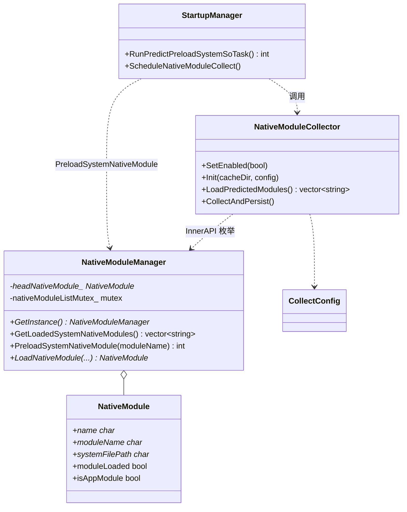
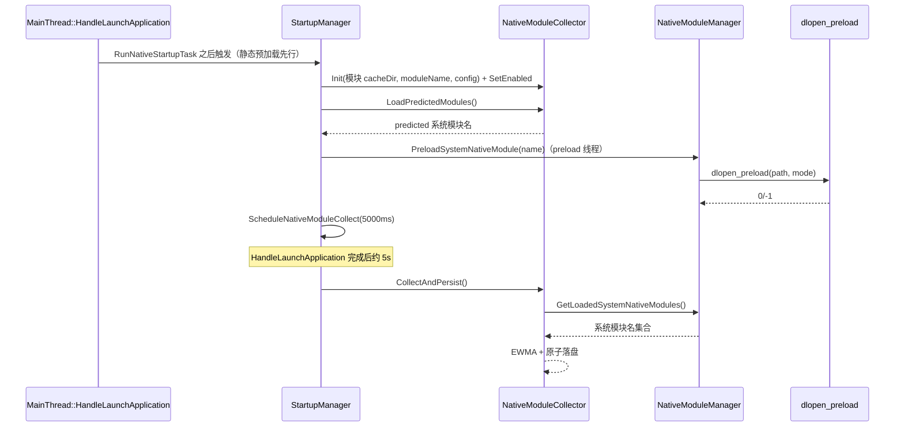
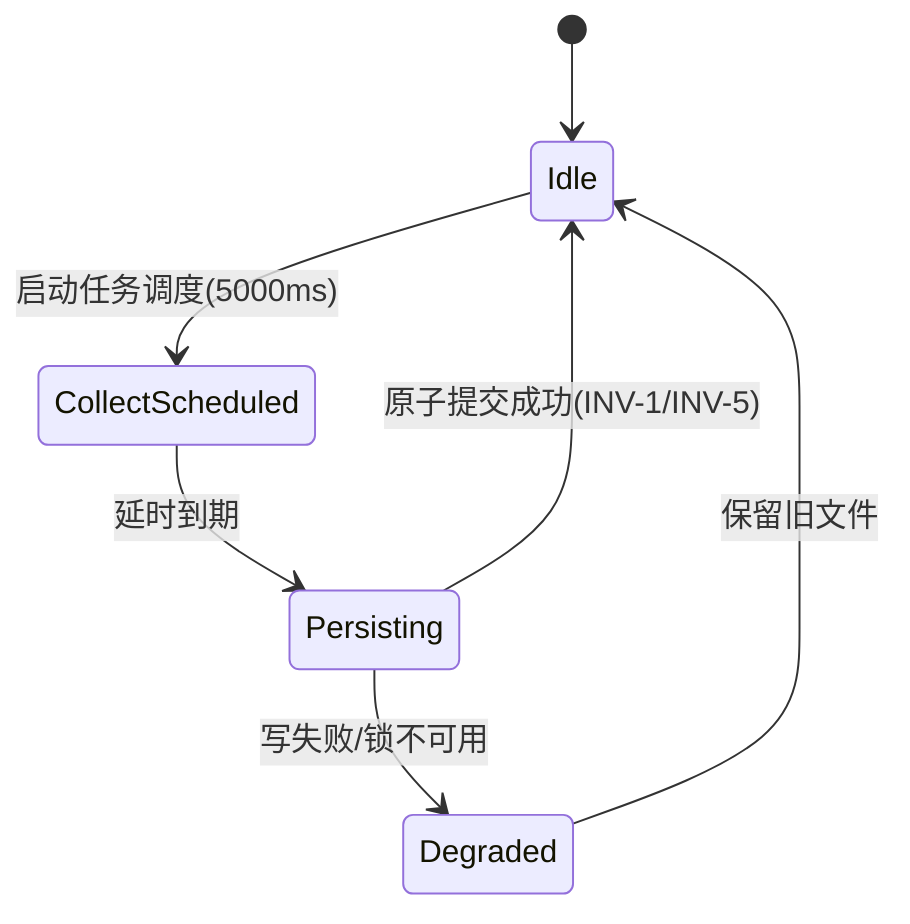

# 架构设计

> 确认 ability_runtime + napi 两仓的架构约束、关键设计决策与 Spec 拆分方向。本文以已批准的 proposal v1.1 与 spec（AC-1..AC-10）为上游输入，只描述实现路径，不发明行为。

## 设计元数据

| 字段 | 内容 |
|------|------|
| Design ID | DESIGN-30096301 |
| 关联需求 | `.codespec/changes/issue-30096301-native-so-preload/proposal.md` |
| 关联 Epic | 无（独立特性） |
| 目标 Feature | FEAT-30096301 |
| 复杂度 | 标准 |
| 目标版本 | OpenHarmony-7.1 |
| Owner | yangzk |
| 状态 | Approved |

## 需求基线

> 需求基线详见 proposal.md。以下仅列出设计阶段需要额外强调的要点。

| 项 | 补充说明（如需） |
|----|------------------|
| napi 仅导出已加载系统模块名 | `GetLoadedSystemNativeModules` 不返回 isAppModule / SO 路径；系统路径由 napi 内部拼接 |
| 预加载下沉 NativeModuleManager | `PreloadSystemNativeModule` 内部拼接系统路径 + `dlopen_preload`；app_startup 只调用 |
| 防自反馈不引入打标 | 靠 `dlopen_preload` 不注册模块实现；不引入 `NativeModulePreloadScope`/`loadCount` |
| `dlopen_preload` mode 待定 | 不与 musl 冲突的实现方式；mode 是否 `RTLD_NOW\|RTLD_LOCAL` 待与 musl 对齐 |
| 多实例并发 | cacheDir 子目录 + 跨进程互斥 + 原子提交 |

## 上下文和现状

### 涉及仓和模块

| 仓库 | 补充架构说明 |
|------|-------------|
| ability_runtime | 启动框架 `frameworks/native/appkit/app_startup/` 负责启动任务编排与 so 预加载；`app/main_thread.cpp` 是应用启动主流程；应用沙箱 cacheDir 经 `ApplicationContext` 获取。启动框架已有低优先级 preload 线程（`startup_manager.cpp:120,131-143`），本设计复用 |
| napi（foundation/arkui/napi） | `module_manager/native_module_manager.{h,cpp}` 单点汇总 native 模块注册/加载，维护模块链表（`native_module_manager.h:197-199`）；本设计在 napi 侧新增 2 个 InnerAPI，不改变既有加载路径 |
| third_party/musl | 已导出 `dlopen_preload`（`dlfcn_ext.h:101`）；本设计仅经 `NativeModuleManager` 内部消费，不改 musl |

### 代码事实基线

| 代码引用（文件:行/符号） | 已验证事实 | 关联架构规则 | 对本设计的约束 | 验证来源/可信度 |
|-------------------------|------------|--------------|----------------|-----------------|
| `frameworks/native/appkit/app/main_thread.cpp:1659,1862,2174 / MainThread::HandleLaunchApplication` | 启动主流程入口，内部 :1862 调用 `LoadExtStartupTasks`，:2174 结束 | OH-ARCH-LAYERING | 采集窗口锚点取"`LoadExtStartupTasks` 触发"与"`HandleLaunchApplication` 完成后 5s" | 源码，高 |
| `services/appmgr/src/app_running_record.cpp:1743 / SetProcessAndExtensionType` 与 `interfaces/inner_api/app_manager/include/appmgr/app_mgr_constants.h:93 / ProcessType` | `preloadModuleName = abilityInfo->moduleName`（被启动模块）；主进程 `ProcessType::NORMAL`，extension 进程为 `EXTENSION` 等 | OH-ARCH-LAYERING | 门控"仅主进程冷启动"以 ProcessType::NORMAL 判定（含进程名兜底）；采集/预加载按被启动模块名区分 | 源码，高 |
| `frameworks/native/appkit/app/ohos_application.cpp:1217 / IsMainProcess` 与 `startup_manager.cpp` 既有 preload 线程 | 既有"preload hint"路径依赖 `appStartup` 配置（无配置早退）；preload 线程可复用 | OH-ARCH-LAYERING | 预测预加载不挂 PreloadAppHintStartup，改在 `LoadExtStartupTasks` 由 main_thread 主动触发 | 源码，高 |
| `frameworks/native/appkit/app_startup/preload_system_so_startup_task.cpp:78-113 / PreloadSystemSoStartupTask::RunTaskInit` | 既有静态白名单预加载经 `LoadNativeModule`（:102）加载系统模块 | OH-ARCH-LAYERING | 新增预测预加载必须独立于该链路，不修改其语义 | 源码，高 |
| `frameworks/native/appkit/app_startup/startup_manager.cpp:120,131-143,66 / StartupManager::preloadHandler_` | 已有独立 preload 线程（`EventRunner::Create`）与低优先级（`setpriority(-20)`） | OH-ARCH-LAYERING | 预测预加载与采集调度复用该线程，保证不阻塞主线程 | 源码，高 |
| `foundation/arkui/napi/module_manager/native_module_manager.h:58-76,197-199 / NativeModule 与 nativeModuleListMutex_` | 模块链表节点含 `name`/`moduleName`/`systemFilePath`/`moduleLoaded`/`isAppModule`，链表由互斥保护 | OH-ARCH-API-LEVEL | 枚举接口基于该链表，加锁读取，仅取系统模块名 | 源码，高 |
| `foundation/arkui/napi/module_manager/native_module_manager.cpp:1517-1601 / FindNativeModuleByDisk` | 系统模块加载时 `systemFilePath=strdup(loadPath)`、`moduleLoaded=true` | OH-ARCH-API-LEVEL | "已加载系统模块"判定依据 `moduleLoaded` + `isAppModule=false` | 源码，高 |
| `foundation/arkui/napi/module_manager/native_module_manager.cpp:294-322 / GetModuleFileName` | 可在不触发加载的情况下解析模块文件路径 | OH-ARCH-LAYERING | `PreloadSystemNativeModule` 内部复用路径解析能力拼接系统路径 | 源码，高 |
| `third_party/musl/include/linux/dlfcn_ext.h:96-101 / dlopen_preload` | 首版文档注释限定 `RTLD_NOW\|RTLD_LOCAL`，仅 load/link、不执行构造函数 | OH-ARCH-SUBSYSTEM | 预加载 mode 待与 musl 对齐；失败一律回退，不改变应用加载路径 | 源码，高 |
| `frameworks/native/appkit/ability_runtime/context/application_context.cpp:1452 / ApplicationContext::GetBaseDir` 与 `context_impl.cpp / ContextImpl::GetBaseDir` | 提供应用沙箱基础目录；模块级目录为 `<base>/haps/<moduleName>` | OH-ARCH-LAYERING | 采集/预测文件落于模块级沙箱 `<base>/haps/<moduleName>/cache/native_module_collect/` | 源码，高 |
| `interfaces/kits/native/appkit/app_startup/startup_utils.h:36 / ERR_LOAD_NATIVE_MODULE` 与 `services/common/include/event_report.h:117 / EventName::STARTUP_TASK_ERROR` | 既有错误码 `28800009` 与故障事件通道 | OH-ARCH-ERROR-LOG | 单模块预加载失败复用既有错误码与事件通道，不新增事件定义 | 源码，高 |

**基线规则：**

- 设计结论与代码事实冲突时，先确认目标版本和分支；不得直接忽略现状。
- 只在注释、README 或二手资料中出现而未被源码/测试验证的内容，标记为待验证，不进入 Approved 设计约束。
- execution-plan 的文件范围必须能追溯到本表、调用链分析或明确的新建文件决策。

### 调用链层级分析

| 层 | 模块 | 职责 | 修改类型 |
|----|------|------|----------|
| 框架（ability_runtime 启动主流程） | `app/main_thread.cpp` | 应用启动主流程；采集窗口锚点 | 修改（挂接采集调度） |
| 框架（ability_runtime 启动框架） | `app_startup/startup_manager.{h,cpp}` | 启动任务编排、预加载线程、预测预加载任务、采集调度、参数开关 | 修改（新增任务与调度） |
| 框架（ability_runtime 采集组件） | `app_startup/native_module_collector.{h,cpp}`（新增） | 采集聚合、EWMA 预测、原子落盘、并发合并 | 新增 |
| NAPI（napi 部件） | `module_manager/native_module_manager.{h,cpp}` | native 模块注册/加载单点；新增系统模块枚举与预加载 InnerAPI | 修改（新增 2 个 InnerAPI） |
| libc（外部依赖） | `third_party/musl` `dlopen_preload` | 分阶段 load/link | 无（仅消费） |

**检查项：**
- [x] 调用链每一层都已覆盖（从最上层到最底层）
- [x] 每层职责边界清晰，无跨层违规调用
- [x] 每层修改类型明确

### 适用架构规则

| Rule ID | 适用原因 | 设计结论 | 验证方式 |
|---------|----------|----------|----------|
| OH-ARCH-LAYERING | 涉及应用框架层与 NAPI 层调用 | app_startup 只调用 napi InnerAPI，不越层访问 napi 内部结构；不反向依赖 | 代码评审/依赖检查 |
| OH-ARCH-SUBSYSTEM | 跨 ability_runtime 与 napi 部件，且消费 musl 能力 | 经 `NativeModuleManager` InnerAPI 解耦；musl 能力封装在 napi 内部 | 代码评审 |
| OH-ARCH-API-LEVEL | 新增 2 个 napi InnerAPI | 均为 InnerAPI，不面向应用；不改 Public/System API | API 评审/XTS |
| OH-ARCH-COMPONENT-BUILD | 两仓新增源文件 | 更新 ability_runtime 与 napi 的 BUILD.gn 源文件列表；napi 侧链接 musl `dlopen_preload` | 构建验证 |
| OH-ARCH-ERROR-LOG | 单模块失败需可观测 | 复用 `ERR_LOAD_NATIVE_MODULE(28800009)` + `STARTUP_TASK_ERROR` 事件通道；关键路径 hilog | 单测/hilog |

### 既有模式复用

| 模式 | 参考代码（文件:行/符号） | 适用架构规则 | 必须复用的约定 | 本设计的复用方式 | 偏差及理由 | 关联 Task |
|------|-------------------------|--------------|------------------|------------------|------------|-----------|
| 低优先级预加载线程 | `frameworks/native/appkit/app_startup/startup_manager.cpp:120,131-143 / preloadHandler_` | OH-ARCH-LAYERING | 复用既有 `preloadHandler_` 与 `setpriority(-20)` 约定 | 预测预加载与采集调度复用该线程 | 无 | TASK-4 |
| 启动任务注册 | `frameworks/native/appkit/app_startup/startup_manager.cpp:757-793 / AddAppAutoPreloadSoTask` | OH-ARCH-LAYERING | 复用 `NativeStartupTask` + 依赖声明 + 回调约定 | 新增预测预加载启动任务，依赖配置加载任务 | 无 | TASK-4 |
| napi 模块链表加锁读取 | `foundation/arkui/napi/module_manager/native_module_manager.cpp:1517 / nativeModuleListMutex_` | OH-ARCH-API-LEVEL | 复用 `std::mutex` 读锁与链表遍历约定 | 枚举接口加锁快照系统模块名 | 无 | TASK-1 |
| 单例 | `foundation/arkui/napi/module_manager/native_module_manager.cpp:161 / NativeModuleManager::GetInstance` | OH-ARCH-LAYERING | 复用单例获取方式 | collector 采用 `DelayedSingleton` | 采集器为新增组件，采用工程既有单例宏 | TASK-3 |
| 原子写盘（先写临时文件再更名） | no prior art found（检索 app_startup 与 context 未发现同类"文件原子更新"实现） | OH-ARCH-ERROR-LOG | 无既有约定 | 新引入 tmp+rename 原子写 + 跨进程 flock | 属本特性新增模式，无既有可复用实现 | TASK-3 |
| 单测与 Mock | `test/mock/frameworks_kits_appkit_native_test/include/mock_native_module_manager.cpp:28 / MockSetNativeModule` | OH-ARCH-COMPONENT-BUILD | 复用既有 mock 注入约定 | 扩展 mock 以注入已加载系统模块与预加载失败 | 无 | TASK-6 |

## 不涉及项承接

| 维度 | 设计结论 |
|------|----------|
| API/SDK | 新增 2 个 napi InnerAPI（见下）；不涉及 Public/System/d.ts/SysCap |
| 构建与部件 | 两仓各更新 BUILD.gn 源文件列表；napi 侧新增对 musl `dlopen_preload` 的符号引用；不改 `ability_runtime.gni` 默认值与 bundle.json 部件依赖 |
| 数据迁移 | 新增 cacheDir 子目录采集/预测文件（JSON，含 version 字段）；无存量迁移；版本不支持按"无历史"处理 |
| 兼容性 | 不改既有加载/静态预加载语义；失败一律降级；不影响应用兼容性 |

## 关键设计决策

| 决策 ID | 问题 | 推荐方案 | 探索过的替代方案 | 取舍理由 | 影响 |
|---------|------|----------|-----------------|------|------|
| ADR-1 | 预加载逻辑放在哪一层 | `NativeModuleManager::PreloadSystemNativeModule` 内部拼接系统路径 + `dlopen_preload` | ①app_startup 侧解析路径后直接调 `dlopen_preload`（路径解析外露、跨仓职责不清）；②改 `LoadNativeModule` 内部走 `dlopen_preload`（改动既有加载行为，影响面大） | 路径拼接内聚在掌握路径的 napi 层，app_startup 只调用；不改既有加载路径 | 新增 napi 预加载 InnerAPI；napi 侧链接 musl |
| ADR-2 | 防自反馈如何实现 | 依赖 `dlopen_preload` 不注册模块：预加载的模块不出现在已加载系统模块枚举中 | ①`NativeModulePreloadScope` + `loadCount` 计数（需改 napi 加载计数与打标）；②按调用方打标 | 选中方案零侵入既有加载路径，行为可经枚举接口观察 | 无需 loadCount/打标；静态 allowlist 预加载仍会计入（已确认接受） |
| ADR-3 | 枚举接口返回内容 | 仅返回已加载系统模块**名** | ①返回含 isAppModule/路径的结构体（暴露内部字段）；②返回 so 路径（路径易变） | 消费侧只需要模块名驱动预测；路径由 napi 内部按需生成 | 接口最小化 |
| ADR-4 | 预测文件原子性与并发 | cacheDir 子目录 + 唯一临时名 + 原子更名 + 跨进程 flock | ①直接覆盖写（半写风险）；②仅进程内互斥（多实例丢失更新） | 保证无半成品文件且多实例命中合并 | 引入 flock 与子目录 |
| ADR-5 | EWMA 参数与预测集上限 | 窗口 5000ms；α、入选阈值、上限由常量集中定义，**并支持经系统参数 `const.abilityruntime.nativepreload.*` 覆盖以便测试调优** | ①不做上限（候选集膨胀）；②不衰减（历史永不淘汰）；③参数硬编码不可调（不利于测试） | 上限与衰减收敛错误预测的常驻映射；系统参数可调便于测试 | design 固化默认值 |
| ADR-6 | 设备差异开关 | 系统参数（`system::GetParameter`/`GetBoolParameter`）读取，缺省关闭（fail-safe） | ①编译期宏（改 `ability_runtime.gni` 默认值，影响面大）；②硬编码设备列表（不可配置） | 系统参数可产品下发、缺省安全 | 参数名与默认值待产品对齐 |
| ADR-7 | 采集窗口锚点 | 启动任务早期在 preload 线程调度一次延时 5000ms 的 `CollectAndPersist` | ①在 `main_thread` 直接起定时器（改动主流程、生命周期耦合）；②窗口结束精确锚定 HLA 返回（需主流程注入回调） | 复用启动任务与 preload 线程，锚点误差受任务调度可控 | 窗口结束时机近似"HandleLaunchApplication 完成后 5s" |
| ADR-8 | 触发点与覆盖范围（修订） | 在 `main_thread` 的 `HandleLaunchApplication` 中、`RunNativeStartupTask` 之后挂接采集/预加载触发（既有静态预加载先行，避免争抢），**独立于 app_startup 配置**；仅主进程冷启动（`ProcessType::NORMAL`），排除应用预加载模式与 debug 应用；按启动模块区分（写应用 cacheDir 下按模块名拆分的子目录） | ①经 `PreloadAppHintStartup` 触发（被 `appStartup.empty()` 早退门控，普通冷启动不覆盖，放弃）；②在 `LoadExtStartupTasks` 触发（先于静态预加载，不满足"静态先行"，放弃） | 覆盖全量主进程冷启动且不污染扩展进程数据，且静态预加载先行 | 解决"无 appStartup 配置则不采集"的覆盖缺口 |

## 设计骨架

### 骨架范围

| 骨架项 | 目标 | 不包含 | 验证方式 |
|--------|------|--------|----------|
| API/接口骨架 | 2 个 napi InnerAPI 签名 + collector 头文件 | 完整 EWMA/并发实现 | 编译通过 |
| 模块骨架 | collector 新文件 + startup_manager 新任务挂点 | 参数调优 | 构建通过 |
| 测试骨架 | mock 扩展 + 采集/预测/预加载最小用例 | 全场景 | 最小用例通过 |

### 骨架 Spec 拆分

| Task ID | 目标 | 受影响文件 | AC |
|---------|------|------------|-----|
| TASK-1 | napi 枚举接口骨架 | `native_module_manager.{h,cpp}` | WHEN 查询 THEN 返回已加载系统模块名 |
| TASK-3 | collector 骨架（Init/落盘壳） | `native_module_collector.{h,cpp}` | WHEN 窗口结束 THEN 生成预测文件 |

## 后续 Task 拆分

| Task ID | 目标 | 受影响文件 | 依赖 |
|---------|------|------------|------|
| TASK-1 | napi `GetLoadedSystemNativeModules`：加锁枚举已加载系统模块名 | `module_manager/native_module_manager.{h,cpp}` | spec/design Approved |
| TASK-2 | napi `PreloadSystemNativeModule`：内部拼接系统路径 + `dlopen_preload` | `module_manager/native_module_manager.{h,cpp}` | TASK-1 |
| TASK-3 | ability_runtime `NativeModuleCollector`：采集 + EWMA + 原子落盘 + 跨进程互斥 | `app_startup/native_module_collector.{h,cpp}`、`interfaces/kits/native/appkit/app_startup/native_module_collector.h` | TASK-1 |
| TASK-4 | startup_manager 预测预加载任务 + 采集调度 + 参数开关 + 故障事件 | `app_startup/startup_manager.{h,cpp}` | TASK-2, TASK-3 |
| TASK-5 | main_thread 采集窗口挂接（若启动任务无法覆盖锚点） | `app/main_thread.cpp` | TASK-4 |
| TASK-6 | 单测与 mock 扩展 | `test/mock/.../mock_native_module_manager.*`、`test/unittest/frameworks_kits_appkit_native_test/*` | TASK-1..TASK-4 |

## API 签名、Kit 与权限

### 新增 API

| API 签名 | 类型 | Kit | d.ts 位置 | 权限要求 | SysCap |
|----------|------|-----|-----------|----------|--------|
| `std::vector<std::string> NativeModuleManager::GetLoadedSystemNativeModules() const` | InnerAPI | 无（napi 内部 C++） | 无 | - | - |
| `int NativeModuleManager::PreloadSystemNativeModule(const char* moduleName)` | InnerAPI | 无（napi 内部 C++） | 无 | - | - |

### 变更/废弃 API

| 原有 API | 变更类型 | 新 API | 迁移说明 |
|----------|----------|--------|----------|
| 无 | N/A | 无 | 既有 `LoadNativeModule`/`GetModuleFileName` 签名与语义不变 |

## 构建系统影响

### BUILD.gn 变更

```
文件路径: frameworks/native/appkit/BUILD.gn
变更说明: 新增源文件 native_module_collector.cpp/.h

文件路径: foundation/arkui/napi/module_manager/BUILD.gn
变更说明: 新增对 musl dlopen_preload 的符号引用（dlfcn_ext.h）；无新增源文件（改既有 native_module_manager.cpp）

文件路径: test/unittest/frameworks_kits_appkit_native_test/BUILD.gn
变更说明: 新增 native_module_collector_test.cpp
```

### bundle.json 变更

无（不新增部件依赖；napi 侧仅引用 musl 已导出符号）。

---

## 可选设计扩展

### 架构图

```
[app_startup 启动框架]
   ├─(启动任务/调度)→ [NativeModuleCollector] ──(读写)→ <appBase>/haps/<moduleName>/cache/native_module_collect/{collected,predict}.json
   ├─(启动任务)──────→ [NativeModuleManager::PreloadSystemNativeModule] ──→ [musl dlopen_preload]
[main_thread] ─(锚点)→ 启动任务

[NativeModuleManager] ←(InnerAPI 枚举)← [NativeModuleCollector]
```

### 类图



| 类型/接口 | 现有代码引用或 New | 关系 | 关键职责/签名 | 关联 ADR | 关联 Task |
|-----------|--------------------|------|---------------|----------|-----------|
| `NativeModuleManager` | `foundation/arkui/napi/module_manager/native_module_manager.h:83` | 单例；持有模块链表 | 新增枚举/预加载 InnerAPI | ADR-1, ADR-3 | TASK-1, TASK-2 |
| `NativeModule` | `foundation/arkui/napi/module_manager/native_module_manager.h:58-76` | 被 NativeModuleManager 持有（链表） | 提供 `moduleName`/`moduleLoaded`/`isAppModule` | ADR-3 | TASK-1 |
| `NativeModuleCollector` | New | 单例；依赖 NativeModuleManager | 采集/EWMA/落盘/并发 | ADR-4, ADR-5 | TASK-3 |
| `CollectConfig` | New | 值类型 | 窗口/α/阈值/上限常量 | ADR-5 | TASK-3 |
| `StartupManager` | `frameworks/native/appkit/app_startup/startup_manager.h` | 编排启动任务 | 新增预测预加载任务与采集调度 | ADR-6, ADR-7 | TASK-4 |

### 数据流/控制流

| 步骤 | 调用方 | 被调用方 | 数据/接口 | 说明 |
|------|--------|----------|-----------|------|
| 1 | app_startup 启动任务 | `NativeModuleCollector::Init` | 模块级 cacheDir + moduleName + CollectConfig | 设置模块沙箱目录与开关 |
| 2 | app_startup 启动任务 | `NativeModuleCollector::LoadPredictedModules` | predict 文件 → 系统模块名 | 读预测集 |
| 3 | app_startup 启动任务 | `NativeModuleManager::PreloadSystemNativeModule` | 模块名 → 0/-1 | 非主线程逐模块预加载 |
| 4 | app_startup 启动任务 | `ScheduleNativeModuleCollect` | 延时 5000ms 任务 | 窗口结束调度 |
| 5 | preload 线程 | `NativeModuleCollector::CollectAndPersist` | 枚举系统模块 → EWMA → 落盘 | 采集与预测写盘 |

### 时序设计



### 数据模型设计

```typescript
// predict.json / collected.json（模块级沙箱 <appBase>/haps/<moduleName>/cache/ 下的本特性子目录）
interface PredictFile {
  version: number;                  // 文件格式版本；不支持则按无历史处理
  scores: Record<string, number>;   // 模块名 -> EWMA 评分（毫定标 0..1000，JSON 对象）
  predicted: string[];              // 入选的系统模块名（按评分降序、不超上限）
}
interface CollectedFile {
  version: number;
  collected: string[];              // 本轮采集窗口内显式 import 的系统模块名
}
```

**存储方案：**

| 数据类型 | 存储方式 | 位置 | 生命周期 |
|----------|----------|------|----------|
| 采集/预测文件 | JSON（唯一临时名 + rename 原子替换） | `<appBase>/haps/<moduleName>/cache/native_module_collect/{collected.json,predict.json}` | 跨启动持久化（随应用沙箱清理） |
| 跨进程互斥 | flock（LOCK_EX \| LOCK_NB，失锁则本轮跳过） | `<appBase>/haps/<moduleName>/cache/native_module_collect/.lock` | 进程生命周期内加锁/解锁 |

### 状态归属与不变量

#### 状态归属

| State ID | 状态/资源 | 唯一 Owner | 存储/Key/Index | 创建与初始化 | 读取/更新方 | 清理/恢复/回滚触发 | 并发模型 | 代码事实/规则来源 |
|----------|-----------|------------|-------------------|------------|-------------|--------------------|----------|-------------------|
| STATE-1 | 采集调度状态 | `StartupManager` | `nativeModuleCollectScheduled_`（原子标志） | 启动任务首次调度时置位 | 启动任务 | 进程退出；调度失败回退为未置位 | 原子 exchange，跨线程单次调度 | `startup_manager.cpp:131-143` + OH-ARCH-LAYERING |
| STATE-2 | 采集/预测文件 | `NativeModuleCollector` | `<appBase>/haps/<moduleName>/cache/native_module_collect/{collected,predict}.json` | `Init` 后首次 `CollectAndPersist` 创建 | 读：`LoadPredictedModules`；写：`CollectAndPersist` | 文件损坏→按无历史；进程退出不清理 | 跨进程 flock + 唯一临时名 + 原子更名 | ADR-4 |
| STATE-3 | 已加载 native 模块链表 | `NativeModuleManager` | `headNativeModule_`/`tailNativeModule_` | 模块注册/加载时追加 | 读：枚举接口；写：加载路径 | 进程退出 | `nativeModuleListMutex_` 加锁 | `native_module_manager.h:197-199` + OH-ARCH-API-LEVEL |
| STATE-4 | 预加载 pending 记录 | musl ldso（外部） | `dlopen_preload` 内部记录 | 首次 `dlopen_preload` 建立 | 应用真实 `dlopen` 消费 | 进程退出释放 | musl 内部（不暴露） | `dlfcn_ext.h:96-101` + OH-ARCH-SUBSYSTEM |

#### 不变量追溯

| Invariant ID | State ID / 范围 | 必须始终成立的约束 | 关联 AC | 关联 Task | 验证方式与通过标准 | 违反时处理 |
|--------------|------------------|--------------------|---------|-----------|--------------------|------------|
| INV-1 | STATE-2 | 预测文件读取到的内容要么是上一次完整提交的版本，要么被视为无历史；不存在半成品可读文件 | AC-2, AC-6 | TASK-3 | 单测：注入写中断，断言无半成品、旧文件可用 | 读侧按无历史降级；写侧清理临时文件 |
| INV-2 | STATE-3 | 枚举返回的是互斥保护下的已加载模块一致快照，不返回正在加载中的中间态 | AC-8 | TASK-1 | 单测：并发加载下枚举，断言不崩溃、元素合法 | 跳过非法节点，记录告警 |
| INV-3 | STATE-4 / STATE-3 | 仅经 `dlopen_preload` 加载的模块不得出现在已加载系统模块枚举结果中（从而不计为命中） | AC-4 | TASK-2, TASK-3 | 单测：仅预加载不 import，断言枚举不含该模块 | 视为设计缺陷，回归修复 |
| INV-4 | STATE-1 | 单次启动仅调度一次采集落盘 | AC-1, AC-2 | TASK-4 | 单测：多次触发调度，断言仅一次落盘 | 原子标志去重 |
| INV-5 | STATE-2 | 多实例并发下，各实例命中合并为并集，不丢失更新 | AC-9 | TASK-3 | 单测：顺序模拟两实例持锁合并，断言并集完整 | 持锁失败则该轮跳过，不影响启动 |

> INV-3 由"预加载不注册模块"结构性保证（见"算法与状态机"）；INV-5 由跨进程 flock 保证（见"线程与并发模型"）。

### 算法与状态机

EWMA 评分（整数毫定标，确定性）：`score' = (α·hit + (1000-α)·score) / 1000`；未命中轮次按同一公式以 hit=0 衰减；入选条件 `score >= 阈值`，并按 score 降序截断至上限。



| 转移 | 触发条件 | Guard | 状态变化/副作用 | 关联不变量 | 异常与恢复 | 验证方式 |
|------|----------|-------|-----------------|------------|------------|----------|
| Idle → CollectScheduled | 启动任务执行 | 开关开启且设备受支持 | STATE-1 置位 | INV-4 | 调度失败回退 Idle | VM-5 |
| CollectScheduled → Persisting | 延时 5000ms 到期 | — | 枚举 STATE-3、更新 STATE-2 | INV-1, INV-2 | 枚举加锁 | VM-2 |
| Persisting → Idle | 原子更名成功 | 持锁成功 | STATE-2 提交新版本 | INV-5 | — | VM-2, VM-9 |
| Persisting → Degraded | 写失败/无锁 | — | 保留旧 STATE-2 | INV-1 | 记录告警，不阻塞启动 | VM-6 |

### 线程与并发模型

| 操作 | State ID / 竞争对象 | 发起线程 | 回调线程 | 跨进程边界 | 同步/所有权机制 | 锁顺序/重入约束 | 关联不变量 |
|------|---------------------|----------|----------|------------|----------------|----------------|------------|
| 启动任务调度 | STATE-1 | 主线程 | preload 线程 | 否 | 原子 exchange | 无重入 | INV-4 |
| 逐模块预加载 | STATE-4 | preload 线程 | preload 线程 | 否 | 串行循环 | 单模块失败续跑 | INV-3 |
| 采集落盘 | STATE-2 | preload 线程 | preload 线程 | 是（多实例文件） | 跨进程 flock + 原子更名 | 先锁后写；失锁跳过 | INV-1, INV-5 |
| 枚举已加载模块 | STATE-3 | preload 线程 | preload 线程 | 否 | `nativeModuleListMutex_` | 只读快照 | INV-2 |

**并发场景：**

| 场景 | 竞争对象 | 保护机制 | 预期行为 | 关联 AC/Task | 验证方式 |
|------|----------|----------|----------|-------------|----------|
| 多实例并发落盘 | STATE-2 | 跨进程 flock + 原子更名 | 命中并集、无丢失 | AC-9 / TASK-3 | 单测 VM-9 |
| 采集与加载并发 | STATE-3 | 互斥加锁 | 枚举一致快照 | AC-8 / TASK-1 | 单测 VM-8 |
| 预加载与真实 import | STATE-4/STATE-3 | musl dev/ino 去重 | 真实 import 复用映射，不计入预加载 | AC-3, AC-4 / TASK-2 | 单测 VM-3, VM-4 |
| 预测预加载中途停止 | autoPreloadSoStopped_ | 加锁读开关标志 | 与其他预加载 so 一致，被停止时中止剩余模块预加载 | AC-3 / TASK-4 | 单测 |

### 测试性设计

| 测试层级 | 测试目标 | Mock 策略 | 验证方式 |
|----------|----------|-----------|----------|
| 单元测试 | 采集/预测/落盘/读取/防自反馈/异常/并发/开关 | 扩展 `mock_native_module_manager` 注入已加载系统模块与预加载失败 | `test/unittest/frameworks_kits_appkit_native_test` |
| 单元测试（napi） | 枚举/预加载 InnerAPI | 复用 napi 既有单测 | `foundation/arkui/napi/test/unittest` |
| 集成/设备 | 真机冷启动落盘与预加载 | 真实依赖 | 人工手测 + hilog |

## 风险和开放问题

| 项 | 类型 | 影响 | 处理方式 | Owner |
|----|------|------|----------|-------|
| `dlopen_preload` mode 待与 musl 对齐 | 外部依赖 | 中 | 保持 mode 可切换；首版按 musl 支持值实现，收口后更新 | yangzk |
| 应用真实 import mode 与预加载 mode 不一致 | 技术 | 中 | 依赖 dev/ino 去重复用映射；文档化口径 | yangzk |
| 静态 allowlist 预加载会被计入已加载系统模块 | 技术 | 低 | 已确认接受；allowlist 默认可为空 | yangzk |
| 采集窗口结束锚点误差 | 技术 | 低 | 以 5000ms 常量近似；后续真机数据校准 | yangzk |
| napi 侧链接 musl `dlopen_preload` 的构建可达性 | 构建 | 中 | 依赖 `dlfcn_ext.h` 在 sysroot 可用；BUILD.gn 验证 | yangzk |
| EWMA 默认参数未经真机验证 | 测试 | 低 | 常量集中、单测固化；保留调优空间 | yangzk |

## 设计审批

- [x] 需求基线已确认，设计覆盖 P0/P1 AC
- [x] 不涉及项已承接，N/A 和展开项都有结论
- [x] 涉及仓和模块职责清楚
- [x] 调用链层级分析完整，每层覆盖到位
- [x] 涉及既有实现时，代码事实基线使用文件:行/符号引用，且每项事实已转化为设计约束
- [x] 已检索并记录既有模式复用；无 prior art 时有检索范围和理由
- [x] 适用架构规则已识别并形成设计结论
- [x] 分层和子系统边界合规
- [x] 命中类/接口关系触发条件时，类图与代码事实、ADR、Task 一致
- [x] 涉及状态/资源/并发时，状态 Owner 唯一，生命周期、恢复和锁/消息模型无冲突
- [x] 每项 `INV-*` 均关联 AC、Task 和可执行验证方式，状态机/资源/并发章节引用一致
- [x] API 变更有签名、权限、错误码和兼容性说明
- [x] BUILD.gn/bundle.json 影响明确
- [x] 设计输出和后续 Task 拆分明确
- [x] 关键设计决策有理由和影响说明
- [x] 风险和开放问题有 Owner

**结论:** 通过（Owner 已评审批准，2026-10-15）
