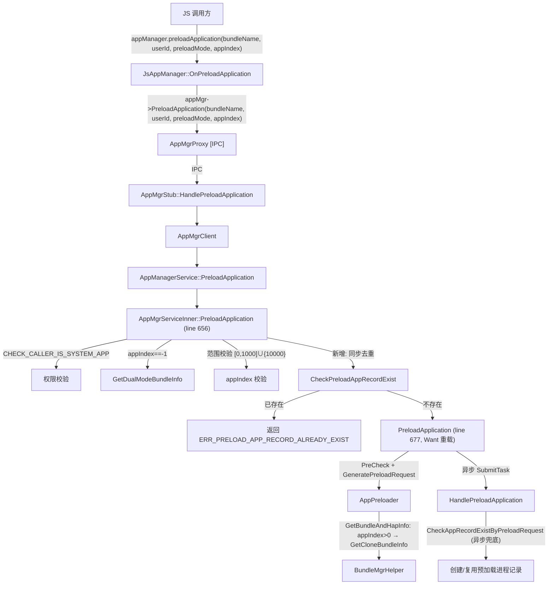
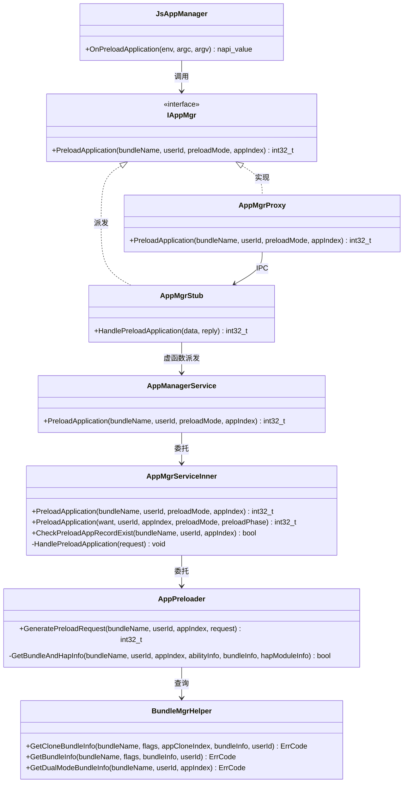
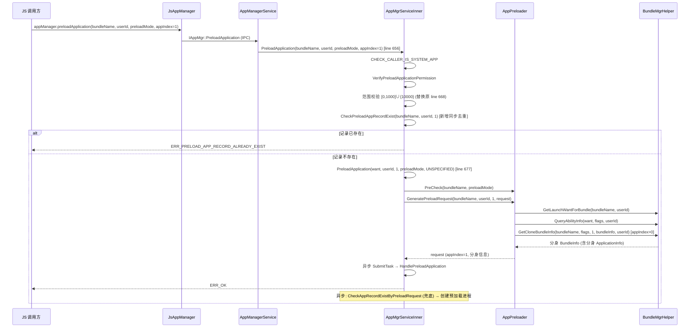

# Design

## 需求基线摘要

需求基线详见 proposal.md。设计阶段需额外强调：JS 接口 `appManager.preloadApplication` 的 `appIndex` 参数已在全链路透传（JsAppManager → IAppMgr IPC → AppMgrServiceInner），阻断点仅在 `AppMgrServiceInner::PreloadApplication`（app_mgr_service_inner.cpp:668）的 `appIndex != 0 && appIndex != PC_TABLET_INDEX` 判断（阻断 [1,1000] 普通分身，PC_TABLET_INDEX=10000 已放行）。去除该阻断后，需补齐分身 BundleInfo 查询逻辑（`GetBundleAndHapInfo` 已由 TASK-2 适配 `GetCloneBundleInfo`），并在 line 656 路径补充**同步去重检查**（当前去重在 `HandlePreloadApplication` 异步任务中，调用方已返回 ERR_OK，无法传播 `ERR_PRELOAD_APP_RECORD_ALREADY_EXIST`）。

> **路径澄清**：`PreloadManagerService::PreloadApplication`（services/abilitymgr/，AMS SA 180 入口）是另一条独立预加载路径，不在本需求 JS 接口调用链上，本设计不涉及。

## 代码事实基线

| 事实项 | 代码引用（文件:行） | 对设计的约束 |
|--------|-------------------|-------------|
| JS 接口入口 | `frameworks/js/napi/app/js_app_manager/js_app_manager.cpp:1442,1467` | `OnPreloadApplication` → `appMgr->PreloadApplication(bundleName, userId, preloadMode, appIndex)` — JS 层已透传 appIndex，无需修改 |
| IPC 链路 | `interfaces/inner_api/app_manager/src/appmgr/app_mgr_stub.cpp:507-515` | `HandlePreloadApplication` 从 Parcel 读取 bundleName/userId/preloadMode/appIndex 并透传 — IPC 序列化格式不变 |
| Path B 阻断点 | `services/appmgr/src/app_mgr_service_inner.cpp:668` | `if (appIndex != 0 && appIndex != PC_TABLET_INDEX) return ERR_INVALID_VALUE` — 阻断 [1,1000]，允许 {0, 10000}；须移除并替换为范围校验 |
| Path B 入口权限检查 | `app_mgr_service_inner.cpp:659-660` | `CHECK_CALLER_IS_SYSTEM_APP` + `VerifyPreloadApplicationPermission` — 无 `IsPreloadApplicationEnabled` 检查（该检查仅在 `PreloadApplicationByPhase` line 647 和 AMS 路径） |
| Path B appIndex=-1 处理 | `app_mgr_service_inner.cpp:664-667` | `if (appIndex == -1) GetDualModeBundleInfo(bundleName, userId, appIndex)` — 双模预加载，appIndex=-1 为内部保留值 |
| Path B 实际预加载 | `app_mgr_service_inner.cpp:677-776` | Want 重载：PreCheck → GeneratePreloadRequest → 异步 SubmitTask → HandlePreloadApplication；**全路径无同步去重检查** |
| 异步去重（当前） | `app_mgr_service_inner.cpp:1895` | `HandlePreloadApplication` 内 `CheckAppRecordExistByPreloadRequest` 检查已有记录，但函数返回 void、在异步任务中执行——调用方已返回 ERR_OK，无法传播 ALREADY_EXIST |
| 同步去重（可复用） | `app_mgr_service_inner.cpp:1961-1983` | `CheckPreloadAppRecordExist(bundleName, userId, appIndex)` → `GeneratePreloadRequest` + `CheckAppRecordExistByPreloadRequest` — 同步返回 bool，可返回去重结果 |
| `GetBundleAndHapInfo` 分身查询 | `services/appmgr/src/app_preloader.cpp:203-228` | appIndex>0 时已调用 `GetCloneBundleInfo`（TASK-2 已完成）；appIndex=0 时调用 `GetBundleInfo` — 无需修改 |
| `GetCloneBundleInfo` 签名 | `interfaces/kits/native/appkit/ability_bundle_manager_helper/bundle_mgr_helper.h:119` | `ErrCode GetCloneBundleInfo(const std::string &bundleName, int32_t flags, int32_t appCloneIndex, BundleInfo &bundleInfo, int32_t userId)` — 返回分身 BundleInfo |
| `MakeProcessName` appIndex 感知 | `app_mgr_service_inner.cpp:2693-2702` | appIndex != 0 时追加 `":" + appIndex` 到进程名 — 去重机制已 appIndex 感知，无需修改 |
| `PC_TABLET_INDEX` / `MAX_APP_CLONE_INDEX` | `utils/global/constant/global_constant.h:21,25` | `MAX_APP_CLONE_INDEX = 1000`；`PC_TABLET_INDEX = 10000` — 范围校验常量来源 |

## 设计约束

1. 不修改任何公共 API 签名（JS 接口 `appManager.preloadApplication` 签名不变，`appIndex` 参数已存在）
2. 不修改 IPC 序列化格式（AppMgrStub/Proxy 已透传 appIndex）
3. 不修改权限校验逻辑（`CHECK_CALLER_IS_SYSTEM_APP` + `VerifyPreloadApplicationPermission` 复用）
4. 不修改 `MakeProcessName` 进程名生成逻辑（已 appIndex 感知）
5. 不修改 `GetBundleAndHapInfo`（TASK-2 已完成 `GetCloneBundleInfo` 适配）
6. appIndex 有效范围 [0, MAX_APP_CLONE_INDEX(1000)] ∪ {PC_TABLET_INDEX(10000)}；appIndex == -1 为内部保留值（双模预加载）
7. 不修改 `PreloadManagerService`（AMS SA 180 独立路径，不在本需求范围）

## 非目标

- 接口签名变更
- 进程复用机制开发（复用现有 `isPreloadStart` 机制）
- 性能指标量化
- bundle_framework 代码修改（`GetCloneBundleInfo` 已由包管理提供）
- `PreloadManagerService` / AMS 路径修改（独立路径，不在本需求范围）
- 新增第三方依赖

## 方案概述

本方案采用**最小侵入式修改**，聚焦 JS 接口调用链（Path B）。核心修改两处：

1. **移除 line 668 阻断 + 替换为范围校验**：将 `if (appIndex != 0 && appIndex != PC_TABLET_INDEX) return ERR_INVALID_VALUE` 替换为 `if (appIndex < 0 || (appIndex > MAX_APP_CLONE_INDEX && appIndex != PC_TABLET_INDEX)) return ERR_INVALID_VALUE`（允许 [0,1000] ∪ {10000}，拒绝越界值）。appIndex == -1 保留双模处理（line 664-667 不变，但需确保范围校验不阻断 -1）。

2. **补充同步去重检查**：在 line 656 的 `PreloadApplication`（4 参数重载）中，权限检查和范围校验之后、调用 line 677 之前，增加同步 `CheckPreloadAppRecordExist` 调用。若记录已存在，返回 `ERR_PRELOAD_APP_RECORD_ALREADY_EXIST`，不进入异步预加载流程。

`GetBundleAndHapInfo` 的分身查询适配（appIndex > 0 时 `GetCloneBundleInfo`）已由 TASK-2 完成，无需修改。进程名生成（`MakeProcessName`）已 appIndex 感知，去重自然正确。

## 架构图

## 类图

## 模块影响

| 子系统 | 仓库 | 模块/路径 | 影响类型 | 相关设计决策 |
|--------|------|-----------|---------|-------------|
| 元能力 | ability_ability_runtime | services/appmgr/src/app_mgr_service_inner.cpp | 核心修改（line 656/668 移除阻断 + 范围校验 + 同步去重） | DD-1, DD-3 |
| 元能力 | ability_ability_runtime | services/appmgr/src/app_preloader.cpp | 无需修改（TASK-2 已完成 GetCloneBundleInfo 适配） | DD-2 |
| 元能力 | ability_ability_runtime | services/appmgr/include/app_preloader.h | 无需修改（签名已含 appIndex） | — |
| 元能力 | ability_ability_runtime | frameworks/js/napi/app/js_app_manager/js_app_manager.cpp | 无需修改（已透传 appIndex） | — |
| 元能力 | ability_ability_runtime | interfaces/inner_api/app_manager/src/appmgr/*.cpp | 无需修改（IPC 已透传 appIndex） | — |
| 元能力 | ability_ability_runtime | services/abilitymgr/src/preload_manager_service.cpp | 不在本需求范围（AMS SA 180 独立路径） | — |

## 实现入口

| Entry Point | 代码引用（文件:行） | 当前职责 | 调用方 | 被调用方 | 预期变更 |
|-------------|-------------------|----------|--------|----------|----------|
| `AppMgrServiceInner::PreloadApplication` (4 参数) | app_mgr_service_inner.cpp:656 | 预加载入口：系统应用校验+权限校验+appIndex=-1 处理+line 668 阻断+转发 line 677 | AppManagerService:244 | PreloadApplication(line 677) | 移除 line 668 阻断；替换为范围校验 [0,1000]∪{10000}；新增同步 `CheckPreloadAppRecordExist` 去重检查 |
| `AppMgrServiceInner::CheckPreloadAppRecordExist` | app_mgr_service_inner.cpp:1961 | 同步去重：GeneratePreloadRequest + CheckAppRecordExistByPreloadRequest | AmsMgrScheduler:944 (Path A) | AppPreloader, CheckAppRecordExistByPreloadRequest | 新增调用方：line 656（Path B）；函数本身不修改（已 appIndex 感知） |
| `AppMgrServiceInner::PreloadApplication` (Want 重载) | app_mgr_service_inner.cpp:677 | 实际预加载：PreCheck+GeneratePreloadRequest+异步 HandlePreloadApplication | line 656 (同文件) | AppPreloader, taskHandler_ | 无需修改 |
| `AppPreloader::GetBundleAndHapInfo` | app_preloader.cpp:203 | 查询 BundleInfo+HapModuleInfo | GeneratePreloadRequest | BundleMgrHelper | 无需修改（TASK-2 已完成 appIndex>0 → GetCloneBundleInfo） |

## 既有模式复用

| Pattern | 参考代码（文件:行） | 复用方式 | 适用 Task |
|---------|-------------------|----------|-----------|
| 同步去重检查 | `app_mgr_service_inner.cpp:1961` `CheckPreloadAppRecordExist` | 在 line 656 权限校验后调用 `CheckPreloadAppRecordExist(bundleName, userId, appIndex)`，返回 true 时返回 `ERR_PRELOAD_APP_RECORD_ALREADY_EXIST` | Task-1 |
| 范围校验模式 | `ams_mgr_scheduler.cpp:939` `if (appIndex < 0 \|\| (appIndex > MAX_APP_CLONE_INDEX && appIndex != PC_TABLET_INDEX))` | 在 line 656 替换 line 668 为同范围校验（允许 -1 通过以支持双模） | Task-1 |
| 分身 BundleInfo 查询 | `app_preloader.cpp:217` `GetCloneBundleInfo(bundleName, flags, appIndex, bundleInfo, userId)` | 已由 TASK-2 完成，无需修改 | 验证 |
| 进程名 appIndex 追加 | `app_mgr_service_inner.cpp:2693` `processName += ":" + std::to_string(appIndex)` | 无需修改，去重机制已 appIndex 感知 | 验证 |

## 关键设计决策

| 决策 ID | 问题 | 推荐方案 | 备选方案 | 选择理由 |
|---------|------|----------|----------|---------|
| DD-1 | 如何处理 line 668 的 appIndex 限制？ | 移除 `if (appIndex != 0 && appIndex != PC_TABLET_INDEX) return ERR_INVALID_VALUE`（line 668），替换为范围校验：`if (appIndex != -1 && (appIndex < 0 \|\| (appIndex > MAX_APP_CLONE_INDEX && appIndex != PC_TABLET_INDEX))) return ERR_INVALID_VALUE`。允许 -1（双模）、[0,1000]（普通分身）、10000（PC 平板），拒绝其他 | A) 直接删除 line 668 不加校验；B) 保留 line 668 仅放宽为 `appIndex > 1000 && appIndex != PC_TABLET_INDEX` | 方案 A 无范围保护，无效 appIndex 穿透至 BMS；方案 B 逻辑不清晰。选用显式范围校验，-1 例外以保留双模入口（line 664-667），与 spec EX-3 一致 |
| DD-2 | 如何获取分身 BundleInfo？ | 不修改。`GetBundleAndHapInfo`（app_preloader.cpp:216-218）已由 TASK-2 适配：appIndex > 0 时调用 `GetCloneBundleInfo` 获取分身 BundleInfo | — | TASK-2 已完成，验证即可 |
| DD-3 | 如何实现同步去重（AC-3）？ | 在 line 656 权限校验和范围校验之后、调用 line 677 之前，新增 `bool isExist = CheckPreloadAppRecordExist(bundleName, userId, appIndex); if (isExist) return ERR_PRELOAD_APP_RECORD_ALREADY_EXIST;` | A) 在 line 677 异步任务中返回错误（需改 HandlePreloadApplication 签名）；B) 不加同步去重，依赖异步兜底 | 方案 A 需改异步模式为同步，影响预加载性能；方案 B 无法向调用方传播错误码（调用方已返回 ERR_OK）。选用在 line 656 同步调用已有的 `CheckPreloadAppRecordExist`，复用现有去重逻辑，最小侵入 |

## 状态归属与不变量

- **Ownership（预加载记录去重）**:
  - Owner: `AppMgrServiceInner::CheckAppRecordExistByPreloadRequest`，key = (appInfo->name, processName, appInfo->uid)
  - 同步检查时机: line 656 `CheckPreloadAppRecordExist`（新增）— 在 GeneratePreloadRequest 后立即检查
  - 异步兜底: `HandlePreloadApplication`（line 1895）— 异步任务中再次检查，防止竞态
  - 不变量: 同一 (bundleName, userId, appIndex) 三元组至多一条预加载记录；不同 appIndex 的记录 processName 不同（含 appIndex 后缀）
  - 验证方法: AC-2（不同 appIndex 不覆盖）、AC-3（同 appIndex 重复返回 ALREADY_EXIST）、AC-6（并发不冲突）
  - 关联 AC: AC-2, AC-3, AC-6

- **Concurrency（同步去重与异步预加载的竞态）**:
  - 同步 `CheckPreloadAppRecordExist` 在 line 656 执行（调用方线程）
  - 异步 `HandlePreloadApplication` 在 taskHandler_ 线程执行（line 764-768 SubmitTask）
  - 竞态窗口: 同步检查通过后、异步任务执行前，另一线程可能预加载同一 appIndex
  - 不变量: 异步兜底 `CheckAppRecordExistByPreloadRequest`（line 1895）保证不会创建重复进程，仅静默返回
  - 验证方法: AC-6 并发预加载不同 appIndex；同 appIndex 并发时异步兜底保证不重复创建
  - 关联 AC: AC-6

- **Compatibility（appIndex=0 行为不变）**:
  - 不变量: appIndex=0 时，line 668 原本通过（0 != 0 为 false），替换为范围校验后仍通过（0 在 [0,1000] 内）；`GetBundleAndHapInfo` 走 else 分支 `GetBundleInfo`（appIndex=0 不 > 0）；代码路径与修改前一致
  - 验证方法: AC-5 回归测试
  - 关联 AC: AC-5

- **Compatibility（PC_TABLET_INDEX 行为不变）**:
  - 不变量: appIndex=10000 时，line 668 原本通过（10000 != 10000 为 false），替换为范围校验后仍通过（10000 == PC_TABLET_INDEX 例外）；行为不变
  - 关联 AC: AC-1

## DFX 设计

### DFX 故障模式分析

涉及仓库：ability_ability_runtime

| 分析对象 | 故障模式 | 故障影响 | 故障原因 | 严酷度 | 恢复措施 | 关键日志 | 大数据打点事件 | 来源 |
|---------|----------|----------|-------------|---------|---------|---------|---------|------|
| 预加载分身进程创建 | 进程启动失败 | 创建不了分身预加载进程 | 1. AppSpawnClient为空; 2. 创建进程启动msg失败，可能查包信息失败（appIndex>0 时 GetCloneBundleInfo 失败）; 3. 调用AppSpawn接口孵化进程失败 | 严重 | 重启设备；重试；重试 | appSpawnClient null/createStartMsg fail/spawn new app fail, errCode | PROCESS_START_FAILED | ability_ability_runtime@docs/dfx/fmea.yaml#启动应用进程 |

## 安全基础检查

> 不涉及。proposal.md §8 安全/权限维度 = 否，复用现有 `CHECK_CALLER_IS_SYSTEM_APP` + `VerifyPreloadApplicationPermission` 权限检查逻辑，不修改权限规则、不新增信任边界交互。本次变更仅移除 line 668 的 appIndex 限制并补充同步去重，所有 appIndex 值均经过同一权限校验入口。

## 时序设计

## 风险与缓解

| 风险 | 可能性 | 影响 | 缓解措施 |
|------|--------|------|----------|
| `CheckPreloadAppRecordExist` 调用 `GeneratePreloadRequest` 与 line 677 重复执行 | 高 | 性能开销：两次 GeneratePreloadRequest（同步去重 + 异步预加载） | 可接受：GeneratePreloadRequest 是轻量查询（BMS IPC），预加载本身是低频操作；备选方案是将去重结果传入 line 677 跳过重复生成，但增加参数传递复杂度 |
| 同步去重与异步预加载竞态 | 中 | 同 appIndex 并发调用时，同步检查均通过，异步创建两个进程 | 异步兜底 `HandlePreloadApplication` line 1895 `CheckAppRecordExistByPreloadRequest` 保证第二个静默返回，不创建重复进程 |
| appIndex=-1 范围校验误阻断 | 低 | 双模预加载失败 | DD-1 范围校验显式排除 -1：`if (appIndex != -1 && ...)` |
| GetCloneBundleInfo 查询失败（分身未安装） | 中 | 预加载失败 | `GetBundleAndHapInfo` 已检查返回值并返回 false（TASK-2），`GeneratePreloadRequest` 返回 `GET_BUNDLE_INFO_FAILED` |

## 验证思路

| 验证场景 | 方法 | 通过标准 |
|----------|------|----------|
| appIndex=1 预加载成功 | UT: 调用 `AppMgrServiceInner::PreloadApplication(bundleName, userId, preloadMode, 1)`，mock GetCloneBundleInfo 返回分身 BundleInfo | 返回 ERR_OK |
| appIndex=10000 预加载成功 | UT: 同上，appIndex=PC_TABLET_INDEX | 返回 ERR_OK |
| appIndex=0 行为不变 | 回归 UT: appIndex=0 | 返回 ERR_OK，不进入 GetCloneBundleInfo 分支 |
| 不同 appIndex 去重独立 | UT: 先 preload(1) 再 preload(10000) | 均 ERR_OK，两条独立记录 |
| 同 appIndex 重复预加载 | UT: preload(1) 后再 preload(1) | 返回 ERR_PRELOAD_APP_RECORD_ALREADY_EXIST |
| appIndex 越界 | UT: appIndex=1001, appIndex=5000, appIndex=-2 | 返回 ERR_INVALID_VALUE |
| appIndex=-1 双模 | UT: appIndex=-1 | 不返回 ERR_INVALID_VALUE（范围校验排除 -1），进入 GetDualModeBundleInfo |
| 分身未安装 | UT: mock GetCloneBundleInfo 失败 | 返回 GET_BUNDLE_INFO_FAILED |

> 兼容性验证详见 spec.md 兼容性声明章节。
