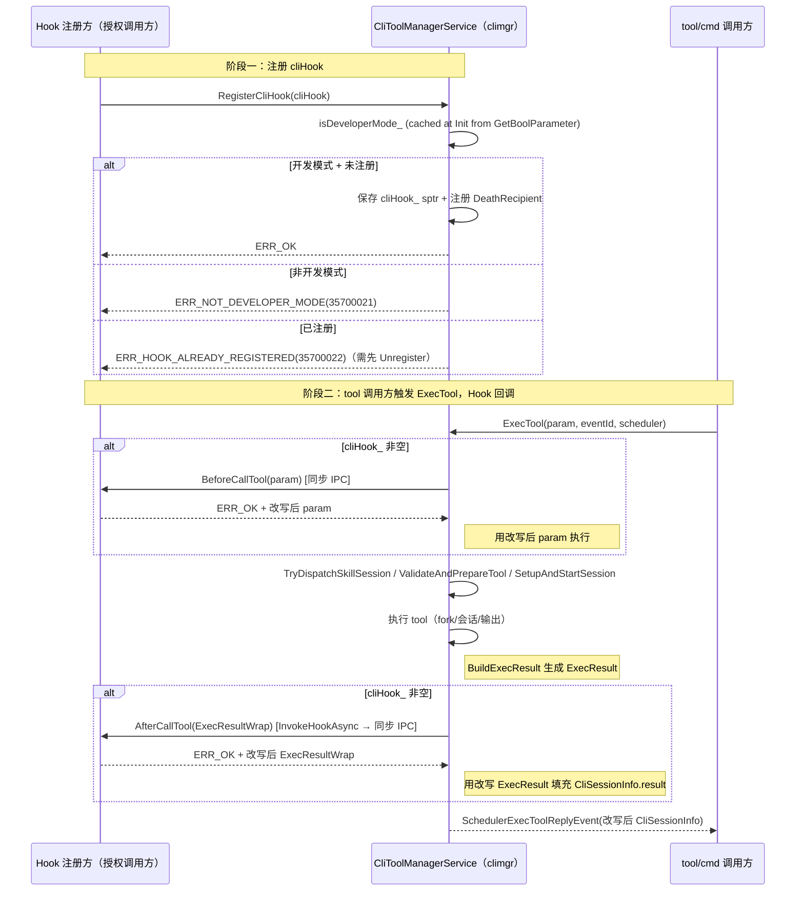
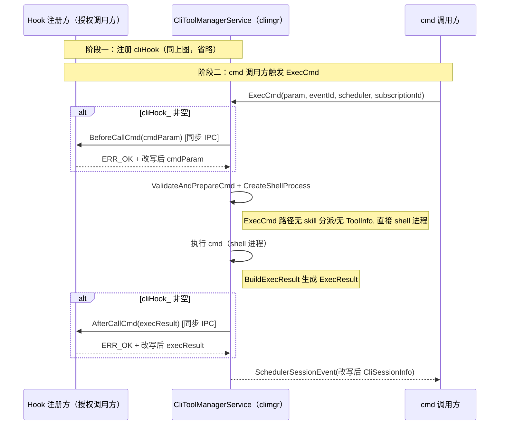
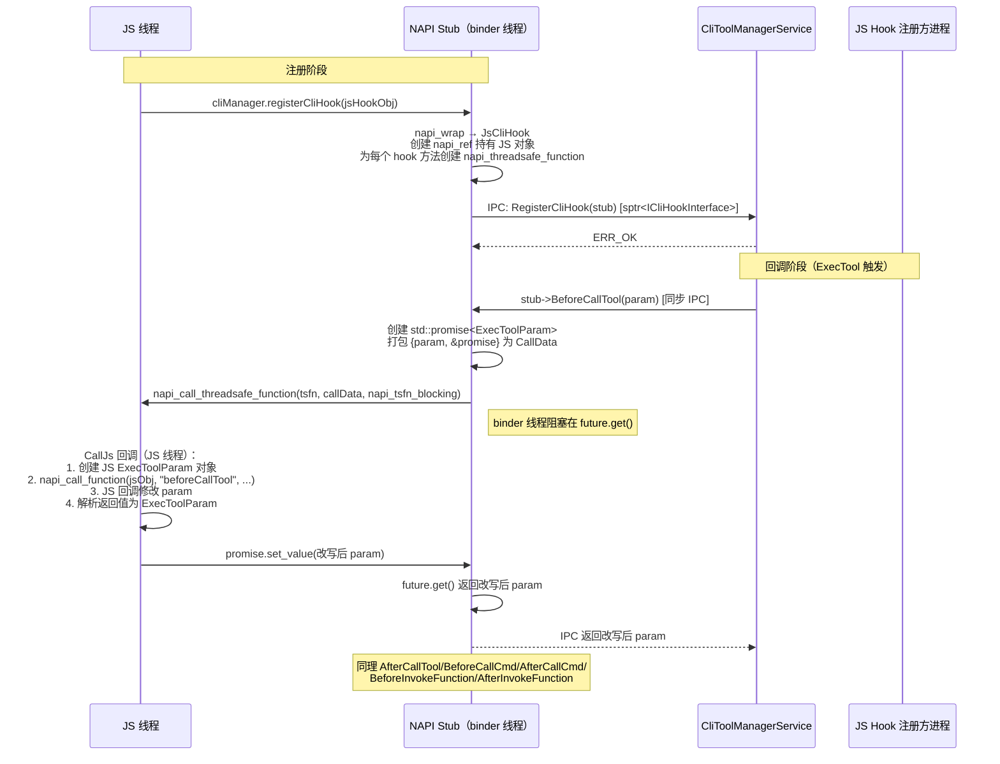
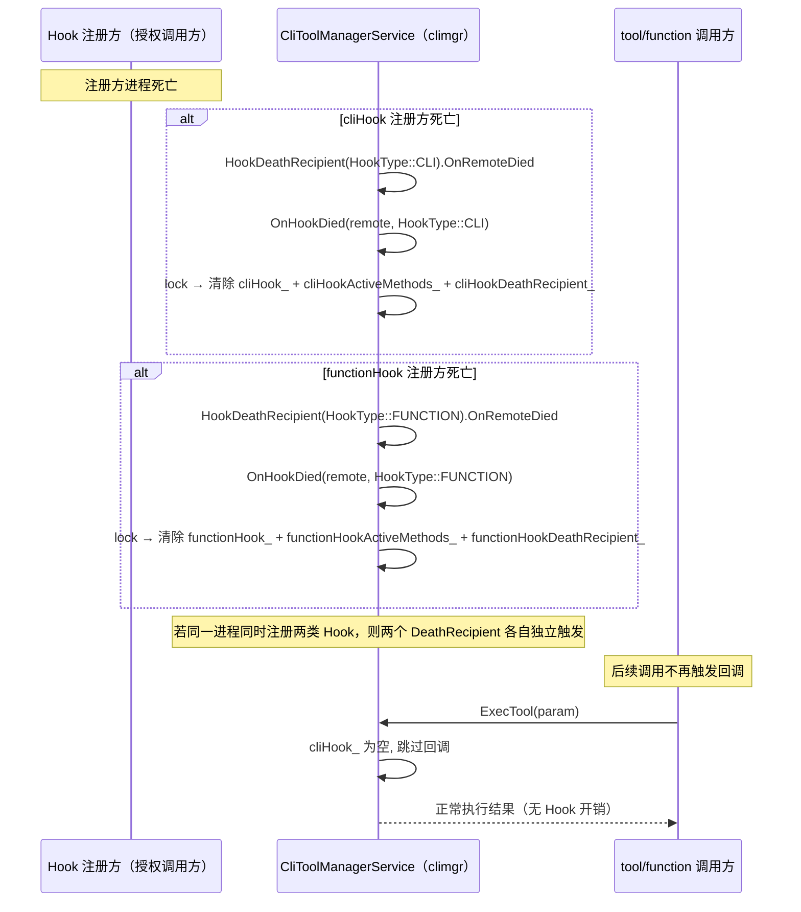
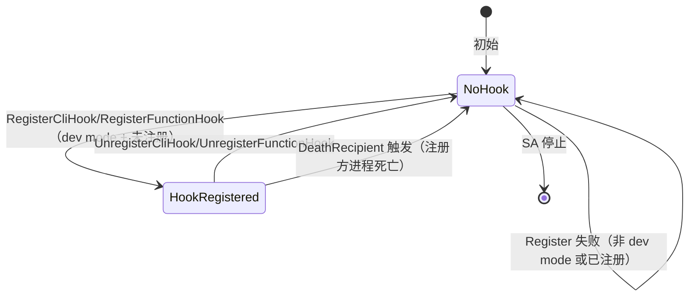
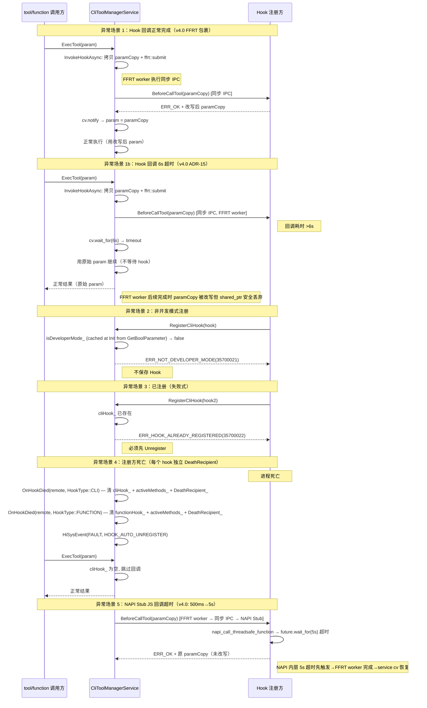

# 架构设计

> 确认目标仓和模块的架构约束、关键设计决策、Spec 拆分方向。本设计承接 `proposal.md` 基线与 `spec.md` 验收标准，实现 `agenthook_design.txt` 粗方案。

## 设计元数据

| 字段 | 内容 |
|------|------|
| Design ID | DESIGN-AGENT-HOOK |
| 关联需求 | `.specs/features/agent-hook/proposal.md` |
| 关联 Epic | 无 |
| 目标 Feature | FEAT-AGENT-HOOK |
| 复杂度 | 标准 |
| 目标版本 | OpenHarmony-7.1-Release |
| Owner | 待确认 |
| 状态 | Draft (v6.0 — 基线变更后重新设计) |

## 需求基线

> 需求基线详见 proposal.md。以下仅列出设计阶段需要额外强调的要点。

| 项 | 补充说明 |
|----|----------|
| cliHook 在 service 进程内触发 | ExecTool/ExecCmd 执行链路在 CliToolManagerService 内，Hook 回调由 service 持 Proxy 发起 IPC 到注册方进程 |
| functionHook 在 service 进程内分发 | InvokeFunctionExecutor 调用 `CliToolMGRClient::BeforeInvokeFunction`/`AfterInvokeFunction`（IPC 到 service），service 内部分发到已注册 functionHook（再 IPC 到注册方进程） |
| v1 单 Hook 语义（失败式） | 同类 Hook 仅保留一个；已注册时重复注册返回 `ERR_HOOK_ALREADY_REGISTERED(35700022)`，必须先 Unregister 再 Register |
| Hook 回调为同步 IPC（service 侧 6s 超时 + NAPI 侧 5000ms 超时） | FFRT worker 执行同步 IPC，service 线程 wait_for(6s) 等待；超时用原始数据继续；NAPI 层 future.wait_for(5000ms) 超时返回原 param |
| 仅开发模式生效 | `system::GetBoolParameter("const.security.developermode.state", false)` 运行时判断；非开发模式注册返回失败、回调点跳过 |
| NAPI 层提供 JS 系统接口 | JS 调用方注册 JS 对象（实现 CliHook/FunctionHook interface），NAPI 层封装为 IPC Stub（RemoteObject），回调时同步到 JS 线程执行 |

## 上下文和现状

### 涉及仓和模块

| 仓库 | 补充架构说明 |
|------|-------------|
| ability_ability_runtime | cli_tool_framework 子系统；既有四层分层（客户端 CliToolMGRClient ↔ IPC ICliToolManager ↔ 服务 CliToolManagerService ↔ 权限 PermissionUtil）；本设计在既有分层上插入 Hook 回调链路，不新增层 |

### 调用链层级分析

| 层 | 模块 | 职责 | 修改类型 |
|----|------|------|----------|
| IPC 契约层 | `interfaces/cli_tool/ICliToolManager.idl` | 跨进程接口契约 | 修改（新增 6 方法：RegisterCliHook/UnregisterCliHook/RegisterFunctionHook/UnregisterFunctionHook/BeforeInvokeFunction/AfterInvokeFunction；移除 GetFunctionHook） |
| IPC 回调契约层 | `interfaces/cli_tool/ICliHookInterface.idl`（新增）、`IFunctionHookInterface.idl`（新增） | Hook 回调跨进程契约 | 新增 |
| 客户端层 | `interfaces/cli_tool/include/cli_tool_mgr_client.h/.cpp` | 单例客户端，供应用调用 | 修改（新增 6 方法代理） |
| 服务层 | `services/climgr/cli_tool_manager_service.h/.cpp` | SA 实现，ExecTool/ExecCmd/BeforeInvokeFunction/AfterInvokeFunction 执行链路 | 修改（新增 6 方法实现 + 回调点 + dev mode 门控 + 失败式注册） |
| 函数执行器层 | `frameworks/js/napi/function_manager/invoke_function_executor.h/.cpp` | invokeFunction 执行器（调用方进程） | 修改（调用 CliToolMGRClient::BeforeInvokeFunction/AfterInvokeFunction 替代 GetFunctionHook 查询） |
| NAPI 绑定层 | `frameworks/js/napi/cli_tool_manager/`（修改） | JS CliHook callback → IPC Stub 封装 + JS 线程同步回调 + registerCliHook/unregisterCliHook | 修改（新增 `js_cli_hook.h/.cpp` + `js_cli_manager.cpp` 新增绑定） |
| NAPI 绑定层 | `frameworks/js/napi/function_manager/`（修改） | JS FunctionHook callback → IPC Stub 封装 + JS 线程同步回调 + registerFunctionHook/unregisterFunctionHook | 修改（新增 `js_function_hook.h/.cpp` + `js_function_manager.cpp` 新增绑定） |
| SDK JS 层 | `interface/sdk-js/api/application/CliHook.d.ts`（新增）、`FunctionHook.d.ts`（新增） | JS 回调 interface 类型声明 | 新增 |
| SDK JS 层 | `interface/sdk-js/api/@ohos.app.cli.cliManager.d.ts`（修改） | JS 注册函数声明 | 修改（新增 4 注册函数） |
| SDK JS 层 | `interface/sdk-js/kits/@kit.AbilityKit.d.ts` | Kit 聚合器 | 修改（导出新类型） |

**检查项：**
- [x] 调用链每一层都已覆盖（从 IPC 契约到服务到函数执行器到权限）
- [x] 每层职责边界清晰，无跨层违规调用（Hook 回调走独立 IPC 接口，不绕过既有分层）
- [x] 每层修改类型明确

### 适用架构规则

| Rule ID | 适用原因 | 设计结论 | 验证方式 |
|---------|----------|----------|----------|
| OH-ARCH-LAYERING | 涉及客户端→IPC→服务→权限调用链 | Hook 注册走客户端→IPC→服务→权限，与既有 ExecTool 等一致；Hook 回调走服务→IPC→注册方，不跨层 | 架构评审/依赖检查 |
| OH-ARCH-IPC-SAF | 涉及跨进程 IPC（Hook 注册 + Hook 回调 + GetFunctionHook 查询） | 新增 2 个回调 IPC 接口（ICliHookInterface/IFunctionHookInterface），复用既有 SA 注册模式 | 集成测试 |
| OH-ARCH-API-LEVEL | 涉及新增 SystemAPI | 6 个新方法 + 2 个回调接口，标注 `@since 6.0`，开放范围 SystemAPI | API 评审/XTS |
| OH-ARCH-COMPONENT-BUILD | 涉及新增 IDL 文件 | 新增 2 个 .idl 文件，更新 BUILD.gn 的 idl_gen_interface 依赖 | 构建验证 |
| OH-ARCH-ERROR-LOG | 涉及新增错误码 + HiSysEvent | 新增错误码 16001000~16001003；Hook 超时/触发/注销记录 HiSysEvent | 单测/hilog |

## 不涉及项承接

> proposal.md 已完成 N/A 判定。本节仅对 proposal 中标记为"涉及"且需展开设计的维度给出结论。

| 维度 | 设计结论 |
|------|----------|
| 性能 | Hook 回调为同步 IPC（阻塞主链路，由 Hook 注册方保证回调快速返回）；`BeforeInvokeFunction`/`AfterInvokeFunction` 为调用方→service→注册方两跳 IPC，P95 目标 <50ms；无 Hook 时 service 侧直接返回 ERR_OK（零开销，调用方无感知）；**非开发模式跳过所有 Hook 逻辑，零开销** |
| 安全与权限 | 见下方「安全基础检查」章节；门控用 `system::GetBoolParameter("const.security.developermode.state", false)` 运行时判断，仅开发模式生效（ADR-8） |
| IPC/跨进程 | 见下方「时序设计」与「线程与并发模型」 |
| 构建与部件 | 无新增特性开关（ADR-8 已移除宏隔离方案）；NAPI 层扩展 `cli_tool_manager` + `function_manager` 两个现有模块；SDK JS 新增 2 个 .d.ts + 修改 1 个 .d.ts |

## 关键设计决策

| 决策 ID | 问题 | 推荐方案 | 探索过的替代方案 | 取舍理由 | 影响 |
|---------|------|----------|-----------------|------|------|
| ADR-1 | Hook 回调用独立 IPC 接口还是复用 ICliToolManagerScheduler？ | 独立 IPC 接口（ICliHookInterface / IFunctionHookInterface） | 备选1：复用 ICliToolManagerScheduler，通过 event type 区分——放弃，因回调接口语义臃肿且 event 携带 Hook 改写语义复杂 | 与既有 `ICliToolManagerScheduler` 回调模式一致；职责清晰；IDL 可读性好 | 新增 2 个 IDL 文件 |
| ADR-2 | cliHook 方法命名：重载（beforeCallCli 同名按参数类型区分）还是异名（BeforeCallTool/BeforeCallCmd）？ | 异名（BeforeCallTool/AfterCallTool/BeforeCallCmd/AfterCallCmd） | 备选1：IDL 重载——放弃，因 IDL 不支持方法重载，需生成不同名 Stub 方法 | 需求方确认：异名。IDL 规范要求方法名唯一；异名可读性好；与 `agenthook_design.txt` 语义一致（4 个方法按 tool/cmd 区分） | IDL 方法名 4 个 |
| ADR-3 | afterCallCli(toolParam) 中参数名——是改写"工具执行后的最终输出参数"还是改写"执行结果对象"？ | 改写执行结果对象（ExecResult） | 备选1：改写 CliSessionInfo——放弃，因 CliSessionInfo 仅含 sessionId/toolName/status + shared_ptr<ExecResult> 包装，Hook 真正要改的是 outputText/exitCode 等 ExecResult 字段；备选2：改写 ExecToolParam——放弃，执行后改写入参无业务意义 | 需求方确认：原始输入 `afterCallCli(toolParam)` 中 toolParam 为笔误，afterCallCli 入参应为结果。执行后 Hook 的价值是改写结果（如脱敏 outputText），故入参为 ExecResult（`exec_result.h:28`：exitCode/outputText/errorText/signalNumber/timeout/executionTime）；service 回调后用改写后的 ExecResult 填充 CliSessionInfo.result 再回传原调用方 | AfterCallTool/AfterCallCmd 入参为 ExecResultWrap& |
| ADR-4 | v1 单 Hook 还是多 Hook 链？ | 单 Hook（失败语义），最多只存在一个 functionHook | 备选1：多 Hook 链按注册顺序执行——放弃，因 v1 场景单一（Agent 框架独占），多 Hook 引入顺序/优先级复杂度；备选2：单 Hook 覆盖语义——放弃，覆盖语义可能意外覆盖他人的 Hook 导致难以排查 | 需求方 v2.0 确认：单 Hook，已注册时重复注册返回 `ERR_HOOK_ALREADY_REGISTERED(35700022)`，必须先 Unregister 再 Register。失败语义比覆盖语义更安全——避免意外覆盖；数据结构从 sptr 扩展为 vector 可向后兼容 | Register 已存在则返回 ERR_HOOK_ALREADY_REGISTERED(35700022) |
| ADR-5 | functionHook 调用路径：调用方查询 Hook 还是由 service 直接分发？ | service 直接分发：移除 `GetFunctionHook`，在 ICliToolManager 提供 `BeforeInvokeFunction`/`AfterInvokeFunction`，调用方 IPC 到 service，service 内部分发到 functionHook | 备选1：调用方经 `GetFunctionHook` 查询 Hook Proxy 再本地回调——放弃（v2.0 变更），因调用方需持 Proxy 管理生命周期，查询 IPC 增加开销，且 Proxy 缓存一致性复杂；备选2：service 全代理（service 替调用方执行整个 invokeFunction）——放弃，职责越界 | 需求方 v2.0 确认：直接提供 `BeforeInvokeFunction`/`AfterInvokeFunction`。调用方不需感知 Hook 存在，只需调 service 的 Before/After；service 内部判断有无 functionHook，有则 IPC 到注册方，无则直接返回 ERR_OK（零开销）；调用方不再需要 GetFunctionHook 查询 IPC | InvokeFunctionExecutor 调 CliToolMGRClient::BeforeInvokeFunction/AfterInvokeFunction |
| ADR-6 | Hook 回调返回值语义：非零是否跳过/阻断？ | 全部 hook 模式（非零也 hook） | 备选1：非零跳过——放弃，需求方确认用"全部 hook 模式"；备选2：非零阻断——放弃，Hook 不应导致主链路失败 | 需求方确认：全部 hook 模式——返回值不影响 Hook 应用，修改后的 param/result 始终生效；返回值仅用于日志/审计 | 返回值被忽略，Hook 修改始终生效 |
| ADR-7 | Hook 注册方死亡检测：DeathRecipient 还是定期心跳？ | 每个 hook 独立 DeathRecipient，构造时传入 `HookType` 枚举（CLI/FUNCTION）；`OnRemoteDied` 直接调 `CliToolManagerService::OnHookDied(remote, type)`；`OnHookDied` 在锁内清理 hook_ + activeMethods_ + DeathRecipient_ | 备选1：单 DeathRecipient 同进程共用——放弃（v3.0 变更），职责耦合不利于独立管理；备选2：定期心跳——放弃，增加无效 IPC 且时延不可控；备选3（v6.0 已废弃）：Handler lambda + Ensure 延迟创建——放弃（v6.0 改造），因 lambda 捕获复杂、Ensure 方法增加不必要的延迟初始化逻辑 | v6.0 改造确认：`HookDeathRecipient` 构造参数从 `Handler`（lambda）改为 `HookType` 枚举；`OnRemoteDied` 直接调 service 单例 `OnHookDied(remote, type)`；service 的 `OnHookDied` 方法在 `hookMutex_` 锁内检查 remote 匹配后一次性清理 `hook_` + `activeMethods_` + `DeathRecipient_`；Register 时直接 `new HookDeathRecipient(HookType::CLI/FUNCTION)` 不再延迟初始化；Unregister 时同样清理三个字段。`HookType` 枚举定义在 `cli_tool_manager_service.h` | `HookDeathRecipient(HookType)` + `OnHookDied` 统一清理 + 去掉 `Ensure*` 方法 |
| ADR-8 | 本能力如何门控？ | 运行时 `system::GetBoolParameter("const.security.developermode.state", false)` 判断开发模式，仅开发模式生效 | 备选1：`#ifdef ABILITY_RUNTIME_AGENT_HOOK` 宏隔离 + `ability_runtime_agent_hook=false` 特性开关——放弃（v2.0 变更），因宏隔离需修改构建配置且编译时固化，开发模式切换需重新编译；运行时判断更灵活，与既有 `ability_command.cpp:985`、`app_mgr_service.cpp:495` 等开发模式门控模式一致；备选2：永久不加门控——放弃，生产环境有安全风险 | 需求方 v2.0 确认：`system::GetBoolParameter` 运行时判断。Header: `#include "parameters.h"`（`base/startup/init/interfaces/innerkits/include/syspara/parameters.h`）；BUILD 依赖 `"init:libbegetutil"`（climgr BUILD.gn 已有）。门控点：RegisterCliHook/RegisterFunctionHook 入口（非开发模式返回 `ERR_NOT_DEVELOPER_MODE(35700021)`）；ExecTool/ExecCmd/BeforeInvokeFunction/AfterInvokeFunction 回调点（非开发模式跳过，零开销） | 非开发模式：注册失败、回调跳过 |
| ADR-9 | NAPI 层如何设计？JS 对象如何封装为 IPC Stub？回调如何到 JS 线程？ | NAPI 层封装 JS 对象为 `CliHookInterfaceStub`/`FunctionHookInterfaceStub`；回调用 `napi_threadsafe_function` + `std::promise/future` 同步到 JS 线程 | 备选1：用既有 `NapiAsyncTask::Schedule` 异步分发——放弃，因 Hook 回调需同步返回（改写后的 param/result），异步无法阻塞 IPC 线程等待 JS 执行完成；备选2：`uv_async_send` + 条件变量——可用但不如 threadsafe_function 规范；备选3：将 Hook 回调设计为异步——放弃，需求方确认同步 IPC 不设超时 | NAPI 层创建 `JsCliHook`（继承 `CliHookInterfaceStub`），持有 `napi_ref`（JS callback 对象引用）+ **per-object 1 个 `napi_threadsafe_function`**（CliHook 对象 1 个、FunctionHook 对象 1 个，共 2 个）。IPC Stub 在 binder 线程收到 `BeforeCallTool` → 创建 `std::promise<ExecToolParam>` → `napi_call_threadsafe_function(tsfn, callData, napi_tsfn_blocking)` 入队 → `future.wait_for(5000ms)` 阻塞等待 → JS 线程 CallJs 回调执行 JS `onBeforeCallTool` → JS **返回修改后对象** → NAPI 从 `napi_call_function` 的返回值解析改写后数据 → `promise.set_value(改写后param)` → binder 线程恢复 → IPC 返回。SDK 目录 `interface/sdk-js/`：新增 `api/application/CliHook.d.ts`、`api/application/FunctionHook.d.ts`；`api/@ohos.app.cli.cliManager.d.ts` 新增 `registerCliHook`/`unregisterCliHook`/`registerFunctionHook`/`unregisterFunctionHook`（返回 `Promise<void>`）。**NAPI 模块组织（ADR-9 确认）**：扩展 `cli_tool_manager` + `function_manager` 两个现有模块（非新建独立模块）——`JsCliHook` + `registerCliHook`/`unregisterCliHook` 放入 `cli_tool_manager`；`JsFunctionHook` + `registerFunctionHook`/`unregisterFunctionHook` 放入 `function_manager` | 扩展 `cli_tool_manager` + `function_manager` 两个现有 NAPI 模块 |
| ADR-10 | Hook 注册安全校验：是否需要系统应用 + 权限校验？ | Register/Unregister Hook 入口增加系统应用校验（`IsSystemAppByFullTokenID`）+ 权限校验（`ohos.permission.REGISTER_AGENT_HOOK`），作为 dev mode 门控之外的第二层安全防御 | 备选1：仅 dev mode 门控不校验权限（v2.0 方案）——放弃（v3.0 变更），因开发模式下任意应用均可注册 Hook 存在安全风险，需系统应用 + 权限双重校验；备选2：使用既有 `REGISTER_CLI_TOOL` + `ACCESS_FUNCTION` 两个权限——放弃，用户确认使用单一新权限 `REGISTER_AGENT_HOOK` 统一管控注册/注销行为，简化权限管理 | v3.0 需求方确认：新建权限 `ohos.permission.REGISTER_AGENT_HOOK`，管控 Register/Unregister Hook（cliHook + functionHook）。校验模式参照既有 Pattern A（`cli_tool_manager_service.cpp:542-552`）：先 `IsSystemAppByFullTokenID(fullTokenId)` → 失败返回 `ERR_NOT_SYSTEM_APP(35700008)`；再 `PermissionUtil::VerifyAccessToken(tokenId, PERMISSION_REGISTER_AGENT_HOOK)` → 失败返回 `ERR_PERMISSION_DENIED(35700007)`。校验在 dev mode 门控之前执行（非系统应用或无权限直接拒绝，不检查 dev mode） | Register/Unregister Hook 新增系统应用 + 权限校验 |
| ADR-11 | ~~Hook 接口是否需要追踪参数？~~ | ~~已废弃（v5.0 CHG-16）~~：HookOption 已移除。InvokeFunctionParam.invokeOptions 仅含 `{ context: string }`。所有 hook 回调方法与 ICliToolManager Before/AfterInvokeFunction 均不包含 HookOption 参数 | — | — | ~~无 HookOption 参数~~ |
| ADR-12 | NAPI Stub 是否需要本地缓存？ | NAPI 层保存 Stub 引用（per hook type），同类型已存在则直接返回异常不 IPC 到服务侧；unregister 无需参数，直接用本地 Stub；同时增加 JS 参数校验 | 备选1：不缓存，每次注册创建新 Stub 直接 IPC——放弃（v3.0 变更），因同进程重复注册时服务侧会返回失败，浪费一次 IPC；备选2：在服务侧缓存——放弃，NAPI 层缓存更高效（避免跨进程 IPC）；备选3：unregister 需要传入 JS 对象用 napi_unwrap 取回 Stub——放弃，既然本地已保存 Stub，unregister 可无参数直接用本地 Stub，简化 API | v3.0 需求方确认：NAPI 层使用静态变量保存 Stub 引用（`static sptr<JsCliHook> g_cliHookStub` + `static sptr<JsFunctionHook> g_functionHookStub`）。registerXxxHook 时先检查本地是否已有 Stub，有则 reject Promise 不 IPC；unregisterXxxHook 传入 hook 对象，先检查本地是否有 Stub，无则 reject `ERR_HOOK_NOT_REGISTERED` 不 IPC，有则用 `napi_strict_equals` 校验同一性后用本地 Stub 直接 IPC 注销。注册时不再使用 napi_wrap/napi_unwrap（Stub 生命周期由 g_cliHookStub sptr 管理）。同时校验 JS 参数：argc 检查 + `napi_typeof` 检查对象类型 + 检查必需回调方法是否存在（`napi_get_named_property` + `napi_typeof` 检查 function 类型） | NAPI 层新增 Stub 缓存 + JS 参数校验 + unregister 传 hook 对象 + napi_strict_equals 校验 |
| ADR-13 | JS 侧系统内部错误码如何映射？ | `CreateCliJsErrorByNativeErr` 将未匹配到特定业务错误码的原生错误统一映射为 `35600050`（system error）；JS 侧不暴露 `ERR_INVALID_PARAM(35700002)` | 备选1：直接透传原生错误码——放弃，JS 调用方无法理解 C++ 内部错误码（如 35700002），且 `ERR_INVALID_PARAM` 语义对 JS 侧不清晰；备选2：全部映射为 201（参数错误）——放弃，系统内部错误（如 IPC 失败、service 未启动）非调用方参数问题，误报参数错误会误导排查方向 | v3.0 需求方确认：JS 侧参数错误返回 201/401；权限/系统应用/已注册等特定业务错误返回各自错误码（201/202/35700021/35700022/35700023）；系统内部原因（非调用方原因，如 IPC 失败、service 未启动、ERR_INVALID_PARAM 等）统一返回 `35600050`（system error）。映射表：`ERR_PERMISSION_DENIED→201`、`ERR_NOT_SYSTEM_APP→202`、`ERR_NOT_DEVELOPER_MODE(35700021)→35700021`、`ERR_HOOK_ALREADY_REGISTERED(35700022)→35700022`、`ERR_HOOK_NOT_REGISTERED(35700023)→35700023`、其他→`35600050`。NAPI 层 `CreateCliJsErrorByNativeErr` 在既有映射表基础上追加 3 条业务错误码映射 + default 分支返回 35600050 | NAPI 层 `CreateCliJsErrorByNativeErr` 新增 3 条映射 + default→35600050；.d.ts @throws 新增 35600050 |
| ADR-14 | Hook 方法如何支持可选？ | 注册时传 `int activeMethods` 位掩码（0=全部有效）；service 按掩码跳过未激活方法的 IPC 调用；NAPI 层根据 JS 对象方法存在性构建掩码；.d.ts 方法改为可选 | 备选1：Map<String,boolean>——放弃，序列化开销大且方法固定（4+2 个），位掩码更高效；备选2：新增 UpdateHookState IPC 动态更新——放弃，v1 场景静态配置足够，动态更新增加并发复杂度；备选3：不改 IDL，NAPI Stub 内部检查方法存在性——放弃，C++ Hook 无法表达可选性，service 仍发 IPC 对未实现方法 | v4.0 需求方确认：位掩码方案。IDL `RegisterCliHook([in] ICliHookInterface hook, [in] int activeMethods)`，`activeMethods=0` 表示全部有效（默认）。CliHook 位掩码：bit0=BeforeCallTool, bit1=AfterCallTool, bit2=BeforeCallCmd, bit3=AfterCallCmd。FunctionHook 位掩码：bit0=BeforeInvokeFunction, bit1=AfterInvokeFunction。service 在 Invoke* 方法中检查掩码，未激活方法直接跳过不发 IPC。NAPI 层在 registerCliHook 时根据 JS 对象方法存在性构建掩码传入 service。全无效（掩码非 0 且无任何 bit 对应方法存在）拒绝注册。IDL 纯虚方法不变（C++ Stub 子类仍 override 全部，但未激活方法内部直接返回 ERR_OK 不处理） | IDL + service + NAPI + .d.ts 四层联动 |
| ADR-15 | Hook IPC 如何异步化防卡死？ | service 用 `InvokeHookAsync` 模板：FFRT 任务包裹同步 IPC + `ffrt::condition_variable::wait_for(6s)` 超时；超时用原始数据继续；FFRT task 后续完成结果通过 `shared_ptr` 安全丢弃 | 备选1：oneway IPC + callback——放弃，需新增 callback IDL 接口 + 会话 ID 追踪，架构变动过大；备选2：仅调大 NAPI 超时——放弃，只解决 JS hook，C++ hook 仍无超时；备选3：不改——放弃，同步 IPC 卡死风险存在 | v4.0 需求方确认：FFRT 包裹方案，IDL 不变。实现为 `CliToolManagerService::InvokeHookAsync<ParamType, HookFunc>` 模板（定义在 header 中）：①`shared_ptr<ParamType> paramCopy = make_shared(param)` 拷贝参数；②创建 `shared_ptr<ffrt::mutex>` + `shared_ptr<ffrt::condition_variable>` + `shared_ptr<atomic<bool>>` 共享同步状态；③`ffrt::submit` 任务内执行 `hookFunc(*paramCopy)` 后 `lock+store(true)+notify`；④service 线程 `cv->wait_for(chrono::seconds(6), pred)` 等待，成功则 `param = *paramCopy`，超时则用原始 param。`shared_ptr` 保证 FFRT task 后续完成时修改 paramCopy 和状态对象不影响已继续的 service 线程。5 个 Invoke* 方法调用 `InvokeHookAsync` 并传入 lambda（捕获 hook sptr + 方法名等）。NAPI Stub `HOOK_TIMEOUT_MS` 从 500 统一为 5000（内层 5s 先触发，service 外层 6s）。Before* hook 必须等待结果（需修改后参数），After* hook 也需等待（需修改后结果）。IPC 默认超时 8s（`TF_WAIT_TIME=8`），FFRT worker 最坏阻塞 8s 后释放 | `InvokeHookAsync` 模板（header）+ 5 个 Invoke* 方法（.cpp）+ NAPI `HOOK_TIMEOUT_MS` 500→5000 |

## 设计骨架

### 骨架范围

| 骨架项 | 目标 | 不包含 | 验证方式 |
|--------|------|--------|----------|
| API/接口骨架 | ICliHookInterface/IFunctionHookInterface IDL + Stub/Proxy 生成 + ICliToolManager 扩展 5 方法 | 完整业务逻辑 | 编译通过 + IDL 生成验证 |
| 模块骨架 | CliToolManagerService 新增成员（cliHook_/functionHook_ sptr + mutex_） | 完整业务逻辑 | 编译通过 |
| 测试骨架 | mock ICliHookInterface/IFunctionHookInterface Stub | 全场景 | 最小注册-回调用例通过 |

### 骨架 Spec 拆分

| Task ID | 目标 | 受影响文件 | AC |
|---------|------|------------|-----|
| TASK-AH-S1 | 建立 IDL + Stub/Proxy 骨架 | ICliHookInterface.idl、IFunctionHookInterface.idl、ICliToolManager.idl、BUILD.gn | WHEN IDL 编译 THEN Stub/Proxy 生成成功 |
| TASK-AH-S2 | CliToolManagerService 新增 Hook 存储成员 | cli_tool_manager_service.h/.cpp | WHEN 编译 THEN 通过 |

## 后 Task 拆分（v2.0 更新）

| Task ID | 目标 | 受影响文件 | 依赖 |
|---------|------|------------|------|
| TASK-AH-001 | 建立 IDL + Stub/Proxy 骨架（ICliHookInterface/IFunctionHookInterface + ICliToolManager 扩展 6 方法，移除 GetFunctionHook；InvokeFunctionResult Parcelable 化 + sequenceable 声明） | ICliHookInterface.idl、IFunctionHookInterface.idl、ICliToolManager.idl、invoke_function_executor.h、BUILD.gn | 无 |
| TASK-AH-002 | CliToolManagerService 新增 Hook 存储成员 + dev mode 门控 + RegisterCliHook（失败式注册） | cli_tool_manager_service.h/.cpp | TASK-AH-S1 |
| TASK-AH-003 | ExecTool 链路插入 BeforeCallTool/AfterCallTool 回调点（含 dev mode 门控） | cli_tool_manager_service.cpp | TASK-AH-002 |
| TASK-AH-004 | ExecCmd 链路插入 BeforeCallCmd/AfterCallCmd 回调点 | cli_tool_manager_service.cpp | TASK-AH-002 |
| TASK-AH-005 | 实现 UnregisterCliHook + DeathRecipient 自动注销 cliHook | cli_tool_manager_service.cpp | TASK-AH-002 |
| TASK-AH-006 | 实现 RegisterFunctionHook/UnregisterFunctionHook（失败式注册） | cli_tool_manager_service.h/.cpp | TASK-AH-001 |
| TASK-AH-007 | 实现 BeforeInvokeFunction/AfterInvokeFunction（service 内部分发到 functionHook_，含 dev mode 门控） | cli_tool_manager_service.cpp | TASK-AH-006 |
| TASK-AH-008 | InvokeFunctionExecutor 调用 CliToolMGRClient::BeforeInvokeFunction/AfterInvokeFunction（替代 GetFunctionHook 查询） | invoke_function_executor.h/.cpp | TASK-AH-007 |
| TASK-AH-009 | DeathRecipient 自动注销 functionHook | cli_tool_manager_service.cpp | TASK-AH-006 |
| TASK-AH-010 | CliToolMGRClient 新增 6 方法代理 | cli_tool_mgr_client.h/.cpp | TASK-AH-001 |
| TASK-AH-011 | 无 Hook 时零开销验证（service 直接返回 ERR_OK） | cli_tool_manager_service.cpp | TASK-AH-003/007/008 |
| TASK-AH-012 | 非开发模式门控验证（注册失败 + 回调跳过） | cli_tool_manager_service.cpp | TASK-AH-003/007 |
| TASK-AH-013 | SDK JS：新增 CliHook.d.ts + FunctionHook.d.ts + cliManager 注册函数 + @kit.AbilityKit 导出 | interface/sdk-js/ | TASK-AH-001 |
| TASK-AH-014 | NAPI 层：JsCliHook + JsFunctionHook（napi_ref + threadsafe_function 同步分发） | frameworks/js/napi/cli_tool_manager/ + function_manager/ | TASK-AH-010/013 |
| TASK-AH-015 | NAPI 层：registerCliHook/unregisterCliHook/registerFunctionHook/unregisterFunctionHook JS 函数绑定 | frameworks/js/napi/cli_tool_manager/ + function_manager/ | TASK-AH-014 |
| TASK-AH-016 | NAPI 层：JS 回调同步分发验证（binder 线程 → JS 线程 → 返回） | frameworks/js/napi/cli_tool_manager/ + function_manager/ | TASK-AH-015 |
| TASK-AH-017 | v3.0：系统应用 + 权限校验（Register/Unregister Hook 入口 + `REGISTER_AGENT_HOOK` 权限声明） | cli_tool_manager_service.cpp + PermissionUtil | TASK-AH-002/006 |
| TASK-AH-018 | ~~v3.0：HookOption 参数~~ **已移除（v5.0 CHG-16）**：HookOption 完全移除 | ~~ICliHookInterface.idl + IFunctionHookInterface.idl + ICliToolManager.idl + hook_option.h~~ | ~~TASK-AH-001~~ |
| TASK-AH-019 | v3.0：NAPI Stub 缓存 + JS 参数校验 | js_cli_manager.cpp + js_function_manager.cpp | TASK-AH-015 |
| TASK-AH-020 | v3.0：.d.ts @permission + @throws 标注（含 35600050） | interface/sdk-js/ | TASK-AH-013 |
| TASK-AH-021 | v3.0：NAPI `CreateCliJsErrorByNativeErr` 错误码映射（default→35600050）+ 单测 | js_cli_manager.cpp + js_function_manager.cpp | TASK-AH-019 |
| TASK-AH-022 | v4.0：IDL + service 位掩码方法可选（RegisterCliHook/RegisterFunctionHook 新增 activeMethods + service 按掩码跳过 + NAPI 构建掩码 + .d.ts 方法可选） | ICliToolManager.idl + cli_tool_manager_service.cpp/.h + js_cli_manager.cpp + js_function_manager.cpp + CliHook.d.ts + FunctionHook.d.ts | TASK-AH-017/019 |
| TASK-AH-023 | v4.0：Hook 调用异步化（FFRT + cv + 6s 超时；5 个 Invoke* 方法改造；NAPI HOOK_TIMEOUT_MS 5000ms） | cli_tool_manager_service.cpp + js_cli_hook.cpp + js_function_hook.cpp | TASK-AH-022 |
| TASK-AH-024 | ~~v4.0：HookOption JS 字段可选~~ **已移除（v5.0 CHG-16）**：HookOption 完全移除，无 dmSessionId/toolCallId 字段 | ~~CliHook.d.ts + js_cli_hook.cpp + js_function_hook.cpp~~ | ~~TASK-AH-022~~ |

## API 签名、Kit 与权限

### 新增 API

**C++/IPC 层 API：**

| API 签名 | 类型 | Kit | d.ts 位置 | 权限要求 | SysCap |
|----------|------|-----|-----------|----------|--------|
| `int32_t ICliToolManager::RegisterCliHook(const sptr<ICliHookInterface>& hook, int32_t activeMethods)` | SystemAPI | CliToolKit | `interfaces/cli_tool/ICliToolManager.idl` | 系统应用 + `ohos.permission.REGISTER_AGENT_HOOK` + 仅开发模式 | SystemCapability.Ability.AgentRuntime.Core |
| `int32_t ICliToolManager::UnregisterCliHook(const sptr<ICliHookInterface>& hook)` | SystemAPI | CliToolKit | 同上 | 系统应用 + `ohos.permission.REGISTER_AGENT_HOOK` | 同上 |
| `int32_t ICliToolManager::RegisterFunctionHook(const sptr<IFunctionHookInterface>& hook, int32_t activeMethods)` | SystemAPI | CliToolKit | 同上 | 系统应用 + `ohos.permission.REGISTER_AGENT_HOOK` + 仅开发模式 | 同上 |
| `int32_t ICliToolManager::UnregisterFunctionHook(const sptr<IFunctionHookInterface>& hook)` | SystemAPI | CliToolKit | 同上 | 系统应用 + `ohos.permission.REGISTER_AGENT_HOOK` | 同上 |
| `int32_t ICliToolManager::BeforeInvokeFunction([in,out] InvokeFunctionParam param)` | SystemAPI | CliToolKit | 同上 | 系统应用 + `ohos.permission.ACCESS_FUNCTION` + 仅开发模式 | 同上 |
| `int32_t ICliToolManager::AfterInvokeFunction([in,out] FunctionResultWrap functionResultWrap)` | SystemAPI | CliToolKit | 同上 | 系统应用 + `ohos.permission.ACCESS_FUNCTION` + 仅开发模式 | 同上 |
| `void ICliHookInterface::BeforeCallTool([in,out] ExecToolParam param)` | SystemAPI | CliToolKit | `interfaces/cli_tool/ICliHookInterface.idl`（新增） | -（由注册方实现） | 同上 |
| `void ICliHookInterface::AfterCallTool([in,out] ExecResultWrap execResultWrap)` | SystemAPI | CliToolKit | 同上 | -（由注册方实现） | 同上 |
| `void ICliHookInterface::BeforeCallCmd([in,out] ExecCmdParam param)` | SystemAPI | CliToolKit | 同上 | - | 同上 |
| `void ICliHookInterface::AfterCallCmd([in,out] ExecResultWrap execResultWrap)` | SystemAPI | CliToolKit | 同上 | - | 同上 |
| `void IFunctionHookInterface::BeforeInvokeFunction([in,out] InvokeFunctionParam param)` | SystemAPI | CliToolKit | `interfaces/cli_tool/IFunctionHookInterface.idl`（新增） | - | 同上 |
| `void IFunctionHookInterface::AfterInvokeFunction([in,out] FunctionResultWrap functionResultWrap)` | SystemAPI | CliToolKit | 同上 | - | 同上 |

> **v2.0 变更：** 移除 `ICliToolManager::GetFunctionHook`（v1.0 定义，由 `BeforeInvokeFunction`/`AfterInvokeFunction` 替代）。
>
> **InvokeFunctionResult Parcelable 化：** `InvokeFunctionResult` 当前为 `invoke_function_executor.h:36` 中的普通 struct（非 Parcelable、不在 IDL 中）。`AfterInvokeFunction([in,out] InvokeFunctionResult result)` IDL 参数要求 Parcelable + `sequenceable` 声明。需将 `InvokeFunctionResult` 改为继承 `Parcelable`，新增 `Marshalling`/`Unmarshalling`，并在 IDL 中声明 `sequenceable InvokeFunctionResult..OHOS.CliTool.InvokeFunctionResult;`。字段序列化：`success`(bool)、`errorCode`(int32_t)、`errorMsg`(string)、`data`(shared_ptr<WantParams>)。

**JS/SDK 层 API（新增 3 个 interface）：**

| API 签名 | 类型 | 文件位置 | SysCap |
|----------|------|----------|--------|
| `interface CliHook { onBeforeCallTool?(param: ExecToolParam): ExecToolParam; onAfterCallTool?(result: ExecResult): ExecResult; onBeforeCallCmd?(param: ExecCmdParam): ExecCmdParam; onAfterCallCmd?(result: ExecResult): ExecResult }` | SystemAPI | `interface/sdk-js/api/application/CliHook.d.ts`（新增） | SystemCapability.Ability.AgentRuntime.Core |
| `interface FunctionHook { onBeforeInvokeFunction?(param: InvokeFunctionParam): Record<string, Object>; onAfterInvokeFunction?(result: InvokeResult): InvokeResult }` | SystemAPI | `interface/sdk-js/api/application/FunctionHook.d.ts`（新增） | 同上 |
| `function registerCliHook(hook: CliHook): Promise<void>` / `function unregisterCliHook(hook: CliHook): Promise<void>` / `function registerFunctionHook(hook: FunctionHook): Promise<void>` / `function unregisterFunctionHook(hook: FunctionHook): Promise<void>` | SystemAPI | `interface/sdk-js/api/@ohos.app.cli.cliManager.d.ts`（修改：新增 4 函数到已有 namespace） | 同上 |

> **JS interface 设计说明：**
> - `CliHook` interface 的参数类型 `ExecToolParam`/`ExecCmdParam` 在 `CliHook.d.ts` 中定义（复用已有 `ExecOptions` 类型）；`ExecResult` 复用已有 `cliManager.ExecResult`。
> - `FunctionHook` interface 的参数 `Record<string, Object>` 和 `InvokeResult` 复用已有 `functionManager` 类型。
> - JS 调用方传入的 JS 对象（实现 CliHook/FunctionHook interface）由 NAPI 层内部封装为 `IRemoteStub`（IPC Stub），注册到 CliToolManagerService。
> - 回调时，IPC Stub 在 binder 线程收到请求 → `napi_threadsafe_function`（blocking 模式）分发到 JS 线程 → JS 回调执行 → `std::promise.set_value()` → binder 线程恢复 → IPC 返回改写后的数据。

### 变更/废弃 API

无变更/废弃。

## 构建系统影响

### BUILD.gn 变更

```
文件路径: cli_tool_framework/interfaces/cli_tool/BUILD.gn
变更说明: 新增 ICliHookInterface.idl、IFunctionHookInterface.idl 到 idl_gen_interface；
         ICliToolManager.idl 新增 6 方法（移除 GetFunctionHook）；
         新增 sequenceable InvokeFunctionResult..OHOS.CliTool.InvokeFunctionResult；
         新增 sequenceable ExecResultWrap..OHOS.CliTool.ExecResultWrap；
         新增 sequenceable FunctionResultWrap..OHOS.CliTool.FunctionResultWrap；
         新增 sequenceable InvokeFunctionParam..OHOS.CliTool.InvokeFunctionParam

（v5.0 CHG-16：HookOption 已移除，无 hook_option.h）

文件路径: cli_tool_framework/services/climgr/BUILD.gn
变更说明: 修改 cli_tool_manager_service.cpp 新增 hook 相关实现；
         确认 external_deps 含 "init:libbegetutil"（已有，提供 parameters.h）；
         确认 external_deps 含 "access_token:libaccesstoken_sdk"（已有，提供 AccessTokenKit）

文件路径: cli_tool_framework/frameworks/js/napi/cli_tool_manager/BUILD.gn
变更说明: 新增 js_cli_hook.cpp 到源文件列表；
         新增 idl_gen_ICliHookInterface 依赖；
         registerCliHook/unregisterCliHook JS 函数绑定到 js_cli_manager.cpp

文件路径: cli_tool_framework/frameworks/js/napi/function_manager/BUILD.gn
变更说明: 新增 js_function_hook.cpp 到源文件列表；
         新增 idl_gen_IFunctionHookInterface 依赖；
         registerFunctionHook/unregisterFunctionHook JS 函数绑定到 js_function_manager.cpp；
         新增 cli_tool_mgr_client 依赖（调 BeforeInvokeFunction/AfterInvokeFunction）

文件路径: interface/sdk-js/api/application/CliHook.d.ts（新增）
变更说明: 新增 CliHook interface 类型声明

文件路径: interface/sdk-js/api/application/FunctionHook.d.ts（新增）
变更说明: 新增 FunctionHook interface 类型声明

文件路径: interface/sdk-js/api/@ohos.app.cli.cliManager.d.ts
变更说明: 新增 registerCliHook/unregisterCliHook/registerFunctionHook/unregisterFunctionHook 4 个函数（返回 Promise<void>）

文件路径: interface/sdk-js/kits/@kit.AbilityKit.d.ts
变更说明: 导出 CliHook、FunctionHook 类型
```

> **v2.0 门控方案（ADR-8）：** 不加 `ability_runtime_agent_hook` 特性开关、不加 `#ifdef ABILITY_RUNTIME_AGENT_HOOK` 宏隔离。Hook 代码正常编译，运行时由 `system::GetBoolParameter("const.security.developermode.state", false)` 判断开发模式，非开发模式注册返回 `ERR_NOT_DEVELOPER_MODE(35700021)`、回调点跳过（零开销）。

### bundle.json 变更

无新增 component；`cli_tool_framework` 既有 component 内新增源文件。无新增 NAPI 模块，扩展 `cli_tool_manager` + `function_manager` 两个现有模块。

---

## 可选设计扩展

### 架构图

> 跨模块依赖：Hook 注册方 ↔ CliToolManagerService ↔ tool/cmd/function 调用方。

```mermaid
graph TD
    subgraph "Hook 注册方进程（授权调用方 / JS 进程）"
        HReg[CliHookSchedulerStub/FunctionHookSchedulerStub<br/>实现 before/after 回调]
        JsStub[NAPI: JsCliHook（在 cli_tool_manager 模块）<br/>封装 JS 对象为 IPC Stub<br/>per-object threadsafe_function 同步到 JS 线程]
        JsObj[JS CliHook/FunctionHook 对象<br/>实现 beforeCallTool/afterCallTool 等]
    end

    subgraph "CliToolManagerService 进程（SA）"
        CTMS[CliToolManagerService]
        HookStore[HookManager<br/>存储 cliHook_/functionHook_ sptr<br/>+ HookDeathRecipient(HookType) + OnHookDied 统一清理<br/>+ cliHookActiveMethods_ + functionHookActiveMethods_<br/>+ CheckCliHook/CheckFunctionHook 封装<br/>+ dev mode 门控 + 系统应用 + 权限校验]
        DevMode[system::GetBoolParameter<br/>const.security.developermode.state]
        ExecTool[ExecTool 执行链路]
        ExecCmd[ExecCmd 执行链路]
        FuncDispatch[BeforeInvokeFunction/AfterInvokeFunction<br/>内部分发到 functionHook_]
        AsyncWrap[InvokeHookAsync 模板<br/>FFRT submit + cv.wait_for(6s)<br/>超时用原始数据继续]
    end

    subgraph "tool/cmd 调用方进程"
        ToolCaller[CliToolMGRClient<br/>调用 ExecTool/ExecCmd]
    end

    subgraph "invokeFunction 调用方进程"
        FuncExec[InvokeFunctionExecutor<br/>DoExecute]
        FuncCaller[上层调用方]
    end

    JsObj -->|napi_wrap| JsStub
    JsStub -->|IPC: RegisterCliHook/RegisterFunctionHook| CTMS
    HReg -->|IPC: RegisterCliHook/RegisterFunctionHook| CTMS
    CTMS --> DevMode
    CTMS --> HookStore
    CTMS --> AsyncWrap
    ToolCaller -->|IPC: ExecTool/ExecCmd| CTMS
    CTMS --> ExecTool
    CTMS --> ExecCmd
    ExecTool -->|InvokeHookAsync| AsyncWrap
    ExecCmd -->|InvokeHookAsync| AsyncWrap
    AsyncWrap -.->|FFRT worker: 同步 IPC| HReg
    ExecCmd -.->|InvokeHookAsync| AsyncWrap
    FuncCaller --> FuncExec
    FuncExec -->|IPC: BeforeInvokeFunction/AfterInvokeFunction| CTMS
    CTMS --> FuncDispatch
    FuncDispatch -->|InvokeHookAsync| AsyncWrap
    AsyncWrap -.->|有 hook 则 FFRT worker IPC 分发| HReg
    AsyncWrap -.->|有 hook 则 FFRT worker IPC 分发| JsStub
    JsStub -.->|threadsafe_function 到 JS 线程| JsObj
```

### 数据流/控制流

#### cliHook 主流程

| 步骤 | 调用方 | 被调用方 | 数据/接口 | 说明 |
|------|--------|----------|-----------|------|
| 1 | Hook 注册方 | CliToolManagerService | `RegisterCliHook(hook, activeMethods)` | 注册 cliHook Proxy + 位掩码（0=全部有效） |
| 2 | CliToolManagerService | GetBoolParameter | `IsDeveloperMode()` | dev mode 门控 |
| 3 | CliToolManagerService | hookMutex_ | 检查 cliHook_ 是否已存在 | 失败式注册：已存在返回 ERR_HOOK_ALREADY_REGISTERED |
| 4 | CliToolManagerService | DeathRecipient | `RegisterDeathRecipient(hook)` | 注册独立死亡监听（cliHookDeathRecipient_） |
| 5 | tool 调用方 | CliToolManagerService | `ExecTool(param)` | 触发执行 |
| 6 | CliToolManagerService | InvokeHookAsync | `ffrt::submit` + `cv.wait_for(6s)` | 拷贝 paramCopy + FFRT worker 执行同步 IPC + service 等待（v4.0 ADR-15） |
| 6a | FFRT worker | Hook 注册方 | `BeforeCallTool(paramCopy)` | before 回调（dev mode + cliHook_ 非空 + 位掩码激活才回调；同步 IPC） |
| 6b | FFRT worker | shared_ptr 状态 | `cv.notify_one()` | 完成→service 应用 paramCopy；超时→service 用原始 param |
| 7 | CliToolManagerService | ExecTool 链路 | `TryDispatchSkillSession / ValidateAndPrepareTool / SetupAndStartSession` | 用改写后 param 执行 |
| 8 | CliToolManagerService | InvokeHookAsync | 同步骤 6 | AfterCallTool 回调（经 InvokeHookAsync 包裹） |
| 9 | CliToolManagerService | tool 调用方 | `SchedulerExecToolReplyEvent(result)` | 返回改写后结果 |

#### functionHook 主流程（v2.0 — service 直接分发）

| 步骤 | 调用方 | 被调用方 | 数据/接口 | 说明 |
|------|--------|----------|-----------|------|
| 1 | Hook 注册方 | CliToolManagerService | `RegisterFunctionHook(hook, activeMethods)` | 注册 functionHook（dev mode 门控 + 失败式注册 + 位掩码） |
| 2 | invokeFunction 调用方 | CliToolManagerService | `BeforeInvokeFunction(ns, name, param)` | IPC 到 service |
| 3 | CliToolManagerService | InvokeHookAsync | `ffrt::submit` + `cv.wait_for(6s)` | FFRT worker 执行同步 IPC 分发（v4.0 ADR-15） |
| 3a | FFRT worker | Hook 注册方 | `functionHook_->BeforeInvokeFunction(ns, name, paramCopy)` | service 内部分发（dev mode + functionHook_ 非空 + 位掩码激活才回调） |
| 3b | FFRT worker | shared_ptr 状态 | `cv.notify_one()` | 完成→service 应用 paramCopy；超时→service 用原始 param |
| 4 | invokeFunction 调用方 | InvokeFunctionExecutor | `DoExecute(改写后 param)` | 用改写后 param 执行；service 无 functionHook 则 param 不变 |
| 5 | invokeFunction 调用方 | CliToolManagerService | `AfterInvokeFunction(ns, name, result)` | IPC 到 service → InvokeHookAsync |
| 6 | invokeFunction 调用方 | 上层 | 返回改写后 result | service 无 functionHook 则 result 不变 |

### 时序设计

> 用户明确要求：参与方为注册 hook 的调用方、climgr、调用 tool/cmd/function 的调用方。

#### 时序图 1：注册 cliHook + tool 调用全链路



#### 时序图 2：注册 cliHook + cmd 调用全链路



#### 时序图 3：注册 functionHook + invokeFunction 调用全链路（v2.0 — service 直接分发）

```mermaid
sequenceDiagram
    participant Reg as Hook 注册方（授权调用方）
    participant CTMS as CliToolManagerService（climgr）
    participant FuncCaller as invokeFunction 调用方

    Note over Reg,CTMS: 阶段一：注册 functionHook
    Reg->>CTMS: RegisterFunctionHook(functionHook)
    CTMS->>CTMS: isDeveloperMode_ (cached at Init from GetBoolParameter)
    alt 非开发模式
        CTMS-->>Reg: ERR_NOT_DEVELOPER_MODE(35700021)
    else 开发模式
        CTMS->>CTMS: 检查 functionHook_ 是否已存在
    alt 已存在
            CTMS-->>Reg: ERR_HOOK_ALREADY_REGISTERED(35700022)（已注册）
    else 不存在
            CTMS->>CTMS: 保存 functionHook_ sptr + 注册 DeathRecipient
            CTMS-->>Reg: ERR_OK
        end
    end

    end
    Note over Reg,FuncCaller: 阶段二：invokeFunction 调用方经 service 分发 Hook
    FuncCaller->>CTMS: BeforeInvokeFunction(ns, name, param) [IPC]
    CTMS->>CTMS: dev mode 门控 + functionHook_ 非空？
    alt functionHook 非空 + dev mode
        CTMS->>Reg: functionHook->BeforeInvokeFunction(ns, name, param) [同步 IPC]
        Reg-->>CTMS: ERR_OK + 改写后 param
        Note right of CTMS: 返回改写后 param 给调用方
    else 无 functionHook 或非 dev mode
        CTMS-->>FuncCaller: ERR_OK（零开销，param 不变）
    end
    FuncCaller->>FuncCaller: InvokeFunctionExecutor.DoExecute(改写后 param)
    FuncCaller->>FuncCaller: GetFunctionInfo + ExecuteIntentByFunctionCall
    Note right of FuncCaller: 函数执行（可能跨进程到目标 Extension）

    FuncCaller->>CTMS: AfterInvokeFunction(ns, name, result) [IPC]
    CTMS->>CTMS: dev mode 门控 + functionHook_ 非空？
    alt functionHook 非空 + dev mode
        CTMS->>Reg: functionHook->AfterInvokeFunction(ns, name, result) [同步 IPC]
        Reg-->>CTMS: ERR_OK + 改写后 result
        Note right of CTMS: 返回改写后 result 给调用方
    else 无 functionHook 或非 dev mode
        CTMS-->>FuncCaller: ERR_OK（零开销，result 不变）
    end
    FuncCaller-->>FuncCaller: 返回改写后 result 给上层
```

#### 时序图 5：NAPI 层 JS 回调同步分发（v2.0 新增）



#### 时序图 4：Hook 注册方进程死亡自动注销（v3.0 — 每个 hook 独立 DeathRecipient）



### 数据模型设计

#### Hook 接口涉及的数据结构

以下数据结构在 Hook 回调中作为参数传递，Hook 注册方可读取和改写其字段。

**ExecToolParam**（`exec_tool_param.h:30`，BeforeCallTool 入参，[inout]）

| 字段 | 类型 | 说明 | Hook 可改写 |
|------|------|------|------------|
| toolName | std::string | 工具名称 | 是 |
| subcommand | std::string | 子命令 | 是 |
| challenge | std::string | 挑战码（用于权限校验） | 是 |
| options | ExecOptions | 执行选项（见下表） | 是 |
| args | AAFwk::WantParams | 工具参数（键值对） | 是 |

**ExecOptions**（`exec_options.h:30`，ExecToolParam/ExecCmdParam 内嵌字段）

| 字段 | 类型 | 默认值 | 说明 |
|------|------|--------|------|
| background | bool | false | 是否后台执行（true 立即返回 sessionId） |
| yieldMs | int64_t | 0 | 让出超时时间（毫秒），前台有效 |
| timeout | int64_t | 0 | 执行超时时间（秒） |

**ExecCmdParam**（`exec_cmd_param.h:29`，BeforeCallCmd 入参，[inout]）

| 字段 | 类型 | 说明 | Hook 可改写 |
|------|------|------|------------|
| cmd | std::string | shell 命令字符串 | 是 |
| workDir | std::string | 工作目录 | 是 |
| env | std::string | 环境变量 | 是 |
| policy | std::string | 沙箱策略（透传不解释） | 是 |
| options | ExecOptions | 执行选项（同上表） | 是 |

**ExecResult**（`exec_result.h:28`，AfterCallTool/AfterCallCmd 入参，[inout]）

| 字段 | 类型 | 默认值 | 说明 | Hook 可改写 |
|------|------|--------|------|------------|
| exitCode | int32_t | 1 | 进程退出码（0=成功） | 是（如改写为 0 伪装成功） |
| outputText | std::string | "" | 标准输出内容 | 是（如脱敏） |
| errorText | std::string | "" | 标准错误内容 | 是 |
| signalNumber | int32_t | 0 | 终止信号编号 | 是 |
| timeout | bool | false | 是否超时终止 | 是 |
| executionTime | int64_t | 0 | 执行耗时（毫秒） | 是 |

**CliSessionInfo**（`cli_session_info.h:30`，service 回传给原调用方的完整会话信息）

| 字段 | 类型 | 说明 | Hook 可改写 |
|------|------|------|------------|
| sessionId | std::string | 会话 ID | 否（Hook 通过 ExecResult 间接改写） |
| toolName | std::string | 工具名（ExecCmd 时为 "shell"） | 否 |
| status | std::string | 状态："running"/"completed"/"failed" | 否 |
| result | shared_ptr\<ExecResult\> | 执行结果（status="completed"/"failed" 时非空） | 是（AfterCallTool/AfterCallCmd 改写 *result） |

> **改写路径：** AfterCallTool/AfterCallCmd 入参为 `ExecResultWrap&`（非 `CliSessionInfo&`）。service 回调后用改写后的 `ExecResultWrap` 填充 `CliSessionInfo.result`，再回传给原调用方。

**WantParams**（`OHOS::AAFwk::WantParams`，BeforeInvokeFunction/AfterInvokeFunction 入参，[inout]）

| 特性 | 说明 |
|------|------|
| 类型 | 键值对容器（`unordered_map<string, sptr<IInterface>>`），标准 Parcelable |
| 用途 | function 的输入参数（before）和输出结果（after） |
| Hook 可改写 | 是（增删改任意 key-value） |
| 声明 | `sequenceable WantParams..OHOS.AAFwk.WantParams;`（IDL 中声明） |

**FunctionInfo**（`function_info.h:37`，invokeFunction 查询的函数元数据，非 Hook 参数，仅参考）

| 字段 | 类型 | 说明 |
|------|------|------|
| functionName | std::string | 函数名 |
| functionNamespace | std::string | 命名空间 |
| version | std::string | 版本 |
| description | std::string | 描述 |
| inputSchema | std::string | 输入 schema（JSON） |
| outputSchema | std::string | 输出 schema（JSON） |
| functionType | FunctionType | 函数类型（INTENT_FUNCTION=0） |

**HookOption**（~~v3.0 新增~~ **已移除（v5.0 CHG-16）**）

> ~~HookOption struct 已移除。~~ InvokeFunctionParam.invokeOptions 仅含 `{ context: string }`。所有 hook 回调方法不包含 HookOption 参数。

#### Hook 存储数据结构

```cpp
// Hook 存储（CliToolManagerService 新增成员）
enum class HookType { CLI, FUNCTION };  // v6.0: DeathRecipient 类型标识

class CliToolManagerService {
public:
    // v6.0：统一清理入口，由 HookDeathRecipient::OnRemoteDied 调用
    void OnHookDied(const wptr<IRemoteObject> &remote, HookType type);
    
    // v6.0：封装 dev mode + hook 快照 + 位掩码检查
    sptr<ICliHookInterface> CheckCliHook(uint32_t flag);
    sptr<IFunctionHookInterface> CheckFunctionHook(uint32_t flag);

private:
    ffrt::mutex hookMutex_;  // 同时保护 cliHook_ 与 functionHook_ + activeMethods_
    sptr<ICliHookInterface> cliHook_;
    sptr<IFunctionHookInterface> functionHook_;

    // v6.0：HookDeathRecipient 构造时传入 HookType 枚举
    // OnRemoteDied 直接调 OnHookDied；不再使用 lambda Handler
    // OnHookDied 统一清理 hook_ + activeMethods_ + DeathRecipient_
    sptr<IRemoteObject::DeathRecipient> cliHookDeathRecipient_;
    sptr<IRemoteObject::DeathRecipient> functionHookDeathRecipient_;

    bool IsDeveloperMode() const;
    // v3.0：权限校验由 PermissionUtil::CheckSystemAndPermission 统一处理

    // v6.0：InvokeAfterCallTool 按 SessionType 路由（不再用 toolName=="shell"）
    // SessionType 枚举新增 CLI_CMD 值，ExecCmd 创建会话时设置

    // v4.0：方法可选位掩码（ADR-14）
    // cliHookActiveMethods_：bit0=BeforeCallTool, bit1=AfterCallTool, bit2=BeforeCallCmd, bit3=AfterCallCmd
    // functionHookActiveMethods_：bit0=BeforeInvokeFunction, bit1=AfterInvokeFunction
    // 0 = 全部有效（默认）；注册后不可变
    uint32_t cliHookActiveMethods_ = 0;
    uint32_t functionHookActiveMethods_ = 0;

    // v4.0：异步 hook 调用 + 6s 超时（ADR-15）
    // InvokeHookAsync 模板：FFRT submit + ffrt::condition_variable::wait_for(6s)
    // 超时用原始数据继续；FFRT task 后续完成结果通过 shared_ptr 安全丢弃
    static constexpr int32_t HOOK_TIMEOUT_SECONDS = 6;
    template<typename ParamType, typename HookFunc>
    bool InvokeHookAsync(HookFunc&& hookFunc, ParamType& param)
    {
        auto mtx = std::make_shared<ffrt::mutex>();
        auto cv = std::make_shared<ffrt::condition_variable>();
        auto completed = std::make_shared<std::atomic<bool>>(false);
        auto paramCopy = std::make_shared<ParamType>(param);

        ffrt::submit([hookFunc = std::forward<HookFunc>(hookFunc), paramCopy, mtx, cv, completed]() {
            hookFunc(*paramCopy);
            { std::lock_guard<ffrt::mutex> lock(*mtx); completed->store(true); }
            cv->notify_one();
        });

        std::unique_lock<ffrt::mutex> lock(*mtx);
        bool ok = cv->wait_for(lock, std::chrono::seconds(HOOK_TIMEOUT_SECONDS),
            [&] { return completed->load(); });
        if (ok) { param = *paramCopy; }
        return ok;
    }
};
```

**存储方案：**
| 数据类型 | 存储方式 | 位置 | 生命周期 |
|----------|----------|------|----------|
| cliHook_ | sptr<ICliHookInterface>（内存） | CliToolManagerService 成员 | Register 时创建（dev mode + 系统应用 + 权限 + 不存在时）；Unregister/DeathRecipient 时清除 |
| functionHook_ | sptr<IFunctionHookInterface>（内存） | 同上 | 同上 |
| cliHookDeathRecipient_ | sptr\<IRemoteObject::DeathRecipient\>（内存） | 同上 | Register 时创建 `new HookDeathRecipient(HookType::CLI)`；OnHookDied 清理时置 nullptr；SA OnStop 析构 |
| functionHookDeathRecipient_ | sptr\<IRemoteObject::DeathRecipient\>（内存） | 同上 | Register 时创建 `new HookDeathRecipient(HookType::FUNCTION)`；OnHookDied 清理时置 nullptr；SA OnStop 析构 |
| dev mode 状态 | `isDeveloperMode_`（bool，缓存于 Init()） | CliToolManagerService 成员 | SA Init 时从 `system::GetBoolParameter("const.security.developermode.state", false)` 读取并缓存 |
| REGISTER_AGENT_HOOK 权限 | `PermissionUtil::VerifyAccessToken`（v3.0 新增） | 无存储，每次 Register/Unregister 实时校验 | - |
| cliHookActiveMethods_ | `uint32_t`（内存） | CliToolManagerService 成员 | Register 时设置（0=全部有效）；Unregister/DeathRecipient 时清零 |
| functionHookActiveMethods_ | `uint32_t`（内存） | 同上 | 同上 |

### 算法与状态机

> Hook 生命周期状态机。



### 测试性设计

| 测试层级 | 测试目标 | Mock 策略 | 验证方式 |
|----------|----------|-----------|----------|
| 单元测试 | RegisterCliHook/UnregisterCliHook 正常路径 + 失败式注册（已注册返回失败） | mock ICliHookInterface Stub | `run -t UT -ts cli_tool_mgr_service_test` |
| 单元测试 | ExecTool 链路 BeforeCallTool/AfterCallTool 回调触发与改写 | mock ICliHookInterface Stub + mock ExecTool 下游 | 同上 |
| 单元测试 | dev mode 门控（非开发模式注册失败 + 回调跳过） | mock GetBoolParameter 返回 false | 同上 |
| 单元测试 | DeathRecipient 触发注销 | 模拟 Proxy 死亡 | 同上 |
| 单元测试 | BeforeInvokeFunction/AfterInvokeFunction service 内部分发 | mock IFunctionHookInterface Stub | 同上 |
| 单元测试 | InvokeFunctionExecutor 调用 BeforeInvokeFunction/AfterInvokeFunction | mock CliToolMGRClient | `run -t UT -ts invoke_function_executor_test` |
| 单元测试 | 无 Hook 时 service 直接返回 ERR_OK（零开销） | cliHook_/functionHook_ 为空 | 同上 |
| 单元测试 | Hook 回调 6s 超时→用原始数据继续（v4.0 ADR-15） | mock hook 阻塞 >6s | 同上 |
| 单元测试 | 位掩码跳过未激活方法（v4.0 ADR-14） | activeMethods 掩码设置 | 同上 |
| NAPI 测试 | JS 对象封装为 IPC Stub + 同步回调到 JS 线程 | mock JS CliHook/FunctionHook 对象 | NAPI 模块单测 |
| NAPI 测试 | registerCliHook/registerFunctionHook JS 函数 | mock service | NAPI 模块单测 |

### 异常传播时序图

> 覆盖 Hook 回调超时、权限拒绝、注册方死亡三类异常。



| 异常场景 | 触发层 | 传播路径 | 最终处理 |
|----------|--------|----------|----------|
| Hook 回调正常完成 | service → FFRT worker → 注册方 | FFRT worker 同步 IPC → cv.notify → service 应用改写值 | param = paramCopy（改写生效） |
| Hook 回调 6s 超时 | service → FFRT worker → 注册方 | FFRT worker 同步 IPC 阻塞 → service `cv.wait_for(6s)` 超时 | service 用原始 param 继续；FFRT worker 后续由 IPC 8s 超时释放；paramCopy 由 shared_ptr 安全丢弃 |
| 非开发模式注册 | 注册方 → service → isDeveloperMode_ (cached) | 返回 false → service 返回 ERR_NOT_DEVELOPER_MODE(35700021) | 注册方收到错误码，Hook 未保存 |
    | 已注册重复注册 | 注册方 → service → hookMutex_ 检查 | cliHook_/functionHook_ 非空 → service 返回 ERR_HOOK_ALREADY_REGISTERED(35700022) | 注册方需先 Unregister |
| NAPI JS 回调超时 | FFRT worker → NAPI Stub → JS 线程 | future.wait_for(5s) 超时 → 返回原 paramCopy | NAPI 内层 5s 先触发→FFRT worker 完成→service cv 恢复（paramCopy 未改写） |
| NAPI JS 回调异常 | FFRT worker → NAPI Stub → JS 线程 | napi try-catch → set 原值 | 返回原 paramCopy；FFRT worker 完成后 service 用原值 |
| 注册方死亡 | service DeathRecipient | OnRemoteDied → 清除 Hook + activeMethods_ → HiSysEvent | 后续调用零开销执行（hook 为空跳过） |
| FFRT 线程池耗尽 | service → ffrt::submit | submit 排队 → cv.wait_for(6s) 超时 | service 用原始数据继续；FFRT task 后续执行但 hook 已超时 |

### 资源所有权矩阵

| 资源 | 创建方 | 持有方 | 销毁触发 | 实际释放 | 异常回收 |
|------|--------|--------|----------|----------|----------|
| cliHook_ sptr | Hook 注册方（C++ Stub 或 NAPI JsCliHook） | CliToolManagerService（持有 Proxy） | UnregisterCliHook / cliHookDeathRecipient_ | sptr 引用计数归零 | cliHookDeathRecipient_ 即时清除 |
| functionHook_ sptr | 同上 | CliToolManagerService（持有 Proxy） | UnregisterFunctionHook / functionHookDeathRecipient_ | 同上 | functionHookDeathRecipient_ 即时清除 |
| cliHookDeathRecipient_ | CliToolManagerService | CliToolManagerService | 首次 RegisterCliHook 创建；SA OnStop | 析构 | 无（SA 生命周期内常驻） |
| functionHookDeathRecipient_ | CliToolManagerService | CliToolManagerService | 首次 RegisterFunctionHook 创建；SA OnStop | 析构 | 无（SA 生命周期内常驻） |
| napi_ref (JS 对象引用) | NAPI Stub 构造时 | NAPI Stub（JsCliHook） | Stub 析构 | napi_delete_reference | JS 线程关闭时 threadsafe_function finalize 回调 |
| napi_threadsafe_function | NAPI Stub 构造时 | NAPI Stub | Stub 析构 / JS 线程关闭 | napi_release_threadsafe_function | finalize 回调清理 |
| std::promise/future | IPC Stub 回调时（FFRT worker 线程） | NAPI Stub（栈上） | JS 线程 set_value 或 wait_for(5s) 超时 | 栈上析构 | 超时返回原 paramCopy |
| shared_ptr\<ParamType\> paramCopy | InvokeHookAsync 模板 | service 线程 + FFRT task（shared_ptr 共享） | FFRT task 完成或 service 超时后释放 | shared_ptr 引用计数归零 | 超时后 FFRT task 仍持有 paramCopy，后续完成时改写 paramCopy 但 service 已用原始 param（安全丢弃） |
| shared_ptr\<ffrt::mutex\> + cv + atomic\<bool\> | InvokeHookAsync 模板 | service 线程 + FFRT task（shared_ptr 共享） | 同上 | shared_ptr 引用计数归零 | 超时后 FFRT task 仍可 lock+store+notify（安全，service 已不再 wait） |

### 接口参数规约

| 接口 | 参数 | 类型 | 合法范围 | 非法处理 | 边界说明 |
|------|------|------|----------|----------|----------|
| RegisterCliHook | hook | `sptr<ICliHookInterface>` | 非空 Proxy | 空时返回 ERR_INVALID_PARAM(35700002) | 已注册则返回 ERR_HOOK_ALREADY_REGISTERED(35700022)（失败式，ADR-4）；非 dev mode 返回 ERR_NOT_DEVELOPER_MODE(35700021) |
| RegisterFunctionHook | hook | `sptr<IFunctionHookInterface>` | 非空 Proxy | 空时返回 ERR_INVALID_PARAM(35700002) | 同上 |
| BeforeInvokeFunction | param | `InvokeFunctionParam&` | 既有 WantParams 约束 | 改写值需通过 functionType 校验 | service 内部判断 dev mode + functionHook_ 非空，无则直接返回 ERR_OK（零开销） |
| AfterInvokeFunction | functionResultWrap | `FunctionResultWrap&` | 既有约束 | 改写值需可序列化 | 同上 |
| BeforeCallTool | param | `ExecToolParam&` | 既有约束 | 改写值需通过 ValidateAndPrepareTool | Hook 可改写全部字段 |
| AfterCallTool | execResultWrap | `ExecResultWrap&` | 既有约束 | 改写值需可序列化 | Hook 可改写 outputText 等 |
| BeforeCallCmd | param | `ExecCmdParam&` | 既有约束 | 改写值需通过 ValidateAndPrepareCmd | ExecCmd 路径直接 CreateShellProcess |
| AfterCallCmd | execResultWrap | `ExecResultWrap&` | 同 AfterCallTool | 同上 | 同上 |

### 线程与并发模型

> **v4.0 关键变更（ADR-15）：** Hook 回调仍为同步 IPC（`MessageOption::TF_SYNC`），但 service 侧用 `InvokeHookAsync` 模板包裹：FFRT worker 线程执行同步 IPC，service 线程用 `ffrt::condition_variable::wait_for(6s)` 等待。超时后 service 用原始数据继续，FFRT worker 后续由 IPC 8s 默认超时（`TF_WAIT_TIME=8`）释放。NAPI Stub 内部 `HOOK_TIMEOUT_MS=5000`（内层 5s 先触发，service 外层 6s）。

| 操作 | 发起线程 | 回调线程 | 跨进程边界 | 线程安全 | 重入约束 |
|------|----------|----------|------------|----------|----------|
| RegisterCliHook | Binder 线程（IPC 入口） | 同 Binder 线程 | 是（注册方→service） | hookMutex_ 保护 cliHook_ + cliHookActiveMethods_ | 已注册则返回失败（不覆盖） |
| ExecTool + BeforeCallTool | Binder 线程 | FFRT worker 线程（执行同步 IPC）→ service 线程 `cv.wait_for(6s)` 等待 | 是（service→注册方） | paramCopy 为 shared_ptr 独立副本；hook sptr 快照保护对象生命周期 | 不允许同一 Hook 重入（v1 单 Hook 不涉及） |
| ExecCmd + BeforeCallCmd | Binder 线程 | 同上 | 同上 | 同上 | 同上 |
| AfterCallTool/AfterCallCmd | 会话完成路径线程 | 同上 | 同上 | 同上 | 同上 |
| BeforeInvokeFunction | FFRT 任务线程（调用方进程）→ IPC → service Binder 线程 → FFRT worker（hook IPC） | FFRT worker 线程（执行同步 IPC）→ service Binder 线程 `cv.wait_for(6s)` 等待 | 是（调用方→service→注册方，两跳 IPC） | service 侧 hookMutex_ 保护 functionHook_ + functionHookActiveMethods_ | 允许并发调用 invokeFunction |
| AfterInvokeFunction | binder/ffrt 回调线程 → service Binder 线程 | FFRT worker 线程（执行同步 IPC）→ service Binder 线程 `cv.wait_for(6s)` 等待 | 同 BeforeInvokeFunction | 同上 | 同上 |
| NAPI Stub 回调 | FFRT worker 线程（执行同步 IPC）→ NAPI Stub binder 线程 | JS 线程（threadsafe_function 分发，超时 5s） | 是（FFRT worker→NAPI Stub→JS 线程） | napi_ref 线程安全 + threadsafe_function | FFRT worker 阻塞在同步 IPC；NAPI binder 线程阻塞 future.wait_for(5s)；JS 线程执行后 set_value |
| DeathRecipient | Binder 死亡通知线程 | 同线程 | 是（service 内） | hookMutex_ 保护清除 | 与 Register/Unregister 互斥 |

**并发场景：**

| 场景 | 竞争对象 | 保护机制 | 预期行为 |
|------|----------|----------|----------|
| Register 与 DeathRecipient 并发 | cliHook_/functionHook_ | hookMutex_ | DeathRecipient 先清除则 Register 成功（hook_ 为空）；Register 先成功则 DeathRecipient 清除新 Hook（注册方已死，合理） |
| ExecTool 与 Unregister 并发 | cliHook_ sptr 快照 | ExecTool 入口持 shared_ptr 快照（sptr 拷贝） | 快照非空则仍回调，回调返回后快照释放；Unregister 清除 service 侧成员不影响已持快照 |
| 多调用方并发 invokeFunction | functionHook_（service 侧） | hookMutex_ 保护 functionHook_ 快照 | 并发 BeforeInvokeFunction/AfterInvokeFunction IPC 到 service，service 串行分发到注册方 |
| NAPI Stub 回调与 JS 线程关闭并发 | napi_threadsafe_function | napi_threadsafe_function 内部引用计数 + finalize 回调 | JS 线程关闭时 tsfn finalize 触发，binder 线程 future.wait_for(5s) 超时后返回原 param |
| FFRT 超时与 hook 后续完成（v4.0 ADR-15） | paramCopy + shared_ptr 状态对象 | shared_ptr 引用计数 + ffrt::mutex | service 6s 超时后用原始 param 继续；FFRT worker 后续完成时修改 paramCopy 和 shared_ptr 状态，不影响 service；paramCopy 由 shared_ptr 保持存活直到 FFRT task 析构 |
| FFRT 线程池耗尽 | FFRT 线程池 | FFRT 内部调度（默认 CPU 核心数，上限 16） | ffrt::submit 排队等待→service cv.wait_for(6s) 超时→用原始数据继续；FFRT task 后续执行时 hook 已超时跳过 |

### NAPI 层设计（v2.0 新增 — ADR-9）

> JS 调用方通过 NAPI 层注册 JS 对象（实现 CliHook/FunctionHook interface），NAPI 层内部封装为 IPC Stub（RemoteObject），回调时同步到 JS 线程执行。

#### 架构分层

```
JS 调用方                    NAPI 层                           IPC 层                          CliToolManagerService
    |                           |                                 |                                 |
    | cliManager.registerCliHook(jsHookObj)                      |                                 |
    |-------------------------->|                                 |                                 |
    |                           | napi_wrap → JsCliHook                                 |
    |                           | 创建 napi_ref 持有 JS 对象                                        |
    |                           | 为对象创建 1 个 napi_threadsafe_function（per-object）          |
    |                           |------------------>| IPC: RegisterCliHook(stub sptr) |------------------>|
    |                           |                   |                                 | 保存 cliHook_
    |<--------------------------|<------------------|<--------------------------------| ERR_OK
    |                           |                                                                 |
    ...                         ...                                                               ...
    |                           |<-- IPC: stub->BeforeCallTool(param) <-------------------------|  (ExecTool 触发)
    |                           | binder 线程收到 IPC                                             |
    |                           | 创建 std::promise<ExecToolParam>                                 |
    |                           | napi_call_threadsafe_function(tsfn, callData, blocking)         |
    |                           | future.get() 阻塞                                                |
    | JS 线程: CallJs 回调        |                                                                 |
    |<--------------------------| 调用 JS beforeCallTool(param)                                   |
    | JS 修改 param              |                                                                 |
    |-------------------------->| promise.set_value(改写后 param)                                 |
    |                           | future.get() 返回                                               |
    |                           |-- IPC 返回改写后 param ---------------------------------->|      |
```

#### NAPI Stub 类设计

```cpp
// JsCliHook — 封装 JS CliHook 对象为 IPC Stub
class JsCliHook : public CliHookInterfaceStub {
public:
    JsCliHook(napi_env env, napi_value jsHookObj);
    ~JsCliHook();

    // CliHookInterfaceStub 接口实现（binder 线程收到 IPC 时调用）
    ErrCode BeforeCallTool(ExecToolParam& param) override;
    ErrCode AfterCallTool(ExecResultWrap& execResultWrap) override;
    ErrCode BeforeCallCmd(ExecCmdParam& param) override;
    ErrCode AfterCallCmd(ExecResultWrap& execResultWrap) override;

    int32_t OnRemoteRequest(uint32_t code, MessageParcel& data,
        MessageParcel& reply, MessageOption& option) override;

private:
    napi_ref callbackRef_;  // 持有 JS CliHook 对象引用
    napi_threadsafe_function tsfn_;  // per-object：1 个 tsfn 服务所有 hook 方法
    std::string methodName_;  // CallJs 时标识当前回调的方法名

    // 同步分发模板：binder 线程 → JS 线程 → 返回
    template<typename ParamType, typename JsConverter, typename NativeParser>
    int32_t DispatchSync(const std::string& method, ParamType& param,
        JsConverter toJs, NativeParser toNative);
};

// JsFunctionHook — 封装 JS FunctionHook 对象为 IPC Stub
class JsFunctionHook : public FunctionHookInterfaceStub {
    // 同上结构，2 个方法：BeforeInvokeFunction / AfterInvokeFunction
};
```

#### 同步回调分发机制

IPC Stub 在 binder 线程收到回调请求后的处理流程：

1. **打包数据**：将 native param + `std::promise<ParamType>` 打包为 `CallData`
2. **入队**：`napi_call_threadsafe_function(tsfn, callData, napi_tsfn_blocking)` — blocking 模式确保入队成功
3. **阻塞等待**：`future.get()` — binder 线程阻塞，等待 JS 线程完成
4. **JS 线程 CallJs 回调**：
   - 从 `CallData` 取出 native param
   - 转换为 JS 对象（`CreateJsExecToolParam(env, param)` 等，复用 `js_cli_manager_utils.cpp` 既有转换函数）
   - 调用 JS 对象方法：`napi_call_function(env, jsHookObj, "onBeforeCallTool", 1, &jsParam, &jsResult)`
   - 解析 JS 返回值：从 `jsResult` 解析回 native param（复用既有 `Unwrap` 函数）
   - `promise->set_value(改写后 param)`
5. **恢复**：binder 线程 `future.get()` 返回改写后 param，IPC 返回

> **超时兜底**：`future.wait_for(5000ms)` 替代 `future.get()`，超时则返回原 param（不阻塞 IPC 默认 1s 超时）。JS 回调异常（throw）时 CallJs 中 try-catch 捕获并 set 原值。

#### NAPI 注册函数

```cpp
// v3.0：NAPI 层 Stub 缓存（ADR-12）
// 同类型 Stub 已存在则直接返回异常，不 IPC 到服务侧
static sptr<JsCliHook> g_cliHookStub = nullptr;

napi_value RegisterCliHook(napi_env env, napi_callback_info info) {
    size_t argc = 1;
    napi_value argv[1];
    napi_get_cb_info(env, info, &argc, argv, nullptr, nullptr);

    // JS 参数校验（ADR-12）
    if (argc < 1) {
        return RejectPromise(env, CreateCliJsErrorByNativeErr(env, ERR_INVALID_PARAM));
    }
    if (!ValidateCliHookObject(env, argv[0])) {  // napi_typeof + 检查 4 个回调方法是否存在
        return RejectPromise(env, CreateCliJsErrorByNativeErr(env, ERR_INVALID_PARAM));
    }

    // Stub 缓存检查：已存在则直接返回异常（不 IPC 到服务侧）
    if (g_cliHookStub != nullptr) {
        return RejectPromise(env, CreateCliJsErrorByNativeErr(env, ERR_HOOK_ALREADY_REGISTERED));
    }

    napi_deferred deferred;
    napi_value promise;
    napi_create_promise(env, &deferred, &promise);

    // 创建 JsCliHook，封装 JS 对象
    auto stub = sptr<JsCliHook>(new JsCliHook(env, argv[0]));

    // 调用 CliToolMGRClient 注册
    int32_t ret = CliToolMGRClient::GetInstance().RegisterCliHook(stub);
    if (ret == ERR_OK) {
        g_cliHookStub = stub;  // 保存 Stub 引用
        napi_resolve_deferred(env, deferred, nullptr);
    } else {
        napi_value jsError = CreateCliJsErrorByNativeErr(env, ret);
        napi_reject_deferred(env, deferred, jsError);
    }
    return promise;
}

// UnregisterCliHook：无参数，直接用本地 Stub 缓存
napi_value UnregisterCliHook(napi_env env, napi_callback_info info) {
    napi_deferred deferred;
    napi_value promise;
    napi_create_promise(env, &deferred, &promise);

    // 检查本地 Stub 缓存：无则直接返回异常（不 IPC 到服务侧）
    if (g_cliHookStub == nullptr) {
        return RejectPromise(env, CreateCliJsErrorByNativeErr(env, ERR_HOOK_NOT_REGISTERED));
    }

    auto stub = g_cliHookStub;
    int32_t ret = CliToolMGRClient::GetInstance().UnregisterCliHook(stub);
    if (ret == ERR_OK) {
        g_cliHookStub = nullptr;  // 清除 Stub 缓存
        napi_resolve_deferred(env, deferred, nullptr);
    } else {
        napi_reject_deferred(env, deferred, CreateCliJsErrorByNativeErr(env, ret));
    }
    return promise;
}

// JS 参数校验函数（ADR-12）
bool ValidateCliHookObject(napi_env env, napi_value obj) {
    napi_valuetype type;
    napi_typeof(env, obj, &type);
    if (type != napi_object) return false;
    // 检查 4 个回调方法是否存在且为 function 类型
    const char* methods[] = {"beforeCallTool", "afterCallTool", "beforeCallCmd", "afterCallCmd"};
    for (auto method : methods) {
        napi_value fn;
        napi_get_named_property(env, obj, method, &fn);
        napi_typeof(env, fn, &type);
        if (type != napi_function) return false;
    }
    return true;
}
```

> **v3.0 NAPI Stub 缓存设计（ADR-12）：** NAPI 层使用静态变量保存 Stub 引用（`g_cliHookStub` / `g_functionHookStub`）。registerXxxHook 时先检查本地是否已有 Stub，有则 reject Promise 不 IPC；unregisterXxxHook 时先检查本地是否有 Stub，无则 reject 不 IPC。同时校验 JS 参数：argc 检查 + `napi_typeof` 检查对象类型 + 检查必需回调方法是否存在（`napi_get_named_property` + `napi_typeof` 检查 function 类型）。

> **v3.0 JS 侧错误码映射（ADR-13）：** `CreateCliJsErrorByNativeErr` 将原生错误码映射到 JS 错误码。映射规则：
> | 原生错误码 | JS 错误码 | 说明 |
> |---|---|---|
> | `ERR_PERMISSION_DENIED(35700007)` | 201 | 权限拒绝 |
> | `ERR_NOT_SYSTEM_APP(35700008)` | 202 | 非系统应用 |
> | `ERR_INVALID_PARAM` | 401 | 参数错误 |
> | `ERR_NOT_DEVELOPER_MODE(35700021)` | 35700021 | 非开发模式 |
> | `ERR_HOOK_ALREADY_REGISTERED(35700022)` | 35700022 | 已注册 |
> | `ERR_HOOK_NOT_REGISTERED(35700023)` | 35700023 | 无 Hook 注册 |
> | 其他（含 `ERR_INVALID_PARAM(35700002)`、IPC 失败、service 未启动等） | 35600050 | 系统内部错误（非调用方原因） |
>
> JS 侧不暴露 `ERR_INVALID_PARAM(35700002)`。NAPI 参数校验失败（argc 不足、非对象、缺方法）直接返回 201/401（参数错误），不经过 `CreateCliJsErrorByNativeErr`。

#### SDK JS interface 文件设计

**`interface/sdk-js/api/application/CliHook.d.ts`（新增）：**
```ts
import { ExecOptions, ExecCmdOptions, ExecResult } from '../@ohos.app.cli.cliManager';

export interface ExecToolParam {
  toolName: string;
  subCommand: string;
  args: Record<string, Object>;
  challenge: string;
  execOptions?: ExecOptions;
}

export interface ExecCmdParam {
  cmd: string;
  execCmdOptions?: ExecCmdOptions;
}

export interface CliHook {
  onBeforeCallTool?(param: ExecToolParam): ExecToolParam;
  onAfterCallTool?(result: ExecResult): ExecResult;
  onBeforeCallCmd?(param: ExecCmdParam): ExecCmdParam;
  onAfterCallCmd?(result: ExecResult): ExecResult;
}
export default CliHook;
```

**`interface/sdk-js/api/application/FunctionHook.d.ts`（新增）：**
```ts
import { InvokeResult, InvokeOptions } from '../@ohos.app.function.functionManager';

export interface InvokeFunctionParam {
  functionNamespace: string;
  functionName: string;
  args: Record<string, Object>;
  invokeOptions?: InvokeOptions;
}

export interface FunctionHook {
  onBeforeInvokeFunction?(param: InvokeFunctionParam): Record<string, Object>;
  onAfterInvokeFunction?(result: InvokeResult): InvokeResult;
}
export default FunctionHook;
```

> **v5.0 变更：** HookOption interface 已删除；方法名改 on 前缀；ExecToolParam/ExecCmdParam 对齐原始函数签名（options 可选）；FunctionHook onBeforeInvokeFunction 封装为 InvokeFunctionParam 结构体；onAfterInvokeFunction 只接收 InvokeResult。@throws 401 不标注（默认参数错误码）。unregisterCliHook/unregisterFunctionHook 改为传 hook 对象 + NAPI napi_strict_equals 校验同一性。

**`interface/sdk-js/api/@ohos.app.cli.cliManager.d.ts`（修改，新增 4 函数）：**
```ts
// 在已有 namespace cliManager 中新增：
import { CliHook } from './application/CliHook';
import { FunctionHook } from './application/FunctionHook';

declare namespace cliManager {
  // ... 既有函数 ...

  /**
   * Registers a CliHook to intercept tool/cmd execution.
   * @permission ohos.permission.REGISTER_AGENT_HOOK
   * @syscap SystemCapability.Ability.AgentRuntime.Core
   * @systemapi @stagemodelonly @since 26.0.0 dynamiconly
   * @throws { BusinessError } 201 - Input parameter error.
   * @throws { BusinessError } 35700007 - Permission denied.
   * @throws { BusinessError } 35700008 - Not a system application.
   * @throws { BusinessError } 35700021 - Not in developer mode.
   * @throws { BusinessError } 35700022 - Hook already registered.
   * @throws { BusinessError } 35600050 - System error (internal failure, not caused by caller).
   */
  function registerCliHook(hook: CliHook): Promise<void>;

  /**
   * Unregisters the CliHook.
   * @permission ohos.permission.REGISTER_AGENT_HOOK
   * @syscap SystemCapability.Ability.AgentRuntime.Core
   * @systemapi @stagemodelonly @since 26.0.0 dynamiconly
   * @throws { BusinessError } 35700007 - Permission denied.
   * @throws { BusinessError } 35700008 - Not a system application.
   * @throws { BusinessError } 35700023 - No hook is registered; nothing to unregister.
   * @throws { BusinessError } 35600050 - System error (internal failure, not caused by caller).
   */
  function unregisterCliHook(): Promise<void>;

  /**
   * Registers a FunctionHook to intercept function invocation.
   * @permission ohos.permission.REGISTER_AGENT_HOOK
   * @syscap SystemCapability.Ability.AgentRuntime.Core
   * @systemapi @stagemodelonly @since 26.0.0 dynamiconly
   * @throws { BusinessError } 201 - Input parameter error.
   * @throws { BusinessError } 35700007 - Permission denied.
   * @throws { BusinessError } 35700008 - Not a system application.
   * @throws { BusinessError } 35700021 - Not in developer mode.
   * @throws { BusinessError } 35700022 - Hook already registered.
   * @throws { BusinessError } 35600050 - System error (internal failure, not caused by caller).
   */
  function registerFunctionHook(hook: FunctionHook): Promise<void>;

  /**
   * Unregisters a FunctionHook.
   * @permission ohos.permission.REGISTER_AGENT_HOOK
   * @syscap SystemCapability.Ability.AgentRuntime.Core
   * @systemapi @stagemodelonly @since 26.0.0 dynamiconly
   * @throws { BusinessError } 35700007 - Permission denied.
   * @throws { BusinessError } 35700008 - Not a system application.
   * @throws { BusinessError } 35700023 - No hook is registered; nothing to unregister.
   * @throws { BusinessError } 35600050 - System error (internal failure, not caused by caller).
   */
  function unregisterFunctionHook(): Promise<void>;
}
```

#### NAPI 模块组织

| 选项 | 方案 | 优势 | 劣势 |
|------|------|------|------|
| 选定 | 扩展 `cli_tool_manager` + `function_manager` 两个现有模块 | 复用既有模块注册入口和 BUILD.gn；JS namespace 不变（`cliManager`/`functionManager`）；registerCliHook/registerFunctionHook 与各自模块的现有函数在同一 so 内 | 两个现有模块各新增 Stub 源文件 |
| 备选 | 新建 `frameworks/js/napi/hook_manager/` 模块 | 职责清晰，独立 so | 多一个 so；JS 调用方需额外 import；与现有 cliManager namespace 分离 |

> **确认（ADR-9）：** 扩展 `cli_tool_manager` + `function_manager` 两个现有模块。`JsCliHook` + `registerCliHook`/`unregisterCliHook` 放入 `cli_tool_manager`（`js_cli_hook.h/.cpp` 新增，`js_cli_manager.cpp` 新增绑定函数）；`JsFunctionHook` + `registerFunctionHook`/`unregisterFunctionHook` 放入 `function_manager`（`js_function_hook.h/.cpp` 新增，`js_function_manager.cpp` 新增绑定函数）。JS 调用方用 `import cliManager from '@ohos.app.cli.cliManager'` 直接获得 `registerCliHook` 等函数。


> proposal「不涉及项确认」的「安全与权限」= 是，必填。

#### 信任边界交叉分析

| 边界类型 | 跨越的交互 | 风险 | 约束 |
|----------|----------|------|------|
| 跨进程 | Hook 注册方 ↔ CliToolManagerService（IPC: RegisterCliHook/RegisterFunctionHook） | 未授权调用方注册恶意 Hook 劫持命令 | **v3.0 三层安全门控**：①系统应用校验（`IsSystemAppByFullTokenID`）→ 非系统应用返回 `ERR_NOT_SYSTEM_APP(35700008)`；②权限校验（`ohos.permission.REGISTER_AGENT_HOOK`）→ 无权限返回 `ERR_PERMISSION_DENIED(35700007)`；③`system::GetBoolParameter("const.security.developermode.state", false)` 门控——仅开发模式可注册；生产环境非开发模式返回 `ERR_NOT_DEVELOPER_MODE(35700021)`（关联 AC-1.8/AC-2.7/AC-3.4~3.6） |
| 跨进程 | CliToolManagerService ↔ Hook 注册方（IPC: BeforeCallTool/AfterCallTool/BeforeCallCmd/AfterCallCmd） | 回调阻塞主链路 | 同步 IPC（service 侧 6s 超时 + FFRT 包裹），由注册方保证回调快速返回；IPC 默认 1s 兜底（关联 AC-1.2/AC-1.4） |
| 跨进程 | invokeFunction 调用方 ↔ CliToolManagerService（IPC: BeforeInvokeFunction/AfterInvokeFunction） | service 分发回调阻塞 | 同上（关联 AC-2.2/AC-2.4） |
| 跨进程 | CliToolManagerService ↔ Hook 注册方（IPC: functionHook_->BeforeInvokeFunction/AfterInvokeFunction） | service 内部分发回调 | 同上（关联 AC-2.2/AC-2.4） |
| 跨线程 | NAPI Stub binder 线程 → JS 线程（threadsafe_function 同步分发） | JS 回调异常导致 binder 线程阻塞 | future.wait_for(5000ms) 超时兜底 + try-catch 捕获 JS 异常（关联 NAPI 层设计） |

#### 基础安全要求

| 检查项 | 结论 | 说明/措施 |
|--------|------|-----------|
| 加密算法 | N/A | Hook 能力不涉及加密 |
| 密钥管理 | N/A | 不涉及密钥 |
| 随机数 | N/A | 不涉及 |
| 输入验证 | ✅ | Hook 入参（ExecToolParam/ExecCmdParam/CliSessionInfo/WantParams/InvokeFunctionResult）为既有 Parcelable，Marshalling 时校验；改写值需通过既有 ValidateAndPrepareTool/ValidateAndPrepareCmd/functionType 校验 |
| 错误处理 | ✅ | 权限拒绝返回 ERR_PERMISSION_DENIED；Hook 为空返回 ERR_INVALID_PARAM（C++ 侧）；JS 侧系统内部错误返回 35600050（ADR-13）；错误码不泄露敏感信息 |
| 配置 | N/A | 无配置文件 |
| 敏感数据处理 | ✅ | Hook 可改写参数/结果（含 outputText），注册方需自行脱敏；HiSysEvent 不记录参数内容（仅记录事件类型+sessionId） |

### 深度威胁分析(如需)

> 命中高风险判据（Hook 可修改其它调用方的参数与结果，属"可劫持执行链路"的安全敏感场景）。但本设计已在 dev mode 门控、DeathRecipient 自动注销两层做了防御。建议在 spec.md/spec for validation 批准后，由 Owner 决定是否产出独立 `threat-model.md`（STRIDE + 合规）。本设计暂不升级，记录决定如下：

- 升级决定：暂不产出独立 threat-model.md，因本设计已覆盖信任边界分析 + 基础安全要求 + 异常传播时序图；如 Owner 在 review 阶段认为风险等级为"关键"，则触发 `ohos-security-threat-model` skill 补充产出。

## 风险和开放问题

| 项 | 类型 | 影响 | 处理方式 | Owner |
|----|------|------|----------|-------|
| NAPI Stub JS 回调阻塞 binder 线程 | 技术 | 中 | future.wait_for(5000ms) 超时兜底，返回原 param；JS 回调异常 try-catch | 待确认 |
| NAPI threadsafe_function 与 JS 引擎关闭竞态 | 技术 | 中 | threadsafe_function 引用计数 + finalize 回调清理；binder 线程超时后返回 | 待确认 |
| BeforeInvokeFunction/AfterInvokeFunction 两跳 IPC 时延 | 性能 | 中 | service 内部判断无 functionHook 时直接返回 ERR_OK（零开销）；有 Hook 时两跳 IPC P95 <50ms | 待确认 |
| Hook 链式注册（多 Hook） | 架构 | 低 | v1 单 Hook（失败式注册）；数据结构从 sptr 扩展为 vector 可向后兼容 | 已确认 |
| Hook 回调死锁（注册方回调中再调用 CliToolManagerService 接口） | 技术 | 中 | 注册方回调中禁止再调用 CliToolManagerService 接口（文档约束） | 待确认 |

## 设计审批

- [x] 需求基线已确认，设计覆盖 P0/P1 AC（含 v2.0 变更：dev mode 门控、失败式注册、service 直接分发、NAPI 层）
- [x] 不涉及项已承接，N/A 和展开项都有结论
- [x] 涉及仓和模块职责清楚（ability_ability_runtime + interface/sdk-js，8 层调用链覆盖含 NAPI 层）
- [x] 调用链层级分析完整，每层覆盖到位
- [x] 适用架构规则已识别并形成设计结论
- [x] 分层和子系统边界合规（Hook 回调走独立 IPC 接口，NAPI 层封装 JS 对象为 Stub，不跨层）
- [x] API 变更有签名、权限/门控、错误码和兼容性说明
- [x] BUILD.gn/bundle.json 影响明确（无新增特性开关；新增 NAPI 模块 + SDK JS 文件）
- [x] 设计输出和后续 Task 拆分明确（TASK-AH-001~016，含 NAPI 层 TASK-AH-013~016）
- [x] 关键设计决策有理由和影响说明（ADR-1~15，含 v2.0 修订的 ADR-4/5/8、v3.0 新增 ADR-9~13、v4.0 新增 ADR-14/15；v5.0 JS API 规范调整 CHG-14~19；v6.0 C++ 接口重命名 + 参数封装 CHG-20~26）
- [x] 风险和开放问题有 Owner

**结论:** 通过（v6.0 基线变更：CHG-20~CHG-26 已融入设计并完成代码实现；ICliHookScheduler→ICliHookInterface、IFunctionHookScheduler→IFunctionHookInterface、AfterCall*参数封装为 ExecResultWrap、BeforeInvokeFunction 参数封装为 InvokeFunctionParam、AfterInvokeFunction 参数封装为 FunctionResultWrap + 去掉 namespace/functionName、JsCliHookSchedulerStub→JsCliHook、JsFunctionHookSchedulerStub→JsFunctionHook。v5.0/v4.0/v3.0 基线变更保留。）
