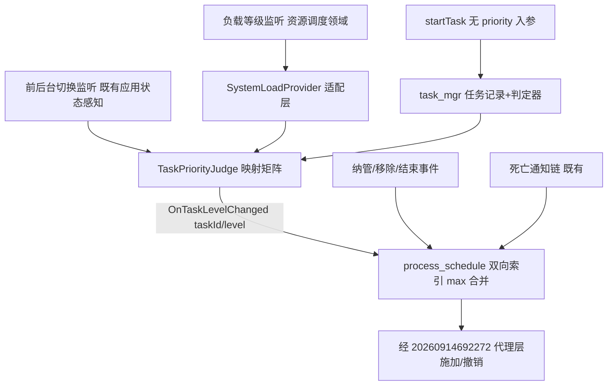
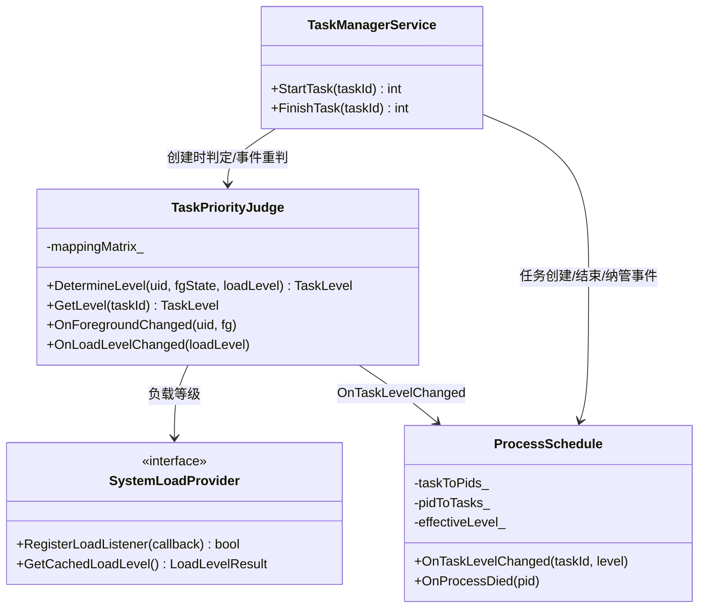
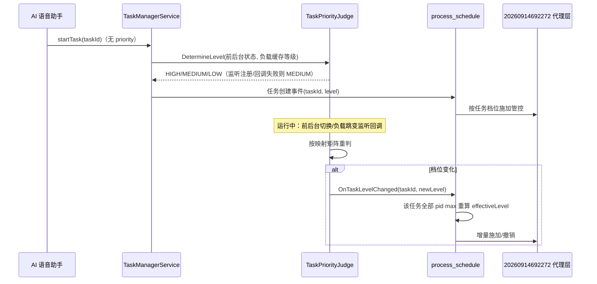

# Design

## 需求基线摘要

> 需求基线详见 proposal.md 与 spec.md。本设计为 FEAT-AI-TASK-MGR-001 的需求拆分之一，需求间接口约定：任务生命周期与 taskId 声明由 20260914692191 承载，本需求消费其归因主键与任务存活期事实，并承载 startTask 入参变更（移除 priority）。设计展开的映射矩阵对应 spec AC-6.5/AC-6.6/AC-6.7 的"设计映射矩阵"。

## 代码事实基线

> 源码基线：openharmony/ability_ability_runtime master（2026-09 勘察）。

| 事实项 | 代码引用（文件:行） | 对设计的约束 |
|--------|-------------------|-------------|
| 既有进程死亡/状态通知链 | services/appmgr（AppStateObserverManager/AppDeathRecipient） | 死亡清理最小挂点，不新增侵入钩子 |
| 事件处理与锁并发先例 | appmgr EventHandlerWrap 风格与既有互斥锁实践 | 任务事件并发处理，经锁保证并发安全（与 20260914692191 同一记录表锁域） |
| ITaskManager startTask 含 priority 入参 | 20260914692191 交付的 IDL/Stub/Proxy/NAPI/d.ts（api/@ohos.app.agent.taskManager.d.ts） | 本需求移除该入参：IDL 消息、Stub/Proxy、NAPI 绑定与 d.ts 同步变更；内部枚举值 100/200/300 保留 |
| 应用前后台状态感知 | appmgr 既有应用/进程状态管理（AppRunningManager / 应用状态通知链） | 判定器前后台输入直接复用，不新增感知链路 |

## 设计约束

1. 任务档位由系统判定：AI 语音助手不指定优先级（startTask 无 priority 入参）；系统在创建时与运行中依据创建者前后台状态与系统负载判定/重判，保留 HIGH/MEDIUM/LOW 三档
2. 进程实际管控档位 = 纳管任务中最高档位（合并语义）；任务档位变化触发归属重算，重算不引入管控空窗（关联 spec BR-1）
3. 豁免合并幂等：同进程同类型豁免幂等（幂等键 taskId+pid+豁免类型），引用计数按 pid 维护
4. 纳管进程死亡自动清理（≤1s），任务不自动结束；全部任务结束后完全恢复（RSS 自然回冻）
5. ≤10 并发任务设计基线（系统参数可配）；并发安全经互斥锁保证（不采用串行域无锁化）

## 非目标

- 任务生命周期实现（20260914692191，本需求仅承载其 startTask 入参变更）
- 纳管链路（20260914692192/20260914692193/20260914692194/20260917785424）
- 管控策略与 RSS 施加/撤销机制（20260914692272）
- DFX 观测面（20260914692442）
- 映射矩阵的运行期在线配置（本设计定义编译期默认矩阵，调整走版本迭代）

## 方案概述

新增优先级判定器 TaskPriorityJudge（隶属 task_mgr 模块、与任务记录同一互斥锁域）：输入为创建者（AI 语音助手）前后台状态（复用 appmgr 既有应用状态感知注册监听）与系统负载等级（经 SystemLoadProvider 适配层向资源调度领域注册监听获取，量化低/高两档），按映射矩阵输出 HIGH/MEDIUM/LOW。判定时机为任务创建时（startTask 链路内同步判定，读取监听缓存的当前状态）与运行中动态重判（前后台切换监听回调、负载等级跳变监听回调触发，事件驱动非周期全量）。档位变化经 OnTaskLevelChanged(taskId, level) 通知 process_schedule，process_schedule 在锁域内对该任务全部纳管 pid 做 max 增量重算并施加/撤销。

判定映射矩阵（默认，编译期常量）：

| 前后台状态 \ 系统负载 | 低 | 高 |
|----------------------|----|----|
| 前台 | HIGH | MEDIUM |
| 后台 | MEDIUM | LOW |

兜底：前后台状态或系统负载感知失败（监听注册失败或回调数据获取失败）时判定为 MEDIUM（对应 spec EX-0，验证方式：档位断言）。感知容错由 SystemLoadProvider 默认实现封装（注册/回调失败按"不可用"处理，判定器走兜底）；前后台状态与系统负载均为注册监听模型，不涉及超时阈值。

process_schedule 维持双向索引（taskToPids_/pidToTasks_）与档位缓存（effectiveLevel_）：进程加入/移除/任务结束/任务档位变化均触发增量重算（max 合并）；豁免申请以最高档任务为准、同进程同类型幂等（pid 维度引用计数，任务结束/降档按剩余任务重算）。进程死亡经既有通知链挂点移除并释放豁免。

startTask 接口变更：ITaskManager IDL 消息、Stub/Proxy、NAPI 绑定移除 priority 字段与参数校验；interface_sdk-js 仓 d.ts 移除 priority 入参与 TaskPriority 枚举导出；@since 26.2.0、鉴权（系统应用校验）、taskId 规格与错误码（202/16000301/401）沿用 20260914692191。

## 架构图

## 类图

## 模块影响

> 基础影响范围见 proposal.md。以下仅列出设计阶段识别的新增/变更模块及对应的设计决策关联。

| 子系统 | 仓库 | 模块/路径 | 影响类型 | 相关设计决策 |
|--------|------|-----------|---------|-------------|
| ability | ability_ability_runtime | services/appmgr/src/task_mgr/（判定器 + startTask 变更） | 修改（startTask 移除 priority）+ 新增（TaskPriorityJudge） | D4、D5、D7、D8 |
| ability | ability_ability_runtime | services/appmgr/src/process_schedule/（索引/合并/重算） | 新增（与 20260914692272 同模块）+ 变更（重判重算入口） | D1、D6 |
| ability | ability_ability_runtime | services/appmgr/（死亡通知挂点、应用状态感知挂点） | 修改（最小） | D2 |
| ability | interface_sdk-js | api/@ohos.app.agent.taskManager.d.ts | 修改（移除 priority 入参与 TaskPriority 枚举导出） | D8 |

## 实现入口

> 给执行 Agent 的代码接入点。优先引用现有入口、调用链和测试入口；不要让 Agent 自行扩大搜索范围。

| Entry Point | 代码引用（文件:行） | 当前职责 | 调用方 | 被调用方 | 预期变更 |
|-------------|-------------------|----------|--------|----------|----------|
| ITaskManager StartTask 消息处理 | services/appmgr/src/task_mgr/（20260914692191 交付） | 任务创建（含 priority 校验） | NAPI 绑定 | 任务记录 | 移除 priority 字段/参数校验，接入判定器 |
| NAPI startTask 绑定 | services/appmgr/src/task_mgr/ | JS 接口绑定 | d.ts 声明 | TaskManagerService | 移除 priority 参数校验 |
| 应用前后台状态通知 | services/appmgr 既有应用状态感知 | 应用/进程状态变化通知 | 系统 | 订阅方 | 新增挂点：转发判定器 OnForegroundChanged |
| 系统负载查询 | 资源调度领域（接口待确认，见 proposal 开放问题） | 系统负载信息 | — | — | SystemLoadProvider 默认实现接入 |
| 进程死亡通知链 | services/appmgr（AppDeathRecipient 回调） | 死亡通知 | 系统 | 订阅方 | 挂点：移除双向索引条目+释放豁免+重算 |

## 既有模式复用

| Pattern | 参考代码 | 复用方式 | 适用 Task |
|---------|----------|----------|-----------|
| 双向索引状态管理 | appmgr 既有记录管理（AppRunningManager） | 索引结构与互斥锁保护更新风格 | TASK-4 |
| 系统参数可配项 | appmgr 既有 parameter 读取封装 | 并发任务数上限等可配项读取（≤10 并发，系统参数可配） | TASK-4 |

## 关键设计决策

| 决策 ID | 问题 | 推荐方案 | 备选方案 | 选择理由 |
|---------|------|----------|----------|----------|
| D1 | 合并算法 | max 合并 + 增量重算（事件驱动） | 全量重算 | 增量重算 O(变更任务数)；锁域内无竞态 |
| D2 | 死亡清理 | 复用既有死亡通知链挂点 | 独立监控 | 最小侵入（🔴 高风险目录约束） |
| D3 | 幂等设计 | pid 维度引用计数（taskId+pid+豁免类型幂等键） | 任务维度标志位 | 同进程多任务豁免正确合并/释放（防误杀） |
| D4 | 判定器归属 | task_mgr 内新增 TaskPriorityJudge，与任务记录同一锁域 | 判定逻辑并入 process_schedule | 档位是任务属性，owner 与任务记录一致；process_schedule 仅消费事件，合并职责单一 |
| D5 | 映射矩阵形态 | 编译期常量默认矩阵（前台低负载=HIGH、前台高负载=MEDIUM、后台低负载=MEDIUM、后台高负载=LOW） | 仅系统参数可配 | 无配置时行为确定；调整走版本迭代 |
| D6 | 动态重判触发模型 | 事件驱动：前后台切换监听回调 + 负载等级跳变监听回调触发（注册监听模型，无轮询采样），判定档位变化才触发下游重算 | 周期全量重判 | 开销低、时延即时；档位不变不重算（天然防抖） |
| D7 | 负载获取 | SystemLoadProvider 适配层抽象（默认实现向资源调度领域注册负载等级监听并维护当前等级缓存；测试桩返回固定等级） | 判定器直接调用 | 负载监听接口待与资源调度领域确认，适配层隔离变化、可测 |
| D8 | startTask 变更范围 | IDL/NAPI/d.ts 同步移除 priority 与 TaskPriority 枚举导出，内部枚举值保留 | 保留入参静默忽略 | 需求明确不再由调用方指定；静默忽略产生误导语义 |

## 状态归属与不变量

- **Ownership（任务档位）**：owner = task_mgr / TaskPriorityJudge（互斥锁保护域）；创建 = startTask 创建时判定；更新 = 前后台切换/负载跳变动态重判；清理 = 任务结束；只读消费者 = process_schedule（经 OnTaskLevelChanged 事件 + GetLevel 查询）。不变量：任务档位 ∈ {HIGH, MEDIUM, LOW}，任一时刻等于按当前前后台状态与负载等级对映射矩阵求值的结果（感知不可用时为 MEDIUM）。验证：判定矩阵单测（AC-6.5/AC-6.6）+ 动态重判单测（AC-6.7）
- **Ownership（双向索引/档位缓存）**：owner = process_schedule（互斥锁保护域）；创建 = 纳管事件；清理 = 进程死亡/任务结束；不变量：effectiveLevel(pid) == max(该 pid 全部存活纳管任务的当前档位)。验证：多任务×多进程矩阵单测
- **Concurrency**：判定器与任务记录表同一互斥锁域；重判事件串行处理，不并发重入；process_schedule 重算在自身锁域内执行。验证：并发单测（≤10 任务）
- **Compatibility**：内部 TaskLevel 枚举值 100/200/300 与 20260914692191 原 TaskPriority 一致；IDL 消息字段移除在同一 @since 26.2.0 版本内完成，无跨版本序列化兼容负担。验证：接口编译 + 新签名调用 demo（AC-6.5）

## DFX 设计

### DFX 故障模式分析

不涉及理由：仓不可达（ability_ability_runtime、interface_sdk-js 源码仓本地不可达，仓知识库 docs/dfx/fmea.yaml 无法读取执行匹配；访问远程仓复核需开发者确认，归档前补查）。

> 涉及仓库：ability_ability_runtime, interface_sdk-js

| 仓库 | 状态 | 理由 |
|------|------|------|
| ability_ability_runtime | UNREACHABLE | 当前工作区无该源码仓，docs/dfx/fmea.yaml 不可达 |
| interface_sdk-js | UNREACHABLE | 当前工作区无该源码仓，docs/dfx/fmea.yaml 不可达 |

| 分析对象 | 故障模式 | 故障影响 | 故障原因 | 严酷度 | 恢复措施 | 关键日志 | 大数据打点事件 | 来源 |
|---------|----------|----------|-------------|---------|---------|---------|---------|------|

观测面沿用 20260914692442：判定/重判/合并/清理关键路径日志与 dump 字段由其规范承载。

## 安全基础检查

不涉及（proposal 安全/权限 = 否）：无新增信任边界交叉；startTask 鉴权（系统应用身份校验）沿用 20260914692191；判定器输入（前后台状态、负载等级）为系统内部状态，无敏感数据外泄面。

## 时序设计

## 风险与缓解

| 风险 | 可能性 | 影响 | 缓解措施 |
|--------|--------|------|----------|
| R1: 重算遗漏（事件顺序异常） | 低 | 档位不一致 | 锁域内处理 + 矩阵单测（多任务×多进程组合） |
| R2: 死亡清理延迟 | 低 | 豁免残留 | 既有通知链（≤1s）+ 任务超时兜底（20260914692191） |
| R3: 档位抖动（负载在量化边界波动） | 中 | 频繁重算、管控抖动 | 负载量化低/高两档 + 跳变触发（非连续阈值比较）；判定档位不变不触发下游重算 |
| R4: 负载监听注册/回调失败 | 中 | 判定不可用 | SystemLoadProvider 失败返回"不可用"语义 → 兜底 MEDIUM + 关键路径日志（20260914692442） |
| R5: startTask 变更与 20260914692191 实现联调不一致 | 低 | 接口面漂移 | TASK-1 声明文件先行；d.ts PR 与 appmgr 变更同评审闭环 |

## 验证思路

| 验证场景 | 方法 | 通过标准 |
|----------|------|----------|
| 判定矩阵 | 单测（TASK-2） | 前后台×负载四组合档位断言与默认矩阵一致；感知不可用兜底 MEDIUM |
| startTask 新签名 | 集成 demo（TASK-3） | 无 priority 入参调用成功、任务按判定档位激活；多传入参返回 401 |
| 动态重判 | 单测+集成（TASK-5） | 前后台切换/负载跳变触发重判；档位不变不触发重算；进程实际档位随归属重算（取最高档） |
| max 合并与降档 | 单测（矩阵） | 档位断言与预期一致 |
| 幂等合并 | 单测 | 同进程同类型豁免不重复施加 |
| 死亡清理 | 集成 | ≤1s 移除、任务不结束 |
| 并发上限 | 单测 | 第 11 个任务拒绝（可配） |

> 兼容性验证详见 spec.md 兼容性声明章节。
