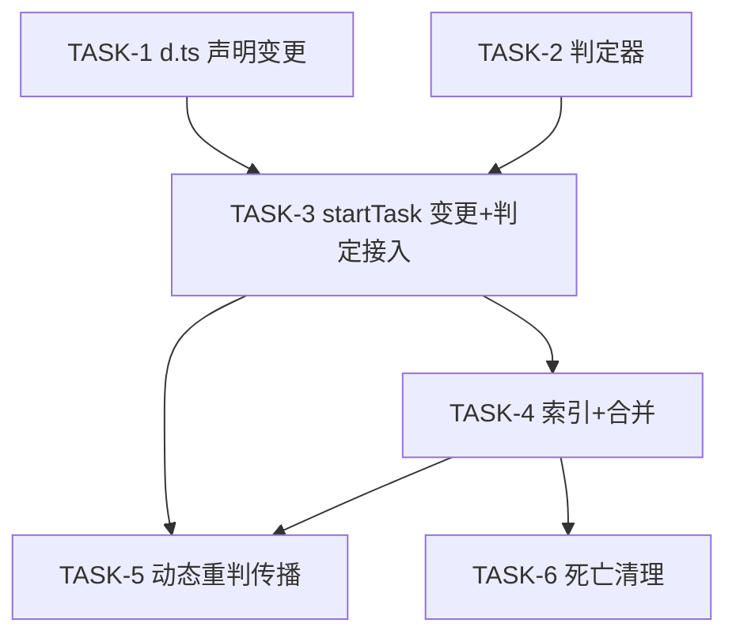

# Execution Plan

## Plan 元数据

| 字段 | 内容 |
|------|------|
| Plan ID | PLAN-20260914692273 |
| 关联 Feature | FEAT-AI-TASK-MGR-001（RR 30096095） |
| 关联文档 | proposal.md / spec.md / design.md（本目录） |
| 状态 | Draft（待评审） |
| Owner | 元能力 SIG |
| 目标版本 | OpenHarmony 7.1.0.23 (2026-11-11) |

## 输入状态

| 输入 | 路径 | 要求状态 |
|------|------|----------|
| Proposal | proposal.md | Draft（随本 PR 评审） |
| Spec | spec.md | Draft（随本 PR 评审） |
| Design | design.md | Draft（随本 PR 评审） |

## 执行原则

- **Spec 权威：** 若实现细节与 spec.md 的 AC、错误码或兼容性声明冲突，先更新 spec/design，再继续实现。
- **测试先行：** 每个 Task 先写失败测试（Red 条件见 spec 测试设计提示）；无法单测的集成行为先写明可复现证据缺口。
- **任务小型化：** 一个 Task 只覆盖一个独立闭环。
- **文件边界：** Task 只能修改 Files 表列出的文件；构建暴露额外需求时先更新本计划。
- **状态所有权唯一：** 新增状态必须明确 owner、key/index、创建时机、清理触发和只读消费者（见 design.md 状态归属与不变量）。
- **证据回填：** Task 完成后回填「AC 到 Task 追溯」验证状态、「代码范围映射」实际文件、per-task Actual Result。
- **反伪完成：** 只补声明、只写结构、只跑非相关测试，都不能替代 AC 闭环。

## AC 到 Task 追溯

| AC | 来源 | Task | 验证方式 | 验证状态 |
|----|------|------|----------|----------|
| AC-6.5 | spec US-1 | TASK-1、TASK-2、TASK-3 | 集成 demo：无 priority 入参 startTask 调用成功，任务按判定档位激活 | Pending |
| AC-6.6 | spec US-1 | TASK-2 | 单测：前后台×负载四组合判定矩阵断言；兜底 MEDIUM | Pending |
| AC-6.7 | spec US-1 | TASK-5 | 单测+集成：前后台切换/负载跳变动态重判，进程档位随归属重算（取最高档） | Pending |
| AC-6.1 | spec US-2 | TASK-4 | 单测：多任务×多进程矩阵档位合并断言（max） | Pending |
| AC-6.2 | spec US-2 | TASK-4 | 单测：高档任务结束降至次高档；全部结束完全恢复 | Pending |
| AC-6.3 | spec US-2 | TASK-6 | 集成：进程死亡移除 ≤1s、任务不自动结束 | Pending |
| AC-6.4 | spec US-2 | TASK-4 | 单测：并发任务上限（默认 10，可配）拒绝 | Pending |

## 实现边界

**必须实现：** d.ts 声明变更、优先级判定器（映射矩阵/兜底）、startTask 接口变更与判定接入、双向索引、max 合并、幂等、并发上限、动态重判传播、死亡清理与全部用例。

**可后置：** 无。

**不建议延后：** 判定器与 startTask 变更（AC-6.5 主链）；max 合并语义（需求"按最高优先级处理"核心）。

## 禁止项

- 每个 AC 必须有明确验证方式；不得使用 TBD/TODO 等占位描述。
- 不得修改 Task 列出范围外的文件；需要新增上下文时先更新本计划。
- 未通过验证不得标记 Task 完成。

## Task 依赖

## Task 列表

| TASK ID | 目标 | 文件范围 | AC 映射 | 前置依赖 | 完成判据 | 验证命令 | 状态 |
|---------|------|----------|---------|----------|----------|----------|------|
| TASK-1 | API 声明文件变更（d.ts） | interface_sdk-js api/@ohos.app.agent.taskManager.d.ts | AC-6.5 | 无 | d.ts 移除 priority 入参与 TaskPriority 导出，@since 26.2.0 不变 | oh-api-definition（可选，不阻塞）+ d.ts diff 审阅 | Pending |
| TASK-2 | 优先级判定器（映射矩阵+状态/负载感知+兜底） | services/appmgr/src/task_mgr/ | AC-6.5、AC-6.6 | 20260914692191 TASK-2（任务记录模块） | 判定矩阵/兜底单测全部通过 | ./build.sh --product-name rk3568 --build-target libappms && run -t UT -tp ability_runtime | Pending |
| TASK-3 | startTask 接口变更与判定接入（IDL/NAPI/Service） | services/appmgr/src/task_mgr/ + interfaces/inner_api | AC-6.5 | TASK-1、TASK-2 | 新签名集成 demo 通过；多传入参返回 401 | ./build.sh --product-name rk3568 --build-target libappms && run -t UT -tp ability_runtime | Pending |
| TASK-4 | 双向索引 + max 档位合并 + 幂等 + 并发上限 | services/appmgr/src/process_schedule/ | AC-6.1、AC-6.2、AC-6.4 | TASK-3；20260914692272 TASK-2 | AC 用例全部通过 | ./build.sh --product-name rk3568 --build-target libappms && run -t UT -tp ability_runtime | Pending |
| TASK-5 | 动态重判与档位传播（订阅状态/负载变化→重算） | services/appmgr/src/task_mgr/ + process_schedule/ | AC-6.7 | TASK-3、TASK-4 | 动态重判用例全部通过 | ./build.sh --product-name rk3568 --build-target libappms && run -t UT -tp ability_runtime | Pending |
| TASK-6 | 进程死亡清理挂点 | services/appmgr/（AppDeathRecipient 挂点） | AC-6.3 | TASK-4 | AC 用例全部通过 | ./build.sh --product-name rk3568 --build-target libappms && run -t UT -tp ability_runtime | Pending |

## Task 详情

### TASK-1: API 声明文件变更（d.ts）

**目标：** 按 spec.md 接口变更分析修改声明文件：startTask 移除 priority 可选入参（签名 startTask(taskId: string): Promise<void>）；移除 TaskPriority 枚举导出；@since 26.2.0、@systemapi、@stagemodelonly、@syscap 标注不变。

**AC 映射：** AC-6.5

**前置依赖：** 无（spec.md 接口变更分析已定稿签名）

**非目标：** appmgr 侧 IDL/NAPI 实现变更（TASK-3）；finishTask 声明（20260914692191 承载，不变）

**状态所有权：** 无（声明文件无运行状态）

**任务间接口：** Produces = d.ts 新签名 startTask(taskId: string): Promise<void>、TaskPriority 枚举不再导出；Consumes = 无

**只读上下文**

| 路径 | 读取目的 |
|------|----------|
| spec.md「接口变更分析」 | 签名与错误码权威来源 |
| 20260914692191 spec.md「API 规格定义」 | 原声明基线（标注/@since/错误码沿用项） |

**Files**

| 操作 | 文件 | 说明 |
|------|------|------|
| 修改 | interface_sdk-js api/@ohos.app.agent.taskManager.d.ts | startTask 移除 priority 入参；移除 TaskPriority 枚举导出 |

**禁止修改文件**

| 文件/路径 | 原因 |
|-----------|------|
| finishTask 声明段 | 20260914692191 承载，本需求不变 |

**Steps**

1. 生成 d.ts diff：startTask 移除 priority 入参、删除 TaskPriority 枚举段
2. 如环境可用运行 oh-api-definition（可选、不阻塞）
3. diff 审阅：与 spec 接口变更分析签名一致
4. 回填本 Task 的 Actual Result

**Verification**

| Command / Evidence | Expected Result | Actual Result |
|--------------------|-----------------|---------------|
| d.ts diff 文件 | 仅 startTask 签名与 TaskPriority 枚举两处变更 | （回填） |

### TASK-2: 优先级判定器（映射矩阵+状态/负载感知+兜底）

**目标：** task_mgr 模块新增 TaskPriorityJudge：DetermineLevel(uid, fgState, loadLevel) 按默认映射矩阵（前台低负载=HIGH、前台高负载=MEDIUM、后台低负载=MEDIUM、后台高负载=LOW）输出档位；SystemLoadProvider 适配层抽象（默认实现向资源调度领域注册负载等级监听并维护当前等级缓存，测试桩返回固定等级）；前后台状态经 appmgr 既有应用状态感知注册监听获取；监听注册失败或回调数据获取失败时兜底 MEDIUM。

**AC 映射：** AC-6.5、AC-6.6

**前置依赖：** 20260914692191 TASK-2（任务记录模块与锁域）

**非目标：** startTask 链路接入（TASK-3）；动态重判事件订阅与传播（TASK-5）

**状态所有权：** 任务档位 owner = task_mgr/TaskPriorityJudge（互斥锁保护域）；创建 = startTask 判定；清理 = 任务结束；只读消费者 = process_schedule

**任务间接口：** Produces = DetermineLevel(uid, fgState, loadLevel) -> TaskLevel（HIGH/MEDIUM/LOW，内部枚举 100/200/300）；GetLevel(taskId)；事件 OnTaskLevelChanged(taskId, level)；Consumes = 无（输入为 appmgr 应用状态与 SystemLoadProvider）

**只读上下文**

| 路径 | 读取目的 |
|------|----------|
| design.md「方案概述」「关键设计决策 D4/D5/D7」 | 矩阵与兜底定义 |
| services/appmgr/src/task_mgr/ | 任务记录与锁域先例 |

**Files**

| 操作 | 文件 | 说明 |
|------|------|------|
| 新增 | services/appmgr/src/task_mgr/task_priority_judge.* | 判定器：映射矩阵+兜底 MEDIUM |
| 新增 | services/appmgr/src/task_mgr/system_load_provider.* | 负载适配层抽象+默认实现 |
| 新增 | test/unittest/task_mgr/ | 判定矩阵/兜底单测（PriorityJudgeMatrix_0100） |

**禁止修改文件**

| 文件/路径 | 原因 |
|-----------|------|
| services/appmgr/src/process_schedule/ | TASK-4 范围 |

**Steps**

1. 写失败测试：四组合矩阵断言（前台/后台 × 低/高负载）+ 感知不可用兜底 MEDIUM（Red：未实现前判定结果无状态差异）
2. 运行验证确认 RED
3. 实现 TaskPriorityJudge 映射矩阵与 SystemLoadProvider 适配层（含测试桩）
4. 运行聚焦验证确认 GREEN
5. 回填本 Task 的 Actual Result

**Anti-Fake Completion**

| Check | Required Evidence |
|-------|-------------------|
| AC closed | 四组合矩阵与兜底用例通过（AC-6.6） |
| Scope respected | 仅 task_mgr/ 与对应单测目录 |
| State lifecycle complete | 档位创建/查询/清理覆盖 |

**Verification**

| Command / Evidence | Expected Result | Actual Result |
|--------------------|-----------------|---------------|
| run -t UT -tp ability_runtime | 判定矩阵/兜底用例全绿 | （回填） |

### TASK-3: startTask 接口变更与判定接入（IDL/NAPI/Service）

**目标：** ITaskManager IDL StartTask 消息移除 priority 字段，Stub/Proxy 序列化同步；NAPI 绑定移除 priority 参数校验（单参）；TaskManagerService::StartTask 创建链路内同步调用 DetermineLevel 判定档位并写入任务记录；错误码沿用 202/16000301/401。

**AC 映射：** AC-6.5

**前置依赖：** TASK-1（d.ts 签名）、TASK-2（判定器接口）

**非目标：** 纳管与归属合并（TASK-4）；动态重判（TASK-5）

**状态所有权：** 无新增状态（消费 TASK-2 任务档位）

**任务间接口：** Produces = 新 IDL StartTask 消息（无 priority 字段）；NAPI startTask(taskId) 参数校验（仅 1 参，多传返回 401）；Consumes = TASK-1 d.ts 签名；TASK-2 DetermineLevel/GetLevel

**只读上下文**

| 路径 | 读取目的 |
|------|----------|
| services/appmgr/src/task_mgr/（20260914692191 交付的 startTask 链路） | IDL/Stub/Proxy/NAPI 现状 |
| TASK-1 d.ts diff | 目标签名 |

**Files**

| 操作 | 文件 | 说明 |
|------|------|------|
| 修改 | interfaces/inner_api（ITaskManager IDL 与生成代码） | StartTask 移除 priority 字段 |
| 修改 | services/appmgr/src/task_mgr/ | Service/Stub/NAPI 移除参数校验，接入判定器 |
| 新增 | test/integration/ | StartTaskPriorityAutoJudge_0100（新签名 demo） |

**禁止修改文件**

| 文件/路径 | 原因 |
|-----------|------|
| IAppMgr 既有接口与序列化 | 高风险目录约束：不扩不修改 |

**Steps**

1. 写失败测试：无 priority 入参调用断言档位激活；多传入参断言 401（Red：未实现前接口含入参/档位缺省固定）
2. 运行验证确认 RED
3. IDL/NAPI/Service 移除 priority 并接入判定器
4. 运行聚焦验证确认 GREEN
5. 回填本 Task 的 Actual Result

**Anti-Fake Completion**

| Check | Required Evidence |
|-------|-------------------|
| AC closed | 新签名调用 demo + 多传 401 用例（AC-6.5） |
| Scope respected | 仅 IDL/task_mgr/integration 目录 |
| State lifecycle complete | N/A |

**Verification**

| Command / Evidence | Expected Result | Actual Result |
|--------------------|-----------------|---------------|
| run -t UT -tp ability_runtime + 集成 demo | 新签名链路全绿、多传 401 | （回填） |

### TASK-4: 双向索引 + max 档位合并 + 幂等 + 并发上限

**目标：** process_schedule 维护双向索引与档位缓存：事件驱动增量重算（max）；豁免合并幂等（taskId+pid+豁免类型）；≤10 并发任务上限（系统参数可配）。

**AC 映射：** AC-6.1、AC-6.2、AC-6.4

**前置依赖：** TASK-3（任务档位事实）；20260914692272 TASK-2（管控代理层）

**非目标：** 死亡清理挂点（TASK-6）；动态重判订阅（TASK-5）

**状态所有权：** 双向索引/档位缓存 owner = process_schedule（互斥锁保护域）；不变量 effectiveLevel(pid) == max(存活任务当前档位)

**任务间接口：** Produces = OnTaskLevelChanged(taskId, level) 重算入口（process_schedule inner API）；豁免幂等键 taskId+pid+豁免类型；Consumes = TASK-2 事件签名（经 task_mgr 转发）

**只读上下文**

| 路径 | 读取目的 |
|------|----------|
| design.md「状态归属与不变量」 | 索引与不变量定义 |
| appmgr AppRunningManager 记录管理 | 索引与锁先例 |

**Files**

| 操作 | 文件 | 说明 |
|------|------|------|
| 新增 | services/appmgr/src/process_schedule/（索引/合并/重算） | 双向索引 + max 合并 + 幂等 |
| 新增 | test/unittest/process_schedule/ | 矩阵/幂等/上限单测 |

**禁止修改文件**

| 文件/路径 | 原因 |
|-----------|------|
| services/appmgr/src/task_mgr/ | TASK-2/TASK-3 范围 |

**Steps**

1. 写失败测试（矩阵/降档/幂等/上限）
2. 运行验证确认 RED
3. 实现双向索引与增量重算
4. 实现幂等键与引用计数
5. 实现并发上限
6. 运行聚焦验证确认 GREEN
7. 回填本 Task 的 Actual Result

**Anti-Fake Completion**

| Check | Required Evidence |
|-------|-------------------|
| AC closed | AC-6.1/6.2/6.4 用例全绿 |
| Scope respected | 仅 process_schedule/ 与对应单测目录 |
| State lifecycle complete | 索引/豁免创建、更新、清理覆盖 |

**Verification**

| Command / Evidence | Expected Result | Actual Result |
|--------------------|-----------------|---------------|
| run -t UT -tp ability_runtime | 归属矩阵/降档/幂等/上限用例全绿 | （回填） |

### TASK-5: 动态重判与档位传播（订阅状态/负载变化→重算）

**目标：** 经注册监听感知创建者前后台状态切换（既有应用状态通知挂点）与负载等级跳变（资源调度领域监听回调，SystemLoadProvider 转发），触发判定器重判；档位变化经 OnTaskLevelChanged 通知 process_schedule，对任务全部纳管 pid 增量重算（取最高档）并施加/撤销；判定档位不变不触发重算（天然防抖）；注册监听模型，无轮询采样、不涉及超时阈值。

**AC 映射：** AC-6.7

**前置依赖：** TASK-3（任务创建链路）、TASK-4（重算入口）

**非目标：** 负载接口语义确认（proposal 开放问题，设计评审闭环）；映射矩阵调整（版本迭代）

**状态所有权：** 无新增状态（复用 TASK-2 任务档位与 TASK-4 档位缓存）

**任务间接口：** Produces = 监听挂点（OnForegroundChanged / SystemLoadProvider 负载等级监听回调）；Consumes = TASK-2 判定器接口；TASK-4 OnTaskLevelChanged 重算入口

**只读上下文**

| 路径 | 读取目的 |
|------|----------|
| design.md「时序设计」「D6」 | 触发模型与防抖语义 |
| appmgr 应用状态通知链 | 前后台事件挂点 |

**Files**

| 操作 | 文件 | 说明 |
|------|------|------|
| 修改 | services/appmgr/src/task_mgr/ | 判定器订阅挂点+重判触发 |
| 修改 | services/appmgr/src/process_schedule/ | OnTaskLevelChanged 重算实现 |
| 新增 | test/unittest/task_mgr/ | PriorityRejudgeOnStateChange_0100 等动态重判用例 |

**禁止修改文件**

| 文件/路径 | 原因 |
|-----------|------|
| 20260914692272 管控代理层 | 档位施加/撤销机制归属其需求 |

**Steps**

1. 写失败测试：运行中切前后台/负载跳变断言档位重判与进程重算；档位不变断言无重算（Red：未实现前档位静止不重判）
2. 运行验证确认 RED
3. 挂接前后台状态与负载等级监听回调，实现重判与传播
4. 运行聚焦验证确认 GREEN
5. 回填本 Task 的 Actual Result

**Anti-Fake Completion**

| Check | Required Evidence |
|-------|-------------------|
| AC closed | AC-6.7 用例全绿（重判+重算+防抖断言） |
| Scope respected | 仅 task_mgr/ 与 process_schedule/ |
| State lifecycle complete | N/A |

**Verification**

| Command / Evidence | Expected Result | Actual Result |
|--------------------|-----------------|---------------|
| run -t UT -tp ability_runtime | 动态重判用例全绿 | （回填） |

### TASK-6: 进程死亡清理挂点

**目标：** 复用 AppMS 既有死亡通知链：死亡进程移除索引 + 释放豁免 + 档位重算（≤1s）；任务不自动结束。

**AC 映射：** AC-6.3

**前置依赖：** TASK-4

**非目标：** CLI 进程死亡（20260914692193 会话链承载）

**状态所有权：** 无新增状态（消费 TASK-4 索引与豁免引用计数）

**任务间接口：** Produces = 无；Consumes = TASK-4 索引移除/豁免释放接口

**只读上下文**

| 路径 | 读取目的 |
|------|----------|
| services/appmgr（AppDeathRecipient 回调） | 既有通知链挂点 |

**Files**

| 操作 | 文件 | 说明 |
|------|------|------|
| 修改 | services/appmgr/（AppDeathRecipient 挂点） | 死亡→移除+释放+重算 |
| 新增 | test/integration/ | 死亡清理时延用例（ProcessDeathCleanup_0100） |

**禁止修改文件**

| 文件/路径 | 原因 |
|-----------|------|
| 既有通知链主体逻辑 | 最小挂点约束（design D2） |

**Steps**

1. 写失败测试（清理 ≤1s、任务存续断言）
2. 运行验证确认 RED
3. 挂接既有通知链
4. 运行聚焦验证确认 GREEN
5. 回填本 Task 的 Actual Result

**Anti-Fake Completion**

| Check | Required Evidence |
|-------|-------------------|
| AC closed | AC-6.3 时延打点与任务存续记录 |
| Scope respected | 仅 appmgr 挂点与 integration 目录 |
| State lifecycle complete | 死亡清理覆盖索引移除+豁免释放+重算 |

**Verification**

| Command / Evidence | Expected Result | Actual Result |
|--------------------|-----------------|---------------|
| run -t UT -tp ability_runtime + 集成用例 | 清理 ≤1s、任务存续 | （回填） |

## Review Gates

| Gate | When | Required Evidence | Blocks Next Step |
|------|------|-------------------|------------------|
| Gate-1 | TASK-1/TASK-3 完成后 | d.ts diff 与 spec 接口变更分析一致；IDL 序列化同步 | TASK-4 起 |
| Gate-2 | TASK-2/TASK-4/TASK-5 完成后 | 判定矩阵/归属矩阵/动态重判用例与断言记录 | TASK-6 起 |
| Gate-Final | 全部 Task 完成后 | 端到端证据（dump/hilog）、「AC 到 Task 追溯」与 Actual Result 全部回填 | 归档 |

## 代码范围映射

| TASK ID | 文件 | 操作 |
|--------|------|------|
| TASK-1 | interface_sdk-js api/@ohos.app.agent.taskManager.d.ts | 修改 |
| TASK-2 | services/appmgr/src/task_mgr/task_priority_judge.*、system_load_provider.*、test/unittest/task_mgr/ | 新增 |
| TASK-3 | interfaces/inner_api（ITaskManager IDL）、services/appmgr/src/task_mgr/、test/integration/ | 修改+新增 |
| TASK-4 | services/appmgr/src/process_schedule/、test/unittest/process_schedule/ | 新增 |
| TASK-5 | services/appmgr/src/task_mgr/、services/appmgr/src/process_schedule/、test/unittest/task_mgr/ | 修改+新增 |
| TASK-6 | services/appmgr/（AppDeathRecipient 挂点）、test/integration/ | 修改+新增 |
