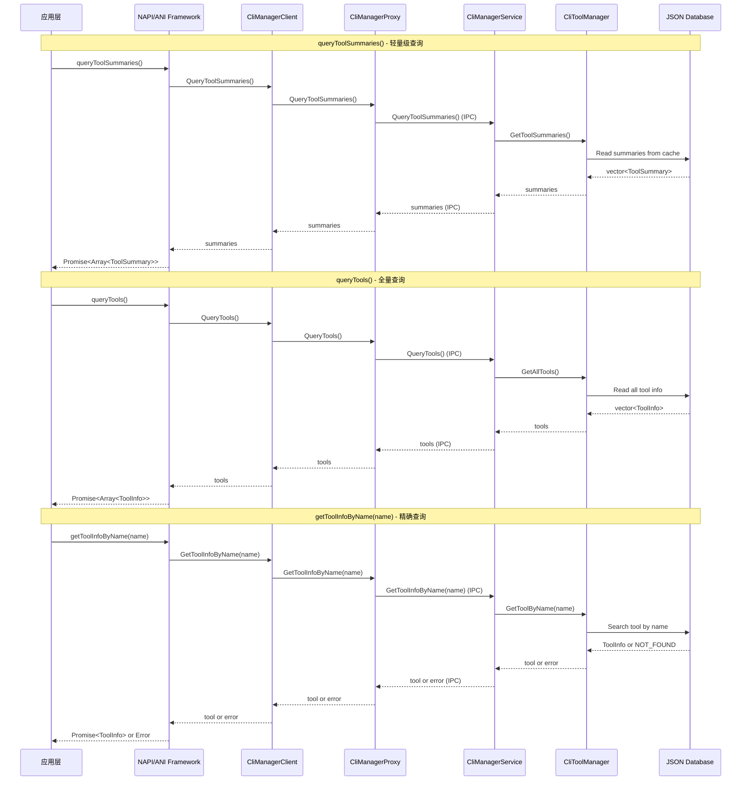
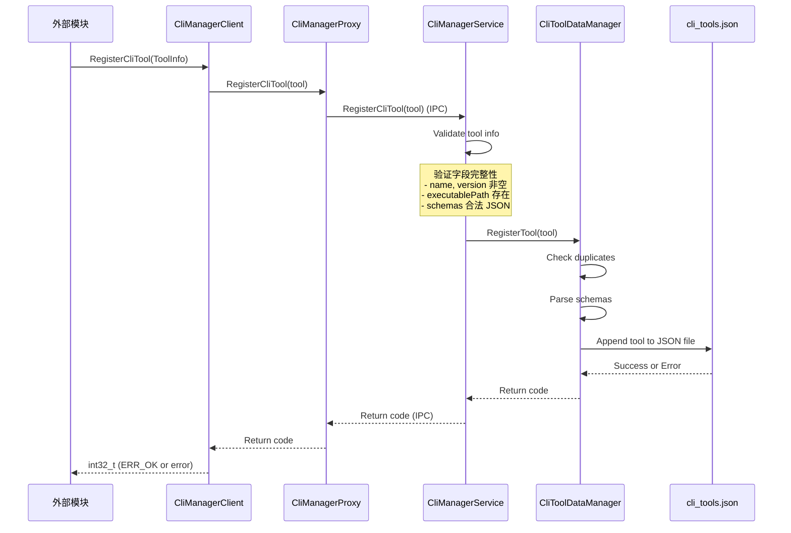
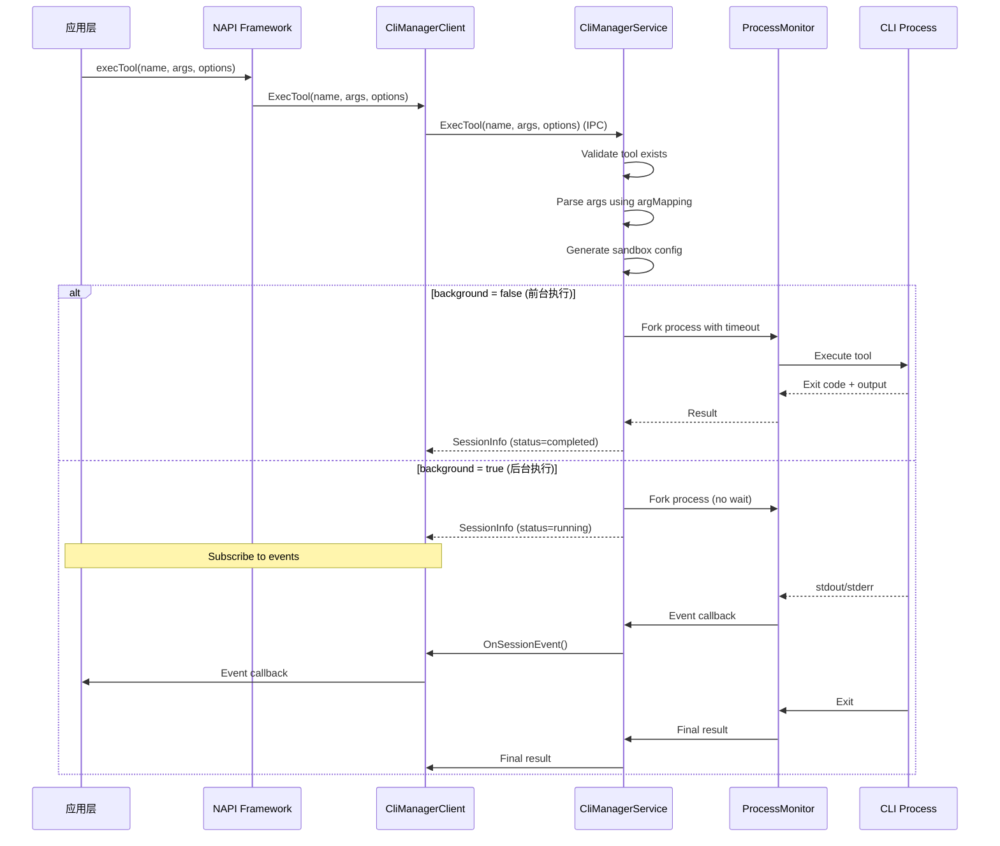

# CLI 管理器设计文档

## 文档信息

| 项目 | 内容 |
|------|------|
| 文档版本 | v1.0 |
| 编写日期 | 2026-04-14 |
| 组件名称 | CLI Manager Framework |
| 系统能力 ID | 8899 |

---

## 1. 功能概述

### 1.1 背景与目标

CLI 管理器（CLI Manager）是 OpenHarmony ability_runtime 组件中的系统能力，为应用提供命令行工具的管理和执行能力。该组件允许开发者：

1. **工具查询**：查询系统中已注册的 CLI 工具信息
2. **工具注册**：向系统注册新的 CLI 工具
3. **工具执行**：同步或异步执行 CLI 工具
4. **会话管理**：管理后台执行会话，支持事件订阅

### 1.2 核心功能

#### 功能一：工具查询接口

提供三个层次的查询能力：

| 接口名称 | 功能描述 | 返回内容 | 使用场景 |
|---------|---------|---------|---------|
| `queryToolSummaries()` | 查询工具摘要 | ToolSummary[]（仅 name, version, description） | 快速列表展示、UI 工具选择器 |
| `queryTools()` | 查询全量工具列表 | ToolInfo[]（完整元数据） | 工具详情页面、参数验证 |
| `getToolInfoByName(name)` | 按名称查询单个工具 | ToolInfo（单个工具完整信息） | 特定工具详情查询、执行前验证 |

#### 功能二：CLI 工具注册接口

提供 C++ 接口 `RegisterCliTool`，允许外部模块向系统注册 CLI 工具：

- **参数校验**：验证 ToolInfo 的完整性和合法性
- **数据持久化**：将工具信息存储到数据库（JSON 文件）
- **版本管理**：支持工具版本升级和覆盖注册

### 1.3 应用场景

1. **开发者工具**：网络扫描器、日志分析器、性能监控工具
2. **系统集成**：包管理器、系统配置工具、诊断工具
3. **自动化脚本**：定时任务、批处理操作、系统维护
4. **AI Agent 集成**：为 AI Agent 提供工具调用能力

### 1.4 支持的 API 版本

- **API 11 (NAPI)**：JavaScript/TypeScript 接口（1.1 版本）
- **API 12 (ANI)**：ArkTS 原生接口（1.2 版本）
- **Native C++**：C++ 客户端接口

---

## 2. 实现方案

### 2.1 架构设计

CLI 管理器采用四层架构：

```
┌─────────────────────────────────────────────────────┐
│          Framework Layer (NAPI/ANI)                 │
│  - js_cli_manager.cpp (NAPI 1.1)                    │
│  - @ohos.app.ability.cliManager.ets (ANI 1.2)      │
└────────────────┬────────────────────────────────────┘
                 │
┌────────────────▼────────────────────────────────────┐
│         Interface Layer (Client/Proxy/Stub)         │
│  - cli_manager_client.cpp                           │
│  - cli_manager_proxy.cpp/stub.cpp                   │
│  - icli_manager.h (IPC Interface)                   │
└────────────────┬────────────────────────────────────┘
                 │ IPC (Binder)
┌────────────────▼────────────────────────────────────┐
│           Service Layer (System Ability)            │
│  - cli_manager_service.cpp/h                        │
│  - cli_tool_manager.cpp/h (Tool 数据管理)            │
│  - session_record.cpp/h (会话记录)                   │
└────────────────┬────────────────────────────────────┘
                 │
┌────────────────▼────────────────────────────────────┐
│            Data Layer (Persistence)                  │
│  - cli_tools.json (工具元数据存储)                   │
│  - Sandbox (工具执行隔离)                            │
└─────────────────────────────────────────────────────┘
```

### 2.2 模块说明

#### 2.2.1 Framework 层

**NAPI 模块** (`frameworks/js/napi/cli_manager/`)
- `js_cli_manager.cpp`：JavaScript 接口实现，参数解析和类型转换
- `js_cli_subscription_manager.cpp`：事件订阅管理

**ANI 模块** (`frameworks/ets/ets/`)
- `@ohos.app.ability.cliManager.ets`：ArkTS 接口定义

#### 2.2.2 Interface 层

**客户端** (`interfaces/inner_api/cli_manager/`)
- `cli_manager_client.cpp`：客户端入口，服务连接管理
- `cli_manager_proxy.cpp`：IPC 代理，发送请求到服务端
- `cli_manager_stub.cpp`：IPC 存根，接收服务端回调
- `icli_manager.h`：IPC 接口定义

#### 2.2.3 Service 层

**系统服务** (`services/climgr/`)
- `cli_manager_service.cpp`：系统服务主类，继承 SystemAbility
- `cli_tool_manager.cpp`：工具数据管理器，加载和查询工具
- `session_record.cpp`：会话记录管理
- `process_monitor.cpp`：进程监控
- `io_monitor.cpp`：IO 监控
- `timeout_manager.cpp`：超时管理

### 2.3 时序图

#### 2.3.1 工具查询时序图



#### 2.3.2 工具注册时序图



#### 2.3.3 工具执行时序图



### 2.4 数据流转

#### 2.4.1 工具元数据加载

```
cli_tools.json (JSON 文件)
    ↓
CliToolDataManager::LoadToolsFromFile()
    ↓
解析 JSON，构建 vector<ToolInfo>
    ↓
存储到内存缓存 (unordered_map)
    ↓
提供查询接口
```

#### 2.4.2 参数映射流程

```
输入参数 (JSON Object)
    ↓
argMapping.type 判断
    ↓
┌─────────────┬──────────────┬─────────────┬───────────────┐
│ flag        │ positional   │ flattened   │ json-string   │
│ 模板替换    │ 按顺序排列   │ 嵌套展平    │ JSON 序列化   │
└─────────────┴──────────────┴─────────────┴───────────────┘
    ↓
生成命令行参数数组 (argv)
    ↓
传递给 CLI 工具
```

### 2.5 进程模型

CLI 管理器作为系统服务运行：

| 组件 | 进程类型 | 说明 |
|------|---------|------|
| CliManagerService | 系统服务进程 | SA ID: 8899 |
| CliManagerClient | 应用进程 | 通过 IPC 连接服务 |
| CLI Tool | 子进程 | 由服务 fork 出来执行 |

---

## 3. 接口设计

### 3.1 TypeScript 接口定义

#### 3.1.1 数据结构

**ToolSummary**（工具摘要）
```typescript
interface ToolSummary {
  name: string;           // 工具名称
  version: string;        // 版本号
  description: string;    // 描述
}
```

**ToolInfo**（完整工具信息）
```typescript
interface ToolInfo {
  // 基础信息
  name: string;
  version: string;
  description: string;
  executablePath: string;
  
  // 权限和配置
  permissions: string[];
  timeout: number;
  enabled: boolean;
  registeredTime: number;
  
  // Schema 定义
  inputSchema: JSONSchema;
  outputSchema: JSONSchema;
  eventSchemas: Record<string, JSONSchema>;
  
  // 参数映射
  argMapping: ArgMapping;
  
  // 事件支持
  eventTypes: string[];
  
  // 子命令支持
  hasSubcommands: boolean;
  subcommands?: Record<string, SubCommandInfo>;
}
```

**ArgMapping**（参数映射规则）
```typescript
interface ArgMapping {
  type: 'flag' | 'positional' | 'flattened' | 'json-string';
  separator?: string;           // for flattened
  templates?: Record<string, string | TemplateDef>;
  order?: string[];             // for positional
}
```

**SubCommandInfo**（子命令信息）
```typescript
interface SubCommandInfo {
  description: string;          // 子命令描述
  inputSchema: JSONSchema;      // 输入参数 Schema
  outputSchema: JSONSchema;     // 输出结果 Schema
  argMapping: ArgMapping;       // 参数映射规则
  eventTypes: Array<string>;    // 支持的事件类型
  eventSchemas: Record<string, JSONSchema>;  // 事件 Schema 定义
}
```

**ExecOptions**（执行选项）
```typescript
interface ExecOptions {
  background?: boolean;         // 默认 false
  yieldMs?: number;            // 默认 30000 (前台等待超时)
  timeout?: number;            // 总超时时间（秒）
}
```

**SessionInfo**（会话信息）
```typescript
interface SessionInfo {
  sessionId: string;
  toolName: string;
  status: 'running' | 'completed' | 'failed';
  startTime: number;
  endTime?: number;
  result?: ExecResult;
}
```

#### 3.1.2 查询接口

```typescript
// 1. 查询工具摘要（轻量级）
function queryToolSummaries(): Promise<Array<ToolSummary>>;

// 2. 查询全量工具列表
function queryTools(): Promise<Array<ToolInfo>>;

// 3. 按名称查询单个工具
function getToolInfoByName(name: string): Promise<ToolInfo>;
```

#### 3.1.3 注册接口（C++）

```cpp
// cli_manager_client.h
class CliManagerClient {
public:
    /**
     * @brief 注册 CLI 工具
     * @param tool 工具信息
     * @return ERR_OK 成功，其他失败
     */
    int32_t RegisterCliTool(const ToolInfo &tool);
};
```

### 3.2 IPC 接口定义

```cpp
// icli_manager.h
class ICliManager : public IRemoteBroker {
public:
    // 查询接口
    virtual int32_t QueryTools(std::vector<ToolInfo> &tools) = 0;
    virtual int32_t QueryToolSummaries(std::vector<ToolSummary> &summaries) = 0;
    virtual int32_t GetToolInfoByName(const std::string &name, ToolInfo &tool) = 0;
    
    // 注册接口
    virtual int32_t RegisterCliTool(const ToolInfo &tool) = 0;
    
    // 执行和管理接口
    virtual int32_t ExecTool(...) = 0;
    virtual int32_t CancelSession(const std::string &sessionId) = 0;
    virtual int32_t QuerySessionStatus(const std::string &sessionId, SessionStatus &status) = 0;
};
```

### 3.3 错误码定义

| 错误码 | 宏定义 | 说明 |
|-------|--------|------|
| 0 | ERR_OK | 成功 |
| -1 | ERROR_CODE | 通用错误 |
| 1001 | ERR_CLI_NOT_FOUND | 工具不存在 |
| 1002 | ERR_CLI_ALREADY_EXISTS | 工具已存在 |
| 1003 | ERR_CLI_INVALID_PARAM | 参数无效 |
| 1004 | ERR_CLI_PERMISSION_DENIED | 权限不足 |
| 1005 | ERR_CLI_EXEC_FAILED | 执行失败 |
| 1006 | ERR_CLI_TIMEOUT | 执行超时 |
| 1007 | ERR_CLI_MEMORY_ALLOC_FAILED | 内存分配失败 |
| 1008 | ERR_CLI_SESSION_NOT_FOUND | 会话不存在 |
| 1009 | ERR_CLI_MAX_SESSIONS | 达到最大会话数 |

---

## 4. DFX 设计（可靠性设计）

### 4.1 异常处理

#### 4.1.1 参数校验

**输入校验规则**
```cpp
// RegisterCliTool 校验逻辑
1. name 非空且符合命名规范（[a-z0-9-]+）
2. version 非空且符合 SemVer
3. executablePath 路径存在且可执行
4. inputSchema/outputSchema 合法 JSON
5. timeout >= 0
6. eventTypes 非空（至少包含 "exit"）
```

**校验失败处理**
- 返回 `ERR_CLI_INVALID_PARAM`
- 记录错误日志（TAG_LOGE）
- 不抛出异常，保证服务稳定

#### 4.1.2 IPC 异常处理

```cpp
// 代理端异常处理
sptr<ICliManager> CliManagerClient::GetCliManagerProxy() {
    // 1. 检查服务是否已加载
    if (!cliManager_) {
        if (!LoadCliManagerService()) {
            return nullptr;  // 返回空指针，调用方检查
        }
    }
    
    // 2. 检查远程对象是否存活
    if (cliManager_->AsObject() == nullptr) {
        TAG_LOGE(AAFwkTag::ABILITYMGR, "Remote object is null");
        return nullptr;
    }
    
    return cliManager_;
}
```

#### 4.1.3 服务崩溃恢复

**死亡通知机制**
```cpp
class CliMgrDeathRecipient : public IRemoteObject::DeathRecipient {
public:
    void OnRemoteDied(const wptr<IRemoteObject> &remote) override {
        TAG_LOGW(AAFwkTag::ABILITYMGR, "CliManagerService died");
        // 清理本地状态
        // 尝试重连服务
        // 通知应用层服务不可用
    }
};
```

### 4.2 资源管理

#### 4.2.1 会话管理

**最大会话数限制**
```cpp
// cli_manager_service.h
static constexpr size_t MAX_SESSION_COUNT = 64;

int32_t CliManagerService::ExecTool(...) {
    std::lock_guard<std::mutex> lock(sessionsMutex_);
    
    if (sessionRecords_.size() >= MAX_SESSION_COUNT) {
        TAG_LOGE(AAFwkTag::ABILITYMGR, "Max session count reached");
        return ERR_CLI_MAX_SESSIONS;
    }
    
    // 创建新会话
    // ...
}
```

**会话清理策略**
1. 正常结束：进程退出后清理
2. 超时结束：TimeoutManager 强制终止
3. 手动取消：CancelSession 清理
4. 服务停止：OnStop 清理所有会话

#### 4.2.2 进程资源控制

**超时管理**
```cpp
class TimeoutManager {
public:
    void StartTimer(const std::string &sessionId, uint32_t timeoutSec) {
        // 启动定时器，超时后发送 SIGKILL
    }
    
    void CancelTimer(const std::string &sessionId) {
        // 取消定时器
    }
};
```

**进程监控**
```cpp
class ProcessMonitor {
public:
    void MonitorProcess(pid_t pid, const std::string &sessionId) {
        // 使用 waitpid 监控进程退出
        // 回调 CliManagerService::HandleProcessExit
    }
};
```

### 4.3 线程安全

#### 4.3.1 互斥锁保护

```cpp
class CliManagerService {
private:
    std::mutex mutex_;           // 保护通用状态
    std::mutex sessionsMutex_;   // 保护会话记录
    
    int32_t QueryTools(std::vector<ToolInfo> &tools) override {
        std::lock_guard<std::mutex> lock(mutex_);
        return cliToolManager_->GetAllTools(tools);
    }
};
```

#### 4.3.2 原子操作

```cpp
std::atomic<bool> stopping_{false};      // 服务停止标志
std::atomic<uint64_t> sessionCounter_{0}; // 会话计数器
```

### 4.4 日志规范

**日志级别使用**
- `TAG_LOGI`：关键操作（工具注册、会话创建）
- `TAG_LOGW`：可恢复异常（重试、降级）
- `TAG_LOGE`：错误（参数错误、执行失败）
- `TAG_LOGD`：调试信息（仅开发版本）

**日志内容要求**
```cpp
// 好的日志
TAG_LOGI(AAFwkTag::ABILITYMGR, 
    "Tool registered: name=%{public}s, version=%{public}s, path=%{public}s",
    tool.name.c_str(), tool.version.c_str(), tool.executablePath.c_str());

// 避免的日志
TAG_LOGI(AAFwkTag::ABILITYMGR, "Tool registered");  // 信息不足
TAG_LOGE(AAFwkTag::ABILITYMGR, "Failed: %{private}s",敏感信息);  // 不要暴露敏感信息
```

### 4.5 性能优化

#### 4.5.1 查询优化

**轻量级查询接口**
- `queryToolSummaries()` 仅返回 3 个字段
- 减少数据传输和序列化开销
- 适用于 UI 列表展示

**缓存机制**
```cpp
class CliToolManager {
private:
    std::vector<ToolSummary> summaryCache_;  // 摘要缓存
    
    int32_t GetToolSummaries(std::vector<ToolSummary> &summaries) {
        if (!summaryCache_.empty()) {
            summaries = summaryCache_;
            return ERR_OK;
        }
        // 首次查询时构建缓存
        // ...
    }
};
```

#### 4.5.2 懒加载

**按需加载工具元数据**
- 服务启动时不加载所有工具
- 首次查询时加载 JSON 文件
- 支持热加载（监控文件变化）

### 4.6 安全设计

#### 4.6.1 权限校验

**调用者身份验证**
```cpp
int32_t CliManagerService::RegisterCliTool(const ToolInfo &tool) {
    // 1. 检查调用者 UID（仅系统应用）
    uid_t callerUid = IPCSkeleton::GetCallingUid();
    if (callerUid >= APP_ACCOUNT_START) {
        TAG_LOGE(AAFwkTag::ABILITYMGR, "Permission denied: uid=%{public}d", callerUid);
        return ERR_CLI_PERMISSION_DENIED;
    }
    
    // 2. 校验工具声明的权限
    // ...
}
```

#### 4.6.2 沙箱隔离

**工具执行隔离**
```cpp
std::string CliManagerService::GenerateSandBoxConfig(const std::string &challenge) {
    // 1. 生成受限的工作目录
    // 2. 设置环境变量限制
    // 3. 配置 seccomp 过滤器
    // 4. 挂载独立的文件系统视图
}
```

#### 4.6.3 输入验证

**命令注入防护**
```cpp
// 参数映射时过滤危险字符
std::string SanitizeArgument(const std::string &arg) {
    // 检查是否包含 shell 元字符
    if (arg.find_first_of(";|&`$()") != std::string::npos) {
        TAG_LOGE(AAFwkTag::ABILITYMGR, "Dangerous character in argument");
        return "";
    }
    return arg;
}
```

---

## 5. 测试用例设计

### 5.1 单元测试

#### 5.1.1 工具查询测试

**测试文件**：`test/unittest/cli_manager_query_test.cpp`

```cpp
// 测试用例 1：查询工具摘要
TEST(CliManagerQueryTest, QueryToolSummaries_Success) {
    // Arrange
    std::vector<ToolSummary> summaries;
    
    // Act
    int32_t ret = cliManagerService_->QueryToolSummaries(summaries);
    
    // Assert
    EXPECT_EQ(ret, ERR_OK);
    EXPECT_GT(summaries.size(), 0);
    EXPECT_FALSE(summaries[0].name.empty());
}

// 测试用例 2：查询全量工具列表
TEST(CliManagerQueryTest, QueryTools_Success) {
    // Arrange
    std::vector<ToolInfo> tools;
    
    // Act
    int32_t ret = cliManagerService_->QueryTools(tools);
    
    // Assert
    EXPECT_EQ(ret, ERR_OK);
    EXPECT_GT(tools.size(), 0);
    EXPECT_FALSE(tools[0].inputSchema.empty());
}

// 测试用例 3：按名称查询已存在的工具
TEST(CliManagerQueryTest, GetToolInfoByName_Exists) {
    // Arrange
    ToolInfo tool;
    std::string name = "network-scanner";
    
    // Act
    int32_t ret = cliManagerService_->GetToolInfoByName(name, tool);
    
    // Assert
    EXPECT_EQ(ret, ERR_OK);
    EXPECT_EQ(tool.name, name);
}

// 测试用例 4：按名称查询不存在的工具
TEST(CliManagerQueryTest, GetToolInfoByName_NotExists) {
    // Arrange
    ToolInfo tool;
    std::string name = "non-existent-tool";
    
    // Act
    int32_t ret = cliManagerService_->GetToolInfoByName(name, tool);
    
    // Assert
    EXPECT_EQ(ret, ERR_CLI_NOT_FOUND);
}
```

#### 5.1.2 工具注册测试

**测试文件**：`test/unittest/cli_manager_register_test.cpp`

```cpp
// 测试用例 5：注册合法工具
TEST(CliManagerRegisterTest, RegisterCliTool_ValidTool) {
    // Arrange
    ToolInfo tool;
    tool.name = "test-tool";
    tool.version = "1.0.0";
    tool.description = "Test tool";
    tool.executablePath = "/bin/ls";
    tool.timeout = 60;
    
    // Act
    int32_t ret = cliManagerService_->RegisterCliTool(tool);
    
    // Assert
    EXPECT_EQ(ret, ERR_OK);
}

// 测试用例 6：注册重复名称工具
TEST(CliManagerRegisterTest, RegisterCliTool_DuplicateName) {
    // Arrange
    ToolInfo tool1, tool2;
    tool1.name = "duplicate-tool";
    tool1.version = "1.0.0";
    
    tool2.name = "duplicate-tool";  // 同名
    tool2.version = "2.0.0";
    
    // Act
    cliManagerService_->RegisterCliTool(tool1);
    int32_t ret = cliManagerService_->RegisterCliTool(tool2);
    
    // Assert
    EXPECT_EQ(ret, ERR_CLI_ALREADY_EXISTS);
}

// 测试用例 7：注册无效参数工具
TEST(CliManagerRegisterTest, RegisterCliTool_InvalidParam) {
    // Arrange
    ToolInfo tool;
    tool.name = "";  // 空名称
    
    // Act
    int32_t ret = cliManagerService_->RegisterCliTool(tool);
    
    // Assert
    EXPECT_EQ(ret, ERR_CLI_INVALID_PARAM);
}

// 测试用例 8：注册不存在的可执行文件
TEST(CliManagerRegisterTest, RegisterCliTool_ExecutableNotExists) {
    // Arrange
    ToolInfo tool;
    tool.name = "test-tool";
    tool.executablePath = "/nonexistent/path/tool";
    
    // Act
    int32_t ret = cliManagerService_->RegisterCliTool(tool);
    
    // Assert
    EXPECT_EQ(ret, ERR_CLI_INVALID_PARAM);
}
```

### 5.2 集成测试

**测试文件**：`test/moduletest/cli_manager_integration_test.cpp`

```cpp
// 测试用例 9：完整查询流程
TEST(CliManagerIntegrationTest, QueryFlow_EndToEnd) {
    // 1. 连接服务
    CliManagerClient &client = CliManagerClient::GetInstance();
    EXPECT_TRUE(client.LoadCliManagerService());
    
    // 2. 查询摘要
    std::vector<ToolSummary> summaries;
    int32_t ret = client.QueryToolSummaries(summaries);
    EXPECT_EQ(ret, ERR_OK);
    
    // 3. 查询详情
    if (!summaries.empty()) {
        ToolInfo tool;
        ret = client.GetToolInfoByName(summaries[0].name, tool);
        EXPECT_EQ(ret, ERR_OK);
        EXPECT_EQ(tool.name, summaries[0].name);
    }
}

// 测试用例 10：注册并验证
TEST(CliManagerIntegrationTest, RegisterAndVerify) {
    // 1. 注册工具
    ToolInfo tool;
    tool.name = "integration-test-tool";
    tool.version = "1.0.0";
    tool.description = "Integration test tool";
    tool.executablePath = "/bin/echo";
    
    CliManagerClient &client = CliManagerClient::GetInstance();
    int32_t ret = client.RegisterCliTool(tool);
    EXPECT_EQ(ret, ERR_OK);
    
    // 2. 验证可查询
    ToolInfo queriedTool;
    ret = client.GetToolInfoByName("integration-test-tool", queriedTool);
    EXPECT_EQ(ret, ERR_OK);
    EXPECT_EQ(queriedTool.version, "1.0.0");
}
```

### 5.3 性能测试

```cpp
// 测试用例 11：大数据量查询性能
TEST(CliManagerPerformanceTest, QueryLargeDataset_Performance) {
    // Arrange: 注册 1000 个工具
    for (int i = 0; i < 1000; i++) {
        ToolInfo tool;
        tool.name = "perf-tool-" + std::to_string(i);
        // ... 填充其他字段
        cliManagerService_->RegisterCliTool(tool);
    }
    
    // Act: 测量查询时间
    auto start = std::chrono::high_resolution_clock::now();
    std::vector<ToolSummary> summaries;
    cliManagerService_->QueryToolSummaries(summaries);
    auto end = std::chrono::high_resolution_clock::now();
    
    // Assert: 应在 100ms 内完成
    auto duration = std::chrono::duration_cast<std::chrono::milliseconds>(end - start);
    EXPECT_LT(duration.count(), 100);
}
```

### 5.4 可靠性测试

```cpp
// 测试用例 12：服务崩溃恢复
TEST(CliManagerReliabilityTest, ServiceCrash_Recovery) {
    // 1. 正常查询
    std::vector<ToolSummary> summaries1;
    EXPECT_EQ(cliManagerService_->QueryToolSummaries(summaries1), ERR_OK);
    
    // 2. 模拟服务崩溃
    cliManagerService_->OnStop();
    
    // 3. 重启服务
    cliManagerService_->OnStart();
    
    // 4. 验证数据恢复
    std::vector<ToolSummary> summaries2;
    EXPECT_EQ(cliManagerService_->QueryToolSummaries(summaries2), ERR_OK);
    EXPECT_EQ(summaries1.size(), summaries2.size());
}

// 测试用例 13：并发查询
TEST(CliManagerReliabilityTest, ConcurrentQuery_ThreadSafety) {
    const int THREAD_COUNT = 10;
    std::vector<std::thread> threads;
    
    for (int i = 0; i < THREAD_COUNT; i++) {
        threads.emplace_back([this]() {
            std::vector<ToolInfo> tools;
            cliManagerService_->QueryTools(tools);
            EXPECT_GT(tools.size(), 0);
        });
    }
    
    for (auto &t : threads) {
        t.join();
    }
}
```

### 5.5 安全测试

```cpp
// 测试用例 14：权限校验
TEST(CliManagerSecurityTest, RegisterWithoutPermission_Denied) {
    // 模拟非系统应用调用
    uid_t savedUid = IPCSkeleton::GetCallingUid();
    // ... 修改 UID
    
    ToolInfo tool;
    tool.name = "unauthorized-tool";
    
    int32_t ret = cliManagerService_->RegisterCliTool(tool);
    EXPECT_EQ(ret, ERR_CLI_PERMISSION_DENIED);
    
    // ... 恢复 UID
}

// 测试用例 15：命令注入防护
TEST(CliManagerSecurityTest, CommandInjection_Prevented) {
    ToolInfo tool;
    tool.name = "malicious-tool";
    tool.executablePath = "/bin/echo";
    tool.argMapping = R"({
        "type": "flag",
        "templates": {"input": "; rm -rf /"}
    })";
    
    int32_t ret = cliManagerService_->RegisterCliTool(tool);
    // 应该拒绝包含危险字符的模板
    EXPECT_EQ(ret, ERR_CLI_INVALID_PARAM);
}
```

### 5.6 测试执行

**编译测试**
```bash
# 编译单元测试
hb build ability_runtime_test -t UT

# 运行特定测试
run -t UT -ts cli_manager_query_test
run -t UT -ts cli_manager_register_test
```

**测试覆盖率目标**
- 语句覆盖率：≥ 80%
- 分支覆盖率：≥ 70%
- 函数覆盖率：≥ 90%

---

## 6. 附录

### 6.1 文件清单

#### Framework 层
- `cli_manager_framework/frameworks/js/napi/cli_manager/js_cli_manager.cpp`
- `cli_manager_framework/frameworks/js/napi/cli_manager/js_cli_manager.h`
- `cli_manager_framework/frameworks/js/napi/cli_manager/js_cli_subscription_manager.cpp`
- `cli_manager_framework/frameworks/ets/ets/@ohos.app.ability.cliManager.ets`

#### Interface 层
- `cli_manager_framework/interfaces/inner_api/cli_manager/include/cli_manager_client.h`
- `cli_manager_framework/interfaces/inner_api/cli_manager/src/cli_manager_client.cpp`
- `cli_manager_framework/interfaces/inner_api/cli_manager/include/cli_manager_proxy.h`
- `cli_manager_framework/interfaces/inner_api/cli_manager/src/cli_manager_proxy.cpp`
- `cli_manager_framework/interfaces/inner_api/cli_manager/include/cli_manager_stub.h`
- `cli_manager_framework/interfaces/inner_api/cli_manager/src/cli_manager_stub.cpp`
- `cli_manager_framework/interfaces/inner_api/cli_manager/include/icli_manager.h`
- `cli_manager_framework/interfaces/@ohos.app.ability.cliManager.d.ts`

#### Service 层
- `cli_manager_framework/services/climgr/include/cli_manager_service.h`
- `cli_manager_framework/services/climgr/src/cli_manager_service.cpp`
- `cli_manager_framework/services/climgr/include/cli_tool_manager.h`
- `cli_manager_framework/services/climgr/src/cli_tool_manager.cpp`
- `cli_manager_framework/services/climgr/include/cli_tool_data_manager.h`
- `cli_manager_framework/services/climgr/src/cli_tool_data_manager.cpp`
- `cli_manager_framework/services/climgr/include/session_record.h`
- `cli_manager_framework/services/climgr/src/session_record.cpp`
- `cli_manager_framework/services/climgr/include/process_monitor.h`
- `cli_manager_framework/services/climgr/src/process_monitor.cpp`
- `cli_manager_framework/services/climgr/include/io_monitor.h`
- `cli_manager_framework/services/climgr/src/io_monitor.cpp`
- `cli_manager_framework/services/climgr/include/timeout_manager.h`
- `cli_manager_framework/services/climgr/src/timeout_manager.cpp`

#### 数据文件
- `cli_manager_framework/resources/cli_tools.json`

### 6.2 依赖关系

**内部依赖**
- `ability_runtime`：基础能力运行时
- `ipc_core`：IPC 通信框架
- `samgr`：系统能力管理器
- `hilog`：日志系统
- `napi`：NAPI 框架

**外部依赖**
- `nlohmann/json`：JSON 解析库
- `c++ standard library`：C++ 标准库

### 6.3 参考资料

1. OpenHarmony 系统能力开发指南
2. IPC 通信框架文档
3. NAPI 接口开发规范
4. JSON Schema 规范（draft-07）
5. SemVer 版本规范

---

## 变更历史

| 版本 | 日期 | 作者 | 变更内容 |
|------|------|------|---------|
| v1.0 | 2026-04-14 | Claude | 初始版本 |

---

**文档结束**
