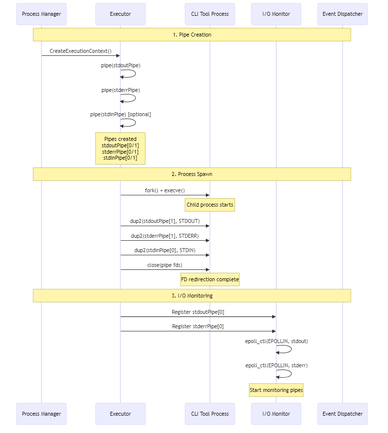
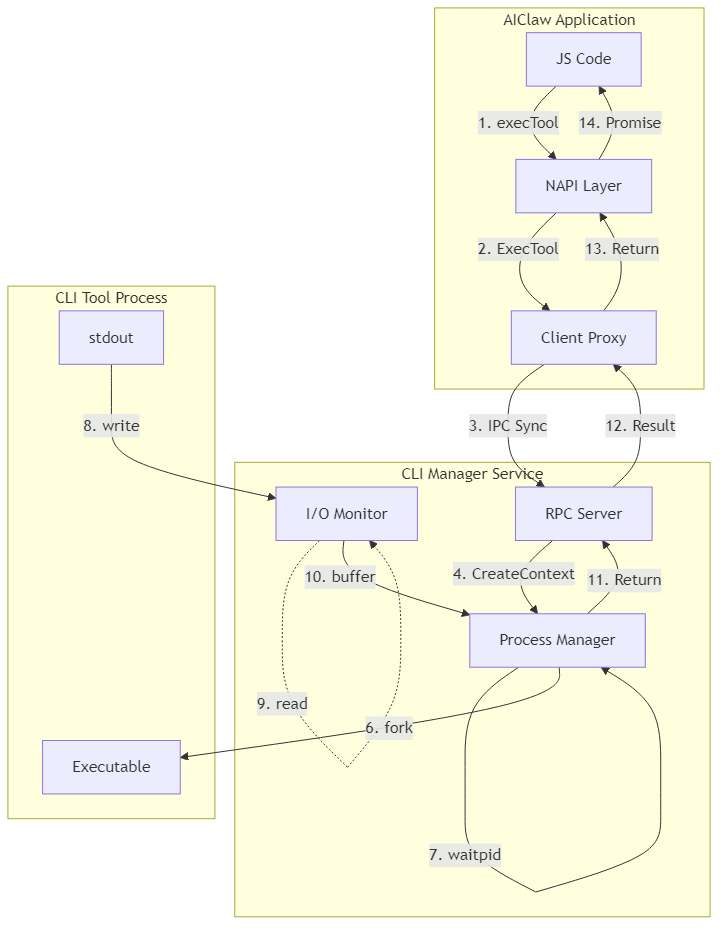
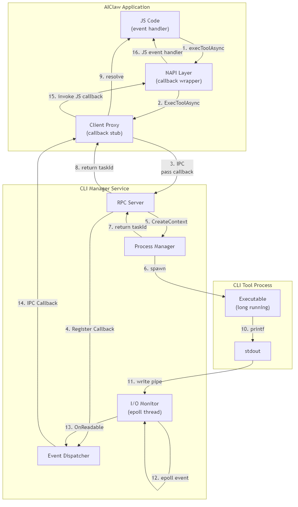

# AIClaw 与 CLI 工具进程通信详细设计

## 1. 通信架构概述

### 1.1 通信模型

AIClaw 与 CLI 工具进程采用 **管道 + IPC 回调** 的混合通信模型：

```
┌─────────────────────────────────────────────────────────────────────────┐
│                          AIClaw Application                              │
│  ┌──────────────┐         ┌──────────────┐         ┌──────────────┐     │
│  │   JS Layer   │────────▶│   NAPI Layer │────────▶│ Client Proxy │     │
│  │ (Event Handler)       │ (C++ Bridge)  │  (IPC Client)     │     │
│  └──────────────┘         └──────────────┘         └──────┬───────┘     │
└────────────────────────────────────────────────────────────┼─────────────┘
                                                          │
                                                          │ IPC (Binder)
                                                          ▼
┌─────────────────────────────────────────────────────────────────────────┐
│                     CLI Manager Service                                  │
│  ┌──────────────┐         ┌──────────────┐         ┌──────────────┐     │
│  │Event Dispatcher│◀───────│Process Manager│        │Registry Mgr  │     │
│  │ (Event Router)│  IPC    │(Process Ctrl)│        │(Tool Metadata)│    │
│  └──────┬───────┘         └──────┬───────┘         └──────────────┘     │
│         │                        │                                         │
│         │ Event Callback         │ pipe                                   │
│         ▼                        ▼                                         │
│  ┌──────────────────────────────────────────────────────┐                │
│  │              Process I/O Monitor                     │                │
│  │  ┌─────────┐    ┌─────────┐    ┌─────────┐          │                │
│  │  │epoll fd │───▶│stdout[] │    │stderr[] │          │                │
│  │  │(event)  │    │(pipes)  │    │(pipes)  │          │                │
│  │  └─────────┘    └─────────┘    └─────────┘          │                │
│  └──────────────────────────────────────────────────────┘                │
└──────────────────────────────────────────────────────────────────────────┘
                          │                    │
                          │ pipe[1]            │ pipe[1]
                          │ (write)            │ (write)
                          ▼                    ▼
                  ┌─────────────────────────────────────────────┐
                  │          CLI Tool Process                   │
                  │  ┌──────────┐        ┌──────────┐          │
                  │  │  stdout  │        │  stderr  │          │
                  │  │  (pipe)  │        │  (pipe)  │          │
                  │  └──────────┘        └──────────┘          │
                  │         │                    │              │
                  │         ▼                    ▼              │
                  │  ┌──────────────────────────────────┐      │
                  │  │     CLI Tool Executable          │      │
                  │  │  (printf/cout/write to stdout)   │      │
                  │  └──────────────────────────────────┘      │
                  └─────────────────────────────────────────────┘
```

### 1.2 通信通道

| 通道 | 类型 | 方向 | 用途 |
|------|------|------|------|
| **控制通道** | IPC (Binder) | 双向 | 进程启动、停止、查询 |
| **stdout 管道** | Pipe | Tool → Service | 标准输出数据 |
| **stderr 管道** | Pipe | Tool → Service | 标准错误数据 |
| **stdin 管道** | Pipe | Service → Tool | 标准输入（可选） |
| **事件回调通道** | IPC (Binder) | Service → Client | 异步事件通知 |

---

## 2. 管道建立机制

### 2.1 进程创建与管道建立流程



### 2.2 核心数据结构

```cpp
// interfaces/inner_api/cli_execution_context.h
#pragma once

#include <string>
#include <memory>
#include <functional>
#include <chrono>
#include <sys/types.h>

namespace OHOS {
namespace CliMgr {

/**
 * @brief 执行模式
 */
enum class ExecutionMode : uint8_t {
    SYNC = 0,      // 同步执行，等待结果
    ASYNC = 1,     // 异步执行，事件回调
};

/**
 * @brief 工具类型
 */
enum class ToolType : uint8_t {
    SHORT_LIVED = 0,  // 短时运行，快速退出
    LONG_LIVED = 1,   // 长时运行，持续输出
};

/**
 * @brief 调用者信息
 */
struct CallerInfo {
    pid_t pid;                    // 调用者进程 ID
    uid_t uid;                    // 调用者用户 ID
    std::string bundleName;       // 应用包名
    std::string abilityName;      // Ability 名称
    std::string token;            // 安全令牌
};

/**
 * @brief 执行上下文
 */
class ExecutionContext {
public:
    ExecutionContext() = default;
    ~ExecutionContext();

    // 禁止拷贝
    ExecutionContext(const ExecutionContext&) = delete;
    ExecutionContext& operator=(const ExecutionContext&) = default;

    // 基本信息
    std::string taskId;                      // 任务唯一 ID
    std::string toolName;                    // 工具名称
    ExecutionMode mode;                      // 执行模式

    // 进程信息
    pid_t processId = -1;                    // 工具进程 ID
    std::chrono::time_point<std::chrono::steady_clock> startTime;
    std::chrono::time_point<std::chrono::steady_clock> endTime;

    // 调用者信息
    CallerInfo caller;

    // 管道文件描述符
    int stdoutPipe[2] = {-1, -1};            // [0]=read, [1]=write
    int stderrPipe[2] = {-1, -1};
    int stdinPipe[2] = {-1, -1};

    // 输出缓冲区
    std::string stdoutBuffer;                // 累积的标准输出
    std::string stderrBuffer;                // 累积的标准错误

    // 执行参数
    Json::Value arguments;                   // 执行参数

    // 执行选项
    uint32_t timeoutMs = 30000;              // 超时时间
    std::string workingDir;                  // 工作目录

    // 回调对象（用于异步模式）
    sptr<ICLICallback> callback;             // IPC 回调代理

    // 状态标志
    std::atomic<bool> isRunning{false};      // 是否正在运行
    std::atomic<bool> isCompleted{false};    // 是否已完成
    int exitCode = -1;                       // 退出码
    int signal = 0;                          // 终止信号

    /**
     * @brief 关闭所有管道
     */
    void CloseAllPipes();

    /**
     * @brief 关闭写端（通知工具进程 EOF）
     */
    void CloseWriteEnds();

    /**
     * @brief 检查是否超时
     */
    bool IsTimedOut() const;

private:
    void ClosePipe(int pipe[2]);
};

} // namespace CliMgr
} // namespace OHOS
```

### 2.3 管道创建实现

```cpp
// services/climgr/src/process_manager.cpp

#include "cli_execution_context.h"
#include "hilog_tag_wrapper.h"
#include <unistd.h>
#include <fcntl.h>
#include <errno.h>

namespace OHOS {
namespace CliMgr {

bool ProcessManager::CreatePipes(ExecutionContext& context)
{
    // 创建 stdout 管道
    if (pipe(context.stdoutPipe) != 0) {
        TAG_LOGE(AAFwkLogTag::ABILITY, "Failed to create stdout pipe: %{public}d", errno);
        return false;
    }

    // 创建 stderr 管道
    if (pipe(context.stderrPipe) != 0) {
        TAG_LOGE(AAFwkLogTag::ABILITY, "Failed to create stderr pipe: %{public}d", errno);
        close(context.stdoutPipe[0]);
        close(context.stdoutPipe[1]);
        return false;
    }

    // 创建 stdin 管道（可选）
    if (pipe(context.stdinPipe) != 0) {
        TAG_LOGW(AAFwkLogTag::ABILITY, "Failed to create stdin pipe: %{public}d", errno);
        context.stdinPipe[0] = -1;
        context.stdinPipe[1] = -1;
    }

    // 设置读端为非阻塞模式
    SetNonBlocking(context.stdoutPipe[0]);
    SetNonBlocking(context.stderrPipe[0]);
    if (context.stdinPipe[0] >= 0) {
        SetNonBlocking(context.stdinPipe[0]);
    }

    TAG_LOGI(AAFwkLogTag::ABILITY, "Pipes created for task %{public}s", context.taskId.c_str());
    return true;
}

void ProcessManager::SetNonBlocking(int fd)
{
    int flags = fcntl(fd, F_GETFL, 0);
    if (flags >= 0) {
        fcntl(fd, F_SETFL, flags | O_NONBLOCK);
    }
}

} // namespace CliMgr
} // namespace OHOS
```

---

## 3. 进程启动与管道重定向

### 3.1 进程启动实现

```cpp
// services/climgr/src/process_manager.cpp

#include <sys/wait.h>
#include <sys/types.h>
#include <unistd.h>
#include <fcntl.h>

namespace OHOS {
namespace CliMgr {

pid_t ProcessManager::SpawnProcess(const ToolInfo& toolInfo,
                                   const ExecutionContext& context)
{
    pid_t pid = fork();

    if (pid < 0) {
        // fork 失败
        TAG_LOGE(AAFwkLogTag::ABILITY, "Failed to fork process: %{public}d", errno);
        return -1;
    }

    if (pid == 0) {
        // === 子进程 ===
        PrepareChildProcess(context);

        // 构建参数数组
        std::vector<char*> argv = BuildArgv(toolInfo, context);

        // 执行工具
        execve(toolInfo.executablePath.c_str(), argv.data(), environ);

        // 如果 execve 返回，说明执行失败
        _exit(127);  // exec 失败退出码
    }

    // === 父进程 ===
    TAG_LOGI(AAFwkLogTag::ABILITY,
             "Tool process spawned: pid=%{public}d, tool=%{public}s",
             pid, toolInfo.name.c_str());

    return pid;
}

void ProcessManager::PrepareChildProcess(ExecutionContext& context)
{
    // 重定向 stdout
    if (context.stdoutPipe[1] != STDOUT_FILENO) {
        dup2(context.stdoutPipe[1], STDOUT_FILENO);
    }

    // 重定向 stderr
    if (context.stderrPipe[1] != STDERR_FILENO) {
        dup2(context.stderrPipe[1], STDERR_FILENO);
    }

    // 重定向 stdin（如果需要）
    if (context.stdinPipe[0] >= 0 && context.stdinPipe[0] != STDIN_FILENO) {
        dup2(context.stdinPipe[0], STDIN_FILENO);
    }

    // 关闭所有不需要的文件描述符
    // 关闭管道的读端（子进程只需要写端）
    close(context.stdoutPipe[0]);
    close(context.stderrPipe[0]);
    if (context.stdinPipe[0] >= 0) {
        close(context.stdinPipe[1]);  // 关闭 stdin 写端
    } else {
        // 如果不需要 stdin，关闭 /dev/null
        int nullFd = open("/dev/null", O_RDONLY);
        if (nullFd >= 0) {
            dup2(nullFd, STDIN_FILENO);
            close(nullFd);
        }
    }

    // 设置进程组 ID（便于进程管理）
    setsid();
}

std::vector<char*> ProcessManager::BuildArgv(
    const ToolInfo& argToolInfo,
    const ExecutionContext& argContext)
{
    std::vector<char*> argv;
    argv.push_back(const_cast<char*>(argToolInfo.executablePath.c_str()));

    // 根据工具描述文件的 inputSchema 转换参数
    if (argContext.arguments.isObject()) {
        for (const auto& key : argContext.arguments.getMemberNames()) {
            Json::Value value = argContext.arguments[key];

            if (value.isString()) {
                std::string arg = "--" + key + "=" + value.asString();
                argv.push_back(strdup(arg.c_str()));
            } else if (value.isInt()) {
                std::string arg = "--" + key + "=" + std::to_string(value.asInt());
                argv.push_back(strdup(arg.c_str()));
            } else if (value.isBool()) {
                std::string arg = value.asBool() ? ("--" + key) : ("--no-" + key);
                argv.push_back(strdup(arg.c_str()));
            }
        }
    }

    argv.push_back(nullptr);  // argv 必须以 nullptr 结尾
    return argv;
}

} // namespace CliMgr
} // namespace OHOS
```

---

## 4. I/O 监控与数据读取

### 4.1 I/O 监控器设计

```cpp
// services/climgr/src/io_monitor.h

#pragma once

#include <string>
#include <unordered_map>
#include <atomic>
#include <thread>
#include <mutex>
#include <sys/epoll.h>

namespace OHOS {
namespace CliMgr {

// 前向声明
class ExecutionContext;
class EventDispatcher;

/**
 * @brief I/O 事件类型
 */
enum class IOEventType : uint8_t {
    STDOUT = 0,
    STDERR = 1,
    PROCESS_EXIT = 2,
    TIMEOUT = 3,
};

/**
 * @brief I/O 事件数据
 */
struct IOEvent {
    IOEventType type;
    std::string taskId;
    std::string data;
    int exitCode;
};

/**
 * @brief I/O 监控器
 *
 * 使用 epoll 监控所有工具进程的管道输出
 */
class IOMonitor {
public:
    explicit IOMonitor(EventDispatcher* dispatcher);
    ~IOMonitor();

    /**
     * @brief 启动监控线程
     */
    bool Start();

    /**
     * @brief 停止监控线程
     */
    void Stop();

    /**
     * @brief 注册任务的管道进行监控
     * @param context 执行上下文
     * @return 是否注册成功
     */
    bool RegisterTask(const std::shared_ptr<ExecutionContext>& context);

    /**
     * @brief 取消任务监控
     * @param taskId 任务 ID
     */
    void UnregisterTask(const std::string& taskId);

    /**
     * @brief 向工具进程写入数据（通过 stdin）
     * @param taskId 任务 ID
     * @param data 要写入的数据
     * @return 写入的字节数，失败返回 -1
     */
    ssize_t WriteToStdin(const std::string& taskId, const std::string& data);

private:
    /**
     * @brief 监控线程主循环
     */
    void MonitorThread();

    /**
     * @brief 处理管道可读事件
     * @param fd 文件描述符
     * @param taskId 任务 ID
     * @param type 事件类型
     */
    void HandleReadable(int fd, const std::string& taskId, IOEventType type);

    /**
     * @brief 从管道读取数据
     * @param fd 文件描述符
     * @return 读取的数据
     */
    std::string ReadFromPipe(int fd);

    /**
     * @brief 关闭任务的所有管道
     * @param taskId 任务 ID
     */
    void CloseTaskPipes(const std::string& taskId);

private:
    EventDispatcher* dispatcher_;
    int epollFd_ = -1;
    std::atomic<bool> running_{false};
    std::thread monitorThread_;

    // taskId -> ExecutionContext
    std::unordered_map<std::string, std::shared_ptr<ExecutionContext>> tasks_;
    std::mutex tasksMutex_;

    // fd -> taskId
    std::unordered_map<int, std::string> fdToTaskId_;
    std::mutex fdMutex_;

    // taskId -> fd (stdin write end)
    std::unordered_map<std::string, int> stdinWriteFds_;
    std::mutex stdinMutex_;
};

} // namespace CliMgr
} // namespace OHOS
```

### 4.2 I/O 监控器实现

```cpp
// services/climgr/src/io_monitor.cpp

#include "io_monitor.h"
#include "cli_execution_context.h"
#include "event_dispatcher.h"
#include "hilog_tag_wrapper.h"
#include <unistd.h>
#include <errno.h>
#include <string.h>

namespace OHOS {
namespace CliMgr {

constexpr size_t MAX_BUFFER_SIZE = 4096;  // 单次读取最大字节数
constexpr int MAX_EPOLL_EVENTS = 64;      // 单次 epoll_wait 最大事件数

IOMonitor::IOMonitor(EventDispatcher* dispatcher)
    : dispatcher_(dispatcher)
{
}

IOMonitor::~IOMonitor()
{
    Stop();
}

bool IOMonitor::Start()
{
    if (running_.load()) {
        TAG_LOGW(AAFwkLogTag::ABILITY, "IOMonitor already running");
        return true;
    }

    // 创建 epoll 实例
    epollFd_ = epoll_create1(EPOLL_CLOEXEC);
    if (epollFd_ < 0) {
        TAG_LOGE(AAFwkLogTag::ABILITY, "Failed to create epoll: %{public}d", errno);
        return false;
    }

    running_.store(true);
    monitorThread_ = std::thread(&IOMonitor::MonitorThread, this);

    TAG_LOGI(AAFwkLogTag::ABILITY, "IOMonitor started");
    return true;
}

void IOMonitor::Stop()
{
    if (!running_.load()) {
        return;
    }

    running_.store(false);

    // 关闭 epoll fd 以唤醒 epoll_wait
    if (epollFd_ >= 0) {
        close(epollFd_);
        epollFd_ = -1;
    }

    if (monitorThread_.joinable()) {
        monitorThread_.join();
    }

    TAG_LOGI(AAFwkLogTag::ABILITY, "IOMonitor stopped");
}

bool IOMonitor::RegisterTask(const std::shared_ptr<ExecutionContext>& context)
{
    if (!context) {
        return false;
    }

    std::lock_guard<std::mutex> lock(tasksMutex_);
    tasks_[context->taskId] = context;

    // 注册 stdout 读端
    struct epoll_event ev;
    memset(&ev, 0, sizeof(ev));
    ev.events = EPOLLIN;  // 监听可读事件
    ev.data.fd = context->stdoutPipe[0];

    if (epoll_ctl(epollFd_, EPOLL_CTL_ADD, context->stdoutPipe[0], &ev) < 0) {
        TAG_LOGE(AAFwkLogTag::ABILITY,
                 "Failed to register stdout fd: %{public}d", errno);
        return false;
    }

    {
        std::lock_guard<std::mutex> fdLock(fdMutex_);
        fdToTaskId_[context->stdoutPipe[0]] = context->taskId;
    }

    // 注册 stderr 读端
    ev.data.fd = context->stderrPipe[0];
    if (epoll_ctl(epollFd_, EPOLL_CTL_ADD, context->stderrPipe[0], &ev) < 0) {
        TAG_LOGE(AAFwkLogTag::ABILITY,
                 "Failed to register stderr fd: %{public}d", errno);
        return false;
    }

    {
        std::lock_guard<std::mutex> fdLock(fdMutex_);
        fdToTaskId_[context->stderrPipe[0]] = context->taskId;
    }

    // 保存 stdin 写端（如果有）
    if (context->stdinPipe[1] >= 0) {
        std::lock_guard<std::mutex> stdinLock(stdinMutex_);
        stdinWriteFds_[context->taskId] = context->stdinPipe[1];
    }

    TAG_LOGI(AAFwkLogTag::ABILITY,
             "Task registered for monitoring: %{public}s", context->taskId.c_str());
    return true;
}

void IOMonitor::UnregisterTask(const std::string& taskId)
{
    std::shared_ptr<ExecutionContext> context;
    {
        std::lock_guard<std::mutex> lock(tasksMutex_);
        auto it = tasks_.find(taskId);
        if (it != tasks_.end()) {
            context = it->second;
            tasks_.erase(it);
        }
    }

    if (!context) {
        return;
    }

    CloseTaskPipes(taskId);

    TAG_LOGI(AAFwkLogTag::ABILITY,
             "Task unregistered: %{public}s", taskId.c_str());
}

void IOMonitor::MonitorThread()
{
    TAG_LOGI(AAFwkLogTag::ABILITY, "IOMonitor thread started");

    while (running_.load()) {
        struct epoll_event events[MAX_EPOLL_EVENTS];
        int nfds = epoll_wait(epollFd_, events, MAX_EPOLL_EVENTS, 100);  // 100ms timeout

        if (nfds < 0) {
            if (errno == EINTR) {
                continue;  // 被信号中断，继续
            }
            TAG_LOGE(AAFwkLogTag::ABILITY,
                     "epoll_wait error: %{public}d", errno);
            break;
        }

        for (int i = 0; i < nfds; ++i) {
            int fd = events[i].data.fd;

            // 查找对应的 taskId
            std::string taskId;
            {
                std::lock_guard<std::mutex> lock(fdMutex_);
                auto it = fdToTaskId_.find(fd);
                if (it != fdToTaskId_.end()) {
                    taskId = it->second;
                }
            }

            if (taskId.empty()) {
                continue;
            }

            // 查找 context 以确定是 stdout 还是 stderr
            std::shared_ptr<ExecutionContext> context;
            {
                std::lock_guard<std::mutex> lock(tasksMutex_);
                auto it = tasks_.find(taskId);
                if (it != tasks_.end()) {
                    context = it->second;
                }
            }

            if (!context) {
                continue;
            }

            // 确定事件类型
            IOEventType type = (fd == context->stdoutPipe[0]) ?
                               IOEventType::STDOUT : IOEventType::STDERR;

            // 处理可读事件
            HandleReadable(fd, taskId, type);
        }
    }

    TAG_LOGI(AAFwkLogTag::ABILITY, "IOMonitor thread exited");
}

void IOMonitor::HandleReadable(int fd, const std::string& taskId, IOEventType type)
{
    std::string data = ReadFromPipe(fd);

    if (data.empty() && errno != EAGAIN) {
        // 管道关闭（EOF）或错误
        TAG_LOGI(AAFwkLogTag::ABILITY,
                 "Pipe closed for task %{public}s", taskId.c_str());
        return;
    }

    // 分发事件
    if (dispatcher_) {
        IOEvent event;
        event.type = type;
        event.taskId = taskId;
        event.data = data;
        dispatcher_->DispatchIOEvent(event);
    }
}

std::string IOMonitor::ReadFromPipe(int fd)
{
    std::string result;
    char buffer[MAX_BUFFER_SIZE];

    while (true) {
        ssize_t n = read(fd, buffer, sizeof(buffer));

        if (n > 0) {
            result.append(buffer, n);
        } else if (n == 0) {
            // EOF
            break;
        } else {  // n < 0
            if (errno == EAGAIN || errno == EWOULDBLOCK) {
                // 非阻塞模式下没有更多数据
                break;
            } else {
                // 真正的错误
                TAG_LOGE(AAFwkLogTag::ABILITY,
                         "Read error: %{public}d", errno);
                break;
            }
        }
    }

    return result;
}

ssize_t IOMonitor::WriteToStdin(const std::string& taskId, const std::string& data)
{
    int stdinFd = -1;
    {
        std::lock_guard<std::mutex> lock(stdinMutex_);
        auto it = stdinWriteFds_.find(taskId);
        if (it != stdinWriteFds_.end()) {
            stdinFd = it->second;
        }
    }

    if (stdinFd < 0) {
        TAG_LOGE(AAFwkLogTag::ABILITY,
                 "No stdin fd for task %{public}s", taskId.c_str());
        return -1;
    }

    ssize_t written = write(stdinFd, data.c_str(), data.size());
    if (written < 0) {
        TAG_LOGE(AAFwkLogTag::ABILITY,
                 "Write to stdin failed: %{public}d", errno);
    }

    return written;
}

void IOMonitor::CloseTaskPipes(const std::string& taskId)
{
    std::shared_ptr<ExecutionContext> context;
    {
        std::lock_guard<std::mutex> lock(tasksMutex_);
        auto it = tasks_.find(taskId);
        if (it != tasks_.end()) {
            context = it->second;
        }
    }

    if (!context) {
        return;
    }

    // 从 epoll 移除并关闭管道
    if (context->stdoutPipe[0] >= 0) {
        epoll_ctl(epollFd_, EPOLL_CTL_DEL, context->stdoutPipe[0], nullptr);
        close(context->stdoutPipe[0]);
        context->stdoutPipe[0] = -1;
    }

    if (context->stderrPipe[0] >= 0) {
        epoll_ctl(epollFd_, EPOLL_CTL_DEL, context->stderrPipe[0], nullptr);
        close(context->stderrPipe[0]);
        context->stderrPipe[0] = -1;
    }

    if (context->stdinPipe[1] >= 0) {
        close(context->stdinPipe[1]);
        context->stdinPipe[1] = -1;
    }

    // 清理映射
    {
        std::lock_guard<std::mutex> lock(fdMutex_);
        fdToTaskId_.erase(context->stdoutPipe[0]);
        fdToTaskId_.erase(context->stderrPipe[0]);
    }

    {
        std::lock_guard<std::mutex> lock(stdinMutex_);
        stdinWriteFds_.erase(taskId);
    }
}

} // namespace CliMgr
} // namespace OHOS
```

---

## 5. 事件分发与回调机制

### 5.1 事件分发器设计

```cpp
// services/climgr/src/event_dispatcher.h

#pragma once

#include <string>
#include <memory>
#include <unordered_map>
#include <mutex>
#include <functional>

#include "cli_execution_context.h"
#include "cli_callback.h"

namespace OHOS {
namespace CliMgr {

// 前向声明
struct IOEvent;

/**
 * @brief 事件分发器
 *
 * 负责将 I/O 事件和进程退出事件分发给对应的客户端回调
 */
class EventDispatcher {
public:
    EventDispatcher() = default;
    ~EventDispatcher() = default;

    /**
     * @brief 注册任务的回调
     * @param taskId 任务 ID
     * @param callback IPC 回调对象
     */
    void RegisterCallback(const std::string& taskId,
                         const sptr<ICLICallback>& callback);

    /**
     * @brief 取消回调
     * @param taskId 任务 ID
     */
    void UnregisterCallback(const std::string& taskId);

    /**
     * @brief 分发 I/O 事件
     * @param event I/O 事件
     */
    void DispatchIOEvent(const IOEvent& event);

    /**
     * @brief 分发进程退出事件
     * @param taskId 任务 ID
     * @param exitCode 退出码
     */
    void DispatchExitEvent(const std::string& taskId, int exitCode);

    /**
     * @brief 分发错误事件
     * @param taskId 任务 ID
     * @param errorCode 错误码
     * @param errorMsg 错误消息
     */
    void DispatchErrorEvent(const std::string& taskId,
                           int32_t errorCode,
                           const std::string& errorMsg);

private:
    // taskId -> IPC Callback
    std::unordered_map<std::string, sptr<ICLICallback>> callbacks_;
    std::mutex callbacksMutex_;
};

} // namespace CliMgr
} // namespace OHOS
```

### 5.2 事件分发器实现

```cpp
// services/climgr/src/event_dispatcher.cpp

#include "event_dispatcher.h"
#include "io_monitor.h"
#include "hilog_tag_wrapper.h"

namespace OHOS {
namespace CliMgr {

void EventDispatcher::RegisterCallback(const std::string& taskId,
                                      const sptr<ICLICallback>& callback)
{
    if (!callback) {
        TAG_LOGE(AAFwkLogTag::ABILITY, "Null callback for task %{public}s", taskId.c_str());
        return;
    }

    std::lock_guard<std::mutex> lock(callbacksMutex_);
    callbacks_[taskId] = callback;

    TAG_LOGI(AAFwkLogTag::ABILITY,
             "Callback registered for task %{public}s", taskId.c_str());
}

void EventDispatcher::UnregisterCallback(const std::string& taskId)
{
    std::lock_guard<std::mutex> lock(callbacksMutex_);
    callbacks_.erase(taskId);

    TAG_LOGI(AAFwkLogTag::ABILITY,
             "Callback unregistered for task %{public}s", taskId.c_str());
}

void EventDispatcher::DispatchIOEvent(const IOEvent& event)
{
    sptr<ICLICallback> callback;
    {
        std::lock_guard<std::mutex> lock(callbacksMutex_);
        auto it = callbacks_.find(event.taskId);
        if (it != callbacks_.end()) {
            callback = it->second;
        }
    }

    if (!callback) {
        TAG_LOGW(AAFwkLogTag::ABILITY,
                 "No callback for task %{public}s", event.taskId.c_str());
        return;
    }

    // 构建 ToolEvent
    ToolEvent toolEvent;
    toolEvent.type = (event.type == IOEventType::STDOUT) ?
                     "stdout" : "stderr";
    toolEvent.data = event.data;
    toolEvent.timestamp = std::chrono::system_clock::now().time_since_epoch().count();

    // 通过 IPC 发送事件到客户端
    callback->OnOutput(event.taskId, toolEvent);

    TAG_LOGD(AAFwkLogTag::ABILITY,
             "IO event dispatched: task=%{public}s, type=%{public}s, size=%{public}zu",
             event.taskId.c_str(), toolEvent.type.c_str(), event.data.size());
}

void EventDispatcher::DispatchExitEvent(const std::string& taskId, int exitCode)
{
    sptr<ICLICallback> callback;
    {
        std::lock_guard<std::mutex> lock(callbacksMutex_);
        auto it = callbacks_.find(taskId);
        if (it != callbacks_.end()) {
            callback = it->second;
        }
    }

    if (!callback) {
        TAG_LOGW(AAFwkLogTag::ABILITY,
                 "No callback for task %{public}s", taskId.c_str());
        return;
    }

    // 发送退出事件
    callback->OnExit(taskId, exitCode);

    TAG_LOGI(AAFwkLogTag::ABILITY,
             "Exit event dispatched: task=%{public}s, code=%{public}d",
             taskId.c_str(), exitCode);

    // 退出后取消回调
    UnregisterCallback(taskId);
}

void EventDispatcher::DispatchErrorEvent(const std::string& taskId,
                                        int32_t errorCode,
                                        const std::string& errorMsg)
{
    sptr<ICLICallback> callback;
    {
        std::lock_guard<std::mutex> lock(callbacksMutex_);
        auto it = callbacks_.find(taskId);
        if (it != callbacks_.end()) {
            callback = it->second;
        }
    }

    if (!callback) {
        TAG_LOGW(AAFwkLogTag::ABILITY,
                 "No callback for task %{public}s", taskId.c_str());
        return;
    }

    // 发送错误事件
    callback->OnError(taskId, errorCode, errorMsg);

    TAG_LOGE(AAFwkLogTag::ABILITY,
             "Error event dispatched: task=%{public}s, code=%{public}d, msg=%{public}s",
             taskId.c_str(), errorCode, errorMsg.c_str());
}

} // namespace CliMgr
} // namespace OHOS
```

---

## 6. 客户端回调实现

### 6.1 IPC 回调接口

```cpp
// interfaces/inner_api/cli_callback.h

#pragma once

#include <iremote_broker.h>
#include <iremote_object.h>

namespace OHOS {
namespace CliMgr {

/**
 * @brief 工具事件
 */
struct ToolEvent {
    std::string type;      // "stdout", "stderr", "exit", "error"
    std::string data;      // 事件数据
    int exitCode = 0;      // 退出码（仅 exit 事件）
    int64_t timestamp;     // 时间戳
};

/**
 * @brief CLI 回调接口
 *
 * 客户端需要实现此接口以接收异步事件
 */
class ICLICallback : public IRemoteBroker {
public:
    DECLARE_INTERFACE_DESCRIPTOR(CLI_CALLBACK);

    /**
     * @brief 工具输出事件
     * @param taskId 任务 ID
     * @param event 事件数据
     */
    virtual void OnOutput(const std::string& taskId, const ToolEvent& event) = 0;

    /**
     * @brief 工具退出事件
     * @param taskId 任务 ID
     * @param exitCode 退出码
     */
    virtual void OnExit(const std::string& taskId, int32_t exitCode) = 0;

    /**
     * @brief 错误事件
     * @param taskId 任务 ID
     * @param errorCode 错误码
     * @param errorMsg 错误消息
     */
    virtual void OnError(const std::string& taskId,
                        int32_t errorCode,
                        const std::string& errorMsg) = 0;

    // 析构函数
    virtual ~ICLICallback() = default;
};

} // namespace CliMgr
} // namespace OHOS
```

### 6.2 客户端回调实现（Stub 端）

```cpp
// interfaces/inner_api/cli_callback_stub.cpp

#include "cli_callback.h"
#include "hilog_tag_wrapper.h"

namespace OHOS {
namespace CliMgr {

class CLICallbackStub : public IRemoteStub<ICLICallback> {
public:
    explicit CLICallbackStub(const std::function<void(const std::string&, const ToolEvent&)>& outputHandler,
                            const std::function<void(const std::string&, int32_t)>& exitHandler,
                            const std::function<void(const std::string&, int32_t, const std::string&)>& errorHandler)
        : outputHandler_(outputHandler),
          exitHandler_(exitHandler),
          errorHandler_(errorHandler) {}

    int32_t OnRemoteRequest(uint32_t code,
                           MessageParcel& data,
                           MessageParcel& reply,
                           MessageOption& option) override
    {
        if (data.ReadInterfaceToken() != GetDescriptor()) {
            TAG_LOGE(AAFwkLogTag::ABILITY, "Invalid interface token");
            return ERR_INVALID_STATE;
        }

        switch (code) {
            case 0:  // OnOutput
                HandleOnOutput(data);
                break;
            case 1:  // OnExit
                HandleOnExit(data);
                break;
            case 2:  // OnError
                HandleOnError(data);
                break;
            default:
                TAG_LOGW(AAFwkLogTag::ABILITY, "Unknown code: %{public}u", code);
                return ERR_UNKNOWN_TRANSACTION;
        }

        return ERR_OK;
    }

private:
    void HandleOnOutput(MessageParcel& data)
    {
        std::string taskId = data.ReadString();
        ToolEvent event;
        event.type = data.ReadString();
        event.data = data.ReadString();
        event.timestamp = data.ReadInt64();

        if (outputHandler_) {
            outputHandler_(taskId, event);
        }
    }

    void HandleOnExit(MessageParcel& data)
    {
        std::string taskId = data.ReadString();
        int32_t exitCode = data.ReadInt32();

        if (exitHandler_) {
            exitHandler_(taskId, exitCode);
        }
    }

    void HandleOnError(MessageParcel& data)
    {
        std::string taskId = data.ReadString();
        int32_t errorCode = data.ReadInt32();
        std::string errorMsg = data.ReadString();

        if (errorHandler_) {
            errorHandler_(taskId, errorCode, errorMsg);
        }
    }

    std::function<void(const std::string&, const ToolEvent&)> outputHandler_;
    std::function<void(const std::string&, int32_t)> exitHandler_;
    std::function<void(const std::string&, int32_t, const std::string&)> errorHandler_;
};

} // namespace CliMgr
} // namespace OHOS
```

---

## 7. JS 层集成

### 7.1 NAPI 绑定

```cpp
// frameworks/js/napi/cli_manager/js_cli_manager.cpp

#include "napi/native_api.h"
#include "cli_manager_client.h"
#include "cli_callback.h"
#include <thread>
#include <mutex>
#include <condition_variable>

namespace OHOS {
namespace CliMgr {

// JS 回调上下文
struct JSCallbackContext {
    napi_env env;
    napi_ref callbackRef;
    std::string taskId;
    std::thread::id threadId;
};

// NAPI 类封装
class JSCLIManager {
public:
    static napi_value ExecToolAsync(napi_env env, napi_callback_info info)
    {
        napi_value exports = nullptr;
        size_t argc = 4;
        napi_value argv[4] = {nullptr};
        napi_value thisVar = nullptr;
        void* data = nullptr;

        napi_get_cb_info(env, info, &argc, argv, &thisVar, &data);

        // 解析参数
        // argv[0]: toolName (string)
        // argv[1]: args (object)
        // argv[2]: callback (function)
        // argv[3]: options (object, optional)

        std::string toolName = GetStringArg(env, argv[0]);
        Json::Value args = GetObjectArg(env, argv[1]);
        napi_value callback = argv[2];

        // 创建回调上下文
        auto* context = new JSCallbackContext();
        context->env = env;
        context->taskId = GenerateTaskId();
        napi_create_reference(env, callback, 1, &context->callbackRef);
        context->threadId = std::this_thread::get_id();

        // 创建 C++ 回调
        auto cppCallback = [context](const std::string& taskId, const ToolEvent& event) {
            // 在 JS 线程执行回调
            napi_value jsCallback;
            napi_get_reference_value(context->env, context->callbackRef, &jsCallback);

            napi_value argv[2];
            napi_create_string_utf8(context->env, event.type.c_str(),
                                   NAPI_AUTO_LENGTH, &argv[0]);
            napi_create_string_utf8(context->env, event.data.c_str(),
                                   NAPI_AUTO_LENGTH, &argv[1]);

            napi_value result;
            napi_call_function(context->env, nullptr, jsCallback, 2, argv, &result);
        };

        // 调用 Native API
        std::string returnedTaskId;
        int32_t ret = CLIManagerClient::ExecToolAsync(
            toolName,
            args,
            cppCallback,
            returnedTaskId
        );

        // 返回 taskId
        napi_value result;
        napi_create_string_utf8(env, returnedTaskId.c_str(),
                               NAPI_AUTO_LENGTH, &result);
        return result;
    }

private:
    static std::string GetStringArg(napi_env env, napi_value value)
    {
        size_t len = 0;
        napi_get_value_string_utf8(env, value, nullptr, 0, &len);
        std::string str(len, '\0');
        napi_get_value_string_utf8(env, value, &str[0], len + 1, &len);
        return str;
    }

    static Json::Value GetObjectArg(napi_env env, napi_value value)
    {
        // 简化实现，实际需要遍历 JS 对象属性
        Json::Value result;
        // ... 实现细节省略
        return result;
    }

    static std::string GenerateTaskId()
    {
        static std::atomic<uint64_t> counter{0};
        return "task_" + std::to_string(counter.fetch_add(1));
    }
};

} // namespace CliMgr
} // namespace OHOS

// NAPI 模块导出
static napi_value Export(napi_env env, napi_value exports)
{
    napi_property_descriptor props[] = {
        {"execToolAsync", nullptr, OHOS::CliMgr::JSCLIManager::ExecToolAsync,
         nullptr, nullptr, nullptr, napi_default, nullptr}
    };

    napi_define_properties(env, exports, sizeof(props) / sizeof(props[0]), props);
    return exports;
}

NAPI_MODULE(NAPI_REGISTRY, exports, Export)
```

---

## 8. 完整通信流程图

### 8.1 同步调用数据流



### 8.2 异步调用数据流



---

## 9. 关键场景处理

### 9.1 大数据量输出处理

```cpp
// services/climgr/src/io_monitor.cpp

std::string IOMonitor::ReadFromPipe(int fd)
{
    std::string result;
    char buffer[64 * 1024];  // 64KB 缓冲区

    while (true) {
        ssize_t n = read(fd, buffer, sizeof(buffer));

        if (n > 0) {
            // 累积数据
            result.append(buffer, n);

            // 如果单次读取超过 1MB，触发批量发送
            if (result.size() > 1024 * 1024) {
                // 立即分发事件，避免内存占用过大
                IOEvent event;
                event.data = result;
                // ... 分发
                result.clear();
            }
        } else if (n == 0) {
            break;  // EOF
        } else {
            if (errno == EAGAIN || errno == EWOULDBLOCK) {
                break;  // 没有更多数据
            }
            break;  // 错误
        }
    }

    return result;
}
```

### 9.2 进程退出检测

```cpp
// services/climgr/src/process_monitor.cpp

#include <sys/wait.h>

class ProcessMonitor {
public:
    void StartMonitoring(pid_t pid, const std::string& taskId)
    {
        std::thread([this, pid, taskId]() {
            int status;
            pid_t ret = waitpid(pid, &status, 0);  // 阻塞等待

            if (ret == pid) {
                int exitCode = WIFEXITED(status) ? WEXITSTATUS(status) : -1;
                int signal = WIFSIGNALED(status) ? WTERMSIG(status) : 0;

                // 通知事件分发器
                if (dispatcher_) {
                    if (signal != 0) {
                        dispatcher_->DispatchErrorEvent(taskId, signal,
                                                        "Process terminated by signal");
                    }
                    dispatcher_->DispatchExitEvent(taskId, exitCode);
                }
            }
        }).detach();
    }
};
```

### 9.3 超时处理

```cpp
// services/climgr/src/timeout_manager.cpp

class TimeoutManager {
public:
    void ScheduleTimeout(const std::string& taskId, uint32_t timeoutMs)
    {
        std::thread([this, taskId, timeoutMs]() {
            std::this_thread::sleep_for(std::chrono::milliseconds(timeoutMs));

            // 检查任务是否仍在运行
            if (IsTaskRunning(taskId)) {
                TAG_LOGW(AAFwkLogTag::ABILITY,
                         "Task %{public}s timed out after %{public}u ms",
                         taskId.c_str(), timeoutMs);

                // 终止进程
                KillTask(taskId, SIGTERM);

                // 等待 3 秒后强制终止
                std::this_thread::sleep_for(std::chrono::seconds(3));
                if (IsTaskRunning(taskId)) {
                    KillTask(taskId, SIGKILL);
                }

                // 通知超时
                if (dispatcher_) {
                    dispatcher_->DispatchErrorEvent(taskId, ERR_TIMEOUT,
                                                    "Execution timed out");
                }
            }
        }).detach();
    }

private:
    bool IsTaskRunning(const std::string& taskId);
    void KillTask(const std::string& taskId, int signal);
};
```

---

## 10. 性能优化

### 10.1 零拷贝优化（大文件传输）

```cpp
// 使用 splice 系统调用实现零拷贝
#include <fcntl.h>

ssize_t ZeroCopyPipeToPipe(int fd_in, int fd_out, size_t len)
{
    // splice 在两个管道之间传输数据，无需用户空间缓冲
    return splice(fd_in, nullptr, fd_out, nullptr, len, SPLICE_F_MOVE);
}
```

### 10.2 事件批量处理

```cpp
// services/climgr/src/event_dispatcher.cpp

void EventDispatcher::DispatchIOEventBatch(const std::vector<IOEvent>& events)
{
    // 批量处理事件，减少 IPC 调用次数
    for (const auto& event : events) {
        // 累积相同 taskId 的数据
        batchedData_[event.taskId].append(event.data);
    }

    // 定时刷新（每 50ms 或累积 1KB）
    FlushBatchedEvents();
}
```

---

## 11. 安全考虑

### 11.1 参数注入防护

```cpp
// services/climgr/src/command_sanitizer.cpp

class CommandSanitizer {
public:
    static std::vector<std::string> SanitizeArgs(const Json::Value& args)
    {
        std::vector<std::string> result;

        for (const auto& key : args.getMemberNames()) {
            Json::Value value = args[key];

            if (value.isString()) {
                std::string str = value.asString();

                // 过滤危险字符
                if (str.find(";") != std::string::npos ||
                    str.find("&") != std::string::npos ||
                    str.find("|") != std::string::npos ||
                    str.find("$") != std::string::npos ||
                    str.find("`") != std::string::npos) {
                    TAG_LOGE(AAFwkLogTag::ABILITY,
                             "Dangerous character detected in arg %{public}s", key.c_str());
                    continue;  // 跳过此参数
                }

                result.push_back("--" + key + "=" + str);
            }
        }

        return result;
    }
};
```

### 11.2 管道缓冲区限制

```cpp
// 设置管道缓冲区大小（防止内存耗尽）
bool SetPipeBufferSize(int fd, int size)
{
    return fcntl(fd, F_SETPIPE_SZ, size) > 0;
}

// 使用示例
SetPipeBufferSize(context.stdoutPipe[0], 64 * 1024);  // 64KB
```

---

## 总结

### 通信机制要点

| 方面 | 实现方案 |
|------|----------|
| **进程创建** | fork + execve，重定向 stdout/stderr/stdin 到管道 |
| **输出捕获** | 非阻塞管道 + epoll 事件监控 |
| **数据传输** | 管道（stdout/stderr） + IPC 回调（事件通知） |
| **异步监听** | epoll 线程 → Event Dispatcher → IPC → JS Callback |
| **同步获取** | waitpid 阻塞等待 + 管道缓冲 |
| **超时控制** | 独立线程定时 + SIGTERM/SIGKILL |
| **大数据处理** | 64KB 缓冲区 + 批量发送 + splice 零拷贝 |
| **安全防护** | 参数过滤、管道大小限制、沙箱隔离 |

### 关键组件职责

1. **ProcessManager**：进程创建、管道建立、进程等待
2. **IOMonitor**：epoll 监控管道、读取数据、检测 EOF
3. **EventDispatcher**：事件路由、IPC 回调分发
4. **CLICallbackStub**：客户端 IPC 回调实现
5. **NAPI Bridge**：JS ↔ C++ 事件转换

---

**文档版本:** v1.0
**最后更新:** 2025-01-XX
