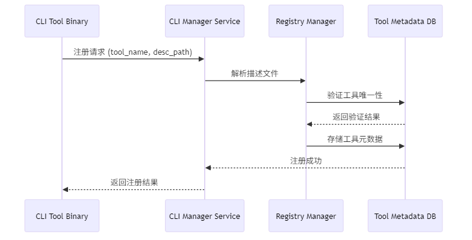
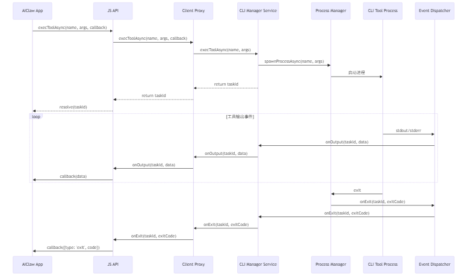

# CLI 工具管理框架设计方案

## 1. 需求分析

### 1.1 核心功能需求

| 需求ID | 功能描述 | 优先级 |
|--------|----------|--------|
| F001 | CLI 工具注册：系统启动时自动扫描并注册可用工具 | P0 |
| F002 | 工具列表查询：支持按名称、能力、权限过滤查询 | P0 |
| F003 | 同步调用：支持短时运行工具的同步调用并获取结果 | P0 |
| F004 | 异步调用：支持长时运行工具的异步调用和消息监听 | P0 |
| F005 | 进程管理：创建、监控、终止 CLI 工具进程 | P0 |
| F006 | 权限校验：调用前校验调用者是否具备所需权限 | P0 |
| F007 | 工具描述文件：定义工具的元数据、输入输出格式 | P0 |
| F008 | 进程隔离：每个 CLI 工具运行在独立进程中 | P1 |
| F009 | 超时控制：支持设置工具执行超时时间 | P1 |
| F010 | 事件订阅：支持订阅工具的输出事件流 | P1 |

### 1.2 非功能需求

| 类别 | 指标 | 目标值 |
|------|------|--------|
| 性能 | 同步调用响应时间 | < 100ms (不含工具执行时间) |
| 性能 | 异步消息延迟 | < 50ms |
| 性能 | 工具查询响应 | < 50ms |
| 安全 | 权限校验覆盖率 | 100% |
| 安全 | 进程隔离 | 完全隔离，独立沙箱 |
| 安全 | 参数注入防护 | 所有输入需验证和转义 |
| 可用性 | 服务可用性 | 99.9% |
| 扩展性 | 支持工具数量 | > 1000 |
| 扩展性 | 插件化描述文件 | 支持动态加载 |

---

## 2. 架构选型

### 2.1 方案对比

#### 方案 A：基于 IPC 的分布式架构

**架构概述：**
```
AIClaw App ← JS API ← Client Proxy ← IPC ← CLI Manager Service ← Process Manager ← CLI Tools
```

**优点：**
- 完全符合 ability_runtime 现有架构模式
- 进程隔离彻底，安全性高
- 可复用现有 IPC 基础设施
- 支持跨设备调用（分布式能力）

**缺点：**
- IPC 通信有一定开销
- 实现复杂度较高

**适用场景：** 系统级服务，需要高安全性和分布式能力

---

#### 方案 B：基于 Socket 的轻量级架构

**架构概述：**
```
AIClaw App ← JS API ← Client Library ← Unix Socket ← CLI Daemon ← CLI Tools
```

**优点：**
- 实现相对简单
- 通信开销较小

**缺点：**
- 安全性依赖 socket 权限控制
- 与现有架构融合度低
- 扩展性较差

**适用场景：** 轻量级场景，对性能要求极高

---

### 2.2 推荐方案

**推荐：方案 A - 基于 IPC 的分布式架构**

**理由：**
1. 完全符合 ability_runtime 的现有架构模式
2. 可复用现有的 SystemAbility、IPC、安全框架
3. 支持未来的分布式和多用户需求
4. 便于与现有服务（如 AbilityManagerService）集成

---

## 3. 系统架构设计

### 3.1 整体架构图


### 3.2 组件职责

| 组件 | 职责 | 文件位置 |
|------|------|----------|
| CLI Manager JS API | 对外暴露的 JS 接口 | `frameworks/js/napi/` |
| NAPI Binding | JS-Native 桥接 | `frameworks/js/napi/` |
| Client Proxy | 客户端代理，封装 IPC 调用 | `interfaces/inner_api/` |
| CLI Manager Service | 核心系统服务 | `services/climgr/` |
| Tool Registry Manager | 工具注册和查询管理 | `services/climgr/src/registry_manager.cpp` |
| Permission Checker | 权限校验模块 | `services/climgr/src/permission_checker.cpp` |
| Process Manager | 进程生命周期管理 | `services/climgr/src/process_manager.cpp` |
| Event Dispatcher | 事件分发和消息路由 | `services/climgr/src/event_dispatcher.cpp` |
| Descriptor Parser | 描述文件解析器 | `services/climgr/src/desc_parser.cpp` |

### 3.3 核心流程图

#### 3.3.1 工具注册流程



#### 3.3.2 同步调用流程


#### 3.3.3 异步调用流程



---

## 4. 数据模型设计

### 4.1 工具描述文件 (Tool Descriptor)

**文件格式：** JSON
**位置：** `/etc/cli/tools/<tool_name>.json`

```json
{
  "$schema": "https://schemas.openharmony.org/cli/tool/v1",
  "name": "network-scanner",
  "version": "1.0.0",
  "description": "Network scanning utility tool",
  "executable": "/usr/bin/net-scan",
  "type": "short-lived",
  "permissions": [
    "ohos.permission.INTERNET",
    "ohos.permission.GET_NETWORK_INFO"
  ],
  "input": {
    "type": "object",
    "properties": {
      "target": {
        "type": "string",
        "format": "ipv4",
        "description": "Target IP address"
      },
      "ports": {
        "type": "array",
        "items": {"type": "integer"},
        "description": "Ports to scan"
      }
    },
    "required": ["target"]
  },
  "output": {
    "type": "object",
    "properties": {
      "results": {
        "type": "array",
        "description": "Scan results"
      }
    }
  },
  "timeout": 30000,
  "events": ["progress", "result"]
}
```

### 4.2 核心数据结构

#### 4.2.1 ToolInfo (工具元数据)

```cpp
// interfaces/inner_api/cli_tool_info.h
struct ToolInfo {
    std::string name;                    // 工具名称
    std::string version;                 // 工具版本
    std::string description;             // 工具描述
    std::string executablePath;          // 可执行文件路径
    ToolType type;                       // 工具类型 (SHORT_LIVED/LONG_LIVED)
    std::vector<std::string> permissions; // 所需权限列表
    Json::Value inputSchema;             // 输入参数 Schema
    Json::Value outputSchema;            // 输出结果 Schema
    uint32_t timeoutMs;                  // 超时时间 (毫秒)
    std::vector<std::string> eventTypes; // 支持的事件类型
    uint64_t registeredTime;             // 注册时间戳
};
```

#### 4.2.2 ExecutionContext (执行上下文)

```cpp
// interfaces/inner_api/cli_execution_context.h
struct ExecutionContext {
    std::string taskId;                  // 任务 ID
    std::string toolName;                // 工具名称
    pid_t processId;                     // 进程 ID
    Json::Value arguments;               // 执行参数
    CallerInfo caller;                   // 调用者信息
    ExecutionMode mode;                  // 执行模式 (SYNC/ASYNC)
    std::string callbackPath;            // 回调路径
    int stdoutPipe[2];                   // stdout 管道
    int stderrPipe[2];                   // stderr 管道
    std::chrono::time_point<std::chrono::steady_clock> startTime;
};
```

#### 4.2.3 ExecutionResult (执行结果)

```cpp
// interfaces/inner_api/cli_execution_result.h
struct ExecutionResult {
    std::string taskId;                  // 任务 ID
    int exitCode;                        // 退出码
    std::string stdout;                  // 标准输出
    std::string stderr;                  // 标准错误
    int signal;                          // 信号 (如果被信号终止)
    bool timedOut;                       // 是否超时
    uint64_t executionTimeMs;            // 执行时长
};
```

### 4.3 数据库设计 (ER 图)


### 4.4 缓存策略

| 缓存项 | 缓存位置 | 过期策略 | 容量限制 |
|--------|----------|----------|----------|
| 工具元数据 | 内存 Hash Map | 永久（监听文件变化） | 1000 条 |
| 权限校验结果 | LRU Cache | 5 分钟 | 500 条 |
| 活跃任务 | 内存 Hash Map | 任务完成/超时 | 100 条 |

---

## 5. 接口定义

### 5.1 JS API 定义

#### 5.1.1 核心接口

```typescript
// interfaces/kits/native/cli_manager.d.ts

declare namespace CLI {
  /**
   * 工具执行选项
   */
  interface ExecOptions {
    /**
     * 执行模式
     * - 'sync': 同步执行，等待结果返回
     * - 'async': 异步执行，通过回调接收事件
     */
    mode?: 'sync' | 'async';

    /**
     * 超时时间（毫秒）
     * 默认使用工具描述文件中的 timeout
     */
    timeout?: number;

    /**
     * 环境变量
     */
    env?: Record<string, string>;

    /**
     * 工作目录
     */
    cwd?: string;
  }

  /**
   * 工具信息
   */
  interface ToolInfo {
    name: string;
    version: string;
    description: string;
    type: 'short-lived' | 'long-lived';
    permissions: string[];
    timeout: number;
    supportedEvents: string[];
  }

  /**
   * 执行结果（同步模式）
   */
  interface ExecResult {
    exitCode: number;
    stdout: string;
    stderr: string;
    timedOut: boolean;
    executionTime: number;
  }

  /**
   * 工具输出事件（异步模式）
   */
  interface ToolEvent {
    type: 'stdout' | 'stderr' | 'exit' | 'error';
    data: string;
    exitCode?: number;
    timestamp: number;
  }

  /**
   * CLI 管理器
   */
  class CLIManager {
    /**
     * 查询所有可用工具
     */
    static queryTools(): Promise<ToolInfo[]>;

    /**
     * 根据名称查询工具
     */
    static queryToolByName(name: string): Promise<ToolInfo | null>;

     * 根据权限过滤工具
     */
    static queryToolsByPermission(permission: string): Promise<ToolInfo[]>;

    /**
     * 同步执行工具
     */
    static execTool(
      name: string,
      args: Record<string, any>,
      options?: ExecOptions
    ): Promise<ExecResult>;

    /**
     * 异步执行工具
     */
    static execToolAsync(
      name: string,
      args: Record<string, any>,
      callback: (event: ToolEvent) => void,
      options?: ExecOptions
    ): Promise<string>; // 返回 taskId

    /**
     * 取消异步任务
     */
    static cancelTask(taskId: string): Promise<boolean>;

    /**
     * 查询任务状态
     */
    static queryTaskStatus(taskId: string): Promise<TaskStatus>;
  }

  /**
   * 任务状态
   */
  interface TaskStatus {
    taskId: string;
    toolName: string;
    status: 'running' | 'completed' | 'failed' | 'timeout' | 'cancelled';
    startTime: number;
    endTime?: number;
    exitCode?: number;
  }
}

export default CLI;
```

#### 5.1.2 使用示例

```typescript
// 示例 1: 同步调用
import CLI from '@ohos.cli.manager';

async function scanNetwork(targetIp: string) {
  try {
    const result = await CLI.CLIManager.execTool('network-scanner', {
      target: targetIp,
      ports: [80, 443, 8080]
    });

    if (result.exitCode === 0) {
      console.log('Scan result:', result.stdout);
    } else {
      console.error('Error:', result.stderr);
    }
  } catch (error) {
    console.error('Failed to execute tool:', error);
  }
}

// 示例 2: 异步调用
async function scanNetworkAsync(targetIp: string) {
  try {
    const taskId = await CLI.CLIManager.execToolAsync(
      'network-scanner',
      { target: targetIp },
      (event) => {
        if (event.type === 'stdout') {
          console.log('Output:', event.data);
        } else if (event.type === 'exit') {
          console.log('Exited with code:', event.exitCode);
        } else if (event.type === 'error') {
          console.error('Error:', event.data);
        }
      }
    );

    console.log('Task started:', taskId);

    // 如果需要取消
    // await CLI.CLIManager.cancelTask(taskId);
  } catch (error) {
    console.error('Failed to start task:', error);
  }
}

// 示例 3: 查询可用工具
async function listAvailableTools() {
  const tools = await CLI.CLIManager.queryTools();
  tools.forEach(tool => {
    console.log(`${tool.name} (${tool.type}): ${tool.description}`);
  });
}
```

### 5.2 Native C++ API

#### 5.2.1 核心接口

```cpp
// interfaces/kits/native/cli_manager_client.h

#ifndef CLI_MANAGER_CLIENT_H
#define CLI_MANAGER_CLIENT_H

#include "cli_tool_info.h"
#include "cli_execution_result.h"
#include "cli_execution_context.h"

namespace OHOS {
namespace CliMgr {

/**
 * @brief CLI 管理器客户端
 */
class CLIManagerClient {
public:
    /**
     * @brief 查询所有可用工具
     * @param tools 输出参数，工具列表
     * @return 错误码
     */
    static int32_t QueryTools(std::vector<ToolInfo>& tools);

    /**
     * @brief 根据名称查询工具
     * @param name 工具名称
     * @param tool 输出参数，工具信息
     * @return 错误码
     */
    static int32_t QueryToolByName(const std::string& name, ToolInfo& tool);

    /**
     * @brief 同步执行工具
     * @param name 工具名称
     * @param arguments 执行参数 (JSON 格式)
     * @param result 输出参数，执行结果
     * @param options 执行选项
     * @return 错误码
     */
    static int32_t ExecTool(
        const std::string& name,
        const Json::Value& arguments,
        ExecutionResult& result,
        const ExecOptions& options = {}
    );

    /**
     * @brief 异步执行工具
     * @param name 工具名称
     * @param arguments 执行参数 (JSON 格式)
     * @param callback 事件回调
     * @param taskId 输出参数，任务 ID
     * @param options 执行选项
     * @return 错误码
     */
    using EventCallback = std::function<void(const ExecutionContext&, const ToolEvent&)>;
    static int32_t ExecToolAsync(
        const std::string& name,
        const Json::Value& arguments,
        EventCallback callback,
        std::string& taskId,
        const ExecOptions& options = {}
    );

    /**
     * @brief 取消异步任务
     * @param taskId 任务 ID
     * @return 错误码
     */
    static int32_t CancelTask(const std::string& taskId);

    /**
     * @brief 查询任务状态
     * @param taskId 任务 ID
     * @param status 输出参数，任务状态
     * @return 错误码
     */
    static int32_t QueryTaskStatus(const std::string& taskId, TaskStatus& status);
};

} // namespace CliMgr
} // namespace OHOS

#endif // CLI_MANAGER_CLIENT_H
```

### 5.3 IPC 接口定义

#### 5.3.1 IServiceAgent 接口

```cpp
// interfaces/inner_api/cli_manager_proxy.h

class ICLIManagerService : public IRemoteBroker {
public:
    DECLARE_INTERFACE_DESCRIPTOR(CLI_MANAGER_SERVICE);

    /**
     * 查询所有工具
     * Message ID: 1
     */
    virtual int32_t QueryTools(std::vector<ToolInfo>& tools) = 0;

    /**
     * 查询单个工具
     * Message ID: 2
     */
    virtual int32_t QueryToolByName(const std::string& name, ToolInfo& tool) = 0;

    /**
     * 同步执行工具
     * Message ID: 3
     */
    virtual int32_t ExecTool(
        const std::string& name,
        const Json::Value& arguments,
        const ExecOptions& options,
        ExecutionResult& result
    ) = 0;

    /**
     * 异步执行工具
     * Message ID: 4
     */
    virtual int32_t ExecToolAsync(
        const std::string& name,
        const Json::Value& arguments,
        const sptr<ICLICallback>& callback,
        const ExecOptions& options,
        std::string& taskId
    ) = 0;

    /**
     * 取消任务
     * Message ID: 5
     */
    virtual int32_t CancelTask(const std::string& taskId) = 0;

    /**
     * 查询任务状态
     * Message ID: 6
     */
    virtual int32_t QueryTaskStatus(const std::string& taskId, TaskStatus& status) = 0;
};
```

#### 5.3.2 ICallback 接口

```cpp
// interfaces/inner_api/cli_callback.h

class ICLICallback : public IRemoteBroker {
public:
    DECLARE_INTERFACE_DESCRIPTOR(CLI_CALLBACK);

    /**
     * 工具输出事件
     * Message ID: 1
     */
    virtual void OnOutput(const std::string& taskId, const ToolEvent& event) = 0;

    /**
     * 工具退出事件
     * Message ID: 2
     */
    virtual void OnExit(const std::string& taskId, int32_t exitCode) = 0;

    /**
     * 错误事件
     * Message ID: 3
     */
    virtual void OnError(const std::string& taskId, int32_t errorCode, const std::string& errorMsg) = 0;
};
```

---

## 6. 风险评估与应对

### 6.1 技术风险

| 风险ID | 风险描述 | 影响 | 概率 | 应对措施 | Plan B |
|--------|----------|------|------|----------|--------|
| R001 | 进程崩溃导致资源泄漏 | 高 | 中 | 进程监控 + 自动清理 | 定期资源扫描和强制回收 |
| R002 | 恶意工具描述文件导致安全问题 | 高 | 低 | Schema 验证 + 沙箱限制 | 白名单机制 |
| R003 | 长时运行工具阻塞系统资源 | 中 | 中 | 资源配额 + 超时控制 | 强制终止 + 记录黑名单 |
| R004 | IPC 通信失败导致回调丢失 | 中 | 中 | 重试机制 + 本地队列 | 轮询模式兜底 |
| R005 | 权限绕过攻击 | 高 | 低 | 多层校验 + 审计日志 | 降级服务 + 告警 |

### 6.2 安全风险与防护

#### 6.2.1 命令注入防护

```cpp
// services/climgr/src/command_sanitizer.cpp
class CommandSanitizer {
public:
    /**
     * 验证并清理命令参数
     * @param rawInput 原始输入
     * @param schema 预期 Schema
     * @return 清理后的参数，失败返回空
     */
    static Json::Value Sanitize(const Json::Value& rawInput, const Json::Value& schema) {
        Json::Value sanitized;
        // 1. 类型验证
        // 2. 格式验证
        // 3. 特殊字符过滤
        // 4. 长度限制
        return sanitized;
    }
};
```

#### 6.2.2 权限校验流程

```cpp
// services/climgr/src/permission_checker.cpp
class PermissionChecker {
public:
    /**
     * @brief 校验调用者权限
     * @param callerInfo 调用者信息
     * @param requiredPermissions 所需权限
     * @return 是否有权限
     */
    static bool CheckPermission(const CallerInfo& callerInfo,
                                const std::vector<std::string>& requiredPermissions) {
        // 1. 校验调用者身份（Token 验证）
        // 2. 校验系统应用签名
        // 3. 逐个校验所需权限
        // 4. 记录审计日志
        return true;
    }
};
```

#### 6.2.3 资源限制

| 资源类型 | 限制值 | 说明 |
|----------|--------|------|
| 单工具最大内存 | 512MB | 超过触发 OOM 终止 |
| 单工具最大 CPU | 单核 80% | 超过触发降频 |
| 单工具最大文件句柄 | 1024 | 防止文件泄漏 |
| 单应用并发任务数 | 10 | 超过排队 |
| 全局并发任务数 | 100 | 超过拒绝 |

### 6.3 兜底方案

#### 场景 1: CLI Manager Service 崩溃

**检测：** 心跳超时（5 秒）

**恢复步骤：**
1. 重启服务
2. 回放注册表中的工具信息
3. 重新建立活跃任务的监控
4. 通知客户端重连

#### 场景 2: 工具进程无响应

**检测：** 超时或心跳失败

**恢复步骤：**
1. 发送 SIGTERM 优雅退出
2. 3 秒后发送 SIGKILL 强制终止
3. 回收所有资源（管道、文件句柄）
4. 记录失败状态到执行历史

---

## 7. 目录结构

```
ability_runtime/
├── services/
│   └── climgr/                          # CLI Manager Service
│       ├── sa_profile/                   # SystemAbility 配置
│       │   └── 9001.xml                 # SA ID: 9001
│       ├── src/
│       │   ├── cli_manager_service.h/cpp
│       │   ├── registry_manager.h/cpp
│       │   ├── permission_checker.h/cpp
│       │   ├── process_manager.h/cpp
│       │   ├── event_dispatcher.h/cpp
│       │   ├── desc_parser.h/cpp
│       │   └── command_sanitizer.h/cpp
│       └── BUILD.gn
├── interfaces/
│   ├── inner_api/                       # 内部 IPC 接口
│   │   └── cli_manager/
│   │       ├── cli_manager_proxy.h/cpp
│   │       ├── cli_manager_stub.h/cpp
│   │       ├── cli_callback.h/cpp
│   │       ├── cli_tool_info.h
│   │       ├── cli_execution_result.h
│   │       └── cli_execution_context.h
│   └── kits/                            # 公共 SDK
│       └── native/
│           └── cli/
│               ├── cli_manager_client.h
│               └── cli_manager_error.h
├── frameworks/
│   └── js/napi/                         # JS/NAPI 绑定
│       └── cli_manager/
│           ├── js_cli_manager.cpp
│           ├── js_cli_manager_module.cpp
│           └── BUILD.gn
├── test/
│   └── unittest/
│       └── climgr/
│           ├── cli_manager_service_test.cpp
│           ├── process_manager_test.cpp
│           └── permission_checker_test.cpp
└── docs/
    ├── CLI.md                           # 原始需求
    └── DESIGN.md                        # 本设计文档
```

---

## 8. 实施计划

### 8.1 开发阶段

| 阶段 | 任务 | 交付物 |
|------|------|--------|
| Phase 1 | 基础设施搭建 | 服务框架、IPC 接口、数据结构定义 |
| Phase 2 | 工具注册和查询 | Registry Manager、描述文件解析 |
| Phase 3 | 进程管理 | Process Manager、进程监控和回收 |
| Phase 4 | 同步调用 | ExecTool 完整流程 |
| Phase 5 | 异步调用 | ExecToolAsync、事件分发 |
| Phase 6 | JS API | NAPI 绑定、JS 接口封装 |
| Phase 7 | 安全加固 | 权限校验、参数过滤、资源限制 |
| Phase 8 | 测试和优化 | 单元测试、集成测试、性能优化 |

### 8.2 里程碑

- **M1 (Week 2):** 核心服务框架搭建完成，IPC 通信可用
- **M2 (Week 4):** 工具注册、查询功能完成
- **M3 (Week 6):** 同步调用功能完成
- **M4 (Week 8):** 异步调用功能完成
- **M5 (Week 10):** JS API 可用，AIClaw 可集成
- **M6 (Week 12):** 安全加固完成，测试覆盖率达到 80%

---

## 9. 附录

### 9.1 错误码定义

```cpp
// interfaces/kits/native/cli_manager_error.h
namespace ErrCode {
    constexpr int32_t OK = 0;
    constexpr int32_t ERR_NOT_FOUND = 1;          // 工具不存在
    constexpr int32_t ERR_PERMISSION_DENIED = 2;  // 权限不足
    constexpr int32_t ERR_INVALID_ARGS = 3;       // 参数无效
    constexpr int32_t ERR_TIMEOUT = 4;            // 执行超时
    constexpr int32_t ERR_PROCESS_CRASH = 5;      // 进程崩溃
    constexpr int32_t ERR_SERVICE_NOT_READY = 6;  // 服务未就绪
    constexpr int32_t ERR_TOO_MANY_TASKS = 7;     // 任务数过多
    constexpr int32_t ERR_INVALID_SCHEMA = 8;     // 描述文件格式错误
}
```

### 9.2 配置文件示例

**SystemAbility 配置:** `services/climgr/sa_profile/9001.xml`
```xml
<info>
    <process>climgr</process>
    <systemability>
        <name>9001</name>
        <libpath>libclimgr.z.so</libpath>
        <run-on-create>true</run-on-create>
        <distributed>false</distributed>
    </systemability>
</info>
```

---

**文档版本:** v1.0
**最后更新:** 2025-01-XX
**状态:** 待批准
