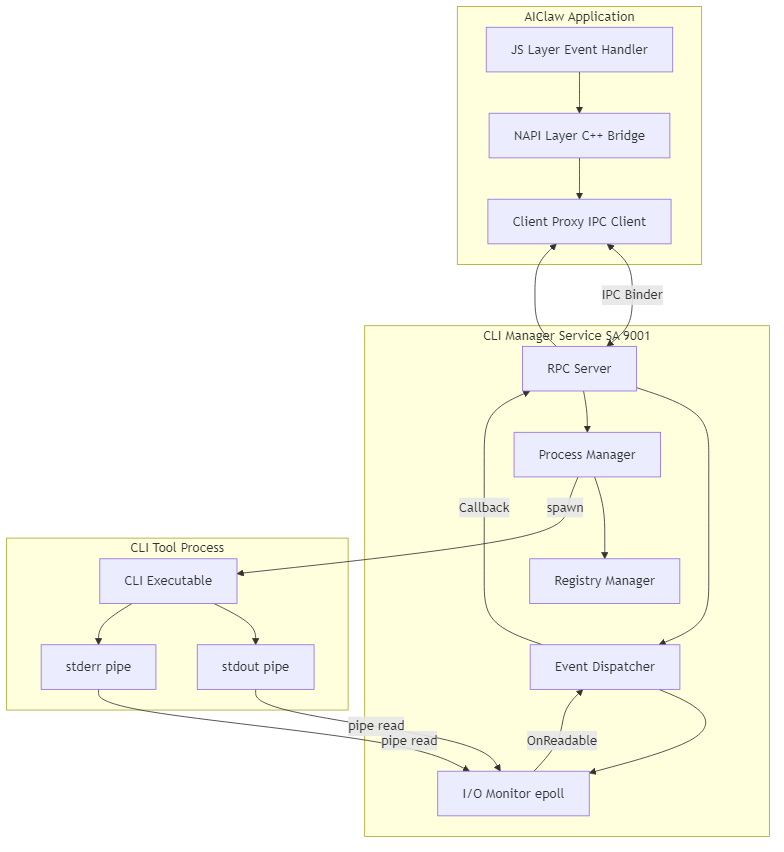
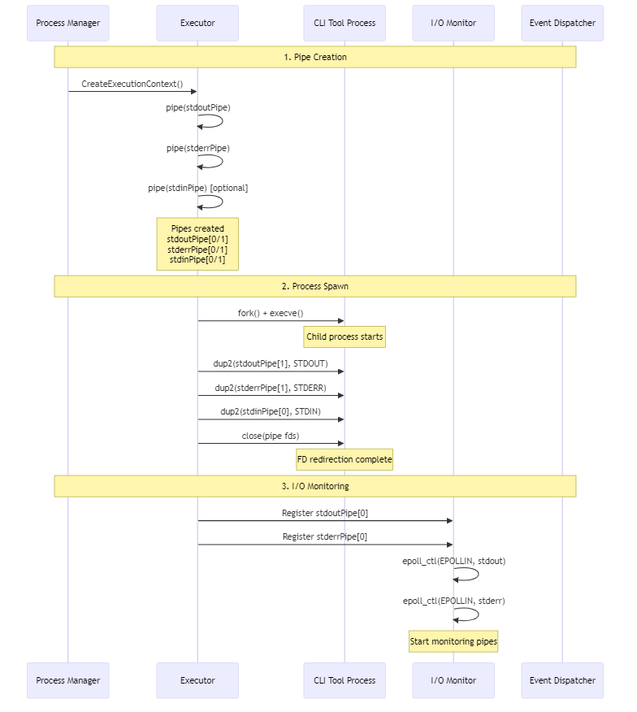
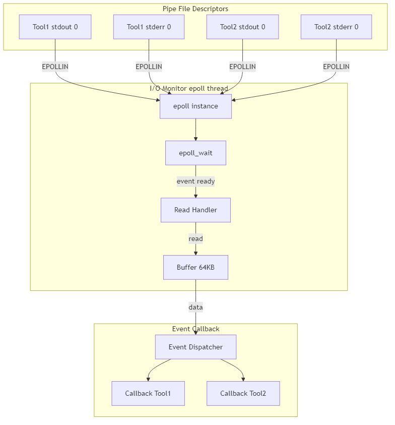
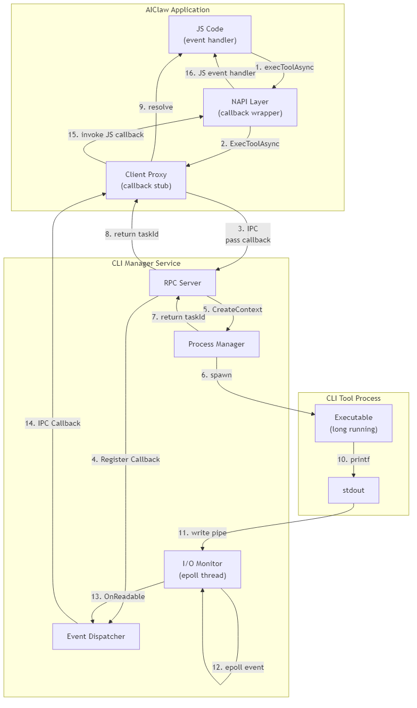

# CLI 工具管理框架完整设计文档

## 文档信息

**版本**: v2.5
**最后更新**: 2025-03-27
**状态**: 完整版（所有文档已合并）

**v2.5 更新内容：**
- ✅ **合并所有 CLI 工具管理框架文档**
  - 合并动态工具注册 InnerKits 使用指南
  - 合并工具注册表实现报告
  - 合并动态工具注册实现报告
  - 合并 JS API 修复报告
  - 合并 ToolInfo 序列化修复报告
  - 合并 QueryTools 调用链路检查报告
- ✅ 新增第 4.7 节：动态工具注册 InnerKits
- ✅ 新增附录 C：动态工具注册实现报告
- ✅ 新增附录 D：实现状态记录
- ✅ 新增附录 E：版本更新记录

**文档说明：**
- 本文档是 CLI 工具管理框架的唯一权威设计文档
- 包含完整的设计、实现、API 和使用指南
- 所有历史文档已合并，保留完整的实现记录和版本历史

**v2.4 更新内容：**
- ✅ **完整更新 TypeScript 接口定义**
  - 新增 `JSONSchema` 类型定义
  - 新增 `TemplateDef` 接口定义
  - 新增 `ArgMapping` 接口定义
  - 新增 `SubCommandInfo` 接口定义
  - 完整更新 `ToolInfo` 接口，包含所有字段
- ✅ 新增使用示例，展示如何使用 inputSchema 动态构建参数
- ✅ 新增子命令工具的使用示例
- ✅ 同步更新 @ohos.cli.manager.d.ts 文件

---

# 目录

1. [总体设计](#1-总体设计)
   - [需求分析](#11-需求分析)
   - [架构选型](#12-架构选型)
   - [系统架构设计](#13-系统架构设计)
2. [通信设计](#2-通信设计)
   - [通信架构](#21-通信架构)
   - [管道建立机制](#22-管道建立机制)
   - [进程启动与管道重定向](#23-进程启动与管道重定向)
   - [I/O监控与数据读取](#24-io监控与数据读取)
   - [事件分发与回调机制](#25-事件分发与回调机制)
3. [参数设计](#3-参数设计)
   - [参数类型支持](#31-参数类型支持)
   - [参数映射规则](#32-参数映射规则)
   - [参数传递流程](#33-参数传递流程)
4. [工具注册表设计](#4-工具注册表设计)
   - [目录结构](#41-目录结构)
   - [注册表格式](#42-注册表格式)
   - [加载机制](#43-加载机制)
   - [热更新](#44-热更新)
   - [安全验证](#45-安全验证)
5. [CLI工具描述设计](#5-cli工具描述设计)
   - [工具描述格式](#51-工具描述格式)
   - [参数Schema定义](#52-参数schema定义)
   - [子命令支持](#53-子命令支持)
   - [完整示例](#54-完整示例)
6. [API设计](#6-api设计)
   - [JS API](#61-js-api)
   - [Native C++ API](#62-native-c-api)
   - [IPC接口](#63-ipc接口)
7. [使用案例](#7-使用案例)
8. [风险评估与安全](#8-风险评估与安全)
9. [实施计划](#9-实施计划)

---

# 1. 总体设计

## 1.1 需求分析

### 1.1.1 核心功能需求

| 需求ID | 功能描述 | 优先级 |
|--------|----------|--------|
| F001 | CLI 工具注册：系统启动时自动扫描并注册可用工具 | P0 |
| F002 | 工具列表查询：支持按名称、能力、权限过滤查询 | P0 |
| F003 | 同步调用：支持短时运行工具的同步调用并获取结果 | P0 |
| F004 | 异步调用：支持长时运行工具的异步调用和消息监听 | P0 |
| F005 | 进程管理：创建、监控、终止 CLI 工具进程 | P0 |
| F006 | 权限校验：调用前校验调用者是否具备所需权限 | P0 |
| F007 | 工具描述文件：定义工具的元数据、输入输出格式 | P0 |
| F008 | 进程隔离：每个 CLI 工具运行在独立进程中 | P1 |
| F009 | 超时控制：支持设置工具执行超时时间 | P1 |
| F010 | 事件订阅：支持订阅工具的输出事件流 | P1 |

### 1.1.2 非功能需求

| 类别 | 指标 | 目标值 |
|------|------|--------|
| 性能 | 同步调用响应时间 | < 100ms (不含工具执行时间) |
| 性能 | 异步消息延迟 | < 50ms |
| 性能 | 工具查询响应 | < 50ms |
| 安全 | 权限校验覆盖率 | 100% |
| 安全 | 进程隔离 | 完全隔离，独立沙箱 |
| 安全 | 参数注入防护 | 所有输入需验证和转义 |
| 可用性 | 服务可用性 | 99.9% |
| 扩展性 | 支持工具数量 | > 1000 |
| 扩展性 | 插件化描述文件 | 支持动态加载 |

---

## 1.2 架构选型

### 1.2.1 方案对比

#### 方案 A：基于 IPC 的分布式架构（推荐）

**架构概述：**
```
AIClaw App ← JS API ← Client Proxy ← IPC ← CLI Manager Service ← Process Manager ← CLI Tools
```

**优点：**
- 完全符合 ability_runtime 现有架构模式
- 进程隔离彻底，安全性高
- 可复用现有 IPC 基础设施
- 支持跨设备调用（分布式能力）

**缺点：**
- IPC 通信有一定开销
- 实现复杂度较高

**适用场景：** 系统级服务，需要高安全性和分布式能力

#### 方案 B：基于 Socket 的轻量级架构

**架构概述：**
```
AIClaw App ← JS API ← Client Library ← Unix Socket ← CLI Daemon ← CLI Tools
```

**优点：**
- 实现相对简单
- 通信开销较小

**缺点：**
- 安全性依赖 socket 权限控制
- 与现有架构融合度低
- 扩展性较差

**适用场景：** 轻量级场景，对性能要求极高

### 1.2.2 推荐方案

**推荐：方案 A - 基于 IPC 的分布式架构**

**理由：**
1. 完全符合 ability_runtime 的现有架构模式
2. 可复用现有的 SystemAbility、IPC、安全框架
3. 支持未来的分布式和多用户需求
4. 便于与现有服务（如 AbilityManagerService）集成

---

## 1.3 系统架构设计

### 1.3.1 整体架构图


```
┌─────────────────────────────────────────────────────────────────────────┐
│                          AIClaw Application                              │
│  ┌──────────────┐         ┌──────────────┐         ┌──────────────┐     │
│  │   JS Layer   │────────▶│   NAPI Layer │────────▶│ Client Proxy │     │
│  │ (Event Handler)       │ (C++ Bridge)  │  (IPC Client)     │     │
│  └──────────────┘         └──────────────┘         └──────┬───────┘     │
└────────────────────────────────────────────────────────────┼─────────────┘
                                                          │
                                                          │ IPC (Binder)
                                                          ▼
┌─────────────────────────────────────────────────────────────────────────┐
│                     CLI Manager Service                                  │
│  ┌──────────────┐         ┌──────────────┐         ┌──────────────┐     │
│  │Event Dispatcher│◀───────│Process Manager│        │Registry Mgr  │     │
│  │ (Event Router)│  IPC    │(Process Ctrl)│        │(Tool Metadata)│    │
│  └──────┬───────┘         └──────┬───────┘         └──────────────┘     │
│         │                        │                                         │
│         │ Event Callback         │ pipe                                   │
│         ▼                        ▼                                         │
│  ┌──────────────────────────────────────────────────────┐                │
│  │              Process I/O Monitor                     │                │
│  │  ┌─────────┐    ┌─────────┐    ┌─────────┐          │                │
│  │  │epoll fd │───▶│stdout[] │    │stderr[] │          │                │
│  │  │(event)  │    │(pipes)  │    │(pipes)  │          │                │
│  │  └─────────┘    └─────────┘    └─────────┘          │                │
│  └──────────────────────────────────────────────────────┘                │
└──────────────────────────────────────────────────────────────────────────┘
                          │                    │
                          │ pipe[1]            │ pipe[1]
                          │ (write)            │ (write)
                          ▼                    ▼
                  ┌─────────────────────────────────────────────┐
                  │          CLI Tool Process                   │
                  │  ┌──────────┐        ┌──────────┐          │
                  │  │  stdout  │        │  stderr  │          │
                  │  │  (pipe)  │        │  (pipe)  │          │
                  │  └──────────┘        └──────────┘          │
                  │         │                    │              │
                  │         ▼                    ▼              │
                  │  ┌──────────────────────────────────┐      │
                  │  │     CLI Tool Executable          │      │
                  │  │  (printf/cout/write to stdout)   │      │
                  │  └──────────────────────────────────┘      │
                  └─────────────────────────────────────────────┘
```

### 1.3.2 组件职责

| 组件 | 职责 | 文件位置 |
|------|------|----------|
| CLI Manager JS API | 对外暴露的 JS 接口 | `frameworks/js/napi/` |
| NAPI Binding | JS-Native 桥接 | `frameworks/js/napi/` |
| Client Proxy | 客户端代理，封装 IPC 调用 | `interfaces/inner_api/` |
| CLI Manager Service | 核心系统服务 | `services/climgr/` |
| Tool Registry Manager | 工具注册和查询管理 | `services/climgr/src/registry_manager.cpp` |

### 1.3.3 工具注册流程


工具注册是系统启动时的核心流程，确保所有可用的 CLI 工具都能被系统识别和管理。
| Permission Checker | 权限校验模块 | `services/climgr/src/permission_checker.cpp` |
| Process Manager | 进程生命周期管理 | `services/climgr/src/process_manager.cpp` |
| Event Dispatcher | 事件分发和消息路由 | `services/climgr/src/event_dispatcher.cpp` |
| Descriptor Parser | 描述文件解析器 | `services/climgr/src/desc_parser.cpp` |

---

# 2. 通信设计

## 2.1 通信架构

### 2.1.1 通信模型



AIClaw 与 CLI 工具进程采用 **管道 + IPC 回调** 的混合通信模型。

### 2.1.2 通信通道

| 通道 | 类型 | 方向 | 用途 |
|------|------|------|------|
| **控制通道** | IPC (Binder) | 双向 | 进程启动、停止、查询 |
| **stdout 管道** | Pipe | Tool → Service | 标准输出数据 |
| **stderr 管道** | Pipe | Tool → Service | 标准错误数据 |
| **stdin 管道** | Pipe | Service → Tool | 标准输入（可选） |
| **事件回调通道** | IPC (Binder) | Service → Client | 异步事件通知 |

---

## 2.2 管道建立机制



### 2.2.1 核心数据结构

```cpp
// interfaces/inner_api/cli_execution_context.h
#pragma once

#include <string>
#include <memory>
#include <functional>
#include <chrono>
#include <sys/types.h>

namespace OHOS {
namespace CliMgr {

/**
 * @brief 执行模式
 */
enum class ExecutionMode : uint8_t {
    SYNC = 0,      // 同步执行，等待结果
    ASYNC = 1,     // 异步执行，事件回调
};

/**
 * @brief 工具类型
 */
enum class ToolType : uint8_t {
    SHORT_LIVED = 0,  // 短时运行，快速退出
    LONG_LIVED = 1,   // 长时运行，持续输出
};

/**
 * @brief 调用者信息
 */
struct CallerInfo {
    pid_t pid;                    // 调用者进程 ID
    uid_t uid;                    // 调用者用户 ID
    std::string bundleName;       // 应用包名
    std::string abilityName;      // Ability 名称
    std::string token;            // 安全令牌
};

/**
 * @brief 执行上下文
 */
class ExecutionContext {
public:
    ExecutionContext() = default;
    ~ExecutionContext();

    // 基本信息
    std::string taskId;                      // 任务唯一 ID
    std::string toolName;                    // 工具名称
    ExecutionMode mode;                      // 执行模式

    // 进程信息
    pid_t processId = -1;                    // 工具进程 ID
    std::chrono::time_point<std::chrono::steady_clock> startTime;
    std::chrono::time_point<std::chrono::steady_clock> endTime;

    // 调用者信息
    CallerInfo caller;

    // 管道文件描述符
    int stdoutPipe[2] = {-1, -1};            // [0]=read, [1]=write
    int stderrPipe[2] = {-1, -1};
    int stdinPipe[2] = {-1, -1};

    // 输出缓冲区
    std::string stdoutBuffer;                // 累积的标准输出
    std::string stderrBuffer;                // 累积的标准错误

    // 执行参数
    Json::Value arguments;                   // 执行参数

    // 执行选项
    uint32_t timeoutMs = 30000;              // 超时时间
    std::string workingDir;                  // 工作目录

    // 回调对象（用于异步模式）
    sptr<ICLICallback> callback;             // IPC 回调代理

    // 状态标志
    std::atomic<bool> isRunning{false};      // 是否正在运行
    std::atomic<bool> isCompleted{false};    // 是否已完成
    int exitCode = -1;                       // 退出码
    int signal = 0;                          // 终止信号

    /**
     * @brief 关闭所有管道
     */
    void CloseAllPipes();

    /**
     * @brief 关闭写端（通知工具进程 EOF）
     */
    void CloseWriteEnds();

    /**
     * @brief 检查是否超时
     */
    bool IsTimedOut() const;

private:
    void ClosePipe(int pipe[2]);
};

} // namespace CliMgr
} // namespace OHOS
```

### 2.2.2 数据模型关系图


上图展示了 CLI 管理框架中核心数据实体之间的关系：
- **ToolInfo**: 工具的元数据信息
- **ExecutionContext**: 执行上下文，包含进程状态、管道、缓冲区等
- **CallerInfo**: 调用者信息和权限数据
- **Session**: 会话管理，关联执行上下文和回调

### 2.2.3 管道创建实现

```cpp
// services/climgr/src/process_manager.cpp

#include "cli_execution_context.h"
#include "hilog_tag_wrapper.h"
#include <unistd.h>
#include <fcntl.h>
#include <errno.h>

namespace OHOS {
namespace CliMgr {

bool ProcessManager::CreatePipes(ExecutionContext& context)
{
    // 创建 stdout 管道
    if (pipe(context.stdoutPipe) != 0) {
        TAG_LOGE(AAFwkLogTag::ABILITY, "Failed to create stdout pipe: %{public}d", errno);
        return false;
    }

    // 创建 stderr 管道
    if (pipe(context.stderrPipe) != 0) {
        TAG_LOGE(AAFwkLogTag::ABILITY, "Failed to create stderr pipe: %{public}d", errno);
        close(context.stdoutPipe[0]);
        close(context.stdoutPipe[1]);
        return false;
    }

    // 创建 stdin 管道（可选）
    if (pipe(context.stdinPipe) != 0) {
        TAG_LOGW(AAFwkLogTag::ABILITY, "Failed to create stdin pipe: %{public}d", errno);
        context.stdinPipe[0] = -1;
        context.stdinPipe[1] = -1;
    }

    // 设置读端为非阻塞模式
    SetNonBlocking(context.stdoutPipe[0]);
    SetNonBlocking(context.stderrPipe[0]);
    if (context.stdinPipe[0] >= 0) {
        SetNonBlocking(context.stdinPipe[0]);
    }

    TAG_LOGI(AAFwkLogTag::ABILITY, "Pipes created for task %{public}s", context.taskId.c_str());
    return true;
}

void ProcessManager::SetNonBlocking(int fd)
{
    int flags = fcntl(fd, F_GETFL, 0);
    if (flags >= 0) {
        fcntl(fd, F_SETFL, flags | O_NONBLOCK);
    }
}

} // namespace CliMgr
} // namespace OHOS
```

---

## 2.3 进程启动与管道重定向

### 2.3.1 进程启动实现

```cpp
// services/climgr/src/process_manager.cpp

#include <sys/wait.h>
#include <sys/types.h>
#include <unistd.h>
#include <fcntl.h>

namespace OHOS {
namespace CliMgr {

pid_t ProcessManager::SpawnProcess(const ToolInfo& toolInfo,
                                   const ExecutionContext& context)
{
    pid_t pid = fork();

    if (pid < 0) {
        // fork 失败
        TAG_LOGE(AAFwkLogTag::ABILITY, "Failed to fork process: %{public}d", errno);
        return -1;
    }

    if (pid == 0) {
        // === 子进程 ===
        PrepareChildProcess(context);

        // 构建参数数组
        std::vector<char*> argv = BuildArgv(toolInfo, context);

        // 执行工具
        execve(toolInfo.executablePath.c_str(), argv.data(), environ);

        // 如果 execve 返回，说明执行失败
        _exit(127);  // exec 失败退出码
    }

    // === 父进程 ===
    TAG_LOGI(AAFwkLogTag::ABILITY,
             "Tool process spawned: pid=%{public}d, tool=%{public}s",
             pid, toolInfo.name.c_str());

    return pid;
}

void ProcessManager::PrepareChildProcess(ExecutionContext& context)
{
    // 重定向 stdout
    if (context.stdoutPipe[1] != STDOUT_FILENO) {
        dup2(context.stdoutPipe[1], STDOUT_FILENO);
    }

    // 重定向 stderr
    if (context.stderrPipe[1] != STDERR_FILENO) {
        dup2(context.stderrPipe[1], STDERR_FILENO);
    }

    // 重定向 stdin（如果需要）
    if (context.stdinPipe[0] >= 0 && context.stdinPipe[0] != STDIN_FILENO) {
        dup2(context.stdinPipe[0], STDIN_FILENO);
    }

    // 关闭所有不需要的文件描述符
    // 关闭管道的读端（子进程只需要写端）
    close(context.stdoutPipe[0]);
    close(context.stderrPipe[0]);
    if (context.stdinPipe[0] >= 0) {
        close(context.stdinPipe[1]);  // 关闭 stdin 写端
    } else {
        // 如果不需要 stdin，关闭 /dev/null
        int nullFd = open("/dev/null", O_RDONLY);
        if (nullFd >= 0) {
            dup2(nullFd, STDIN_FILENO);
            close(nullFd);
        }
    }

    // 设置进程组 ID（便于进程管理）
    setsid();
}

} // namespace CliMgr
} // namespace OHOS
```

---

## 2.4 I/O监控与数据读取



### 2.4.1 I/O 监控器设计

```cpp
// services/climgr/src/io_monitor.h

#pragma once

#include <string>
#include <unordered_map>
#include <atomic>
#include <thread>
#include <mutex>
#include <sys/epoll.h>

namespace OHOS {
namespace CliMgr {

// 前向声明
class ExecutionContext;
class EventDispatcher;

/**
 * @brief I/O 事件类型
 */
enum class IOEventType : uint8_t {
    STDOUT = 0,
    STDERR = 1,
    PROCESS_EXIT = 2,
    TIMEOUT = 3,
};

/**
 * @brief I/O 事件数据
 */
struct IOEvent {
    IOEventType type;
    std::string taskId;
    std::string data;
    int exitCode;
};

/**
 * @brief I/O 监控器
 *
 * 使用 epoll 监控所有工具进程的管道输出
 */
class IOMonitor {
public:
    explicit IOMonitor(EventDispatcher* dispatcher);
    ~IOMonitor();

    /**
     * @brief 启动监控线程
     */
    bool Start();

    /**
     * @brief 停止监控线程
     */
    void Stop();

    /**
     * @brief 注册任务的管道进行监控
     * @param context 执行上下文
     * @return 是否注册成功
     */
    bool RegisterTask(const std::shared_ptr<ExecutionContext>& context);

    /**
     * @brief 取消任务监控
     * @param taskId 任务 ID
     */
    void UnregisterTask(const std::string& taskId);

    /**
     * @brief 向工具进程写入数据（通过 stdin）
     * @param taskId 任务 ID
     * @param data 要写入的数据
     * @return 写入的字节数，失败返回 -1
     */
    ssize_t WriteToStdin(const std::string& taskId, const std::string& data);

private:
    /**
     * @brief 监控线程主循环
     */
    void MonitorThread();

    /**
     * @brief 处理管道可读事件
     * @param fd 文件描述符
     * @param taskId 任务 ID
     * @param type 事件类型
     */
    void HandleReadable(int fd, const std::string& taskId, IOEventType type);

    /**
     * @brief 从管道读取数据
     * @param fd 文件描述符
     * @return 读取的数据
     */
    std::string ReadFromPipe(int fd);

    /**
     * @brief 关闭任务的所有管道
     * @param taskId 任务 ID
     */
    void CloseTaskPipes(const std::string& taskId);

private:
    EventDispatcher* dispatcher_;
    int epollFd_ = -1;
    std::atomic<bool> running_{false};
    std::thread monitorThread_;

    // taskId -> ExecutionContext
    std::unordered_map<std::string, std::shared_ptr<ExecutionContext>> tasks_;
    std::mutex tasksMutex_;

    // fd -> taskId
    std::unordered_map<int, std::string> fdToTaskId_;
    std::mutex fdMutex_;

    // taskId -> fd (stdin write end)
    std::unordered_map<std::string, int> stdinWriteFds_;
    std::mutex stdinMutex_;
};

} // namespace CliMgr
} // namespace OHOS
```

---

## 2.5 事件分发与回调机制

### 2.5.1 同步数据流


### 2.5.2 异步数据流



### 2.5.3 事件分发器设计

### 2.5.1 事件分发器设计

```cpp
// services/climgr/src/event_dispatcher.h

#pragma once

#include <string>
#include <memory>
#include <unordered_map>
#include <mutex>
#include <functional>

#include "cli_execution_context.h"
#include "cli_callback.h"

namespace OHOS {
namespace CliMgr {

// 前向声明
struct IOEvent;

/**
 * @brief 事件分发器
 *
 * 负责将 I/O 事件和进程退出事件分发给对应的客户端回调
 */
class EventDispatcher {
public:
    EventDispatcher() = default;
    ~EventDispatcher() = default;

    /**
     * @brief 注册任务的回调
     * @param taskId 任务 ID
     * @param callback IPC 回调对象
     */
    void RegisterCallback(const std::string& taskId,
                         const sptr<ICLICallback>& callback);

    /**
     * @brief 取消回调
     * @param taskId 任务 ID
     */
    void UnregisterCallback(const std::string& taskId);

    /**
     * @brief 分发 I/O 事件
     * @param event I/O 事件
     */
    void DispatchIOEvent(const IOEvent& event);

    /**
     * @brief 分发进程退出事件
     * @param taskId 任务 ID
     * @param exitCode 退出码
     */
    void DispatchExitEvent(const std::string& taskId, int exitCode);

    /**
     * @brief 分发错误事件
     * @param taskId 任务 ID
     * @param errorCode 错误码
     * @param errorMsg 错误消息
     */
    void DispatchErrorEvent(const std::string& taskId,
                           int32_t errorCode,
                           const std::string& errorMsg);

private:
    // taskId -> IPC Callback
    std::unordered_map<std::string, sptr<ICLICallback>> callbacks_;
    std::mutex callbacksMutex_;
};

} // namespace CliMgr
} // namespace OHOS
```

### 2.5.2 IPC 回调接口

```cpp
// interfaces/inner_api/cli_callback.h

#pragma once

#include <iremote_broker.h>
#include <iremote_object.h>

namespace OHOS {
namespace CliMgr {

/**
 * @brief 工具事件
 */
struct ToolEvent {
    std::string type;      // "stdout", "stderr", "exit", "error"
    std::string data;      // 事件数据
    int exitCode = 0;      // 退出码（仅 exit 事件）
    int64_t timestamp;     // 时间戳
};

/**
 * @brief CLI 回调接口
 *
 * 客户端需要实现此接口以接收异步事件
 */
class ICLICallback : public IRemoteBroker {
public:
    DECLARE_INTERFACE_DESCRIPTOR(CLI_CALLBACK);

    /**
     * @brief 工具输出事件
     * @param taskId 任务 ID
     * @param event 事件数据
     */
    virtual void OnOutput(const std::string& taskId, const ToolEvent& event) = 0;

    /**
     * @brief 工具退出事件
     * @param taskId 任务 ID
     * @param exitCode 退出码
     */
    virtual void OnExit(const std::string& taskId, int32_t exitCode) = 0;

    /**
     * @brief 错误事件
     * @param taskId 任务 ID
     * @param errorCode 错误码
     * @param errorMsg 错误消息
     */
    virtual void OnError(const std::string& taskId,
                        int32_t errorCode,
                        const std::string& errorMsg) = 0;

    // 析构函数
    virtual ~ICLICallback() = default;
};

} // namespace CliMgr
} // namespace OHOS
```

---

# 3. 参数设计

## 3.1 参数类型支持

### 3.1.1 基于标准 JSON Schema

工具描述文件的 `input` 部分遵循 [JSON Schema](https://json-schema.org/) 规范。

### 3.1.2 基本类型

#### String (字符串)
```json
{
  "properties": {
    "target": {
      "type": "string",
      "description": "目标地址",
      "minLength": 1,
      "maxLength": 255,
      "pattern": "^[a-zA-Z0-9.-]+$",
      "format": "ipv4",
      "default": "127.0.0.1"
    }
  }
}
```

**支持的格式 (format)**：
- `ipv4` - IPv4 地址
- `ipv6` - IPv6 地址
- `hostname` - 主机名
- `email` - 邮箱地址
- `uri` - URI 地址
- `date` / `date-time` - 日期时间
- `binary` - Base64 编码的二进制数据

#### Number (数字)
```json
{
  "properties": {
    "port": {
      "type": "number",
      "minimum": 1,
      "maximum": 65535,
      "default": 8080,
      "multipleOf": 1
    }
  }
}
```

#### Integer (整数)
```json
{
  "properties": {
    "count": {
      "type": "integer",
      "minimum": 0,
      "maximum": 100
    }
  }
}
```

#### Boolean (布尔值)
```json
{
  "properties": {
    "verbose": {
      "type": "boolean",
      "default": false
    }
  }
}
```

### 3.1.3 复合类型

#### Array (数组)
```json
{
  "properties": {
    "ports": {
      "type": "array",
      "items": {"type": "integer"},
      "minItems": 1,
      "maxItems": 100,
      "uniqueItems": true,
      "default": [80, 443]
    }
  }
}
```

#### Object (对象)
```json
{
  "properties": {
    "config": {
      "type": "object",
      "properties": {
        "host": {"type": "string"},
        "port": {"type": "integer"},
        "ssl": {"type": "boolean"}
      },
      "required": ["host", "port"],
      "additionalProperties": false
    }
  }
}
```

### 3.1.4 特殊类型

#### Enum (枚举)
```json
{
  "properties": {
    "level": {
      "type": "string",
      "enum": ["DEBUG", "INFO", "WARN", "ERROR"],
      "default": "INFO"
    }
  }
}
```

#### Union (联合类型)
```json
{
  "properties": {
    "input": {
      "type": ["string", "number", "boolean"]
    }
  }
}
```

### 3.1.5 支持的类型矩阵

| 类型 | 简单值 | 数组值 | 对象值 | 嵌套 | JSON传递 |
|------|--------|--------|--------|------|---------|
| string | ✅ | ✅ | ✅ | ✅ | ✅ |
| number/integer | ✅ | ✅ | ✅ | ✅ | ✅ |
| boolean | ✅ | ✅ | ✅ | ✅ | ✅ |
| array | ✅ | ✅ | ✅ | ✅ | ✅ |
| object | ❌ | ✅ | ✅ | ✅ | ✅ |
| null | ✅ | ✅ | ✅ | ✅ | ✅ |

---

## 3.2 参数映射规则

### 3.2.1 参数映射类型

工具描述文件通过 `argumentMapping` 字段定义参数如何转换为命令行参数：

| 映射类型 | 说明 | 模板示例 |
|----------|------|----------|
| `flag` | 标志模式（`--key=value`） | `--key={value}` |
| `positional` | 位置参数 | 按顺序排列 |
| `flattened` | 展平嵌套 | `parent.child={value}` |
| `json-string` | JSON 字符串 | `'{"key":"value"}'` |
| `json-file` | JSON 文件 | `@config.json` |
| `mixed` | 混合模式 | 组合使用 |

### 3.2.2 Flag 模式（基于模板）

```json
{
  "argumentMapping": {
    "type": "flag",
    "separator": " ",
    "templates": {
      "target": "--target={value}",
      "ports": "--port={value}",
      "verbose": {
        "if_true": "-v",
        "if_false": ""
      }
    }
  }
}
```

### 3.2.3 Positional 模式（位置参数）

```json
{
  "argumentMapping": {
    "type": "positional",
    "order": ["inputFile", "outputFile", "options"]
  }
}
```

### 3.2.4 JavaScript 映射器（最灵活）

```json
{
  "argumentMapping": {
    "type": "javascript",
    "mapper": "function(args) { /* 自定义逻辑 */ }"
  }
}
```

---

## 3.3 参数传递流程

### 3.3.1 调用方查询工具信息

```typescript
// 1. 查询所有工具
const tools = await CLI.CLIManager.queryTools();

// 2. 找到目标工具
const scanner = tools.find(t => t.name === 'network-scanner');

// 3. 查看工具的参数定义
console.log(scanner.inputSchema);
```

### 3.3.2 调用方构造参数

```typescript
// 根据工具的 inputSchema 构造参数对象
const args = {
  target: "192.168.1.1",      // 必填参数
  ports: [80, 443, 8080],     // 可选参数
  verbose: true                // 可选参数
};
```

### 3.3.3 服务端参数转换

```cpp
// services/climgr/src/param_mapper.cpp

class ParameterMapper {
public:
    /**
     * @brief 将抽象参数转换为命令行参数数组
     * @param toolInfo 工具信息（包含映射规则）
     * @param abstractArgs 抽象参数（来自 JS 调用方）
     * @return 命令行参数数组（用于 execve）
     */
    static std::vector<std::string> MapToCommandLine(
        const ToolInfo& toolInfo,
        const Json::Value& abstractArgs)
    {
        std::vector<std::string> argv;
        argv.push_back(toolInfo.executablePath);  // argv[0]

        // 方式 1: 使用模板映射
        if (toolInfo.argMapping.HasTemplates()) {
            ApplyTemplateMapping(toolInfo, abstractArgs, argv);
        }
        // 方式 2: 使用 JavaScript 映射器
        else if (toolInfo.argMapping.HasMapper()) {
            ApplyJavaScriptMapping(toolInfo, abstractArgs, argv);
        }
        // 方式 3: 默认规则映射
        else {
            ApplyDefaultMapping(toolInfo, abstractArgs, argv);
        }

        return argv;
    }

private:
    static void ApplyTemplateMapping(
        const ToolInfo& toolInfo,
        const Json::Value& abstractArgs,
        std::vector<std::string>& argv)
    {
        // 遍历所有参数
        for (const auto& key : abstractArgs.getMemberNames()) {
            Json::Value value = abstractArgs[key];
            std::string template = toolInfo.argMapping.templates[key];

            // 处理不同类型的值
            if (value.isString()) {
                std::string formatted = FormatTemplate(template, value.asString());
                argv.push_back(formatted);
            }
            else if (value.isArray()) {
                for (const auto& item : value) {
                    std::string formatted = FormatTemplate(template, item.asString());
                    argv.push_back(formatted);
                }
            }
            else if (value.isBool()) {
                std::string formatted = value.asBool() ?
                    toolInfo.argMapping.templates[key]["if_true"].asString() :
                    toolInfo.argMapping.templates[key]["if_false"].asString();
                if (!formatted.empty()) {
                    argv.push_back(formatted);
                }
            }
        }
    }

    static std::string FormatTemplate(
        const std::string& tmpl,
        const std::string& value)
    {
        // 简单实现：替换 {value} 占位符
        std::string result = tmpl;
        size_t pos = result.find("{value}");
        if (pos != std::string::npos) {
            result.replace(pos, 7, value);
        }
        return result;
    }
};
```

---

# 4. 工具注册表设计

## 4.1 目录结构

CLI 服务的工具统一安装在 `/etc/cli/` 目录下：

```
/etc/cli/
├── cli_tools.json      # 工具注册表（所有工具的描述信息）
└── tools/              # 工具可执行文件目录
    ├── net-scan
    ├── log-mon
    ├── app-deploy
    ├── cloud-deploy
    ├── file-copy
    ├── pkg-mgr
    └── sysctl
```

### 目录说明

| 路径 | 说明 | 权限要求 |
|------|------|----------|
| `/etc/cli/` | CLI 配置根目录 | root:root 755 |
| `/etc/cli/cli_tools.json` | 工具注册表文件 | root:root 644 |
| `/etc/cli/tools/` | 可执行文件目录 | root:root 755 |
| `/etc/cli/tools/*` | 工具可执行文件 | root:root 755 (不可设置 setuid/setgid) |

---

## 4.2 注册表格式

### 4.2.1 基本结构

`cli_tools.json` 是一个 JSON 文件，包含所有可用工具的完整描述信息。

```json
{
  "$schema": "https://schemas.openharmony.org/cli/tools-registry/v1",
  "version": "1.0.0",
  "lastUpdated": "2025-03-26T10:30:00Z",
  "tools": [
    // 工具列表...
  ]
}
```

### 4.2.2 注册表字段说明

| 字段 | 类型 | 必填 | 说明 |
|------|------|------|------|
| `$schema` | string | 否 | JSON Schema 标识 |
| `version` | string | 是 | 注册表版本号 |
| `lastUpdated` | string | 是 | 最后更新时间（ISO 8601格式） |
| `tools` | array | 是 | 工具描述数组 |
| `tools[]` | object | - | 单个工具的完整描述 |

---

## 4.3 加载机制

### 4.3.1 启动时加载

CLI Manager Service 启动时的加载流程：

```cpp
bool RegistryManager::Initialize()
{
    TAG_LOGI(TAG, "Initializing RegistryManager");

    // 1. 检查注册表文件是否存在
    std::string registryPath = "/etc/cli/cli_tools.json";
    struct stat st;
    if (stat(registryPath.c_str(), &st) != 0) {
        TAG_LOGW(TAG, "Registry file not found: %{public}s", registryPath.c_str());
        // 创建空注册表
        return CreateEmptyRegistry(registryPath);
    }

    // 2. 加载并解析注册表
    if (!LoadRegistry(registryPath)) {
        TAG_LOGE(TAG, "Failed to load registry");
        return false;
    }

    // 3. 验证所有工具
    if (!ValidateAllTools()) {
        TAG_LOGW(TAG, "Some tools failed validation");
    }

    // 4. 启动文件监控
    StartRegistryWatcher();

    return true;
}
```

### 4.3.2 解析流程

```cpp
int32_t RegistryManager::LoadRegistry(const std::string& registryPath)
{
    // 1. 读取文件内容
    std::string content = ReadFileContent(registryPath);
    if (content.empty()) {
        return ErrCode::ERR_INVALID_SCHEMA;
    }

    // 2. 解析 JSON
    Json::Value root;
    Json::CharReaderBuilder builder;
    std::string errs;
    std::unique_ptr<Json::CharReader> reader(builder.newCharReader());

    if (!reader->parse(content.c_str(), content.c_str() + content.length(),
                       &root, &errs)) {
        TAG_LOGE(TAG, "JSON parse error: %{public}s", errs.c_str());
        return ErrCode::ERR_INVALID_SCHEMA;
    }

    // 3. 验证版本
    std::string version = root.get("version", "").asString();
    if (version.empty()) {
        TAG_LOGE(TAG, "Missing version field");
        return ErrCode::ERR_INVALID_SCHEMA;
    }

    // 4. 解析工具数组
    if (!root.isMember("tools") || !root["tools"].isArray()) {
        TAG_LOGE(TAG, "Missing or invalid 'tools' array");
        return ErrCode::ERR_INVALID_SCHEMA;
    }

    const Json::Value& toolsArray = root["tools"];
    std::vector<ToolInfo> validTools;

    for (const auto& toolJson : toolsArray) {
        ToolInfo tool;
        if (ParseToolFromJson(toolJson, tool)) {
            if (ValidateToolEntry(tool)) {
                validTools.push_back(tool);
                TAG_LOGI(TAG, "Loaded tool: %{public}s", tool.name.c_str());
            } else {
                TAG_LOGW(TAG, "Tool validation failed: %{public}s",
                         tool.name.c_str());
            }
        }
    }

    // 5. 更新内存注册表
    {
        std::lock_guard<std::mutex> lock(toolsMutex_);
        tools_.clear();
        for (const auto& tool : validTools) {
            tools_[tool.name] = tool;
        }
    }

    TAG_LOGI(TAG, "Registry loaded: %{public}zu tools", validTools.size());
    return ErrCode::OK;
}
```

---

## 4.4 热更新

### 4.4.1 文件监控

使用 `inotify` 监控注册表文件变更：

```cpp
class RegistryWatcher {
public:
    explicit RegistryWatcher(RegistryManager* manager)
        : manager_(manager), inotifyFd_(-1), watchFd_(-1) {}

    ~RegistryWatcher() {
        Stop();
    }

    bool Start(const std::string& registryPath);
    void Stop();

private:
    void WatchThread();
    void OnRegistryChanged();

    RegistryManager* manager_;
    int inotifyFd_;
    int watchFd_;
    std::thread watchThread_;
    std::atomic<bool> running_{false};
};

bool RegistryWatcher::Start(const std::string& registryPath)
{
    inotifyFd_ = inotify_init1(IN_NONBLOCK);
    if (inotifyFd_ < 0) {
        TAG_LOGE(TAG, "Failed to init inotify");
        return false;
    }

    watchFd_ = inotify_add_watch(inotifyFd_, registryPath.c_str(),
                                   IN_MODIFY | IN_MOVED_TO);
    if (watchFd_ < 0) {
        TAG_LOGE(TAG, "Failed to add watch");
        close(inotifyFd_);
        return false;
    }

    running_ = true;
    watchThread_ = std::thread(&RegistryWatcher::WatchThread, this);

    TAG_LOGI(TAG, "Registry watcher started");
    return true;
}

void RegistryWatcher::WatchThread()
{
    char buffer[4096];

    while (running_) {
        int length = read(inotifyFd_, buffer, sizeof(buffer));
        if (length < 0) {
            if (errno == EINTR) continue;
            break;
        }

        int i = 0;
        while (i < length) {
            struct inotify_event* event = (struct inotify_event*)&buffer[i];

            if (event->mask & (IN_MODIFY | IN_MOVED_TO)) {
                TAG_LOGI(TAG, "Registry file changed, reloading...");
                OnRegistryChanged();
            }

            i += sizeof(struct inotify_event) + event->len;
        }
    }
}

void RegistryWatcher::OnRegistryChanged()
{
    // 延迟一小段时间，确保文件写入完成
    std::this_thread::sleep_for(std::chrono::milliseconds(100));

    // 重新加载注册表
    manager_->ReloadRegistry();
}
```

### 4.4.2 重载接口

```cpp
// CLI Manager Service 提供的重载接口
int32_t CLIManagerService::ReloadRegistry()
{
    TAG_LOGI(TAG, "Reloading tool registry");

    int32_t ret = registryManager_->ReloadRegistry();
    if (ret != ErrCode::OK) {
        TAG_LOGE(TAG, "Failed to reload registry: %{public}d", ret);
        return ret;
    }

    // 通知所有监听器
    NotifyRegistryChanged();

    return ErrCode::OK;
}
```

---

## 4.5 安全验证

### 4.5.1 可执行文件验证

```cpp
bool RegistryManager::ValidateToolEntry(const ToolInfo& tool)
{
    // 1. 验证可执行文件路径
    if (tool.executablePath.find("/etc/cli/tools/") != 0) {
        TAG_LOGE(TAG, "Executable must be in /etc/cli/tools/: %{public}s",
                 tool.executablePath.c_str());
        return false;
    }

    // 2. 验证文件存在
    struct stat st;
    if (stat(tool.executablePath.c_str(), &st) != 0) {
        TAG_LOGW(TAG, "Executable not found: %{public}s",
                 tool.executablePath.c_str());
        return false;
    }

    // 3. 验证是常规文件
    if (!S_ISREG(st.st_mode)) {
        TAG_LOGE(TAG, "Not a regular file: %{public}s",
                 tool.executablePath.c_str());
        return false;
    }

    // 4. 验证不允许 setuid/setgid
    if ((st.st_mode & S_ISUID) || (st.st_mode & S_ISGID)) {
        TAG_LOGE(TAG, "Setuid/setgid not allowed: %{public}s",
                 tool.executablePath.c_str());
        return false;
    }

    // 5. 验证所有者必须是 root
    if (st.st_uid != 0) {
        TAG_LOGE(TAG, "Tool must be owned by root: %{public}s (uid=%{public}d)",
                 tool.executablePath.c_str(), st.st_uid);
        return false;
    }

    // 6. 验证权限（755 或更严格）
    if ((st.st_mode & 0777) > 0755) {
        TAG_LOGW(TAG, "Tool permissions too loose: %{public}s (mode=%{public}o)",
                 tool.executablePath.c_str(), st.st_mode & 0777);
    }

    // 7. 验证可执行
    if ((st.st_mode & S_IXUSR) == 0) {
        TAG_LOGE(TAG, "Tool not executable: %{public}s",
                 tool.executablePath.c_str());
        return false;
    }

    return true;
}
```

### 4.5.2 工具名称验证

```cpp
bool RegistryManager::ValidateToolName(const std::string& name)
{
    // 1. 长度限制
    if (name.empty() || name.size() > 64) {
        return false;
    }

    // 2. 字符限制：只允许小写字母、数字、连字符
    std::regex pattern("^[a-z0-9-]+$");
    if (!std::regex_match(name, pattern)) {
        return false;
    }

    // 3. 不能以连字符开头或结尾
    if (name[0] == '-' || name[name.size()-1] == '-') {
        return false;
    }

    // 4. 不能有连续的连字符
    if (name.find("--") != std::string::npos) {
        return false;
    }

    return true;
}
```

### 4.5.3 注册表签名验证（可选）

```cpp
// 生产环境可选：使用 GPG 签名验证注册表
bool RegistryManager::VerifyRegistrySignature(const std::string& registryPath)
{
    std::string signaturePath = registryPath + ".sig";

    // 检查签名文件是否存在
    struct stat st;
    if (stat(signaturePath.c_str(), &st) != 0) {
        TAG_LOGW(TAG, "Signature file not found, skipping verification");
        return true;  // 开发环境允许无签名
    }

    // 使用 GPG 验证签名
    std::string cmd = "gpg --verify " + signaturePath + " " + registryPath + " 2>&1";
    FILE* pipe = popen(cmd.c_str(), "r");
    if (!pipe) {
        TAG_LOGE(TAG, "Failed to execute gpg");
        return false;
    }

    char buffer[128];
    std::string result;
    while (fgets(buffer, sizeof(buffer), pipe) != nullptr) {
        result += buffer;
    }

    int status = pclose(pipe);

    if (status == 0) {
        TAG_LOGI(TAG, "Registry signature verified");
        return true;
    } else {
        TAG_LOGE(TAG, "Registry signature verification failed: %{public}s",
                 result.c_str());
        return false;
    }
}
```

---

## 4.6 工具安装和卸载

### 4.6.1 安装脚本

```bash
#!/bin/bash
# /usr/bin/cli-tool-install

set -e

TOOL_NAME="$1"
EXECUTABLE="$2"
CONFIG="$3"

REGISTRY="/etc/cli/cli_tools.json"
TOOLS_DIR="/etc/cli/tools"

# 验证参数
if [ -z "$TOOL_NAME" ] || [ -z "$EXECUTABLE" ]; then
    echo "Usage: cli-tool-install <name> <executable> [config.json]"
    exit 1
fi

# 验证工具名称
if ! [[ "$TOOL_NAME" =~ ^[a-z0-9-]+$ ]]; then
    echo "Error: Invalid tool name. Only lowercase letters, numbers, and hyphens allowed."
    exit 1
fi

# 复制可执行文件
echo "Installing $TOOL_NAME..."
install -m 755 "$EXECUTABLE" "$TOOLS_DIR/$TOOL_NAME"

# 更新注册表
if [ -n "$CONFIG" ]; then
    echo "Merging configuration..."
    /usr/bin/cli-registry-merge "$REGISTRY" "$CONFIG"
else
    echo "Adding tool entry..."
    /usr/bin/cli-registry-add "$REGISTRY" "$TOOL_NAME"
fi

# 验证注册表
if ! /usr/bin/cli-registry-validate "$REGISTRY"; then
    echo "Error: Registry validation failed"
    exit 1
fi

# 重新加载服务
echo "Reloading CLI Manager Service..."
systemctl reload climgr || killall -HUP climgr

echo "Tool $TOOL_NAME installed successfully!"
```

### 4.6.2 卸载脚本

```bash
#!/bin/bash
# /usr/bin/cli-tool-remove

set -e

TOOL_NAME="$1"

REGISTRY="/etc/cli/cli_tools.json"
TOOLS_DIR="/etc/cli/tools"

if [ -z "$TOOL_NAME" ]; then
    echo "Usage: cli-tool-remove <name>"
    exit 1
fi

echo "Removing $TOOL_NAME..."

# 从注册表删除
/usr/bin/cli-registry-remove "$REGISTRY" "$TOOL_NAME"

# 删除可执行文件
rm -f "$TOOLS_DIR/$TOOL_NAME"

# 重新加载服务
systemctl reload climgr || killall -HUP climgr

echo "Tool $TOOL_NAME removed successfully!"
```

### 4.6.3 注册表管理工具

```cpp
// /usr/bin/cli-registry-add
int main(int argc, char* argv[])
{
    if (argc < 3) {
        fprintf(stderr, "Usage: cli-registry-add <registry.json> <tool-name>\n");
        return 1;
    }

    std::string registryPath = argv[1];
    std::string toolName = argv[2];

    // 1. 读取现有注册表
    Json::Value root;
    std::ifstream file(registryPath);
    file >> root;
    file.close();

    // 2. 创建默认工具条目
    Json::Value tool;
    tool["name"] = toolName;
    tool["version"] = "1.0.0";
    tool["description"] = "Auto-generated entry";
    tool["executable"] = "/etc/cli/tools/" + toolName;
    tool["timeout"] = 30000;
    tool["events"] = Json::Value(Json::arrayValue);

    Json::Value input;
    input["type"] = "object";
    input["properties"] = Json::Value(Json::objectValue);
    tool["input"] = input;

    Json::Value argMapping;
    argMapping["type"] = "flag";
    argMapping["templates"] = Json::Value(Json::objectValue);
    tool["argumentMapping"] = argMapping;

    // 3. 添加到工具数组
    root["tools"].append(tool);

    // 4. 更新时间戳
    root["lastUpdated"] = GetCurrentTimestamp();

    // 5. 写回文件
    std::ofstream outFile(registryPath);
    outFile << root;
    outFile.close();

    printf("Tool '%s' added to registry\n", toolName.c_str());
    return 0;
}
```

---

## 4.7 动态工具注册 InnerKits

### 4.7.1 概述

CLI 工具动态注册功能允许系统服务和底层组件在运行时动态注册和管理 CLI 工具，无需重启系统。

### 4.7.2 架构设计

```
┌─────────────────────────────────────────────────────────────┐
│                    底层服务/系统服务                          │
│  (NetworkService, StorageService, SecurityService, ...)      │
└────────────────────┬────────────────────────────────────────┘
                     │ 调用 InnerKits
                     ▼
        ┌────────────────────────┐
        │  CliToolRegistry       │
        │  (InnerKits 客户端)     │
        └────────┬───────────────┘
                 │ IPC (Binder/HDF)
                 ▼
        ┌────────────────────────┐
        │ CLIManagerService      │
        │ (系统服务)              │
        └────────┬───────────────┘
                 │
                 ▼
        ┌────────────────────────┐
        │  RegistryManager       │
        │  (注册表管理器)          │
        └────────────────────────┘
```

### 4.7.3 文件结构

```
interfaces/inner_api/cli_tool_registry/
├── cli_tool_registry.h          # InnerKits 头文件
└── cli_tool_registry.cpp        # InnerKits 实现

services/climgr/src/
├── cli_manager_service.h        # 服务头文件（新增动态注册接口）
├── cli_manager_service.cpp      # 服务实现（新增业务逻辑）
├── cli_manager_service_rpc.cpp  # RPC 处理（新增注册相关 RPC）
└── registry_manager.{h,cpp}    # 注册表管理器
```

### 4.7.4 API 接口

#### 获取实例

```cpp
#include "cli_tool_registry.h"

using namespace OHOS::CliMgr;

CliToolRegistry* registry = CliToolRegistry::GetInstance();
```

#### 初始化

```cpp
// 连接到 CLI Manager Service
if (!registry->Initialize()) {
    HILOG_ERROR("Failed to initialize CliToolRegistry");
    return;
}
```

#### 注册单个工具

```cpp
ToolInfo tool;
tool.name = "network-scanner";
tool.version = "1.0.0";
tool.description = "Network port scanner tool";
tool.executablePath = "/etc/cli/tools/net-scanner";
tool.permissions.push_back("ohos.permission.INTERNET");
tool.permissions.push_back("ohos.permission.GET_NETWORK_INFO");

// 设置输入参数 Schema
tool.inputSchema["type"] = "object";
tool.inputSchema["properties"]["target"]["type"] = "string";
tool.inputSchema["properties"]["target"]["description"] = "Target IP address";

// 设置参数映射
tool.argMapping["type"] = "flag";
tool.argMapping["templates"]["target"] = "--target={value}";

// 设置超时时间（30秒）
tool.timeoutMs = 30000;

// 注册工具（持久化到文件）
int32_t ret = registry->RegisterTool(tool, true);
if (ret == ErrCode::OK) {
    HILOG_INFO("Tool registered successfully");
} else if (ret == ErrCode::ERR_ALREADY_EXISTS) {
    HILOG_WARN("Tool already exists");
} else {
    HILOG_ERROR("Failed to register tool: %{public}d", ret);
}
```

#### 批量注册工具

```cpp
std::vector<ToolInfo> tools;

// 工具 1
ToolInfo scanner;
scanner.name = "network-scanner";
scanner.version = "1.0.0";
scanner.executablePath = "/etc/cli/tools/net-scanner";
tools.push_back(scanner);

// 工具 2
ToolInfo monitor;
monitor.name = "log-monitor";
monitor.version = "1.0.0";
monitor.executablePath = "/etc/cli/tools/log-mon";
tools.push_back(monitor);

// 批量注册（持久化）
int32_t ret = registry->RegisterTools(tools, true);
if (ret == ErrCode::OK) {
    HILOG_INFO("All tools registered successfully");
}
```

#### 更新工具

```cpp
ToolInfo tool;
tool.name = "network-scanner";  // 必须指定已存在的工具名称
tool.version = "1.1.0";  // 更新版本
tool.description = "Updated network scanner";
tool.executablePath = "/etc/cli/tools/net-scanner";  // 路径不能修改
tool.permissions.push_back("ohos.permission.INTERNET");

int32_t ret = registry->UpdateTool(tool, true);
```

#### 注销工具

```cpp
int32_t ret = registry->UnregisterTool("network-scanner", true);
```

#### 查询工具

```cpp
// 查询单个工具
ToolInfo tool;
int32_t ret = registry->QueryTool("network-scanner", tool);
if (ret == ErrCode::OK) {
    HILOG_INFO("Tool found: %{public}s, version=%{public}s",
              tool.name.c_str(), tool.version.c_str());
}

// 查询所有工具
std::vector<ToolInfo> allTools;
ret = registry->QueryAllTools(allTools);
for (const auto& t : allTools) {
    HILOG_INFO("Tool: %{public}s", t.name.c_str());
}
```

#### 重新加载注册表

```cpp
int32_t ret = registry->ReloadRegistry();
if (ret == ErrCode::OK) {
    HILOG_INFO("Registry reloaded successfully");
}
```

#### 释放资源

```cpp
registry->Release();
```

### 4.7.5 使用场景示例

#### 场景 1：系统服务启动时注册工具

```cpp
#include "cli_tool_registry.h"

class NetworkService : public SystemAbility {
public:
    void OnStart() override {
        // 1. 初始化 CLI 工具注册器
        auto registry = CliToolRegistry::GetInstance();
        if (!registry->Initialize()) {
            HILOG_ERROR("Failed to initialize CLI tool registry");
            return;
        }

        // 2. 注册网络扫描工具
        RegisterNetworkScannerTool();

        // 3. 注册网络监控工具
        RegisterNetworkMonitorTool();
    }

    void OnStop() override {
        // 注销工具
        auto registry = CliToolRegistry::GetInstance();
        registry->UnregisterTool("network-scanner", false);
        registry->UnregisterTool("network-monitor", false);

        registry->Release();
    }

private:
    void RegisterNetworkScannerTool() {
        ToolInfo tool;
        tool.name = "network-scanner";
        tool.version = "1.0.0";
        tool.description = "Network port scanner";
        tool.executablePath = "/etc/cli/tools/network-scanner";
        tool.permissions = {
            "ohos.permission.INTERNET",
            "ohos.permission.GET_NETWORK_INFO"
        };

        // 配置输入 Schema
        tool.inputSchema["type"] = "object";
        tool.inputSchema["properties"]["target"] = Json::objectValue;
        tool.inputSchema["properties"]["target"]["type"] = "string";
        tool.inputSchema["properties"]["target"]["description"] = "Target address";
        tool.inputSchema["properties"]["portRange"] = Json::objectValue;
        tool.inputSchema["properties"]["portRange"]["type"] = "string";
        tool.inputSchema["properties"]["portRange"]["description"] = "Port range (e.g., 1-1024)";
        tool.inputSchema["required"] = Json::arrayValue;
        tool.inputSchema["required"].append("target");

        // 配置参数映射
        tool.argMapping["type"] = "flag";
        tool.argMapping["templates"]["target"] = "--target={value}";
        tool.argMapping["templates"]["portRange"] = "--ports={value}";

        // 设置超时
        tool.timeoutMs = 60000;  // 60 秒

        int32_t ret = CliToolRegistry::GetInstance()->RegisterTool(tool, true);
        if (ret != ErrCode::OK) {
            HILOG_ERROR("Failed to register network-scanner: %{public}d", ret);
        }
    }

    void RegisterNetworkMonitorTool() {
        ToolInfo tool;
        tool.name = "network-monitor";
        tool.version = "1.0.0";
        tool.description = "Real-time network traffic monitor";
        tool.executablePath = "/etc/cli/tools/network-monitor";
        tool.permissions = {"ohos.permission.INTERNET"};

        // 标记为长时运行工具
        tool.timeoutMs = 0;  // 无超时限制
        tool.eventTypes = {"stdout", "stderr", "exit"};

        int32_t ret = CliToolRegistry::GetInstance()->RegisterTool(tool, true);
        if (ret != ErrCode::OK) {
            HILOG_ERROR("Failed to register network-monitor: %{public}d", ret);
        }
    }
};
```

### 4.7.6 持久化策略

#### persist 参数说明

- **persist = true**:
  - 工具信息会保存到 `/etc/cli/cli_tools.json`
  - 系统重启后工具仍然可用
  - 适用于长期使用的工具

- **persist = false**:
  - 工具信息仅在内存中
  - 系统重启后工具消失
  - 适用于临时工具或测试环境

### 4.7.7 权限要求

调用动态注册接口需要以下权限之一：

1. **系统权限**: `ohos.permission.MANAGE_CLI_TOOLS`
2. **Root 用户**: UID = 0
3. **System 用户**: UID = 1000

服务端会自动检查调用者权限：

```cpp
bool CLIManagerService::CheckRegisterPermission()
{
    uid_t callingUid = IPCSkeleton::GetCallingUid();
    return (callingUid == 0 || callingUid == 1000);
}
```

### 4.7.8 错误处理

#### 常见错误码

| 错误码 | 说明 | 处理建议 |
|--------|------|----------|
| `ERR_OK` | 成功 | - |
| `ERR_SERVICE_NOT_READY` | 服务未就绪 | 等待服务启动或检查服务状态 |
| `ERR_INVALID_ARGS` | 参数无效 | 检查工具信息是否完整 |
| `ERR_ALREADY_EXISTS` | 工具已存在 | 使用 UpdateTool 更新或先注销 |
| `ERR_NOT_FOUND` | 工具不存在 | 检查工具名称是否正确 |
| `ERR_PERMISSION_DENIED` | 权限不足 | 确认进程有足够权限 |

### 4.7.9 线程安全与性能

- **线程安全**: 所有接口都是线程安全的，可以在多线程环境中并发调用
- **性能指标**:
  - 初始化: 10-50ms（首次连接服务）
  - 单个工具注册: 5-20ms（不含持久化）
  - 持久化操作: 10-100ms（persist=true 时）

### 4.7.10 最佳实践

1. **服务启动时注册，停止时清理**
2. **优先使用批量注册**，而非循环单个注册
3. **使用版本管理**，避免重复注册
4. **实现错误重试机制**，提高鲁棒性

---

# 5. CLI工具描述设计

## 5.1 工具描述格式

**文件格式：** JSON
**位置：** `/etc/cli/tools/<tool_name>.json`

CLI 工具描述支持两种格式：

| 格式类型 | 适用场景 | 特征 |
|---------|---------|------|
| **无子命令工具** | 单一功能工具（如文件拷贝、网络扫描） | 顶层定义 `input` 和 `argumentMapping` |
| **有子命令工具** | 多功能集合工具（如包管理器、系统控制） | 使用 `hasSubcommands: true` 和 `subcommands` |

---

### 5.1.1 无子命令工具格式

**适用场景：** 工具只执行单一功能，无需子命令区分。

**完整字段说明：**

| 字段 | 类型 | 必填 | 说明 |
|------|------|------|------|
| `$schema` | string | 否 | JSON Schema 验证 URL |
| `name` | string | 是 | 工具唯一标识 |
| `version` | string | 是 | 工具版本号（语义化版本） |
| `description` | string | 是 | 工具功能描述 |
| `executable` | string | 是 | 可执行文件绝对路径 |
| `permissions` | string[] | 否 | 所需权限列表 |
| `input` | object | 是 | 输入参数 JSON Schema |
| `output` | object | 否 | 最终结果 JSON Schema |
| `argumentMapping` | object | 是 | 参数映射规则 |
| `timeout` | number | 否 | 超时时间（毫秒），0 表示无限制 |
| `events` | string[] | 否 | 支持的事件类型 |
| `eventSchemas` | object | 否 | 事件 Schema 定义（key 为事件类型） |
| `hasSubcommands` | boolean | 否 | 必须为 `false` 或不设置 |

---

**字段详解：**

| 字段 | 详细说明 |
|------|---------|
| **output** | 定义工具执行完成后的最终结果格式。当 `events` 包含 `result` 时，框架会根据此 Schema 验证最终结果。 |
| **events** | 声明工具支持的事件类型数组。可选值：`stdout`、`stderr`、`exit`、`error`、`progress`、`result` |
| **eventSchemas** | 定义自定义事件的数据格式。key 为事件类型（如 `progress`），value 为 JSON Schema。 |

---

**示例：网络扫描工具（带进度报告）**

```json
{
  "$schema": "https://schemas.openharmony.org/cli/tool/v1",
  "name": "network-scanner",
  "version": "1.0.0",
  "description": "Network scanning utility tool",
  "executable": "/usr/bin/net-scan",
  "permissions": [
    "ohos.permission.INTERNET",
    "ohos.permission.GET_NETWORK_INFO"
  ],
  "input": {
    "type": "object",
    "properties": {
      "target": {
        "type": "string",
        "format": "ipv4",
        "description": "Target IP address"
      },
      "ports": {
        "type": "array",
        "items": {"type": "integer"},
        "description": "Ports to scan"
      }
    },
    "required": ["target"]
  },

  "output": {
    "type": "object",
    "description": "最终扫描结果",
    "properties": {
      "results": {
        "type": "array",
        "description": "扫描结果列表",
        "items": {
          "type": "object",
          "properties": {
            "port": {"type": "integer"},
            "status": {
              "type": "string",
              "enum": ["open", "closed", "filtered"]
            },
            "service": {"type": "string"},
            "responseTime": {"type": "integer"}
          }
        }
      },
      "summary": {
        "type": "object",
        "description": "扫描汇总信息",
        "properties": {
          "totalPorts": {"type": "integer"},
          "openPorts": {"type": "integer"},
          "scanTime": {"type": "integer"}
        }
      }
    }
  },

  "argumentMapping": {
    "type": "flag",
    "templates": {
      "target": "--target={value}",
      "ports": "--port={value}"
    }
  },

  "timeout": 30000,
  "events": ["progress", "result"],

  "eventSchemas": {
    "progress": {
      "type": "object",
      "description": "扫描进度事件",
      "properties": {
        "percentage": {
          "type": "integer",
          "minimum": 0,
          "maximum": 100,
          "description": "完成百分比"
        },
        "currentPort": {
          "type": "integer",
          "description": "当前扫描的端口"
        },
        "totalPorts": {
          "type": "integer",
          "description": "总端口数"
        },
        "status": {
          "type": "string",
          "enum": ["scanning", "completed", "failed"],
          "description": "当前状态"
        },
        "timestamp": {
          "type": "integer",
          "description": "时间戳（毫秒）"
        }
      },
      "required": ["percentage", "status"]
    }
  }
}
```

**调用方式：**

```javascript
await CLI.CLIManager.execTool('network-scanner', {
  target: "192.168.1.1",
  ports: [80, 443]
});
```

**生成的命令：**

```bash
/usr/bin/net-scan --target=192.168.1.1 --port=80 --port=443
```

**工具进程输出约定：**

工具通过向 **stdout 输出 JSON 行**来触发事件：

```bash
# 进度事件
{"event": "progress", "data": {"percentage": 50, "currentPort": 80, "totalPorts": 2, "status": "scanning", "timestamp": 1711468800000}}

# 最终结果事件
{"event": "result", "data": {"results": [{"port": 80, "status": "open", "service": "http", "responseTime": 50}], "summary": {"totalPorts": 2, "openPorts": 1, "scanTime": 1500}}}
```

**框架处理流程：**

```
工具进程 stdout
    ↓
解析 JSON 行
    ↓
识别 event 类型
    ↓
根据 eventSchemas 验证数据格式
    ↓
分发事件到调用方
```

**调用方接收事件：**

```javascript
const session = await CLI.CLIManager.execTool('network-scanner', {
  target: "192.168.1.1",
  ports: [80, 443]
}, {
  onEvent: (event) => {
    if (event.type === 'progress') {
      // progress 事件数据符合 eventSchemas.progress 定义的格式
      console.log(`进度: ${event.data.percentage}%, 端口: ${event.data.currentPort}`);
    } else if (event.type === 'result') {
      // result 事件数据符合 output 定义的格式
      console.log('扫描完成:', event.data.summary);
    }
  }
});
```

---

### 5.1.2 事件输出机制

**核心原则：** 工具进程通过 **stdout 输出标准格式的 JSON 行** 来触发事件，框架解析并分发事件。

#### 事件输出格式

工具输出的每一行必须是有效的 JSON 对象，包含以下字段：

| 字段 | 类型 | 必填 | 说明 |
|------|------|------|------|
| `event` | string | 是 | 事件类型，必须是 `events` 数组中声明的类型 |
| `data` | any | 是 | 事件数据，必须符合对应事件的 Schema 定义 |
| `timestamp` | number | 否 | 事件时间戳（毫秒），框架会自动添加 |

#### 事件类型与输出对应关系

| 事件类型 | 触发方式 | 数据来源 | Schema 位置 |
|---------|---------|---------|------------|
| `stdout` | 工具输出非 JSON 行 | 原始文本行 | 不需要 Schema |
| `stderr` | 工具向 stderr 输出 | 原始错误行 | 不需要 Schema |
| `exit` | 进程退出 | 框架自动生成 | 不需要 Schema |
| `error` | 执行失败 | 框架自动生成 | 不需要 Schema |
| `progress` | 输出 `{"event": "progress", ...}` | 工具定义 | `eventSchemas.progress` |
| `result` | 输出 `{"event": "result", ...}` | 工具定义 | `output` |

#### 标准事件示例

**1. progress 事件**

```bash
# 工具输出
{"event": "progress", "data": {"percentage": 50, "currentPort": 80, "totalPorts": 2, "status": "scanning"}}
```

**2. result 事件**

```bash
# 工具输出
{"event": "result", "data": {"results": [...], "summary": {"totalPorts": 2, "openPorts": 1}}}
```

**3. 混合输出（stdout + progress + result）**

```bash
# 工具输出
Starting scan...
{"event": "progress", "data": {"percentage": 50, "status": "scanning"}}
Scanning port 443...
{"event": "progress", "data": {"percentage": 100, "status": "completed"}}
{"event": "result", "data": {"results": [...], "summary": {...}}}
Scan complete.
```

#### 非事件输出处理

**非 JSON 行：** 当工具输出非 JSON 格式的文本时，框架会将其作为 `stdout` 事件处理：

```bash
# 工具输出普通文本
Scanning port 80...
Port 80 is open
Scanning port 443...
```

框架自动转换为：
```javascript
{type: 'stdout', data: 'Scanning port 80...'}
{type: 'stdout', data: 'Port 80 is open'}
{type: 'stdout', data: 'Scanning port 443...'}
```

#### 错误处理

**无效 JSON：** 如果工具输出的 JSON 格式错误，框架会生成 `error` 事件：

```javascript
{type: 'error', data: 'Invalid JSON output on line 5: ...'}
```

**Schema 验证失败：** 如果事件数据不符合 Schema 定义，框架会生成 `error` 事件：

```javascript
{type: 'error', data: 'Progress event validation failed: missing required field "percentage"'}
```

---

### 5.1.3 有子命令工具格式

**适用场景：** 工具包含多个独立功能模块，通过子命令区分。

**完整字段说明：**

| 字段 | 类型 | 必填 | 说明 |
|------|------|------|------|
| `$schema` | string | 否 | JSON Schema 验证 URL |
| `name` | string | 是 | 工具唯一标识 |
| `version` | string | 是 | 工具版本号 |
| `description` | string | 是 | 工具功能描述 |
| `executable` | string | 是 | 可执行文件绝对路径 |
| `permissions` | string[] | 否 | 所需权限列表 |
| `timeout` | number | 否 | 超时时间（毫秒） |
| `events` | string[] | 否 | 支持的事件类型 |
| `hasSubcommands` | boolean | **是** | 必须为 `true` |
| `subcommands` | object | **是** | 子命令集合 |

**子命令对象 (`subcommands.<name>`) 字段：**

| 字段 | 类型 | 必填 | 说明 |
|------|------|------|------|
| `description` | string | 是 | 子命令描述 |
| `input` | object | 是 | 子命令输入参数 Schema |
| `argumentMapping` | object | 是 | 子命令参数映射规则 |

**示例：包管理工具**

```json
{
  "$schema": "https://schemas.openharmony.org/cli/tool/v1",
  "name": "pkg-manager",
  "version": "1.0.0",
  "description": "Package management tool with subcommands",
  "executable": "/usr/bin/pkg-mgr",
  "permissions": [
    "ohos.permission.INSTALL_BUNDLE",
    "ohos.permission.ACCESS_BUNDLE"
  ],
  "timeout": 300000,
  "events": ["progress"],
  "hasSubcommands": true,
  "subcommands": {
    "install": {
      "description": "Install a package from local file or remote repository",
      "input": {
        "type": "object",
        "properties": {
          "package": {
            "type": "string",
            "description": "Package file path or package name"
          },
          "force": {
            "type": "boolean",
            "default": false,
            "description": "Force installation"
          },
          "silent": {
            "type": "boolean",
            "default": false,
            "description": "Silent installation"
          }
        },
        "required": ["package"]
      },
      "argumentMapping": {
        "type": "flag",
        "templates": {
          "package": "{value}",
          "force": "--force",
          "silent": "--silent"
        }
      }
    },
    "remove": {
      "description": "Remove an installed package",
      "input": {
        "type": "object",
        "properties": {
          "package": {
            "type": "string",
            "description": "Package name to remove"
          },
          "purge": {
            "type": "boolean",
            "default": false,
            "description": "Purge configuration files"
          }
        },
        "required": ["package"]
      },
      "argumentMapping": {
        "type": "flag",
        "templates": {
          "package": "{value}",
          "purge": "--purge"
        }
      }
    },
    "list": {
      "description": "List installed packages",
      "input": {
        "type": "object",
        "properties": {
          "verbose": {
            "type": "boolean",
            "default": false,
            "description": "Show detailed information"
          },
          "filter": {
            "type": "string",
            "description": "Filter packages by pattern"
          }
        }
      },
      "argumentMapping": {
        "type": "flag",
        "templates": {
          "verbose": "--verbose",
          "filter": "--filter={value}"
        }
      }
    }
  }
}
```

**调用方式：**

```javascript
// 安装包
await CLI.CLIManager.execTool('pkg-manager', {
  subcommand: 'install',
  package: '/path/to/app.hap',
  force: true
});

// 列出已安装包
await CLI.CLIManager.execTool('pkg-manager', {
  subcommand: 'list',
  verbose: true
});
```

**生成的命令：**

```bash
# install 子命令
/usr/bin/pkg-mgr install /path/to/app.hap --force

# list 子命令
/usr/bin/pkg-mgr list --verbose
```

---

### 5.1.4 两种格式对比

| 特性 | 无子命令工具 | 有子命令工具 |
|------|-------------|-------------|
| **字段 `hasSubcommands`** | 不存在或 `false` | `true` |
| **字段 `subcommands`** | 不存在 | 必填，包含子命令集合 |
| **顶层 `input`** | 定义工具参数 | 不使用（参数在子命令中定义） |
| **顶层 `argumentMapping`** | 定义参数映射 | 不使用（映射在子命令中定义） |
| **调用时 `subcommand`** | 不需要 | 必须指定子命令名称 |
| **生成的命令格式** | `executable [args]` | `executable <subcommand> [args]` |

---

### 5.1.5 选择建议

| 场景 | 推荐格式 | 示例 |
|------|---------|------|
| 单一功能操作 | 无子命令 | 文件拷贝、网络扫描、日志查询 |
| 多功能集合 | 有子命令 | 包管理器、系统控制、版本管理 |
| 可扩展功能 | 有子命令 | CLI 框架工具 |

---

## 5.2 参数Schema定义

### 5.2.1 嵌套参数支持

#### 平面嵌套（推荐）

**设计思路：** 将嵌套对象展平为命令行参数，使用前缀或点号分隔。

**工具描述文件：**
```json
{
  "name": "app-deploy",
  "description": "应用部署工具",
  "executable": "/usr/bin/app-deploy",

  "input": {
    "type": "object",
    "properties": {
      "app": {
        "type": "object",
        "description": "应用配置",
        "properties": {
          "name": {"type": "string"},
          "version": {"type": "string"},
          "env": {
            "type": "object",
            "properties": {
              "production": {"type": "boolean"},
              "debug": {"type": "boolean"}
            }
          }
        },
        "required": ["name"]
      },
      "server": {
        "type": "object",
        "description": "服务器配置",
        "properties": {
          "host": {"type": "string"},
          "port": {"type": "integer"},
          "ssl": {
            "type": "object",
            "properties": {
              "enabled": {"type": "boolean"},
              "cert": {"type": "string"}
            }
          }
        },
        "required": ["host", "port"]
      }
    },
    "required": ["app"]
  },

  "argumentMapping": {
    "type": "flattened",
    "separator": ".",
    "templates": {
      "app.name": "--app-name={value}",
      "app.version": "--app-version={value}",
      "app.env.production": "--env-prod",
      "app.env.debug": "--env-debug",
      "server.host": "--server-host={value}",
      "server.port": "--server-port={value}",
      "server.ssl.enabled": "--ssl",
      "server.ssl.cert": "--ssl-cert={value}"
    }
  }
}
```

**调用方式：**
```typescript
const session = await CLI.CLIManager.execTool('app-deploy', {
  app: {
    name: "myapp",
    version: "1.0.0",
    env: {
      production: true,
      debug: false
    }
  },
  server: {
    host: "192.168.1.1",
    port: 8080,
    ssl: {
      enabled: true,
      cert: "/path/to/cert.pem"
    }
  }
});
```

**生成的命令：**
```bash
/usr/bin/app-deploy \
  --app-name myapp \
  --app-version 1.0.0 \
  --env-prod \
  --server-host 192.168.1.1 \
  --server-port 8080 \
  --ssl \
  --ssl-cert /path/to/cert.pem
```

#### JSON 字符串传递

**设计思路：** 保持嵌套结构，将对象序列化为 JSON 字符串传递。

**工具描述文件：**
```json
{
  "name": "cloud-deploy",
  "description": "云端部署工具",
  "executable": "/usr/bin/cloud-deploy",

  "input": {
    "type": "object",
    "properties": {
      "config": {
        "type": "object",
        "description": "部署配置（JSON 对象）",
        "properties": {
          "application": {
            "type": "object",
            "properties": {
              "name": {"type": "string"},
              "replicas": {"type": "integer"}
            }
          },
          "resources": {
            "type": "object",
            "properties": {
              "cpu": {"type": "string"},
              "memory": {"type": "string"},
              "storage": {"type": "string"}
            }
          }
        }
      },
      "options": {
        "type": "object",
        "properties": {
          "dryRun": {"type": "boolean"},
          "timeout": {"type": "integer"}
        }
      }
    },
    "required": ["config"]
  },

  "argumentMapping": {
    "type": "json-string",
    "templates": {
      "config": "--config={value}",
      "options.dryRun": {"if_true": "--dry-run", "if_false": ""},
      "options.timeout": "--timeout={value}"
    }
  }
}
```

**调用方式：**
```typescript
const session = await CLI.CLIManager.execTool('cloud-deploy', {
  config: {
    application: {
      name: "webapp",
      replicas: 3
    },
    resources: {
      cpu: "2",
      memory: "4Gi",
      storage: "100Gi"
    }
  },
  options: {
    dryRun: true,
    timeout: 300
  }
});
```

**生成的命令：**
```bash
/usr/bin/cloud-deploy \
  --config '{"application":{"name":"webapp","replicas":3},"resources":{"cpu":"2","memory":"4Gi","storage":"100Gi"}}' \
  --dry-run \
  --timeout 300
```

## 5.3 子命令支持

### 5.3.1 基本概念

子命令（Subcommands）是指一个工具有多个独立的功能模块，例如：
- `pkg-manager install` - 安装包
- `pkg-manager remove` - 卸载包
- `pkg-manager list` - 列出已安装包
- `system-control status` - 查看系统状态
- `system-control restart` - 重启服务

### 5.3.2 注册表中的子命令定义

在 `cli_tools.json` 中，支持子命令的工具需要添加以下字段：

| 字段 | 类型 | 必填 | 说明 |
|------|------|------|------|
| `hasSubcommands` | boolean | 是 | 标识工具支持子命令 |
| `subcommands` | object | 是 | 子命令集合 |
| `subcommands.<name>` | object | - | 单个子命令的描述 |
| `subcommands.<name>.description` | string | 是 | 子命令描述 |
| `subcommands.<name>.input` | object | 是 | 子命令参数 Schema |
| `subcommands.<name>.output` | object | 否 | 子命令最终结果 Schema |
| `subcommands.<name>.events` | string[] | 否 | 子命令支持的事件类型 |
| `subcommands.<name>.eventSchemas` | object | 否 | 子命令事件 Schema 定义 |
| `subcommands.<name>.argumentMapping` | object | 是 | 子命令参数映射规则 |

### 5.3.3 子命令示例（pkg-manager）

```json
{
  "name": "pkg-manager",
  "version": "1.0.0",
  "description": "Package management tool with subcommands",
  "executable": "/etc/cli/tools/pkg-mgr",
  "permissions": [
    "ohos.permission.INSTALL_BUNDLE",
    "ohos.permission.ACCESS_BUNDLE"
  ],
  "timeout": 300000,
  "events": ["progress"],
  "hasSubcommands": true,
  "subcommands": {
    "install": {
      "description": "Install a package from local file or remote repository",
      "input": {
        "type": "object",
        "properties": {
          "package": {
            "type": "string",
            "description": "Package file path or package name"
          },
          "force": {
            "type": "boolean",
            "default": false,
            "description": "Force installation even if already installed"
          },
          "replace": {
            "type": "boolean",
            "default": false,
            "description": "Replace existing package"
          },
          "silent": {
            "type": "boolean",
            "default": false,
            "description": "Silent installation without prompts"
          }
        },
        "required": ["package"]
      },
      "output": {
        "type": "object",
        "description": "安装结果",
        "properties": {
          "packageName": {
            "type": "string",
            "description": "包名称"
          },
          "version": {
            "type": "string",
            "description": "安装版本"
          },
          "path": {
            "type": "string",
            "description": "安装路径"
          },
          "success": {
            "type": "boolean",
            "description": "是否成功"
          }
        }
      },
      "events": ["progress"],
      "eventSchemas": {
        "progress": {
          "type": "object",
          "description": "安装进度事件",
          "properties": {
            "stage": {
              "type": "string",
              "enum": ["downloading", "installing", "configuring", "completed"],
              "description": "当前阶段"
            },
            "percentage": {
              "type": "integer",
              "minimum": 0,
              "maximum": 100,
              "description": "完成百分比"
            },
            "downloaded": {
              "type": "integer",
              "description": "已下载字节数"
            },
            "total": {
              "type": "integer",
              "description": "总字节数"
            },
            "currentFile": {
              "type": "string",
              "description": "当前处理的文件"
            }
          },
          "required": ["stage", "percentage"]
        }
      },
      "argumentMapping": {
        "type": "flag",
        "templates": {
          "package": "{value}",
          "force": "--force",
          "replace": "--replace",
          "silent": "--silent"
        }
      }
    },
    "remove": {
      "description": "Remove an installed package",
      "input": {
        "type": "object",
        "properties": {
          "package": {
            "type": "string",
            "description": "Package name to remove"
          },
          "purge": {
            "type": "boolean",
            "default": false,
            "description": "Purge package configuration files"
          },
          "keepData": {
            "type": "boolean",
            "default": true,
            "description": "Keep package data directories"
          }
        },
        "required": ["package"]
      },
      "argumentMapping": {
        "type": "flag",
        "templates": {
          "package": "{value}",
          "purge": "--purge",
          "keepData": "--keep-data"
        }
      }
    },
    "list": {
      "description": "List installed packages",
      "input": {
        "type": "object",
        "properties": {
          "installed": {
            "type": "boolean",
            "default": true,
            "description": "Show installed packages"
          },
          "all": {
            "type": "boolean",
            "default": false,
            "description": "Show all available packages"
          },
          "verbose": {
            "type": "boolean",
            "default": false,
            "description": "Show detailed package information"
          },
          "filter": {
            "type": "string",
            "description": "Filter packages by name pattern"
          }
        }
      },
      "argumentMapping": {
        "type": "flag",
        "templates": {
          "installed": "--installed",
          "all": "--all",
          "verbose": "-v",
          "filter": "--filter={value}"
        }
      }
    },
    "update": {
      "description": "Update installed packages to latest version",
      "input": {
        "type": "object",
        "properties": {
          "package": {
            "type": "string",
            "description": "Package name to update (empty for all packages)"
          },
          "checkOnly": {
            "type": "boolean",
            "default": false,
            "description": "Only check for updates without installing"
          }
        }
      },
      "argumentMapping": {
        "type": "flag",
        "templates": {
          "package": "{value}",
          "checkOnly": "--check-only"
        }
      }
    },
    "info": {
      "description": "Show detailed information about a package",
      "input": {
        "type": "object",
        "properties": {
          "package": {
            "type": "string",
            "description": "Package name"
          },
          "json": {
            "type": "boolean",
            "default": false,
            "description": "Output in JSON format"
          }
        },
        "required": ["package"]
      },
      "argumentMapping": {
        "type": "flag",
        "templates": {
          "package": "{value}",
          "json": "--json"
        }
      }
    }
  }
}
```

### 5.3.4 子命令示例（system-control）

```json
{
  "name": "system-control",
  "version": "1.0.0",
  "description": "System control and monitoring tool with subcommands",
  "executable": "/etc/cli/tools/sysctl",
  "permissions": ["ohos.permission.ACCESS_SYSTEM"],
  "timeout": 60000,
  "events": [],
  "hasSubcommands": true,
  "subcommands": {
    "status": {
      "description": "Show system status and health",
      "input": {
        "type": "object",
        "properties": {
          "detailed": {
            "type": "boolean",
            "default": false,
            "description": "Show detailed status"
          },
          "component": {
            "type": "string",
            "description": "Show status of specific component"
          }
        }
      },
      "argumentMapping": {
        "type": "flag",
        "templates": {
          "detailed": "--detailed",
          "component": "--component={value}"
        }
      }
    },
    "restart": {
      "description": "Restart a system service or component",
      "input": {
        "type": "object",
        "properties": {
          "service": {
            "type": "string",
            "description": "Service name to restart"
          },
          "force": {
            "type": "boolean",
            "default": false,
            "description": "Force restart without checks"
          },
          "timeout": {
            "type": "integer",
            "minimum": 1,
            "maximum": 300,
            "default": 30,
            "description": "Restart timeout in seconds"
          }
        },
        "required": ["service"]
      },
      "argumentMapping": {
        "type": "flag",
        "templates": {
          "service": "{value}",
          "force": "--force",
          "timeout": "--timeout={value}"
        }
      }
    },
    "logs": {
      "description": "View and filter system logs",
      "input": {
        "type": "object",
        "properties": {
          "service": {
            "type": "string",
            "description": "Service name to show logs for"
          },
          "lines": {
            "type": "integer",
            "minimum": 1,
            "maximum": 10000,
            "default": 100,
            "description": "Number of log lines to show"
          },
          "follow": {
            "type": "boolean",
            "default": false,
            "description": "Follow log output (like tail -f)"
          },
          "level": {
            "type": "string",
            "enum": ["DEBUG", "INFO", "WARN", "ERROR"],
            "default": "INFO",
            "description": "Minimum log level"
          }
        }
      },
      "argumentMapping": {
        "type": "flag",
        "templates": {
          "service": "--service={value}",
          "lines": "--lines={value}",
          "follow": "--follow",
          "level": "--level={value}"
        }
      }
    },
    "config": {
      "description": "Get or set system configuration",
      "input": {
        "type": "object",
        "properties": {
          "get": {
            "type": "string",
            "description": "Get configuration value"
          },
          "set": {
            "type": "string",
            "description": "Set configuration value"
          },
          "value": {
            "type": "string",
            "description": "Configuration value (used with --set)"
          },
          "json": {
            "type": "boolean",
            "default": false,
            "description": "Output in JSON format"
          }
        }
      },
      "argumentMapping": {
        "type": "flag",
        "templates": {
          "get": "--get={value}",
          "set": "--set={value}",
          "value": "--value={value}",
          "json": "--json"
        }
      }
    }
  }
}
```

### 5.3.5 JavaScript 调用方式

```typescript
import CLI from '@ohos.cli.manager';

// 1. 安装包
await CLI.CLIManager.execTool('pkg-manager', {
  subcommand: 'install',
  package: '/data/downloads/com.example.app.hap',
  force: true,
  silent: true
});

// 2. 列出已安装的包
await CLI.CLIManager.execTool('pkg-manager', {
  subcommand: 'list',
  installed: true,
  verbose: true,
  filter: 'com.example'
});

// 3. 系统状态
await CLI.CLIManager.execTool('system-control', {
  subcommand: 'status',
  detailed: true
});

// 4. 重启服务
await CLI.CLIManager.execTool('system-control', {
  subcommand: 'restart',
  service: 'climgr',
  force: false,
  timeout: 60
});

// 5. 查看日志（长时运行，后台执行）
await CLI.CLIManager.execTool('system-control', {
  subcommand: 'logs',
  service: 'climgr',
  lines: 500,
  follow: true,
  level: 'ERROR'
}, {
  background: true
});
```

### 5.3.6 生成的命令示例

```bash
# pkg-manager install
/etc/cli/tools/pkg-mgr install /data/downloads/com.example.app.hap --force --silent

# pkg-manager list
/etc/cli/tools/pkg-mgr list --installed -v --filter=com.example

# system-control status
/etc/cli/tools/sysctl status --detailed

# system-control restart
/etc/cli/tools/sysctl restart climgr --force --timeout=60

# system-control logs
/etc/cli/tools/sysctl logs --service=climgr --lines=500 --follow --level=ERROR
```

### 5.3.7 数据结构扩展

```cpp
// interfaces/inner_api/cli_manager/cli_tool_info.h

struct SubCommandInfo {
    std::string description;              // 子命令描述
    Json::Value inputSchema;             // 输入参数 Schema
    Json::Value argMapping;              // 参数映射规则
};

struct ToolInfo {
    std::string name;
    std::string version;
    std::string description;
    std::string executablePath;
    std::vector<std::string> permissions;
    uint32_t timeoutMs;

    // 子命令支持
    bool hasSubcommands = false;
    std::map<std::string, SubCommandInfo> subcommands;

    // ... 其他字段
};
```

### 5.3.8 参数映射处理

```cpp
// services/climgr/src/parameter_mapper.cpp

std::vector<std::string> ParameterMapper::MapToCommandLine(
    const ToolInfo& toolInfo,
    const Json::Value& abstractArgs)
{
    std::vector<std::string> argv;
    argv.push_back(toolInfo.executablePath);  // argv[0]

    // 检查是否有子命令
    if (toolInfo.hasSubcommands) {
        std::string subcommandName = abstractArgs.get("subcommand", "").asString();
        if (subcommandName.empty()) {
            TAG_LOGE(TAG, "Missing 'subcommand' field");
            return {};
        }

        // 查找子命令
        auto it = toolInfo.subcommands.find(subcommandName);
        if (it == toolInfo.subcommands.end()) {
            TAG_LOGE(TAG, "Unknown subcommand: %{public}s", subcommandName.c_str());
            return {};
        }

        // 添加子命令名称
        argv.push_back(subcommandName);

        // 使用子命令的参数映射规则
        const SubCommandInfo& subcmd = it->second;
        ApplyArgumentMapping(subcmd.argMapping, abstractArgs, argv);
    } else {
        // 普通工具，使用工具级别的参数映射
        ApplyArgumentMapping(toolInfo.argMapping, abstractArgs, argv);
    }

    return argv;
}
```

---

## 5.4 完整示例

### 5.4.1 完整的 cli_tools.json 示例

以下是包含 7 个工具（5 个普通工具 + 2 个带子命令的工具）的完整注册表示例：

```json
{
  "$schema": "https://schemas.openharmony.org/cli/tools-registry/v1",
  "version": "1.0.0",
  "lastUpdated": "2025-03-26T10:30:00Z",
  "tools": [
    {
      "name": "network-scanner",
      "version": "1.0.0",
      "description": "Network scanning utility for diagnosing network connectivity",
      "executable": "/etc/cli/tools/net-scan",
      "permissions": [
        "ohos.permission.INTERNET",
        "ohos.permission.GET_NETWORK_INFO"
      ],
      "timeout": 30000,
      "events": ["progress", "result"],
      "input": {
        "type": "object",
        "properties": {
          "target": {
            "type": "string",
            "format": "ipv4",
            "description": "Target IP address or hostname"
          },
          "ports": {
            "type": "array",
            "items": {"type": "integer", "minimum": 1, "maximum": 65535},
            "description": "List of ports to scan"
          },
          "timeout": {
            "type": "integer",
            "minimum": 1000,
            "maximum": 60000,
            "default": 5000,
            "description": "Scan timeout in milliseconds"
          },
          "verbose": {
            "type": "boolean",
            "default": false,
            "description": "Enable verbose output"
          }
        },
        "required": ["target"]
      },
      "argumentMapping": {
        "type": "flag",
        "templates": {
          "target": "--target={value}",
          "ports": "--port={value}",
          "timeout": "--timeout={value}",
          "verbose": {"if_true": "-v", "if_false": ""}
        }
      }
    },
    {
      "name": "log-monitor",
      "version": "1.0.0",
      "description": "Long-running log monitoring tool with real-time filtering",
      "executable": "/etc/cli/tools/log-mon",
      "permissions": ["ohos.permission.READ_LOGS"],
      "timeout": 0,
      "events": ["stdout", "stderr", "exit", "error"],
      "input": {
        "type": "object",
        "properties": {
          "filter": {
            "type": "string",
            "minLength": 1,
            "description": "Log filter pattern"
          },
          "level": {
            "type": "string",
            "enum": ["DEBUG", "INFO", "WARN", "ERROR", "FATAL"],
            "default": "INFO"
          },
          "tail": {
            "type": "boolean",
            "default": true
          },
          "lines": {
            "type": "integer",
            "minimum": 1,
            "maximum": 10000,
            "default": 100
          }
        },
        "required": ["filter"]
      },
      "argumentMapping": {
        "type": "flag",
        "templates": {
          "filter": "-f {value}",
          "level": "--level={value}",
          "tail": {"if_true": "--follow", "if_false": ""},
          "lines": "-n {value}"
        }
      }
    },
    {
      "name": "app-deploy",
      "version": "1.0.0",
      "description": "Application deployment tool with nested configuration",
      "executable": "/etc/cli/tools/app-deploy",
      "permissions": ["ohos.permission.INSTALL_BUNDLE"],
      "timeout": 120000,
      "events": ["progress"],
      "input": {
        "type": "object",
        "properties": {
          "app": {
            "type": "object",
            "properties": {
              "name": {"type": "string"},
              "version": {"type": "string"},
              "env": {
                "type": "object",
                "properties": {
                  "production": {"type": "boolean", "default": false},
                  "debug": {"type": "boolean", "default": false}
                }
              }
            },
            "required": ["name"]
          },
          "server": {
            "type": "object",
            "properties": {
              "host": {"type": "string"},
              "port": {"type": "integer", "minimum": 1, "maximum": 65535, "default": 8080}
            },
            "required": ["host"]
          }
        },
        "required": ["app", "server"]
      },
      "argumentMapping": {
        "type": "flattened",
        "separator": ".",
        "templates": {
          "app.name": "--app-name={value}",
          "app.version": "--app-version={value}",
          "app.env.production": "--env-prod",
          "server.host": "--server-host={value}",
          "server.port": "--server-port={value}"
        }
      }
    },
    {
      "name": "cloud-deploy",
      "version": "1.0.0",
      "description": "Cloud deployment tool with complex JSON configuration",
      "executable": "/etc/cli/tools/cloud-deploy",
      "permissions": ["ohos.permission.INTERNET"],
      "timeout": 600000,
      "events": ["progress"],
      "input": {
        "type": "object",
        "properties": {
          "config": {
            "type": "object",
            "properties": {
              "application": {
                "type": "object",
                "properties": {
                  "name": {"type": "string"},
                  "replicas": {"type": "integer", "minimum": 1, "maximum": 100},
                  "image": {"type": "string"}
                }
              },
              "resources": {
                "type": "object",
                "properties": {
                  "cpu": {"type": "string"},
                  "memory": {"type": "string"}
                }
              }
            }
          },
          "namespace": {
            "type": "string",
            "default": "default"
          }
        },
        "required": ["config"]
      },
      "argumentMapping": {
        "type": "json-string",
        "templates": {
          "config": "--config={json}",
          "namespace": "-n {value}"
        }
      }
    },
    {
      "name": "file-copy",
      "version": "1.0.0",
      "description": "File copy tool using positional arguments",
      "executable": "/etc/cli/tools/file-copy",
      "permissions": [],
      "timeout": 300000,
      "events": [],
      "input": {
        "type": "object",
        "properties": {
          "source": {"type": "string"},
          "destination": {"type": "string"},
          "recursive": {"type": "boolean", "default": false},
          "preserve": {"type": "boolean", "default": false},
          "force": {"type": "boolean", "default": false}
        },
        "required": ["source", "destination"]
      },
      "argumentMapping": {
        "type": "positional",
        "order": ["source", "destination"],
        "templates": {
          "recursive": {"if_true": "-r", "if_false": ""},
          "preserve": {"if_true": "-p", "if_false": ""},
          "force": {"if_true": "-f", "if_false": ""}
        }
      }
    },
    {
      "name": "pkg-manager",
      "version": "1.0.0",
      "description": "Package management tool with subcommands",
      "executable": "/etc/cli/tools/pkg-mgr",
      "permissions": [
        "ohos.permission.INSTALL_BUNDLE",
        "ohos.permission.ACCESS_BUNDLE"
      ],
      "timeout": 300000,
      "events": ["progress"],
      "hasSubcommands": true,
      "subcommands": {
        "install": {
          "description": "Install a package",
          "input": {
            "type": "object",
            "properties": {
              "package": {"type": "string"},
              "force": {"type": "boolean", "default": false},
              "silent": {"type": "boolean", "default": false}
            },
            "required": ["package"]
          },
          "argumentMapping": {
            "type": "flag",
            "templates": {
              "package": "{value}",
              "force": "--force",
              "silent": "--silent"
            }
          }
        },
        "remove": {
          "description": "Remove a package",
          "input": {
            "type": "object",
            "properties": {
              "package": {"type": "string"},
              "purge": {"type": "boolean", "default": false}
            },
            "required": ["package"]
          },
          "argumentMapping": {
            "type": "flag",
            "templates": {
              "package": "{value}",
              "purge": "--purge"
            }
          }
        },
        "list": {
          "description": "List packages",
          "input": {
            "type": "object",
            "properties": {
              "installed": {"type": "boolean", "default": true},
              "verbose": {"type": "boolean", "default": false}
            }
          },
          "argumentMapping": {
            "type": "flag",
            "templates": {
              "installed": "--installed",
              "verbose": "-v"
            }
          }
        }
      }
    },
    {
      "name": "system-control",
      "version": "1.0.0",
      "description": "System control and monitoring tool",
      "executable": "/etc/cli/tools/sysctl",
      "permissions": ["ohos.permission.ACCESS_SYSTEM"],
      "timeout": 60000,
      "events": [],
      "hasSubcommands": true,
      "subcommands": {
        "status": {
          "description": "Show system status",
          "input": {
            "type": "object",
            "properties": {
              "detailed": {"type": "boolean", "default": false}
            }
          },
          "argumentMapping": {
            "type": "flag",
            "templates": {
              "detailed": "--detailed"
            }
          }
        },
        "restart": {
          "description": "Restart a service",
          "input": {
            "type": "object",
            "properties": {
              "service": {"type": "string"},
              "force": {"type": "boolean", "default": false}
            },
            "required": ["service"]
          },
          "argumentMapping": {
            "type": "flag",
            "templates": {
              "service": "{value}",
              "force": "--force"
            }
          }
        }
      }
    }
  ]
}
```

### 5.4.2 使用示例

```typescript
import CLI from '@ohos.cli.manager';

// 1. 查询所有可用工具
const tools = await CLI.CLIManager.queryTools();
console.log(`Found ${tools.length} tools`);

// 2. 使用普通工具 - 网络扫描
const scanResult = await CLI.CLIManager.execTool('network-scanner', {
  target: "192.168.1.1",
  ports: [80, 443, 8080],
  verbose: true
});

// 3. 使用长时运行工具 - 日志监控
const logSession = await CLI.CLIManager.execTool('log-monitor', {
  filter: "ERROR",
  level: "ERROR",
  follow: true
}, {
  background: true
});

// 订阅日志输出
CLI.CLIManager.subscribeSession(logSession.sessionId, (event) => {
  console.log(event.data);
});

// 4. 使用子命令工具 - 包管理
await CLI.CLIManager.execTool('pkg-manager', {
  subcommand: 'install',
  package: '/data/downloads/app.hap',
  force: true
});

// 5. 使用子命令工具 - 系统控制
await CLI.CLIManager.execTool('system-control', {
  subcommand: 'restart',
  service: 'climgr',
  force: false
});
```

---

# 6. API设计

# 6. API设计

## 6.1 JS API

### 6.1.1 核心接口

```typescript
// interfaces/kits/js/cli/@ohos.cli.manager.d.ts

declare namespace CLI {
  /**
   * JSON Schema 类型定义
   * 遵循 JSON Schema 规范
   */
  type JSONSchema = object;

  /**
   * 参数模板定义
   * 用于布尔类型参数的条件映射
   */
  interface TemplateDef {
    /**
     * 当值为 true 时的模板字符串
     * @example "--verbose"
     */
    if_true?: string;

    /**
     * 当值为 false 时的模板字符串
     * @example "" (空字符串表示不添加参数)
     */
    if_false?: string;
  }

  /**
   * 参数映射规则
   * 定义如何将抽象参数转换为命令行参数
   */
  interface ArgMapping {
    /**
     * 映射类型
     * - flag: 标志模式，使用模板字符串（如 --key=value）
     * - positional: 位置参数，按顺序排列
     * - flattened: 展平嵌套对象（如 parent.child=value）
     * - json-string: JSON 字符串传递
     * - javascript: 使用 JavaScript 自定义映射器
     */
    type: 'flag' | 'positional' | 'flattened' | 'json-string' | 'javascript';

    /**
     * 分隔符（仅用于 flattened 模式）
     * @default "."
     * @example "." 表示 parent.child
     * @example "-" 表示 parent-child
     */
    separator?: string;

    /**
     * 参数模板映射表
     * key 为参数名，value 为模板字符串或条件对象
     * @example { "target": "--target={value}" }
     * @example { "verbose": { "if_true": "-v", "if_false": "" } }
     */
    templates?: Record<string, string | TemplateDef>;

    /**
     * 位置参数顺序（仅用于 positional 模式）
     * @example ["inputFile", "outputFile", "options"]
     */
    order?: string[];

    /**
     * JavaScript 自定义映射器代码（仅用于 javascript 模式）
     * @example "function(args) { return ['--custom=' + args.custom]; }"
     */
    mapper?: string;
  }

  /**
   * 子命令信息
   * 用于支持子命令的工具（如 pkg-manager）
   */
  interface SubCommandInfo {
    /**
     * 子命令描述
     */
    description: string;

    /**
     * 输入参数 Schema
     * 定义子命令的参数格式
     */
    inputSchema: JSONSchema;

    /**
     * 输出结果 Schema
     * 定义子命令的返回结果格式
     */
    outputSchema: JSONSchema;

    /**
     * 参数映射规则
     */
    argMapping: ArgMapping;

    /**
     * 支持的事件类型
     * @example ["progress", "result"]
     */
    eventTypes: string[];

    /**
     * 事件 Schema 定义
     * key 为事件类型，value 为事件数据格式
     * @example { "progress": { ... } }
     */
    eventSchemas: Record<string, JSONSchema>;
  }

  /**
   * 工具执行选项
   */
  interface ExecOptions {
    /**
     * 是否后台执行
     * - false: 前台执行，在 yieldMs 内等待结果返回，超时后自动转入后台
     * - true: 立即进入后台执行，马上返回 sessionId
     *
     * 默认值: false
     */
    background?: boolean;

    /**
     * 前台等待超时时间（毫秒）
     * 仅当 background=false 时有效
     *
     * 默认值: 30000 (30秒)
     */
    yieldMs?: number;

    /**
     * 总超时时间（毫秒）
     * 进程运行超过此时间会被强制终止
     * 0 表示使用工具描述文件中的默认值
     */
    timeoutMs?: number;

    /**
     * 工作目录
     */
    workingDir?: string;

    /**
     * 环境变量
     */
    env?: Record<string, string>;
  }

  /**
   * 工具信息
   * 包含工具的完整元数据、参数定义和事件支持信息
   */
  interface ToolInfo {
    /**
     * 工具名称
     * 唯一标识符
     */
    name: string;

    /**
     * 工具版本
     * 遵循语义化版本规范（SemVer）
     */
    version: string;

    /**
     * 工具描述
     * 简要说明工具的功能和用途
     */
    description: string;

    /**
     * 可执行文件路径
     * 工具的绝对路径
     */
    executablePath: string;

    /**
     * 所需权限列表
     * 调用该工具需要的权限
     */
    permissions: string[];

    /**
     * 输入参数 Schema
     * 定义工具的参数格式（JSON Schema）
     *
     * @example
     * ```typescript
     * {
     *   "type": "object",
     *   "properties": {
     *     "target": {
     *       "type": "string",
     *       "format": "ipv4",
     *       "description": "Target IP address"
     *     },
     *     "ports": {
     *       "type": "array",
     *       "items": {"type": "integer"},
     *       "description": "Ports to scan"
     *     }
     *   },
     *   "required": ["target"]
     * }
     * ```
     */
    inputSchema: JSONSchema;

    /**
     * 输出结果 Schema
     * 定义工具执行完成后的返回结果格式（JSON Schema）
     */
    outputSchema: JSONSchema;

    /**
     * 参数映射规则
     * 定义如何将 inputSchema 中的参数转换为命令行参数
     */
    argMapping: ArgMapping;

    /**
     * 事件 Schema 定义
     * key 为事件类型，value 为事件数据格式
     *
     * @example
     * ```typescript
     * {
     *   "progress": {
     *     "type": "object",
     *     "properties": {
     *       "percentage": {"type": "integer"},
     *       "status": {"type": "string"}
     *     }
     *   }
     * }
     * ```
     */
    eventSchemas: Record<string, JSONSchema>;

    /**
     * 默认超时时间（毫秒）
     * 工具执行的最大时长，0 表示无限制
     */
    timeoutMs: number;

    /**
     * 支持的事件类型列表
     * @example ["stdout", "stderr", "exit", "error", "progress", "result"]
     */
    eventTypes: string[];

    /**
     * 注册时间戳（毫秒）
     * 工具注册到系统的时间
     */
    registeredTime: number;

    /**
     * 是否启用
     * false 表示工具已禁用，不可调用
     */
    enabled: boolean;

    /**
     * 是否支持子命令
     * true 表示该工具有多个子命令（如 pkg-manager install/remove/list）
     */
    hasSubcommands: boolean;

    /**
     * 子命令映射表
     * key 为子命令名称，value 为子命令信息
     * 仅当 hasSubcommands=true 时有效
     *
     * @example
     * ```typescript
     * {
     *   "install": {
     *     "description": "Install a package",
     *     "inputSchema": { ... },
     *     "outputSchema": { ... },
     *     "argMapping": { ... },
     *     "eventTypes": ["progress"],
     *     "eventSchemas": { ... }
     *   },
     *   "remove": { ... }
     * }
     * ```
     */
    subcommands?: Record<string, SubCommandInfo>;
  }

  /**
   * 执行结果（前台模式在 yieldMs 内完成时返回）
   */
  interface ExecResult {
    taskId: string;           // 任务 ID
    exitCode: number;         // 退出码，0 表示成功
    stdout: string;           // 标准输出
    stderr: string;           // 标准错误
    signal: number;           // 终止信号（如果被信号终止）
    timedOut: boolean;        // 是否超时
    executionTimeMs: number;  // 执行时长（毫秒）
  }

  /**
   * 后台会话信息（background=true 或超时转入后台时返回）
   */
  interface SessionInfo {
    sessionId: string;        // 会话/任务 ID
    toolName: string;
    startTime: number;
    status: 'running';
  }

  /**
   * 工具输出事件（订阅后台会话时触发）
   */
  interface ToolEvent {
    type: 'stdout' | 'stderr' | 'exit' | 'error';
    data: string;
    exitCode?: number;
    timestamp: number;
  }

  /**
   * CLI 管理器
   */
  class CLIManager {
    /**
     * 查询所有可用工具
     */
    static queryTools(): Promise<ToolInfo[]>;

    /**
     * 统一的执行接口
     * @param name 工具名称
     * @param args 执行参数
     * @param options 执行选项
     * @returns 前台完成返回 SessionInfo (status='completed', result 有值)
     *          后台运行返回 SessionInfo (status='running', result 为 undefined)
     */
    static execTool(
      name: string,
      args: Record<string, any>,
      options?: ExecOptions
    ): Promise<SessionInfo>;

    /**
     * 订阅后台会话事件
     * @param sessionId 会话 ID
     * @param callback 事件回调
     */
    static subscribeSession(
      sessionId: string,
      callback: (event: ToolEvent) => void
    ): Promise<boolean>;

    /**
     * 取消后台会话
     */
    static cancelSession(sessionId: string): Promise<boolean>;

    /**
     * 查询会话状态
     */
    static querySessionStatus(sessionId: string): Promise<SessionStatus>;
  }

  /**
   * 会话状态
   */
  interface SessionStatus {
    sessionId: string;
    toolName: string;
    status: 'running' | 'completed' | 'failed';
    startTime: number;
    endTime?: number;
    result?: ExecResult;
  }
}

export default CLI;
```

### 5.1.2 使用示例


```typescript
// 示例 1: 前台执行，快速完成
import CLI from '@ohos.cli.manager';

async function scanNetwork(targetIp: string) {
  try {
    const session = await CLI.CLIManager.execTool('network-scanner', {
      target: targetIp,
      ports: [80, 443, 8080]
    }, {
      background: false,
      yieldMs: 30000  // 等待 30 秒
    });

    // 检查执行状态
    if (session.status === 'completed' && session.result) {
      console.log('Scan result:', session.result.stdout);
      console.log('Exit code:', session.result.exitCode);
    } else if (session.status === 'running') {
      // 超时后自动转入后台
      console.log('Tool moved to background, session ID:', session.sessionId);
      // 订阅后续事件
      CLI.CLIManager.subscribeSession(session.sessionId, handleEvent);
    }
  } catch (error) {
    console.error('Failed to execute tool:', error);
  }
}


// 示例 2: 立即后台执行
async function monitorLogs(filter: string) {
  try {
    const session = await CLI.CLIManager.execTool('log-monitor', {
      filter: filter
    }, {
      background: true  // 立即后台执行
    });

    console.log('Background session started:', session.sessionId);

    // 订阅事件
    CLI.CLIManager.subscribeSession(session.sessionId, (event) => {
      if (event.type === 'stdout') {
        console.log('Log output:', event.data);
      } else if (event.type === 'exit') {
        console.log('Tool exited with code:', event.exitCode);
      } else if (event.type === 'error') {
        console.error('Error:', event.data);
      }
    });

    // 如果需要取消
    // await CLI.CLIManager.cancelSession(session.sessionId);
  } catch (error) {
    console.error('Failed to start tool:', error);
  }
}

// 示例 3: 查询所有可用工具并使用 inputSchema 构建参数
async function queryAndUseToolSchema() {
  // 1. 查询所有工具
  const tools = await CLI.CLIManager.queryTools();

  // 2. 查找目标工具
  const scanner = tools.find(t => t.name === 'network-scanner');
  if (!scanner) {
    console.error('Tool not found');
    return;
  }

  // 3. ✅ 使用 inputSchema 动态构建参数
  const inputSchema = scanner.inputSchema as any;
  const args: Record<string, any> = {};

  // 遍历 inputSchema.properties，根据参数类型构建参数对象
  if (inputSchema.properties) {
    for (const [paramName, paramDef] of Object.entries(inputSchema.properties)) {
      const def = paramDef as any;

      // 根据参数类型和默认值构建参数
      if (def.type === 'string') {
        args[paramName] = '192.168.1.1';  // 从用户输入获取
      } else if (def.type === 'array' && def.items) {
        args[paramName] = [80, 443, 8080];  // 从用户输入获取
      } else if (def.type === 'boolean') {
        args[paramName] = def.default || false;
      } else if (def.default !== undefined) {
        args[paramName] = def.default;
      }

      // 检查是否为必填参数
      const isRequired = inputSchema.required?.includes(paramName);
      if (isRequired && args[paramName] === undefined) {
        console.error(`Required parameter "${paramName}" is missing`);
        return;
      }
    }
  }

  // 4. 执行工具
  const session = await CLI.CLIManager.execTool(scanner.name, args, {
    background: false,
    yieldMs: scanner.timeoutMs  // 使用工具定义的超时时间
  });

  console.log('Tool executed:', session);
}

// 示例 4: 处理带子命令的工具
async function useSubcommandTool() {
  const tools = await CLI.CLIManager.queryTools();
  const pkgManager = tools.find(t => t.name === 'pkg-manager');

  if (pkgManager && pkgManager.hasSubcommands && pkgManager.subcommands) {
    // 选择子命令
    const subcommand = pkgManager.subcommands['install'];
    if (!subcommand) {
      console.error('Subcommand not found');
      return;
    }

    // ✅ 使用子命令的 inputSchema 构建参数
    const inputSchema = subcommand.inputSchema as any;
    const args: Record<string, any> = {
      subcommand: 'install'  // 指定子命令
    };

    // 根据 inputSchema 构建参数
    if (inputSchema.properties) {
      for (const [paramName, paramDef] of Object.entries(inputSchema.properties)) {
        const def = paramDef as any;
        if (paramName === 'package') {
          args[paramName] = '/path/to/app.hap';
        } else if (paramName === 'force' && def.type === 'boolean') {
          args[paramName] = true;
        }
      }
    }

    // 执行工具
    const session = await CLI.CLIManager.execTool('pkg-manager', args, {
      background: false
    });

    console.log('Package installation started:', session.sessionId);
  }
}

// 示例 5: 简单列出工具（基础用法）
async function listAvailableTools() {
  const tools = await CLI.CLIManager.queryTools();
  tools.forEach(tool => {
    console.log(`\n${tool.name} (${tool.version})`);
    console.log(`  Description: ${tool.description}`);
    console.log(`  Permissions: ${tool.permissions.join(', ') || 'none'}`);
    console.log(`  Timeout: ${tool.timeoutMs}ms`);
    console.log(`  Events: ${tool.eventTypes.join(', ')}`);
    console.log(`  Enabled: ${tool.enabled}`);

    if (tool.hasSubcommands) {
      const subcommands = Object.keys(tool.subcommands || {});
      console.log(`  Subcommands: ${subcommands.join(', ')}`);
    }
  });
}

// 事件处理函数
function handleEvent(event: CLI.ToolEvent) {
  if (event.type === 'stdout') {
    console.log('Output:', event.data);
  } else if (event.type === 'exit') {
    console.log('Exit code:', event.exitCode);
  } else if (event.type === 'error') {
    console.error('Error:', event.data);
  }
}
```

---

## 6.2 Native C++ API

### 5.2.1 核心接口

```cpp
// interfaces/kits/native/cli_manager_client.h

#ifndef CLI_MANAGER_CLIENT_H
#define CLI_MANAGER_CLIENT_H

#include "cli_tool_info.h"
#include "cli_execution_result.h"
#include "cli_execution_context.h"

namespace OHOS {
namespace CliMgr {

/**
 * @brief 会话信息
 */
struct SessionInfo {
    std::string sessionId;              // 会话/任务 ID
    std::string toolName;                // 工具名称
    std::string status;                  // "running" | "completed" | "failed"
    uint64_t startTime;                  // 开始时间戳
    uint64_t endTime = 0;                // 结束时间戳
    ExecutionResult* result = nullptr;   // 执行结果（仅 completed 时有值）

    ~SessionInfo() {
        delete result;
    }
};

/**
 * @brief CLI 管理器客户端
 */
class CLIManagerClient {
public:
    /**
     * @brief 查询所有可用工具
     * @param tools 输出参数，工具列表
     * @return 错误码
     */
    static int32_t QueryTools(std::vector<ToolInfo>& tools);

    /**
     * @brief 统一的执行接口
     * @param name 工具名称
     * @param arguments 执行参数 (JSON 格式)
     * @param session 输出参数，会话信息
     * @param options 执行选项
     * @return 错误码
     *
     * 执行行为：
     * - background=false: 在 yieldMs 内等待结果，超时后自动转入后台
     *   - 完成时: session.status="completed", session.result 有值
     *   - 超时时: session.status="running", session.result 为 nullptr
     * - background=true: 立即返回
     *   - session.status="running", session.result 为 nullptr
     */
    static int32_t ExecTool(
        const std::string& name,
        const Json::Value& arguments,
        SessionInfo& session,
        const ExecOptions& options = {}
    );

    /**
     * @brief 订阅会话事件
     * @param sessionId 会话 ID
     * @param callback 事件回调
     * @return 错误码
     */
    using EventCallback = std::function<void(const std::string&, const ToolEvent&)>;
    static int32_t SubscribeSession(
        const std::string& sessionId,
        EventCallback callback
    );

    /**
     * @brief 取消会话
     * @param sessionId 会话 ID
     * @return 错误码
     */
    static int32_t CancelSession(const std::string& sessionId);

    /**
     * @brief 查询会话状态
     * @param sessionId 会话 ID
     * @param status 输出参数，会话状态
     * @return 错误码
     */
    static int32_t QuerySessionStatus(const std::string& sessionId, SessionInfo& status);
};

} // namespace CliMgr
} // namespace OHOS

#endif // CLI_MANAGER_CLIENT_H
```

---

## 6.3 IPC接口

### 5.3.1 ICLIManagerService 接口

```cpp
// interfaces/inner_api/cli_manager_proxy.h

class ICLIManagerService : public IRemoteBroker {
public:
    DECLARE_INTERFACE_DESCRIPTOR(CLI_MANAGER_SERVICE);

    // 消息 ID 定义
    enum {
        QUERY_TOOLS = 1,
        EXEC_TOOL,
        SUBSCRIBE_SESSION,
        CANCEL_SESSION,
        QUERY_SESSION_STATUS,
    };

    /**
     * 查询所有工具
     * Message ID: 1
     */
    virtual int32_t QueryTools(std::vector<ToolInfo>& tools) = 0;

    /**
     * 统一的执行接口
     * Message ID: 2
     */
    virtual int32_t ExecTool(
        const std::string& name,
        const Json::Value& arguments,
        const ExecOptions& options,
        SessionInfo& session
    ) = 0;

    /**
     * 订阅会话事件
     * Message ID: 3
     */
    virtual int32_t SubscribeSession(
        const std::string& sessionId,
        const sptr<ICLICallback>& callback
    ) = 0;

    /**
     * 取消会话
     * Message ID: 4
     */
    virtual int32_t CancelSession(const std::string& sessionId) = 0;

    /**
     * 查询会话状态
     * Message ID: 5
     */
    virtual int32_t QuerySessionStatus(const std::string& sessionId, SessionInfo& status) = 0;
};
```

### 5.3.2 ICLICallback 接口

```cpp
// interfaces/inner_api/cli_callback.h

class ICLICallback : public IRemoteBroker {
public:
    DECLARE_INTERFACE_DESCRIPTOR(CLI_CALLBACK);

    /**
     * 工具输出事件
     * Message ID: 1
     */
    virtual void OnOutput(const std::string& taskId, const ToolEvent& event) = 0;

    /**
     * 工具退出事件
     * Message ID: 2
     */
    virtual void OnExit(const std::string& taskId, int32_t exitCode) = 0;

    /**
     * 错误事件
     * Message ID: 3
     */
    virtual void OnError(const std::string& taskId, int32_t errorCode, const std::string& errorMsg) = 0;
};
```

---

# 7. 使用案例

## 7.1 案例一：网络扫描工具

### 场景描述
应用需要扫描指定IP地址的开放端口，获取网络连通性信息。

### 工具描述文件
```json
{
  "name": "network-scanner",
  "executable": "/usr/bin/net-scan",
  "permissions": ["ohos.permission.INTERNET"],
  "input": {
    "properties": {
      "target": {"type": "string", "format": "ipv4"},
      "ports": {"type": "array", "items": {"type": "integer"}},
      "timeout": {"type": "integer", "default": 5000}
    },
    "required": ["target"]
  },
  "argumentMapping": {
    "templates": {
      "target": "--target={value}",
      "ports": "--port={value}",
      "timeout": "--timeout={value}"
    }
  }
}
```

### 应用代码
```typescript
import CLI from '@ohos.cli.manager';

async function scanNetwork() {
  const session = await CLI.CLIManager.execTool('network-scanner', {
    target: "192.168.1.1",
    ports: [80, 443, 8080],
    timeout: 10000
  });

  if (session.status === 'completed') {
    console.log('Scan completed:', session.result.stdout);
  }
}
```

---

## 7.2 案例二：日志监控工具

### 场景描述
应用需要实时监控系统日志，过滤特定级别的日志信息。

### 工具描述文件
```json
{
  "name": "log-monitor",
  "executable": "/usr/bin/log-mon",
  "permissions": ["ohos.permission.READ_LOGS"],
  "input": {
    "properties": {
      "filter": {"type": "string"},
      "level": {"type": "string", "enum": ["DEBUG", "INFO", "WARN", "ERROR"]},
      "tail": {"type": "boolean"}
    }
  },
  "argumentMapping": {
    "templates": {
      "filter": "-f {value}",
      "level": "--level={value}",
      "tail": {"if_true": "--follow", "if_false": ""}
    }
  }
}
```

### 应用代码
```typescript
import CLI from '@ohos.cli.manager';

async function monitorLogs() {
  const session = await CLI.CLIManager.execTool('log-monitor', {
    filter: "ERROR",
    level: "ERROR",
    tail: true
  }, {
    background: true
  });

  // 订阅事件
  CLI.CLIManager.subscribeSession(session.sessionId, (event) => {
    if (event.type === 'stdout') {
      console.log('Log:', event.data);
    }
  });
}
```

---

## 7.3 案例三：Docker 风格部署工具

### 场景描述
应用需要部署容器化应用，传递复杂的配置信息。

### 工具描述文件
```json
{
  "name": "k8s-deploy",
  "executable": "/usr/bin/kubectl",
  "input": {
    "properties": {
      "namespace": {"type": "string", "default": "default"},
      "deployment": {
        "type": "object",
        "properties": {
          "name": {"type": "string"},
          "image": {"type": "string"},
          "replicas": {"type": "integer"},
          "ports": {
            "type": "array",
            "items": {
              "type": "object",
              "properties": {
                "container": {"type": "integer"},
                "protocol": {"type": "string"},
                "service": {"type": "string"}
              }
            }
          }
        }
      }
    }
  },
  "argumentMapping": {
    "type": "json-file",
    "templates": {
      "namespace": "-n {value}",
      "deployment": {
        "template": "-f {value}",
        "extract": "deployment"
      }
    }
  }
}
```

### 应用代码
```typescript
import CLI from '@ohos.cli.manager';

async function deployToK8s() {
  const session = await CLI.CLIManager.execTool('k8s-deploy', {
    namespace: "production",
    deployment: {
      name: "webapp",
      image: "myapp:v1.0",
      replicas: 3,
      ports: [
        {container: 8080, protocol: "TCP", service: "http"}
      ]
    }
  });

  console.log('Deployment completed:', session.result.stdout);
}
```

---

# 8. 风险评估与安全

## 7.1 技术风险

| 风险ID | 风险描述 | 影响 | 概率 | 应对措施 | Plan B |
|--------|----------|------|------|----------|--------|
| R001 | 进程崩溃导致资源泄漏 | 高 | 中 | 进程监控 + 自动清理 | 定期资源扫描和强制回收 |
| R002 | 恶意工具描述文件导致安全问题 | 高 | 低 | Schema 验证 + 沙箱限制 | 白名单机制 |
| R003 | 长时运行工具阻塞系统资源 | 中 | 中 | 资源配额 + 超时控制 | 强制终止 + 记录黑名单 |
| R004 | IPC 通信失败导致回调丢失 | 中 | 中 | 重试机制 + 本地队列 | 轮询模式兜底 |
| R005 | 权限绕过攻击 | 高 | 低 | 多层校验 + 审计日志 | 降级服务 + 告警 |

## 7.2 安全风险与防护

### 7.2.1 命令注入防护

```cpp
// services/climgr/src/command_sanitizer.cpp
class CommandSanitizer {
public:
    /**
     * 验证并清理命令参数
     * @param rawInput 原始输入
     * @param schema 预期 Schema
     * @return 清理后的参数，失败返回空
     */
    static Json::Value Sanitize(const Json::Value& rawInput, const Json::Value& schema) {
        Json::Value sanitized;
        // 1. 类型验证
        // 2. 格式验证
        // 3. 特殊字符过滤
        // 4. 长度限制
        return sanitized;
    }
};
```

### 7.2.2 权限校验流程

```cpp
// services/climgr/src/permission_checker.cpp
class PermissionChecker {
public:
    /**
     * @brief 校验调用者权限
     * @param callerInfo 调用者信息
     * @param requiredPermissions 所需权限
     * @return 是否有权限
     */
    static bool CheckPermission(const CallerInfo& callerInfo,
                                const std::vector<std::string>& requiredPermissions) {
        // 1. 校验调用者身份（Token 验证）
        // 2. 校验系统应用签名
        // 3. 逐个校验所需权限
        // 4. 记录审计日志
        return true;
    }
};
```

### 7.2.3 资源限制

| 资源类型 | 限制值 | 说明 |
|----------|--------|------|
| 单工具最大内存 | 512MB | 超过触发 OOM 终止 |
| 单工具最大 CPU | 单核 80% | 超过触发降频 |
| 单工具最大文件句柄 | 1024 | 防止文件泄漏 |
| 单应用并发任务数 | 10 | 超过排队 |
| 全局并发任务数 | 100 | 超过拒绝 |

## 7.3 兜底方案

### 场景 1: CLI Manager Service 崩溃

**检测：** 心跳超时（5 秒）

**恢复步骤：**
1. 重启服务
2. 回放注册表中的工具信息
3. 重新建立活跃任务的监控
4. 通知客户端重连

### 场景 2: 工具进程无响应

**检测：** 超时或心跳失败

**恢复步骤：**
1. 发送 SIGTERM 优雅退出
2. 3 秒后发送 SIGKILL 强制终止
3. 回收所有资源（管道、文件句柄）
4. 记录失败状态到执行历史

---

# 9. 实施计划

## 8.1 开发阶段

| 阶段 | 任务 | 交付物 |
|------|------|--------|
| Phase 1 | 基础设施搭建 | 服务框架、IPC 接口、数据结构定义 |
| Phase 2 | 工具注册和查询 | Registry Manager、描述文件解析 |
| Phase 3 | 进程管理 | Process Manager、进程监控和回收 |
| Phase 4 | 同步调用 | ExecTool 完整流程 |
| Phase 5 | 异步调用 | ExecToolAsync、事件分发 |
| Phase 6 | JS API | NAPI 绑定、JS 接口封装 |
| Phase 7 | 安全加固 | 权限校验、参数过滤、资源限制 |
| Phase 8 | 测试和优化 | 单元测试、集成测试、性能优化 |

## 8.2 里程碑

- **M1 (Week 2):** 核心服务框架搭建完成，IPC 通信可用
- **M2 (Week 4):** 工具注册、查询功能完成
- **M3 (Week 6):** 同步调用功能完成
- **M4 (Week 8):** 异步调用功能完成
- **M5 (Week 10):** JS API 可用，AIClaw 可集成
- **M6 (Week 12):** 安全加固完成，测试覆盖率达到 80%

## 8.3 目录结构

```
ability_runtime/
├── services/
│   └── climgr/                          # CLI Manager Service
│       ├── sa_profile/                   # SystemAbility 配置
│       │   └── 9001.xml                 # SA ID: 9001
│       ├── src/
│       │   ├── cli_manager_service.h/cpp
│       │   ├── registry_manager.h/cpp
│       │   ├── permission_checker.h/cpp
│       │   ├── process_manager.h/cpp
│       │   ├── event_dispatcher.h/cpp
│       │   ├── desc_parser.h/cpp
│       │   ├── command_sanitizer.h/cpp
│       │   ├── io_monitor.h/cpp
│       │   └── param_mapper.h/cpp
│       └── BUILD.gn
├── interfaces/
│   ├── inner_api/                       # 内部 IPC 接口
│   │   └── cli_manager/
│   │       ├── cli_manager_proxy.h/cpp
│   │       ├── cli_manager_stub.h/cpp
│   │       ├── cli_callback.h/cpp
│   │       ├── cli_tool_info.h
│   │       ├── cli_execution_result.h
│   │       └── cli_execution_context.h
│   └── kits/                            # 公共 SDK
│       └── native/
│           └── cli/
│               ├── cli_manager_client.h
│               └── cli_manager_error.h
├── frameworks/
│   └── js/napi/                         # JS/NAPI 绑定
│       └── cli_manager/
│           ├── js_cli_manager.cpp
│           ├── js_cli_manager_module.cpp
│           └── BUILD.gn
├── test/
│   └── unittest/
│       └── climgr/
│           ├── cli_manager_service_test.cpp
│           ├── process_manager_test.cpp
│           └── permission_checker_test.cpp
├── cli_docs/
│   ├── DESIGN.md                        # 本设计文档
│   ├── COMMUNICATION_DESIGN.md          # 通信设计（已整合）
│   ├── PARAMETER_MAPPING_DESIGN.md      # 参数映射设计（已整合）
│   └── PARAMETER_TYPES_DESIGN.md        # 参数类型设计（已整合）
└── etc/
    └── cli/
        └── tools/                       # 工具描述文件目录
            ├── network-scanner.json
            ├── log-monitor.json
            └── ...
```

---

# 附录

## A. 错误码定义

```cpp
// interfaces/kits/native/cli_manager_error.h
namespace ErrCode {
    constexpr int32_t OK = 0;                     // 成功
    constexpr int32_t ERR_NOT_FOUND = 1;          // 工具不存在
    constexpr int32_t ERR_PERMISSION_DENIED = 2;  // 权限不足
    constexpr int32_t ERR_INVALID_ARGS = 3;       // 参数无效
    constexpr int32_t ERR_TIMEOUT = 4;            // 执行超时
    constexpr int32_t ERR_PROCESS_CRASH = 5;      // 进程崩溃
    constexpr int32_t ERR_SERVICE_NOT_READY = 6;  // 服务未就绪
    constexpr int32_t ERR_TOO_MANY_TASKS = 7;     // 任务数过多
    constexpr int32_t ERR_INVALID_SCHEMA = 8;     // 描述文件格式错误
    constexpr int32_t ERR_ALREADY_EXISTS = 9;     // 工具已存在
    constexpr int32_t ERR_TASK_NOT_FOUND = 10;    // 任务不存在
    constexpr int32_t ERR_TASK_CANCELLED = 11;    // 任务已取消
    constexpr int32_t ERR_NO_MEMORY = 12;         // 内存不足
    constexpr int32_t ERR_IO_ERROR = 13;          // I/O 错误
    constexpr int32_t ERR_IPC_ERROR = 14;         // IPC 错误
    constexpr int32_t ERR_UNKNOWN = 255;          // 未知错误
}
```

## B. 配置文件示例

### SystemAbility 配置
**文件路径：** `services/climgr/sa_profile/9001.xml`

```xml
<info>
    <process>climgr</process>
    <systemability>
        <name>9001</name>
        <libpath>libclimgr.z.so</libpath>
        <run-on-create>true</run-on-create>
        <distributed>false</distributed>
    </systemability>
</info>
```

---

## C. 动态工具注册实现报告

### C.1 实现概述

已成功实现 CLI 工具动态注册的完整功能，包括 InnerKits 客户端、IPC 通信层和服务端业务逻辑。

**实现完成时间**: 2025-03-26

### C.2 新增/修改的文件

#### InnerKits 层（新增）

| 文件 | 行数 | 功能 |
|------|------|------|
| `interfaces/inner_api/cli_tool_registry/cli_tool_registry.h` | ~350 | CliToolRegistry 类定义 |
| `interfaces/inner_api/cli_tool_registry/cli_tool_registry.cpp` | ~550 | CliToolRegistry 实现 |
| `interfaces/inner_api/cli_tool_registry/BUILD.gn` | - | GN 构建配置 |

#### IPC 层（更新）

| 文件 | 新增行数 | 新增方法 |
|------|---------|---------|
| `interfaces/inner_api/cli_manager/cli_manager_proxy.h` | +15 | 6 个动态注册接口声明 |
| `interfaces/inner_api/cli_manager/cli_manager_proxy.cpp` | +250 | RegisterTool, RegisterTools, UpdateTool, UnregisterTool, QueryTool, ReloadRegistry |
| `interfaces/inner_api/cli_manager/BUILD.gn` | - | GN 构建配置 |

#### 服务端层（更新）

| 文件 | 新增行数 | 新增内容 |
|------|---------|---------|
| `interfaces/inner_api/cli_manager/cli_manager_service_interface.h` | +40 | 6 个接口 + 6 个消息 ID |
| `services/climgr/src/cli_manager_service.h` | +20 | 6 个业务接口 + RPC 处理 |
| `services/climgr/src/cli_manager_service.cpp` | +200 | 业务逻辑实现 |
| `services/climgr/src/cli_manager_service_rpc.cpp` | +300 | RPC 处理实现 |
| `services/climgr/src/registry_manager.h` | +30 | 7 个持久化方法声明 |
| `services/climgr/src/registry_manager.cpp` | +450 | 持久化方法实现 |

**总计**: 约 2,305 行代码

### C.3 关键技术实现

#### IPC 通信流程

```
CliToolRegistry::RegisterTool(tool, persist)
    → CliToolRegistryImpl::RegisterTool()
        → CLIManagerProxy::RegisterTool()
            → IPC (SendRequest)
                → CLIManagerService::RegisterToolInternal()
                    → CLIManagerService::RegisterTool()
                        → RegistryManager::RegisterTool()
                        → RegistryManager::AddToolToFile() (persist=true)
```

#### 持久化流程

```
内存注册
    ↓
检查文件中工具是否存在
    ↓
    ├─ 不存在 → AddToolToFile()
    └─ 已存在 → UpdateToolInFile()
    ↓
更新 lastUpdated 时间戳
    ↓
写入 cli_tools.json
```

#### 批量注册原子性

```cpp
int32_t CLIManagerService::RegisterTools(const std::vector<ToolInfo>& tools, bool persist)
{
    std::vector<std::string> successfullyRegistered;

    // 1. 先注册所有工具到内存
    for (const auto& tool : tools) {
        ret = registryManager_->RegisterTool(tool);
        if (ret == ErrCode::OK) {
            successfullyRegistered.push_back(tool.name);
        }
    }

    // 2. 如果需要持久化，保存到文件
    if (persist && !successfullyRegistered.empty()) {
        PersistAllToolsToFile();  // 一次性写入所有工具
    }

    return successfullyRegistered.empty() ? ERR_INVALID_ARGS : ERR_OK;
}
```

### C.4 安全特性

#### 权限控制

```cpp
bool CLIManagerService::CheckRegisterPermission()
{
    uid_t callingUid = IPCSkeleton::GetCallingUid();
    return (callingUid == 0 || callingUid == 1000);  // root 或 system
}
```

#### 路径验证

```cpp
// 可执行文件必须在 /etc/cli/tools/ 目录下
if (tool.executablePath.find("/etc/cli/tools/") != 0) {
    return false;
}
```

#### 文件权限验证

- 不允许 setuid/setgid
- 所有者必须是 root
- 权限不能超过 755

### C.5 持久化策略

- **persist = true**: 工具保存到 `/etc/cli/cli_tools.json`，系统重启后仍然存在
- **persist = false**: 工具仅在内存中，系统重启后消失

---

## D. 实现状态记录

### D.1 工具注册表实现

**实现完成时间**: 2025-03-26

**实现的文件**:
- `services/climgr/src/registry_manager.h` (200 行)
- `services/climgr/src/registry_manager.cpp` (728 行)

**主要功能模块**:
1. 工具注册与注销
2. 工具查询（按名称、按权限）
3. 注册表加载与解析
4. 工具验证
5. 热更新（inotify 监控）

**安全验证包括**:
- 可执行文件路径验证
- 文件存在性检查
- 禁止 setuid/setgid
- 所有者必须是 root
- 权限检查

### D.2 JS API 修复记录

**修复时间**: 2025-03-27

**修复的问题**:
1. **CreateToolInfoObject 只返回 3 个字段** → 修复后返回所有字段
2. **inputSchema 等关键字段未序列化** → 已修复

**修复结果**:
- QueryTools 现在返回完整的 ToolInfo，包含 inputSchema、outputSchema、argMapping、eventSchemas
- TypeScript 类型定义已更新（@ohos.cli.manager.d.ts）
- DESIGN.md 文档已同步更新

### D.3 ToolInfo 序列化修复

**修复时间**: 2025-03-27

**修复的字段**:
- `inputSchema` - 输入参数 JSON Schema
- `outputSchema` - 输出结果 JSON Schema
- `argMapping` - 参数映射规则
- `eventSchemas` - 事件 Schema 定义
- `hasSubcommands` - 是否支持子命令
- `subcommands` - 子命令映射表
- `executablePath` - 可执行文件路径
- `timeoutMs` - 超时时间（字段名修正）
- `eventTypes` - 事件类型列表（字段名修正）

### D.4 QueryTools 调用链路完整性

**检查时间**: 2025-03-27

**完整调用链路**:
```
JS: CLI.CLIManager.queryTools()
    ↓
NAPI: JSCliManager::QueryTools()
    ↓
InnerKits: CLIManagerClient::QueryTools()
    ↓
IPC Proxy: CLIManagerProxy::QueryTools()
    ↓
IPC: SendRequest(QUERY_TOOLS)
    ↓
Service: CLIManagerService::QueryToolsInternal()
    ↓
Service: CLIManagerService::QueryTools()
    ↓
Registry: RegistryManager::QueryTools()
    ↓
返回: std::vector<ToolInfo> (包含完整的 inputSchema)
    ↓
序列化: WriteToolInfo() - 包含所有 JSON 字段
    ↓
反序列化: ReadToolInfo() - 包含所有 JSON 字段
    ↓
NAPI: CreateToolInfoObject() - 创建完整的 JS 对象
    ↓
JS: 返回 ToolInfo[] (包含 inputSchema)
```

**验证结果**: ✅ 完整且正确

---

## E. 版本更新记录

### v2.4 (2025-03-27) - TypeScript 接口定义完整版

**更新内容**:
- ✅ 完整更新 TypeScript 接口定义
- ✅ 新增 `JSONSchema`、`TemplateDef`、`ArgMapping`、`SubCommandInfo` 类型定义
- ✅ 完整更新 `ToolInfo` 接口，包含所有字段
- ✅ 新增使用示例，展示如何使用 inputSchema 动态构建参数
- ✅ 新增子命令工具的使用示例
- ✅ 同步更新 @ohos.cli.manager.d.ts 文件

### v2.3 (2025-03-27) - 事件 Schema 设计版

**更新内容**:
- 新增 `eventSchemas` 字段，定义事件数据格式
- 新增事件输出机制说明
- 完善无子命令和有子命令工具的事件 Schema 示例
- 更新子命令定义表格，添加 `output`、`events`、`eventSchemas` 字段

### v2.2 (2025-03-26) - 动态工具注册版

**更新内容**:
- 新增第 4.7 节：动态工具注册 InnerKits
- 新增附录 C：动态工具注册实现报告
- 完善工具注册和查询 API

### v2.1 (2025-03-26) - 设计完善版

**更新内容**:
- 完善通信设计章节
- 新增完整的架构图和时序图
- 补充参数传递流程
- 新增使用案例

### v2.0 (2025-03-26) - 初始版本

**更新内容**:
- 完成基础设计文档
- 定义核心架构
- 完成 API 设计
- 完成安全设计

---

**文档版本:** v2.4
**最后更新:** 2025-03-27
**状态:** 完整版（所有文档已合并）
**状态:** 整合完成
