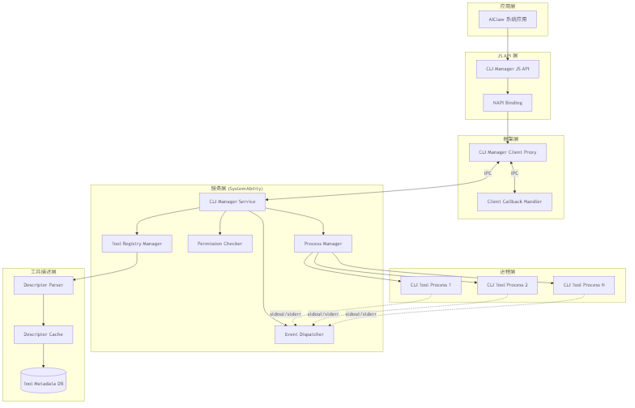
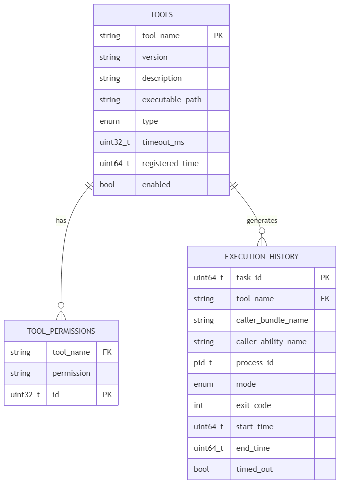
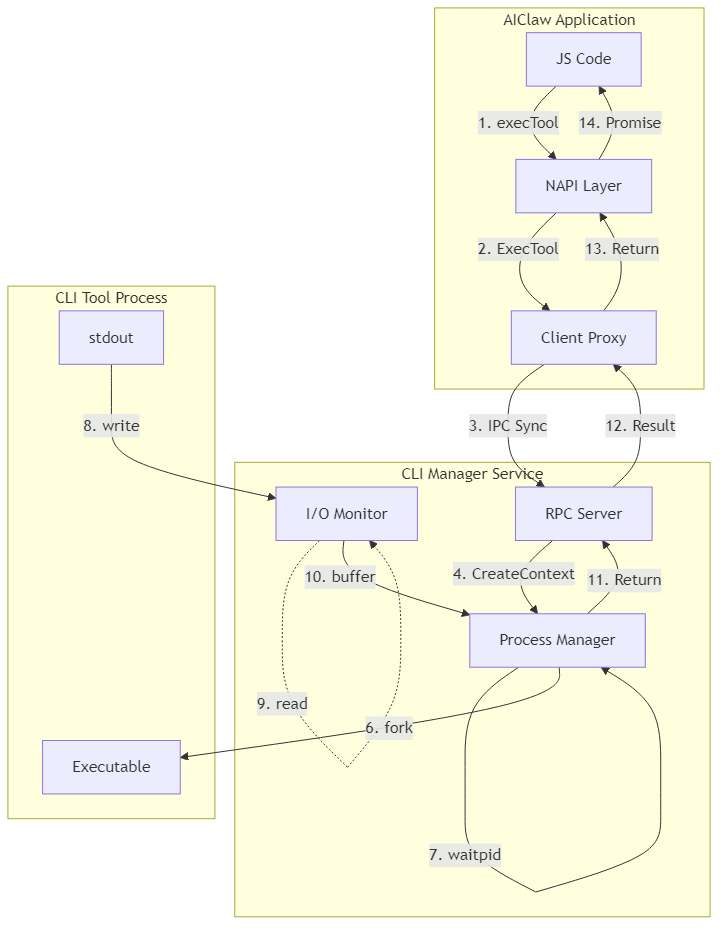
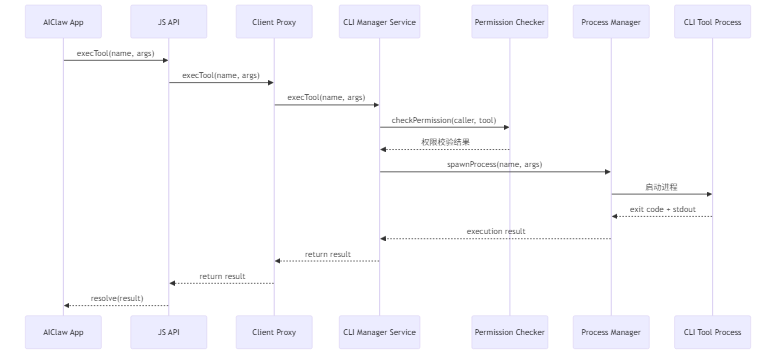

# CLI 工具管理框架完整设计文档

## 文档信息

**版本**: v2.0
**最后更新**: 2025-03-26
**状态**: 整合版

---

# 目录

1. [总体设计](#1-总体设计)
   - [需求分析](#11-需求分析)
   - [架构选型](#12-架构选型)
   - [系统架构设计](#13-系统架构设计)
2. [通信设计](#2-通信设计)
   - [通信架构](#21-通信架构)
   - [管道建立机制](#22-管道建立机制)
   - [进程启动与管道重定向](#23-进程启动与管道重定向)
   - [I/O监控与数据读取](#24-io监控与数据读取)
   - [事件分发与回调机制](#25-事件分发与回调机制)
3. [参数设计](#3-参数设计)
   - [参数类型支持](#31-参数类型支持)
   - [参数映射规则](#32-参数映射规则)
   - [参数传递流程](#33-参数传递流程)
4. [CLI工具描述设计](#4-cli工具描述设计)
   - [工具描述文件格式](#41-工具描述文件格式)
   - [参数Schema定义](#42-参数schema定义)
   - [完整示例](#43-完整示例)
5. [API设计](#5-api设计)
   - [JS API](#51-js-api)
   - [Native C++ API](#52-native-c-api)
   - [IPC接口](#53-ipc接口)
6. [使用案例](#6-使用案例)
7. [风险评估与安全](#7-风险评估与安全)
8. [实施计划](#8-实施计划)

---

# 1. 总体设计

## 1.1 需求分析

### 1.1.1 核心功能需求

| 需求ID | 功能描述 | 优先级 |
|--------|----------|--------|
| F001 | CLI 工具注册：系统启动时自动扫描并注册可用工具 | P0 |
| F002 | 工具列表查询：支持按名称、能力、权限过滤查询 | P0 |
| F003 | 同步调用：支持短时运行工具的同步调用并获取结果 | P0 |
| F004 | 异步调用：支持长时运行工具的异步调用和消息监听 | P0 |
| F005 | 进程管理：创建、监控、终止 CLI 工具进程 | P0 |
| F006 | 权限校验：调用前校验调用者是否具备所需权限 | P0 |
| F007 | 工具描述文件：定义工具的元数据、输入输出格式 | P0 |
| F008 | 进程隔离：每个 CLI 工具运行在独立进程中 | P1 |
| F009 | 超时控制：支持设置工具执行超时时间 | P1 |
| F010 | 事件订阅：支持订阅工具的输出事件流 | P1 |

### 1.1.2 非功能需求

| 类别 | 指标 | 目标值 |
|------|------|--------|
| 性能 | 同步调用响应时间 | < 100ms (不含工具执行时间) |
| 性能 | 异步消息延迟 | < 50ms |
| 性能 | 工具查询响应 | < 50ms |
| 安全 | 权限校验覆盖率 | 100% |
| 安全 | 进程隔离 | 完全隔离，独立沙箱 |
| 安全 | 参数注入防护 | 所有输入需验证和转义 |
| 可用性 | 服务可用性 | 99.9% |
| 扩展性 | 支持工具数量 | > 1000 |
| 扩展性 | 插件化描述文件 | 支持动态加载 |

---

## 1.2 架构选型

### 1.2.1 方案对比

#### 方案 A：基于 IPC 的分布式架构（推荐）

**架构概述：**
```
AIClaw App ← JS API ← Client Proxy ← IPC ← CLI Manager Service ← Process Manager ← CLI Tools
```

**优点：**
- 完全符合 ability_runtime 现有架构模式
- 进程隔离彻底，安全性高
- 可复用现有 IPC 基础设施
- 支持跨设备调用（分布式能力）

**缺点：**
- IPC 通信有一定开销
- 实现复杂度较高

**适用场景：** 系统级服务，需要高安全性和分布式能力

#### 方案 B：基于 Socket 的轻量级架构

**架构概述：**
```
AIClaw App ← JS API ← Client Library ← Unix Socket ← CLI Daemon ← CLI Tools
```

**优点：**
- 实现相对简单
- 通信开销较小

**缺点：**
- 安全性依赖 socket 权限控制
- 与现有架构融合度低
- 扩展性较差

**适用场景：** 轻量级场景，对性能要求极高

### 1.2.2 推荐方案

**推荐：方案 A - 基于 IPC 的分布式架构**

**理由：**
1. 完全符合 ability_runtime 的现有架构模式
2. 可复用现有的 SystemAbility、IPC、安全框架
3. 支持未来的分布式和多用户需求
4. 便于与现有服务（如 AbilityManagerService）集成

---

## 1.3 系统架构设计

### 1.3.1 整体架构图



```
┌─────────────────────────────────────────────────────────────────────────┐
│                          AIClaw Application                              │
│  ┌──────────────┐         ┌──────────────┐         ┌──────────────┐     │
│  │   JS Layer   │────────▶│   NAPI Layer │────────▶│ Client Proxy │     │
│  │ (Event Handler)       │ (C++ Bridge)  │  (IPC Client)     │     │
│  └──────────────┘         └──────────────┘         └──────┬───────┘     │
└────────────────────────────────────────────────────────────┼─────────────┘
                                                          │
                                                          │ IPC (Binder)
                                                          ▼
┌─────────────────────────────────────────────────────────────────────────┐
│                     CLI Manager Service                                  │
│  ┌──────────────┐         ┌──────────────┐         ┌──────────────┐     │
│  │Event Dispatcher│◀───────│Process Manager│        │Registry Mgr  │     │
│  │ (Event Router)│  IPC    │(Process Ctrl)│        │(Tool Metadata)│    │
│  └──────┬───────┘         └──────┬───────┘         └──────────────┘     │
│         │                        │                                         │
│         │ Event Callback         │ pipe                                   │
│         ▼                        ▼                                         │
│  ┌──────────────────────────────────────────────────────┐                │
│  │              Process I/O Monitor                     │                │
│  │  ┌─────────┐    ┌─────────┐    ┌─────────┐          │                │
│  │  │epoll fd │───▶│stdout[] │    │stderr[] │          │                │
│  │  │(event)  │    │(pipes)  │    │(pipes)  │          │                │
│  │  └─────────┘    └─────────┘    └─────────┘          │                │
│  └──────────────────────────────────────────────────────┘                │
└──────────────────────────────────────────────────────────────────────────┘
                          │                    │
                          │ pipe[1]            │ pipe[1]
                          │ (write)            │ (write)
                          ▼                    ▼
                  ┌─────────────────────────────────────────────┐
                  │          CLI Tool Process                   │
                  │  ┌──────────┐        ┌──────────┐          │
                  │  │  stdout  │        │  stderr  │          │
                  │  │  (pipe)  │        │  (pipe)  │          │
                  │  └──────────┘        └──────────┘          │
                  │         │                    │              │
                  │         ▼                    ▼              │
                  │  ┌──────────────────────────────────┐      │
                  │  │     CLI Tool Executable          │      │
                  │  │  (printf/cout/write to stdout)   │      │
                  │  └──────────────────────────────────┘      │
                  └─────────────────────────────────────────────┘
```

### 1.3.2 组件职责

| 组件 | 职责 | 文件位置 |
|------|------|----------|
| CLI Manager JS API | 对外暴露的 JS 接口 | `frameworks/js/napi/` |
| NAPI Binding | JS-Native 桥接 | `frameworks/js/napi/` |
| Client Proxy | 客户端代理，封装 IPC 调用 | `interfaces/inner_api/` |
| CLI Manager Service | 核心系统服务 | `services/climgr/` |
| Tool Registry Manager | 工具注册和查询管理 | `services/climgr/src/registry_manager.cpp` |

### 1.3.3 工具注册流程


工具注册是系统启动时的核心流程，确保所有可用的 CLI 工具都能被系统识别和管理。
| Permission Checker | 权限校验模块 | `services/climgr/src/permission_checker.cpp` |
| Process Manager | 进程生命周期管理 | `services/climgr/src/process_manager.cpp` |
| Event Dispatcher | 事件分发和消息路由 | `services/climgr/src/event_dispatcher.cpp` |
| Descriptor Parser | 描述文件解析器 | `services/climgr/src/desc_parser.cpp` |

---

# 2. 通信设计

## 2.1 通信架构

### 2.1.1 通信模型


AIClaw 与 CLI 工具进程采用 **管道 + IPC 回调** 的混合通信模型。

### 2.1.2 通信通道

| 通道 | 类型 | 方向 | 用途 |
|------|------|------|------|
| **控制通道** | IPC (Binder) | 双向 | 进程启动、停止、查询 |
| **stdout 管道** | Pipe | Tool → Service | 标准输出数据 |
| **stderr 管道** | Pipe | Tool → Service | 标准错误数据 |
| **stdin 管道** | Pipe | Service → Tool | 标准输入（可选） |
| **事件回调通道** | IPC (Binder) | Service → Client | 异步事件通知 |

---

## 2.2 管道建立机制


### 2.2.1 核心数据结构

```cpp
// interfaces/inner_api/cli_execution_context.h
#pragma once

#include <string>
#include <memory>
#include <functional>
#include <chrono>
#include <sys/types.h>

namespace OHOS {
namespace CliMgr {

/**
 * @brief 执行模式
 */
enum class ExecutionMode : uint8_t {
    SYNC = 0,      // 同步执行，等待结果
    ASYNC = 1,     // 异步执行，事件回调
};

/**
 * @brief 工具类型
 */
enum class ToolType : uint8_t {
    SHORT_LIVED = 0,  // 短时运行，快速退出
    LONG_LIVED = 1,   // 长时运行，持续输出
};

/**
 * @brief 调用者信息
 */
struct CallerInfo {
    pid_t pid;                    // 调用者进程 ID
    uid_t uid;                    // 调用者用户 ID
    std::string bundleName;       // 应用包名
    std::string abilityName;      // Ability 名称
    std::string token;            // 安全令牌
};

/**
 * @brief 执行上下文
 */
class ExecutionContext {
public:
    ExecutionContext() = default;
    ~ExecutionContext();

    // 基本信息
    std::string taskId;                      // 任务唯一 ID
    std::string toolName;                    // 工具名称
    ExecutionMode mode;                      // 执行模式

    // 进程信息
    pid_t processId = -1;                    // 工具进程 ID
    std::chrono::time_point<std::chrono::steady_clock> startTime;
    std::chrono::time_point<std::chrono::steady_clock> endTime;

    // 调用者信息
    CallerInfo caller;

    // 管道文件描述符
    int stdoutPipe[2] = {-1, -1};            // [0]=read, [1]=write
    int stderrPipe[2] = {-1, -1};
    int stdinPipe[2] = {-1, -1};

    // 输出缓冲区
    std::string stdoutBuffer;                // 累积的标准输出
    std::string stderrBuffer;                // 累积的标准错误

    // 执行参数
    Json::Value arguments;                   // 执行参数

    // 执行选项
    uint32_t timeoutMs = 30000;              // 超时时间
    std::string workingDir;                  // 工作目录

    // 回调对象（用于异步模式）
    sptr<ICLICallback> callback;             // IPC 回调代理

    // 状态标志
    std::atomic<bool> isRunning{false};      // 是否正在运行
    std::atomic<bool> isCompleted{false};    // 是否已完成
    int exitCode = -1;                       // 退出码
    int signal = 0;                          // 终止信号

    /**
     * @brief 关闭所有管道
     */
    void CloseAllPipes();

    /**
     * @brief 关闭写端（通知工具进程 EOF）
     */
    void CloseWriteEnds();

    /**
     * @brief 检查是否超时
     */
    bool IsTimedOut() const;

private:
    void ClosePipe(int pipe[2]);
};

} // namespace CliMgr
} // namespace OHOS
```

### 2.2.2 数据模型关系图



上图展示了 CLI 管理框架中核心数据实体之间的关系：
- **ToolInfo**: 工具的元数据信息
- **ExecutionContext**: 执行上下文，包含进程状态、管道、缓冲区等
- **CallerInfo**: 调用者信息和权限数据
- **Session**: 会话管理，关联执行上下文和回调

### 2.2.3 管道创建实现

```cpp
// services/climgr/src/process_manager.cpp

#include "cli_execution_context.h"
#include "hilog_tag_wrapper.h"
#include <unistd.h>
#include <fcntl.h>
#include <errno.h>

namespace OHOS {
namespace CliMgr {

bool ProcessManager::CreatePipes(ExecutionContext& context)
{
    // 创建 stdout 管道
    if (pipe(context.stdoutPipe) != 0) {
        TAG_LOGE(AAFwkLogTag::ABILITY, "Failed to create stdout pipe: %{public}d", errno);
        return false;
    }

    // 创建 stderr 管道
    if (pipe(context.stderrPipe) != 0) {
        TAG_LOGE(AAFwkLogTag::ABILITY, "Failed to create stderr pipe: %{public}d", errno);
        close(context.stdoutPipe[0]);
        close(context.stdoutPipe[1]);
        return false;
    }

    // 创建 stdin 管道（可选）
    if (pipe(context.stdinPipe) != 0) {
        TAG_LOGW(AAFwkLogTag::ABILITY, "Failed to create stdin pipe: %{public}d", errno);
        context.stdinPipe[0] = -1;
        context.stdinPipe[1] = -1;
    }

    // 设置读端为非阻塞模式
    SetNonBlocking(context.stdoutPipe[0]);
    SetNonBlocking(context.stderrPipe[0]);
    if (context.stdinPipe[0] >= 0) {
        SetNonBlocking(context.stdinPipe[0]);
    }

    TAG_LOGI(AAFwkLogTag::ABILITY, "Pipes created for task %{public}s", context.taskId.c_str());
    return true;
}

void ProcessManager::SetNonBlocking(int fd)
{
    int flags = fcntl(fd, F_GETFL, 0);
    if (flags >= 0) {
        fcntl(fd, F_SETFL, flags | O_NONBLOCK);
    }
}

} // namespace CliMgr
} // namespace OHOS
```

---

## 2.3 进程启动与管道重定向

### 2.3.1 进程启动实现

```cpp
// services/climgr/src/process_manager.cpp

#include <sys/wait.h>
#include <sys/types.h>
#include <unistd.h>
#include <fcntl.h>

namespace OHOS {
namespace CliMgr {

pid_t ProcessManager::SpawnProcess(const ToolInfo& toolInfo,
                                   const ExecutionContext& context)
{
    pid_t pid = fork();

    if (pid < 0) {
        // fork 失败
        TAG_LOGE(AAFwkLogTag::ABILITY, "Failed to fork process: %{public}d", errno);
        return -1;
    }

    if (pid == 0) {
        // === 子进程 ===
        PrepareChildProcess(context);

        // 构建参数数组
        std::vector<char*> argv = BuildArgv(toolInfo, context);

        // 执行工具
        execve(toolInfo.executablePath.c_str(), argv.data(), environ);

        // 如果 execve 返回，说明执行失败
        _exit(127);  // exec 失败退出码
    }

    // === 父进程 ===
    TAG_LOGI(AAFwkLogTag::ABILITY,
             "Tool process spawned: pid=%{public}d, tool=%{public}s",
             pid, toolInfo.name.c_str());

    return pid;
}

void ProcessManager::PrepareChildProcess(ExecutionContext& context)
{
    // 重定向 stdout
    if (context.stdoutPipe[1] != STDOUT_FILENO) {
        dup2(context.stdoutPipe[1], STDOUT_FILENO);
    }

    // 重定向 stderr
    if (context.stderrPipe[1] != STDERR_FILENO) {
        dup2(context.stderrPipe[1], STDERR_FILENO);
    }

    // 重定向 stdin（如果需要）
    if (context.stdinPipe[0] >= 0 && context.stdinPipe[0] != STDIN_FILENO) {
        dup2(context.stdinPipe[0], STDIN_FILENO);
    }

    // 关闭所有不需要的文件描述符
    // 关闭管道的读端（子进程只需要写端）
    close(context.stdoutPipe[0]);
    close(context.stderrPipe[0]);
    if (context.stdinPipe[0] >= 0) {
        close(context.stdinPipe[1]);  // 关闭 stdin 写端
    } else {
        // 如果不需要 stdin，关闭 /dev/null
        int nullFd = open("/dev/null", O_RDONLY);
        if (nullFd >= 0) {
            dup2(nullFd, STDIN_FILENO);
            close(nullFd);
        }
    }

    // 设置进程组 ID（便于进程管理）
    setsid();
}

} // namespace CliMgr
} // namespace OHOS
```

---

## 2.4 I/O监控与数据读取


### 2.4.1 I/O 监控器设计

```cpp
// services/climgr/src/io_monitor.h

#pragma once

#include <string>
#include <unordered_map>
#include <atomic>
#include <thread>
#include <mutex>
#include <sys/epoll.h>

namespace OHOS {
namespace CliMgr {

// 前向声明
class ExecutionContext;
class EventDispatcher;

/**
 * @brief I/O 事件类型
 */
enum class IOEventType : uint8_t {
    STDOUT = 0,
    STDERR = 1,
    PROCESS_EXIT = 2,
    TIMEOUT = 3,
};

/**
 * @brief I/O 事件数据
 */
struct IOEvent {
    IOEventType type;
    std::string taskId;
    std::string data;
    int exitCode;
};

/**
 * @brief I/O 监控器
 *
 * 使用 epoll 监控所有工具进程的管道输出
 */
class IOMonitor {
public:
    explicit IOMonitor(EventDispatcher* dispatcher);
    ~IOMonitor();

    /**
     * @brief 启动监控线程
     */
    bool Start();

    /**
     * @brief 停止监控线程
     */
    void Stop();

    /**
     * @brief 注册任务的管道进行监控
     * @param context 执行上下文
     * @return 是否注册成功
     */
    bool RegisterTask(const std::shared_ptr<ExecutionContext>& context);

    /**
     * @brief 取消任务监控
     * @param taskId 任务 ID
     */
    void UnregisterTask(const std::string& taskId);

    /**
     * @brief 向工具进程写入数据（通过 stdin）
     * @param taskId 任务 ID
     * @param data 要写入的数据
     * @return 写入的字节数，失败返回 -1
     */
    ssize_t WriteToStdin(const std::string& taskId, const std::string& data);

private:
    /**
     * @brief 监控线程主循环
     */
    void MonitorThread();

    /**
     * @brief 处理管道可读事件
     * @param fd 文件描述符
     * @param taskId 任务 ID
     * @param type 事件类型
     */
    void HandleReadable(int fd, const std::string& taskId, IOEventType type);

    /**
     * @brief 从管道读取数据
     * @param fd 文件描述符
     * @return 读取的数据
     */
    std::string ReadFromPipe(int fd);

    /**
     * @brief 关闭任务的所有管道
     * @param taskId 任务 ID
     */
    void CloseTaskPipes(const std::string& taskId);

private:
    EventDispatcher* dispatcher_;
    int epollFd_ = -1;
    std::atomic<bool> running_{false};
    std::thread monitorThread_;

    // taskId -> ExecutionContext
    std::unordered_map<std::string, std::shared_ptr<ExecutionContext>> tasks_;
    std::mutex tasksMutex_;

    // fd -> taskId
    std::unordered_map<int, std::string> fdToTaskId_;
    std::mutex fdMutex_;

    // taskId -> fd (stdin write end)
    std::unordered_map<std::string, int> stdinWriteFds_;
    std::mutex stdinMutex_;
};

} // namespace CliMgr
} // namespace OHOS
```

---

## 2.5 事件分发与回调机制

### 2.5.1 同步数据流



### 2.5.2 异步数据流


### 2.5.3 事件分发器设计

### 2.5.1 事件分发器设计

```cpp
// services/climgr/src/event_dispatcher.h

#pragma once

#include <string>
#include <memory>
#include <unordered_map>
#include <mutex>
#include <functional>

#include "cli_execution_context.h"
#include "cli_callback.h"

namespace OHOS {
namespace CliMgr {

// 前向声明
struct IOEvent;

/**
 * @brief 事件分发器
 *
 * 负责将 I/O 事件和进程退出事件分发给对应的客户端回调
 */
class EventDispatcher {
public:
    EventDispatcher() = default;
    ~EventDispatcher() = default;

    /**
     * @brief 注册任务的回调
     * @param taskId 任务 ID
     * @param callback IPC 回调对象
     */
    void RegisterCallback(const std::string& taskId,
                         const sptr<ICLICallback>& callback);

    /**
     * @brief 取消回调
     * @param taskId 任务 ID
     */
    void UnregisterCallback(const std::string& taskId);

    /**
     * @brief 分发 I/O 事件
     * @param event I/O 事件
     */
    void DispatchIOEvent(const IOEvent& event);

    /**
     * @brief 分发进程退出事件
     * @param taskId 任务 ID
     * @param exitCode 退出码
     */
    void DispatchExitEvent(const std::string& taskId, int exitCode);

    /**
     * @brief 分发错误事件
     * @param taskId 任务 ID
     * @param errorCode 错误码
     * @param errorMsg 错误消息
     */
    void DispatchErrorEvent(const std::string& taskId,
                           int32_t errorCode,
                           const std::string& errorMsg);

private:
    // taskId -> IPC Callback
    std::unordered_map<std::string, sptr<ICLICallback>> callbacks_;
    std::mutex callbacksMutex_;
};

} // namespace CliMgr
} // namespace OHOS
```

### 2.5.2 IPC 回调接口

```cpp
// interfaces/inner_api/cli_callback.h

#pragma once

#include <iremote_broker.h>
#include <iremote_object.h>

namespace OHOS {
namespace CliMgr {

/**
 * @brief 工具事件
 */
struct ToolEvent {
    std::string type;      // "stdout", "stderr", "exit", "error"
    std::string data;      // 事件数据
    int exitCode = 0;      // 退出码（仅 exit 事件）
    int64_t timestamp;     // 时间戳
};

/**
 * @brief CLI 回调接口
 *
 * 客户端需要实现此接口以接收异步事件
 */
class ICLICallback : public IRemoteBroker {
public:
    DECLARE_INTERFACE_DESCRIPTOR(CLI_CALLBACK);

    /**
     * @brief 工具输出事件
     * @param taskId 任务 ID
     * @param event 事件数据
     */
    virtual void OnOutput(const std::string& taskId, const ToolEvent& event) = 0;

    /**
     * @brief 工具退出事件
     * @param taskId 任务 ID
     * @param exitCode 退出码
     */
    virtual void OnExit(const std::string& taskId, int32_t exitCode) = 0;

    /**
     * @brief 错误事件
     * @param taskId 任务 ID
     * @param errorCode 错误码
     * @param errorMsg 错误消息
     */
    virtual void OnError(const std::string& taskId,
                        int32_t errorCode,
                        const std::string& errorMsg) = 0;

    // 析构函数
    virtual ~ICLICallback() = default;
};

} // namespace CliMgr
} // namespace OHOS
```

---

# 3. 参数设计

## 3.1 参数类型支持

### 3.1.1 基于标准 JSON Schema

工具描述文件的 `input` 部分遵循 [JSON Schema](https://json-schema.org/) 规范。

### 3.1.2 基本类型

#### String (字符串)
```json
{
  "properties": {
    "target": {
      "type": "string",
      "description": "目标地址",
      "minLength": 1,
      "maxLength": 255,
      "pattern": "^[a-zA-Z0-9.-]+$",
      "format": "ipv4",
      "default": "127.0.0.1"
    }
  }
}
```

**支持的格式 (format)**：
- `ipv4` - IPv4 地址
- `ipv6` - IPv6 地址
- `hostname` - 主机名
- `email` - 邮箱地址
- `uri` - URI 地址
- `date` / `date-time` - 日期时间
- `binary` - Base64 编码的二进制数据

#### Number (数字)
```json
{
  "properties": {
    "port": {
      "type": "number",
      "minimum": 1,
      "maximum": 65535,
      "default": 8080,
      "multipleOf": 1
    }
  }
}
```

#### Integer (整数)
```json
{
  "properties": {
    "count": {
      "type": "integer",
      "minimum": 0,
      "maximum": 100
    }
  }
}
```

#### Boolean (布尔值)
```json
{
  "properties": {
    "verbose": {
      "type": "boolean",
      "default": false
    }
  }
}
```

### 3.1.3 复合类型

#### Array (数组)
```json
{
  "properties": {
    "ports": {
      "type": "array",
      "items": {"type": "integer"},
      "minItems": 1,
      "maxItems": 100,
      "uniqueItems": true,
      "default": [80, 443]
    }
  }
}
```

#### Object (对象)
```json
{
  "properties": {
    "config": {
      "type": "object",
      "properties": {
        "host": {"type": "string"},
        "port": {"type": "integer"},
        "ssl": {"type": "boolean"}
      },
      "required": ["host", "port"],
      "additionalProperties": false
    }
  }
}
```

### 3.1.4 特殊类型

#### Enum (枚举)
```json
{
  "properties": {
    "level": {
      "type": "string",
      "enum": ["DEBUG", "INFO", "WARN", "ERROR"],
      "default": "INFO"
    }
  }
}
```

#### Union (联合类型)
```json
{
  "properties": {
    "input": {
      "type": ["string", "number", "boolean"]
    }
  }
}
```

### 3.1.5 支持的类型矩阵

| 类型 | 简单值 | 数组值 | 对象值 | 嵌套 | JSON传递 |
|------|--------|--------|--------|------|---------|
| string | ✅ | ✅ | ✅ | ✅ | ✅ |
| number/integer | ✅ | ✅ | ✅ | ✅ | ✅ |
| boolean | ✅ | ✅ | ✅ | ✅ | ✅ |
| array | ✅ | ✅ | ✅ | ✅ | ✅ |
| object | ❌ | ✅ | ✅ | ✅ | ✅ |
| null | ✅ | ✅ | ✅ | ✅ | ✅ |

---

## 3.2 参数映射规则

### 3.2.1 参数映射类型

工具描述文件通过 `argumentMapping` 字段定义参数如何转换为命令行参数：

| 映射类型 | 说明 | 模板示例 |
|----------|------|----------|
| `flag` | 标志模式（`--key=value`） | `--key={value}` |
| `positional` | 位置参数 | 按顺序排列 |
| `flattened` | 展平嵌套 | `parent.child={value}` |
| `json-string` | JSON 字符串 | `'{"key":"value"}'` |
| `json-file` | JSON 文件 | `@config.json` |
| `mixed` | 混合模式 | 组合使用 |

### 3.2.2 Flag 模式（基于模板）

```json
{
  "argumentMapping": {
    "type": "flag",
    "separator": " ",
    "templates": {
      "target": "--target={value}",
      "ports": "--port={value}",
      "verbose": {
        "if_true": "-v",
        "if_false": ""
      }
    }
  }
}
```

### 3.2.3 Positional 模式（位置参数）

```json
{
  "argumentMapping": {
    "type": "positional",
    "order": ["inputFile", "outputFile", "options"]
  }
}
```

### 3.2.4 JavaScript 映射器（最灵活）

```json
{
  "argumentMapping": {
    "type": "javascript",
    "mapper": "function(args) { /* 自定义逻辑 */ }"
  }
}
```

---

## 3.3 参数传递流程

### 3.3.1 调用方查询工具信息

```typescript
// 1. 查询所有工具
const tools = await CLI.CLIManager.queryTools();

// 2. 找到目标工具
const scanner = tools.find(t => t.name === 'network-scanner');

// 3. 查看工具的参数定义
console.log(scanner.inputSchema);
```

### 3.3.2 调用方构造参数

```typescript
// 根据工具的 inputSchema 构造参数对象
const args = {
  target: "192.168.1.1",      // 必填参数
  ports: [80, 443, 8080],     // 可选参数
  verbose: true                // 可选参数
};
```

### 3.3.3 服务端参数转换

```cpp
// services/climgr/src/param_mapper.cpp

class ParameterMapper {
public:
    /**
     * @brief 将抽象参数转换为命令行参数数组
     * @param toolInfo 工具信息（包含映射规则）
     * @param abstractArgs 抽象参数（来自 JS 调用方）
     * @return 命令行参数数组（用于 execve）
     */
    static std::vector<std::string> MapToCommandLine(
        const ToolInfo& toolInfo,
        const Json::Value& abstractArgs)
    {
        std::vector<std::string> argv;
        argv.push_back(toolInfo.executablePath);  // argv[0]

        // 方式 1: 使用模板映射
        if (toolInfo.argMapping.HasTemplates()) {
            ApplyTemplateMapping(toolInfo, abstractArgs, argv);
        }
        // 方式 2: 使用 JavaScript 映射器
        else if (toolInfo.argMapping.HasMapper()) {
            ApplyJavaScriptMapping(toolInfo, abstractArgs, argv);
        }
        // 方式 3: 默认规则映射
        else {
            ApplyDefaultMapping(toolInfo, abstractArgs, argv);
        }

        return argv;
    }

private:
    static void ApplyTemplateMapping(
        const ToolInfo& toolInfo,
        const Json::Value& abstractArgs,
        std::vector<std::string>& argv)
    {
        // 遍历所有参数
        for (const auto& key : abstractArgs.getMemberNames()) {
            Json::Value value = abstractArgs[key];
            std::string template = toolInfo.argMapping.templates[key];

            // 处理不同类型的值
            if (value.isString()) {
                std::string formatted = FormatTemplate(template, value.asString());
                argv.push_back(formatted);
            }
            else if (value.isArray()) {
                for (const auto& item : value) {
                    std::string formatted = FormatTemplate(template, item.asString());
                    argv.push_back(formatted);
                }
            }
            else if (value.isBool()) {
                std::string formatted = value.asBool() ?
                    toolInfo.argMapping.templates[key]["if_true"].asString() :
                    toolInfo.argMapping.templates[key]["if_false"].asString();
                if (!formatted.empty()) {
                    argv.push_back(formatted);
                }
            }
        }
    }

    static std::string FormatTemplate(
        const std::string& tmpl,
        const std::string& value)
    {
        // 简单实现：替换 {value} 占位符
        std::string result = tmpl;
        size_t pos = result.find("{value}");
        if (pos != std::string::npos) {
            result.replace(pos, 7, value);
        }
        return result;
    }
};
```

---

# 4. CLI工具描述设计

## 4.1 工具描述文件格式

**文件格式：** JSON
**位置：** `/etc/cli/tools/<tool_name>.json`

### 4.1.1 基本结构

```json
{
  "$schema": "https://schemas.openharmony.org/cli/tool/v1",
  "name": "network-scanner",
  "version": "1.0.0",
  "description": "Network scanning utility tool",
  "executable": "/usr/bin/net-scan",
  "type": "short-lived",
  "permissions": [
    "ohos.permission.INTERNET",
    "ohos.permission.GET_NETWORK_INFO"
  ],
  "input": {
    "type": "object",
    "properties": {
      "target": {
        "type": "string",
        "format": "ipv4",
        "description": "Target IP address"
      },
      "ports": {
        "type": "array",
        "items": {"type": "integer"},
        "description": "Ports to scan"
      }
    },
    "required": ["target"]
  },
  "output": {
    "type": "object",
    "properties": {
      "results": {
        "type": "array",
        "description": "Scan results"
      }
    }
  },
  "timeout": 30000,
  "events": ["progress", "result"]
}
```

---

## 4.2 参数Schema定义

### 4.2.1 嵌套参数支持

#### 平面嵌套（推荐）

**设计思路：** 将嵌套对象展平为命令行参数，使用前缀或点号分隔。

**工具描述文件：**
```json
{
  "name": "app-deploy",
  "description": "应用部署工具",
  "executable": "/usr/bin/app-deploy",

  "input": {
    "type": "object",
    "properties": {
      "app": {
        "type": "object",
        "description": "应用配置",
        "properties": {
          "name": {"type": "string"},
          "version": {"type": "string"},
          "env": {
            "type": "object",
            "properties": {
              "production": {"type": "boolean"},
              "debug": {"type": "boolean"}
            }
          }
        },
        "required": ["name"]
      },
      "server": {
        "type": "object",
        "description": "服务器配置",
        "properties": {
          "host": {"type": "string"},
          "port": {"type": "integer"},
          "ssl": {
            "type": "object",
            "properties": {
              "enabled": {"type": "boolean"},
              "cert": {"type": "string"}
            }
          }
        },
        "required": ["host", "port"]
      }
    },
    "required": ["app"]
  },

  "argumentMapping": {
    "type": "flattened",
    "separator": ".",
    "templates": {
      "app.name": "--app-name={value}",
      "app.version": "--app-version={value}",
      "app.env.production": "--env-prod",
      "app.env.debug": "--env-debug",
      "server.host": "--server-host={value}",
      "server.port": "--server-port={value}",
      "server.ssl.enabled": "--ssl",
      "server.ssl.cert": "--ssl-cert={value}"
    }
  }
}
```

**调用方式：**
```typescript
const session = await CLI.CLIManager.execTool('app-deploy', {
  app: {
    name: "myapp",
    version: "1.0.0",
    env: {
      production: true,
      debug: false
    }
  },
  server: {
    host: "192.168.1.1",
    port: 8080,
    ssl: {
      enabled: true,
      cert: "/path/to/cert.pem"
    }
  }
});
```

**生成的命令：**
```bash
/usr/bin/app-deploy \
  --app-name myapp \
  --app-version 1.0.0 \
  --env-prod \
  --server-host 192.168.1.1 \
  --server-port 8080 \
  --ssl \
  --ssl-cert /path/to/cert.pem
```

#### JSON 字符串传递

**设计思路：** 保持嵌套结构，将对象序列化为 JSON 字符串传递。

**工具描述文件：**
```json
{
  "name": "cloud-deploy",
  "description": "云端部署工具",
  "executable": "/usr/bin/cloud-deploy",

  "input": {
    "type": "object",
    "properties": {
      "config": {
        "type": "object",
        "description": "部署配置（JSON 对象）",
        "properties": {
          "application": {
            "type": "object",
            "properties": {
              "name": {"type": "string"},
              "replicas": {"type": "integer"}
            }
          },
          "resources": {
            "type": "object",
            "properties": {
              "cpu": {"type": "string"},
              "memory": {"type": "string"},
              "storage": {"type": "string"}
            }
          }
        }
      },
      "options": {
        "type": "object",
        "properties": {
          "dryRun": {"type": "boolean"},
          "timeout": {"type": "integer"}
        }
      }
    },
    "required": ["config"]
  },

  "argumentMapping": {
    "type": "json-string",
    "templates": {
      "config": "--config={value}",
      "options.dryRun": {"if_true": "--dry-run", "if_false": ""},
      "options.timeout": "--timeout={value}"
    }
  }
}
```

**调用方式：**
```typescript
const session = await CLI.CLIManager.execTool('cloud-deploy', {
  config: {
    application: {
      name: "webapp",
      replicas: 3
    },
    resources: {
      cpu: "2",
      memory: "4Gi",
      storage: "100Gi"
    }
  },
  options: {
    dryRun: true,
    timeout: 300
  }
});
```

**生成的命令：**
```bash
/usr/bin/cloud-deploy \
  --config '{"application":{"name":"webapp","replicas":3},"resources":{"cpu":"2","memory":"4Gi","storage":"100Gi"}}' \
  --dry-run \
  --timeout 300
```

### 4.2.2 子命令支持

对于有子命令的工具（如 `git add`, `git commit`），使用嵌套结构：

**工具描述文件：**
```json
{
  "name": "git",
  "subcommands": {
    "clone": {
      "description": "Clone a repository",
      "arguments": {
        "type": "flag",
        "templates": {
          "subcommand": "clone",
          "repository": "--repo={value}",
          "directory": "{value}",
          "branch": {"if_true": "--branch={value}"}
        }
      },
      "input": {
        "type": "object",
        "properties": {
          "repository": {"type": "string"},
          "directory": {"type": "string"},
          "branch": {"type": "string"}
        },
        "required": ["repository", "directory"]
      }
    },
    "commit": {
      "description": "Commit changes",
      "arguments": {
        "type": "flag",
        "templates": {
          "subcommand": "commit",
          "message": "-m {value}"
        }
      },
      "input": {
        "type": "object",
        "properties": {
          "message": {"type": "string"},
          "all": {"type": "boolean"},
          "amend": {"type": "boolean"}
        },
        "required": ["message"]
      }
    }
  }
}
```

**调用方式：**
```typescript
// Clone
await CLI.CLIManager.execTool('git', {
  subcommand: 'clone',
  repository: 'https://github.com/user/repo.git',
  directory: '/path/to/repo',
  branch: 'main'
});

// Commit
await CLI.CLIManager.execTool('git', {
  subcommand: 'commit',
  message: 'Fix bug #123',
  all: true
});
```

---

## 4.3 完整示例

### 4.3.1 network-scanner 完整示例

**工具描述文件：**
```json
{
  "$schema": "https://schemas.openharmony.org/cli/tool/v1",
  "name": "network-scanner",
  "version": "1.0.0",
  "description": "Network scanning utility for diagnosing network connectivity",
  "executable": "/usr/bin/net-scan",
  "type": "short-lived",
  "permissions": ["ohos.permission.INTERNET"],

  "input": {
    "type": "object",
    "properties": {
      "target": {
        "type": "string",
        "format": "ipv4",
        "description": "Target IP address or hostname",
        "example": "192.168.1.1"
      },
      "ports": {
        "type": "array",
        "items": {"type": "integer", "minimum": 1, "maximum": 65535},
        "description": "List of ports to scan",
        "example": [80, 443, 8080]
      },
      "timeout": {
        "type": "integer",
        "minimum": 1000,
        "maximum": 60000,
        "default": 5000,
        "description": "Scan timeout in milliseconds"
      },
      "verbose": {
        "type": "boolean",
        "default": false,
        "description": "Enable verbose output"
      }
    },
    "required": ["target"]
  },

  "argumentMapping": {
    "type": "flag",
    "templates": {
      "target": "--target={value}",
      "ports": "--port={value}",
      "timeout": "--timeout={value}",
      "verbose": {"if_true": "-v", "if_false": ""}
    }
  },

  "output": {
    "type": "object",
    "description": "Scan results",
    "example": {
      "results": [
        {"port": 80, "status": "open", "service": "http"},
        {"port": 443, "status": "open", "service": "https"}
      ],
      "summary": {
        "totalPorts": 3,
        "openPorts": 2,
        "scanTime": 2341
      }
    }
  },

  "timeout": 30000,
  "events": ["progress", "result"]
}
```

**调用方代码：**
```typescript
const scanner = tools.find(t => t.name === 'network-scanner');

const args = {
  target: "192.168.1.1",
  ports: [80, 443],
  verbose: true
};

const session = await CLI.CLIManager.execTool('network-scanner', args);
```

**实际执行的命令：**
```bash
/usr/bin/net-scan --target=192.168.1.1 --port=80 --port=443 -v
```

---

# 5. API设计

## 5.1 JS API

### 5.1.1 核心接口

```typescript
// interfaces/kits/native/cli_manager.d.ts

declare namespace CLI {
  /**
   * 工具执行选项
   */
  interface ExecOptions {
    /**
     * 是否后台执行
     * - false: 前台执行，在 yieldMs 内等待结果返回，超时后自动转入后台
     * - true: 立即进入后台执行，马上返回 sessionId
     *
     * 默认值: false
     */
    background?: boolean;

    /**
     * 前台等待超时时间（毫秒）
     * 仅当 background=false 时有效
     *
     * 默认值: 30000 (30秒)
     */
    yieldMs?: number;

    /**
     * 总超时时间（毫秒）
     * 进程运行超过此时间会被强制终止
     * 默认使用工具描述文件中的 timeout
     */
    timeout?: number;

    /**
     * 环境变量
     */
    env?: Record<string, string>;

    /**
     * 工作目录
     */
    cwd?: string;
  }

  /**
   * 工具信息
   */
  interface ToolInfo {
    name: string;
    version: string;
    description: string;
    type: 'short-lived' | 'long-lived';
    permissions: string[];
    timeout: number;
    supportedEvents: string[];
  }

  /**
   * 执行结果（前台模式在 yieldMs 内完成时返回）
   */
  interface ExecResult {
    exitCode: number;
    stdout: string;
    stderr: string;
    timedOut: boolean;
    executionTime: number;
  }

  /**
   * 后台会话信息（background=true 或超时转入后台时返回）
   */
  interface SessionInfo {
    sessionId: string;        // 会话/任务 ID
    toolName: string;
    startTime: number;
    status: 'running';
  }

  /**
   * 工具输出事件（订阅后台会话时触发）
   */
  interface ToolEvent {
    type: 'stdout' | 'stderr' | 'exit' | 'error';
    data: string;
    exitCode?: number;
    timestamp: number;
  }

  /**
   * CLI 管理器
   */
  class CLIManager {
    /**
     * 查询所有可用工具
     */
    static queryTools(): Promise<ToolInfo[]>;

    /**
     * 统一的执行接口
     * @param name 工具名称
     * @param args 执行参数
     * @param options 执行选项
     * @returns 前台完成返回 SessionInfo (status='completed', result 有值)
     *          后台运行返回 SessionInfo (status='running', result 为 undefined)
     */
    static execTool(
      name: string,
      args: Record<string, any>,
      options?: ExecOptions
    ): Promise<SessionInfo>;

    /**
     * 订阅后台会话事件
     * @param sessionId 会话 ID
     * @param callback 事件回调
     */
    static subscribeSession(
      sessionId: string,
      callback: (event: ToolEvent) => void
    ): Promise<boolean>;

    /**
     * 取消后台会话
     */
    static cancelSession(sessionId: string): Promise<boolean>;

    /**
     * 查询会话状态
     */
    static querySessionStatus(sessionId: string): Promise<SessionStatus>;
  }

  /**
   * 会话状态
   */
  interface SessionStatus {
    sessionId: string;
    toolName: string;
    status: 'running' | 'completed' | 'failed';
    startTime: number;
    endTime?: number;
    result?: ExecResult;
  }
}

export default CLI;
```

### 5.1.2 使用示例



```typescript
// 示例 1: 前台执行，快速完成
import CLI from '@ohos.cli.manager';

async function scanNetwork(targetIp: string) {
  try {
    const session = await CLI.CLIManager.execTool('network-scanner', {
      target: targetIp,
      ports: [80, 443, 8080]
    }, {
      background: false,
      yieldMs: 30000  // 等待 30 秒
    });

    // 检查执行状态
    if (session.status === 'completed' && session.result) {
      console.log('Scan result:', session.result.stdout);
      console.log('Exit code:', session.result.exitCode);
    } else if (session.status === 'running') {
      // 超时后自动转入后台
      console.log('Tool moved to background, session ID:', session.sessionId);
      // 订阅后续事件
      CLI.CLIManager.subscribeSession(session.sessionId, handleEvent);
    }
  } catch (error) {
    console.error('Failed to execute tool:', error);
  }
}


// 示例 2: 立即后台执行
async function monitorLogs(filter: string) {
  try {
    const session = await CLI.CLIManager.execTool('log-monitor', {
      filter: filter
    }, {
      background: true  // 立即后台执行
    });

    console.log('Background session started:', session.sessionId);

    // 订阅事件
    CLI.CLIManager.subscribeSession(session.sessionId, (event) => {
      if (event.type === 'stdout') {
        console.log('Log output:', event.data);
      } else if (event.type === 'exit') {
        console.log('Tool exited with code:', event.exitCode);
      } else if (event.type === 'error') {
        console.error('Error:', event.data);
      }
    });

    // 如果需要取消
    // await CLI.CLIManager.cancelSession(session.sessionId);
  } catch (error) {
    console.error('Failed to start tool:', error);
  }
}

// 示例 3: 查询所有可用工具
async function listAvailableTools() {
  const tools = await CLI.CLIManager.queryTools();
  tools.forEach(tool => {
    console.log(`${tool.name} (${tool.type}): ${tool.description}`);
  });
}

// 事件处理函数
function handleEvent(event: CLI.ToolEvent) {
  if (event.type === 'stdout') {
    console.log('Output:', event.data);
  } else if (event.type === 'exit') {
    console.log('Exit code:', event.exitCode);
  } else if (event.type === 'error') {
    console.error('Error:', event.data);
  }
}
```

---

## 5.2 Native C++ API

### 5.2.1 核心接口

```cpp
// interfaces/kits/native/cli_manager_client.h

#ifndef CLI_MANAGER_CLIENT_H
#define CLI_MANAGER_CLIENT_H

#include "cli_tool_info.h"
#include "cli_execution_result.h"
#include "cli_execution_context.h"

namespace OHOS {
namespace CliMgr {

/**
 * @brief 会话信息
 */
struct SessionInfo {
    std::string sessionId;              // 会话/任务 ID
    std::string toolName;                // 工具名称
    std::string status;                  // "running" | "completed" | "failed"
    uint64_t startTime;                  // 开始时间戳
    uint64_t endTime = 0;                // 结束时间戳
    ExecutionResult* result = nullptr;   // 执行结果（仅 completed 时有值）

    ~SessionInfo() {
        delete result;
    }
};

/**
 * @brief CLI 管理器客户端
 */
class CLIManagerClient {
public:
    /**
     * @brief 查询所有可用工具
     * @param tools 输出参数，工具列表
     * @return 错误码
     */
    static int32_t QueryTools(std::vector<ToolInfo>& tools);

    /**
     * @brief 统一的执行接口
     * @param name 工具名称
     * @param arguments 执行参数 (JSON 格式)
     * @param session 输出参数，会话信息
     * @param options 执行选项
     * @return 错误码
     *
     * 执行行为：
     * - background=false: 在 yieldMs 内等待结果，超时后自动转入后台
     *   - 完成时: session.status="completed", session.result 有值
     *   - 超时时: session.status="running", session.result 为 nullptr
     * - background=true: 立即返回
     *   - session.status="running", session.result 为 nullptr
     */
    static int32_t ExecTool(
        const std::string& name,
        const Json::Value& arguments,
        SessionInfo& session,
        const ExecOptions& options = {}
    );

    /**
     * @brief 订阅会话事件
     * @param sessionId 会话 ID
     * @param callback 事件回调
     * @return 错误码
     */
    using EventCallback = std::function<void(const std::string&, const ToolEvent&)>;
    static int32_t SubscribeSession(
        const std::string& sessionId,
        EventCallback callback
    );

    /**
     * @brief 取消会话
     * @param sessionId 会话 ID
     * @return 错误码
     */
    static int32_t CancelSession(const std::string& sessionId);

    /**
     * @brief 查询会话状态
     * @param sessionId 会话 ID
     * @param status 输出参数，会话状态
     * @return 错误码
     */
    static int32_t QuerySessionStatus(const std::string& sessionId, SessionInfo& status);
};

} // namespace CliMgr
} // namespace OHOS

#endif // CLI_MANAGER_CLIENT_H
```

---

## 5.3 IPC接口

### 5.3.1 ICLIManagerService 接口

```cpp
// interfaces/inner_api/cli_manager_proxy.h

class ICLIManagerService : public IRemoteBroker {
public:
    DECLARE_INTERFACE_DESCRIPTOR(CLI_MANAGER_SERVICE);

    // 消息 ID 定义
    enum {
        QUERY_TOOLS = 1,
        EXEC_TOOL,
        SUBSCRIBE_SESSION,
        CANCEL_SESSION,
        QUERY_SESSION_STATUS,
    };

    /**
     * 查询所有工具
     * Message ID: 1
     */
    virtual int32_t QueryTools(std::vector<ToolInfo>& tools) = 0;

    /**
     * 统一的执行接口
     * Message ID: 2
     */
    virtual int32_t ExecTool(
        const std::string& name,
        const Json::Value& arguments,
        const ExecOptions& options,
        SessionInfo& session
    ) = 0;

    /**
     * 订阅会话事件
     * Message ID: 3
     */
    virtual int32_t SubscribeSession(
        const std::string& sessionId,
        const sptr<ICLICallback>& callback
    ) = 0;

    /**
     * 取消会话
     * Message ID: 4
     */
    virtual int32_t CancelSession(const std::string& sessionId) = 0;

    /**
     * 查询会话状态
     * Message ID: 5
     */
    virtual int32_t QuerySessionStatus(const std::string& sessionId, SessionInfo& status) = 0;
};
```

### 5.3.2 ICLICallback 接口

```cpp
// interfaces/inner_api/cli_callback.h

class ICLICallback : public IRemoteBroker {
public:
    DECLARE_INTERFACE_DESCRIPTOR(CLI_CALLBACK);

    /**
     * 工具输出事件
     * Message ID: 1
     */
    virtual void OnOutput(const std::string& taskId, const ToolEvent& event) = 0;

    /**
     * 工具退出事件
     * Message ID: 2
     */
    virtual void OnExit(const std::string& taskId, int32_t exitCode) = 0;

    /**
     * 错误事件
     * Message ID: 3
     */
    virtual void OnError(const std::string& taskId, int32_t errorCode, const std::string& errorMsg) = 0;
};
```

---

# 6. 使用案例

## 6.1 案例一：网络扫描工具

### 场景描述
应用需要扫描指定IP地址的开放端口，获取网络连通性信息。

### 工具描述文件
```json
{
  "name": "network-scanner",
  "executable": "/usr/bin/net-scan",
  "type": "short-lived",
  "permissions": ["ohos.permission.INTERNET"],
  "input": {
    "properties": {
      "target": {"type": "string", "format": "ipv4"},
      "ports": {"type": "array", "items": {"type": "integer"}},
      "timeout": {"type": "integer", "default": 5000}
    },
    "required": ["target"]
  },
  "argumentMapping": {
    "templates": {
      "target": "--target={value}",
      "ports": "--port={value}",
      "timeout": "--timeout={value}"
    }
  }
}
```

### 应用代码
```typescript
import CLI from '@ohos.cli.manager';

async function scanNetwork() {
  const session = await CLI.CLIManager.execTool('network-scanner', {
    target: "192.168.1.1",
    ports: [80, 443, 8080],
    timeout: 10000
  });

  if (session.status === 'completed') {
    console.log('Scan completed:', session.result.stdout);
  }
}
```

---

## 6.2 案例二：日志监控工具

### 场景描述
应用需要实时监控系统日志，过滤特定级别的日志信息。

### 工具描述文件
```json
{
  "name": "log-monitor",
  "executable": "/usr/bin/log-mon",
  "type": "long-lived",
  "permissions": ["ohos.permission.READ_LOGS"],
  "input": {
    "properties": {
      "filter": {"type": "string"},
      "level": {"type": "string", "enum": ["DEBUG", "INFO", "WARN", "ERROR"]},
      "tail": {"type": "boolean"}
    }
  },
  "argumentMapping": {
    "templates": {
      "filter": "-f {value}",
      "level": "--level={value}",
      "tail": {"if_true": "--follow", "if_false": ""}
    }
  }
}
```

### 应用代码
```typescript
import CLI from '@ohos.cli.manager';

async function monitorLogs() {
  const session = await CLI.CLIManager.execTool('log-monitor', {
    filter: "ERROR",
    level: "ERROR",
    tail: true
  }, {
    background: true
  });

  // 订阅事件
  CLI.CLIManager.subscribeSession(session.sessionId, (event) => {
    if (event.type === 'stdout') {
      console.log('Log:', event.data);
    }
  });
}
```

---

## 6.3 案例三：Docker 风格部署工具

### 场景描述
应用需要部署容器化应用，传递复杂的配置信息。

### 工具描述文件
```json
{
  "name": "k8s-deploy",
  "executable": "/usr/bin/kubectl",
  "type": "short-lived",
  "input": {
    "properties": {
      "namespace": {"type": "string", "default": "default"},
      "deployment": {
        "type": "object",
        "properties": {
          "name": {"type": "string"},
          "image": {"type": "string"},
          "replicas": {"type": "integer"},
          "ports": {
            "type": "array",
            "items": {
              "type": "object",
              "properties": {
                "container": {"type": "integer"},
                "protocol": {"type": "string"},
                "service": {"type": "string"}
              }
            }
          }
        }
      }
    }
  },
  "argumentMapping": {
    "type": "json-file",
    "templates": {
      "namespace": "-n {value}",
      "deployment": {
        "template": "-f {value}",
        "extract": "deployment"
      }
    }
  }
}
```

### 应用代码
```typescript
import CLI from '@ohos.cli.manager';

async function deployToK8s() {
  const session = await CLI.CLIManager.execTool('k8s-deploy', {
    namespace: "production",
    deployment: {
      name: "webapp",
      image: "myapp:v1.0",
      replicas: 3,
      ports: [
        {container: 8080, protocol: "TCP", service: "http"}
      ]
    }
  });

  console.log('Deployment completed:', session.result.stdout);
}
```

---

# 7. 风险评估与安全

## 7.1 技术风险

| 风险ID | 风险描述 | 影响 | 概率 | 应对措施 | Plan B |
|--------|----------|------|------|----------|--------|
| R001 | 进程崩溃导致资源泄漏 | 高 | 中 | 进程监控 + 自动清理 | 定期资源扫描和强制回收 |
| R002 | 恶意工具描述文件导致安全问题 | 高 | 低 | Schema 验证 + 沙箱限制 | 白名单机制 |
| R003 | 长时运行工具阻塞系统资源 | 中 | 中 | 资源配额 + 超时控制 | 强制终止 + 记录黑名单 |
| R004 | IPC 通信失败导致回调丢失 | 中 | 中 | 重试机制 + 本地队列 | 轮询模式兜底 |
| R005 | 权限绕过攻击 | 高 | 低 | 多层校验 + 审计日志 | 降级服务 + 告警 |

## 7.2 安全风险与防护

### 7.2.1 命令注入防护

```cpp
// services/climgr/src/command_sanitizer.cpp
class CommandSanitizer {
public:
    /**
     * 验证并清理命令参数
     * @param rawInput 原始输入
     * @param schema 预期 Schema
     * @return 清理后的参数，失败返回空
     */
    static Json::Value Sanitize(const Json::Value& rawInput, const Json::Value& schema) {
        Json::Value sanitized;
        // 1. 类型验证
        // 2. 格式验证
        // 3. 特殊字符过滤
        // 4. 长度限制
        return sanitized;
    }
};
```

### 7.2.2 权限校验流程

```cpp
// services/climgr/src/permission_checker.cpp
class PermissionChecker {
public:
    /**
     * @brief 校验调用者权限
     * @param callerInfo 调用者信息
     * @param requiredPermissions 所需权限
     * @return 是否有权限
     */
    static bool CheckPermission(const CallerInfo& callerInfo,
                                const std::vector<std::string>& requiredPermissions) {
        // 1. 校验调用者身份（Token 验证）
        // 2. 校验系统应用签名
        // 3. 逐个校验所需权限
        // 4. 记录审计日志
        return true;
    }
};
```

### 7.2.3 资源限制

| 资源类型 | 限制值 | 说明 |
|----------|--------|------|
| 单工具最大内存 | 512MB | 超过触发 OOM 终止 |
| 单工具最大 CPU | 单核 80% | 超过触发降频 |
| 单工具最大文件句柄 | 1024 | 防止文件泄漏 |
| 单应用并发任务数 | 10 | 超过排队 |
| 全局并发任务数 | 100 | 超过拒绝 |

## 7.3 兜底方案

### 场景 1: CLI Manager Service 崩溃

**检测：** 心跳超时（5 秒）

**恢复步骤：**
1. 重启服务
2. 回放注册表中的工具信息
3. 重新建立活跃任务的监控
4. 通知客户端重连

### 场景 2: 工具进程无响应

**检测：** 超时或心跳失败

**恢复步骤：**
1. 发送 SIGTERM 优雅退出
2. 3 秒后发送 SIGKILL 强制终止
3. 回收所有资源（管道、文件句柄）
4. 记录失败状态到执行历史

---

# 8. 实施计划

## 8.1 开发阶段

| 阶段 | 任务 | 交付物 |
|------|------|--------|
| Phase 1 | 基础设施搭建 | 服务框架、IPC 接口、数据结构定义 |
| Phase 2 | 工具注册和查询 | Registry Manager、描述文件解析 |
| Phase 3 | 进程管理 | Process Manager、进程监控和回收 |
| Phase 4 | 同步调用 | ExecTool 完整流程 |
| Phase 5 | 异步调用 | ExecToolAsync、事件分发 |
| Phase 6 | JS API | NAPI 绑定、JS 接口封装 |
| Phase 7 | 安全加固 | 权限校验、参数过滤、资源限制 |
| Phase 8 | 测试和优化 | 单元测试、集成测试、性能优化 |

## 8.2 里程碑

- **M1 (Week 2):** 核心服务框架搭建完成，IPC 通信可用
- **M2 (Week 4):** 工具注册、查询功能完成
- **M3 (Week 6):** 同步调用功能完成
- **M4 (Week 8):** 异步调用功能完成
- **M5 (Week 10):** JS API 可用，AIClaw 可集成
- **M6 (Week 12):** 安全加固完成，测试覆盖率达到 80%

## 8.3 目录结构

```
ability_runtime/
├── services/
│   └── climgr/                          # CLI Manager Service
│       ├── sa_profile/                   # SystemAbility 配置
│       │   └── 9001.xml                 # SA ID: 9001
│       ├── src/
│       │   ├── cli_manager_service.h/cpp
│       │   ├── registry_manager.h/cpp
│       │   ├── permission_checker.h/cpp
│       │   ├── process_manager.h/cpp
│       │   ├── event_dispatcher.h/cpp
│       │   ├── desc_parser.h/cpp
│       │   ├── command_sanitizer.h/cpp
│       │   ├── io_monitor.h/cpp
│       │   └── param_mapper.h/cpp
│       └── BUILD.gn
├── interfaces/
│   ├── inner_api/                       # 内部 IPC 接口
│   │   └── cli_manager/
│   │       ├── cli_manager_proxy.h/cpp
│   │       ├── cli_manager_stub.h/cpp
│   │       ├── cli_callback.h/cpp
│   │       ├── cli_tool_info.h
│   │       ├── cli_execution_result.h
│   │       └── cli_execution_context.h
│   └── kits/                            # 公共 SDK
│       └── native/
│           └── cli/
│               ├── cli_manager_client.h
│               └── cli_manager_error.h
├── frameworks/
│   └── js/napi/                         # JS/NAPI 绑定
│       └── cli_manager/
│           ├── js_cli_manager.cpp
│           ├── js_cli_manager_module.cpp
│           └── BUILD.gn
├── test/
│   └── unittest/
│       └── climgr/
│           ├── cli_manager_service_test.cpp
│           ├── process_manager_test.cpp
│           └── permission_checker_test.cpp
├── cli_docs/
│   ├── DESIGN.md                        # 本设计文档
│   ├── COMMUNICATION_DESIGN.md          # 通信设计（已整合）
│   ├── PARAMETER_MAPPING_DESIGN.md      # 参数映射设计（已整合）
│   └── PARAMETER_TYPES_DESIGN.md        # 参数类型设计（已整合）
└── etc/
    └── cli/
        └── tools/                       # 工具描述文件目录
            ├── network-scanner.json
            ├── log-monitor.json
            └── ...
```

---

# 附录

## A. 错误码定义

```cpp
// interfaces/kits/native/cli_manager_error.h
namespace ErrCode {
    constexpr int32_t OK = 0;
    constexpr int32_t ERR_NOT_FOUND = 1;          // 工具不存在
    constexpr int32_t ERR_PERMISSION_DENIED = 2;  // 权限不足
    constexpr int32_t ERR_INVALID_ARGS = 3;       // 参数无效
    constexpr int32_t ERR_TIMEOUT = 4;            // 执行超时
    constexpr int32_t ERR_PROCESS_CRASH = 5;      // 进程崩溃
    constexpr int32_t ERR_SERVICE_NOT_READY = 6;  // 服务未就绪
    constexpr int32_t ERR_TOO_MANY_TASKS = 7;     // 任务数过多
    constexpr int32_t ERR_INVALID_SCHEMA = 8;     // 描述文件格式错误
}
```

## B. 配置文件示例

### SystemAbility 配置
**文件路径：** `services/climgr/sa_profile/9001.xml`

```xml
<info>
    <process>climgr</process>
    <systemability>
        <name>9001</name>
        <libpath>libclimgr.z.so</libpath>
        <run-on-create>true</run-on-create>
        <distributed>false</distributed>
    </systemability>
</info>
```

---

**文档版本:** v2.0
**最后更新:** 2025-03-26
**状态:** 整合完成
