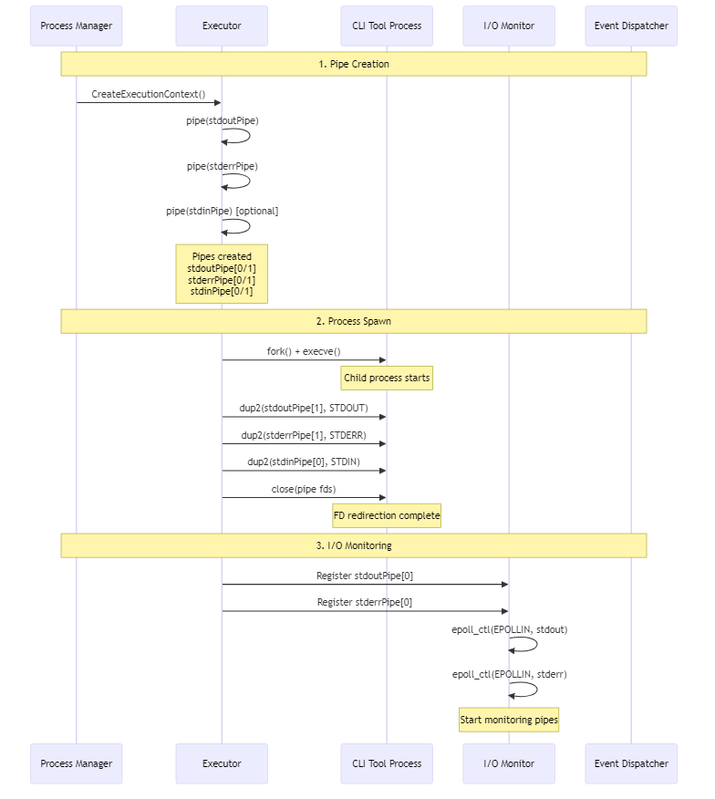
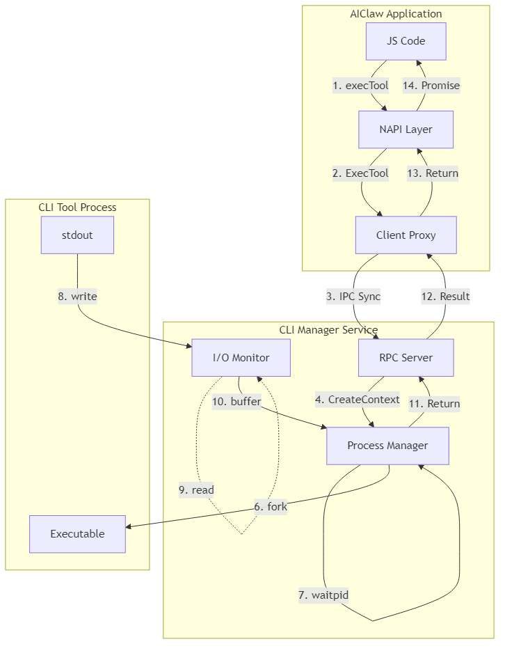
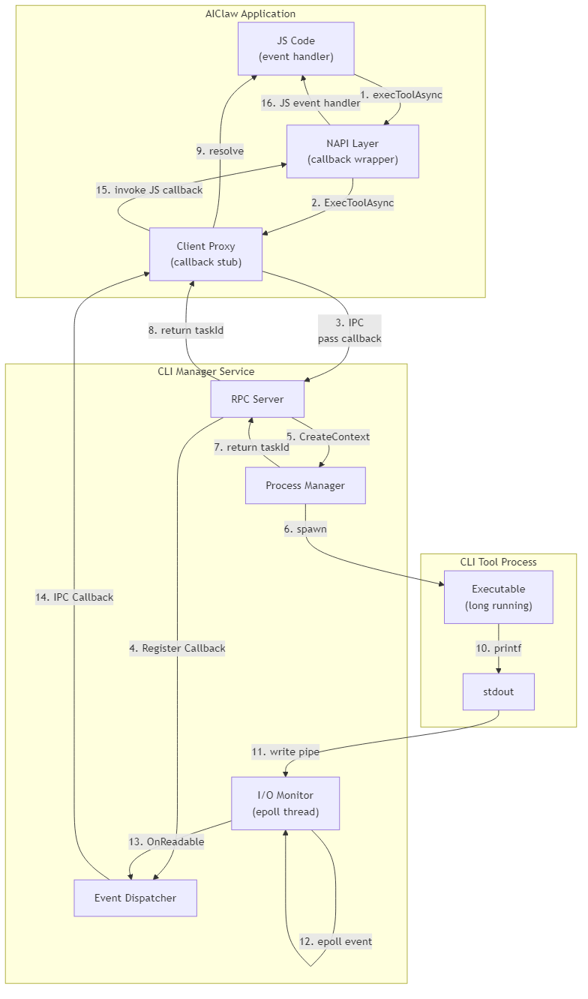

# 更新总结 - CLI 工具管理框架设计文档

## 更新完成时间
2025-03-24

---

## 文档更新概览

### 1. DESIGN.md - 总体设计方案 ✅
**状态：** 所有 Mermaid 图表已替换为可视化图片

| 章节 | 图表 | 图片文件 |
|------|------|----------|
| 3.1 整体架构图 | ✅ 已替换 | `diagrams/overall_architecture.png` |
| 3.3.1 工具注册流程 | ✅ 已替换 | `diagrams/tool_registration_flow.png` |
| 3.3.2 同步调用流程 | ✅ 已替换 | `diagrams/sync_execution_flow.png` |
| 3.3.3 异步调用流程 | ✅ 已替换 | `diagrams/async_execution_flow.png` |
| 4.3 数据库 ER 图 | ✅ 已替换 | `diagrams/database_er.png` |

---

### 2. COMMUNICATION_DESIGN.md - 通信详细设计 ✅
**状态：** 所有 Mermaid 图表已替换为可视化图片

| 章节 | 图表 | 图片文件 |
|------|------|----------|
| 2.1 进程创建与管道建立流程 | ✅ 已替换 | `diagrams/pipe_creation_flow.png` |
| 8.1 同步调用数据流 | ✅ 已替换 | `diagrams/sync_data_flow.png` |
| 8.2 异步调用数据流 | ✅ 已替换 | `diagrams/data_flow_async.png` |

---

## 生成的所有架构图

### 总体架构图（5 张）

| # | 文件名 | 大小 | 说明 |
|---|--------|------|------|
| 1 | `overall_architecture.png` | 38.8 KB | 完整的系统分层架构 |
| 2 | `tool_registration_flow.png` | 32.7 KB | 工具注册的时序流程 |
| 3 | `sync_execution_flow.png` | 34.6 KB | 同步调用的完整流程 |
| 4 | `async_execution_flow.png` | 45.3 KB | 异步调用和事件监听 |
| 5 | `database_er.png` | 51.9 KB | 数据库表结构关系 |

### 通信架构图（5 张）⭐

| # | 文件名 | 大小 | 说明 |
|---|--------|------|------|
| 1 | `communication_architecture.png` | 53.1 KB | AIClaw 到 Tool 进程的完整通信链路 |
| 2 | `pipe_creation_flow.png` | 50.8 KB | 进程启动时管道建立和重定向的详细步骤 |
| 3 | `data_flow_async.png` | 84.0 KB | 异步调用时数据从 Tool 流向 AIClaw 的完整路径 |
| 4 | `sync_data_flow.png` | 61.3 KB | 同步调用的数据流转过程 |
| 5 | `io_monitor_detail.png` | 35.2 KB | epoll 监控多个管道的工作原理 |

**总计：10 张可视化架构图**

---

## 可视化图表示例

### 1. 管道创建流程图
**位置：** `COMMUNICATION_DESIGN.md` 第 2.1 节



展示内容：
- 进程创建与管道建立的 4 个阶段
- `pipe()` 系统调用创建管道
- `fork() + execve()` 启动工具进程
- `dup2()` 文件描述符重定向
- `epoll_ctl()` 注册管道监控

---

### 2. 同步调用数据流图
**位置：** `COMMUNICATION_DESIGN.md` 第 8.1 节



展示内容：
- JS API → NAPI → Client Proxy
- IPC 同步调用到 CLI Manager Service
- Process Manager 创建进程并 `waitpid()` 阻塞等待
- I/O Monitor 读取管道数据
- 返回完整执行结果到 JS 层

---

### 3. 异步调用数据流图
**位置：** `COMMUNICATION_DESIGN.md` 第 8.2 节



展示内容：
- JS API 传递回调函数
- 立即返回 taskId，不等待执行完成
- epoll 线程持续监控工具输出
- 实时通过 IPC 分发事件到 JS 回调
- 工具退出时发送 exit 事件

---

## 通信机制核心要点可视化

### 数据流向（异步模式）

```
┌─────────────────────────────────────────────────────────────┐
│                     AIClaw Application                       │
│  JS Code → NAPI → Client Proxy (IPC Client)                 │
└───────────────────────────┬─────────────────────────────────┘
                            │ IPC (Binder)
                            ▼
┌─────────────────────────────────────────────────────────────┐
│                  CLI Manager Service                         │
│  RPC Server → Event Dispatcher → I/O Monitor (epoll)        │
│                                          ↓                   │
│                                   Process Manager            │
└───────────────────────────────────┬─────────────────────────┘
                                  │ pipe
                                  ▼
                        ┌───────────────────┐
                        │  CLI Tool Process │
                        │  printf() → pipe  │
                        └───────────────────┘
```

### 关键通信步骤

1. **管道创建**
   - `pipe(stdoutPipe)` - 创建 stdout 管道
   - `pipe(stderrPipe)` - 创建 stderr 管道
   - 设置非阻塞模式：`fcntl(fd, F_SETFL, O_NONBLOCK)`

2. **进程启动**
   - `fork()` - 创建子进程
   - `dup2(stdoutPipe[1], STDOUT_FILENO)` - 重定向 stdout
   - `dup2(stderrPipe[1], STDERR_FILENO)` - 重定向 stderr
   - `execve()` - 执行工具程序

3. **I/O 监控**
   - `epoll_create1()` - 创建 epoll 实例
   - `epoll_ctl(EPOLL_CTL_ADD, fd)` - 注册管道
   - `epoll_wait()` - 等待可读事件
   - `read(fd, buffer)` - 读取数据

4. **事件分发**
   - I/O Monitor → Event Dispatcher
   - Event Dispatcher → IPC Callback
   - Client Proxy → NAPI Bridge
   - NAPI Bridge → JS Event Handler

---

## 文档导航

### 快速查找

| 想了解... | 查看文档 | 章节 |
|----------|---------|------|
| 整体系统架构 | `DESIGN.md` | 第 3 节 |
| 数据模型设计 | `DESIGN.md` | 第 4 节 |
| API 接口定义 | `DESIGN.md` | 第 5 节 |
| **管道如何建立** | `COMMUNICATION_DESIGN.md` | 第 2 节 + 图 |
| **进程如何启动** | `COMMUNICATION_DESIGN.md` | 第 3 节 |
| **输出如何获取** | `COMMUNICATION_DESIGN.md` | 第 4 节 |
| **事件如何监听** | `COMMUNICATION_DESIGN.md` | 第 5 节 |
| **同步调用流程** | `COMMUNICATION_DESIGN.md` | 第 8.1 节 + 图 |
| **异步调用流程** | `COMMUNICATION_DESIGN.md` | 第 8.2 节 + 图 |
| 性能优化方案 | `COMMUNICATION_DESIGN.md` | 第 10 节 |
| 安全防护措施 | `COMMUNICATION_DESIGN.md` | 第 11 节 |

---

## 代码实现亮点

### 1. 非阻塞 I/O + epoll
```cpp
// 设置管道为非阻塞模式
fcntl(stdoutPipe[0], F_SETFL, O_NONBLOCK);

// 单线程监控多个工具
epoll_fd = epoll_create1(EPOLL_CLOEXEC);
epoll_ctl(epoll_fd, EPOLL_CTL_ADD, fd, &ev);
epoll_wait(epoll_fd, events, MAX_EVENTS, timeout);
```

### 2. 进程生命周期管理
```cpp
// 创建进程并重定向 I/O
pid = fork();
if (pid == 0) {
    dup2(stdoutPipe[1], STDOUT_FILENO);
    dup2(stderrPipe[1], STDERR_FILENO);
    execve(tool_path, argv, envp);
}
```

### 3. 事件驱动回调
```cpp
// 数据到达时触发回调
void IOMonitor::HandleReadable(int fd, const std::string& taskId) {
    std::string data = ReadFromPipe(fd);
    dispatcher_->DispatchIOEvent({taskId, data});
}
```

---

## 技术栈总结

| 组件 | 技术 |
|------|------|
| 进程创建 | fork() + execve() |
| I/O 重定向 | dup2() |
| 管道通信 | pipe() + 非阻塞 I/O |
| 事件监控 | epoll (EPOLLIN) |
| 进程间通信 | IPC (Binder) |
| JS 桥接 | NAPI |
| 并发模型 | 单线程 epoll + 事件驱动 |

---

## 总结

✅ **DESIGN.md** - 所有 5 张架构图已替换为可视化图片
✅ **COMMUNICATION_DESIGN.md** - 所有 3 张通信流程图已替换为可视化图片
✅ **diagrams/** - 生成 10 张高质量 PNG 架构图
✅ **README_DESIGN.md** - 更新文档导航和图表清单

所有文档现在都包含清晰的可视化架构图，便于理解和展示！

---

**文档版本：** v1.0
**更新日期：** 2025-03-24
