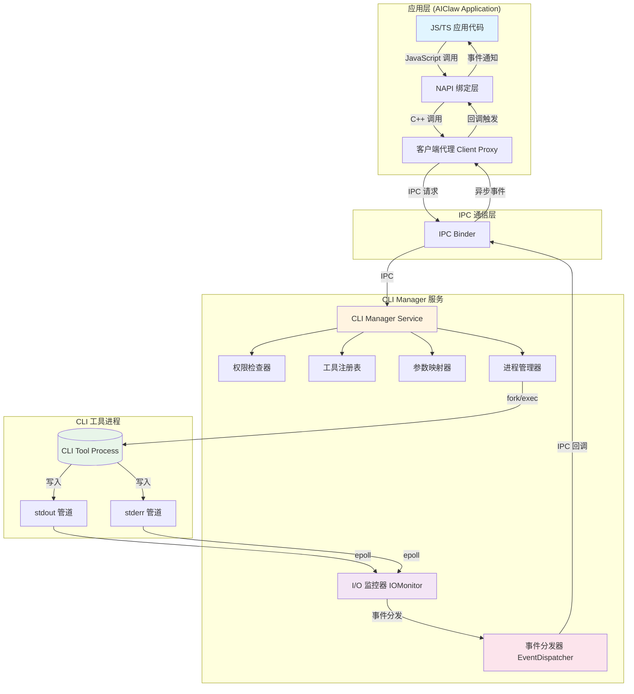
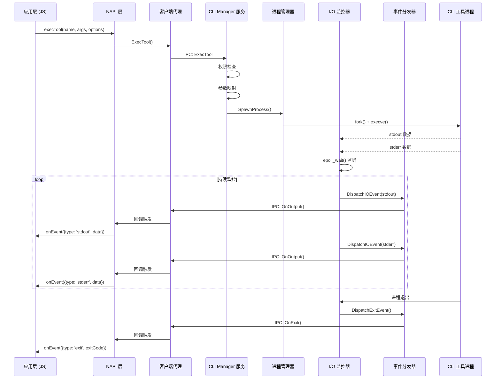
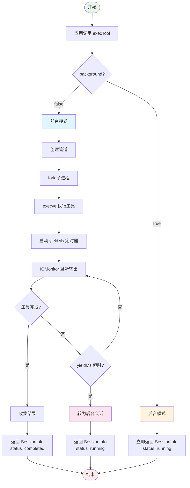
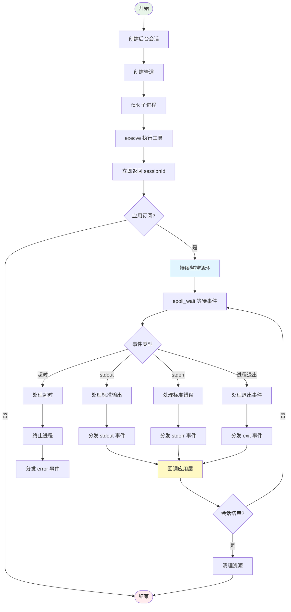
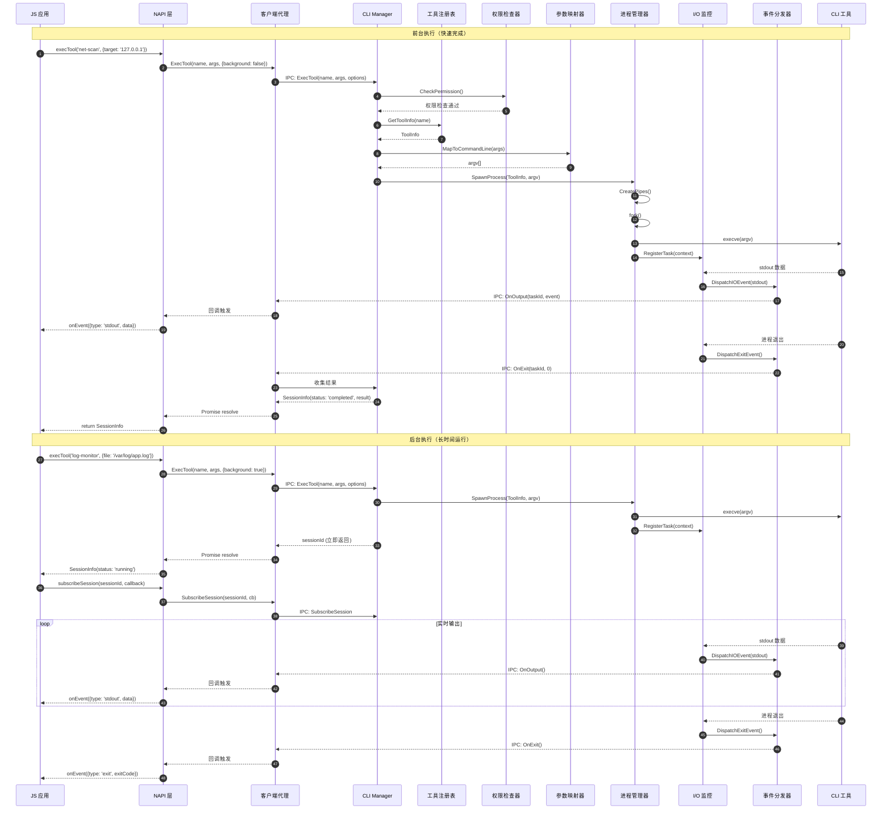
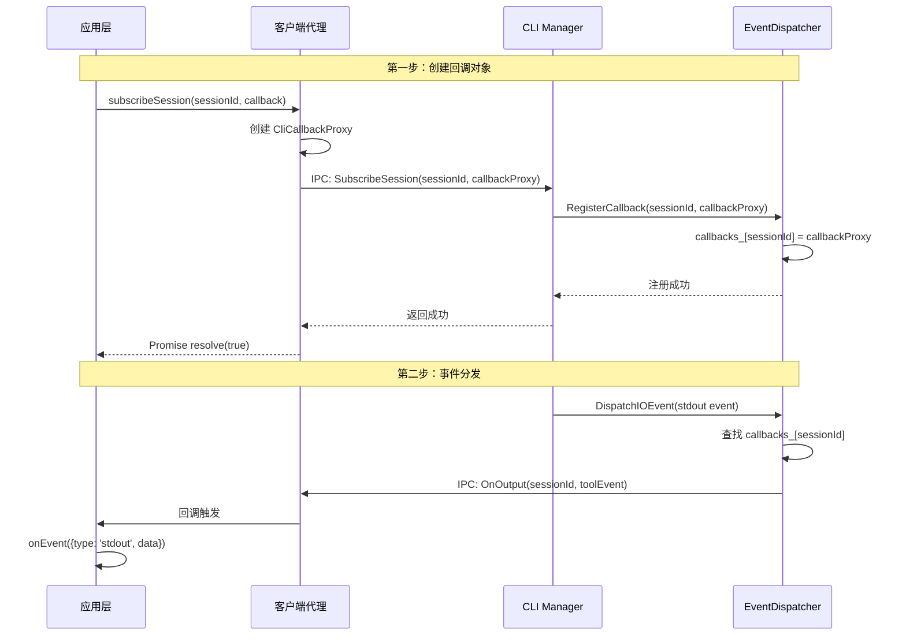
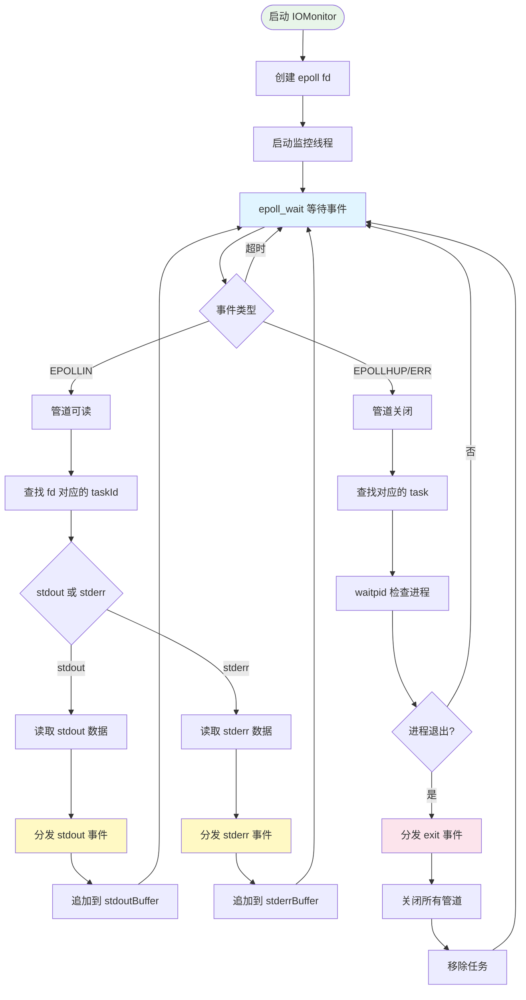
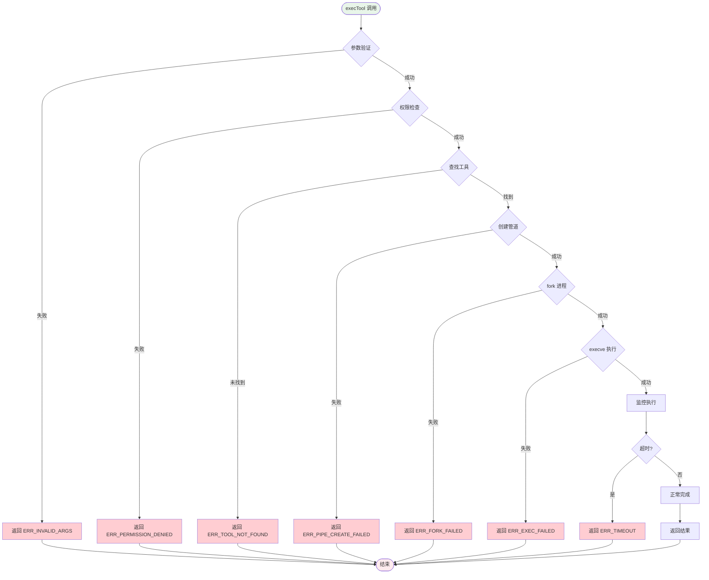

# CLI 工具异步执行设计文档

## 文档信息

**版本**: v1.0
**创建日期**: 2025-04-20
**状态**: 设计文档
**作者**: CLI 工具管理框架设计团队

---

## 目录

1. [概述](#概述)
2. [API设计](#api设计)
3. [架构设计](#架构设计)
4. [执行流程](#执行流程)
5. [事件分发机制](#事件分发机制)
6. [IO监控设计](#io监控设计)
7. [使用实例](#使用实例)
8. [性能优化](#性能优化)
9. [错误处理](#错误处理)
10. [安全考虑](#安全考虑)

---

## 概述

### 设计目标

CLI 工具异步执行机制旨在解决以下问题：

1. **长时运行工具**: 支持执行时间较长的 CLI 工具（如日志监控、文件同步）
2. **实时输出**: 应用可以实时接收工具的标准输出和错误输出
3. **非阻塞调用**: 应用可以在工具运行时继续执行其他任务
4. **会话管理**: 支持对后台运行的工具进行管理和控制

### 核心特性

| 特性 | 说明 |
|------|------|
| **前台/后台模式** | 支持同步等待和后台执行两种模式 |
| **实时事件流** | 通过回调函数实时接收 stdout/stderr 事件 |
| **会话管理** | 支持查询、取消后台运行的工具 |
| **超时控制** | 前台模式支持设置等待超时时间 |
| **自动转换** | 前台超时自动转为后台会话 |

### 应用场景

| 场景 | 执行模式 | 说明 |
|------|---------|------|
| 快速命令 | 前台 | 如 `ls`, `echo` 等快速执行的命令 |
| 日志监控 | 后台 | 持续监控日志文件，实时输出 |
| 网络扫描 | 前台转后台 | 快速扫描可能超时，转为后台 |
| 文件下载 | 后台 | 大文件下载需要长时间运行 |
| 批量处理 | 后台 | 批量处理多个文件，显示进度 |

---

## API设计

### TypeScript 接口定义

```typescript
// interfaces/kits/native/cli.d.ts

/**
 * 执行选项
 */
export interface ExecOptions {
  /**
   * 是否后台执行
   * - true: 立即返回 sessionId，工具在后台运行
   * - false: 等待工具完成或超时
   * @default false
   */
  background?: boolean;

  /**
   * 前台等待时间（毫秒）
   * 仅当 background=false 时有效
   * - 在 yieldMs 时间内完成：返回结果
   * - 超时未完成：转为后台会话
   * @default 30000 (30秒)
   */
  yieldMs?: number;

  /**
   * 执行超时时间（毫秒）
   * - 0 表示无限制
   * - 超时后自动终止工具进程
   * @default 300000 (5分钟)
   */
  timeoutMs?: number;

  /**
   * 环境变量
   * @default 继承父进程环境变量
   */
  env?: Record<string, string>;

  /**
   * 工作目录
   * @default 当前进程工作目录
   */
  cwd?: string;
}

/**
 * 工具事件（异步模式）
 */
export interface ToolEvent {
  /**
   * 事件类型
   */
  type: 'stdout' | 'stderr' | 'exit' | 'error' | 'timeout';

  /**
   * 会话ID
   */
  sessionId: string;

  /**
   * 事件数据
   * - stdout/stderr: 输出内容
   * - error: 错误信息
   */
  data?: string;

  /**
   * 退出码（仅 exit 事件）
   */
  exitCode?: number;

  /**
   * 时间戳
   */
  timestamp: number;
}

/**
 * 会话信息
 */
export interface SessionInfo {
  /**
   * 会话ID
   */
  sessionId: string;

  /**
   * 工具名称
   */
  toolName: string;

  /**
   * 启动时间
   */
  startTime: number;

  /**
   * 会话状态
   */
  status: 'running' | 'completed' | 'failed' | 'cancelled';

  /**
   * 执行结果（仅当 status='completed' 时）
   */
  result?: ExecResult;
}

/**
 * 执行结果
 */
export interface ExecResult {
  /**
   * 退出码
   * - 0: 成功
   * - 非 0: 失败
   */
  exitCode: number;

  /**
   * 标准输出（累积）
   */
  stdout?: string;

  /**
   * 标准错误（累积）
   */
  stderr?: string;

  /**
   * 执行耗时（毫秒）
   */
  duration?: number;
}

/**
 * CLI Manager 接口
 */
export interface CLIManager {
  /**
   * 执行 CLI 工具（统一接口）
   * @param name 工具名称
   * @param args 输入参数
   * @param options 执行选项
   * @returns 会话信息
   */
  execTool(
    name: string,
    args: Record<string, any>,
    options?: ExecOptions
  ): Promise<SessionInfo>;

  /**
   * 订阅后台会话事件
   * @param sessionId 会话ID
   * @param callback 事件回调函数
   * @returns 是否订阅成功
   */
  subscribeSession(
    sessionId: string,
    callback: (event: ToolEvent) => void
  ): Promise<boolean>;

  /**
   * 取消后台会话
   * @param sessionId 会话ID
   * @returns 是否取消成功
   */
  cancelSession(sessionId: string): Promise<boolean>;

  /**
   * 查询会话状态
   * @param sessionId 会话ID
   * @returns 会话信息（如果存在）
   */
  getSession(sessionId: string): Promise<SessionInfo | null>;

  /**
   * 列出所有活动会话
   * @returns 活动会话列表
   */
  listSessions(): Promise<SessionInfo[]>;
}
```

### C++ IPC 接口定义

```cpp
// interfaces/inner_api/cli_callback.h

#pragma once

#include <iremote_broker.h>
#include <iremote_object.h>
#include <string>

namespace OHOS {
namespace CliMgr {

/**
 * @brief 工具事件结构
 */
struct ToolEvent {
    std::string type;      // "stdout", "stderr", "exit", "error", "timeout"
    std::string data;      // 事件数据
    int exitCode = 0;      // 退出码（仅 exit 事件）
    int64_t timestamp;     // 时间戳
};

/**
 * @brief CLI 回调接口
 *
 * 客户端实现此接口以接收工具执行过程中的异步事件
 */
class ICLICallback : public IRemoteBroker {
public:
    DECLARE_INTERFACE_DESCRIPTOR(u"ohos.CliMgr.ICLICallback");

    /**
     * @brief 工具输出事件
     * @param taskId 任务ID
     * @param event 工具事件
     */
    virtual void OnOutput(const std::string& taskId, const ToolEvent& event) = 0;

    /**
     * @brief 工具退出事件
     * @param taskId 任务ID
     * @param exitCode 退出码
     */
    virtual void OnExit(const std::string& taskId, int32_t exitCode) = 0;

    /**
     * @brief 错误事件
     * @param taskId 任务ID
     * @param errorCode 错误码
     * @param errorMsg 错误信息
     */
    virtual void OnError(const std::string& taskId,
                        int32_t errorCode,
                        const std::string& errorMsg) = 0;

    /**
     * @brief 超时事件
     * @param taskId 任务ID
     */
    virtual void OnTimeout(const std::string& taskId) = 0;
};

} // namespace CliMgr
} // namespace OHOS
```

### Native C++ 客户端 API

```cpp
// interfaces/inner_api/cli_manager_client.h

#pragma once

#include <string>
#include <memory>
#include <functional>
#include <map>

namespace OHOS {
namespace CliMgr {

// 前向声明
class ICLICallback;

/**
 * @brief 执行选项
 */
struct ExecOptions {
    bool background = false;       // 是否后台执行
    uint32_t yieldMs = 30000;      // 前台等待时间
    uint32_t timeoutMs = 300000;   // 执行超时时间
    std::map<std::string, std::string> env;  // 环境变量
    std::string workingDir;        // 工作目录
};

/**
 * @brief 会话信息
 */
struct SessionInfo {
    std::string sessionId;
    std::string toolName;
    int64_t startTime;
    std::string status;  // "running", "completed", "failed", "cancelled"
};

/**
 * @brief CLI Manager 客户端类
 */
class CliManagerClient {
public:
    static CliManagerClient* GetInstance();

    /**
     * @brief 执行 CLI 工具
     * @param toolName 工具名称
     * @param args 输入参数（JSON 格式）
     * @param options 执行选项
     * @param callback 事件回调（可选）
     * @return 任务ID
     */
    std::string ExecTool(
        const std::string& toolName,
        const std::string& args,
        const ExecOptions& options,
        const sptr<ICLICallback>& callback = nullptr
    );

    /**
     * @brief 订阅会话事件
     * @param sessionId 会话ID
     * @param callback 事件回调
     * @return 是否订阅成功
     */
    bool SubscribeSession(
        const std::string& sessionId,
        const sptr<ICLICallback>& callback
    );

    /**
     * @brief 取消会话
     * @param sessionId 会话ID
     * @return 是否取消成功
     */
    bool CancelSession(const std::string& sessionId);

    /**
     * @brief 查询会话状态
     * @param sessionId 会话ID
     * @param[out] sessionInfo 会话信息
     * @return 是否查询成功
     */
    bool GetSession(
        const std::string& sessionId,
        SessionInfo& sessionInfo
    );

    /**
     * @brief 列出所有活动会话
     * @return 会话列表
     */
    std::vector<SessionInfo> ListSessions();
};

} // namespace CliMgr
} // namespace OHOS
```

---

## 架构设计

### 整体架构图



### 异步数据流图



### 组件交互图

```mermaid
graph LR
    A[ExecutionContext] -->|包含| B[进程信息]
    A -->|包含| C[管道文件描述符]
    A -->|包含| D[回调对象]

    C -->|stdout| E[stdoutPipe[2]]
    C -->|stderr| F[stderrPipe[2]]
    C -->|stdin| G[stdinPipe[2]]

    E -->|可读| H[IOMonitor.epoll]
    F -->|可读| H

    H -->|事件| I[EventDispatcher]
    I -->|回调| D
    D -->|IPC| J[Client Proxy]
    J -->|事件| K[JS Layer]

    style A fill:#e1f5ff
    style H fill:#f3e5f5
    style I fill:#fce4ec
    style K fill:#fff9c4
```

---

## 执行流程

### 执行模式对比

| 场景 | background | yieldMs | 返回状态 | 后续处理 |
|------|-----------|---------|----------|----------|
| **快速完成** | false | 30000 | `completed` + result | 直接获取结果 |
| **前台超时** | false | 30000 | `running` | 订阅会话接收事件 |
| **后台执行** | true | - | `running` | 订阅会话接收事件 |
| **执行失败** | false | - | `failed` | 查看错误信息 |

### 前台执行流程



### 后台执行流程



### 完整时序图



---

## 事件分发机制

### EventDispatcher 设计

```cpp
// services/climgr/src/event_dispatcher.h

#pragma once

#include <string>
#include <unordered_map>
#include <mutex>
#include <iremote_object.h>
#include "cli_callback.h"

namespace OHOS {
namespace CliMgr {

/**
 * @brief I/O 事件类型
 */
enum class IOEventType : uint8_t {
    STDOUT = 0,
    STDERR = 1,
    PROCESS_EXIT = 2,
    TIMEOUT = 3,
};

/**
 * @brief I/O 事件结构
 */
struct IOEvent {
    IOEventType type;
    std::string taskId;
    std::string data;
    int exitCode;
};

/**
 * @brief 事件分发器
 *
 * 负责将 I/O 监控器捕获的事件分发给对应的客户端回调
 */
class EventDispatcher {
public:
    explicit EventDispatcher();
    ~EventDispatcher();

    /**
     * @brief 注册任务的回调
     * @param taskId 任务ID
     * @param callback IPC 回调对象
     */
    void RegisterCallback(const std::string& taskId,
                         const sptr<ICLICallback>& callback);

    /**
     * @brief 注销任务的回调
     * @param taskId 任务ID
     */
    void UnregisterCallback(const std::string& taskId);

    /**
     * @brief 分发 I/O 事件
     * @param event I/O 事件
     */
    void DispatchIOEvent(const IOEvent& event);

    /**
     * @brief 分发进程退出事件
     * @param taskId 任务ID
     * @param exitCode 退出码
     */
    void DispatchExitEvent(const std::string& taskId, int exitCode);

    /**
     * @brief 分发错误事件
     * @param taskId 任务ID
     * @param errorCode 错误码
     * @param errorMsg 错误信息
     */
    void DispatchErrorEvent(const std::string& taskId,
                           int32_t errorCode,
                           const std::string& errorMsg);

    /**
     * @brief 分发超时事件
     * @param taskId 任务ID
     */
    void DispatchTimeoutEvent(const std::string& taskId);

private:
    /**
     * @brief 转换 I/O 事件为 ToolEvent
     */
    ToolEvent ConvertToToolEvent(const IOEvent& event);

private:
    // taskId -> IPC 回调对象
    std::unordered_map<std::string, sptr<ICLICallback>> callbacks_;

    // 保护 callbacks_ 的互斥锁
    std::mutex callbacksMutex_;
};

} // namespace CliMgr
} // namespace OHOS
```

### EventDispatcher 实现

```cpp
// services/climgr/src/event_dispatcher.cpp

#include "event_dispatcher.h"
#include "hilog_tag_wrapper.h"

namespace OHOS {
namespace CliMgr {

EventDispatcher::EventDispatcher() = default;

EventDispatcher::~EventDispatcher() = default;

void EventDispatcher::RegisterCallback(const std::string& taskId,
                                      const sptr<ICLICallback>& callback)
{
    std::lock_guard<std::mutex> lock(callbacksMutex_);
    callbacks_[taskId] = callback;
    TAG_LOGI(TAG, "Registered callback for task %{public}s", taskId.c_str());
}

void EventDispatcher::UnregisterCallback(const std::string& taskId)
{
    std::lock_guard<std::mutex> lock(callbacksMutex_);
    callbacks_.erase(taskId);
    TAG_LOGI(TAG, "Unregistered callback for task %{public}s", taskId.c_str());
}

void EventDispatcher::DispatchIOEvent(const IOEvent& event)
{
    sptr<ICLICallback> callback;

    {
        std::lock_guard<std::mutex> lock(callbacksMutex_);
        auto it = callbacks_.find(event.taskId);
        if (it == callbacks_.end()) {
            TAG_LOGW(TAG, "No callback found for task %{public}s", event.taskId.c_str());
            return;
        }
        callback = it->second;
    }

    // 转换并发送事件
    ToolEvent toolEvent = ConvertToToolEvent(event);
    callback->OnOutput(event.taskId, toolEvent);

    TAG_LOGD(TAG, "Dispatched I/O event: type=%{public}d, task=%{public}s",
             static_cast<int>(event.type), event.taskId.c_str());
}

void EventDispatcher::DispatchExitEvent(const std::string& taskId, int exitCode)
{
    sptr<ICLICallback> callback;

    {
        std::lock_guard<std::mutex> lock(callbacksMutex_);
        auto it = callbacks_.find(taskId);
        if (it == callbacks_.end()) {
            return;
        }
        callback = it->second;
    }

    callback->OnExit(taskId, exitCode);

    // 退出后注销回调
    UnregisterCallback(taskId);

    TAG_LOGI(TAG, "Task %{public}s exited with code %{public}d",
             taskId.c_str(), exitCode);
}

void EventDispatcher::DispatchErrorEvent(const std::string& taskId,
                                        int32_t errorCode,
                                        const std::string& errorMsg)
{
    sptr<ICLICallback> callback;

    {
        std::lock_guard<std::mutex> lock(callbacksMutex_);
        auto it = callbacks_.find(taskId);
        if (it == callbacks_.end()) {
            return;
        }
        callback = it->second;
    }

    callback->OnError(taskId, errorCode, errorMsg);

    TAG_LOGE(TAG, "Task %{public}s error: %{public}d, %{public}s",
             taskId.c_str(), errorCode, errorMsg.c_str());
}

void EventDispatcher::DispatchTimeoutEvent(const std::string& taskId)
{
    sptr<ICLICallback> callback;

    {
        std::lock_guard<std::mutex> lock(callbacksMutex_);
        auto it = callbacks_.find(taskId);
        if (it == callbacks_.end()) {
            return;
        }
        callback = it->second;
    }

    callback->OnTimeout(taskId);

    TAG_LOGW(TAG, "Task %{public}s timeout", taskId.c_str());
}

ToolEvent EventDispatcher::ConvertToToolEvent(const IOEvent& event)
{
    ToolEvent toolEvent;
    toolEvent.timestamp = std::chrono::system_clock::now().time_since_epoch().count();

    switch (event.type) {
        case IOEventType::STDOUT:
            toolEvent.type = "stdout";
            toolEvent.data = event.data;
            break;

        case IOEventType::STDERR:
            toolEvent.type = "stderr";
            toolEvent.data = event.data;
            break;

        case IOEventType::PROCESS_EXIT:
            toolEvent.type = "exit";
            toolEvent.exitCode = event.exitCode;
            break;

        case IOEventType::TIMEOUT:
            toolEvent.type = "timeout";
            break;

        default:
            toolEvent.type = "unknown";
            break;
    }

    return toolEvent;
}

} // namespace CliMgr
} // namespace OHOS
```

### 回调注册流程



---

## IO监控设计

### IOMonitor 架构

```cpp
// services/climgr/io_monitor.h

#pragma once

#include <string>
#include <unordered_map>
#include <thread>
#include <atomic>
#include <mutex>
#include <sys/epoll.h>
#include "cli_execution_context.h"
#include "event_dispatcher.h"

namespace OHOS {
namespace CliMgr {

/**
 * @brief I/O 监控器
 *
 * 使用 epoll 监控所有工具进程的管道输出
 * 当管道可读时，读取数据并分发事件
 */
class IOMonitor {
public:
    explicit IOMonitor(EventDispatcher* dispatcher);
    ~IOMonitor();

    /**
     * @brief 启动监控线程
     * @return 是否启动成功
     */
    bool Start();

    /**
     * @brief 停止监控线程
     */
    void Stop();

    /**
     * @brief 注册任务的管道进行监控
     * @param context 执行上下文（包含管道信息）
     * @return 是否注册成功
     */
    bool RegisterTask(const std::shared_ptr<ExecutionContext>& context);

    /**
     * @brief 取消任务监控
     * @param taskId 任务ID
     */
    void UnregisterTask(const std::string& taskId);

    /**
     * @brief 向工具进程写入数据（通过 stdin）
     * @param taskId 任务ID
     * @param data 要写入的数据
     * @return 写入的字节数，-1 表示失败
     */
    ssize_t WriteToStdin(const std::string& taskId, const std::string& data);

private:
    /**
     * @brief 监控线程主循环
     */
    void MonitorThread();

    /**
     * @brief 处理管道可读事件
     * @param fd 文件描述符
     * @param taskId 任务ID
     * @param type 事件类型
     */
    void HandleReadable(int fd, const std::string& taskId, IOEventType type);

    /**
     * @brief 从管道读取数据
     * @param fd 文件描述符
     * @return 读取的数据
     */
    std::string ReadFromPipe(int fd);

    /**
     * @brief 关闭任务的所有管道
     * @param taskId 任务ID
     */
    void CloseTaskPipes(const std::string& taskId);

    /**
     * @brief 检查并处理进程退出
     * @param taskId 任务ID
     * @param exitCode 退出码
     */
    void CheckProcessExit(const std::string& taskId, int exitCode);

private:
    EventDispatcher* dispatcher_;      // 事件分发器

    int epollFd_ = -1;                  // epoll 文件描述符
    std::atomic<bool> running_{false};  // 运行标志
    std::thread monitorThread_;         // 监控线程

    // taskId -> ExecutionContext
    std::unordered_map<std::string, std::shared_ptr<ExecutionContext>> tasks_;

    // fd -> taskId 映射（用于 epoll 事件回调）
    std::unordered_map<int, std::string> fdToTaskId_;

    // taskId -> stdin 写端 fd（用于向工具写入数据）
    std::unordered_map<std::string, int> stdinWriteFds_;

    // 保护共享数据的互斥锁
    std::mutex tasksMutex_;
    std::mutex fdMapMutex_;
};

} // namespace CliMgr
} // namespace OHOS
```

### IOMonitor 实现（核心部分）

```cpp
// services/climgr/io_monitor.cpp

#include "io_monitor.h"
#include "hilog_tag_wrapper.h"
#include <unistd.h>
#include <fcntl.h>
#include <errno.h>
#include <sys/wait.h>

namespace OHOS {
namespace CliMgr {

IOMonitor::IOMonitor(EventDispatcher* dispatcher)
    : dispatcher_(dispatcher)
{
    epollFd_ = epoll_create1(EPOLL_CLOEXEC);
    if (epollFd_ < 0) {
        TAG_LOGE(TAG, "Failed to create epoll: %{public}d", errno);
    }
}

IOMonitor::~IOMonitor()
{
    Stop();
    if (epollFd_ >= 0) {
        close(epollFd_);
    }
}

bool IOMonitor::Start()
{
    if (running_.load()) {
        TAG_LOGW(TAG, "IOMonitor already running");
        return true;
    }

    running_.store(true);
    monitorThread_ = std::thread(&IOMonitor::MonitorThread, this);

    TAG_LOGI(TAG, "IOMonitor started");
    return true;
}

void IOMonitor::Stop()
{
    if (!running_.load()) {
        return;
    }

    running_.store(false);

    // 唤醒 epoll_wait
    if (epollFd_ >= 0) {
        write(epollFd_, "\n", 1);
    }

    if (monitorThread_.joinable()) {
        monitorThread_.join();
    }

    TAG_LOGI(TAG, "IOMonitor stopped");
}

bool IOMonitor::RegisterTask(const std::shared_ptr<ExecutionContext>& context)
{
    std::lock_guard<std::mutex> lock(tasksMutex_);

    // 注册 stdout 管道
    struct epoll_event ev;
    ev.events = EPOLLIN;
    ev.data.fd = context->stdoutPipe[0];

    if (epoll_ctl(epollFd_, EPOLL_CTL_ADD, context->stdoutPipe[0], &ev) < 0) {
        TAG_LOGE(TAG, "Failed to add stdout to epoll: %{public}d", errno);
        return false;
    }

    // 注册 stderr 管道
    ev.data.fd = context->stderrPipe[0];
    if (epoll_ctl(epollFd_, EPOLL_CTL_ADD, context->stderrPipe[0], &ev) < 0) {
        TAG_LOGE(TAG, "Failed to add stderr to epoll: %{public}d", errno);
        epoll_ctl(epollFd_, EPOLL_CTL_DEL, context->stdoutPipe[0], nullptr);
        return false;
    }

    // 保存任务信息
    tasks_[context->taskId] = context;

    // 建立 fd -> taskId 映射
    {
        std::lock_guard<std::mutex> lockFd(fdMapMutex_);
        fdToTaskId_[context->stdoutPipe[0]] = context->taskId;
        fdToTaskId_[context->stderrPipe[0]] = context->taskId;
    }

    // 保存 stdin 写端
    if (context->stdinPipe[1] >= 0) {
        stdinWriteFds_[context->taskId] = context->stdinPipe[1];
    }

    TAG_LOGI(TAG, "Registered task %{public}s for monitoring",
             context->taskId.c_str());
    return true;
}

void IOMonitor::MonitorThread()
{
    TAG_LOGI(TAG, "Monitor thread started");

    const int MAX_EVENTS = 64;
    struct epoll_event events[MAX_EVENTS];

    while (running_.load()) {
        int nfds = epoll_wait(epollFd_, events, MAX_EVENTS, 100);

        if (nfds < 0) {
            if (errno == EINTR) {
                continue;
            }
            TAG_LOGE(TAG, "epoll_wait failed: %{public}d", errno);
            break;
        }

        for (int i = 0; i < nfds; ++i) {
            int fd = events[i].data.fd;
            uint32_t ev = events[i].events;

            if (ev & EPOLLIN) {
                // 管道可读
                std::string taskId;
                {
                    std::lock_guard<std::mutex> lock(fdMapMutex_);
                    auto it = fdToTaskId_.find(fd);
                    if (it == fdToTaskId_.end()) {
                        TAG_LOGW(TAG, "Unknown fd %{public}d", fd);
                        continue;
                    }
                    taskId = it->second;
                }

                // 判断是 stdout 还是 stderr
                std::shared_ptr<ExecutionContext> context;
                {
                    std::lock_guard<std::mutex> lock(tasksMutex_);
                    auto it = tasks_.find(taskId);
                    if (it == tasks_.end()) {
                        continue;
                    }
                    context = it->second;
                }

                IOEventType type = (fd == context->stdoutPipe[0])
                    ? IOEventType::STDOUT
                    : IOEventType::STDERR;

                HandleReadable(fd, taskId, type);
            }
            else if (ev & EPOLLHUP || ev & EPOLLERR) {
                // 管道关闭或错误
                TAG_LOGW(TAG, "Pipe closed or error for fd %{public}d", fd);

                // 查找对应的任务
                std::string taskId;
                {
                    std::lock_guard<std::mutex> lock(fdMapMutex_);
                    auto it = fdToTaskId_.find(fd);
                    if (it != fdToTaskId_.end()) {
                        taskId = it->second;
                        fdToTaskId_.erase(it);
                    }
                }

                if (!taskId.empty()) {
                    // 检查进程是否退出
                    int status;
                    pid_t ret = waitpid(context->processId, &status, WNOHANG);
                    if (ret > 0) {
                        int exitCode = WEXITSTATUS(status);
                        CheckProcessExit(taskId, exitCode);
                    }
                }

                // 从 epoll 移除
                epoll_ctl(epollFd_, EPOLL_CTL_DEL, fd, nullptr);
                close(fd);
            }
        }
    }

    TAG_LOGI(TAG, "Monitor thread stopped");
}

void IOMonitor::HandleReadable(int fd, const std::string& taskId, IOEventType type)
{
    std::string data = ReadFromPipe(fd);

    if (data.empty()) {
        return;
    }

    // 分发事件
    IOEvent event;
    event.type = type;
    event.taskId = taskId;
    event.data = data;

    dispatcher_->DispatchIOEvent(event);

    // 累积到缓冲区
    std::lock_guard<std::mutex> lock(tasksMutex_);
    auto it = tasks_.find(taskId);
    if (it != tasks_.end()) {
        if (type == IOEventType::STDOUT) {
            it->second->stdoutBuffer += data;
        } else {
            it->second->stderrBuffer += data;
        }
    }
}

std::string IOMonitor::ReadFromPipe(int fd)
{
    const size_t BUFFER_SIZE = 4096;
    char buffer[BUFFER_SIZE];
    std::string result;

    while (true) {
        ssize_t n = read(fd, buffer, BUFFER_SIZE);
        if (n < 0) {
            if (errno == EAGAIN || errno == EWOULDBLOCK) {
                // 没有更多数据了
                break;
            } else {
                TAG_LOGE(TAG, "read failed: %{public}d", errno);
                break;
            }
        } else if (n == 0) {
            // EOF
            break;
        } else {
            result.append(buffer, n);
        }
    }

    return result;
}

void IOMonitor::CheckProcessExit(const std::string& taskId, int exitCode)
{
    std::shared_ptr<ExecutionContext> context;

    {
        std::lock_guard<std::mutex> lock(tasksMutex_);
        auto it = tasks_.find(taskId);
        if (it != tasks_.end()) {
            context = it->second;
            context->exitCode = exitCode;
            context->isCompleted.store(true);
            context->isRunning.store(false);
        }
    }

    if (context) {
        dispatcher_->DispatchExitEvent(taskId, exitCode);
        CloseTaskPipes(taskId);
    }
}

void IOMonitor::CloseTaskPipes(const std::string& taskId)
{
    std::shared_ptr<ExecutionContext> context;

    {
        std::lock_guard<std::mutex> lock(tasksMutex_);
        auto it = tasks_.find(taskId);
        if (it != tasks_.end()) {
            context = it->second;
        }
    }

    if (!context) {
        return;
    }

    // 关闭所有管道
    context->CloseAllPipes();

    // 从 epoll 移除
    if (context->stdoutPipe[0] >= 0) {
        epoll_ctl(epollFd_, EPOLL_CTL_DEL, context->stdoutPipe[0], nullptr);
    }
    if (context->stderrPipe[0] >= 0) {
        epoll_ctl(epollFd_, EPOLL_CTL_DEL, context->stderrPipe[0], nullptr);
    }

    // 清理映射
    {
        std::lock_guard<std::mutex> lock(fdMapMutex_);
        if (context->stdoutPipe[0] >= 0) {
            fdToTaskId_.erase(context->stdoutPipe[0]);
        }
        if (context->stderrPipe[0] >= 0) {
            fdToTaskId_.erase(context->stderrPipe[0]);
        }
    }

    // 移除任务
    {
        std::lock_guard<std::mutex> lock(tasksMutex_);
        tasks_.erase(taskId);
    }

    TAG_LOGI(TAG, "Closed pipes for task %{public}s", taskId.c_str());
}

} // namespace CliMgr
} // namespace OHOS
```

### I/O 监控流程图



---

## 使用实例

### 示例 1: 后台日志监控

```typescript
import CLI from '@ohos.cli.manager';

/**
 * 后台日志监控示例
 * 持续监控日志文件，实时输出匹配的行
 */
async function monitorLogFile(filter: string) {
  try {
    // 启动后台日志监控
    const session = await CLI.CLIManager.execTool('log-monitor', {
      file: '/var/log/app.log',
      pattern: filter,
      follow: true
    }, {
      background: true  // 后台执行
    });

    console.log('Log monitor started, session:', session.sessionId);

    // 订阅会话事件
    await CLI.CLIManager.subscribeSession(session.sessionId, (event) => {
      switch (event.type) {
        case 'stdout':
          // 实时输出匹配的日志行
          console.log('[LOG]', event.data);
          break;

        case 'stderr':
          // 错误输出
          console.error('[ERROR]', event.data);
          break;

        case 'exit':
          // 工具退出
          console.log('Monitor exited with code:', event.exitCode);
          break;

        case 'error':
          // 执行错误
          console.error('Execution error:', event.data);
          break;
      }
    });

    // 应用可以继续执行其他任务
    console.log('Application continues running...');

  } catch (error) {
    console.error('Failed to start log monitor:', error);
  }
}
```

### 示例 2: 前台执行转后台

```typescript
import CLI from '@ohos.cli.manager';

/**
 * 前台扫描，超时转后台
 */
async function scanNetworkWithTimeout(targetIp: string) {
  try {
    const session = await CLI.CLIManager.execTool('network-scanner', {
      target: targetIp,
      ports: [80, 443, 8080, 22, 3306, 6379],
      verbose: true
    }, {
      background: false,   // 前台模式
      yieldMs: 30000       // 等待 30 秒
    });

    if (session.status === 'completed' && session.result) {
      // 在 30 秒内完成
      console.log('Scan completed!');
      console.log('Exit code:', session.result.exitCode);
      console.log('Output:', session.result.stdout);
    } else if (session.status === 'running') {
      // 超时后自动转为后台
      console.log('Scan timeout, moved to background');
      console.log('Session ID:', session.sessionId);

      // 订阅后台事件
      await CLI.CLIManager.subscribeSession(session.sessionId, handleScanEvent);
    }

  } catch (error) {
    console.error('Scan failed:', error);
  }
}

function handleScanEvent(event: CLI.ToolEvent) {
  switch (event.type) {
    case 'stdout':
      console.log('Scan output:', event.data);
      break;

    case 'exit':
      console.log('Scan completed with code:', event.exitCode);
      break;

    case 'error':
      console.error('Scan error:', event.data);
      break;
  }
}
```

### 示例 3: 带进度显示的文件下载

```typescript
import CLI from '@ohos.cli.manager';

/**
 * 文件下载，显示进度
 */
async function downloadFile(url: string, outputPath: string) {
  let totalBytes = 0;
  let downloadedBytes = 0;

  const session = await CLI.CLIManager.execTool('file-downloader', {
    url: url,
    output: outputPath
  }, {
    background: true
  });

  await CLI.CLIManager.subscribeSession(session.sessionId, (event) => {
    if (event.type === 'stdout') {
      // 解析进度输出
      const match = event.data.match(/Progress: (\d+)\/(\d+)/);
      if (match) {
        downloadedBytes = parseInt(match[1]);
        totalBytes = parseInt(match[2]);

        const percent = (downloadedBytes / totalBytes * 100).toFixed(2);
        console.log(`Downloaded: ${percent}% (${downloadedBytes}/${totalBytes} bytes)`);
      }
    } else if (event.type === 'exit') {
      console.log('Download completed!');
    }
  });

  return session.sessionId;
}
```

### 示例 4: 批量文件处理

```typescript
import CLI from '@ohos.cli.manager';

/**
 * 批量处理文件，显示进度
 */
async function batchProcessFiles(files: string[]) {
  const total = files.length;
  let completed = 0;

  console.log(`Processing ${total} files...`);

  const session = await CLI.CLIManager.execTool('batch-processor', {
    files: files,
    action: 'convert',
    format: 'jpeg'
  }, {
    background: true
  });

  await CLI.CLIManager.subscribeSession(session.sessionId, (event) => {
    if (event.type === 'stdout') {
      // 解析文件名
      const match = event.data.match(/Processing: (.+)/);
      if (match) {
        console.log(`[${++completed}/${total}] Processing: ${match[1]}`);
      }
    } else if (event.type === 'exit') {
      console.log(`All files processed! Completed: ${completed}/${total}`);
    }
  });

  return session.sessionId;
}
```

### 示例 5: 会话管理

```typescript
import CLI from '@ohos.cli.manager';

/**
 * 会话管理示例
 */
class SessionManager {
  private sessions: Map<string, CLI.SessionInfo> = new Map();

  async startBackgroundTool(toolName: string, args: any): Promise<string> {
    const session = await CLI.CLIManager.execTool(toolName, args, {
      background: true
    });

    this.sessions.set(session.sessionId, session);
    console.log(`Started ${toolName}, session: ${session.sessionId}`);

    // 订阅事件
    await CLI.CLIManager.subscribeSession(session.sessionId, (event) => {
      this.handleSessionEvent(session.sessionId, event);
    });

    return session.sessionId;
  }

  async handleSessionEvent(sessionId: string, event: CLI.ToolEvent) {
    const session = this.sessions.get(sessionId);
    if (!session) return;

    console.log(`[${session.toolName}:${sessionId}]`, event.type, event.data);

    if (event.type === 'exit' || event.type === 'error') {
      // 会话结束
      this.sessions.delete(sessionId);
    }
  }

  async cancelSession(sessionId: string) {
    const success = await CLI.CLIManager.cancelSession(sessionId);
    if (success) {
      this.sessions.delete(sessionId);
      console.log(`Cancelled session: ${sessionId}`);
    }
  }

  listActiveSessions() {
    console.log('Active sessions:');
    for (const [id, session] of this.sessions) {
      console.log(`  - ${id}: ${session.toolName} (${session.status})`);
    }
  }
}

// 使用示例
async function testSessionManager() {
  const manager = new SessionManager();

  // 启动多个后台工具
  await manager.startBackgroundTool('log-monitor', {file: '/var/log/app1.log'});
  await manager.startBackgroundTool('log-monitor', {file: '/var/log/app2.log'});
  await manager.startBackgroundTool('network-scanner', {target: '192.168.1.1'});

  // 列出活动会话
  manager.listActiveSessions();

  // 取消某个会话
  const sessions = Array.from(manager.sessions.keys());
  if (sessions.length > 0) {
    await manager.cancelSession(sessions[0]);
  }
}
```

### 示例 6: 错误处理和重试

```typescript
import CLI from '@ohos.cli.manager';

/**
 * 带重试的工具执行
 */
async function executeWithRetry(
  toolName: string,
  args: any,
  maxRetries: number = 3
): Promise<CLI.ExecResult> {
  let lastError: Error | null = null;

  for (let i = 0; i < maxRetries; i++) {
    try {
      console.log(`Attempt ${i + 1}/${maxRetries}...`);

      const session = await CLI.CLIManager.execTool(toolName, args, {
        background: false,
        yieldMs: 60000  // 等待 60 秒
      });

      if (session.status === 'completed' && session.result) {
        console.log('Success!');
        return session.result;
      } else if (session.status === 'failed') {
        throw new Error(`Tool execution failed`);
      } else {
        // 超时，转为后台
        console.log('Timeout, cancelling...');
        await CLI.CLIManager.cancelSession(session.sessionId);
        throw new Error(`Execution timeout`);
      }

    } catch (error) {
      lastError = error as Error;
      console.error(`Attempt ${i + 1} failed:`, error.message);

      if (i < maxRetries - 1) {
        const delay = (i + 1) * 1000;  // 递增延迟
        console.log(`Retrying in ${delay}ms...`);
        await new Promise(resolve => setTimeout(resolve, delay));
      }
    }
  }

  throw lastError || new Error('All retries failed');
}

// 使用示例
async function testRetry() {
  try {
    const result = await executeWithRetry('network-scanner', {
      target: '192.168.1.1',
      ports: [80, 443, 8080]
    }, 3);

    console.log('Final result:', result);
  } catch (error) {
    console.error('All attempts failed:', error);
  }
}
```

---

## 性能优化

### 性能指标

| 指标 | 目标值 | 说明 |
|------|--------|------|
| 事件分发延迟 | < 10ms | 从 I/O 可读到回调触发的延迟 |
| 内存占用 | < 1MB/会话 | 每个会话的内存开销 |
| 最大并发会话 | > 1000 | 同时运行的后台工具数量 |
| 缓冲区大小 | 64KB | stdout/stderr 缓冲区上限 |

### 优化策略

#### 1. 批量事件分发

```cpp
// services/climgr/src/event_dispatcher.cpp

void EventDispatcher::DispatchBatch(const std::vector<IOEvent>& events)
{
    if (events.empty()) {
        return;
    }

    // 按任务ID分组
    std::unordered_map<std::string, std::vector<IOEvent>> grouped;
    for (const auto& event : events) {
        grouped[event.taskId].push_back(event);
    }

    // 批量分发
    for (const auto& [taskId, taskEvents] : grouped) {
        sptr<ICLICallback> callback;

        {
            std::lock_guard<std::mutex> lock(callbacksMutex_);
            auto it = callbacks_.find(taskId);
            if (it == callbacks_.end()) {
                continue;
            }
            callback = it->second;
        }

        // 批量发送
        for (const auto& event : taskEvents) {
            ToolEvent toolEvent = ConvertToToolEvent(event);
            callback->OnOutput(taskId, toolEvent);
        }
    }
}
```

#### 2. 零拷贝优化

```cpp
// 使用共享内存或管道传递大数据
void IOMonitor::HandleReadable(int fd, const std::string& taskId, IOEventType type)
{
    // 对于大数据，使用共享内存
    if (IsLargeData(fd)) {
        std::shared_ptr<SharedMemory> shm = CreateSharedMemory();
        ReadToSharedMemory(fd, shm);

        IOEvent event;
        event.type = type;
        event.taskId = taskId;
        event.sharedMemory = shm;  // 避免数据拷贝

        dispatcher_->DispatchIOEvent(event);
    } else {
        // 小数据正常处理
        std::string data = ReadFromPipe(fd);
        // ...
    }
}
```

#### 3. 缓冲区限制

```cpp
// services/climgr/src/io_monitor.cpp

void IOMonitor::AppendToBuffer(const std::string& taskId,
                               const std::string& data,
                               IOEventType type)
{
    const size_t MAX_BUFFER_SIZE = 64 * 1024;  // 64KB

    std::lock_guard<std::mutex> lock(tasksMutex_);
    auto it = tasks_.find(taskId);
    if (it == tasks_.end()) {
        return;
    }

    auto& context = it->second;
    std::string* buffer = (type == IOEventType::STDOUT)
        ? &context->stdoutBuffer
        : &context->stderrBuffer;

    if (buffer->size() + data.size() > MAX_BUFFER_SIZE) {
        // 丢弃最旧的数据
        size_t dropSize = (buffer->size() + data.size()) - MAX_BUFFER_SIZE;
        buffer->erase(0, dropSize);
        TAG_LOGW(TAG, "Buffer overflow, dropped %{public}zu bytes", dropSize);
    }

    buffer->append(data);
}
```

#### 4. 线程池优化

```cpp
// services/climgr/src/event_dispatcher.cpp

class EventDispatcher {
public:
    EventDispatcher() {
        // 创建线程池处理事件分发
        for (int i = 0; i < 4; ++i) {
            workers_.emplace_back([this]() {
                while (running_) {
                    std::function<void()> task;
                    {
                        std::unique_lock<std::mutex> lock(queueMutex_);
                        cv_.wait(lock, [this]() {
                            return !running_ || !taskQueue_.empty();
                        });

                        if (!running_) break;

                        task = std::move(taskQueue_.front());
                        taskQueue_.pop();
                    }

                    task();
                }
            });
        }
    }

private:
    std::vector<std::thread> workers_;
    std::queue<std::function<void()>> taskQueue_;
    std::mutex queueMutex_;
    std::condition_variable cv_;
};
```

---

## 错误处理

### 错误码定义

```cpp
// interfaces/inner_api/cli_error.h

namespace OHOS {
namespace CliMgr {

enum class CliErrorCode {
    SUCCESS = 0,
    ERR_TOOL_NOT_FOUND = 1,
    ERR_PERMISSION_DENIED = 2,
    ERR_INVALID_ARGS = 3,
    ERR_EXEC_FAILED = 4,
    ERR_TIMEOUT = 5,
    ERR_CANCELLED = 6,
    ERR_SESSION_NOT_FOUND = 7,
    ERR_BUFFER_OVERFLOW = 8,
    ERR_PIPE_CREATE_FAILED = 9,
    ERR_FORK_FAILED = 10,
};

} // namespace CliMgr
} // namespace OHOS
```

### 错误处理流程



### 错误恢复策略

| 错误类型 | 恢复策略 |
|---------|---------|
| **工具未找到** | 检查工具名称，更新工具注册表 |
| **权限拒绝** | 请求所需权限，使用降级功能 |
| **参数验证失败** | 修正参数，使用默认值 |
| **管道创建失败** | 重试，降低并发数 |
| **fork 失败** | 等待资源释放，重试 |
| **执行失败** | 检查工具路径，重新安装 |
| **超时** | 转为后台，取消会话 |

---

## 安全考虑

### 安全威胁

| 威胁 | 风险 | 缓解措施 |
|------|------|---------|
| **命令注入** | 恶意参数注入攻击 | 参数验证，命令白名单 |
| **缓冲区溢出** | 内存破坏 | 限制缓冲区大小 |
| **资源耗尽** | 拒绝服务 | 限制并发数，超时控制 |
| **权限提升** | 未授权访问 | 权限检查，最小权限原则 |
| **信息泄露** | 敏感数据泄露 | 日志脱敏，权限隔离 |

### 安全机制

#### 1. 参数验证

```cpp
bool ValidateToolArgs(const std::string& toolName, const Json::Value& args)
{
    // 1. 工具名称白名单
    if (!IsToolAllowed(toolName)) {
        TAG_LOGE(TAG, "Tool not in whitelist: %{public}s", toolName.c_str());
        return false;
    }

    // 2. 参数大小限制
    if (args.toStyledString().length() > MAX_ARG_SIZE) {
        TAG_LOGE(TAG, "Args too large");
        return false;
    }

    // 3. Schema 验证
    if (!ValidateAgainstSchema(toolName, args)) {
        TAG_LOGE(TAG, "Schema validation failed");
        return false;
    }

    return true;
}
```

#### 2. 资源限制

```cpp
struct ResourceLimits {
    size_t maxConcurrentTasks = 1000;      // 最大并发任务数
    size_t maxBufferSize = 64 * 1024;     // 最大缓冲区 64KB
    uint32_t maxExecutionTime = 300000;   // 最大执行时间 5 分钟
    size_t maxTotalMemory = 100 * 1024 * 1024;  // 总内存限制 100MB
};

bool CheckResourceLimits()
{
    // 检查当前资源使用情况
    size_t currentTasks = GetActiveTaskCount();
    size_t currentMemory = GetTotalMemoryUsage();

    if (currentTasks >= limits_.maxConcurrentTasks) {
        TAG_LOGE(TAG, "Too many concurrent tasks");
        return false;
    }

    if (currentMemory >= limits_.maxTotalMemory) {
        TAG_LOGE(TAG, "Memory limit exceeded");
        return false;
    }

    return true;
}
```

#### 3. 权限隔离

```cpp
bool CheckPermission(const std::string& toolName, const CallerInfo& caller)
{
    // 1. 检查工具所需权限
    std::vector<std::string> requiredPerms = GetToolPermissions(toolName);

    // 2. 检查调用者权限
    for (const auto& perm : requiredPerms) {
        if (!caller.HasPermission(perm)) {
            TAG_LOGE(TAG, "Permission denied: %{public}s", perm.c_str());
            return false;
        }
    }

    // 3. 检查访问控制策略
    if (!AccessControl::CanAccess(caller, toolName)) {
        TAG_LOGE(TAG, "Access denied by policy");
        return false;
    }

    return true;
}
```

#### 4. 日志脱敏

```cpp
std::string SanitizeLog(const std::string& message)
{
    std::string result = message;

    // 脱敏敏感信息
    result = std::regex_replace(result, std::regex("password=[^\\s]+"), "password=***");
    result = std::regex_replace(result, std::regex("token=[^\\s]+"), "token=***");
    result = std::regex_replace(result, std::regex("key=[^\\s]+"), "key=***");

    return result;
}
```

---

## 附录

### A. 配置选项

```json
{
  "asyncExecution": {
    "enabled": true,
    "maxConcurrentTasks": 1000,
    "defaultTimeout": 300000,
    "defaultYieldMs": 30000,
    "bufferSize": 65536,
    "workerThreads": 4
  }
}
```

### B. 相关文档

- [CLI 工具管理框架完整设计](./DESIGN.md)
- [CLI 工具开发规范](./cli_specification.md)
- [参数映射设计详解](./argument_mapping_design.md)

### C. 版本历史

| 版本 | 日期 | 说明 |
|------|------|------|
| v1.0 | 2025-04-20 | 初始版本 |

---

**文档版本**: v1.0
**最后更新**: 2025-04-20
**维护者**: CLI 工具管理框架设计团队
