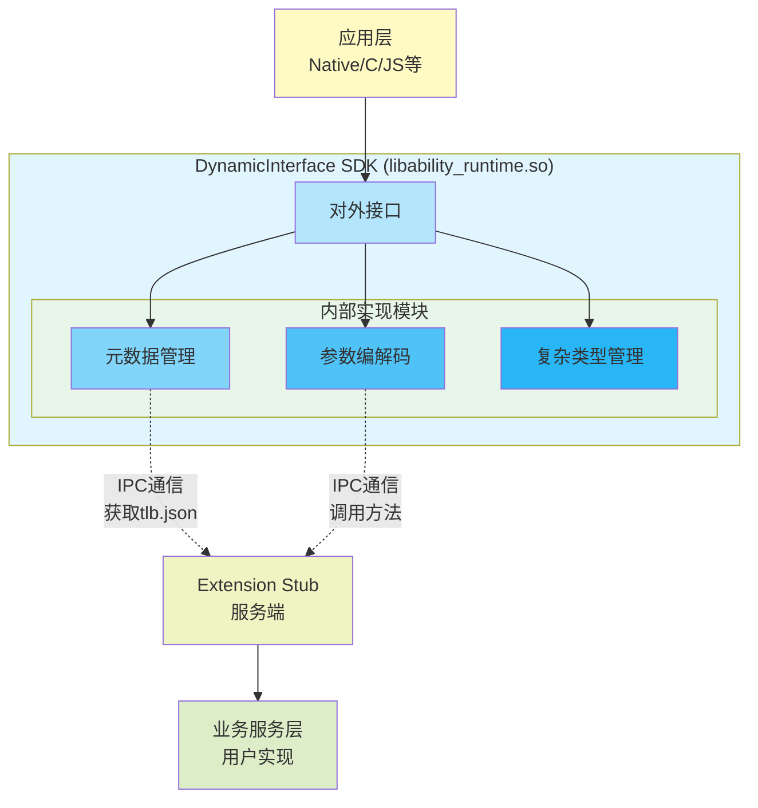
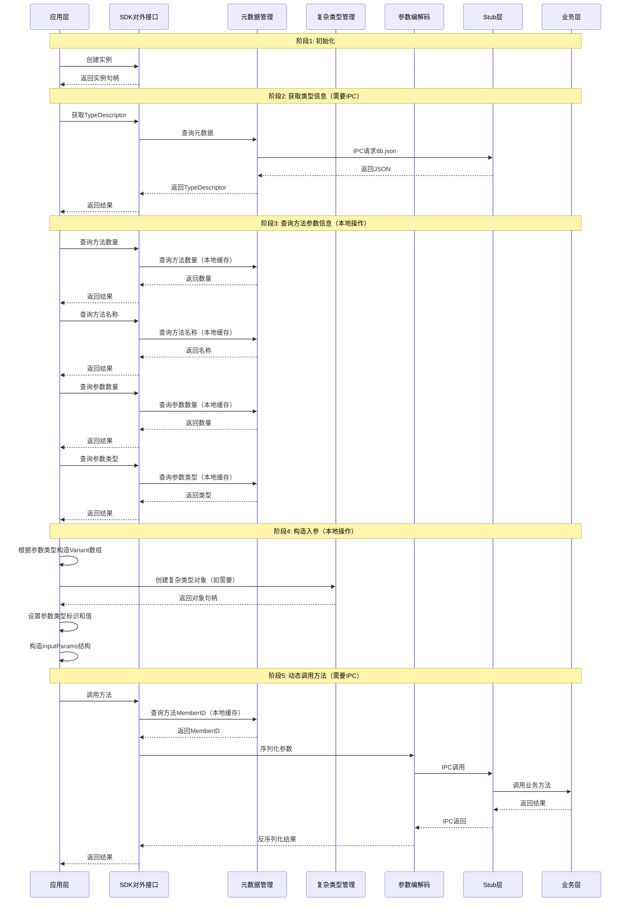
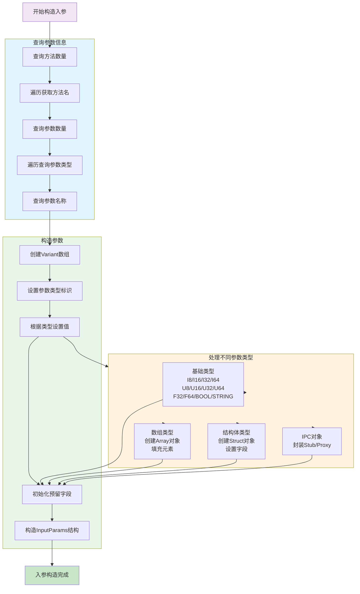

# 鸿蒙DynamicInterface设计文档

# 功能概述

鸿蒙DynamicInterface是一个晚期绑定（Late Binding）接口，用于支持运行时动态调用方法、查询类型信息等场景。它提供统一的类型信息查询和动态调用能力，支持脚本引擎、插件系统、跨语言互操作等场景。

**核心能力：**
- 动态方法调用（CallMethod）：支持运行时通过MemberID或方法名调用方法
- 类型信息查询（GetTypeDescriptor）：支持查询接口、方法、参数、枚举、结构体等元数据
- MemberID映射（QueryMemIDsOfNames）：支持方法名到MemberID的批量转换
- 复杂类型操作：支持数组、向量、集合、映射、（DynamicInterface）、接口等复杂类型
- 类型系统：提供完整的Variant类型系统，支持多种数据类型

**应用场景：**
- 脚本引擎集成：JavaScript、Python等脚本语言动态调用鸿蒙服务
- 插件系统：支持插件动态注册和调用扩展方法
- 跨语言互操作：不同编程语言之间的方法调用
- 类型浏览器：动态浏览类型信息
- 调试器：运行时查看类型信息

# 实现思路

1. **架构设计**：采用分层架构，包括SDK层、Proxy层、Stub层
2. **元数据驱动**：使用TLB JSON格式描述类型信息，支持动态加载和解析
3. **IPC通信**：基于OH_IPC RemoteObject实现跨进程通信
4. **类型系统**：设计Variant类型系统，支持多种数据类型和ABI兼容性
5. **复杂类型管理**：独立管理Array、Vector、Set、Map、Struct、Interface等复杂类型
6. **MemberID机制**：与Windows DynamicInterface的DispID保持一致，支持MemberID和方法名两种调用方式

# 实现设计

## 整体架构



## 架构说明

### 分层架构

#### 1. 应用层
- **角色**：SDK的使用者
- **职责**：调用SDK提供的对外接口
- **语言支持**：Native C/C++、JavaScript、Python等

#### 2. DynamicInterface SDK层（libability_runtime.so）

**对外接口**：
- 提供统一的C接口供应用层调用
- 封装内部实现细节

**内部实现模块**（并行关系）：
- **元数据管理**：负责TLB JSON的解析、缓存和查询
  - **IPC场景**：GetTypeDescriptor时从服务端获取tlb.json
- **参数编解码**：负责Variant的序列化、反序列化和类型检查
  - **IPC场景**：CallMethod时通过IPC调用服务端方法
- **复杂类型管理**：负责Array、Vector、Set、Map、Struct、Interface等类型的管理
  - **无IPC**：纯本地操作，不涉及跨进程通信

**模块协作**：
- 三个模块是并行关系，各自独立实现特定功能
- 对外接口根据需要调用不同的内部模块
- **IPC通信场景**：
  - 元数据获取：GetTypeDescriptor需要从服务端获取tlb.json
  - 方法调用：CallMethod需要跨进程调用服务端方法

#### 3. Extension Stub层（服务端）
- **角色**：IPC服务端
- **职责**：处理客户端请求、方法分发、返回值封装
- **通信**：通过OH_IPC RemoteObject与客户端通信

#### 4. 业务服务层（用户实现）
- **角色**：具体业务逻辑的实现者
- **职责**：实现服务接口的具体业务逻辑
- **由用户开发**：根据业务需求自行实现

## 典型调用流程

### 完整调用流程（含入参构造）



### 入参构造详细流程



### 入参构造流程说明

#### 1. 查询参数信息阶段
**目标**：获取方法的完整参数签名

**步骤**：
1. **查询方法数量**：了解接口有多少个方法
2. **遍历获取方法名**：找到目标方法
3. **查询参数数量**：确定需要构造多少个参数
4. **遍历查询参数类型**：获取每个参数的数据类型
5. **查询参数名称**：获取参数的名称（用于调试和日志）

**涉及模块**：
- 对外接口：提供查询接口
- 元数据管理：从缓存的TLB JSON中查询参数信息

#### 2. 构造参数阶段
**目标**：根据查询到的参数类型构造Variant数组

**步骤**：
1. **创建Variant数组**：根据参数数量分配数组空间
2. **设置参数类型标识**：将每个参数的vt字段设置为对应的类型枚举
3. **根据类型设置值**：根据参数类型，将值设置到union的对应字段
4. **初始化预留字段**：将reserved1、reserved2、reserved3设置为0
5. **构造InputParams结构**：
   - 设置rgvarg指向Variant数组
   - 设置cArgs为参数数量
   - 设置rgMemIdNamedArgs为NULL（不使用命名参数）
   - 设置cNamedArgs为0

**涉及模块**：
- 应用层：负责构造Variant数组和InputParams结构
- 复杂类型管理：当参数是复杂类型时，需要调用对应的Create接口

#### 3. 处理不同参数类型
**基础类型**：
- 设置vt为对应类型枚举（VT_I32、VT_STRING等）
- 直接设置union中的对应字段（i32Val、bstrVal等）

**数组类型**：
- 调用Array_Create创建数组对象
- 填充数组元素
- 设置vt为VT_ARRAY
- 设置u.parrayVal为数组句柄

**结构体类型**：
- 调用Struct_Create创建结构体对象
- 通过Struct_SetField设置各个字段
- 设置vt为VT_STRUCT
- 设置u.pstructVal为结构体句柄

**IPC对象类型**：
- 对于回调参数，创建Stub对象
- 设置vt为VT_IPC_REMOTE_STUB
- 设置u.premoteStubVal为Stub指针
- IPC传递后，服务端收到的是VT_IPC_REMOTE_PROXY类型

#### 4. 关键注意事项

**内存管理**：
- Variant数组由应用层分配和管理
- 复杂类型对象（Array、Struct等）需要调用对应的Release接口释放
- InputParams结构是临时结构，调用完成后可以销毁

**类型安全**：
- 构造参数前必须先查询参数类型
- 设置的值类型必须与查询到的类型一致
- SDK会在调用时进行类型检查

**性能优化**：
- 可以缓存方法的参数信息，避免重复查询
- 对于频繁调用的方法，可以预先构造Variant数组模板

## 模块职责说明

### 对外接口
- 创建和释放DynamicInterface实例
- 提供类型信息查询接口
- 提供动态方法调用接口

### 元数据管理模块
- 解析和缓存TLB JSON元数据
- 维护MemberID到IPC Code的映射
- 提供接口、方法、参数、枚举、结构体的元数据查询
- **IPC场景**：GetTypeDescriptor时从服务端获取tlb.json（首次访问）

### 参数编解码模块
- Variant对象的序列化和反序列化
- 类型检查和验证
- MessageParcel的读写操作
- **IPC场景**：CallMethod时序列化参数并发送IPC请求

### 复杂类型管理模块
- Array、Vector、Set、Map的创建和管理
- Struct类型的字段访问
- Interface类型的动态调用
- 支持类型的嵌套组合
- **无IPC**：纯本地操作，不涉及跨进程通信

### Extension Stub模块（服务端）
- 监听和处理IPC请求
- 根据MemberID分发方法调用
- 封装返回值并通过IPC返回
- 管理服务端业务对象的生命周期

## IPC通信场景总结

| 操作类型 | 是否需要IPC | 说明 |
|---------|-----------|------|
| 创建实例 | 否 | 本地创建SDK对象 |
| 释放实例 | 否 | 本地释放资源 |
| GetTypeDescriptor | 是（首次） | 首次访问需要从服务端获取tlb.json，后续使用缓存 |
| 查询方法/参数信息 | 否 | 使用本地缓存的元数据 |
| 构造Variant参数 | 否 | 本地创建和填充Variant对象 |
| 复杂类型操作 | 否 | 本地创建和管理Array/Map/Struct等 |
| CallMethod | 是 | 跨进程调用服务端方法 |
| Release TypeDescriptor | 否 | 本地释放资源，不影响全局缓存 |

### 2. 元数据管理模块（SDK内部）
- **TLB JSON解析**：从服务端获取并解析类型库元数据
- **元数据缓存**：缓存解析后的类型信息（全局缓存）
- **MemberID到IPC Code映射**：维护MemberID到IPC Code的映射关系
- **MemberID缓存**：实例级缓存，缓存方法名到MemberID的映射
- **跨接口查询**：支持多接口类型信息查询

### 3. TypeDescriptor模块
- **基本信息查询**：GetPackage, GetVersion
- **接口查询**：GetInterfaceCount, GetInterfaceName, GetInterfaceVersion, GetInterfaceMemberId, GetInterfaceDescriptor
- **枚举查询**：GetEnumCount, GetEnumName, GetEnumMemberId, GetEnumValueCount, GetEnumValueName, GetEnumValue
- **结构体查询**：GetStructCount, GetStructName, GetStructMemberId, GetStructFieldCount, GetStructFieldName, GetStructFieldType
- **MemberID查询**：QueryMemIDsOfNames, GetMemberName
- **回调接口识别**：GetInterfaceIsCallback（识别回调接口）
- **主服务接口**：GetMainServiceInterfaceName（获取主服务接口名称）

### 4. InterfaceDescriptor模块（对外接口）
- **方法查询**：GetMethodCount, GetMethodName, GetMethodMemberId, GetMethodReturnType, GetMethodParamCount, GetMethodParamType, GetMethodParamName

### 5. 参数编解码模块（SDK内部）
- **Variant序列化**：将Variant转换为MessageParcel格式
- **Variant反序列化**：将MessageParcel转换为Variant对象
- **类型检查**：验证Variant类型与元数据定义一致
- **类型转换**：支持基础类型、枚举、结构体、数组、向量、集合、映射、接口等类型的转换
- **IPC通信**：在CallMethod等函数内部通过OH_IPC RemoteObject进行跨进程通信

### 6. 复杂类型管理模块（SDK内部）
- **Array**：Create, GetElementType, Set, Get, GetSize, Resize, Release
- **Vector**：Create, GetElementType, Add, Get, GetSize, Clear, Release
- **Set**：Create, GetElementType, Add, Remove, Contains, GetSize, Clear, Release
- **Map**：Create, GetKeyType, GetValueType, Put, Get, Remove, ContainsKey, GetSize, Clear, Release
- **Struct**：Create, GetName, SetField, GetField, Release
- **Interface**：Create, GetName, CallMethod, Release

**说明**：复杂类型管理模块提供Array、Vector、Set、Map、Struct、Interface等复杂类型的创建、访问、修改和释放功能。这些类型通过句柄（Handle）进行管理，支持嵌套使用。

### 7. TypeDescriptor模块（对外接口）
- **基本信息查询**：GetPackage, GetVersion
- **接口查询**：GetInterfaceCount, GetInterfaceName, GetInterfaceMemberId, GetInterfaceDescriptor, GetInterfaceIsCallback
- **主服务接口**：GetMainServiceInterfaceName
- **枚举查询**：GetEnumCount, GetEnumName, GetEnumMemberId, GetEnumValueCount, GetEnumValueName, GetEnumValue
- **结构体查询**：GetStructCount, GetStructName, GetStructMemberId, GetStructFieldCount, GetStructFieldName, GetStructFieldType
- **MemberID查询**：GetMemIDsOfNames, GetMemberName

### 8. InterfaceDescriptor模块（对外接口）
- **方法查询**：GetMethodCount, GetMethodName, GetMethodMemberId, GetMethodReturnType, GetMethodParamCount, GetMethodParamType, GetMethodParamName

## MemberID与IPC Code映射关系

### 映射机制
DynamicInterface 使用 MemberID 作为统一的方法/属性标识，在内部通过元数据模块维护 MemberID 到 IPC Code 的映射关系。

### 映射流程
1. **类型库加载**：从 TLB JSON 文件加载类型信息
2. **MemberID 分配**：为每个接口、方法、属性、枚举、结构体分配唯一的 MemberID
3. **IPC Code 关联**：将 MemberID 与对应的 IPC Code 关联存储
4. **查询映射**：通过 MemberID 查找对应的 IPC Code 和方法元数据

### 映射关系示例
```json
{
  "interfaces": [
    {
      "interfaceName": "IMyObject",
      "memberId": 1001,
      "methods": [
        {
          "memberId": 1002,
          "name": "Add",
          "code": 1,
          "returnType": {"vt": "VTI4"},
          "parameters": [
            {"name": "a", "vt": "VTI4"},
            {"name": "b", "vt": "VTI4"}
          ]
        },
        {
          "memberId": 1003,
          "name": "Calculate",
          "code": 2,
          "returnType": {"vt": "VTR8"},
          "parameters": [
            {"name": "input", "vt": "VTSTRING"}
          ]
        }
      ],
      "properties": [
        {
          "memberId": 2001,
          "name": "Name",
          "code": 3,
          "vt": "VTSTRING",
          "flags": ["read", "write"]
        }
      ]
    }
  ]
}
```

### 映射表结构
| MemberID | 类型 | 名称 | IPC Code | 说明 |
|----------|------|------|----------|------|
| 1001 | Interface | IMyObject | - | 接口本身 |
| 1002 | Method | Add | 1 | 方法调用 |
| 1003 | Method | Calculate | 2 | 方法调用 |
| 2001 | Property | Name | 3 | 属性访问 |

### 映射优势
1.   **统一标识**：使用 MemberID 作为跨接口的统一标识
2.   **类型安全**：通过 MemberID 可以获取完整的类型信息
3.   **IPC 透明**：上层调用者无需关心底层 IPC Code
4.   **元数据驱动**：支持运行时动态查询类型信息

## 回调接口设计

### 回调接口识别机制

在 TLB JSON 中，每个接口都有一个 `isCallback` 字段，用于标识该接口是否为回调接口：

```json
{
  "interfaces": [
    {
      "name": "ICallbackInterface",
      "memberId": 2001,
      "isCallback": true,
      "methods": [
        {
          "name": "OnResult",
          "memberId": 2002,
          "code": 1,
          "returnType": {"vt": "VT_VOID"},
          "parameters": [
            {"name": "result", "vt": "VT_I32"}
          ]
        }
      ]
    }
  ]
}
```

### 回调接口使用流程（客户端视角）

1. **识别回调接口**：
   - 通过 `GetInterfaceCount` 和 `GetInterfaceName` 遍历所有接口
   - 使用 `GetInterfaceIsCallback` 检查接口是否为回调类型

2. **创建回调Stub**：
   - 根据接口元数据动态创建 Stub 实现
   - Stub 需要实现 `OnRemoteRequest` 方法处理服务端的回调请求

3. **注册回调**：
   - 将 Stub 封装为 `VT_IPC_REMOTE_STUB` 类型的 Variant
   - 调用服务端的注册方法传递 Stub
   - Stub 通过 IPC 传递后，服务端收到的是 `OHIPCRemoteProxy`

4. **服务端反向调用**：
   - 服务端保存客户端传来的 Proxy
   - 需要通知时通过 Proxy 调用客户端方法
   - 客户端 Stub 的 `OnRemoteRequest` 被触发，执行实际回调逻辑

### 关键API

| API | 功能 | 说明 |
|-----|------|------|
| OH_AbilityRuntime_TypeDescriptor_GetInterfaceIsCallback | 检查接口是否为回调类型 | 客户端用于识别回调接口 |
| OH_AbilityRuntime_TypeDescriptor_GetMainServiceInterfaceName | 获取主服务接口名称 | 快速定位主服务接口 |

### 客户端示例

```cpp
// 1. 遍历所有接口，识别回调接口
uint32_t interfaceCount = 0;
OH_AbilityRuntime_TypeDescriptor_GetInterfaceCount(typeDesc, &interfaceCount);

for (uint32_t i = 0; i < interfaceCount; i++) {
    char interfaceName[256];
    OH_AbilityRuntime_TypeDescriptor_GetInterfaceName(typeDesc, i, interfaceName, sizeof(interfaceName));
    
    bool isCallback = false;
    OH_AbilityRuntime_TypeDescriptor_GetInterfaceIsCallback(
        typeDesc, interfaceName, &isCallback);
    
    if (isCallback) {
        // 2. 获取回调接口的方法信息
        char interfaceDesc[4096];
        OH_AbilityRuntime_TypeDescriptor_GetInterfaceDescriptor(
            typeDesc, interfaceName, interfaceDesc, sizeof(interfaceDesc));
        
        // 3. 创建并注册回调Stub（根据方法元数据动态创建）
        MyCallbackStub* stub = new MyCallbackStub();
        
        // 4. 封装为Variant
        OH_AbilityRuntime_DynamicInterface_Variant callbackParam;
        callbackParam.vt = OH_ABILITY_RUNTIME_DYNAMIC_INTERFACE_VT_IPC_REMOTE_STUB;
        callbackParam.u.premoteStubVal = stub;
        
        // 5. 调用注册方法
        OH_AbilityRuntime_DynamicInterface_Variant params[1] = {callbackParam};
        OH_AbilityRuntime_DynamicInterface_Inputparams inputParams;
        inputParams.rgvarg = params;
        inputParams.cArgs = 1;
        
        OH_AbilityRuntime_DynamicInterface_Variant result;
        OH_AbilityRuntime_DynamicInterface_CallMethod(
            handle, registerMethodMemID, &inputParams, &result);
    }
}
```

## 主服务接口设计

### 主服务接口标识

在 TLB JSON 中，有一个接口被标记为 `main_service: true`，表示这是主服务接口：

```json
{
  "interfaces": [
    {
      "name": "IMyMainService",
      "memberId": 1001,
      "main_service": true,
      "methods": [...]
    }
  ]
}
```

### 主服务接口查询

通过 `GetMainServiceInterfaceName` 可以快速获取主服务接口名称，无需遍历所有接口：

```cpp
char mainServiceName[256];
OH_AbilityRuntime_TypeDescriptor_GetMainServiceInterfaceName(
    typeDesc, mainServiceName, sizeof(mainServiceName));

// 获取主服务接口描述符
char interfaceDesc[4096];
OH_AbilityRuntime_TypeDescriptor_GetInterfaceDescriptor(
    typeDesc, mainServiceName, interfaceDesc, sizeof(interfaceDesc));
```

### 设计优势

1. **快速定位**：无需遍历所有接口即可找到主服务接口
2. **明确标识**：每个 TLB 只有一个主服务接口
3. **简化使用**：客户端可以直接使用主服务接口，无需判断

## 复杂类型嵌套方案

### 类型嵌套场景
复杂类型嵌套指在 Variant 中包含其他复杂类型（Array、Vector、Set、Map、Struct、Interface），形成多层嵌套结构。

### 常见嵌套模式
1.   **Array 嵌套**：Array<Array<int32_t>>、Array<Struct>
2.   **Map 嵌套**：Map<string, Variant>、Map<string, Array<int32_t>>
3.   **Struct 嵌套**：Struct 中包含 Array、Map 或其他 Struct
4.   **Interface 嵌套**：方法参数或返回值中包含 Interface 类型

### 使用方案

#### 1. 创建嵌套 Array
```cpp
// 创建 Array<Array<int32_t>>
OH_AbilityRuntime_DynamicInterface_ArrayHandle outerArray;
OH_AbilityRuntime_DynamicInterface_Array_Create(
    OH_ABILITY_RUNTIME_DYNAMIC_INTERFACE_VT_ARRAY, 2, &outerArray);

// 创建内层 Array<int32_t>
OH_AbilityRuntime_DynamicInterface_ArrayHandle innerArray1;
OH_AbilityRuntime_DynamicInterface_Array_Create(
    OH_ABILITY_RUNTIME_DYNAMIC_INTERFACE_VT_I32, 3, &innerArray1);

// 设置内层 Array 元素
OH_AbilityRuntime_DynamicInterface_Variant elem1;
elem1.vt = OH_ABILITY_RUNTIME_DYNAMIC_INTERFACE_VT_I32;
elem1.u.i32Val = 1;
OH_AbilityRuntime_DynamicInterface_Array_Set(innerArray1, 0, &elem1);

// 将内层 Array 作为外层 Array 元素
OH_AbilityRuntime_DynamicInterface_Variant outerElem;
outerElem.vt = OH_ABILITY_RUNTIME_DYNAMIC_INTERFACE_VT_ARRAY;
outerElem.u.parrayVal = innerArray1;
OH_AbilityRuntime_DynamicInterface_Array_Set(outerArray, 0, &outerElem);
```

#### 2. 创建嵌套 Map
```cpp
// 创建 Map<string, Array<int32_t>>
OH_AbilityRuntime_DynamicInterface_MapHandle map;
OH_AbilityRuntime_DynamicInterface_Map_Create(
    OH_ABILITY_RUNTIME_DYNAMIC_INTERFACE_VT_STRING,
    OH_ABILITY_RUNTIME_DYNAMIC_INTERFACE_VT_ARRAY, &map);

// 创建 Array<int32_t>
OH_AbilityRuntime_DynamicInterface_ArrayHandle array;
OH_AbilityRuntime_DynamicInterface_Array_Create(
    OH_ABILITY_RUNTIME_DYNAMIC_INTERFACE_VT_I32, 3, &array);

// 设置 Map 键值对
OH_AbilityRuntime_DynamicInterface_Variant key;
key.vt = OH_ABILITY_RUNTIME_DYNAMIC_INTERFACE_VT_STRING;
key.u.bstrVal = "numbers";

OH_AbilityRuntime_DynamicInterface_Variant value;
value.vt = OH_ABILITY_RUNTIME_DYNAMIC_INTERFACE_VT_ARRAY;
value.u.parrayVal = array;

OH_AbilityRuntime_DynamicInterface_Map_Put(map, &key, &value);
```

#### 3. 创建嵌套 Struct
```cpp
// 创建 Struct（包含 Array 字段）
OH_AbilityRuntime_DynamicInterface_StructHandle struct;
OH_AbilityRuntime_DynamicInterface_Struct_Create("PointList", &struct);

// 创建 Array<Point>
OH_AbilityRuntime_DynamicInterface_ArrayHandle pointArray;
OH_AbilityRuntime_DynamicInterface_Array_Create(
    OH_ABILITY_RUNTIME_DYNAMIC_INTERFACE_VT_STRUCT, 2, &pointArray);

// 设置 Struct 字段
OH_AbilityRuntime_DynamicInterface_Variant fieldValue;
fieldValue.vt = OH_ABILITY_RUNTIME_DYNAMIC_INTERFACE_VT_ARRAY;
fieldValue.u.parrayVal = pointArray;
OH_AbilityRuntime_DynamicInterface_Struct_SetField(struct, "points", &fieldValue);
```

### 解析方案

#### 1. 递归解析策略
```cpp
class VariantParser {
public:
    static void ParseVariant(const OH_AbilityRuntime_DynamicInterface_Variant* variant) {
        switch (variant->vt) {
            case OH_ABILITY_RUNTIME_DYNAMIC_INTERFACE_VT_ARRAY:
                ParseArray(variant->u.parrayVal);
                break;
            case OH_ABILITY_RUNTIME_DYNAMIC_INTERFACE_VT_VECTOR:
                ParseVector(variant->u.pvectorVal);
                break;
            case OH_ABILITY_RUNTIME_DYNAMIC_INTERFACE_VT_MAP:
                ParseMap(variant->u.pmapVal);
                break;
            case OH_ABILITY_RUNTIME_DYNAMIC_INTERFACE_VT_STRUCT:
                ParseStruct(variant->u.pstructVal);
                break;
            case OH_ABILITY_RUNTIME_DYNAMIC_INTERFACE_VT_INTERFACE:
                ParseInterface(variant->u.pdispVal);
                break;
            default:
                ParsePrimitive(variant);
                break;
        }
    }

private:
    static void ParseArray(OH_AbilityRuntime_DynamicInterface_ArrayHandle array) {
        uint32_t size;
        OH_AbilityRuntime_DynamicInterface_Array_GetSize(array, &size);
        
        OH_AbilityRuntime_DynamicInterface_Vt elementType;
        OH_AbilityRuntime_DynamicInterface_Array_GetElementType(array, &elementType);
        
        for (uint32_t i = 0; i < size; i++) {
            OH_AbilityRuntime_DynamicInterface_Variant elem;
            OH_AbilityRuntime_DynamicInterface_Array_Get(array, i, &elem);
            ParseVariant(&elem);
        }
    }
    
    static void ParseMap(OH_AbilityRuntime_DynamicInterface_MapHandle map) {
        uint32_t size;
        OH_AbilityRuntime_DynamicInterface_Map_GetSize(map, &size);
        
        // 注意：当前 Map 接口不支持直接遍历，需要通过已知键来获取值
        // 实际使用时需要维护一个键列表或使用其他方式遍历
        for (uint32_t i = 0; i < size; i++) {
            OH_AbilityRuntime_DynamicInterface_Variant key;
            OH_AbilityRuntime_DynamicInterface_Variant value;
            // 从已知键列表获取键
            // OH_AbilityRuntime_DynamicInterface_Map_Get(map, &key, &value);
            ParseVariant(&key);
            ParseVariant(&value);
        }
    }
};
```

#### 2. 类型信息驱动解析
```cpp
void ParseByTypeInfo(const OH_AbilityRuntime_DynamicInterface_Variant* variant,
                      const TypeInfo* typeInfo) {
    switch (typeInfo->type) {
        case TYPE_ARRAY:
            ParseArrayByElementInfo(variant->u.parrayVal, typeInfo->elementType);
            break;
        case TYPE_MAP:
            ParseMapByKeyValueInfo(variant->u.pmapVal, 
                                  typeInfo->keyType, typeInfo->valueType);
            break;
        case TYPE_STRUCT:
            ParseStructByFieldInfo(variant->u.pstructVal, typeInfo->fields);
            break;
        default:
            break;
    }
}
```

### 序列化传递方案

#### 1. MessageParcel 序列化策略
```cpp
class VariantMarshaller {
public:
    static AbilityRuntime_ErrorCode Marshal(
        const OH_AbilityRuntime_DynamicInterface_Variant* variant,
        MessageParcel& parcel) {
        
        parcel.WriteUint32(variant->vt);
        parcel.WriteUint32(variant->size);
        
        switch (variant->vt) {
            case OH_ABILITY_RUNTIME_DYNAMIC_INTERFACE_VT_ARRAY:
                return MarshalArray(variant->u.parrayVal, parcel);
            case OH_ABILITY_RUNTIME_DYNAMIC_INTERFACE_VT_VECTOR:
                return MarshalVector(variant->u.pvectorVal, parcel);
            case OH_ABILITY_RUNTIME_DYNAMIC_INTERFACE_VT_MAP:
                return MarshalMap(variant->u.pmapVal, parcel);
            case OH_ABILITY_RUNTIME_DYNAMIC_INTERFACE_VT_STRUCT:
                return MarshalStruct(variant->u.pstructVal, parcel);
            case OH_ABILITY_RUNTIME_DYNAMIC_INTERFACE_VT_INTERFACE:
                return MarshalInterface(variant->u.pdispVal, parcel);
            default:
                return MarshalPrimitive(variant, parcel);
        }
    }

private:
    static AbilityRuntime_ErrorCode MarshalArray(
        OH_AbilityRuntime_DynamicInterface_ArrayHandle array,
        MessageParcel& parcel) {
        
        uint32_t size;
        OH_AbilityRuntime_DynamicInterface_Array_GetSize(array, &size);
        parcel.WriteUint32(size);
        
        OH_AbilityRuntime_DynamicInterface_Vt elementType;
        OH_AbilityRuntime_DynamicInterface_Array_GetElementType(array, &elementType);
        parcel.WriteUint32(elementType);
        
        for (uint32_t i = 0; i < size; i++) {
            OH_AbilityRuntime_DynamicInterface_Variant elem;
            AbilityRuntime_ErrorCode ret = 
                OH_AbilityRuntime_DynamicInterface_Array_Get(array, i, &elem);
            if (ret != ABILITY_RUNTIME_ERROR_CODE_NO_ERROR) {
                return ret;
            }
            ret = Marshal(&elem, parcel);
            if (ret != ABILITY_RUNTIME_ERROR_CODE_NO_ERROR) {
                return ret;
            }
        }
        
        return ABILITY_RUNTIME_ERROR_CODE_NO_ERROR;
    }
    
    static AbilityRuntime_ErrorCode MarshalMap(
        OH_AbilityRuntime_DynamicInterface_MapHandle map,
        MessageParcel& parcel) {
        
        uint32_t size;
        OH_AbilityRuntime_DynamicInterface_Map_GetSize(map, &size);
        parcel.WriteUint32(size);
        
        OH_AbilityRuntime_DynamicInterface_Vt keyType, valueType;
        OH_AbilityRuntime_DynamicInterface_Map_GetKeyType(map, &keyType);
        OH_AbilityRuntime_DynamicInterface_Map_GetValueType(map, &valueType);
        parcel.WriteUint32(keyType);
        parcel.WriteUint32(valueType);
        
        for (uint32_t i = 0; i < size; i++) {
            OH_AbilityRuntime_DynamicInterface_Variant key, value;
            AbilityRuntime_ErrorCode ret = 
                OH_AbilityRuntime_DynamicInterface_Map_Get(map, &key, &value);
            if (ret != ABILITY_RUNTIME_ERROR_CODE_NO_ERROR) {
                return ret;
            }
            ret = Marshal(&key, parcel);
            if (ret != ABILITY_RUNTIME_ERROR_CODE_NO_ERROR) {
                return ret;
            }
            ret = Marshal(&value, parcel);
            if (ret != MODULAR_OBJECT_DYNAMIC_INTERFACE_ERROR_CODE司) {
                return ret;
            }
        }
        
        return ABILITY_RUNTIME_ERROR_CODE_NO_ERROR;
    }
};
```

#### 2. 反序列化策略
```cpp
class VariantUnmarshaller {
public:
    static AbilityRuntime_ErrorCode Unmarshal(
        MessageParcel& parcel,
        OH_AbilityRuntime_DynamicInterface_Variant* variant) {
        
        parcel.ReadUint32(reinterpret_cast<uint32_t*>(&variant->vt));
        parcel.ReadUint32(&variant->size);
        
        switch (variant->vt) {
            case OH_ABILITY_RUNTIME_DYNAMIC_INTERFACE_VT_ARRAY:
                return UnmarshalArray(parcel, &variant->u.parrayVal);
            case OH_ABILITY_RUNTIME_DYNAMIC_INTERFACE_VT_VECTOR:
                return UnmarshalVector(parcel, &variant->u.pvectorVal);
            case OH_ABILITY_RUNTIME_DYNAMIC_INTERFACE_VT_MAP:
                return UnmarshalMap(parcel, &variant->u.pmapVal);
            case OH_ABILITY_RUNTIME_DYNAMIC_INTERFACE_VT_STRUCT:
                return UnmarshalStruct(parcel, &variant->u.pstructVal);
            case OH_ABILITY_RUNTIME_DYNAMIC_INTERFACE_VT_INTERFACE:
                return UnmarshalInterface(parcel, &variant->u.pdispVal);
            default:
                return UnmarshalPrimitive(parcel, variant);
        }
    }

private:
    static AbilityRuntime_ErrorCode UnmarshalArray(
        MessageParcel& parcel,
        OH_AbilityRuntime_DynamicInterface_ArrayHandle* array) {
        
        uint32_t size, elementType;
        parcel.ReadUint32(&size);
        parcel.ReadUint32(&elementType);
        
        AbilityRuntime_ErrorCode ret = 
            OH_AbilityRuntime_DynamicInterface_Array_Create(
                static_cast<OH_AbilityRuntime_DynamicInterface_Vt>(elementType),
                size, array);
        if (ret != ABILITY_RUNTIME_ERROR_CODE_NO_ERROR) {
            return ret;
        }
        
        for (uint32_t i = 0; i < size; i++) {
            OH_AbilityRuntime_DynamicInterface_Variant elem;
            ret = Unmarshal(parcel, &elem);
            if (ret != ABILITY_RUNTIME_ERROR_CODE_NO_ERROR) {
                return ret;
            }
            ret = OH_AbilityRuntime_DynamicInterface_Array_Set(*array, i, &elem);
            if (ret != ABILITY_RUNTIME_ERROR_CODE_NO_ERROR) {
                return ret;
            }
        }
        
        return ABILITY_RUNTIME_ERROR_CODE_NO_ERROR;
    }
};
```

### 内存管理策略

#### 1. 引用计数管理
```cpp
class ComplexTypeManager {
public:
    void AddRef(OH_AbilityRuntime_DynamicInterface_ArrayHandle handle) {
        std::lock_guard<std::mutex> lock(mutex_);
        refCounts_[handle]++;
    }
    
    void Release(OH_AbilityRuntime_DynamicInterface_ArrayHandle handle) {
        std::lock_guard<std::mutex> lock(mutex_);
        if (--refCounts_[handle] == 0) {
            OH_AbilityRuntime_DynamicInterface_Array_Release(handle);
            refCounts_.erase(handle);
        }
    }

private:
    std::mutex mutex_;
    std::unordered_map<void*, uint32_t> refCounts_;
};
```

#### 2. 循环引用检测
```cpp
class CycleDetector {
public:
    static bool HasCycle(const OH_AbilityRuntime_DynamicInterface_Variant* variant,
                        std::set<void*>& visited) {
        
        void* handle = GetHandle(variant);
        if (visited.find(handle) != visited.end()) {
            return true;
        }
        
        visited.insert(handle);
        
        switch (variant->vt) {
            case OH_ABILITY_RUNTIME_DYNAMIC_INTERFACE_VT_ARRAY:
                return CheckArrayCycle(variant->u.parrayVal, visited);
            case OH_ABILITY_RUNTIME_DYNAMIC_INTERFACE_VT_MAP:
                return CheckMapCycle(variant->u.pmapVal, visited);
            default:
                return false;
        }
    }
};
```

### 性能优化策略

#### 1. 对象池复用
```cpp
class VariantPool {
public:
    OH_AbilityRuntime_DynamicInterface_Variant* Acquire() {
        std::lock_guard<std::mutex> lock(mutex_);
        if (!pool_.empty()) {
            auto* variant = pool_.back();
            pool_.pop_back();
            return variant;
        }
        return new OH_AbilityRuntime_DynamicInterface_Variant();
    }
    
    void Release(OH_AbilityRuntime_DynamicInterface_Variant* variant) {
        std::lock_guard<std::mutex> lock(mutex_);
        ResetVariant(variant);
        pool_.push_back(variant);
    }

private:
    std::mutex mutex_;
    std::vector<OH_AbilityRuntime_DynamicInterface_Variant*> pool_;
};
```

#### 2. 延迟解析
```cpp
class LazyVariantParser {
public:
    void SetData(const char* data, uint32_t size) {
        data_ = data;
        size_ = size;
        parsed_ = false;
    }
    
    const ParsedVariant& GetParsed() {
        if (!parsed_) {
            Parse();
            parsed_ = true;
        }
        return parsedVariant_;
    }

private:
    void Parse() {
        // 延迟解析逻辑
    }
    
    const char* data_;
    uint32_t size_;
    bool parsed_;
    ParsedVariant parsedVariant_;
};
```

# 功能FMEA分析

| 失败模式 | 失败原因 | 影响范围 | 检测方式 | 恢复措施 |
|----------|----------|----------|----------|----------|
| Extension连接失败 | Extension未安装或权限不足 | 无法创建DynamicInterface对象 | 连接返回错误码 | 提示用户安装Extension或检查权限 |
| 元数据解析失败 | JSON格式错误或版本不匹配 | 无法获取类型信息 | JSON解析错误 | 使用默认元数据或降级处理 |
| MemberID查找失败 | 方法名不存在或元数据未加载 | 方法调用失败 | 返回NOT_FOUND | 返回错误码给调用者 |
| IPC通信失败 | Extension进程崩溃或网络异常 | 调用超时或失败 | SendRequest返回错误 | 重试机制或提示用户 |
| 参数类型不匹配 | 传入参数类型与元数据不符 | 调用失败或数据错误 | 参数验证 | 返回TYPE_MISMATCH错误 |
| 内存不足 | Variant参数过大或频繁分配 | 系统性能下降 | 内存监控 | 限制参数大小，使用对象池 |
| 权限不足 | 调用者无权限调用该方法 | 调用被拒绝 | 权限检查 | 返回PERMISSION_DENIED |
| 索引越界 | 访问数组/向量/集合越界 | 程序崩溃或数据错误 | 边界检查 | 返回OUT_OF_BOUNDS错误 |
| 键不存在 | 访问Map中不存在的键 | 返回错误数据 | 键存在检查 | 返回KEY_NOT_FOUND错误 |

# 接口设计

## 调用接口

### 1. CallMethod接口

### 【需求价值】
满足晚期绑定调用的核心体验，支持运行时动态方法调用。

### 【需求场景】
- 脚本引擎集成场景，支持JavaScript、Python等脚本语言动态调用鸿蒙服务
- 插件系统场景，支持插件动态注册和调用扩展方法
- 跨语言互操作场景，支持不同编程语言之间的方法调用

### 【需求描述】
**输入：**
- pDispatch: DynamicInterface对象句柄
- memID: 方法MemberID
- wFlags: 调用标志（INVOKE_PROPERTYGET/PUT/INVOKE_METHOD）
- pDispParams: 参数数组（Variant类型）
- pDispResult: 输出返回值（Variant类型）
- pExcepInfo: 异常信息（可选）
- puArgErr: 参数错误索引（可选）

**处理：**
1. 参数验证：检查pDispatch有效性
2. 方法查找：根据memID查找方法元数据
3. 参数编解码：将Variant参数序列化为MessageParcel
4. IPC调用：通过OH_IPC RemoteObject发送IPC请求到服务端
5. 结果解码：将MessageParcel反序列化为Variant返回值
6. 错误处理：统一错误码返回

**输出：**
- 返回值：AbilityRuntime_ErrorCode
  - ABILITY_RUNTIME_ERROR_CODE_NO_ERROR：调用成功
  - ABILITY_RUNTIME_ERROR_CODE_PARAM_INVALID：参数无效
  - ABILITY_RUNTIME_ERROR_CODE_PROPERTY_NOT_FOUND：方法未找到
  - ABILITY_RUNTIME_ERROR_CODE_TYPE_MISMATCH：类型不匹配
  - ABILITY_RUNTIME_ERROR_CODE_IPC_FAILED：IPC通信失败
- pDispResult：方法返回值（Variant类型）

### 【实现细节】

#### 1. 参数验证模块
```cpp
AbilityRuntime_ErrorCode ValidateCallMethodParams(
    OH_AbilityRuntime_DynamicInterfaceHandle pDispatch,
    uint32_t memID,
    uint16_t wFlags,
    OH_AbilityRuntime_DynamicInterface_Variant* pDispParams,
    OH_AbilityRuntime_DynamicInterface_Variant* pDispResult) {
    
    if (pDispatch == nullptr) {
        return ABILITY_RUNTIME_ERROR_CODE_PARAM_INVALID;
    }
    
    if (pDispResult == nullptr) {
        return ABILITY_RUNTIME_ERROR_CODE_PARAM_INVALID;
    }
    
    return ABILITY_RUNTIME_ERROR_CODE_NO_ERROR;
}
```

#### 2. 方法查找模块
```cpp
struct MethodInfo {
    uint32_t ipcCode;
    std::string interfaceName;
    std::string methodName;
    std::vector<ParameterInfo> parameters;
    OH_AbilityRuntime_DynamicInterface_Vt returnType;
};

AbilityRuntime_ErrorCode FindMethodByMemberId(
    DynamicInterface* dispatch,
    uint32_t memID,
    MethodInfo& methodInfo) {
    
    return dispatch->metadataCache_.FindMethodByMemberId(memID, methodInfo);
}
```

#### 3. 参数编解码模块
```cpp
class ParameterMarshaller {
public:
    AbilityRuntime_ErrorCode MarshalParameters(
        const std::vector<ParameterInfo>& paramInfos,
        const OH_AbilityRuntime_DynamicInterface_Variant* pDispParams,
        MessageParcel& dataParcel) {
        
        for (size_t i = 0; i < paramInfos.size(); i++) {
            auto ret = MarshalVariant(pDispParams[i], paramInfos[i].typeInfo, dataParcel);
            if (ret != ABILITY_RUNTIME_ERROR_CODE_NO_ERROR) {
                return ret;
            }
        }
        
        return ABILITY_RUNTIME_ERROR_CODE_NO_ERROR;
    }
    
    AbilityRuntime_ErrorCode UnmarshalResult(
        const OH_AbilityRuntime_DynamicInterface_Vt& returnType,
        MessageParcel& replyParcel,
        OH_AbilityRuntime_DynamicInterface_Variant* pDispResult) {
        
        return UnmarshalVariant(returnType, replyParcel, pDispResult);
    }
    
private:
    AbilityRuntime_ErrorCode MarshalVariant(
        const OH_AbilityRuntime_DynamicInterface_Variant& variant,
        const TypeDescriptor& typeInfo,
        MessageParcel& parcel);
    
    AbilityRuntime_ErrorCode UnmarshalVariant(
        const OH_AbilityRuntime_DynamicInterface_Vt& typeInfo,
        MessageParcel& parcel,
        OH_AbilityRuntime_DynamicInterface_Variant* pVariant);
};
```

#### 4. IPC调用模块
```cpp
AbilityRuntime_ErrorCode CallMethodRemoteMethod(
    void* remoteObject,
    uint32_t ipcCode,
    MessageParcel& dataParcel,
    MessageParcel& replyParcel) {
    
    int32_t ret = remoteObject->SendRequest(ipcCode, dataParcel, replyParcel);
    if (ret != ERR_NONE) {
        return ABILITY_RUNTIME_ERROR_CODE_IPC_FAILED;
    }
    
    return ABILITY_RUNTIME_ERROR_CODE_NO_ERROR;
}
```

#### 5. 主流程
```cpp
AbilityRuntime_ErrorCode OH_OH_AbilityRuntime_DynamicInterface_CallMethod(
    OH_AbilityRuntime_DynamicInterfaceHandle pDispatch, uint32_t memID, uint16_t wFlags,
    OH_AbilityRuntime_DynamicInterface_Variant* pDispParams,
    OH_AbilityRuntime_DynamicInterface_Variant* pDispResult,
    void* pExcepInfo, uint32_t* puArgErr) {
    
    DynamicInterface* dispatchObj = static_cast<DynamicInterface*>(pDispatch);
    
    // 1. 参数验证
    auto ret = ValidateCallMethodParams(pDispatch, memID, wFlags, pDispParams, pDispResult);
    if (ret != ABILITY_RUNTIME_ERROR_CODE_NO_ERROR) {
        return ret;
    }
    
    // 2. 方法查找
    MethodInfo methodInfo;
    ret = FindMethodByMemberId(dispatchObj, memID, methodInfo);
    if (ret != ABILITY_RUNTIME_ERROR_CODE_NO_ERROR) {
        return ret;
    }
    
    // 3. 参数编解码
    MessageParcel dataParcel;
    ParameterMarshaller marshaller;
    ret = marshaller.MarshalParameters(methodInfo.parameters, pDispParams, dataParcel);
    if (ret != ABILITY_RUNTIME_ERROR_CODE_NO_ERROR) {
        return ret;
    }
    
    // 4. IPC调用
    MessageParcel replyParcel;
    ret = CallMethodRemoteMethod(dispatchObj->remoteObject_, methodInfo.ipcCode, dataParcel, replyParcel);
    if (ret != ABILITY_RUNTIME_ERROR_CODE_NO_ERROR) {
        return ret;
    }
    
    // 5. 结果解码
    ret = marshaller.UnmarshalResult(methodInfo.returnType, replyParcel, pDispResult);
    
    return ret;
}
```

### 2. QueryMemIDsOfNames接口

### 【需求价值】
满足方法名到MemberID映射的查询体验，支持批量方法名转换。

### 【需求场景】
- 脚本引擎场景，支持脚本将方法名转换为MemberID后缓存，提升调用性能
- 类型浏览器场景，支持通过方法名查询对应的MemberID
- 调试器场景，支持通过方法名定位到具体的MemberID

### 【需求描述】
**输入：**
- pDispatch: DynamicInterface对象句柄
- rgszNames: 方法/属性名称数组
- cNames: 名称数量
- pMemID: 输出MemberID数组
- lcid: 区域ID（可选，传0表示默认）

**处理：**
1. 参数验证：检查pDispatch、rgszNames、pMemID有效性
2. 遍历方法名：逐个查找每个方法名对应的MemberID
3. 元数据查询：从TLB JSON元数据中查找MemberID
4. 缓存更新：将查询结果更新到MemberID缓存
5. 错误处理：任一方法未找到则返回错误

**输出：**
- 返回值：AbilityRuntime_ErrorCode
  - ABILITY_RUNTIME_ERROR_CODE_NO_ERROR：所有方法名都找到
  - ABILITY_RUNTIME_ERROR_CODE_PARAM_INVALID：参数无效
  - ABILITY_RUNTIME_ERROR_CODE_PROPERTY_NOT_FOUND：某个方法未找到
- pMemID: MemberID数组

### 【实现细节】

#### 1. MemberID缓存模块
```cpp
class MemberIdCache {
public:
    struct CacheEntry {
        std::string memberName;
        uint32_t memberId;
        uint32_t ipcCode;
    };
    
    bool Find(const std::string& memberName, uint32_t& memberId) {
        std::lock_guard<std::mutex> lock(mutex_);
        auto it = cacheMap_.find(memberName);
        if (it != cacheMap_.end()) {
            memberId = it->second.memberId;
            return true;
        }
        return false;
    }
    
    void Update(const std::string& memberName, uint32_t memberId, uint32_t ipcCode) {
        std::lock_guard<std::mutex> lock(mutex_);
        cacheMap_[memberName] = {memberName, memberId, ipcCode};
    }
    
private:
    std::mutex mutex_;
    std::unordered_map<std::string, CacheEntry> cacheMap_;
};
```

#### 2. 元数据查询模块
```cpp
class MetadataCache {
public:
    AbilityRuntime_ErrorCode FindMethodByName(
        const std::string& methodName,
        uint32_t& memberId,
        uint32_t& ipcCode) {
        
        std::lock_guard<std::mutex> lock(mutex_);
        
        for (const auto& interface : metadata_.interfaces) {
            for (const auto& method : interface.methods) {
                if (method.name == methodName) {
                    memberId = method.memberId;
                    ipcCode = method.code;
                    return ABILITY_RUNTIME_ERROR_CODE_NO_ERROR;
                }
            }
        }
        
        return ABILITY_RUNTIME_ERROR_CODE_PROPERTY_NOT_FOUND;
    }
    
private:
    std::mutex mutex_;
    Metadata metadata_;
};
```

#### 3. 主流程
```cpp
AbilityRuntime_ErrorCode OH_OH_AbilityRuntime_DynamicInterface_QueryMemIDsOfNames(
    OH_AbilityRuntime_DynamicInterfaceHandle pDispatch, const char** rgszNames, uint32_t cNames,
    uint32_t* pMemID, uint32_t lcid) {
    
    DynamicInterface* dispatchObj = static_cast<DynamicInterface*>(pDispatch);
    
    // 1. 参数验证
    if (pDispatch == nullptr || rgszNames == nullptr || pMemID == nullptr) {
        return ABILITY_RUNTIME_ERROR_CODE_PARAM_INVALID;
    }
    
    if (cNames == 0) {
        return ABILITY_RUNTIME_ERROR_CODE_PARAM_INVALID;
    }
    
    // 2. 遍历方法名
    for (uint32_t i = 0; i < cNames; i++) {
        if (rgszNames[i] == nullptr) {
            return ABILITY_RUNTIME_ERROR_CODE_PARAM_INVALID;
        }
        
        std::string methodName(rgszNames[i]);
        uint32_t memberId = 0;
        uint32_t ipcCode = 0;
        
        // 3. 先查缓存
        if (!dispatchObj->memberIdCache_.Find(methodName, memberId)) {
            // 4. 缓存未命中，查询元数据
            auto ret = dispatchObj->metadataCache_.FindMethodByName(
                methodName, memberId, ipcCode);
            if (ret != ABILITY_RUNTIME_ERROR_CODE_NO_ERROR) {
                return ret;
            }
            
            // 5. 更新缓存
            dispatchObj->memberIdCache_.Update(methodName, memberId, ipcCode);
        }
        
        pMemID[i] = memberId;
    }
    
    return ABILITY_RUNTIME_ERROR_CODE_NO_ERROR;
}
```

### 3. GetTypeDescriptor和TypeDescriptor相关接口

### 【需求价值】
满足类型信息查询的完整体验，支持运行时动态获取接口、方法、参数、枚举、结构体等元数据。

### 【需求场景】
- 类型浏览器场景，支持动态浏览所有接口、方法、参数的类型信息
- 调试器场景，支持调试时查看变量和参数的类型信息
- 文档生成场景，支持自动生成API文档
- 跨语言绑定场景，支持根据类型信息生成语言绑定代码

### 【需求描述】
**输入：**
- pDispatch: DynamicInterface对象句柄
- iTypeDescriptor: 类型信息索引
- ppTInfo: 输出TypeDescriptor句柄
- lcid: 区域ID（可选，传0表示默认）

**处理：**
1. 参数验证：检查pDispatch、ppTInfo有效性
2. 元数据加载：首次调用时从服务端加载TLB JSON元数据
3. 元数据解析：解析JSON并构建类型信息对象
4. 类型信息缓存：缓存解析后的类型信息
5. 错误处理：统一错误码返回

**输出：**
- 返回值：AbilityRuntime_ErrorCode
  - ABILITY_RUNTIME_ERROR_CODE_NO_ERROR：成功
  - ABILITY_RUNTIME_ERROR_CODE_PARAM_INVALID：参数无效
  - ABILITY_RUNTIME_ERROR_CODE_IPC_FAILED：IPC通信失败
- ppTInfo: TypeDescriptor对象句柄

**TypeDescriptor相关接口（与TLB JSON结构一致）：**
- **接口查询**：
  - GetInterfaceCount：获取接口总数
  - GetInterfaceName：按索引获取接口名称
  - GetInterfaceVersion：按接口名获取版本号
  - GetInterfaceMemberId：按接口名获取MemberID
- **方法查询**：
  - GetMethodCount：按接口名获取方法数
  - GetMethodName：按接口名和索引获取方法名
  - GetMethodMemberId：按接口名和方法名获取MemberID
  - GetMethodReturnType：按接口名和方法名获取返回类型
  - GetMethodParamCount：按接口名和方法名获取参数数
  - GetMethodParamType：按接口名、方法名和参数索引获取参数类型
  - GetMethodParamName：按接口名、方法名和参数索引获取参数名
- **枚举查询**：
  - GetEnumCount：获取枚举总数
  - GetEnumName：按索引获取枚举名
  - GetEnumMemberId：按枚举名获取MemberID
  - GetEnumValueCount：按枚举名获取枚举值数
  - GetEnumValueName：按枚举名和值索引获取枚举值名
  - GetEnumValue：按枚举名和值名获取枚举值
- **结构体查询**：
  - GetStructCount：获取结构体总数
  - GetStructName：按索引获取结构体名
  - GetStructMemberId：按结构体名获取MemberID
  - GetStructFieldCount：按结构体名获取字段数
  - GetStructFieldName：按结构体名和字段索引获取字段名
  - GetStructFieldType：按结构体名和字段名获取字段类型
- **MemberID查询**：
  - GetMemberName：按MemberID获取名称（支持同类型不同名称）
- **释放**：Release

**同类型不同名称支持：**
- TLB JSON中每个元素（接口、方法、参数、枚举、结构体、字段）都有唯一的MemberID
- 同一类型（如interface）可以有多个不同名称的接口
- 通过MemberID可以精确定位到具体元素
- GetMemberName支持通过MemberID反查名称

### 【实现细节】

#### 1. TypeDescriptor对象定义
```cpp
class TypeDescriptorImpl {
public:
    struct TypeDescriptorData {
        Metadata metadata;
        // 全局MemberID到名称的映射（支持同类型不同名称）
        std::unordered_map<uint32_t, std::string> memberIdToMemberMap;
        // 名称到MemberID的映射（包含类型前缀，如"IMyObject::Add"）
        std::unordered_map<std::string, uint32_t> nameToMemberIdMap;
        // 类型分类：interface, method, enum, struct, field, enumValue
        std::unordered_map<uint32_t, std::string> memberIdToTypeMap;
    };
    
    TypeDescriptorImpl(const TypeDescriptorData& data) : data_(data) {}
    
    // 接口查询
    int32_t GetInterfaceCount(uint32_t* count);
    int32_t GetInterfaceName(uint32_t index, char* pbstrName, uint32_t cMaxName);
    int32_t GetInterfaceVersion(const char* pbstrName, uint32_t* pVersion);
    int32_t GetInterfaceMemberId(const char* pbstrName, uint32_t* pMemID);
    
    // 方法查询
    int32_t GetMethodCount(const char* pbstrInterfaceName, uint32_t* pcMethods);
    int32_t GetMethodName(const char* pbstrInterfaceName, uint32_t index, char* pbstrName, uint32_t cMaxName);
    int32_t GetMethodMemberId(const char* pbstrInterfaceName, const char* pbstrMethodName, uint32_t* pMemID);
    int32_t GetMethodReturnType(const char* pbstrInterfaceName, const char* pbstrMethodName,
        OH_AbilityRuntime_DynamicInterface_Vt* pReturnType);
    int32_t GetMethodParamCount(const char* pbstrInterfaceName, const char* pbstrMethodName, uint32_t* pcParams);
    int32_t GetMethodParamType(const char* pbstrInterfaceName, const char* pbstrMethodName,
        uint32_t iParamIndex, OH_AbilityRuntime_DynamicInterface_Vt* pParamType);
    int32_t GetMethodParamName(const char* pbstrInterfaceName, const char* pbstrMethodName,
        uint32_t iParamIndex, char* pbstrName, uint32_t cMaxName);
    
    // 枚举查询
    int32_t GetEnumCount(uint32_t* pcEnums);
    int32_t GetEnumName(uint32_t index, char* pbstrName, uint32_t cMaxName);
    int32_t GetEnumMemberId(const char* pbstrEnumName, uint32_t* pMemID);
    int32_t GetEnumValueCount(const char* pbstrEnumName, uint32_t* pcValues);
    int32_t GetEnumValueName(const char* pbstrEnumName, uint32_t iValueIndex, char* pbstrValueName, uint32_t cMaxName);
    int32_t GetEnumValue(const char* pbstrEnumName, const char* pbstrValueName, int32_t* pValue);
    
    // 结构体查询
    int32_t GetStructCount(uint32_t* pcStructs);
    int32_t GetStructName(uint32_t index, char* pbstrName, uint32_t cMaxName);
    int32_t GetStructMemberId(const char* pbstrStructName, uint32_t* pMemID);
    int32_t GetStructFieldCount(const char* pbstrStructName, uint32_t* pcFields);
    int32_t GetStructFieldName(const char* pbstrStructName, uint32_t iFieldIndex, char* pbstrFieldName, uint32_t cMaxName);
    int32_t GetStructFieldType(const char* pbstrStructName, const char* pbstrFieldName,
        OH_AbilityRuntime_DynamicInterface_Vt* pFieldType);
    
    // MemberID查询（全局）
    int32_t GetMemberName(uint32_t memID, char* pbstrName, uint32_t cMaxName);
    
    void Release() { delete this; }
    
private:
    TypeDescriptorData data_;
    std::mutex mutex_;
};
```

#### 2. TLB JSON元数据结构示例
```json
{
  "version": "1.0",
  "package": "com.example.dataservice",
  "interfaces": [
    {
      "interfaceName": "IMyObject",
      "version": 1,
      "memberId": 1001,
      "methods": [
        {
          "memberId": 1002,
          "name": "Add",
          "returnType": {"vt": "VT_I4"},
          "parameters": [
            {"name": "a", "vt": "VT_I4"},
            {"name": "b", "vt": "VT_I4"}
          ]
        },
        {
          "memberId": 1003,
          "name": "Calculate",
          "returnType": {"vt": "VT_R8"},
          "parameters": [
            {"name": "input", "vt": "VT_STRING"}
          ]
        }
      ]
    }
  ]
}
```

#### 3. 元数据加载模块
```cpp
class MetadataLoader {
public:
    AbilityRuntime_ErrorCode LoadMetadata(
        void* remoteObject,
        Metadata& metadata) {
        
        MessageParcel dataParcel;
        MessageParcel replyParcel;
        
        int32_t ret = remoteObject->SendRequest(CMD_GET_METADATA, dataParcel, replyParcel);
        if (ret != ERR_NONE) {
            return ABILITY_RUNTIME_ERROR_CODE_IPC_FAILED;
        }
        
        std::string jsonStr;
        replyParcel.ReadString(jsonStr);
        
        return ParseMetadata(jsonStr, metadata);
    }
    
private:
    AbilityRuntime_ErrorCode ParseMetadata(
        const std::string& jsonStr,
        Metadata& metadata);
};
```

#### 4. GetTypeDescriptor主流程
```cpp
AbilityRuntime_ErrorCode OH_OH_AbilityRuntime_DynamicInterface_GetTypeDescriptor(
    OH_AbilityRuntime_DynamicInterfaceHandle pDispatch, uint32_t iTypeDescriptor,
    OH_AbilityRuntime_DynamicInterface_TypeDescriptorHandle* ppTInfo, uint32_t lcid) {
    
    DynamicInterface* dispatchObj = static_cast<DynamicInterface*>(pDispatch);
    
    // 1. 参数验证
    if (pDispatch == nullptr || ppTInfo == nullptr) {
        return ABILITY_RUNTIME_ERROR_CODE_PARAM_INVALID;
    }
    
    // 2. 检查缓存
    if (dispatchObj->typeInfo_ != nullptr) {
        *ppTInfo = dispatchObj->typeInfo_;
        return ABILITY_RUNTIME_ERROR_CODE_NO_ERROR;
    }
    
    // 3. 加载元数据
    Metadata metadata;
    auto ret = dispatchObj->metadataLoader_.LoadMetadata(dispatchObj->remoteObject_, metadata);
    if (ret != ABILITY_RUNTIME_ERROR_CODE_NO_ERROR) {
        return ret;
    }
    
    // 4. 创建TypeDescriptor对象
    TypeDescriptorImpl::Data data;
    data.metadata = metadata;
    
    // 构建映射表
    BuildMemberIdMaps(metadata, data);
    
    TypeDescriptorImpl* typeInfo = new TypeDescriptorImpl(data);
    *ppTInfo = typeInfo;
    
    // 5. 缓存TypeDescriptor对象
    dispatchObj->->typeInfo_ = typeInfo;
    
    return ABILITY_RUNTIME_ERROR_CODE_NO_ERROR;
}
```

#### 5. GetInterfaceMemberId方法实现示例
```cpp
int32_t TypeDescriptorImpl::GetInterfaceMemberId(const char* pbstrName, uint32_t* pMemID) {
    std::lock_guard<std::mutex> lock(mutex_);
    
    // 查找接口
    for (const auto& interface : data_.metadata.interfaces) {
        if (interface.interfaceName == std::string(pbstrName)) {
            *pMemID = interface.memberId;
            return ABILITY_RUNTIME_ERROR_CODE_NO_ERROR;
        }
    }
    
    return ABILITY_RUNTIME_ERROR_CODE_PROPERTY_NOT_FOUND;
}
```

#### 6. GetMemberName方法实现示例（支持同类型不同名称）
```cpp
int32_t TypeDescriptorImpl::GetMemberName(uint32_t memID) {
    std::lock_guard<std::mutex> lock(mutex_);
    
    auto it = memberIdToMemberMap_.find(memID);
    if (it == memberIdToMemberMap_.end()) {
        return ABILITY_RUNTIME_ERROR_CODE_PROPERTY_NOT_FOUND;
    }
    
    // 返回完整名称，如"IMyObject::Add"
    std::string fullName = it->second;
    
    if (pbstrName == nullptr || cMaxName == 0) {
        return ABILITY_RUNTIME_ERROR_CODE_PARAM_INVALID;
    }
    
    uint32_t copyLen = std::min(static_cast<uint32_t>(fullName.length()), cMaxName - 1);
    strncpy(pbstrName, fullName.c_str(), copyLen);
    pbstrName[copyLen] = '\0';
    
    return ABILITY_RUNTIME_ERROR_CODE_NO_ERROR;
}
```

#### 2. 元数据加载模块
```cpp
class MetadataLoader {
public:
    AbilityRuntime_ErrorCode LoadMetadata(
        void* remoteObject,
        Metadata& metadata) {
        
        MessageParcel dataParcel;
        MessageParcel replyParcel;
        
        int32_t ret = remoteObject->SendRequest(CMD_GET_METADATA, dataParcel, replyParcel);
        if (ret != ERR_NONE) {
            return ABILITY_RUNTIME_ERROR_CODE_IPC_FAILED;
        }
        
        std::string jsonStr;
        replyParcel.ReadString(jsonStr);
        
        return ParseMetadata(jsonStr, metadata);
    }
    
private:
    AbilityRuntime_ErrorCode ParseMetadata(
        const std::string& jsonStr,
        Metadata& metadata);
};
```

#### 3. GetTypeDescriptor主流程
```cpp
AbilityRuntime_ErrorCode OH_OH_AbilityRuntime_DynamicInterface_GetTypeDescriptor(
    OH_AbilityRuntime_DynamicInterfaceHandle pDispatch, uint32_t iTypeDescriptor,
    OH_AbilityRuntime_DynamicInterface_TypeDescriptorHandle* ppTInfo, uint32_t lcid) {
    
    DynamicInterface* dispatchObj = static_cast<DynamicInterface*>(pDispatch);
    
    // 1. 参数验证
    if (pDispatch == nullptr || ppTInfo == nullptr) {
        return ABILITY_RUNTIME_ERROR_CODE_PARAM_INVALID;
    }
    
    // 2. 检查缓存
    if (dispatchObj->typeInfo_ != nullptr) {
        *ppTInfo = dispatchObj->typeInfo_;
        return ABILITY_RUNTIME_ERROR_CODE_NO_ERROR;
    }
    
    // 3. 加载元数据
    Metadata metadata;
    auto ret = dispatchObj->metadataLoader_.LoadMetadata(dispatchObj->remoteObject_, metadata);
    if (ret != ABILITY_RUNTIME_ERROR_CODE_NO_ERROR) {
        return ret;
    }
    
    // 4. 创建TypeDescriptor对象
    TypeDescriptorImpl::Data data;
    data.metadata = metadata;
    
    // 构建映射表
    BuildMemberIdMaps(metadata, data);
    
    TypeDescriptorImpl* typeInfo = new TypeDescriptorImpl(data);
    *ppTInfo = typeInfo;
    
    // 5. 缓存TypeDescriptor对象
    dispatchObj->typeInfo_ = typeInfo;
    
    return ABILITY_RUNTIME_ERROR_CODE_NO_ERROR;
}
```

#### 4. GetMemberId方法实现示例
```cpp
int32_t TypeDescriptorImpl::GetMemberId(const char* szName, uint32_t* pMemID) {
    std::lock_guard<std::mutex> lock(mutex_);
    
    auto it = nameToMemberIdMap_.find(std::string(szName));
    if (it == nameToMemberIdMap_.end()) {
        return ABILITY_RUNTIME_ERROR_CODE_PROPERTY_NOT_FOUND;
    }
    
    if (pMemID == nullptr) {
        return ABILITY_RUNTIME_ERROR_CODE_PARAM_INVALID;
    }
    
    *pMemID = it->second;
    
    return ABILITY_RUNTIME_ERROR_CODE_NO_ERROR;
}
```

## 提供接口

### 1. 对外C接口（dynamic_interface.h）

```c
// ========== 核心接口 ==========

// 创建DynamicInterface实例
AbilityRuntime_ErrorCode OH_OH_AbilityRuntime_DynamicInterface_CoCreateInstance(
    void* remoteObject, OH_AbilityRuntime_DynamicInterfaceHandle* ppDispatch);

// 释放DynamicInterface对象
void OH_OH_AbilityRuntime_DynamicInterface_Release(OH_AbilityRuntime_DynamicInterfaceHandle pDispatch);

// 获取类型信息数量
AbilityRuntime_ErrorCode OH_OH_AbilityRuntime_DynamicInterface_GetTypeDescriptorCount(
    OH_AbilityRuntime_DynamicInterfaceHandle pDispatch, uint32_t* pctinfo);

// 获取类型信息
AbilityRuntime_ErrorCode OH_OH_AbilityRuntime_DynamicInterface_GetTypeDescriptor(
    OH_AbilityRuntime_DynamicInterfaceHandle pDispatch, uint32_t iTypeDescriptor,
    OH_AbilityRuntime_DynamicInterface_TypeDescriptorHandle* ppTInfo, uint32_t lcid);

// 获取MemberIDs
AbilityRuntime_ErrorCode OH_OH_AbilityRuntime_DynamicInterface_QueryMemIDsOfNames(
    OH_AbilityRuntime_DynamicInterfaceHandle pDispatch, const char** rgszNames, uint32_t cNames,
    uint32_t* pMemID, uint32_t lcid);

// 调用方法
AbilityRuntime_ErrorCode OH_OH_AbilityRuntime_DynamicInterface_CallMethod(
    OH_AbilityRuntime_DynamicInterfaceHandle pDispatch, uint32_t memID, uint16_t wFlags,
    OH_AbilityRuntime_DynamicInterface_Variant* pDispParams,
    OH_AbilityRuntime_DynamicInterface_Variant* pDispResult,
    void* pExcepInfo, uint32_t* puArgErr);

// ========== TypeDescriptor相关C函数 ==========

// 释放TypeDescriptor
void OH_OH_AbilityRuntime_DynamicInterface_TypeDescriptor_Release(OH_AbilityRuntime_DynamicInterface_TypeDescriptorHandle pTInfo);

// ========== Interface Type Queries ==========

AbilityRuntime_ErrorCode OH_OH_AbilityRuntime_DynamicInterface_TypeDescriptor_GetInterfaceCount(
    OH_AbilityRuntime_DynamicInterface_TypeDescriptorHandle pTInfo, uint32_t* pcTInfo);
AbilityRuntime_ErrorCode OH_OH_AbilityRuntime_DynamicInterface_TypeDescriptor_GetInterfaceName(
    OH_AbilityRuntime_DynamicInterface_TypeDescriptorHandle pTInfo, uint32_t index, char* pbstrName, uint32_t cMaxName);
AbilityRuntime_ErrorCode OH_OH_AbilityRuntime_DynamicInterface_TypeDescriptor_GetInterfaceVersion(
    OH_AbilityRuntime_DynamicInterface_TypeDescriptorHandle pTInfo, const char* pbstrName, uint32_t* pVersion);
AbilityRuntime_ErrorCode OH_OH_AbilityRuntime_DynamicInterface_TypeDescriptor_GetInterfaceMemberId(
    OH_AbilityRuntime_DynamicInterface_TypeDescriptorHandle pTInfo, const char* pbstrName, uint32_t* pMemID);

// ========== Method Queries ==========

AbilityRuntime_ErrorCode OH_OH_AbilityRuntime_DynamicInterface_TypeDescriptor_GetMethodCount(
    OH_AbilityRuntime_DynamicInterface_TypeDescriptorHandle pTInfo, const char* pbstrInterfaceName, uint32_t* pcMethods);
AbilityRuntime_ErrorCode OH_OH_AbilityRuntime_DynamicInterface_TypeDescriptor_GetMethodName(
    OH_AbilityRuntime_DynamicInterface_TypeDescriptorHandle pTInfo, const char* pbstrInterfaceName, uint32_t index,
    char* pbstrName, uint32_t cMaxName);
AbilityRuntime_ErrorCode OH_OH_AbilityRuntime_DynamicInterface_TypeDescriptor_GetMethodMemberId(
    OH_AbilityRuntime_DynamicInterface_TypeDescriptorHandle pTInfo, const char* pbstrInterfaceName, const char* pbstrMethodName,
    uint32_t* pMemID);
AbilityRuntime_ErrorCode OH_OH_AbilityRuntime_DynamicInterface_TypeDescriptor_GetMethodReturnType(
    OH_AbilityRuntime_DynamicInterface_TypeDescriptorHandle pTInfo, const char* pbstrInterfaceName, const char* pbstrMethodName,
    OH_AbilityRuntime_DynamicInterface_Vt* pReturnType);
AbilityRuntime_ErrorCode OH_OH_AbilityRuntime_DynamicInterface_TypeDescriptor_GetMethodParamCount(
    OH_AbilityRuntime_DynamicInterface_TypeDescriptorHandle pTInfo, const char* pbstrInterfaceName, const char* pbstrMethodName,
    uint32_t* pcParams);
AbilityRuntime_ErrorCode OH_OH_AbilityRuntime_DynamicInterface_TypeDescriptor_GetMethodParamType(
    OH_AbilityRuntime_DynamicInterface_TypeDescriptorHandle pTInfo, const char* pbstrInterfaceName, const char* pbstrMethodName,
    uint32_t iParamIndex, OH_AbilityRuntime_DynamicInterface_Vt* pParamType);
AbilityRuntime_ErrorCode OH_OH_AbilityRuntime_DynamicInterface_TypeDescriptor_GetMethodParamName(
    OH_AbilityRuntime_DynamicInterface_TypeDescriptorHandle pTInfo, const char* pbstrInterfaceName, const char* pbstrMethodName,
    uint32_t iParamIndex, char* pbstrName, uint32_t cMaxName);

// ========== Enum Queries ==========

AbilityRuntime_ErrorCode OH_OH_AbilityRuntime_DynamicInterface_TypeDescriptor_GetEnumCount(
    OH_AbilityRuntime_DynamicInterface_TypeDescriptorHandle pTInfo, uint32_t* pcEnums);
AbilityRuntime_ErrorCode OH_OH_AbilityRuntime_DynamicInterface_TypeDescriptor_GetEnumName(
    OH_AbilityRuntime_DynamicInterface_TypeDescriptorHandle pTInfo, uint32_t index, char* pbstrName, uint32_t cMaxName);
AbilityRuntime_ErrorCode OH_OH_AbilityRuntime_DynamicInterface_TypeDescriptor_GetEnumMemberId(
    OH_AbilityRuntime_DynamicInterface_TypeDescriptorHandle pTInfo, const char* pbstrEnumName, uint32_t* pMemID);
AbilityRuntime_ErrorCode OH_OH_AbilityRuntime_DynamicInterface_TypeDescriptor_GetEnumValueCount(
    OH_AbilityRuntime_DynamicInterface_TypeDescriptorHandle pTInfo, const char* pbstrEnumName, uint32_t* pcValues);
AbilityRuntime_ErrorCode OH_OH_AbilityRuntime_DynamicInterface_TypeDescriptor_GetEnumValueName(
    OH_AbilityRuntime_DynamicInterfaceTypeDescriptorHandle pTInfo, const char* pbstrEnumName, uint32_t iValueIndex,
    char* pbstrValueName, uint32_t cMaxName);
AbilityRuntime_ErrorCode OH_OH_AbilityRuntime_DynamicInterface_TypeDescriptor_GetEnumValue(
    OH_AbilityRuntime_DynamicInterface_TypeDescriptorHandle pTInfo, const char* pbstrEnumName, const char* pbstrValueName,
    int32_t* pValue);

// ========== Struct Queries ==========

AbilityRuntime_ErrorCode OH_OH_AbilityRuntime_DynamicInterface_TypeDescriptor_GetStructCount(
    OH_AbilityRuntime_DynamicInterface_TypeDescriptorHandle pTInfo, uint32_t* pcStructs);
AbilityRuntime_ErrorCode OH_OH_AbilityRuntime_DynamicInterface_TypeDescriptor_GetStructName(
    OH_AbilityRuntime_DynamicInterface_TypeDescriptorHandle pTInfo, uint32_t index, char* pbstrName, uint32_t cMaxName);
AbilityRuntime_ErrorCode OH_OH_AbilityRuntime_DynamicInterface_TypeDescriptor_GetStructMemberId(
    OH_AbilityRuntime_DynamicInterface_TypeDescriptorHandle pTInfo, const char* pbstrStructName, uint32_t* pMemID);
AbilityRuntime_ErrorCode OH_OH_AbilityRuntime_DynamicInterface_TypeDescriptor_GetStructFieldCount(
    OH_AbilityRuntime_DynamicInterface_TypeDescriptorHandle pTInfo, const char* pbstrStructName, uint32_t* pcFields);
AbilityRuntime_ErrorCode OH_OH_AbilityRuntime_DynamicInterface_TypeDescriptor_GetStructFieldName(
    OH_AbilityRuntime_DynamicInterface_TypeDescriptorHandle pTInfo, const char* pbstrStructName, uint32_t iFieldIndex,
    char* pbstrFieldName, uint32_t cMaxName);
AbilityRuntime_ErrorCode OH_OH_AbilityRuntime_DynamicInterface_TypeDescriptor_GetStructFieldType(
    OH_AbilityRuntime_DynamicInterface_TypeDescriptorHandle pTInfo, const char* pbstrStructName, const char* pbstrFieldName,
    OH_AbilityRuntime_DynamicInterface_Vt* pFieldType);

// ========== MemberID Queries ==========

AbilityRuntime_ErrorCode OH_OH_AbilityRuntime_DynamicInterface_TypeDescriptor_GetMemberName(
    OH_AbilityRuntime_DynamicInterface_TypeDescriptorHandle pTInfo, uint32_t memID, char* pbstrName, uint32_t cMaxName);

// ========== Array操作 ==========

AbilityRuntime_ErrorCode OH_OH_AbilityRuntime_DynamicInterface_Array_Create(
    OH_AbilityRuntime_DynamicInterface_Vt elementType, uint32_t size,
    OH_AbilityRuntime_DynamicInterface_ArrayHandle* pArray);
AbilityRuntime_ErrorCode OH_OH_AbilityRuntime_DynamicInterface_Array_GetElementType(
    OH_AbilityRuntime_DynamicInterface_ArrayHandle pArray, OH_AbilityRuntime_DynamicInterface_Vt* pElementType);
AbilityRuntime_ErrorCode OH_OH_AbilityRuntime_DynamicInterface_Array_Set(
    OH_AbilityRuntime_DynamicInterface_ArrayHandle pArray, uint32_t index, const OH_AbilityRuntime_DynamicInterface_Variant* pValue);
AbilityRuntime_ErrorCode OH_OH_AbilityRuntime_DynamicInterface_Array_Get(
    OH_AbilityRuntime_DynamicInterface_ArrayHandle pArray, uint32_t index, OH_AbilityRuntime_DynamicInterface_Variant* pValue);
AbilityRuntime_ErrorCode OH_OH_AbilityRuntime_DynamicInterface_Array_GetSize(
    OH_AbilityRuntime_DynamicInterface_ArrayHandle pArray, uint32_t* pSize);
AbilityRuntime_ErrorCode OH_OH_AbilityRuntime_DynamicInterface_Array_Resize(
    OH_AbilityRuntime_DynamicInterface_ArrayHandle pArray, uint32_t newSize);
void OH_OH_AbilityRuntime_DynamicInterface_Array_Release(OH_AbilityRuntime_DynamicInterface_ArrayHandle pArray);

// ========== Vector操作 ==========

AbilityRuntime_ErrorCode OH_OH_AbilityRuntime_DynamicInterface_Vector_Create(
    OH_AbilityRuntime_DynamicInterface_Vt elementType, OH_AbilityRuntime_DynamicInterface_VectorHandle* pVector);
AbilityRuntime_ErrorCode OH_OH_AbilityRuntime_DynamicInterface_Vector_GetElementType(
    OH_AbilityRuntime_DynamicInterface_VectorHandle pVector, OH_AbilityRuntime_DynamicInterface_Vt* pElementType);
AbilityRuntime_ErrorCode OH_OH_AbilityRuntime_DynamicInterface_Vector_Add(
    OH_AbilityRuntime_DynamicInterface_VectorHandle pVector, const OH_AbilityRuntime_DynamicInterface_Variant* pValue);
AbilityRuntime_ErrorCode OH_OH_AbilityRuntime_DynamicInterface_Vector_Get(
    OH_AbilityRuntime_DynamicInterface_VectorHandle pVector, uint32_t index, OH_AbilityRuntime_DynamicInterface_Variant* pValue);
AbilityRuntime_ErrorCode OH_OH_AbilityRuntime_DynamicInterface_Vector_GetSize(
    OH_AbilityRuntime_DynamicInterface_VectorHandle pVector, uint32_t* pSize);
AbilityRuntime_ErrorCode OH_OH_AbilityRuntime_DynamicInterface_Vector_Clear(
    OH_AbilityRuntime_DynamicInterface_VectorHandle pVector);
void OH_OH_AbilityRuntime_DynamicInterface_Vector_Release(OH_AbilityRuntime_DynamicInterface_VectorHandle pVector);

// ========== Set操作 ==========

AbilityRuntime_ErrorCode OH_OH_AbilityRuntime_DynamicInterface_Set_Create(
    OH_AbilityRuntime_DynamicInterface_Vt elementType, OH_AbilityRuntime_DynamicInterface_SetHandle* pSet);
AbilityRuntime_ErrorCode OH_OH_AbilityRuntime_DynamicInterface_Set_GetElementType(
    OH_AbilityRuntime_DynamicInterface_SetHandle pSet, OH_AbilityRuntime_DynamicInterface_Vt* pElementType);
AbilityRuntime_ErrorCode OH_OH_AbilityRuntime_DynamicInterface_Set_Add(
    OH_AbilityRuntime_DynamicInterface_SetHandle pSet, const OH_AbilityRuntime_DynamicInterface_Variant* pValue);
AbilityRuntime_ErrorCode OH_OH_AbilityRuntime_DynamicInterface_Set_Remove(
    OH_AbilityRuntime_DynamicInterface_SetHandle pSet, const OH_AbilityRuntime_DynamicInterface_Variant* pValue);
AbilityRuntime_ErrorCode OH_OH_AbilityRuntime_DynamicInterface_Set_Contains(
    OH_AbilityRuntime_DynamicInterface_SetHandle pSet, const OH_AbilityRuntime_DynamicInterface_Variant* pValue, bool* pExists);
AbilityRuntime_ErrorCode OH_OH_AbilityRuntime_DynamicInterface_Set_GetSize(
    OH_AbilityRuntime_DynamicInterface_SetHandle pSet, uint32_t* pSize);
AbilityRuntime_ErrorCode OH_OH_AbilityRuntime_DynamicInterface_Set_Clear(
    OH_AbilityRuntime_DynamicInterface_SetHandle pSet);
void OH_OH_AbilityRuntime_DynamicInterface_Set_Release(OH_AbilityRuntime_DynamicInterface_SetHandle pSet);

// ========== Map操作 ==========

AbilityRuntime_ErrorCode OH_OH_AbilityRuntime_DynamicInterface_Map_Create(
    OH_AbilityRuntime_DynamicInterface_Vt keyType, OH_AbilityRuntime_DynamicInterface_Vt valueType,
    OH_AbilityRuntime_DrafficInterface_MapHandle* pMap);
AbilityRuntime_ErrorCode OH_OH_AbilityRuntime_DynamicInterface_Map_GetKeyType(
    OH_AbilityRuntime_DynamicInterface_MapHandle pMap, OH_AbilityRuntime_DynamicInterface_Vt* pKeyType);
AbilityRuntime_ErrorCode OH_OH_AbilityRuntime_DynamicInterface_Map_GetValueType(
    OH_AbilityRuntime_DynamicInterface_MapHandle pMap, OH_AbilityRuntime_DynamicInterface_Vt* pValueType);
AbilityRuntime_ErrorCode OH_OH_AbilityRuntime_DynamicInterface_Map_Put(
    OH_AbilityRuntime_DynamicInterface_MapHandle pMap, const OH_AbilityRuntime_DynamicInterface_Variant* pKey,
    const OH_AbilityRuntime_DynamicInterface_Variant* pValue);
AbilityRuntime_ErrorCode OH_OH_AbilityRuntime_DynamicInterface_Map_Get(
    OH_AbilityRuntime_DynamicInterface_MapHandle pMap, const OH_AbilityRuntime_DynamicInterface_Variant* pKey,
    OH_AbilityRuntime_DynamicInterface_Variant* pValue);
AbilityRuntime_ErrorCode OH_OH_AbilityRuntime_DynamicInterface_Map_Remove(
    OH_AbilityRuntime_DynamicInterface_MapHandle pMap, const OH_AbilityRuntime_DynamicInterface_Variant* pKey);
AbilityRuntime_ErrorCode OH_OH_AbilityRuntime_DynamicInterface_Map_ContainsKey(
    OH_AbilityRuntime_DynamicInterface_MapHandle pMap, const OH_AbilityRuntime_DynamicInterface_Variant* pKey, bool* pExists);
AbilityRuntime_ErrorCode OH_OH_AbilityRuntime_DynamicInterface_Map_GetSize(
    OH_AbilityRuntime_DynamicInterface_MapHandle pMap, uint32_t* pSize);
AbilityRuntime_ErrorCode OH_OH_AbilityRuntime_DynamicInterface_Map_Clear(
    OH_AbilityRuntime_DynamicInterface_MapHandle pMap);
void OH_OH_AbilityRuntime_DynamicInterface_Map_Release(OH_AbilityRuntime_DynamicInterface_MapHandle pMap);

// ========== Struct操作 ==========

AbilityRuntime_ErrorCode OH_OH_AbilityRuntime_DynamicInterface_Struct_Create(
    const char* structName, OH_AbilityRuntime_DynamicInterface_StructHandle* pStruct);
AbilityRuntime_ErrorCode OH_OH_AbilityRuntime_DynamicInterface_Struct_GetName(
    OH_AbilityRuntime_DynamicInterface_StructHandle pStruct, char* pbstrName, uint32_t cMaxName);
AbilityRuntime_ErrorCode OH_OH_AbilityRuntime_DynamicInterface_Struct_SetField(
    OH_AbilityRuntime_DynamicInterface_StructHandle pStruct, const char* szName,
    const OH_AbilityRuntime_DynamicInterface_Variant* pValue);
AbilityRuntime_ErrorCode OH_OH_AbilityRuntime_DynamicInterface_Struct_GetField(
    OH_AbilityRuntime_DynamicInterface_StructHandle pStruct, const char* szName,
    OH_AbilityRuntime_DynamicInterface_Variant* pValue);
void OH_OH_AbilityRuntime_DynamicInterface_Struct_Release(OH_AbilityRuntime_DynamicInterface_StructHandle pStruct);

// ========== Interface操作 ==========

AbilityRuntime_ErrorCode OH_OH_AbilityRuntime_DynamicInterface_Interface_Create(
    const char* interfaceName, OH_AbilityRuntime_DynamicInterface_InterfaceHandle* pInterface);
AbilityRuntime_ErrorCode OH_OH_AbilityRuntime_DynamicInterface_Interface_GetName(
    OH_AbilityRuntime_DynamicInterface_InterfaceHandle pInterface, char* pbstrName, uint32_t cMaxName);
AbilityRuntime_ErrorCode OH_OH_AbilityRuntime_DynamicInterface_Interface_CallMethod(
    OH_AbilityRuntime_DynamicInterface_InterfaceHandle pInterface, const char* szMemberName,
    OH_AbilityRuntime_DynamicInterface_Variant* pDispParams, OH_AbilityRuntime_DynamicInterface_Variant* pDispResult);
void OH_OH_AbilityRuntime_DynamicInterface_Interface_Release(OH_AbilityRuntime_DynamicInterface_InterfaceHandle pInterface);
```

## 子系统/模块间接口基线

### 1. SDK层与Proxy层接口

```cpp
// DynamicInterface对象接口
class DynamicInterface {
public:
    virtual ~DynamicInterface() = default;
    
    // 核心方法
    virtual AbilityRuntime_ErrorCode GetTypeDescriptor(
        OH_AbilityRuntime_DynamicInterface_TypeDescriptorHandle* ppTInfo) = 0;
    
    virtual AbilityRuntime_ErrorCode QueryMemIDsOfNames(
        const char** rgszNames, uint32_t cNames, uint32_t* pMemID) = 0;
    
    virtual AbilityRuntime_ErrorCode CallMethod(
        uint32_t memID, uint16_t wFlags,
        OH_AbilityRuntime_DynamicInterface_Variant* pDispParams,
        OH_AbilityRuntime_DynamicInterface_Variant* pDispResult) = 0;
    
    // 资源管理
    void* GetRemoteObject() { return remoteObject_; }
    
protected:
    void* remoteObject_ = nullptr;
    OH_AbilityRuntime_DynamicInterface_TypeDescriptorHandle typeInfo_ = nullptr;
    MemberIdCache memberIdCache_;
    MetadataCache metadataCache_;
};
```

### 2. Proxy层与IPC接口

```cpp
// IPC通信接口
class IPCCommunicator {
public:
    virtual AbilityRuntime_ErrorCode SendRequest(
        uint32_t code, MessageParcel& data, MessageParcel& reply) = 0;
    
    virtual AbilityRuntime_ErrorCode SendOnewayRequest(
        uint32_t code, MessageParcel& data) = 0;
};
```

## 提供接口的权限设计

### 1. 权限分级

| 权限级别 | 说明 | 影响接口 |
|----------|------|----------|
| 基础调用 | 允许基本方法调用 | CallMethod, QueryMemIDsOfNames |
| 类型查询 | 允许查询类型信息 | GetTypeDescriptor, TypeDescriptor相关接口 |
| 复杂类型操作 | 允许复杂类型操作 | Array/Vector/Set/Map/Struct/Interface相关操作 |
| 完全权限 | 包含所有权限 | 所有接口 |

# 周边依赖关系

## 网络依赖

| 依赖项 | 版本要求 | 用途 | 依赖类型 |
|--------|----------|------|----------|
| OH_IPC RemoteObject | OpenHarmony API | 跨进程IPC通信 | 系统API |
| MessageParcel | OpenHarmony API | 数据序列化 | 系统API |
| nlohmann/json | 3.0+ | JSON解析 | 第三方库 |
| HiLog | OpenHarmony API | 日志记录 | 系统API |

## OpenHarmony依赖

| 依赖模块 | 版本要求 | 功能 | 依赖方式 |
|----------|----------|------|----------|
| IPC子系统 | OpenHarmony 4.0+ | API 26+ | 系统API |
| Extension子系统 | OpenHarmony 4.0+ | Extension生命周期 | 系统API |
| NDK | OpenHarmony 4.0+ | Native开发 | 系统SDK |

# 架构关键设计

## VARIANT设计（ABI兼容性）

```c
typedef struct {
    OH_AbilityRuntime_DynamicInterface_Vt vt;    // 类型标识
    uint64_t reserved1;                      // 预留字段1（扩展为64位）
    uint64_t reserved2;                      // 预留字段2（扩展为64位）
    uint64_t reserved3;                      // 预留字段3（扩展为64位）
    union {
        // 基础类型
        void *pvoidVal;                  // 空指针
        bool boolVal;                    // 布尔值
        int8_t i8Val;                    // 8位有符号整数
        int16_t i16Val;                  // 16位有符号整数
        int32_t i32Val;                  // 32位有符号整数
        int64_t i64Val;                  // 64位有符号整数
        uint8_t u8Val;                   // 8位无符号整数
        uint16_t u16Val;                 // 16位无符号整数
        uint32_t u32Val;                 // 32位无符号整数
        uint64_t u64Val;                 // 64位无符号整数
        float f32Val;                    // 32位浮点数
        double f64Val;                   // 64位浮点数
        int32_t enumVal;                 // 枚举值
        char* bstrVal;                   // 字符串指针(UTF-8)
        
        // 复杂类型
        OH_AbilityRuntime_DynamicInterface_ArrayHandle parrayVal;      // 数组句柄
        OH_AbilityRuntime_DynamicInterface_VectorHandle pvectorVal;    // 向量句柄
        OH_AbilityRuntime_DynamicInterface_SetHandle psetVal;          // 集合句柄
        OH_AbilityRuntime_DynamicInterface_MapHandle pmapVal;          // 映射句柄
        OH_AbilityRuntime_DynamicInterface_StructHandle pstructVal;    // 结构体句柄
        OH_AbilityRuntime_DynamicInterface_InterfaceHandle pdispVal;   // 接口句柄
        
        // IPC对象类型（新增）
        OHIPCRemoteProxy *premoteProxyVal;  // IPC远程代理
        OHIPCRemoteStub *premoteStubVal;    // IPC远程桩
    } u;
} OH_AbilityRuntime_DynamicInterface_Variant;
```

**优势：**
- 结构体大小固定，直接访问union字段
- 添加3个uint64_t预留字段，未来扩展性强
- 无需辅助函数，直接操作union字段
- 向后兼容性好
- 支持IPC对象传递（远程代理和远程桩）
- 预留字段扩展为64位，提供更大的扩展空间

## MemberID机制（与Windows DynamicInterface兼容）

- **MemberID**：全局唯一标识符，与Windows COM DynamicInterface的DispID含义一致
- **作用范围**：所有元数据元素（接口、方法、参数、枚举、枚举值、结构体、字段）
- **特点**：
  - 在整个TLB JSON文件中全局唯一
  - 与Windows DynamicInterface的DispID完全兼容
  - 用于唯一标识类型库中的每个元素
  - 支持类型浏览器、调试器等工具通过MemberID快速定位元素

## 复杂类型嵌套方案

### Windows COM类型嵌套实现

Windows COM通过VARIANT的嵌套实现复杂类型嵌套：

```c
// 示例：Vector<Vector<int>>
VARIANT outerVector;
outerVector.vt = VT_ARRAY | VT_VECTOR;
outerVector.parray = SafeArrayCreate(...);

// 内部Vector
VARIANT innerVector;
innerVector.vt = VT_ARRAY | VT_I4;
innerVector.parray = SafeArrayCreate(...);

// 将内部Vector放入外部Vector
SafeArrayPutElement(outerVector.parray, &innerVector, ...);
```

### 鸿蒙DynamicInterface类型嵌套实现

鸿蒙DynamicInterface通过Variant的句柄嵌套实现复杂类型嵌套：

```c
// 示例：Vector<Vector<int>>
OH_AbilityRuntime_DynamicInterface_Variant outerVector;
outerVector.vt = OH_ABILITY_RUNTIME_DYNAMIC_INTERFACE_VT_VECTOR;
OH_OH_AbilityRuntime_DynamicInterface_Vector_Create(OH_ABILITY_RUNTIME_DYNAMIC_INTERFACE_VT_I32, &outerVector.u.pvectorVal);

// 内部Vector
OH_AbilityRuntime_DynamicInterface_Variant innerVector;
innerVector.vt = OH_ABILITY_RUNTIME_DYNAMIC_INTERFACE_VT_VECTOR;
OH_OH_AbilityRuntime_DynamicInterface_Vector_Create(OH_ABILITY_RUNTIME_DYNAMIC_INTERFACE_VT_I32, &innerVector.u.pvectorVal);

// 将内部Vector放入外部Vector
OH_OH_AbilityRuntime_DynamicInterface_Vector_Add(outerVector.u.pvectorVal, &innerVector);

// 设置size字段
outerVector.size = ...;
```

**嵌套规则：**
1. 任何复杂类型都可以作为元素类型
2. 通过句柄引用实现嵌套
3. size字段用于返回复杂类型的大小
4. 类型检查确保嵌套类型正确

# 性能功耗设计

## 性能设计

### 1. 性能指标

| 指标 | 目标值 | 测试方法 |
|------|--------|----------|
| CallMethod调用延迟 | < 1ms | 单次调用测试 |
| QueryMemIDsOfNames延迟 | < 0.5ms | 单次查询测试 |
| GetTypeDescriptor延迟 | < 10ms | 首次加载测试 |
| 内存占用 | < 100KB | 运行时内存监控 |

### 2. 性能优化策略

- **MemberID缓存**：缓存方法名到MemberID的映射，避免重复查询
- **元数据缓存**：缓存解析后的类型信息，避免重复解析
- **批量操作**：支持批量查询，减少IPC调用次数

## 功耗设计

### 1. 功耗指标

| 场景 | 功耗目标 | 优化策略 |
|------|----------|----------|
| 空闲状态 | < 1mA | 最小化后台活动 |
| 频繁调用 | < 10mA | 优化IPC通信频率 |
| 元数据加载 | < 50mA | 分批加载元数据 |

# DFX分析

## 可靠性分析

### 1. 故障检测

| 故障类型 | 检测方式 | 恢复策略 |
|----------|----------|----------|
| Extension崩溃 | Binder死亡通知 | 重新连接Extension |
| IPC超时 | 超时检测 | 重试机制 |
| 内存泄漏 | 内存监控 | 智能指针管理 |

### 2. 容错机制

- **重试机制**：IPC失败后自动重试
- **降级处理**：元数据加载失败后使用默认元数据
- **资源回收**：异常情况下自动回收资源

## 安全性分析

### 1. 安全威胁

| 威胁类型 | 风险等级 | 防护措施 |
|----------|----------|----------|
| 权限提升 | 高 | 严格的权限检查 |
| 数据泄露 | 中 | 敏感数据加密 |
| 拒绝服务 | 中 | 调用频率限制 |

### 2. 安全措施

- **权限验证**：所有接口调用前验证权限
- **输入验证**：所有外部输入必须验证
- **审计日志**：记录关键操作日志

## 可测试性设计

### 1. 测试框架

- **GTest**：单元测试框架
- **Mock**：支持Mock对象
- **Fuzz**：支持模糊测试

### 2. 测试用例

| 测试类型 | 测试数量 | 覆盖率 |
|----------|----------|--------|
| 单元测试 | 50+ | 80%+ |
| 集成测试 | 20+ | 70%+ |
| 性能测试 | 10+ | 60%+ |

# 其他非功能性设计

## 全球化设计

### 1. 多语言支持

- **错误消息**：支持多语言错误消息
- **类型信息**：支持多语言类型信息

## 可扩展性设计

### 1. 扩展机制

- **自定义类型**：支持用户自定义类型
- **插件系统**：支持第三方插件

## 设计IPR自检

### 1. 开源协议

- **Apache 2.0**：使用Apache 2.0开源协议
- **第三方库**：明确第三方库的许可证
