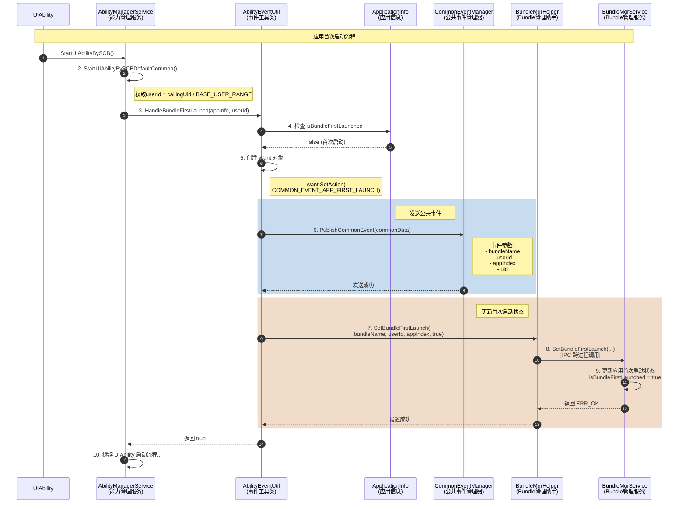

# 应用首次启动功能 UML 序列图

## 流程概述

本文档描述应用首次启动功能的完整调用流程，包括 AMS、BMS 和公共事件服务之间的交互。

## UML 序列图



## 组件说明

| 组件 | 说明 |
|------|------|
| **UIAbility** | 用户界面能力，发起启动请求 |
| **AbilityManagerService** | 能力管理服务，统一入口点 |
| **AbilityEventUtil** | 事件工具类，封装首次启动逻辑 |
| **ApplicationInfo** | 应用信息，包含 `isBundleFirstLaunched` 字段 |
| **CommonEventManager** | 公共事件管理器，发布系统事件 |
| **BundleMgrHelper** | Bundle管理助手，本地代理 |
| **BundleMgrService** | Bundle管理服务，管理应用状态 |

## 关键数据结构

### ApplicationInfo (应用信息)
```cpp
struct ApplicationInfo {
    std::string bundleName;           // 应用包名
    int32_t appIndex;                  // 应用索引(0=普通, >0=克隆)
    bool isBundleFirstLaunched;       // 是否首次启动 ⭐
    int32_t uid;                       // 用户ID
    // ... 其他字段
};
```

### COMMON_EVENT_APP_FIRST_LAUNCH 事件参数
```cpp
Want want;
want.SetAction("usual.event.APP_FIRST_LAUNCH");
want.SetParam("bundleName", appInfo.bundleName);
want.SetParam("userId", userId);
want.SetParam("appIndex", appInfo.appIndex);
want.SetParam("uid", appInfo.uid);
```

## 代码位置

| 文件 | 行号 | 说明 |
|------|------|------|
| `ability_manager_service.cpp` | 3224 | `StartUIAbilityBySCBDefaultCommon` 入口 |
| `ability_event_util.cpp` | 59 | `HandleBundleFirstLaunch` 实现 |
| `bundle_mgr_helper.cpp` | 1177 | `SetBundleFirstLaunch` 代理方法 |

## 状态转换

```
┌─────────────────────────────────────────────────────────────────┐
│                    应用首次启动状态转换                          │
└─────────────────────────────────────────────────────────────────┘

    应用安装          首次启动           再次启动
       │                │                │
       ▼                ▼                ▼
   [未启动] ────────→ [首次启动] ────────→ [已启动]
 isBundleFirst    isBundleFirst    isBundleFirst
 Launched=false   Launched=false   Launched=true
                       │
                       ▼
                 发送事件 + 置为true
```

## 时序说明

1. **应用启动** (`T1`)
   - UIAbility 发起启动请求
   - SCB 调用 `StartUIAbilityBySCB`

2. **统一入口处理** (`T2-T3`)
   - `StartUIAbilityBySCBDefaultCommon` 作为所有 UIAbility 启动的统一入口
   - 获取 `userId = callingUid / BASE_USER_RANGE`

3. **首次启动检查** (`T4`)
   - `HandleBundleFirstLaunch` 检查 `appInfo.isBundleFirstLaunched`
   - 如果为 `true`，直接返回，不做处理

4. **发送公共事件** (`T5-T6`)
   - 创建 `Want` 对象，设置 action 为 `COMMON_EVENT_APP_FIRST_LAUNCH`
   - 添加参数：`bundleName`, `userId`, `appIndex`, `uid`
   - 调用 `CommonEventManager::PublishCommonEvent` 发布事件
   - 系统和应用可以订阅此事件

5. **更新启动状态** (`T7-T9`)
   - 调用 `BundleMgrHelper::SetBundleFirstLaunch(bundleName, userId, appIndex, true)`
   - 通过 IPC 跨进程调用 BMS 的 `SetBundleFirstLaunch` 接口
   - BMS 更新应用状态，将 `isBundleFirstLaunched` 置为 `true`

6. **完成** (`T10`)
   - 返回处理结果
   - 继续后续的 UIAbility 启动流程

## 支持场景

| 场景 | appIndex | 说明 |
|------|----------|------|
| 普通应用首次启动 | 0 | 标准应用首次安装后启动 |
| 克隆应用首次启动 | 1, 2, ... | 应用克隆的首次启动 |
| 非首次启动 | - | `isBundleFirstLaunched=true`，跳过处理 |

## 相关 Commits

- `feat: add isBundleFirstLaunched field and logging`
- `refactor: extract first launch logic to AbilityEventUtil`
- `feat: send COMMON_EVENT_APP_FIRST_LAUNCH event`
