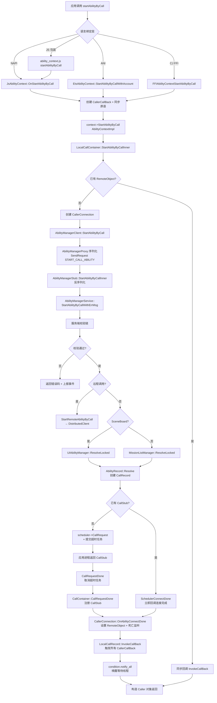
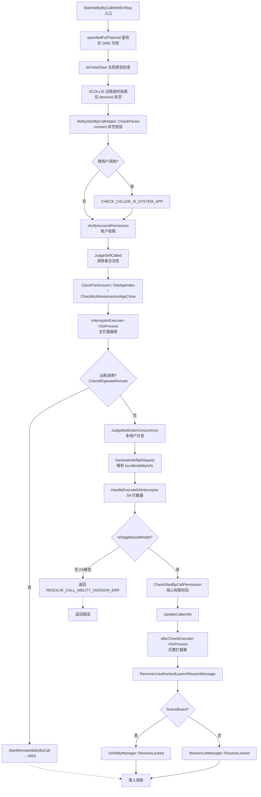
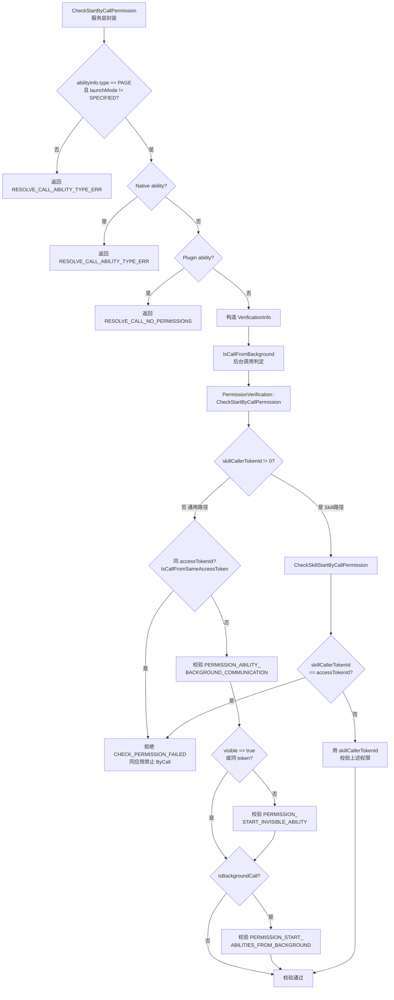
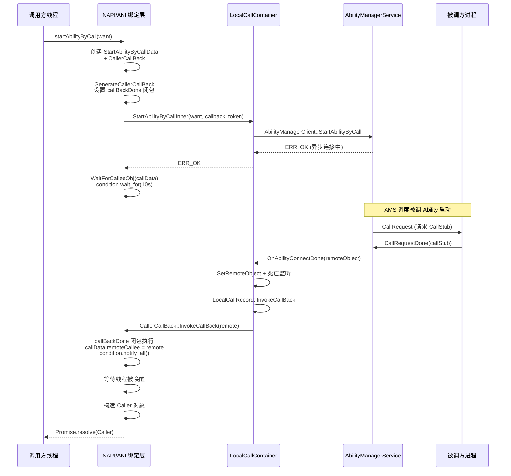
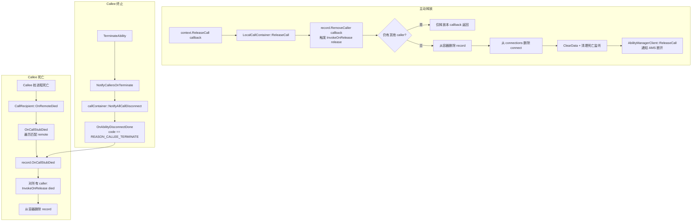

# startAbilityByCall 业务逻辑梳理

> 适用范围：`ability_runtime` 仓库（OpenHarmony 元能力运行时）
> 梳理目标：覆盖 `startAbilityByCall` 从 SDK 接口、frameworks 绑定、IPC 编解码、服务端处理、权限校验、超时机制到衍生入口（InsightIntent / Skill）的完整业务逻辑，附流程图与规格列表。

---

## 1. 概述

`startAbilityByCall` 是 OpenHarmony **Caller/Callee 通信模型**的入口 API。调用方通过它启动一个目标 Ability（仅限 Stage 模型 PAGE 类型），并拿到被调方暴露的 `IRemoteObject`（Callee 桩），从而实现**跨进程直接方法调用**。区别于 `startAbility`（单向启动）和 `connectServiceExtensionAbility`（Extension 连接），`startAbilityByCall` 专用于 UIAbility 之间的双向通信通道。

### 1.1 核心特征

| 特征 | 说明 |
|------|------|
| 通信模型 | Caller（调用方）持有 Callee（被调方）的 `IRemoteObject`，可跨进程直接调用 |
| 目标限制 | 仅支持 **Stage 模型 PAGE 类型** Ability，非 SPECIFIED 启动模式，非 Native/Plugin |
| 同应用限制 | **禁止同应用调用**（同 accessTokenId 直接拒绝），同应用应使用 `startAbility` |
| 同步语义 | 调用方线程同步等待远端 Callee 对象（超时 10s） |
| 连接复用 | 单例目标复用同一 `LocalCallRecord`，多 caller 共享一个远程连接 |
| 衍生入口 | InsightIntent（意图执行）和 Skill（技能路由）复用 ByCall 通道 |

---

## 2. 分层架构

```
┌─────────────────────────────────────────────────────────────┐
│  应用层 (ArkTS/JS/CJ)                                        │
│  UIAbilityContext / ServiceExtensionContext                  │
│  EmbeddableUIAbilityContext                                  │
├─────────────────────────────────────────────────────────────┤
│  语言绑定层 (frameworks/)                                    │
│  ┌─────────────┬──────────────┬────────────┬──────────────┐ │
│  │ NAPI (C++)  │  ANI (ETS)   │  CJ FFI    │  NAPI JS 包装 │ │
│  │ js_ability_ │  ets_ability_│  cj_ability_│  ability_    │ │
│  │ context.cpp │  context.cpp │  context_  │  context.js  │ │
│  │             │              │  ffi.cpp   │              │ │
│  └──────┬──────┴──────┬───────┴──────┬─────┴──────┬───────┘ │
│         │             │              │            │          │
├─────────┴─────────────┴──────────────┴────────────┴──────────┤
│  SDK 接口层 (interfaces/kits/native/)                         │
│  AbilityContext / ServiceExtensionContext (抽象接口)           │
│  AbilityContextImpl / ServiceExtensionContext (实现)           │
│  LocalCallContainer / LocalCallRecord / CallerCallBack        │
│  CallUtil (GenerateCallerCallBack / WaitForCalleeObj)         │
├──────────────────────────────────────────────────────────────┤
│  内部 API 层 (interfaces/inner_api/ability_manager/)          │
│  AbilityManagerClient → AbilityManagerInterface               │
├──────────────────────────────────────────────────────────────┤
│  IPC 层 (services/abilitymgr/)                                │
│  AbilityManagerProxy (序列化) ↔ AbilityManagerStub (反序列化) │
│  IPC Code: START_CALL_ABILITY                                 │
├──────────────────────────────────────────────────────────────┤
│  服务层 (services/abilitymgr/)                                │
│  AbilityManagerService::StartAbilityByCallWithErrMsg (核心)   │
│  CheckStartByCallPermission (权限)                            │
│  interceptorExecuter / afterCheckExecuter (拦截器)            │
│  UIAbilityManager / MissionListManager (调度)                 │
│  AbilityRecord (超时/CallRequest/终止通知)                    │
├──────────────────────────────────────────────────────────────┤
│  安全层 (services/common/)                                    │
│  PermissionVerification::CheckStartByCallPermission           │
└──────────────────────────────────────────────────────────────┘
```

---

## 3. API 规格列表

### 3.1 公共 API 签名

#### UIAbilityContext（ArkTS / ETS）

| 方法 | 签名 | 说明 |
|------|------|------|
| `startAbilityByCall` | `(want: Want): Promise<Caller>` | 转发到 `startAbilityByCallWithAccount(want, -1)` |
| `startAbilityByCallWithAccount` | `(want: Want, accountId: int): Promise<Caller>` | `taskpool.execute` 异步执行 native 同步方法 |

#### ServiceExtensionContext（ArkTS / ETS）

| 方法 | 签名 | 说明 |
|------|------|------|
| `startAbilityByCall` | `(want: Want): Promise<Caller>` | 调用 `nativeStartAbilityByCallSync(want)` |
| `startAbilityByCallWithAccount` | `(want: Want, accountId: int): Promise<Caller>` | 调用 `nativeStartAbilityByCallWithAccount(want, accountId)` |

#### NAPI 绑定（UIAbilityContext）

| 方法 | 参数形式 | 返回 | 说明 |
|------|---------|------|------|
| `startAbilityByCall` | `(want)` | `Promise<Caller>` | accountId 默认 -1 |
| `startAbilityByCall` | `(want, accountId)` | `Promise<Caller>` | 指定账户 |
| `startAbilityByCall` | `(want, callback)` | `void` | AsyncCallback 形式 |
| `startAbilityByCall` | `(want, accountId, callback)` | `void` | 完整三参数 |

#### NAPI 绑定（ServiceExtensionContext）

| 方法 | 参数形式 | 返回 | 说明 |
|------|---------|------|------|
| `startAbilityByCall` | `(want)` | `Promise<Caller>` | **不支持 callback 参数** |
| `startAbilityByCall` | `(want, accountId)` | `Promise<Caller>` | 指定账户 |

#### CJ FFI

| 方法 | 签名 | 说明 |
|------|------|------|
| `FFIAbilityContextStartAbilityByCall` | `(id: int64, wantHandle: int64, callerId*: int64, remoteId*: int64): int32` | 完全同步，不支持 accountId |

### 3.2 C++ 内部接口

#### AbilityContext（抽象接口，`interfaces/kits/native/ability/ability_runtime/ability_context.h:311`）

```cpp
virtual ErrCode StartAbilityByCall(
    const AAFwk::Want& want,
    const std::shared_ptr<CallerCallBack> &callback,
    int32_t accountId = DEFAULT_INVAL_VALUE) = 0;

virtual ErrCode ReleaseCall(const std::shared_ptr<CallerCallBack> &callback) = 0;
virtual void ClearFailedCallConnection(const std::shared_ptr<CallerCallBack> &callback) = 0;
virtual std::shared_ptr<LocalCallContainer> GetLocalCallContainer() = 0;
```

#### AbilityManagerInterface（IPC 接口，`interfaces/inner_api/ability_manager/include/ability_manager_interface.h:1239`）

```cpp
virtual int StartAbilityByCall(
    const Want &want, const sptr<IAbilityConnection> &connect,
    const sptr<IRemoteObject> &callerToken,
    int32_t accountId = DEFAULT_INVAL_VALUE,
    bool isSilent = false, bool promotePriority = false,
    bool isVisible = false, uint64_t specifiedFullTokenId = 0) = 0;

virtual int StartAbilityByCallWithErrMsg(
    const Want &want, const sptr<IAbilityConnection> &connect,
    const sptr<IRemoteObject> &callerToken, int32_t accountId,
    std::string &errMsg, bool isSilent = false,
    bool promotePriority = false, bool isVisible = false,
    uint64_t specifiedFullTokenId = 0);
```

### 3.3 参数规格

| 参数 | 类型 | 含义 | 默认值 | 约束 |
|------|------|------|--------|------|
| `want` | `Want` | 目标 Ability 描述（bundleName/abilityName/moduleName/deviceId） | — | 必填，bundleName 与 abilityName 非空 |
| `connect` | `IAbilityConnection` | IPC 连接回调桩（CallerConnection） | — | 非空，AsObject 非空 |
| `callerToken` | `IRemoteObject` | 调用方 Ability 的 token | — | 用于身份识别和权限校验 |
| `accountId` | `int32_t` | 目标账户 ID | `DEFAULT_INVAL_VALUE(-1)` | 跨用户需系统应用权限 |
| `isSilent` | `bool` | 是否静默启动（影响 isWithUI 判定） | `false` | — |
| `promotePriority` | `bool` | 是否提升优先级（仅 SA 调用生效） | `false` | 非SA调用自动忽略 |
| `isVisible` | `bool` | afterCheck 拦截器是否可见 | `false` | — |
| `specifiedFullTokenId` | `uint64_t` | 指定 token ID | `0` | **仅 DMS 可用**，非 DMS 清零 |

---

## 4. 完整流程图

### 4.1 端到端主流程



### 4.2 服务端校验链流程



### 4.3 权限校验流程



### 4.4 异步→同步桥接流程



### 4.5 释放与死亡通知流程



---

## 5. 衍生入口规格

### 5.1 StartAbilityByCallWithInsightIntent（意图框架）

| 维度 | 规格 |
|------|------|
| 入口 | `services/abilitymgr/src/ability_manager_service.cpp:14964` |
| 签名 | `int32_t StartAbilityByCallWithInsightIntent(const Want&, const sptr<IRemoteObject>& callerToken, const InsightIntentExecuteParam& param, int32_t userId, uint64_t specifiedFullTokenId)` |
| 连接类型 | `AbilityBackgroundConnection`（后台无 UI） |
| 已启动处理 | `OnExecuteIntent(abilityRequest, targetRecord)` — 直接在已有实例执行意图 |
| 未启动处理 | 复用 `StartAbilityByCall(want, connect, callerToken, oriValidUserId, false, false, false, specifiedFullTokenId)` |
| 特殊副作用 | `ReportAbilityIntentExemptionInfoToRSS` + `SetIntentExemptionInfo` — 意图豁免，避免被限流 |
| 上游调用 | 意图框架执行器（InsightIntentExecuteManager） |

### 5.2 StartAbilityByCallWithSkill（技能路由）

| 维度 | 规格 |
|------|------|
| 入口 | `services/abilitymgr/src/ability_manager_service.cpp:15178` |
| 签名 | `int32_t StartAbilityByCallWithSkill(const Want&, const sptr<IRemoteObject>& callerToken, int32_t userId, uint32_t skillCallerTokenId)` |
| 连接类型 | `AbilityBackgroundConnection` |
| 鉴权差异 | 设置 `abilityRequest.skillCallerTokenId`，走 `CheckSkillStartByCallPermission`（用 skillCallerTokenId 鉴权） |
| 已启动处理 | `scheduler->ExecuteSkill(want)` — 向已运行实例派发 Skill 执行 |
| 未启动处理 | 复用 `StartAbilityByCall(want, connect, callerToken, oriValidUserId)` |
| 上游调用 | `ExecuteInAppSkill` / `ExecuteInAppSkillWithTokenId`（SkillInfo.skillType == PAGE 时） |

### 5.3 三入口对比

| 维度 | 通用 ByCall | InsightIntent | Skill |
|------|------------|---------------|-------|
| 入口方法 | `StartAbilityByCall` | `StartAbilityByCallWithInsightIntent` | `StartAbilityByCallWithSkill` |
| 连接类型 | CallerConnection（来自 LocalCallContainer） | AbilityBackgroundConnection | AbilityBackgroundConnection |
| 鉴权路径 | 通用 `CheckStartByCallPermission` | 通用（复用） | Skill 专用 `CheckSkillStartByCallPermission` |
| 鉴权载体 | calling token | calling token | `skillCallerTokenId` |
| 已启动实例 | 正常 CallRequest | `OnExecuteIntent` | `ExecuteSkill` |
| 豁免机制 | 无 | RSS 豁免 + IntentExemptionInfo | 无 |

---

## 6. 权限校验规格列表

### 6.1 服务层校验点（`StartAbilityByCallWithErrMsg`）

| 序号 | 校验点 | 失败错误码 | 说明 |
|------|--------|-----------|------|
| 1 | specifiedFullTokenId 鉴权 | （清零不报错） | 非 DMS 调用清零 |
| 2 | IsForbidStart 全局禁启 | `INNER_ERR` | 设备级禁止启动 |
| 3 | AbilityStartByCallHelper::CheckParam | `ERR_INVALID_VALUE` | connect / AsObject 非空 |
| 4 | IsCrossUserCall + CHECK_CALLER_IS_SYSTEM_APP | 系统应用校验失败 | 跨用户需系统应用 |
| 5 | VerifyAccountPermission | `CHECK_PERMISSION_FAILED` | 账户权限 |
| 6 | JudgeSelfCalled | `CHECK_PERMISSION_FAILED` | 调用者合法性 |
| 7 | GetAppIndex | `ERR_APP_CLONE_INDEX_INVALID` | 应用分身 index |
| 8 | CheckMultiInstanceAndAppClone | 对应错误码 | 多实例/分身校验 |
| 9 | interceptorExecuter DoProcess | 拦截器返回码 | 主拦截器链 |
| 10 | JudgeMultiUserConcurrency | `ERR_CROSS_USER` | 多用户并发 |
| 11 | GenerateAbilityRequest | 解析错误码 | bundle/abilityInfo 解析 |
| 12 | HandleExecuteSAInterceptor | SA 拦截器返回码 | SA 拦截 |
| 13 | isStageBasedModel | `RESOLVE_CALL_ABILITY_VERSION_ERR` | 仅支持 Stage 模型 |
| 14 | CheckStartByCallPermission | 见 6.2 | 核心权限 |
| 15 | afterCheckExecuter DoProcess | 后置拦截器返回码 | 后置拦截 |

### 6.2 CheckStartByCallPermission 校验点

| 序号 | 校验点 | 失败错误码 | 说明 |
|------|--------|-----------|------|
| 1 | abilityInfo.type == PAGE 且 launchMode != SPECIFIED | `RESOLVE_CALL_ABILITY_TYPE_ERR` | 仅 PAGE 类型 |
| 2 | 非 Native ability | `RESOLVE_CALL_ABILITY_TYPE_ERR` | Native 不支持 |
| 3 | 非 Plugin ability | `RESOLVE_CALL_NO_PERMISSIONS` | Plugin 禁止 |
| 4 | IsCallFromBackground 判定 | `ERR_INVALID_VALUE` | 后台调用判定失败 |
| 5 | PermissionVerification 权限校验 | 见 6.3 | 委托安全层 |

### 6.3 PermissionVerification::CheckStartByCallPermission 校验点

| 序号 | 校验点 | 失败错误码 | 说明 |
|------|--------|-----------|------|
| 1a | **通用路径** IsCallFromSameAccessToken | `CHECK_PERMISSION_FAILED` | **同应用禁止 ByCall** |
| 1b | PERMISSION_ABILITY_BACKGROUND_COMMUNICATION | `CHECK_PERMISSION_FAILED` | 跨应用后台通信权限 |
| 1c | JudgeStartInvisibleAbility（visible=false 时） | `ABILITY_VISIBLE_FALSE_DENY_REQUEST` | 不可见 Ability 启动权限 |
| 1d | JudgeStartAbilityFromBackground（后台调用时） | `CHECK_PERMISSION_FAILED` | 后台启动权限 |
| 2a | **Skill 路径** skillCallerTokenId == accessTokenId | `CHECK_PERMISSION_FAILED` | Skill 禁止调自身 |
| 2b | 同 1b（用 skillCallerTokenId） | `CHECK_PERMISSION_FAILED` | — |
| 2c | 同 1c（用 skillCallerTokenId） | `ABILITY_VISIBLE_FALSE_DENY_REQUEST` | — |
| 2d | 同 1d（用 skillCallerTokenId） | `CHECK_PERMISSION_FAILED` | — |

### 6.4 涉及权限常量

| 权限名 | 用途 |
|--------|------|
| `PERMISSION_ABILITY_BACKGROUND_COMMUNICATION` | 跨应用后台通信 |
| `PERMISSION_START_INVISIBLE_ABILITY` | 启动不可见 Ability |
| `PERMISSION_START_ABILITIES_FROM_BACKGROUND` | 后台启动 Ability |

---

## 7. 错误码规格列表

| 错误码 | 常量名 | 触发场景 |
|--------|--------|---------|
| `INNER_ERR` | — | 全局禁启；specifiedFullTokenId 非 DMS（仅清零） |
| `ERR_INVALID_VALUE` | — | connect 为空；Want 序列化失败；manager 为空；IsCallFromBackground 失败；远程 missionId 无效；scheduler 为空 |
| `CHECK_PERMISSION_FAILED` | — | VerifyAccountPermission 失败；JudgeSelfCalled 失败；同 accessToken 调用；缺后台通信权限；缺后台启动权限；Skill 自调 |
| `ERR_CROSS_USER` | — | JudgeMultiUserConcurrency 失败 |
| `RESOLVE_ABILITY_ERR` | — | CloneForAccount ProcessAppIndex 失败 |
| `ERR_APP_CLONE_INDEX_INVALID` | — | GetAppIndex 失败 |
| `RESOLVE_CALL_ABILITY_VERSION_ERR` | — | 目标非 Stage 模型 |
| `RESOLVE_CALL_ABILITY_TYPE_ERR` | — | 非 PAGE 类型 / SPECIFIED 模式 / Native ability |
| `RESOLVE_CALL_NO_PERMISSIONS` | — | Plugin ability；权限不足 |
| `ABILITY_VISIBLE_FALSE_DENY_REQUEST` | — | visible=false 且无 START_INVISIBLE_ABILITY 权限 |
| `ABILITY_SERVICE_NOT_CONNECTED` | — | AMS 代理未就绪 |

---

## 8. 超时机制规格

### 8.1 调用方超时（SDK 层）

| 机制 | 阈值 | 触发动作 | 位置 |
|------|------|---------|------|
| `WaitForCalleeObj` | **10s** | `callData.err = -1`，Reject Promise | `caller_callback.cpp:60` |

### 8.2 服务端超时（AbilityRecord 层）

| 机制 | 阈值 | 事件名 | 触发动作 | 位置 |
|------|------|--------|---------|------|
| 半超时 | **2500ms** | `LIFECYCLE_HALF_TIMEOUT_WARNING` | 告警，不清理事件 | `ability_record.cpp:2587` |
| 全超时 | **5000ms** | `LIFECYCLE_TIMEOUT_WARNING` | 清理 FreezeUtil 事件，触发 `LifecycleTimeoutHandle` ANR 处理 | `ability_record.cpp:2587` |
| XCOLLIE | 较短（LESS） | — | 远程调用时挂表防 IPC 卡死 | `ability_manager_service.cpp:10183` |

超时任务在 `CallRequest()` 时同时提交 half + full 两个，在 `CallRequestDone` 时统一取消。任务名以 `recordId_` 区分，支持多 Ability 实例并发。

### 8.3 超时时序

```
CallRequest()
  ├── scheduler_->CallRequest()          // 异步请求 CallStub
  ├── PostStartAbilityByCallTimeoutTask(true)   // 2.5s 半超时告警
  └── PostStartAbilityByCallTimeoutTask(false)  // 5s 全超时 ANR

CallRequestDone(callStub)
  └── CancelStartAbilityByCallTimeoutTask()     // 取消两个超时任务
       └── CallContainer::CallRequestDone(callStub)
```

---

## 9. 关键数据结构

### 9.1 StartAbilityByCallData（同步桥接）

```cpp
// interfaces/kits/native/ability/ability_runtime/caller_callback.h:98
struct StartAbilityByCallData {
    int32_t err = 0;                    // 错误码，超时置 -1
    sptr<IRemoteObject> remoteCallee;   // callee 远程对象
    std::mutex mutexlock;               // 保护 remoteCallee
    std::condition_variable condition;  // 同步等待远端对象
};
```

> ANI 层使用此共享结构；NAPI/CJ FFI 层各自内联定义等价的 `StartAbilityByCallParameters`。

### 9.2 CallerCallBack（回调载体）

```cpp
// 三类闭包
CallBackClosure callback_;                       // 连接成功 → 接收 callee IRemoteObject
OnReleaseClosure onRelease_;                     // 释放/死亡 → 接收 "release"/"died"
OnRemoteStateChangedClosure onRemoteStateChanged_; // 状态变更 → 接收 "foreground"/"background"
bool isCallBack_ = false;                        // 是否已回调（幂等保证）
std::weak_ptr<LocalCallRecord> localCallRecord_;  // 反向弱引用所属 record
```

### 9.3 LocalCallRecord（连接记录）

```cpp
static int64_t callRecordId;            // 全局自增 ID
sptr<IRemoteObject> remoteObject_;      // callee 桩远程对象
wptr<IRemoteObject> connection_;        // 反向弱引用 CallerConnection
sptr<DeathRecipient> callRecipient_;    // 死亡监听
std::vector<std::shared_ptr<CallerCallBack>> callers_;  // 所有挂在本连接上的 caller
AppExecFwk::ElementName elementName_;   // 目标 element
bool isSingleton_ = false;              // 单例/多实例标记
int32_t userId_ = -1;                   // 目标用户
```

### 9.4 LocalCallContainer（容器）

```cpp
std::map<std::string, std::set<std::shared_ptr<LocalCallRecord>>> callProxyRecords_;        // 单例 call 记录，key=URI
std::map<std::string, std::set<std::shared_ptr<LocalCallRecord>>> multipleCallProxyRecords_; // 多实例 call 记录
std::set<sptr<CallerConnection>> connections_;   // 当前所有 CallerConnection
```

### 9.5 IPC 序列化格式（START_CALL_ABILITY）

| 序号 | 字段 | 类型 | 说明 |
|------|------|------|------|
| 1 | InterfaceToken | string | IPC 接口校验 |
| 2 | Want | Parcelable | 目标 Ability 描述 |
| 3 | connect->AsObject() | RemoteObject | 连接回调桩 |
| 4 | hasCallerToken | Bool | callerToken 是否非空 |
| 5 | callerToken | RemoteObject | （条件写入）调用方 token |
| 6 | accountId | Int32 | 账户 ID |
| 7 | isSilent | Bool | 静默标记 |
| 8 | promotePriority | Bool | 优先级提升 |
| 9 | isVisible | Bool | 可见标记 |

> **注意**：`specifiedFullTokenId` 当前**未序列化**到 parcel，仅在同进程直调场景生效。

**Reply 格式**：`errMsg(String)` + `result(Int32)`

---

## 10. 拦截器规格

### 10.1 主拦截器链（interceptorExecuter）

在 `StartAbilityByCallWithErrMsg` 第 16 步执行，`isWithUI = want.GetBoolParam(CALL_TO_FOREGROUND) ? true : !isSilent`：

| 拦截器 | 作用 |
|--------|------|
| BlockAllAppStartInterceptor | 紧急阻断所有应用启动 |
| StartOtherAppInterceptor | 控制启动其他应用 |
| EcologicalRuleInterceptor | 生态规则 |
| KioskInterceptor | 展台模式 |
| ScreenUnlockInterceptor | 屏幕锁定状态 |
| ControlInterceptor | 系统级控制 |
| DisposedRuleInterceptor | 规则处置 |
| AbilityJumpInterceptor | 跳转相关 |
| CrowdTestInterceptor | 测试模式 |

### 10.2 SA 拦截器（HandleExecuteSAInterceptor）

在 `GenerateAbilityRequest` 之后执行，针对 SA 调用的额外拦截。

### 10.3 后置拦截器链（afterCheckExecuter）

在 `CheckStartByCallPermission` 通过后执行，参数含 `isVisible`、`callerToken`、`abilityInfo`、`appIndex`。

---

## 11. 多语言绑定差异规格

| 维度 | NAPI UIAbility | NAPI ServiceExt | ANI UIAbility | ANI ServiceExt | CJ FFI |
|------|---------------|-----------------|---------------|----------------|--------|
| 异步调度 | `NapiAsyncTask::ScheduleHighQos` | 同左 | `taskpool.execute` | 同左 | 无（同步） |
| 阻塞位置 | Execute 回调内 `wait_for` | 同左 | native `WaitForCalleeObj` | 同左 | `wait_for` |
| accountId | 可选 | 可选 | 必传(-1) | 必传(DEFAULT) | 不支持 |
| AsyncCallback | 支持 | **不支持** | 无 | 无 | 无 |
| Caller 创建 | `CreateJsCallerComplex` | 同左 | `EtsCallerComplex::CreateEtsCaller` | 同左 | `CreateCjCallerComplex` |
| 失败清理 | `ClearFailedCallConnection` | 同左 | **未做**（潜在问题） | 做了 | 做了 |
| OnRelease 设置 | 仅日志 | 仅日志 | **未设置**（潜在问题） | 设置了 | 仅日志 |
| 超时 | 10s | 10s | 10s | 10s | 10s |

### 11.1 EmbeddableUIAbilityContext 特殊限制

- 嵌入式屏幕模式（`IsEmbeddableStart(screenMode_)`）下**禁止** `startAbilityByCall`，抛 `ERR_MSG_NOT_SUPPORT`。
- 非嵌入模式委托 `JsAbilityContext::OnStartAbilityByCall` 复用完整实现。

### 11.2 UIExtensionContentSession

- **不支持** `startAbilityByCall`（代码中 `js_ui_extension_content_session.cpp:909` 的日志属于 `OnStartAbilityByType` 的误导性文案）。

---

## 12. 涉及文件清单

### 12.1 SDK 接口层

| 文件 | 关键内容 |
|------|---------|
| `interfaces/kits/native/ability/ability_runtime/ability_context.h:311` | 抽象接口声明 |
| `interfaces/kits/native/ability/ability_runtime/ability_context_impl.h:194` | 实现类声明 |
| `interfaces/kits/native/ability/ability_runtime/ability_context_impl.cpp:810` | 懒创建 LocalCallContainer + 委托 |
| `interfaces/kits/native/ability/ability_runtime/caller_callback.h:98` | StartAbilityByCallData + CallUtil |
| `interfaces/kits/native/ability/ability_runtime/local_call_container.h:37` | 容器 + CallerConnection |
| `interfaces/kits/native/ability/ability_runtime/local_call_record.h` | 连接记录 + CallRecipient |
| `interfaces/kits/native/appkit/ability_runtime/service_extension_context.h:75` | ServiceExtension 接口 |

### 12.2 内部 API 层

| 文件 | 关键内容 |
|------|---------|
| `interfaces/inner_api/ability_manager/include/ability_manager_interface.h:1239` | IPC 接口声明 |
| `interfaces/inner_api/ability_manager/include/ability_manager_client.h:1090` | 客户端封装声明 |

### 12.3 语言绑定层

| 文件 | 关键内容 |
|------|---------|
| `frameworks/native/ability/native/ability_runtime/js_ability_context.cpp:171` | NAPI UIAbility 绑定 |
| `frameworks/native/ability/native/js_service_extension_context.cpp:63` | NAPI ServiceExt 绑定 |
| `frameworks/native/ability/native/ability_runtime/cj_ability_context_ffi.cpp:129` | CJ FFI 绑定 |
| `frameworks/native/ability/native/ability_runtime/cj_ability_context_object.cpp:943` | CJ Object 绑定（复用 NAPI） |
| `frameworks/ets/ani/ui_ability/src/ets_ability_context.cpp:1024` | ANI UIAbility 绑定 |
| `frameworks/ets/ani/service_extension_ability/src/ets_service_extension_context.cpp:1813` | ANI ServiceExt 绑定 |
| `frameworks/js/napi/ability_context/ability_context.js:65` | JS 包装层 |
| `frameworks/js/napi/service_extension_context/service_extension_context.js:130` | JS 包装层 |
| `frameworks/ets/ets/application/UIAbilityContext.ets:309` | ETS 声明 |
| `frameworks/ets/ets/application/ServiceExtensionContext.ets:404` | ETS 声明 |
| `frameworks/native/ability/native/ui_extension_ability/js_embeddable_ui_ability_context.cpp:359` | EmbeddableUIAbility 限制 |

### 12.4 服务层

| 文件 | 关键内容 |
|------|---------|
| `services/abilitymgr/src/ability_manager_service.cpp:10161` | 核心实现 StartAbilityByCall |
| `services/abilitymgr/src/ability_manager_service.cpp:10170` | StartAbilityByCallWithErrMsg |
| `services/abilitymgr/src/ability_manager_service.cpp:13294` | CheckStartByCallPermission（服务层封装） |
| `services/abilitymgr/src/ability_manager_service.cpp:14964` | StartAbilityByCallWithInsightIntent |
| `services/abilitymgr/src/ability_manager_service.cpp:15178` | StartAbilityByCallWithSkill |
| `services/abilitymgr/src/ability_manager_stub.cpp:2652` | IPC 反序列化 |
| `services/abilitymgr/src/ability_manager_proxy.cpp:4039` | IPC 序列化 |
| `services/abilitymgr/src/ability_manager_client.cpp:1256` | 客户端封装 |
| `services/abilitymgr/src/ability_record.cpp:2587` | 超时机制 |
| `services/abilitymgr/src/ability_record.cpp:890` | 终止通知 |

### 12.5 安全层

| 文件 | 关键内容 |
|------|---------|
| `services/common/src/permission_verification.cpp:366` | CheckStartByCallPermission |
| `services/common/src/permission_verification.cpp:342` | CheckSkillStartByCallPermission |
| `services/common/include/permission_verification.h:98` | 声明 |

### 12.6 容器实现层

| 文件 | 关键内容 |
|------|---------|
| `frameworks/native/ability/ability_runtime/local_call_container.cpp:25` | StartAbilityByCallInner |
| `frameworks/native/ability/ability_runtime/local_call_container.cpp:80` | ReleaseCall |
| `frameworks/native/ability/ability_runtime/local_call_record.cpp` | 连接记录实现 |
| `frameworks/native/ability/ability_runtime/caller_callback.cpp:25` | CallUtil 工具 |
| `frameworks/native/appkit/ability_runtime/service_extension_context.cpp:86` | ServiceExt 实现 |
