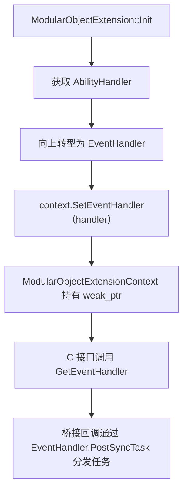
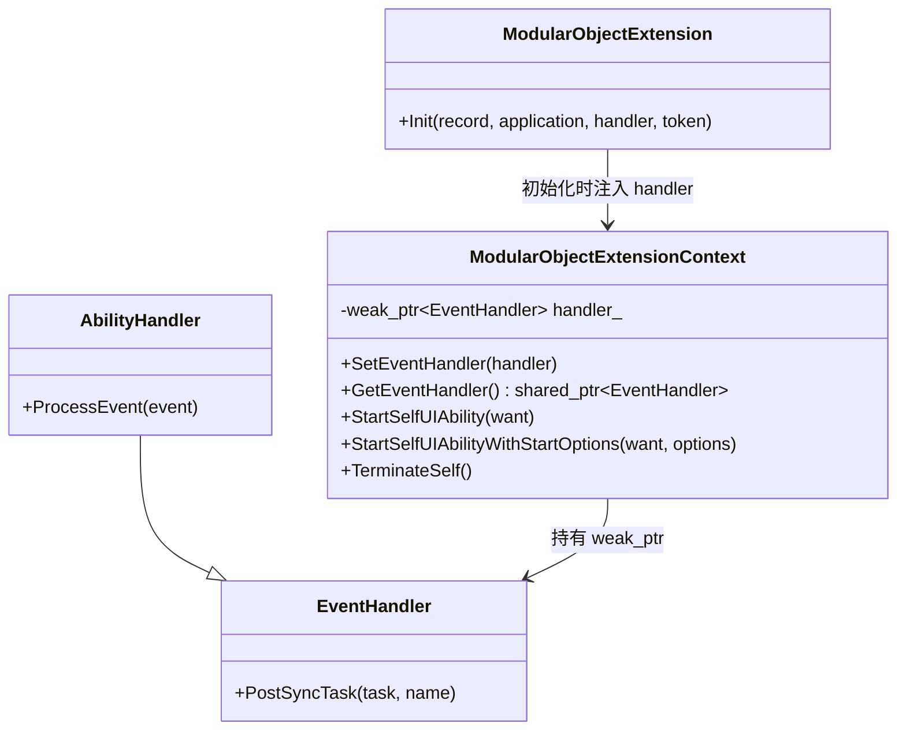
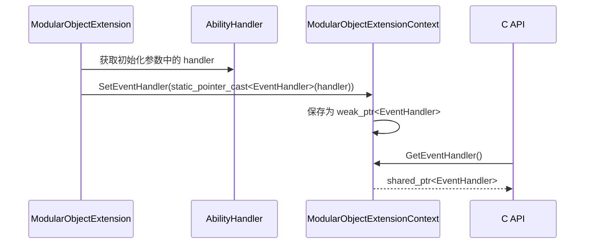
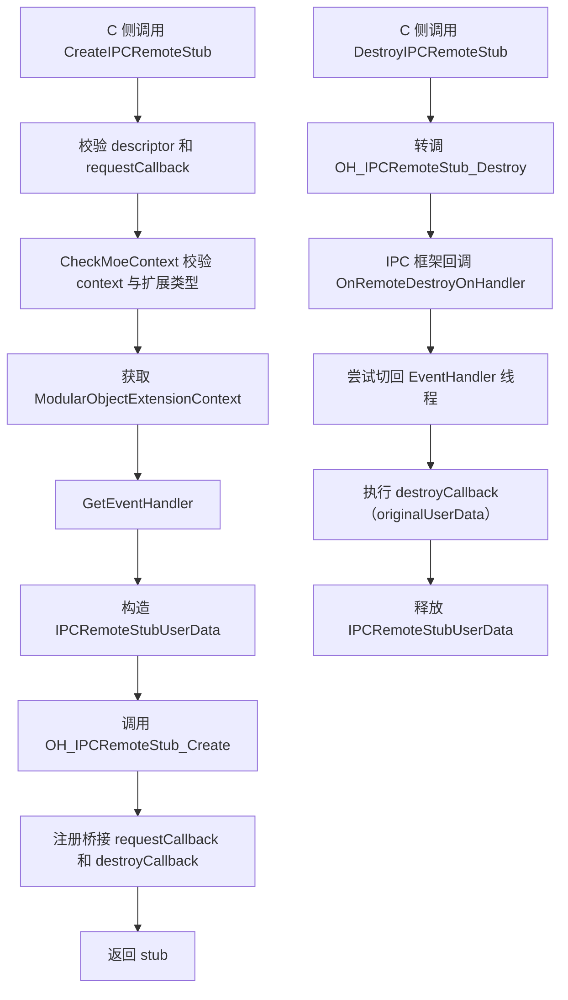
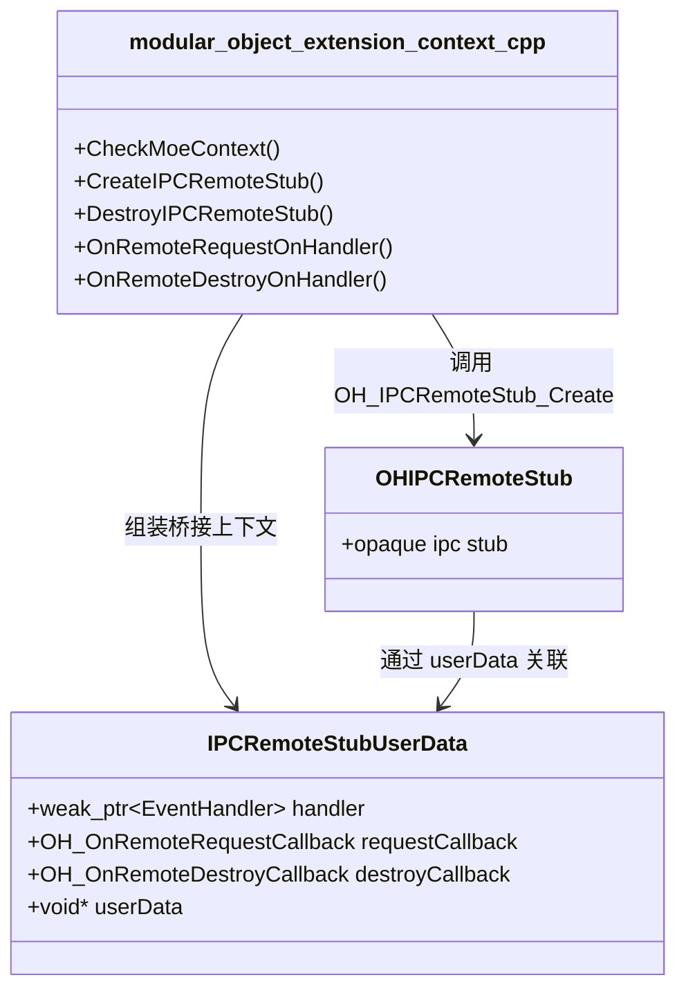
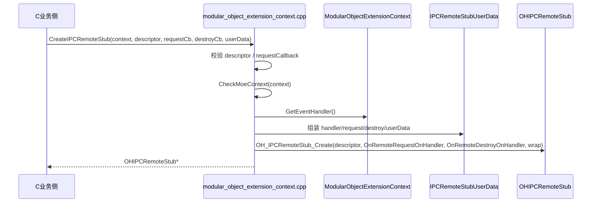
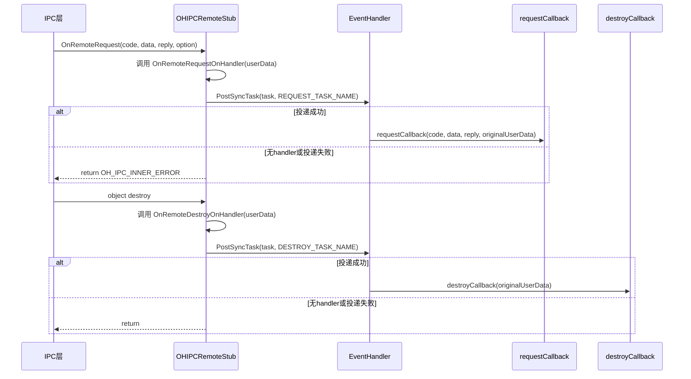

# Modular Object Extension IPC Stub 实现说明

## 1. 背景

本实现为 Modular Object Extension 新增两个 C 接口：

- `OH_AbilityRuntime_ModObjExtensionContext_CreateIPCRemoteStub`
- `OH_AbilityRuntime_ModObjExtensionContext_DestroyIPCRemoteStub`

目标是在 C 接口层提供 `OHIPCRemoteStub` 的创建与销毁能力，并在条件允许时将 IPC 请求回调与销毁回调调度回 Modular Object Extension 所在线程执行。

当前实现不再通过自定义 `IPCObjectStub` 创建 `OHIPCRemoteStub`，而是直接调用 `OH_IPCRemoteStub_Create`，并通过内部包装的 `userData` 结构保存 `EventHandler`、用户回调以及原始 `userData`。

## 2. 文件布局

树状结构图：

```text
foundation/ability/ability_runtime/
├── interfaces/
│   └── kits/
│       ├── c/
│       │   └── ability_runtime/
│       │       └── modular_object_extension_context.h            [修改]
│       └── native/
│           └── ability/
│               └── native/
│                   └── modular_object_extension/
│                       └── modular_object_extension_context_impl.h [修改]
└── frameworks/
    ├── c/
    │   └── ability_runtime/
    │       └── src/
    │           └── modular_object_extension_context.cpp          [修改]
    └── native/
        └── ability/
            └── native/
                ├── BUILD.gn                                      [修改]
                └── modular_object_extension/
                    ├── modular_object_extension.cpp              [修改]
                    └── modular_object_extension_context_impl.cpp [修改]
```

修改文件：

- `interfaces/kits/c/ability_runtime/modular_object_extension_context.h`
  - 功能：新增两个对外 C 接口声明。

- `frameworks/c/ability_runtime/src/modular_object_extension_context.cpp`
  - 功能：实现 C API 桥接、参数校验、context 获取、内部 `userData` 包装构造，以及基于 `OH_IPCRemoteStub_Create` 的 stub 创建逻辑。

- `interfaces/kits/native/ability/native/modular_object_extension/modular_object_extension_context_impl.h`
  - 功能：为 `ModularObjectExtensionContext` 增加 `SetEventHandler` / `GetEventHandler`。

- `frameworks/native/ability/native/modular_object_extension/modular_object_extension_context_impl.cpp`
  - 功能：实现 `EventHandler` 的保存与获取。

- `frameworks/native/ability/native/modular_object_extension/modular_object_extension.cpp`
  - 功能：在 `Init(...)` 中将 `AbilityHandler` 向上转型为 `EventHandler` 并注入 `ModularObjectExtensionContext`。

- `frameworks/native/ability/native/BUILD.gn`
  - 功能：调整 `modular_object_extension` 目标的源码列表，移除不再需要的自定义 IPC stub 源文件。

## 3. EventHandler 的实现

本章说明 Modular Object Extension 线程调度能力的保存、传递及其在 IPC 回调分发过程中的使用方式。

### 3.1 设计目的

`OH_AbilityRuntime_ModObjExtensionContext_CreateIPCRemoteStub(...)` 的目标并非仅创建 remote stub，而是在创建过程中建立回调调度所需的线程上下文，使 request 回调与 destroy 回调在条件允许时回到 Modular Object Extension 对应线程执行。

为实现上述目标，需要解决以下两个问题：

1. 在 extension 初始化阶段获取线程调度对象。
2. 在后续 C 接口调用阶段重新取回该调度对象。

当前实现选择将 `AbilityHandler` 向上转型为 `EventHandler` 并保存至 `ModularObjectExtensionContext`，在后续创建 IPC stub 时再通过 `GetEventHandler()` 取出。

### 3.2 实现链路



### 3.3 类图



### 3.4 时序图



### 3.5 关键实现代码

`AbilityHandler` 继承自 `EventHandler`，因此在初始化阶段可以安全进行向上转型：

```cpp
void ModularObjectExtension::Init(const std::shared_ptr<AbilityLocalRecord> &record,
    const std::shared_ptr<OHOSApplication> &application,
    std::shared_ptr<AbilityHandler> &handler,
    const sptr<IRemoteObject> &token)
{
    ExtensionBase<ModularObjectExtensionContext>::Init(record, application, handler, token);
    auto context = GetContext();
    if (context != nullptr) {
        context->SetEventHandler(std::static_pointer_cast<AppExecFwk::EventHandler>(handler));
    }
}
```

在 context 中仅保存 `weak_ptr`，以避免形成生命周期环：

```cpp
void ModularObjectExtensionContext::SetEventHandler(
    const std::shared_ptr<AppExecFwk::EventHandler> &handler)
{
    handler_ = handler;
}

std::shared_ptr<AppExecFwk::EventHandler> ModularObjectExtensionContext::GetEventHandler() const
{
    return handler_.lock();
}
```

### 3.6 设计说明

- 保存 `EventHandler` 而非 `AbilityHandler`，原因在于 IPC 回调分发仅依赖统一的任务投递能力。
- 使用 `weak_ptr` 可避免 context 反向持有 handler 所带来的生命周期耦合。
- 当 `lock()` 失败时，表示当前线程调度能力已经不可用。此时不再退化为当前线程直接执行，而是按失败路径处理。

## 4. OH_AbilityRuntime_ModObjExtensionContext_CreateIPCRemoteStub 和 OH_AbilityRuntime_ModObjExtensionContext_DestroyIPCRemoteStub 的实现

本章说明两个对外 C 接口如何完成参数校验、context 获取、内部包装 `userData` 构造、`OH_IPCRemoteStub_Create` 调用，以及销毁阶段的回调触发。

### 4.1 总体流程图



### 4.2 类图



### 4.3 创建时序图



### 4.4 请求与销毁时序图



### 4.5 Create 接口实现

Create 接口负责完成桥接、内部包装 `userData` 构造以及 `OH_IPCRemoteStub_Create` 调用。

```cpp
OHIPCRemoteStub* OH_AbilityRuntime_ModObjExtensionContext_CreateIPCRemoteStub(
    OH_AbilityRuntime_ModObjExtensionContextHandle context, const char *descriptor,
    OH_OnRemoteRequestCallback requestCallback, OH_OnRemoteDestroyCallback destroyCallback,
    void *userData)
{
    if (descriptor == nullptr || requestCallback == nullptr) {
        return nullptr;
    }

    std::shared_ptr<OHOS::AbilityRuntime::Context> contextPtr;
    auto ret = CheckMoeContext(context, contextPtr);
    if (ret != ABILITY_RUNTIME_ERROR_CODE_NO_ERROR) {
        return nullptr;
    }

    auto moeContext = std::static_pointer_cast<ModularObjectExtensionContext>(contextPtr);
    auto callbackInfo = CreateIPCRemoteStubUserData(
        moeContext->GetEventHandler(), requestCallback, destroyCallback, userData);
    if (callbackInfo == nullptr) {
        return nullptr;
    }

    auto *stub = OH_IPCRemoteStub_Create(descriptor, OnRemoteRequestOnHandler,
        OnRemoteDestroyOnHandler, callbackInfo.get());
    if (stub == nullptr) {
        return nullptr;
    }
    callbackInfo.release();
    return stub;
}
```

该实现的职责如下：

1. 拒绝非法输入。
2. 确保当前 context 确实来自 Modular Object Extension。
3. 从 context 中取出 `EventHandler`。
4. 构造内部 `IPCRemoteStubUserData`。
5. 调用 `OH_IPCRemoteStub_Create` 创建 stub。

### 4.6 请求回调实现

请求回调逻辑在 `OnRemoteRequestOnHandler(...)` 中完成。

```cpp
int OnRemoteRequestOnHandler(uint32_t code, const OHIPCParcel *data, OHIPCParcel *reply, void *userData)
{
    auto *callbackInfo = static_cast<IPCRemoteStubUserData *>(userData);
    if (callbackInfo == nullptr || callbackInfo->requestCallback == nullptr) {
        return OH_IPC_INNER_ERROR;
    }

    auto handler = callbackInfo->handler.lock();
    if (handler == nullptr) {
        return OH_IPC_INNER_ERROR;
    }

    int32_t result = OH_IPC_INNER_ERROR;
    auto task = [&]() {
        result = callbackInfo->requestCallback(code, data, reply, callbackInfo->userData);
    };
    if (!handler->PostSyncTask(task, REQUEST_TASK_NAME)) {
        return OH_IPC_INNER_ERROR;
    }
    return result;
}
```

该实现体现了当前 request 分发语义：

- 优先通过 `EventHandler::PostSyncTask` 切回 extension 线程。
- 当 handler 不存在或任务投递失败时，直接返回 `OH_IPC_INNER_ERROR`。
- 传入 `OH_IPCRemoteStub_Create` 的 `userData` 为内部包装结构，用户回调实际收到的是原始 `userData`。

### 4.7 Destroy 接口实现

Destroy 接口保持轻量桥接形式：

```cpp
void OH_AbilityRuntime_ModObjExtensionContext_DestroyIPCRemoteStub(
    OH_AbilityRuntime_ModObjExtensionContextHandle context, OHIPCRemoteStub *stub)
{
    (void)context;
    OH_IPCRemoteStub_Destroy(stub);
}
```

销毁回调在 `OH_IPCRemoteStub_Create` 注册的销毁桥接回调中完成：

```cpp
void OnRemoteDestroyOnHandler(void *userData)
{
    std::unique_ptr<IPCRemoteStubUserData> callbackInfo(
        static_cast<IPCRemoteStubUserData *>(userData));
    if (callbackInfo == nullptr || callbackInfo->destroyCallback == nullptr) {
        return;
    }

    auto handler = callbackInfo->handler.lock();
    if (handler == nullptr) {
        return;
    }

    auto task = [&]() {
        callbackInfo->destroyCallback(callbackInfo->userData);
    };
    if (!handler->PostSyncTask(task, DESTROY_TASK_NAME)) {
        return;
    }
}
```

该实现的关键点如下：

1. Destroy 接口本身不处理线程切换。
2. 线程切换语义由销毁桥接回调负责。
3. 当 handler 不存在或任务投递失败时，销毁回调不再退化为当前线程执行，而是直接结束当前处理。
4. 包装后的 `userData` 在销毁桥接回调返回时统一释放。

### 4.8 关键数据结构

```cpp
struct IPCRemoteStubUserData {
    std::weak_ptr<AppExecFwk::EventHandler> handler;
    OH_OnRemoteRequestCallback requestCallback = nullptr;
    OH_OnRemoteDestroyCallback destroyCallback = nullptr;
    void *userData = nullptr;
};
```

该结构体是单个 stub 的最小桥接上下文，用于将调度对象、请求回调、销毁回调以及用户原始数据绑定到同一个 IPC stub 生命周期中。

### 4.9 设计说明

- `Create` 接口负责完成 C API 入口校验、包装 `userData` 构造以及 `OH_IPCRemoteStub_Create` 调用。
- `Destroy` 接口仅负责释放外层 `OHIPCRemoteStub`。
- 请求分发与销毁分发均由桥接回调控制。
- 每个 stub 的回调上下文通过包装 `userData` 绑定，无需自定义 `IPCObjectStub` 实现。
- 回调优先通过 `EventHandler` 调度；当线程能力不可用或任务投递失败时，按失败路径返回，不再退化为当前线程执行。

## 5. 小结

本设计可概括为以下两条主线：

1. 在 extension 初始化阶段将 `EventHandler` 注入 `ModularObjectExtensionContext`。
2. 在 Create/Destroy 两个 C 接口中通过包装 `userData` 和 `OH_IPCRemoteStub_Create` 完成 IPC 回调桥接与生命周期管理。

因此，文档与实现均围绕两个核心问题展开：线程调度能力的来源，以及 Create/Destroy 两个接口如何基于包装 `userData` 方案完成 stub 生命周期管理。
