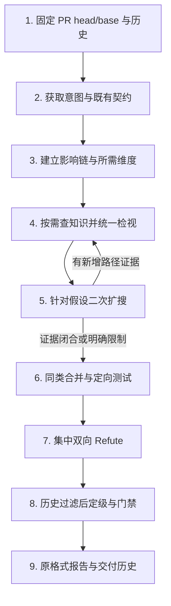

# codecheck 代码检视工作台

一个九阶段主流程沿完整影响链检视，逻辑分析贯穿始终，安全、输入和 API 作为按需检查视角融入。保留 BDA 双向验证和原报告格式。

先读 [公约](conventions.md)，再执行唯一入口 [orchestrator/SKILL.md](orchestrator/SKILL.md)。旧 scanner 名称仍可表达用户的专项意图，但不再代表独立子 skill 或扫描任务。共用一份上下文、候选集合和证据记录。

## 九个处理步骤

| 步骤 | 处理重点 |
|---|---|
| 1 | 固定实际比较基准，读取已交付/接受历史与本轮预算 |
| 2 | 从 PR/关联 Issue/契约获取意图，区分明确、推断和未知 |
| 3 | 建立行为变化及调用、状态、生命周期等影响链 |
| 4 | 按需查 standards，沿同一条链检查逻辑、安全、输入、API 和格式 |
| 5 | 有证据才扩搜；无必要可直接结束此步，不强行全库扫描 |
| 6 | 同类问题一次汇总，按行为及影响链验证测试适配 |
| 7 | 对候选集中反证与影响复核，最多两轮 |
| 8 | 过滤历史后统一定级、核实覆盖、计算评分与门禁 |
| 9 | 同一最终记录生成原格式产物，实际交付后登记历史 |

技术规则从 [standards](https://gitcode.com/abilitykit_public/abilitykit_sdd/tree/main/standards) 固定版本按需读取，定位与缓存见 [知识入口](patterns/INDEX.md)。测试默认一轮、至多一次针对性补充；扩搜/反证均有停止条件，不因没有发现重复执行。

## 输出兼容

[原报告模板](codecheck_report_TEMPLATE.md) 保留六节、表列、卡片五要素和 schema 1.0。`Scanner` 列及原维度名称用作来源分类，不映射独立执行者。专项原始产物格式集中在 [export-formats.md](export-formats.md)，输出视图不触发重复扫描。

原模板导航中的“Step 5：交付”是旧入口说明，现在对应本流程第 9 步；为保持模板文件原样，本页说明这处历史编号。

P0 阻断；无 P0 时缺维度 insufficient，其次 P1 conditional，其余 approve。评分公式不变，P2/P3 不累计阻断。Tier/热点只影响调查顺序和深度。

工具：[门禁与历史](scripts/review_policy.py)、[安全 CSV](scripts/export_text.py)、[安全 Excel](scripts/generate_report.py)。验证：`python3 -m unittest discover -s skills/codecheck/tests -v`。
