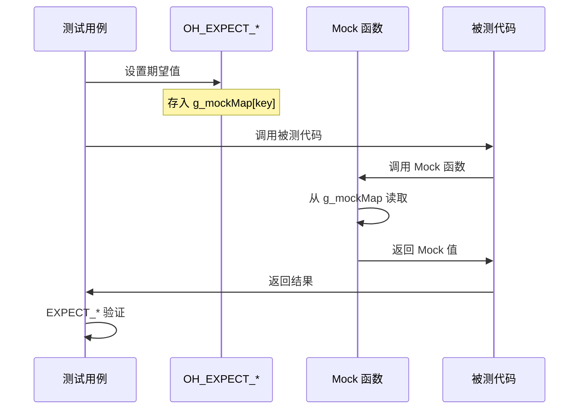
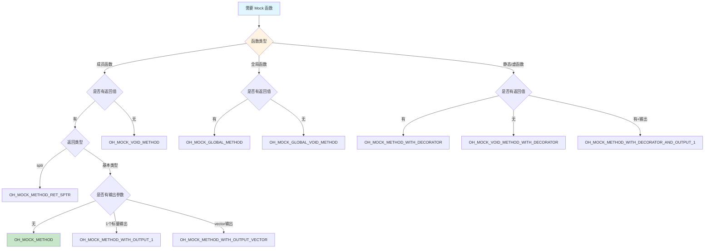

# oh_mock_utils.h 使用指南

**版本**: 1.0
**最后更新**: 2026-02-02
**组件**: ability_runtime
**文件位置**: `test/new_test/mock_utils/oh_mock_utils.h`

---

## 目录

1. [简介](#1-简介)
2. [10分钟快速入门](#2-10分钟快速入门)
3. [核心概念](#3-核心概念)
4. [宏选择决策树](#4-宏选择决策树)
5. [Mock 定义宏完整参考](#5-mock-定义宏完整参考)
6. [期望设置宏完整参考](#6-期望设置宏完整参考)
7. [真实案例库](#7-真实案例库)
8. [最佳实践与注意事项](#8-最佳实践与注意事项)
9. [故障排除指南](#9-故障排除指南)
10. [快速参考卡片](#10-快速参考卡片)
11. [附录](#11-附录)

---

## 1. 简介

### 1.1 oh_mock_utils 是什么

`oh_mock_utils.h` 是 OpenHarmony ability_runtime 组件提供的轻量级 Mock 测试框架。它基于 C++ 宏和 thread_local 存储，为 TDD（测试驱动开发）提供简单易用的 Mock 能力。

**核心特点**:
- **零外部依赖**: 无需 GoogleMock 或其他第三方库
- **类型安全**: 基于 C++ 模板的类型检查
- **线程隔离**: 使用 thread_local 存储，测试之间互不干扰
- **宏驱动**: 简单的宏定义，易于使用

### 1.2 与 GoogleMock 的对比

| 特性 | oh_mock_utils | GoogleMock |
|------|--------------|------------|
| 依赖 | 无 | 需要 gtest/gmock |
| 学习曲线 | 低 | 中等 |
| 功能范围 | 基础 Mock | 高级 Mock（匹配器、序列等） |
| 性能 | 轻量 | 较重 |
| 适用场景 | 单元测试、TDD | 集成测试、复杂 Mock |

**何时使用 oh_mock_utils**:
- ✅ ability_runtime 组件内的单元测试
- ✅ 需要 Mock 外部依赖的系统服务调用
- ✅ 快速验证逻辑分支

**何时考虑 GoogleMock**:
- ❌ 需要复杂的参数匹配器
- ❌ 需要验证调用顺序和次数
- ❌ 跨组件的大型集成测试

### 1.3 设计原理

**Key 生成机制**:
每个 Mock 函数通过 `className_funcName_parameterTypes` 生成唯一 Key：
```cpp
// 示例：PermissionVerification::VerifyPermissionByTokenId(const int&, const std::string&)
// 生成 Key：PermissionVerification_VerifyPermissionByTokenId_const int&, const std::string&
```

**队列式的期望值消费**:
- 期望值按 FIFO 顺序存储
- 每次调用消费一个期望值
- 支持多次调用序列

**类型安全**:
- 使用 `std::any` 存储任意类型
- 返回时通过模板参数 `Get<T>()` 提取
- 编译时检查类型匹配

---

## 2. 10分钟快速入门

### 2.1 环境准备

在测试文件开头添加必要的宏定义和头文件：

```cpp
#define private public
#define protected public

#include <gtest/gtest.h>
#include "your_class.h"        // 被测类
#include "oh_mock_utils.h"     // Mock 工具

#undef private
#undef protected

using namespace OHOS::YourNamespace;  // 重要！使用 using 引入命名空间
```

**⚠️ 关键**: `#define private public` 必须在 `#include` 之前！

### 2.2 第一个 Mock 示例

假设要测试 `TokenIdPermission::VerifyProxyAuthorizationUriPermission()`，该方法依赖 `PermissionVerification::VerifyPermissionByTokenId()`。

**步骤 1**: 定义 Mock 函数（通常在 mock 头文件中）
```cpp
// test/new_test/mock/permission_verification/permission_verification.h
class PermissionVerification {
public:
    OH_MOCK_METHOD(bool, PermissionVerification, VerifyPermissionByTokenId,
        const int&, const std::string&);
};
```

**步骤 2**: 编写测试用例
```cpp
HWTEST_F(TokenIdPermissionTest, VerifyProxyAuthorizationUriPermission_Granted_001, TestSize.Level1)
{
    // Arrange：设置 Mock 期望值
    OH_EXPECT_RET({true}, PermissionVerification, VerifyPermissionByTokenId,
        const int&, const std::string&);

    // Act：调用被测代码
    TokenIdPermission tidp(1001);
    bool result = tidp.VerifyProxyAuthorizationUriPermission();

    // Assert：验证结果
    EXPECT_EQ(result, true);
}
```

**步骤 3**: 编译运行
```bash
./build.sh --product-name <product> --build-target tokenId_permission_test
run -t UT -ts tokenId_permission_test
```

### 2.3 处理输出参数

如果要 Mock 的函数有输出参数（通过引用返回）：

```cpp
// 原函数签名
int32_t CheckPhotoUriPermission(uint32_t tokenId,
                                 const std::vector<std::string>& uris,
                                 std::vector<bool>& results,  // 输出参数
                                 const std::vector<uint32_t>& flags);
```

**Mock 定义**:
```cpp
OH_MOCK_METHOD_WITH_OUTPUT_VECTOR(int32_t, results, MediaPermissionHelper, CheckPhotoUriPermission,
    uint32_t, const std::vector<std::string>&, std::vector<bool>& results, const std::vector<uint32_t>&);
```

**测试用例**:
```cpp
HWTEST_F(MediaPermissionManagerTest, CheckUriPermission_Success_001, TestSize.Level1)
{
    // ⚠️ 必须使用临时变量，不能直接传 {{...}}
    std::vector<std::vector<bool>> expectResults = {{true, true}};
    OH_EXPECT_RET_AND_OUTPUT({static_cast<int32_t>(ERR_OK)}, expectResults,
        MediaPermissionHelper, CheckPhotoUriPermission,
        uint32_t, const std::vector<std::string>&, std::vector<bool>& results,
        const std::vector<uint32_t>&);

    auto& instance = MediaPermissionManager::GetInstance();
    auto results = instance.CheckUriPermission(uriVec, callerTokenId, flag);

    EXPECT_EQ(results.size(), 2U);
    EXPECT_EQ(results[0], true);
}
```

---

## 3. 核心概念

### 3.1 宏的两大类别

**定义宏**（Definition Macros）:
- 创建 Mock 函数体
- 通常在 mock 头文件中使用
- 每个函数只需定义一次

**期望宏**（Expectation Macros）:
- 设置函数的返回值
- 在测试用例中调用
- 每次测试前重新设置

### 3.2 工作流程


### 3.3 数据流向



---

## 4. 宏选择决策树

### 4.1 可视化决策树



### 4.2 快速查找表

| 宏名称 | 函数类型 | 返回值 | 输出参数 | 使用场景 |
|--------|---------|--------|---------|---------|
| `OH_MOCK_METHOD` | 成员 | ✅ 基本类型 | ❌ | 普通成员函数（int、bool、string等） |
| `OH_MOCK_VOID_METHOD` | 成员 | ❌ void | ❌ | 无返回值的成员函数 |
| `OH_MOCK_METHOD_RET_SPTR` | 成员 | ✅ sptr<T> | ❌ | 返回智能指针的函数 |
| `OH_MOCK_METHOD_WITH_OUTPUT_1` | 成员 | ✅ 基本类型 | ✅ 1个标量 | 带1个输出参数的函数 |
| `OH_MOCK_METHOD_WITH_OUTPUT_VECTOR` | 成员 | ✅ 基本类型 | ✅ vector | vector 输出参数（提取所有元素） |
| `OH_MOCK_METHOD_WITH_DECORATOR` | static/virtual | ✅ 基本类型 | ❌ | 静态或虚函数 |
| `OH_MOCK_VOID_METHOD_WITH_DECORATOR` | static/virtual | ❌ void | ❌ | 静态或虚 void 函数 |
| `OH_MOCK_METHOD_WITH_DECORATOR_AND_OUTPUT_1` | static/virtual | ✅ 基本类型 | ✅ 1个 | static/virtual + 输出参数 |
| `OH_MOCK_GLOBAL_METHOD` | 全局 | ✅ 基本类型 | ❌ | 全局函数 |
| `OH_MOCK_GLOBAL_VOID_METHOD` | 全局 | ❌ void | ❌ | 全局 void 函数 |

---

## 5. Mock 定义宏完整参考

### 5.1 OH_MOCK_METHOD

**用途**: Mock 有返回值的基本类型成员函数

**适用场景**:
- 返回 int、bool、string、double 等基本类型
- 不返回 sptr<T>
- 不带输出参数

**函数签名**:
```cpp
#define OH_MOCK_METHOD(ret, className, funcName, ...)
```

**参数说明**:
| 参数 | 类型 | 说明 | 示例 |
|------|------|------|------|
| ret | 类型 | 返回值类型 | `int32_t`, `bool`, `std::string` |
| className | 标识符 | 类名（不带命名空间） | `PermissionVerification` |
| funcName | 标识符 | 函数名 | `VerifyPermissionByTokenId` |
| ... | 类型列表 | 参数类型列表 | `const int&, const std::string&` |

**示例**:
```cpp
// Mock 定义（在 mock 头文件中）
class PermissionVerification {
public:
    OH_MOCK_METHOD(bool, PermissionVerification, VerifyPermissionByTokenId,
        const int&, const std::string&);
};

// 测试用例
HWTEST_F(Test, Case_001, TestSize.Level1)
{
    using namespace OHOS::Security;  // 引入命名空间

    // 设置期望值
    OH_EXPECT_RET({true}, PermissionVerification, VerifyPermissionByTokenId,
        const int&, const std::string&);

    // 调用被测代码
    TokenIdPermission tidp(1001);
    bool result = tidp.VerifyProxyAuthorizationUriPermission();

    EXPECT_EQ(result, true);
}
```

**注意事项**:
- ⚠️ className 不要加命名空间前缀
- ⚠️ 使用 `using namespace` 引入命名空间
- ⚠️ 参数类型必须完全匹配（包括 const 和 &）

---

### 5.2 OH_MOCK_VOID_METHOD

**用途**: Mock 无返回值的成员函数

**函数签名**:
```cpp
#define OH_MOCK_VOID_METHOD(className, funcName, ...)
```

**示例**:
```cpp
// Mock 定义
class EventHandler {
public:
    OH_MOCK_VOID_METHOD(EventHandler, PublishEvent, const std::string&);
};

// 测试用例
HWTEST_F(Test, Case_001, TestSize.Level1)
{
    OH_EXPECT_RET({}, EventHandler, PublishEvent, const std::string&);

    EventHandler handler;
    handler.PublishEvent("test_event");  // 不会调用真实实现
}
```

---

### 5.3 OH_MOCK_METHOD_RET_SPTR

**用途**: Mock 返回 `sptr<T>` 类型的成员函数

**适用场景**:
- GetInstance() 等获取单例的函数
- 返回智能指针的接口函数

**函数签名**:
```cpp
#define OH_MOCK_METHOD_RET_SPTR(ret, className, funcName, ...)
```

**示例**:
```cpp
// Mock 定义
class AbilityManagerClient {
public:
    OH_MOCK_METHOD_RET_SPTR(sptr<AbilityManagerService>, AbilityManagerClient,
        GetInstance);
};

// 测试用例
HWTEST_F(Test, Case_001, TestSize.Level1)
{
    auto mockService = new AbilityManagerService();
    OH_EXPECT_RET({mockService}, AbilityManagerClient, GetInstance);

    auto service = AbilityManagerClient::GetInstance();
    EXPECT_NE(service, nullptr);
}
```

---

### 5.4 OH_MOCK_METHOD_WITH_OUTPUT_1

**用途**: Mock 带1个标量输出参数的成员函数

**适用场景**:
- 函数通过引用参数返回单个值
- 输出参数是标量类型（int、bool、string等）

**函数签名**:
```cpp
#define OH_MOCK_METHOD_WITH_OUTPUT_1(ret, oPName, className, funcName, ...)
```

**参数说明**:
| 参数 | 说明 |
|------|------|
| ret | 返回值类型 |
| oPName | **输出参数的名称**（必须与函数签名中的参数名一致） |
| className | 类名 |
| funcName | 函数名 |
| ... | 所有参数类型（包括输出参数） |

**示例**:
```cpp
// 原函数
int GetHapTokenInfo(uint32_t tokenId, HapTokenInfo& hapInfo);

// Mock 定义
OH_MOCK_METHOD_WITH_OUTPUT_1(int, hapInfo, AccessTokenKit, GetHapTokenInfo,
    uint32_t, HapTokenInfo& hapInfo);

// 测试用例
HWTEST_F(Test, Case_001, TestSize.Level1)
{
    HapTokenInfo hapInfo;
    hapInfo.bundleName = "com.example.app";

    // ⚠️ 注意：使用 vector<vector<T>> 结构
    auto expectHapInfo = std::vector<std::vector<HapTokenInfo>>{{hapInfo}};
    OH_EXPECT_RET_AND_OUTPUT({RET_SUCCESS}, expectHapInfo, AccessTokenKit,
        GetHapTokenInfo, uint32_t, HapTokenInfo& hapInfo);

    HapTokenInfo result;
    int ret = GetHapTokenInfo(1001, result);
    EXPECT_EQ(ret, RET_SUCCESS);
    EXPECT_EQ(result.bundleName, "com.example.app");
}
```

**⚠️ 关键注意事项**:
1. 输出参数名 `hapInfo` 必须在宏中指定
2. 期望值结构：`vector<vector<T>>`（即使只有一个值）
3. 必须使用临时变量，不能传 `{{...}}`

---

### 5.5 OH_MOCK_METHOD_WITH_OUTPUT_VECTOR

**用途**: Mock 带 vector 输出参数的成员函数

**与 OH_MOCK_METHOD_WITH_OUTPUT_1 的区别**:
- `WITH_OUTPUT_1`: 提取向量的**第一个元素**赋值给标量输出
- `WITH_OUTPUT_VECTOR`: 提取向量的**所有元素**赋值给 vector 输出

**函数签名**:
```cpp
#define OH_MOCK_METHOD_WITH_OUTPUT_VECTOR(ret, oPName, className, funcName, ...)
```

**示例**:
```cpp
// 原函数
int32_t CheckPhotoUriPermission(uint32_t tokenId,
                                const std::vector<std::string>& uris,
                                std::vector<bool>& results,  // vector 输出
                                const std::vector<uint32_t>& flags);

// Mock 定义
OH_MOCK_METHOD_WITH_OUTPUT_VECTOR(int32_t, results, MediaPermissionHelper,
    CheckPhotoUriPermission,
    uint32_t, const std::vector<std::string>&, std::vector<bool>& results,
    const std::vector<uint32_t>&);

// 测试用例
HWTEST_F(Test, Case_001, TestSize.Level1)
{
    // ⚠️ 必须使用临时变量
    std::vector<std::vector<bool>> expectResults = {{true, false, true}};
    OH_EXPECT_RET_AND_OUTPUT({ERR_OK}, expectResults, MediaPermissionHelper,
        CheckPhotoUriPermission,
        uint32_t, const std::vector<std::string>&, std::vector<bool>& results,
        const std::vector<uint32_t>&);

    std::vector<bool> results;
    int32_t ret = helper->CheckPhotoUriPermission(1001, uris, results, flags);

    // results 将包含 {true, false, true} 三个元素
    EXPECT_EQ(results.size(), 3U);
}
```

---

### 5.6 OH_MOCK_METHOD_WITH_DECORATOR

**用途**: Mock static 或 virtual 成员函数

**函数签名**:
```cpp
#define OH_MOCK_METHOD_WITH_DECORATOR(decorator, ret, className, funcName, ...)
```

**示例**:
```cpp
// 原函数
static MediaPermissionHelper* GetMediaPermissionHelper();

// Mock 定义
OH_MOCK_METHOD_WITH_DECORATOR(static, MediaPermissionHelper*, MediaPermissionHelper,
    GetMediaPermissionHelper);

// 测试用例
HWTEST_F(Test, Case_001, TestSize.Level1)
{
    auto mockHelper = new MediaPermissionHelper();
    OH_EXPECT_RET({mockHelper}, MediaPermissionHelper, GetMediaPermissionHelper);

    auto* helper = MediaPermissionHelper::GetMediaPermissionHelper();
    EXPECT_NE(helper, nullptr);
}
```

---

### 5.7 OH_MOCK_GLOBAL_METHOD

**用途**: Mock 全局函数（不属于任何类）

**⚠️ 注意**: 不要与静态成员函数混淆。静态成员函数应使用 `OH_MOCK_METHOD_WITH_DECORATOR`

**函数签名**:
```cpp
#define OH_MOCK_GLOBAL_METHOD(ret, funcName, ...)
```

**示例**:
```cpp
// 原全局函数（假设）
int32_t GetGlobalConfigValue(const std::string& key);

// Mock 定义
OH_MOCK_GLOBAL_METHOD(int32_t, GetGlobalConfigValue, const std::string&);

// 测试用例
HWTEST_F(Test, Case_001, TestSize.Level1)
{
    OH_GLOBAL_EXPECT_RET({100}, GetGlobalConfigValue, const std::string&);

    int32_t value = GetGlobalConfigValue("timeout");
    EXPECT_EQ(value, 100);
}
```

**错误示例**（将静态成员函数当作全局函数）:
```cpp
// ❌ 错误：GetCallingTokenID 实际上是 IPCSkeleton 的静态成员函数
OH_MOCK_GLOBAL_METHOD(uint32_t, GetCallingTokenID);

// ✅ 正确：应该使用 OH_MOCK_METHOD_WITH_DECORATOR
OH_MOCK_METHOD_WITH_DECORATOR(static, uint32_t, IPCSkeleton, GetCallingTokenID);
```

---

### 5.8 OH_MOCK_FUNCTION_WITH_DEFAULT_PARAM_BODY

**用途**: Mock 带默认参数的函数（手动定义函数体）

**适用场景**:
- 函数有默认参数
- 标准宏（如 `OH_MOCK_METHOD`）无法处理默认参数
- 需要手动声明函数签名

**⚠️ 特殊性**:
- 这个宏只生成**函数体**，不生成函数签名
- 需要手动编写完整的函数声明
- 参数类型作为字符串传入（用于生成 Key）

**函数签名**:
```cpp
#define OH_MOCK_FUNCTION_WITH_DEFAULT_PARAM_BODY(ret, className, funcName, paramTypesStr)
```

**参数说明**:
| 参数 | 类型 | 说明 | 示例 |
|------|------|------|------|
| ret | 类型 | 返回值类型 | `PolicyInfo`, `int32_t` |
| className | 标识符 | 类名 | `FilePermissionManager` |
| funcName | 标识符 | 函数名 | `GetPathPolicyInfoFromUri` |
| paramTypesStr | 字符串字面量 | 参数类型字符串 | `"Uri&, uint32_t, const std::string&"` |

**使用步骤**:

1. **手动声明函数**（包括默认参数）
2. **在函数体内调用宏**（传入参数类型字符串）

**示例**:

```cpp
// 原函数（带默认参数）
static PolicyInfo GetPathPolicyInfoFromUri(Uri& uri, uint32_t flag,
                                           const std::string& bundleName = "");

// Mock 定义（手动编写）
class FilePermissionManager {
public:
    // 步骤1: 手动声明函数（保留默认参数）
    static PolicyInfo GetPathPolicyInfoFromUri(Uri& uri, uint32_t flag,
                                               const std::string& bundleName = "")
    {
        // 步骤2: 在函数体内调用宏（参数类型不带默认值）
        OH_MOCK_FUNCTION_WITH_DEFAULT_PARAM_BODY(PolicyInfo, FilePermissionManager,
            GetPathPolicyInfoFromUri, "Uri&, uint32_t, const std::string&");
    }
};
```

**测试用例**:
```cpp
HWTEST_F(BatchUriTest, GetUriToGrantByPolicy_HasSelfBundle_001, TestSize.Level1)
{
    std::vector<std::string> uriVec = {"file://com.example.caller/test.txt"};
    uint32_t mode = 1;

    // 准备期望返回值
    PolicyInfo policyInfo;
    policyInfo.path = "/test";
    policyInfo.mode = mode;
    policyInfo.type = PolicyType::SELF_PATH;

    // 设置期望（注意：参数类型字符串要一致）
    OH_EXPECT_RET({policyInfo}, FilePermissionManager, GetPathPolicyInfoFromUri,
        Uri&, uint32_t, const std::string&);

    // 调用被测代码
    BatchUri batchUri;
    batchUri.Init(uriVec, mode, "com.example.caller", "", false);

    std::vector<PolicyInfo> docsPolicyInfoVec;
    std::vector<PolicyInfo> bundlePolicyInfoVec;
    int32_t count = batchUri.GetUriToGrantByPolicy(docsPolicyInfoVec, bundlePolicyInfoVec);

    EXPECT_GT(count, 0);
}
```

**关键要点**:
1. ⚠️ **必须手动编写完整的函数声明**，包括函数名、参数和默认参数
2. ⚠️ **参数类型字符串**（`paramTypesStr`）不能包含默认值，只写类型
3. ⚠️ **参数类型字符串**必须与函数声明中的类型完全一致（包括 `&` 和 `const`）
4. 函数可以是 `static` 或普通成员函数，不影响使用
5. 期望设置使用 `OH_EXPECT_RET`，与其他宏相同

**为什么需要这个宏？**

C++ 预处理器无法直接展开带有默认参数的宏。例如：

```cpp
// ❌ 标准宏无法处理默认参数
OH_MOCK_METHOD(PolicyInfo, FilePermissionManager, GetPathPolicyInfoFromUri,
    Uri&, uint32_t, const std::string& bundleName = "");  // 编译错误
```

因此需要手动声明函数，然后使用 `OH_MOCK_FUNCTION_WITH_DEFAULT_PARAM_BODY` 生成 Mock 逻辑。

**常见错误**:

❌ **错误 1**：参数类型字符串包含默认值
```cpp
OH_MOCK_FUNCTION_WITH_DEFAULT_PARAM_BODY(PolicyInfo, FilePermissionManager,
    GetPathPolicyInfoFromUri, "Uri&, uint32_t, const std::string& bundleName = \"\"");
    // 编译错误：字符串中不能有默认值
```

✅ **正确做法**：只写参数类型
```cpp
OH_MOCK_FUNCTION_WITH_DEFAULT_PARAM_BODY(PolicyInfo, FilePermissionManager,
    GetPathPolicyInfoFromUri, "Uri&, uint32_t, const std::string&");
```

❌ **错误 2**：参数类型字符串与函数声明不一致
```cpp
// 函数声明
static PolicyInfo Func(Uri& uri, uint32_t flag, const std::string& bundleName = "")
{
    OH_MOCK_FUNCTION_WITH_DEFAULT_PARAM_BODY(PolicyInfo, Class, Func,
        "Uri&, uint32_t, std::string&");  // 错误：少了 const
}
```

✅ **正确做法**：保持完全一致
```cpp
OH_MOCK_FUNCTION_WITH_DEFAULT_PARAM_BODY(PolicyInfo, Class, Func,
    "Uri&, uint32_t, const std::string&");
```

---

### 5.9 其他宏

| 宏 | 说明 | 参考章节 |
|-----|------|---------|
| `OH_MOCK_VOID_METHOD_WITH_DECORATOR` | static/virtual void 函数 | 5.6 |
| `OH_MOCK_METHOD_WITH_DECORATOR_AND_OUTPUT_1` | static/virtual 函数 + 输出参数 | 5.6 |
| `OH_MOCK_FUNCTION_WITH_DEFAULT_PARAM_BODY` | 带默认参数的函数（手动定义函数体） | 5.8 |
| `OH_MOCK_GLOBAL_METHOD` | 全局函数 | 5.7 |
| `OH_MOCK_GLOBAL_VOID_METHOD` | 全局 void 函数 | 5.7 |
| `OH_MOCK_GLOBAL_TEMPLATE_METHOD_RET_SPTR` | 全局模板函数（返回 sptr） | - |

---

## 6. 期望设置宏完整参考

### 6.1 OH_EXPECT_RET

**用途**: 设置成员函数的期望返回值序列

**函数签名**:
```cpp
#define OH_EXPECT_RET(expectRetVec, className, funcName, ...)
```

**参数说明**:
| 参数 | 类型 | 说明 |
|------|------|------|
| expectRetVec | vector<T> 或 vector<T>& | 返回值序列（多次调用必须用临时变量） |
| className | 标识符 | 类名 |
| funcName | 标识符 | 函数名 |
| ... | 类型列表 | 参数类型列表 |

**队列行为**:
- 多次调用时，按顺序从队列中取出返回值
- 队列为空时，返回默认值（0/false/空）

**⚠️ 重要**:
- 单次返回可直接传 `{val}`
- **多次返回必须使用临时变量**

**示例**:

```cpp
// 单次返回（可以直接传初始化列表）
OH_EXPECT_RET({true}, PermissionVerification, VerifyPermissionByTokenId,
    const int&, const std::string&);

// 多次返回（必须使用临时变量）
auto expectRets = std::vector<bool>{true, false, true};
OH_EXPECT_RET(expectRets, PermissionVerification, VerifyPermissionByTokenId,
    const int&, const std::string&);

// 测试
bool r1 = VerifyPermissionByTokenId(1001, "permission1");  // true
bool r2 = VerifyPermissionByTokenId(1002, "permission2");  // false
bool r3 = VerifyPermissionByTokenId(1003, "permission3");  // true
```

---

### 6.2 OH_EXPECT_RET_AND_OUTPUT

**用途**: 设置带输出参数函数的期望返回值和输出值

**函数签名**:
```cpp
#define OH_EXPECT_RET_AND_OUTPUT(expectRetVec, expectOutputVec, className, funcName, ...)
```

**参数说明**:
| 参数 | 类型 | 说明 |
|------|------|------|
| expectRetVec | 初始化列表 | 返回值序列 |
| expectOutputVec | vector<vector<T>> | **输出值序列**（必须是临时变量） |
| className | 标识符 | 类名 |
| funcName | 标识符 | 函数名 |
| ... | 类型列表 | 参数类型列表 |

**⚠️ 关键规则**:

1. **必须使用临时变量**
   ```cpp
   // ❌ 错误：直接传初始化列表
   OH_EXPECT_RET_AND_OUTPUT({ERR_OK}, {{true, false}}, ...);

   // ✅ 正确：使用临时变量
   std::vector<std::vector<bool>> expectResults = {{true, false}};
   OH_EXPECT_RET_AND_OUTPUT({ERR_OK}, expectResults, ...);
   ```

2. **输出结构为 vector<vector<T>>**
   - 外层 vector：多次调用
   - 内层 vector：单次调用的输出值

3. **size 匹配**
   ```cpp
   // ✅ 正确：返回值和输出值的数量一致
   std::vector<int32_t> expectRets = {ERR_OK, ERR_OK};
   std::vector<std::vector<bool>> expectOutputs = {{true}, {false}};
   OH_EXPECT_RET_AND_OUTPUT(expectRets, expectOutputs, ...);
   ```

**示例**:
```cpp
// 单次调用
std::vector<std::vector<bool>> expectResults = {{true, true}};
OH_EXPECT_RET_AND_OUTPUT({ERR_OK}, expectResults, MediaPermissionHelper,
    CheckPhotoUriPermission,
    uint32_t, const std::vector<std::string>&, std::vector<bool>& results,
    const std::vector<uint32_t>&);

// 多次调用
std::vector<int32_t> expectRets = {ERR_OK, ERR_OK, INNER_ERR};
std::vector<std::vector<bool>> expectOutputs = {
    {true, true},    // 第1次调用输出
    {true, false},   // 第2次调用输出
    {false}          // 第3次调用输出
};
OH_EXPECT_RET_AND_OUTPUT(expectRets, expectOutputs, MediaPermissionHelper,
    CheckPhotoUriPermission, ...);
```

---

### 6.3 OH_GLOBAL_EXPECT_RET

**用途**: 设置全局函数的期望返回值

**函数签名**:
```cpp
#define OH_GLOBAL_EXPECT_RET(expectRetVec, funcName, ...)
```

**与 OH_EXPECT_RET 的区别**: 无 className 参数

**示例**:
```cpp
// 单次返回（全局函数示例）
OH_GLOBAL_EXPECT_RET({100}, GetGlobalConfigValue, const std::string&);

// ⚠️ 多次返回：必须使用临时变量
auto expectRets = std::vector<int32_t>{ERR_OK, INNER_ERR};
OH_GLOBAL_EXPECT_RET(expectRets, GetGlobalErrorCode);
```

**⚠️ 注意**: 如果是静态成员函数（如 `IPCSkeleton::GetCallingTokenID`），应使用 `OH_EXPECT_RET` 而不是 `OH_GLOBAL_EXPECT_RET`。

---

## 7. 真实案例库

### 7.1 简单案例：Bool 返回值

**来源**: `test/new_test/unit_test/uripermmgr_unit_test/tokenid_permission_test/tokenid_permission_test.cpp:52-60`

**Mock 定义**（在 `test/new_test/mock/permission_verification/permission_verification.h`）:
```cpp
namespace OHOS {
namespace AAFwk {
class PermissionVerification : public DelayedSingleton<PermissionVerification> {
public:
    OH_MOCK_METHOD(bool, PermissionVerification, VerifyPermissionByTokenId,
        const int&, const std::string&);
};
}  // namespace AAFwk
}  // namespace OHOS
```

**测试用例**:
```cpp
HWTEST_F(TokenIdPermissionTest, VerifyProxyAuthorizationUriPermission_Granted_001, TestSize.Level1)
{
    // 设置 Mock 返回 true
    OH_EXPECT_RET({true}, PermissionVerification, VerifyPermissionByTokenId,
        const int&, const std::string&);

    // 调用被测代码
    TokenIdPermission tidp(TEST_TOKEN_ID);
    bool result = tidp.VerifyProxyAuthorizationUriPermission();

    // 验证结果
    EXPECT_EQ(result, true);
}
```

**适用场景**: 验证权限检查、状态判断等返回 bool 的函数。

---

### 7.2 中级案例：输出参数

**来源**: `test/new_test/unit_test/uripermmgr_unit_test/media_permission_manager_test/media_permission_manager_test.cpp:90-113`

**Mock 定义**（在 `test/new_test/mock/media_permission_helper/media_permission_helper.h`）:
```cpp
namespace OHOS {
namespace Media {
class MediaPermissionHelper {
public:
    OH_MOCK_METHOD_WITH_DECORATOR(static, MediaPermissionHelper*, MediaPermissionHelper,
        GetMediaPermissionHelper);

    OH_MOCK_METHOD_WITH_OUTPUT_VECTOR(int32_t, results, MediaPermissionHelper,
        CheckPhotoUriPermission,
        uint32_t, const std::vector<std::string>&, std::vector<bool>& results,
        const std::vector<uint32_t>&);
};
}  // namespace Media
}  // namespace OHOS
```

**测试用例**:
```cpp
HWTEST_F(MediaPermissionManagerTest, CheckUriPermission_Success_001, TestSize.Level1)
{
    std::vector<std::string> uriVec = {"file://media/test1.jpg", "file://media/test2.jpg"};
    uint32_t callerTokenId = 1001;
    uint32_t flag = Want::FLAG_AUTH_READ_URI_PERMISSION;

    // Mock helper 单例
    auto mockHelper = new MediaPermissionHelper();
    OH_EXPECT_RET({mockHelper}, MediaPermissionHelper, GetMediaPermissionHelper);

    // ⚠️ 关键：使用临时变量存储期望输出
    std::vector<std::vector<bool>> expectResults = {{true, true}};
    OH_EXPECT_RET_AND_OUTPUT({static_cast<int32_t>(ERR_OK)}, expectResults,
        MediaPermissionHelper, CheckPhotoUriPermission,
        uint32_t, const std::vector<std::string>&, std::vector<bool>& results,
        const std::vector<uint32_t>&);

    // 调用被测代码
    auto& instance = MediaPermissionManager::GetInstance();
    auto results = instance.CheckUriPermission(uriVec, callerTokenId, flag);

    // 验证结果
    EXPECT_EQ(results.size(), 2U);
    EXPECT_EQ(results[0], true);
    EXPECT_EQ(results[1], true);
}
```

**关键要点**:
1. Mock 单例使用 `OH_MOCK_METHOD_WITH_DECORATOR(static, ...)`
2. 输出参数使用 `OH_MOCK_METHOD_WITH_OUTPUT_VECTOR`（vector 类型）
3. 期望值必须使用临时变量 `expectResults`

---

### 7.3 高级案例：多个 Mock 协同

**来源**: `test/new_test/unit_test/uripermmgr_unit_test/file_uri_distribution_utils_test/file_uri_distribution_utils_test.cpp:72-93`

**Mock 定义**:

1. **IPCSkeleton**（在 `test/new_test/mock/ipc_skeleton/ipc_skeleton.h`）:
```cpp
namespace OHOS {
class IPCSkeleton {
public:
    OH_MOCK_METHOD_WITH_DECORATOR(static, uint32_t, IPCSkeleton, GetCallingTokenID);
    OH_MOCK_METHOD_WITH_DECORATOR(static, pid_t, IPCSkeleton, GetCallingUid);
};
}  // namespace OHOS
```

2. **AccessTokenKit**（在 `test/new_test/mock/new_security/accesstoken/accesstoken_kit.h`）:
```cpp
namespace OHOS {
namespace Security {
namespace AccessToken {
class AccessTokenKit {
public:
    OH_MOCK_METHOD_WITH_DECORATOR(static, ATokenTypeEnum, AccessTokenKit,
        GetTokenTypeFlag, uint32_t);

    OH_MOCK_METHOD_WITH_DECORATOR_AND_OUTPUT_1(static, int, hapInfo, AccessTokenKit,
        GetHapTokenInfo, uint32_t, HapTokenInfo& hapInfo);
};
}  // namespace AccessToken
}  // namespace Security
}  // namespace OHOS
```

**测试用例**:
```cpp
HWTEST_F(FileUriDistributionUtilsTest, SendShareUnPrivilegeUriEvent_Success_001, TestSize.Level1)
{
    uint32_t callTokenId = 1001;
    uint32_t targetTokenId = 1002;

    // Mock 1: IPCSkeleton::GetCallingTokenID（静态函数）
    OH_EXPECT_RET({static_cast<uint32_t>(ERR_OK)}, IPCSkeleton, GetCallingTokenID);

    // Mock 2: AccessTokenKit::GetTokenTypeFlag（静态函数）
    OH_EXPECT_RET({ATokenTypeEnum::TOKEN_HAP},
        AccessTokenKit, GetTokenTypeFlag, uint32_t);

    // Mock 3: AccessTokenKit::GetHapTokenInfo（静态函数 + 输出参数）
    HapTokenInfo hapInfo1;
    hapInfo1.bundleName = "com.example.caller";
    HapTokenInfo hapInfo2;
    hapInfo2.bundleName = "com.example.target";
    auto expectHapInfo = std::vector<std::vector<HapTokenInfo>>{{hapInfo1}, {hapInfo2}};
    OH_EXPECT_RET_AND_OUTPUT({static_cast<int>(AccessTokenKitRet::RET_SUCCESS)},
        expectHapInfo, AccessTokenKit, GetHapTokenInfo,
        uint32_t, HapTokenInfo& hapInfo);

    // 调用被测代码（内部会依次调用上述3个Mock函数）
    bool result = FUDUtils::SendShareUnPrivilegeUriEvent(callTokenId, targetTokenId);

    EXPECT_EQ(result, true);
}
```

**关键要点**:
1. 静态函数使用 `OH_MOCK_METHOD_WITH_DECORATOR(static, ...)`
2. 带输出参数的静态函数使用 `OH_MOCK_METHOD_WITH_DECORATOR_AND_OUTPUT_1`
3. 多个 Mock 按调用顺序设置
4. 输出结构体（HapTokenInfo）与基本类型用法相同
5. 多次调用使用 `vector<vector<T>>` 传递序列

---

### 7.4 高级案例：vector 输出参数

**来源**: `test/new_test/unit_test/uripermmgr_unit_test/file_uri_distribution_utils_test/file_uri_distribution_utils_test.cpp:213-225`

**Mock 定义**（在 `test/new_test/mock/os_account_manager_wrapper/os_account_manager_wrapper.h`）:
```cpp
namespace OHOS {
namespace AppExecFwk {
class OsAccountManagerWrapper : public DelayedSingleton<OsAccountManagerWrapper> {
public:
    OH_MOCK_METHOD_WITH_OUTPUT_VECTOR(int32_t, osAccountIds, OsAccountManagerWrapper,
        QueryActiveOsAccountIds, std::vector<int32_t>& osAccountIds);
};
}  // namespace AppExecFwk
}  // namespace OHOS
```

**测试用例**:
```cpp
HWTEST_F(FileUriDistributionUtilsTest, GetCurrentAccountId_Success_001, TestSize.Level1)
{
    // 准备期望输出值
    std::vector<int32_t> accountIds = {100};
    auto expectAccountIds = std::vector<std::vector<int32_t>>{accountIds};

    // 设置 Mock 期望值
    OH_EXPECT_RET_AND_OUTPUT({static_cast<int32_t>(ERR_OK)}, expectAccountIds,
        OsAccountManagerWrapper, QueryActiveOsAccountIds,
        std::vector<int32_t>& osAccountIds);

    // 调用被测代码
    int32_t accountId = FUDUtils::GetCurrentAccountId();

    // 验证结果
    EXPECT_GT(accountId, 0);
}
```

**关键要点**:
1. `OsAccountManagerWrapper` 是单例类（继承自 `DelayedSingleton`）
2. 使用 `OH_MOCK_METHOD_WITH_OUTPUT_VECTOR` Mock vector 输出参数
3. **必须使用临时变量** `expectAccountIds`
4. 外层 vector 表示多次调用，内层 vector 表示单次调用的输出值

---

### 7.5 高级案例：带默认参数的函数

**来源**: `test/new_test/mock/upms/uripermmgr/file_permission_manager/file_permission_manager.h` 和 `test/new_test/unit_test/uripermmgr_unit_test/batch_uri_test/batch_uri_test.cpp:397-417`

**Mock 定义**（在 `test/new_test/mock/upms/uripermmgr/file_permission_manager/file_permission_manager.h`）:
```cpp
namespace OHOS {
namespace AAFwk {
class FilePermissionManager {
public:
    // 原函数签名（带默认参数）
    // static PolicyInfo GetPathPolicyInfoFromUri(Uri& uri, uint32_t flag,
    //                                            const std::string& bundleName = "");

    // Mock 定义：手动编写函数声明，在函数体中使用宏
    static PolicyInfo GetPathPolicyInfoFromUri(Uri& uri, uint32_t flag,
                                               const std::string& bundleName = "")
    {
        // 注意：参数类型字符串不包含默认值
        OH_MOCK_FUNCTION_WITH_DEFAULT_PARAM_BODY(PolicyInfo, FilePermissionManager,
            GetPathPolicyInfoFromUri, "Uri&, uint32_t, const std::string&");
    }
};
}  // namespace AAFwk
}  // namespace OHOS
```

**测试用例**:
```cpp
HWTEST_F(BatchUriTest, GetUriToGrantByPolicy_HasSelfBundle_001, TestSize.Level1)
{
    std::vector<std::string> uriVec = {"file://com.example.caller/test.txt"};
    uint32_t mode = 1;
    std::string callerAlterBundleName = "com.example.caller";
    std::string targetAlterBundleName = "";
    bool haveSandboxAccessPermission = false;

    // 准备期望返回值（PolicyInfo 结构体）
    PolicyInfo policyInfo;
    policyInfo.path = "/test";
    policyInfo.mode = mode;
    policyInfo.type = PolicyType::SELF_PATH;

    // 设置 Mock 期望值
    OH_EXPECT_RET({policyInfo}, FilePermissionManager, GetPathPolicyInfoFromUri,
        Uri&, uint32_t, const std::string&);

    // 调用被测代码
    BatchUri batchUri;
    batchUri.Init(uriVec, mode, callerAlterBundleName, targetAlterBundleName,
                  haveSandboxAccessPermission);

    std::vector<PolicyInfo> docsPolicyInfoVec;
    std::vector<PolicyInfo> bundlePolicyInfoVec;
    int32_t count = batchUri.GetUriToGrantByPolicy(docsPolicyInfoVec, bundlePolicyInfoVec);

    EXPECT_GT(count, 0);
}
```

**关键要点**:
1. ⚠️ **手动编写函数声明**：必须完整写出函数签名，包括默认参数
2. ⚠️ **参数类型字符串**：只写参数类型，不写参数名和默认值
3. ⚠️ **类型一致性**：参数类型字符串必须与函数声明完全一致
4. 测试中使用 `OH_EXPECT_RET` 设置期望值，与其他宏相同
5. 返回结构体时，直接使用 `{structObj}` 格式设置期望值

**为什么需要手动声明？**

C++ 宏展开器无法处理带默认参数的函数签名。例如：

```cpp
// ❌ 尝试使用标准宏会失败
OH_MOCK_METHOD(PolicyInfo, FilePermissionManager, GetPathPolicyInfoFromUri,
    Uri&, uint32_t, const std::string& bundleName = "");
// 编译错误：宏无法处理 "= 默认值" 语法
```

因此必须使用两步法：
1. 手动声明函数（保留默认参数）
2. 在函数体中使用 `OH_MOCK_FUNCTION_WITH_DEFAULT_PARAM_BODY` 生成 Mock 逻辑

---

## 8. 最佳实践与注意事项

### 8.1 关键注意事项（必读！）

#### 1. 命名空间处理

```cpp
// ❌ 错误：className 带命名空间前缀（导致 Key 不匹配）
OH_EXPECT_RET({true}, OHOS::Security::PermissionVerification,
    VerifyPermissionByTokenId, const int&, const std::string&);

// ✅ 正确：使用 using 声明
using namespace OHOS::Security;
OH_EXPECT_RET({true}, PermissionVerification, VerifyPermissionByTokenId,
    const int&, const std::string&);
```

#### 2. TDD 宏定义位置

```cpp
// ✅ 正确顺序
#define private public
#define protected public

#include <gtest/gtest.h>
#include "your_class.h"
#include "oh_mock_utils.h"

#undef private
#undef protected

// ❌ 错误：顺序颠倒
#include "your_class.h"  // 此时 private 还是 private
#define private public  // 太晚了
```

#### 3. OH_EXPECT_RET 临时变量要求

**⚠️ 关键规则**：

- **单次返回**：可以直接传初始化列表 `{val}`
- **多次返回**：必须使用临时变量

```cpp
// ✅ 正确：单次返回
OH_EXPECT_RET({true}, PermissionVerification, VerifyPermissionByTokenId,
    const int&, const std::string&);

// ✅ 正确：多次返回使用临时变量
auto expectRets = std::vector<bool>{true, false, true};
OH_EXPECT_RET(expectRets, PermissionVerification, VerifyPermissionByTokenId,
    const int&, const std::string&);

// ❌ 错误：多次返回直接传初始化列表（可能导致编译错误或运行时问题）
OH_EXPECT_RET({true, false, true}, PermissionVerification, VerifyPermissionByTokenId,
    const int&, const std::string&);
```

**原因**：
- 初始化列表 `{...}` 是 C++ 语法糖，在某些情况下无法正确推导为 `vector<T>`
- 使用显式的 `std::vector<T>{...}` 可以确保类型正确

---

#### 4. 类型匹配

```cpp
// Mock 定义和期望设置的返回类型必须一致
OH_MOCK_METHOD(int32_t, MyClass, MyFunc, ...);

OH_EXPECT_RET({static_cast<int32_t>(ERR_OK)}, ...);  // ✅ 类型一致
OH_EXPECT_RET({ERR_OK}, ...);                        // ❌ 类型可能不匹配
```

#### 5. 临时变量要求（OH_EXPECT_RET_AND_OUTPUT）

```cpp
// ❌ 错误：直接传初始化列表（编译错误）
OH_EXPECT_RET_AND_OUTPUT({ERR_OK}, {{true, false}}, ...);

// ❌ 错误：大括号嵌套
OH_EXPECT_RET_AND_OUTPUT({ERR_OK}, {{{true, false}}}, ...);

// ✅ 正确：使用临时变量
std::vector<std::vector<bool>> expectResults = {{true, false}};
OH_EXPECT_RET_AND_OUTPUT({ERR_OK}, expectResults, ...);

// ✅ 空结果也需要临时变量
std::vector<std::vector<bool>> expectResults;  // 空
OH_EXPECT_RET_AND_OUTPUT({ERR_OK}, expectResults, ...);
```

#### 6. 输出参数命名

```cpp
// Mock 定义时必须指定输出参数名
OH_MOCK_METHOD_WITH_OUTPUT_1(int32_t, hapInfo,  // ← 输出参数名
    AccessTokenKit, GetHapTokenInfo,
    uint32_t, HapTokenInfo& hapInfo);  // ← 必须与这里一致
```

#### 6. 多次调用处理

```cpp
// ✅ 正确：使用临时变量，放在一个列表中
auto expectRets = std::vector<bool>{true, false, true};
OH_EXPECT_RET(expectRets, PermissionVerification, VerifyPermissionByTokenId, ...);

// ❌ 错误：直接传初始化列表
OH_EXPECT_RET({true, false, true}, PermissionVerification, VerifyPermissionByTokenId, ...);

// ❌ 错误：多次调用宏（会被覆盖）
OH_EXPECT_RET({true}, PermissionVerification, VerifyPermissionByTokenId, ...);
OH_EXPECT_RET({false}, PermissionVerification, VerifyPermissionByTokenId, ...);  // 覆盖上面的
```

#### 7. 多次调用处理

```cpp
// ✅ 正确：使用临时变量，放在一个列表中
auto expectRets = std::vector<bool>{true, false, true};
OH_EXPECT_RET(expectRets, PermissionVerification, VerifyPermissionByTokenId, ...);

// ❌ 错误：直接传初始化列表
OH_EXPECT_RET({true, false, true}, PermissionVerification, VerifyPermissionByTokenId, ...);

// ❌ 错误：多次调用宏（会被覆盖）
OH_EXPECT_RET({true}, PermissionVerification, VerifyPermissionByTokenId, ...);
OH_EXPECT_RET({false}, PermissionVerification, VerifyPermissionByTokenId, ...);  // 覆盖上面的
```

#### 8. Size 匹配

```cpp
// ✅ 正确：返回值和输出值数量一致
std::vector<int32_t> expectRets = {ERR_OK, ERR_OK};
std::vector<std::vector<bool>> expectOutputs = {{true}, {false}};
OH_EXPECT_RET_AND_OUTPUT(expectRets, expectOutputs, ...);

// ❌ 错误：数量不匹配（未定义行为）
std::vector<int32_t> expectRets = {ERR_OK};  // 只有1个
std::vector<std::vector<bool>> expectOutputs = {{true}, {false}};  // 有2个
OH_EXPECT_RET_AND_OUTPUT(expectRets, expectOutputs, ...);
```

---

### 8.2 常见模式

#### 模式 1：Mock 类组织

**推荐结构**:
```
test/new_test/mock/
├── media_permission_helper/
│   └── media_permission_helper.h
├── permission_verification/
│   └── permission_verification.h
└── bundle_mgr_client/
    └── bundle_mgr_client.h
```

**Mock 头文件模板**:
```cpp
#ifndef OHOS_ABILITY_RUNTIME_MEDIA_PERMISSION_HELPER_H
#define OHOS_ABILITY_RUNTIME_MEDIA_PERMISSION_HELPER_H

#include <vector>
#include "oh_mock_utils.h"

namespace OHOS {
namespace Media {

class MediaPermissionHelper {
public:
    OH_MOCK_METHOD_WITH_DECORATOR(static, MediaPermissionHelper*, MediaPermissionHelper,
        GetMediaPermissionHelper);

    OH_MOCK_METHOD_WITH_OUTPUT_VECTOR(int32_t, results, MediaPermissionHelper,
        CheckPhotoUriPermission,
        uint32_t, const std::vector<std::string>&, std::vector<bool>& results,
        const std::vector<uint32_t>&);
};

}  // namespace Media
}  // namespace OHOS

#endif  // OHOS_ABILITY_RUNTIME_MEDIA_PERMISSION_HELPER_H
```

#### 模式 2：AAA 测试结构

```cpp
HWTEST_F(MyTest, Method_Scenario_Number, TestSize.Level1)
{
    // ===== Arrange：准备数据和 Mock =====
    OH_EXPECT_RET({true}, MyClass, MyMethod, ...);
    MyClass obj;

    // ===== Act：执行被测代码 =====
    bool result = obj.Method();

    // ===== Assert：验证结果 =====
    EXPECT_EQ(result, true);
}
```

#### 模式 3：分支覆盖模式

```cpp
// 为每个分支创建独立测试用例
// 命名格式：方法名_场景描述_编号

HWTEST_F(BatchUriTest, Init_Empty_001, TestSize.Level1)
{
    // 分支：uriVec.empty() == true
    std::vector<std::string> uriVec;  // 空
    // ...
}

HWTEST_F(BatchUriTest, Init_ContentUri_003, TestSize.Level1)
{
    // 分支：scheme == CONTENT_SCHEME
    std::vector<std::string> uriVec = {"content://media/test"};
    // ...
}
```

---

### 8.3 TDD 工作流程

**步骤清单**:

1. ✅ **识别需要 Mock 的函数**
   - 列出被测代码调用的外部依赖
   - 确定哪些函数需要 Mock

2. ✅ **创建或查找 Mock 类定义**
   - 检查 `test/new_test/mock/` 是否已有
   - 如没有，创建新的 mock 头文件

3. ✅ **设置测试环境**
   - 添加 `#define private public`
   - 使用 `using namespace` 引入命名空间

4. ✅ **设置期望值**（每次测试前）
   - 使用 `OH_EXPECT_RET` 或 `OH_EXPECT_RET_AND_OUTPUT`
   - 为多次调用准备序列

5. ✅ **调用被测代码**
   - 创建被测类实例
   - 调用被测方法

6. ✅ **验证结果**
   - 使用 `EXPECT_EQ`、`EXPECT_TRUE` 等
   - 验证输出参数

7. ✅ **清理**（自动）
   - 期望值队列自动消费
   - 无需手动清理

---

## 9. 故障排除指南

### 9.1 常见问题

#### 问题 1：编译错误 - 找不到 opParam

**错误信息**:
```
error: 'opParam' was not declared in this scope
```

**原因**: Mock 定义时未指定输出参数名

**解决**:
```cpp
// ❌ 错误：缺少输出参数名
OH_MOCK_METHOD_WITH_OUTPUT_1(int32_t, ,  // 空的
    ClassName, FuncName, ...);

// ✅ 正确：指定输出参数名
OH_MOCK_METHOD_WITH_OUTPUT_1(int32_t, results,
    ClassName, FuncName, ...);
```

---

#### 问题 2：返回值不符合预期

**症状**: Mock 函数返回了默认值（0/false），而不是设置的期望值

**原因**: Key 不匹配

**排查步骤**:
1. 检查命名空间是否正确引入
   ```cpp
   using namespace OHOS::YourNamespace;  // 必须有
   ```

2. 检查 className 是否带命名空间前缀
   ```cpp
   // ❌ 错误
   OH_EXPECT_RET({true}, OHOS::AAFwk::PermissionVerification, ...);

   // ✅ 正确
   OH_EXPECT_RET({true}, PermissionVerification, ...);
   ```

3. 检查参数类型字符串是否一致
   ```cpp
   // 函数签名
   bool Func(const int&, const std::string&);

   // Mock 定义和期望设置的参数类型必须完全一致
   OH_MOCK_METHOD(bool, ClassName, Func, const int&, const std::string&);
   OH_EXPECT_RET({true}, ClassName, Func, const int&, const std::string&);
   ```

---

#### 问题 3：多次调用返回错误值

**症状**: 第2次及以后的调用返回了错误值

**原因**: 期望值队列设置不正确

**解决**:
```cpp
// ❌ 错误：多次调用宏（后面的会覆盖前面的）
OH_EXPECT_RET({true}, Class, Method, ...);
OH_EXPECT_RET({false}, Class, Method, ...);  // 覆盖了上面的

// ❌ 错误：直接传初始化列表
OH_EXPECT_RET({true, false}, Class, Method, ...);

// ✅ 正确：使用临时变量
auto expectRets = std::vector<bool>{true, false};
OH_EXPECT_RET(expectRets, Class, Method, ...);
```

---

#### 问题 4：OH_EXPECT_RET_AND_OUTPUT 编译错误

**错误信息**:
```
error: no matching function for call to 'CreateResultWrap'
```

**原因**: 直接传了初始化列表 `{{...}}`

**解决**:
```cpp
// ❌ 错误
OH_EXPECT_RET_AND_OUTPUT({ERR_OK}, {{true, false}}, ...);

// ✅ 正确：使用临时变量
std::vector<std::vector<bool>> expectResults = {{true, false}};
OH_EXPECT_RET_AND_OUTPUT({ERR_OK}, expectResults, ...);
```

---

### 9.2 调试技巧

#### 技巧 1：打印 Key（用于调试）

```cpp
// 在 Mock 函数定义中添加日志
std::string key = #className"_"#funcName"_"#__VA_ARGS__;
printf("Mock Key: %s\n", key.c_str());
```

#### 技巧 2：验证期望值队列

```cpp
// 在设置期望值后验证
auto it = g_mockMap.find("ClassName_Method_paramTypes");
if (it != g_mockMap.end()) {
    printf("Queue size: %zu\n", it->second.size());
}
```

---

## 10. 快速参考卡片

### 10.1 决策树文本版

```
需要 Mock 函数
├─ 成员函数？
│  ├─ 有返回值？
│  │  ├─ 返回 sptr？ → OH_MOCK_METHOD_RET_SPTR
│  │  └─ 返回基本类型？
│  │     ├─ 无输出参数 → OH_MOCK_METHOD
│  │     ├─ 1个输出参数 → OH_MOCK_METHOD_WITH_OUTPUT_1
│  │     └─ vector输出 → OH_MOCK_METHOD_WITH_OUTPUT_VECTOR
│  └─ 无返回值 → OH_MOCK_VOID_METHOD
├─ 静态/虚函数？
│  ├─ 有返回值 → OH_MOCK_METHOD_WITH_DECORATOR
│  ├─ 无返回值 → OH_MOCK_VOID_METHOD_WITH_DECORATOR
│  └─ 有输出参数 → OH_MOCK_METHOD_WITH_DECORATOR_AND_OUTPUT_1
└─ 全局函数？
   ├─ 有返回值 → OH_MOCK_GLOBAL_METHOD
   └─ 无返回值 → OH_MOCK_GLOBAL_VOID_METHOD
```

### 10.2 宏速查表

| 宏 | 用途 | 示例场景 | 参数个数 |
|-----|------|---------|---------|
| `OH_MOCK_METHOD` | 成员函数+返回值 | 普通getter | 4+ |
| `OH_MOCK_VOID_METHOD` | 成员函数+void | setter | 3+ |
| `OH_MOCK_METHOD_RET_SPTR` | 返回sptr | GetInstance() | 4+ |
| `OH_MOCK_METHOD_WITH_OUTPUT_1` | 带输出参数 | GetInfo(T& info) | 5+ |
| `OH_MOCK_METHOD_WITH_OUTPUT_VECTOR` | vector输出 | GetResults(vector<T>&) | 5+ |
| `OH_MOCK_METHOD_WITH_DECORATOR` | static/virtual | static Create() | 5+ |
| `OH_MOCK_VOID_METHOD_WITH_DECORATOR` | static/virtual void | static Init() | 4+ |
| `OH_MOCK_METHOD_WITH_DECORATOR_AND_OUTPUT_1` | static+输出 | static Get(T& info) | 6+ |
| `OH_MOCK_FUNCTION_WITH_DEFAULT_PARAM_BODY` | 带默认参数 | Func(T arg = def) | 特殊 |
| `OH_MOCK_GLOBAL_METHOD` | 全局函数 | GlobalFunc() | 3+ |
| `OH_MOCK_GLOBAL_VOID_METHOD` | 全局void | GlobalVoidFunc() | 2+ |

### 10.3 期望宏速查表

| 宏 | 用途 | 参数示例 |
|-----|------|---------|
| `OH_EXPECT_RET` | 成员函数期望 | `{vals}, Class, Method, types...` |
| `OH_EXPECT_RET_AND_OUTPUT` | 成员函数+输出 | `{rets}, {outs}, Class, Method, types...` |
| `OH_GLOBAL_EXPECT_RET` | 全局函数期望 | `{vals}, Func, types...` |

### 10.4 常见参数类型字符串

| C++ 类型 | 参数字符串 |
|---------|----------|
| `int` | `int` |
| `const int&` | `const int&` |
| `const std::string&` | `const std::string&` |
| `const std::vector<std::string>&` | `const std::vector<std::string>&` |
| `std::vector<bool>&` (输出) | `std::vector<bool>& results` |
| `HapTokenInfo&` (输出) | `HapTokenInfo& hapInfo` |
| `uint32_t` | `uint32_t` |
| `int32_t` | `int32_t` |

---

## 11. 附录

### 附录 A：完整测试文件示例

```cpp
/*
 * Copyright (c) 2026 Huawei Device Co., Ltd.
 * Licensed under the Apache License, Version 2.0 (the "License");
 * you may not use this file except in compliance with the License.
 */

#define private public
#define protected public

#include <gtest/gtest.h>
#include "media_permission_manager.h"
#include "media_permission_helper.h"
#include "want.h"
#include "ability_manager_errors.h"
#include "oh_mock_utils.h"

#undef private
#undef protected

using namespace testing;
using namespace testing::ext;
using namespace OHOS::Media;

namespace OHOS {
namespace AAFwk {

class MediaPermissionManagerTest : public testing::Test {
public:
    static void SetUpTestCase();
    static void TearDownTestCase();
    void SetUp() override;
    void TearDown() override;
};

void MediaPermissionManagerTest::SetUpTestCase() {}

void MediaPermissionManagerTest::TearDownTestCase() {}

void MediaPermissionManagerTest::SetUp() {}

void MediaPermissionManagerTest::TearDown() {}

/**
 * @tc.name: CheckUriPermission_Success_001
 * @tc.desc: Verify CheckUriPermission returns correct results.
 * @tc.type: FUNC
 */
HWTEST_F(MediaPermissionManagerTest, CheckUriPermission_Success_001, TestSize.Level1)
{
    // Arrange：准备数据和 Mock
    std::vector<std::string> uriVec = {"file://media/test1.jpg", "file://media/test2.jpg"};
    uint32_t callerTokenId = 1001;
    uint32_t flag = Want::FLAG_AUTH_READ_URI_PERMISSION;

    // Mock helper
    auto mockHelper = new MediaPermissionHelper();
    OH_EXPECT_RET({mockHelper}, MediaPermissionHelper, GetMediaPermissionHelper);

    // Mock CheckPhotoUriPermission（带输出参数）
    std::vector<std::vector<bool>> expectResults = {{true, true}};
    OH_EXPECT_RET_AND_OUTPUT({static_cast<int32_t>(ERR_OK)}, expectResults,
        MediaPermissionHelper, CheckPhotoUriPermission,
        uint32_t, const std::vector<std::string>&, std::vector<bool>& results,
        const std::vector<uint32_t>&);

    // Act：调用被测代码
    auto& instance = MediaPermissionManager::GetInstance();
    auto results = instance.CheckUriPermission(uriVec, callerTokenId, flag);

    // Assert：验证结果
    EXPECT_EQ(results.size(), 2U);
    EXPECT_EQ(results[0], true);
    EXPECT_EQ(results[1], true);
}

}  // namespace AAFwk
}  // namespace OHOS
```

### 附录 B：BUILD.gn 配置示例

```gn
import("//build/ohos.gni")

ohos_unittest("media_permission_manager_test") {
  module_out_path = "$module_output_path/unittest"

  sources = [
    "media_permission_manager_test.cpp",
  ]

  deps = [
    "//third_party/googletest:gtest",
    "//foundation/ability/ability_runtime/interfaces/inner_api/uri_permission_manager:uri_permission_manager",
    "//foundation/ability/ability_runtime/test/new_test/mock/media_permission_helper:media_permission_helper_mock",
    "//foundation/ability/ability_runtime/test/new_test/mock_utils:mock_utils",
  ]

  external_deps = [
    "hiviewdfx_hilog_native:libhilog",
  ]

  include_dirs = [
    "//foundation/ability/ability_runtime/interfaces/inner_api/uri_permission_manager/include",
    "//foundation/ability/ability_runtime/test/new_test/mock",
    "//foundation/ability/ability_runtime/test/new_test/mock/media_permission_helper",
    "//foundation/ability/ability_runtime/test/new_test/mock_utils",
  ]
}

group("uripermmgr_unit_test") {
  testonly = true
  deps = [
    ":media_permission_manager_test",
  ]
}
```

### 附录 C：构建和运行命令

```bash
# 构建特定测试
./build.sh --product-name <product> --build-target media_permission_manager_test

# 运行测试
run -t UT -ts media_permission_manager_test

# 运行所有 uripermmgr 单元测试
run -t UT -tp uripermmgr_unit_test

# 查看测试结果
# 测试报告位于：out/<product>/tests/unittest/ability_runtime/test_report.xml
```

### 附录 D：相关文档

- `oh_mock_utils_readme.md` - 编码规范和注意事项
- `CLAUDE.md` - 项目规范和架构说明
- `file_uri_distribution_utils_test.md` - 测试模式参考

---

## 结语

`oh_mock_utils.h` 是 ability_runtime 组件 TDD 开发的利器。通过掌握本指南中的宏定义和最佳实践，您可以快速编写高质量的单元测试。

如有疑问或建议，请联系 TDD 团队或查看相关测试用例示例。

**Happy Testing! 🎯**
