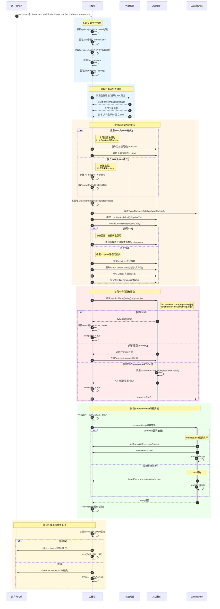

# ohos-arkts

ohos-arkts [options]  -abc module.abc  [script.ets]  functionName [arguments], []表示可选参数


有script类的时候，开发者代码格式（如skill开发，一个abc可以打包多个ets）。类java命令行格式
```
 export default class script { // 类名与文件名相同
FunctionA(a:string[]) // 开发者可指定函数名，但参数必须是a:string[]
}
```

没有script类的时候，开发者代码格式（如系统sa，系统应用开发，一个abc只能打包一个ets）。类node命令行格式
```
 static FunctionA(a:string[]) // 开发者可指定函数名，但参数必须是a:string[]
 ```
etsTool接口：
etsTool(cmd, options, arguments)
etsTool("ohos-arts",{}, {-abc:moudule.abc, functionName:functionName, args: [arg1, arg2, arg3]})
 
工具进程.completeArkTsTool接口：
工具进程.completeArkTsTool(requestCode, result);  -> 标准输出 -> 退出

## 流程图 


## Plan
|  序号 | 任务                                 | 预估时间 | 测试方式                              |
| :-: | ---------------------------------- | :--: | :-------------------------------- |
|  1  | **命令行解析 + 包管理器Mock**               |  2h  | 构造各种argv组合，验证解析正确性                |
|  2  | **ExecutionContext状态管理**            |  1h  | 单元测试：验证原子状态切换、结果存储                |
|  3  | **Runtime工厂（复用/新建）+ ABC加载**        |  4h  | 两种模式分别加载测试ABC，验证globalThis绑定      |
|  4  | **Skill类型分发 + 函数解析（静态/实例）**        |  4h  | 构造应用Skill/独立Skill测试ABC，验证函数调用链    |
|  5  | **completeArkTsTool NAPI绑定**       |  2h  | JS调用completeArkTsTool，验证回调触发   |
|  6  | **EventRunner等待 + 超时处理**            |  2h  | 集成测试：同步返回、Promise返回、超时路径           |

## 技术选型说明

**EventRunner vs SocketPair+Worker线程**

| 方案 | 实现复杂度 | 性能 | 维护成本 | 选用理由 |
|------|:--:|:--:|:--:|------|
| EventRunner + PostTask | 低 | 高 | 低 | 仓库已有成熟实现，参考main.cpp |
| SocketPair + Worker + epoll | 高 | 中 | 高 | 新增多线程管理，复杂度高 |

**选用EventRunner方案**：
- 复用现有 `EventRunner::Run()` 阻塞等待机制
- 复用现有 `runtime->PostTask()` 超时任务注册
- 复用现有 Promise then/catch 回调处理（参考 `js_insight_intent_executor`）
- 新增 `completeArkTsTool` NAPI 绑定即可

## Phase 示例代码

### Phase 1: 命令行解析 + 包管理器Mock

**头文件修改 (include/arkts_script.h)**:
```cpp
enum class SkillType {
    APP_SKILL,        // 应用Skill，复用Runtime
    STANDALONE_SKILL, // 独立Skill，新建Runtime
    UNKNOWN
};

struct ScriptArgs {
    std::string abcPath;              // -abc module.abc
    std::string scriptClass;          // [script.ets] 类名（可选）
    std::string funName;              // functionName
    std::vector<std::string> arguments; // [arguments]
    SkillType skillType = SkillType::UNKNOWN;
    bool showHelp = false;

    void Print() const;
};
```

**命令行解析实现 (src/arkts_script.cpp)**:
```cpp
bool ParseArguments(int argc, char* argv[], ScriptArgs& args)
{
    if (argc < 4) {
        PrintUsage(argv[0], true);
        return false;
    }

    int i = 1;
    // 解析 options (只支持 --help/-h)
    while (i < argc && argv[i][0] == '-' && strcmp(argv[i], "-abc") != 0) {
        std::string option = argv[i];
        if (option == "-h" || option == "--help") {
            PrintUsage(argv[0], false);
            args.showHelp = true;
            return true;
        } else {
            TAG_LOGE(AAFwkTag::APPKIT, "Unknown option: %{public}s", option.c_str());
            return false;
        }
    }

    // 解析 -abc module.abc
    if (i >= argc || strcmp(argv[i], "-abc") != 0) {
        PrintUsage(argv[0], true);
        return false;
    }
    i++;
    if (i >= argc) return false;
    args.abcPath = argv[i++];

    // 解析可选的 [script.ets]
    if (i < argc && argv[i][0] != '-') {
        args.scriptClass = argv[i++];
        args.skillType = SkillType::STANDALONE_SKILL;
    } else {
        args.skillType = SkillType::APP_SKILL;
    }

    // 解析 functionName
    if (i >= argc) return false;
    args.funName = argv[i++];

    // 解析 [arguments]
    while (i < argc) {
        args.arguments.push_back(argv[i++]);
    }

    return ValidateScriptFile(args.abcPath);
}
```

**包管理器Mock (src/arkts_script.cpp)**:
```cpp
SkillType ResolveSkillType(const std::string& abcPath)
{
    // Mock实现：根据abc路径特征判断
    // 实际实现应调用包管理器接口
    if (abcPath.find("/standalone_skills/") != std::string::npos) {
        return SkillType::STANDALONE_SKILL;
    }
    return SkillType::APP_SKILL;
}
```

### Phase 2: ExecutionContext状态管理

**现有实现 (src/main.cpp，无需修改)**:
```cpp
struct ExecutionContext {
    std::atomic<bool> completed{false};
    std::atomic<bool> isPromise{false};
    std::atomic<bool> timedOut{false};
    std::string result;
    std::string error;
};
```

**状态切换使用示例**:
```cpp
// 同步完成
execContext.completed.store(true);
execContext.result = resultStr;

// Promise完成（在回调中）
bool expected = false;
if (execContext.completed.compare_exchange_strong(expected, true)) {
    execContext.result = resultStr;
    runner->Stop();
}

// 超时处理（在PostTask中）
bool expected = false;
if (execContext.completed.compare_exchange_strong(expected, true)) {
    execContext.timedOut.store(true);
    execContext.error = "execution timeout";
    runner->Stop();
}
```

### Phase 3: Runtime工厂（复用/新建）+ ABC加载

**获取已有JsRuntime的接口（应用Skill模式）**:

关键接口路径：
```
ApplicationLoader::GetInstance().GetApplicationByName() -> OHOSApplication*
OHOSApplication::GetRuntime() -> std::unique_ptr<Runtime>&
JsRuntime::GetNapiEnv() -> napi_env
```

**Runtime工厂 (src/arkts_script.cpp)**:
```cpp
#include "app_loader.h"

JsRuntime* GetExistingJsRuntime()
{
    // 获取当前应用的 OHOSApplication
    auto* application = ApplicationLoader::GetInstance().GetApplicationByName();
    if (application == nullptr) {
        TAG_LOGE(AAFwkTag::APPKIT, "failed to get OHOSApplication");
        return nullptr;
    }

    // 获取 JsRuntime
    auto& runtime = application->GetRuntime();
    if (runtime == nullptr) {
        TAG_LOGE(AAFwkTag::APPKIT, "runtime is null");
        return nullptr;
    }

    // ohos-arkts 环境下只存在 JsRuntime
    return static_cast<JsRuntime*>(runtime.get());
}

JsRuntime* CreateRuntimeForSkill(SkillType skillType)
{
    if (skillType == SkillType::APP_SKILL) {
        // 应用Skill：复用当前应用的 Runtime（在应用进程内运行）
        TAG_LOGI(AAFwkTag::APPKIT, "App Skill: reusing existing Runtime from application");
        return GetExistingJsRuntime();
    } else if (skillType == SkillType::STANDALONE_SKILL) {
        // 独立Skill：新建 Runtime（在独立进程运行）
        TAG_LOGI(AAFwkTag::APPKIT, "Standalone Skill: creating new Runtime");
        auto context = CreateScriptContext();
        if (context == nullptr) return nullptr;
        auto runtime = CreateScriptJsRuntime(context);
        if (runtime == nullptr) return nullptr;
        // 注意：返回裸指针，所有权由调用方管理
        return runtime.release();
    }
    return nullptr;
}

// 注意：应用Skill模式下，返回的 JsRuntime 指针不拥有所有权，不可释放
// 独立Skill模式下，返回的 JsRuntime 指针拥有所有权，需要调用方释放
```

**ABC加载（现有实现，无需修改）**:
```cpp
bool LoadAbcFile(JsRuntime* runtime, const std::string& path)
{
    if (runtime == nullptr) return false;
    bool loaded = runtime->RunScript(path, "", false);
    if (!loaded) {
        TAG_LOGE(AAFwkTag::APPKIT, "RunScript failed for %{private}s", path.c_str());
    }
    return loaded;
}
```

### Phase 4: Skill类型分发 + 函数解析（静态/实例）

**函数解析 (src/js_arkts_script.cpp)**:
```cpp
napi_value ResolveFunctionForSkill(napi_env env,
    SkillType skillType,
    const std::string& scriptClass,
    const std::string& funName)
{
    napi_value global = nullptr;
    napi_get_global(env, &global);

    if (skillType == SkillType::APP_SKILL) {
        // 应用Skill：静态函数，直接从globalThis获取
        napi_value func = nullptr;
        napi_status status = napi_get_named_property(env, global, funName.c_str(), &func);
        if (status != napi_ok) return nullptr;
        
        // 验证是否为函数
        napi_valuetype valueType = napi_undefined;
        napi_typeof(env, func, &valueType);
        if (valueType != napi_function) return nullptr;
        
        return func;
    } else if (skillType == SkillType::STANDALONE_SKILL) {
        // 独立Skill：实例化类并获取方法
        napi_value module = nullptr;
        napi_get_named_property(env, global, scriptClass.c_str(), &module);
        if (module == nullptr) return nullptr;
        
        // 获取 export default class
        napi_value defaultExport = nullptr;
        napi_get_named_property(env, module, "default", &defaultExport);
        if (defaultExport == nullptr) return nullptr;
        
        // 实例化类
        napi_value instance = nullptr;
        napi_new_instance(env, defaultExport, 0, nullptr, &instance);
        if (instance == nullptr) return nullptr;
        
        // 从实例获取方法
        napi_value method = nullptr;
        napi_get_named_property(env, instance, funName.c_str(), &method);
        return method;
    }
    return nullptr;
}
```

**参数转换**:
```cpp
napi_value ConvertArgumentsToNapi(napi_env env, const std::vector<std::string>& arguments)
{
    // 创建 string[] 数组
    napi_value argsArray = nullptr;
    napi_create_array_with_length(env, arguments.size(), &argsArray);
    
    for (size_t i = 0; i < arguments.size(); i++) {
        napi_value strVal = nullptr;
        napi_create_string_utf8(env, arguments[i].c_str(), 
            arguments[i].size(), &strVal);
        napi_set_element(env, argsArray, i, strVal);
    }
    
    return argsArray;
}
```

### Phase 5: completeArkTsTool NAPI绑定

**NAPI绑定实现 (src/js_arkts_script.cpp)**:
```cpp
struct CompleteCallbackData {
    std::function<void(bool, const std::string&, const std::string&)> callback;
    std::shared_ptr<AppExecFwk::EventRunner> runner;
};

static CompleteCallbackData* g_completeCallbackData = nullptr;

napi_value CompleteArkTsTool(napi_env env, napi_callback_info info)
{
    size_t argc = 2;
    napi_value argv[2] = {nullptr};
    napi_get_cb_info(env, info, &argc, argv, nullptr, nullptr);

    if (argc < 2) {
        TAG_LOGE(AAFwkTag::APPKIT, "completeArkTsTool requires 2 arguments");
        return nullptr;
    }

    int requestCode = 0;
    napi_get_value_int32(env, argv[0], &requestCode);

    std::string resultStr = NapiValueToJsonString(env, argv[1]);
    TAG_LOGI(AAFwkTag::APPKIT, "completeArkTsTool called, requestCode=%{public}d", requestCode);

    if (g_completeCallbackData != nullptr && g_completeCallbackData->callback) {
        g_completeCallbackData->callback(true, resultStr, "");
        if (g_completeCallbackData->runner) {
            g_completeCallbackData->runner->Stop();
        }
    }

    return nullptr;
}

void BindCompleteArkTsTool(napi_env env, 
    std::function<void(bool, const std::string&, const std::string&)> callback,
    std::shared_ptr<AppExecFwk::EventRunner> runner)
{
    napi_value global = nullptr;
    napi_get_global(env, &global);

    // 存储回调数据
    g_completeCallbackData = new CompleteCallbackData{callback, runner};

    // 绑定函数到 globalThis
    napi_value func = nullptr;
    napi_create_function(env, "completeArkTsTool", NAPI_AUTO_LENGTH,
        CompleteArkTsTool, nullptr, &func);
    napi_set_named_property(env, global, "completeArkTsTool", func);
}
```

### Phase 6: EventRunner等待 + 超时处理

**主流程整合 (src/main.cpp)**:
```cpp
int main(int argc, char* argv[])
{
    using namespace OHOS::ArktsScript;
    using OHOS::AppExecFwk::EventRunner;

    constexpr int64_t EXECUTION_TIMEOUT_MS = 300 * 1000; // 300秒
    constexpr const char* EXECUTION_TIMEOUT_TASK = "arktsScript_timeout";

    // Phase 1: 命令行解析
    ScriptArgs args;
    if (!ParseArguments(argc, argv, args)) {
        OutputError("failed to parse arguments", "ARGUMENT_ERROR");
        return EXIT_FAILURE;
    }
    if (args.showHelp) return EXIT_SUCCESS;

    args.Print();
    args.skillType = ResolveSkillType(args.abcPath);

    // Phase 3: 获取Runtime
    JsRuntime* runtime = CreateRuntimeForSkill(args.skillType);
    if (runtime == nullptr) {
        OutputError("failed to get Runtime", "RUNTIME_ERROR");
        return EXIT_FAILURE;
    }

    // 独立Skill需要管理Runtime所有权，应用Skill不需要
    std::unique_ptr<JsRuntime> runtimeOwner;
    if (args.skillType == SkillType::STANDALONE_SKILL) {
        runtimeOwner.reset(runtime); // 独立Skill拥有所有权
    }

    napi_env env = runtime->GetNapiEnv();
    auto runner = EventRunner::GetMainEventRunner();

    // Phase 2: 初始化ExecutionContext
    ExecutionContext execContext;

    // Phase 5: 绑定completeArkTsTool
    BindCompleteArkTsTool(env, 
        [&execContext](bool success, const std::string& result, const std::string& error) {
            bool expected = false;
            if (!execContext.completed.compare_exchange_strong(expected, true)) {
                return;
            }
            if (success) {
                execContext.result = result;
            } else {
                execContext.error = error;
            }
        }, runner);

    // Phase 3: 加载ABC
    if (!LoadAbcFile(runtime, args.abcPath)) {
        OutputError("failed to load ABC file", "LOAD_ERROR");
        return EXIT_FAILURE;
    }

    // Phase 4: 解析函数
    napi_value func = ResolveFunctionForSkill(env, args.skillType, 
        args.scriptClass, args.funName);
    if (func == nullptr) {
        OutputError("failed to resolve function", "FUNCTION_ERROR");
        return EXIT_FAILURE;
    }

    // 转换参数
    napi_value argsArray = ConvertArgumentsToNapi(env, args.arguments);
    napi_value global = nullptr;
    napi_get_global(env, &global);

    // 调用函数
    napi_value result = nullptr;
    napi_call_function(env, global, func, 1, &argsArray, &result);

    // 检查是否为Promise
    bool isPromise = false;
    napi_is_promise(env, result, &isPromise);
    execContext.isPromise.store(isPromise);

    if (isPromise) {
        // Promise回调处理（复用现有HandlePromiseResult）
        HandlePromiseResult(env, result, 
            [&execContext, runner](bool success, const std::string& result, const std::string& error) {
                bool expected = false;
                if (!execContext.completed.compare_exchange_strong(expected, true)) {
                    return;
                }
                if (success) {
                    execContext.result = result;
                } else {
                    execContext.error = error;
                }
                runner->Stop();
            });
    } else {
        // 同步结果处理
        execContext.completed.store(true);
        execContext.result = NapiValueToJsonString(env, result);
    }

    // Phase 6: EventRunner等待
    if (!execContext.completed.load()) {
        // 注册超时任务（使用runtime->PostTask）
        runtime->PostTask([&execContext, runner]() {
            bool expected = false;
            if (!execContext.completed.compare_exchange_strong(expected, true)) {
                return;
            }
            execContext.timedOut.store(true);
            execContext.error = "execution timeout";
            runner->Stop();
        }, EXECUTION_TIMEOUT_TASK, EXECUTION_TIMEOUT_MS);

        // 阻塞等待
        runner->Run();
        runtime->RemoveTask(EXECUTION_TIMEOUT_TASK);
    }

    // 输出结果
    if (execContext.timedOut.load()) {
        OutputError("execution timeout", "TIMEOUT_ERROR");
        return EXIT_FAILURE;
    }
    if (!execContext.error.empty()) {
        OutputError(execContext.error, "EXECUTION_ERROR");
        return EXIT_FAILURE;
    }
    OutputResult(execContext.result);

    // 注意：应用Skill不释放runtime（所有权属于OHOSApplication）
    // 独立Skill通过runtimeOwner自动释放
    return EXIT_SUCCESS;
}
```

## ETS 示例代码

**应用Skill（类Node格式）**:
```typescript
// app_skill.ets - 一个abc只能打包一个ets
export function FunctionA(args: string[]): string {
    return JSON.stringify({ processed: args });
}

// 异步版本
export async function FunctionB(args: string[]): Promise<string> {
    const result = await doAsyncWork(args);
    return JSON.stringify({ asyncResult: result });
}

// 使用completeArkTsTool显式完成
export function FunctionC(args: string[]) {
    const result = doWork(args);
    completeArkTsTool(1, JSON.stringify({ manualResult: result }));
}
```

**独立Skill（类Java格式）**:
```typescript
// script.ets - 类名与文件名相同
export default class script {
    FunctionA(args: string[]): string {
        return JSON.stringify({ classResult: this.doWork(args) });
    }

    private doWork(args: string[]): string[] {
        return args.map(s => "processed_" + s);
    }
}

// other_skill.ets - 同一个abc中可以打包多个
export default class other_skill {
    FunctionB(args: string[]) {
        completeArkTsTool(2, JSON.stringify({ otherResult: args }));
    }
}
```

**使用示例**:
```bash
# 应用Skill（类Node格式）
ohos-arkts -abc /path/to/app_skill.abc FunctionA arg1 arg2

# 独立Skill（类Java格式）
ohos-arkts -abc /path/to/module.abc script.ets FunctionA arg1 arg2
ohos-arkts -abc /path/to/module.abc other_skill.ets FunctionB arg1
```
