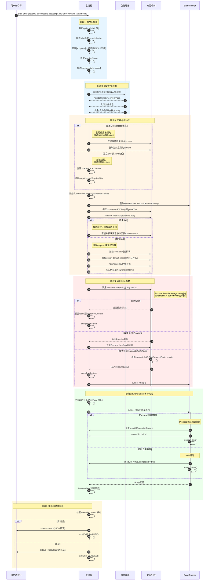

# ohos-arkts 设计文档

> **说明**：本文档为 ohos-arkts 模块的**架构设计文档**，描述最终目标架构及实现方案。示例代码展示了各阶段的参考实现，实际代码应逐步按此设计实现。

## 1. 设计目标

提供一种命令行工具 `ohos-arkts`，用于执行 ArkTS 脚本中的指定函数，支持：
- **同步返回**：函数直接返回结果
- **Promise 返回**：函数返回 Promise，工具等待 Promise resolve
- **显式完成**：函数调用 `completeArkTsTool()` 显式通知完成

## 2. 命令行接口

### 2.1 使用格式

```
ohos-arkts [options] -abc module.abc [script.ets] functionName [arguments]
```

| 参数 | 说明 | 必需 | 示例 |
|------|------|------|------|
| `-abc module.abc` | ABC 文件路径 | 是 | `-abc /data/scripts/test.abc` |
| `[script.ets]` | 脚本类名（仅独立 Skill） | 否 | `script` |
| `functionName` | 要执行的函数名 | 是 | `FunctionA` |
| `[arguments]` | 函数参数（字符串数组） | 否 | `arg1 arg2 arg3` |
| `[options]` | 可选参数 | 否 | `--help` |

### 2.2 选项

| 选项 | 说明 |
|------|------|
| `-h, --help` | 显示帮助信息 |

### 2.3 示例

```bash
# 应用 Skill（无 script 类，静态函数）
ohos-arkts -abc /data/app/sa.abc calculate "100" "200"

# 独立 Skill（有 script 类）
ohos-arkts -abc /data/skills/myskill.abc MySkill process "input.json"

# 带多个参数
ohos-arkts -abc /data/app/test.abc process "arg1" "arg2" "arg3"
```

## 3. 开发者代码格式

### 3.1 独立 Skill（有 script 类）

一个 ABC 可打包多个 ETS 文件，每个文件对应一个 script 类。

```typescript
// script.ets（类名必须与文件名相同）
export default class script {
    FunctionA(a: string[]): string {
        const result = doSomething(a);
        return JSON.stringify({ success: true, data: result });
    }

    AsyncFunction(a: string[]): Promise<string> {
        return new Promise((resolve) => {
            setTimeout(() => {
                resolve(JSON.stringify({ success: true, data: "done" }));
            }, 1000);
        });
    }

    ManualComplete(a: string[]): void {
        const result = doSomething(a);
        completeArkTsTool(0, JSON.stringify({ success: true, data: result }));
    }
}
```

### 3.2 应用 Skill（无 script 类）

一个 ABC 只能打包一个 ETS 文件，函数必须是静态的。

```typescript
// main.ets
@Entry
@Component
struct MainComponent {
    // ...
}

export function FunctionA(a: string[]): string {
    const result = doSomething(a);
    return JSON.stringify({ success: true, data: result });
}

export function AsyncFunction(a: string[]): Promise<string> {
    return new Promise((resolve) => {
        setTimeout(() => {
            resolve(JSON.stringify({ success: true, data: "done" }));
        }, 1000);
    });
}
```

## 4. 整体流程



## 5. 实现方案

### 5.1 头文件 (include/arkts_script.h)

```cpp
#ifndef ARKTSSCRIPT_H
#define ARKTSSCRIPT_H

#include <memory>
#include <string>
#include <vector>
#include <functional>
#include <atomic>

#include "js_runtime.h"
#include "napi/native_api.h"

namespace OHOS {
namespace ArktsScript {

enum class SkillType {
    APP_SKILL,
    STANDALONE_SKILL,
    UNKNOWN
};

struct ScriptArgs {
    std::string abcPath;
    std::string scriptClass;
    std::string funName;
    std::vector<std::string> arguments;
    SkillType skillType = SkillType::UNKNOWN;
    bool showHelp = false;

    void Print() const;
};

struct ExecutionContext {
    std::atomic<bool> completed{false};
    std::atomic<bool> isPromise{false};
    std::atomic<bool> timedOut{false};
    std::string result;
    std::string error;
};

using ResultCallback = std::function<void(bool success, const std::string& result, const std::string& error)>;

bool ParseArguments(int argc, char* argv[], ScriptArgs& args);

SkillType ResolveSkillType(const std::string& abcPath);

JsRuntime* GetExistingJsRuntime();

JsRuntime* CreateRuntimeForSkill(SkillType skillType);

bool LoadAbcFile(JsRuntime* runtime, const std::string& path);

bool BindContextToGlobal(napi_env env, JsRuntime* runtime);

bool BindCompleteArkTsTool(napi_env env, ResultCallback callback,
    std::shared_ptr<AppExecFwk::EventRunner> runner);

napi_value ResolveFunctionForSkill(napi_env env, SkillType skillType,
    const std::string& scriptClass, const std::string& funName);

napi_value ConvertArgumentsToNapi(napi_env env, const std::vector<std::string>& arguments);

bool HandlePromiseResult(napi_env env, napi_value promise, ResultCallback callback);

std::string NapiValueToJsonString(napi_env env, napi_value value);

void OutputResult(const std::string& result);
void OutputError(const std::string& error, const std::string& errorType);

} // namespace ArktsScript
} // namespace OHOS

#endif // ARKTSSCRIPT_H
```

### 5.2 命令行解析 (src/arkts_script.cpp)

```cpp
#include "arkts_script.h"
#include "hilog_tag_wrapper.h"

#include <cstring>
#include <fstream>

namespace OHOS {
namespace ArktsScript {
namespace {

void PrintUsage(const char* execName, bool isErrorLog)
{
    const std::string usage = std::string("Usage: ") + execName +
        " [options] -abc module.abc [script.ets] functionName [arguments]\n\n"
        "Options:\n"
        "  -h, --help    Show this help message\n\n"
        "Arguments:\n"
        "  -abc module.abc    ABC file path (required)\n"
        "  [script.ets]       Script class name (optional, for standalone skill)\n"
        "  functionName       Function name to execute (required)\n"
        "  [arguments]        Function arguments as string array (optional)\n\n"
        "Examples:\n"
        "  " + execName + " -abc /data/app/test.abc calculate \"100\" \"200\"\n"
        "  " + execName + " -abc /data/skills/myskill.abc MySkill process \"input.json\"";

    if (isErrorLog) {
        TAG_LOGE(AAFwkTag::APPKIT, "%{public}s", usage.c_str());
    } else {
        TAG_LOGI(AAFwkTag::APPKIT, "%{public}s", usage.c_str());
    }
}

bool ValidateScriptFile(const std::string& path)
{
    if (path.empty()) {
        TAG_LOGE(AAFwkTag::APPKIT, "empty script path");
        return false;
    }

    std::ifstream input(path, std::ios::binary);
    if (!input.is_open()) {
        TAG_LOGE(AAFwkTag::APPKIT, "failed to open script file: %{private}s", path.c_str());
        return false;
    }
    return true;
}

} // namespace

bool ParseArguments(int argc, char* argv[], ScriptArgs& args)
{
    if (argc < 4) {
        PrintUsage(argv[0], true);
        return false;
    }

    int i = 1;
    while (i < argc && argv[i][0] == '-' && strcmp(argv[i], "-abc") != 0) {
        std::string option = argv[i];
        if (option == "-h" || option == "--help") {
            PrintUsage(argv[0], false);
            args.showHelp = true;
            return true;
        } else {
            TAG_LOGE(AAFwkTag::APPKIT, "Unknown option: %{public}s", option.c_str());
            PrintUsage(argv[0], true);
            return false;
        }
    }

    if (i >= argc || strcmp(argv[i], "-abc") != 0) {
        TAG_LOGE(AAFwkTag::APPKIT, "Missing -abc option");
        PrintUsage(argv[0], true);
        return false;
    }
    i++;
    if (i >= argc) {
        TAG_LOGE(AAFwkTag::APPKIT, "Missing value for -abc");
        return false;
    }
    args.abcPath = argv[i++];

    if (i < argc && argv[i][0] != '-') {
        args.scriptClass = argv[i++];
        args.skillType = SkillType::STANDALONE_SKILL;
    } else {
        args.skillType = SkillType::APP_SKILL;
    }

    if (i >= argc) {
        TAG_LOGE(AAFwkTag::APPKIT, "Missing functionName");
        PrintUsage(argv[0], true);
        return false;
    }
    args.funName = argv[i++];

    while (i < argc) {
        args.arguments.push_back(argv[i++]);
    }

    return ValidateScriptFile(args.abcPath);
}

void ScriptArgs::Print() const
{
    TAG_LOGI(AAFwkTag::APPKIT, "  ABC Path: %{private}s", abcPath.c_str());
    TAG_LOGI(AAFwkTag::APPKIT, "  Skill Type: %{public}d", static_cast<int>(skillType));
    if (!scriptClass.empty()) {
        TAG_LOGI(AAFwkTag::APPKIT, "  Script Class: %{public}s", scriptClass.c_str());
    }
    TAG_LOGI(AAFwkTag::APPKIT, "  Function: %{public}s", funName.c_str());
    TAG_LOGI(AAFwkTag::APPKIT, "  Arguments: [%{public}zu]", arguments.size());
    for (size_t i = 0; i < arguments.size(); i++) {
        TAG_LOGI(AAFwkTag::APPKIT, "    argv[%{public}zu] = %{public}s", i, arguments[i].c_str());
    }
}

SkillType ResolveSkillType(const std::string& abcPath)
{
    if (abcPath.find("/standalone_skills/") != std::string::npos ||
        abcPath.find("/skills/") != std::string::npos) {
        return SkillType::STANDALONE_SKILL;
    }
    return SkillType::APP_SKILL;
}

JsRuntime* GetExistingJsRuntime()
{
    return nullptr;
}

JsRuntime* CreateRuntimeForSkill(SkillType skillType)
{
    return nullptr;
}

} // namespace ArktsScript
} // namespace OHOS
```

### 5.3 JS 函数调用 (src/js_arkts_script.cpp)

```cpp
#include "arkts_script.h"
#include "js_runtime_utils.h"
#include "hilog_tag_wrapper.h"

#include <cstring>

namespace OHOS {
namespace ArktsScript {

using namespace OHOS::AbilityRuntime;

namespace {

struct CompleteCallbackData {
    ResultCallback callback;
    std::weak_ptr<AppExecFwk::EventRunner> runner;

    ~CompleteCallbackData()
    {
        TAG_LOGD(AAFwkTag::APPKIT, "CompleteCallbackData destroyed");
    }
};

static CompleteCallbackData* g_completeCallbackData = nullptr;

struct PromiseCallbackData {
    ResultCallback callback;
    std::weak_ptr<AppExecFwk::EventRunner> runner;

    ~PromiseCallbackData()
    {
        TAG_LOGD(AAFwkTag::APPKIT, "PromiseCallbackData destroyed");
    }
};

std::string GetNapiErrorMessage(napi_env env)
{
    if (env == nullptr) {
        return "napi_env is null";
    }
    const napi_extended_error_info* errorInfo = nullptr;
    napi_status status = napi_get_last_error_info(env, &errorInfo);
    if (status != napi_ok || errorInfo == nullptr || errorInfo->error_message == nullptr) {
        return "unknown napi error";
    }
    return errorInfo->error_message;
}

bool GetUtf8String(napi_env env, napi_value value, std::string& output)
{
    if (env == nullptr || value == nullptr) {
        return false;
    }

    size_t length = 0;
    napi_status status = napi_get_value_string_utf8(env, value, nullptr, 0, &length);
    if (status != napi_ok) {
        return false;
    }

    std::string buffer(length + 1, '\0');
    status = napi_get_value_string_utf8(env, value, buffer.data(), buffer.size(), &length);
    if (status != napi_ok) {
        return false;
    }

    buffer.resize(length);
    output = buffer;
    return true;
}

napi_value CompleteArkTsTool(napi_env env, napi_callback_info info)
{
    size_t argc = 2;
    napi_value argv[2] = {nullptr};
    napi_get_cb_info(env, info, &argc, argv, nullptr, nullptr);

    if (argc < 2) {
        TAG_LOGE(AAFwkTag::APPKIT, "completeArkTsTool requires 2 arguments");
        return nullptr;
    }

    int requestCode = 0;
    napi_get_value_int32(env, argv[0], &requestCode);

    std::string resultStr = NapiValueToJsonString(env, argv[1]);
    TAG_LOGI(AAFwkTag::APPKIT, "completeArkTsTool called, requestCode=%{public}d", requestCode);

    if (g_completeCallbackData != nullptr && g_completeCallbackData->callback) {
        g_completeCallbackData->callback(true, resultStr, "");
        auto runner = g_completeCallbackData->runner.lock();
        if (runner) {
            runner->Stop();
        }
        delete g_completeCallbackData;
        g_completeCallbackData = nullptr;
    }

    return nullptr;
}

napi_value PromiseResolveCallback(napi_env env, napi_callback_info info)
{
    napi_value result = nullptr;
    size_t argc = 1;
    napi_value argv[1] = {nullptr};
    void* data = nullptr;
    napi_get_cb_info(env, info, &argc, argv, nullptr, &data);

    if (argc > 0) {
        result = argv[0];
    }

    auto* callbackData = static_cast<PromiseCallbackData*>(data);
    if (callbackData != nullptr && callbackData->callback) {
        std::string resultStr = NapiValueToJsonString(env, result);
        TAG_LOGI(AAFwkTag::APPKIT, "Promise resolve callback triggered");
        callbackData->callback(true, resultStr, "");
        auto runner = callbackData->runner.lock();
        if (runner) {
            runner->Stop();
        }
        delete callbackData;
    }

    return nullptr;
}

napi_value PromiseRejectCallback(napi_env env, napi_callback_info info)
{
    napi_value error = nullptr;
    size_t argc = 1;
    napi_value argv[1] = {nullptr};
    void* data = nullptr;
    napi_get_cb_info(env, info, &argc, argv, nullptr, &data);

    if (argc > 0) {
        error = argv[0];
    }

    auto* callbackData = static_cast<PromiseCallbackData*>(data);
    if (callbackData != nullptr && callbackData->callback) {
        std::string errorStr = NapiValueToJsonString(env, error);
        TAG_LOGW(AAFwkTag::APPKIT, "Promise reject callback triggered");
        callbackData->callback(false, "", errorStr);
        auto runner = callbackData->runner.lock();
        if (runner) {
            runner->Stop();
        }
        delete callbackData;
    }

    return nullptr;
}

bool HandlePromiseResult(napi_env env, napi_value promise, ResultCallback callback,
    const std::weak_ptr<AppExecFwk::EventRunner>& runner)
{
    auto* callbackData = new (std::nothrow) PromiseCallbackData{callback, runner};
    if (callbackData == nullptr) {
        callback(false, "", "failed to allocate callback data");
        return false;
    }

    napi_value then = nullptr;
    napi_status status = napi_get_named_property(env, promise, "then", &then);
    if (status != napi_ok || then == nullptr) {
        delete callbackData;
        callback(false, "", "failed to get Promise.then");
        return false;
    }

    napi_value resolveCb = nullptr;
    status = napi_create_function(env, "onResolve", NAPI_AUTO_LENGTH,
        PromiseResolveCallback, callbackData, &resolveCb);
    if (status != napi_ok || resolveCb == nullptr) {
        delete callbackData;
        callback(false, "", "failed to create resolve callback");
        return false;
    }

    napi_value argvThen[1] = {resolveCb};
    status = napi_call_function(env, promise, then, 1, argvThen, nullptr);
    if (status != napi_ok) {
        delete callbackData;
        callback(false, "", "failed to register Promise.then callback");
        return false;
    }

    napi_value promiseCatch = nullptr;
    status = napi_get_named_property(env, promise, "catch", &promiseCatch);
    if (status != napi_ok || promiseCatch == nullptr) {
        delete callbackData;
        callback(false, "", "failed to get Promise.catch");
        return false;
    }

    napi_value rejectCb = nullptr;
    status = napi_create_function(env, "onReject", NAPI_AUTO_LENGTH,
        PromiseRejectCallback, callbackData, &rejectCb);
    if (status != napi_ok || rejectCb == nullptr) {
        delete callbackData;
        callback(false, "", "failed to create reject callback");
        return false;
    }

    napi_value argvCatch[1] = {rejectCb};
    status = napi_call_function(env, promise, promiseCatch, 1, argvCatch, nullptr);
    if (status != napi_ok) {
        delete callbackData;
        callback(false, "", "failed to register Promise.catch callback");
        return false;
    }

    TAG_LOGI(AAFwkTag::APPKIT, "Promise callbacks registered successfully");
    return true;
}

} // namespace

bool BindContextToGlobal(napi_env env, JsRuntime* runtime)
{
    if (env == nullptr || runtime == nullptr) {
        TAG_LOGE(AAFwkTag::APPKIT, "invalid env or runtime when binding context");
        return false;
    }

    napi_value globalObj = nullptr;
    napi_status status = napi_get_global(env, &globalObj);
    if (status != napi_ok || globalObj == nullptr) {
        TAG_LOGE(AAFwkTag::APPKIT, "napi_get_global failed");
        return false;
    }

    return true;
}

bool BindCompleteArkTsTool(napi_env env, ResultCallback callback,
    std::shared_ptr<AppExecFwk::EventRunner> runner)
{
    if (env == nullptr) {
        return false;
    }

    napi_value global = nullptr;
    napi_status status = napi_get_global(env, &global);
    if (status != napi_ok || global == nullptr) {
        return false;
    }

    if (g_completeCallbackData != nullptr) {
        delete g_completeCallbackData;
        g_completeCallbackData = nullptr;
    }
    g_completeCallbackData = new (std::nothrow) CompleteCallbackData{callback, runner};
    if (g_completeCallbackData == nullptr) {
        return false;
    }

    napi_value func = nullptr;
    status = napi_create_function(env, "completeArkTsTool", NAPI_AUTO_LENGTH,
        CompleteArkTsTool, nullptr, &func);
    if (status != napi_ok || func == nullptr) {
        delete g_completeCallbackData;
        g_completeCallbackData = nullptr;
        return false;
    }

    status = napi_set_named_property(env, global, "completeArkTsTool", func);
    if (status != napi_ok) {
        delete g_completeCallbackData;
        g_completeCallbackData = nullptr;
        return false;
    }

    return true;
}

bool LoadAbcFile(JsRuntime* runtime, const std::string& path)
{
    if (runtime == nullptr) {
        TAG_LOGE(AAFwkTag::APPKIT, "runtime is null when loading abc");
        return false;
    }

    bool loaded = runtime->RunScript(path, "", false);
    if (!loaded) {
        napi_env env = runtime->GetNapiEnv();
        TAG_LOGE(AAFwkTag::APPKIT, "RunScript failed for %{private}s", path.c_str());
    }
    return loaded;
}

napi_value ResolveFunctionForSkill(napi_env env, SkillType skillType,
    const std::string& scriptClass, const std::string& funName)
{
    if (env == nullptr) {
        return nullptr;
    }

    napi_value global = nullptr;
    napi_get_global(env, &global);

    if (skillType == SkillType::APP_SKILL) {
        napi_value func = nullptr;
        napi_status status = napi_get_named_property(env, global, funName.c_str(), &func);
        if (status != napi_ok) return nullptr;

        napi_valuetype valueType = napi_undefined;
        napi_typeof(env, func, &valueType);
        if (valueType != napi_function) return nullptr;

        return func;
    } else if (skillType == SkillType::STANDALONE_SKILL) {
        napi_value module = nullptr;
        napi_get_named_property(env, global, scriptClass.c_str(), &module);
        if (module == nullptr) return nullptr;

        napi_value defaultExport = nullptr;
        napi_get_named_property(env, module, "default", &defaultExport);
        if (defaultExport == nullptr) return nullptr;

        napi_value instance = nullptr;
        napi_new_instance(env, defaultExport, 0, nullptr, &instance);
        if (instance == nullptr) return nullptr;

        napi_value method = nullptr;
        napi_get_named_property(env, instance, funName.c_str(), &method);
        return method;
    }
    return nullptr;
}

napi_value ConvertArgumentsToNapi(napi_env env, const std::vector<std::string>& arguments)
{
    if (env == nullptr) {
        return nullptr;
    }

    napi_value argsArray = nullptr;
    napi_status status = napi_create_array_with_length(env, arguments.size(), &argsArray);
    if (status != napi_ok || argsArray == nullptr) {
        return nullptr;
    }

    for (size_t i = 0; i < arguments.size(); i++) {
        napi_value strVal = nullptr;
        status = napi_create_string_utf8(env, arguments[i].c_str(),
            arguments[i].size(), &strVal);
        if (status != napi_ok || strVal == nullptr) {
            return nullptr;
        }
        status = napi_set_element(env, argsArray, i, strVal);
        if (status != napi_ok) {
            return nullptr;
        }
    }

    return argsArray;
}

std::string NapiValueToJsonString(napi_env env, napi_value value)
{
    if (env == nullptr || value == nullptr) {
        return "null";
    }

    napi_valuetype valueType = napi_undefined;
    napi_status status = napi_typeof(env, value, &valueType);
    if (status != napi_ok) {
        return "null";
    }

    nlohmann::json output;
    output["type"] = "unknown";
    output["value"] = nullptr;

    if (valueType == napi_null || valueType == napi_undefined) {
        output["type"] = (valueType == napi_null) ? "null" : "undefined";
        output["value"] = nullptr;
        return output.dump();
    }

    if (valueType == napi_boolean) {
        bool boolValue = false;
        napi_get_value_bool(env, value, &boolValue);
        output["type"] = "boolean";
        output["value"] = boolValue;
        return output.dump();
    }

    if (valueType == napi_number) {
        double numberValue = 0.0;
        napi_get_value_double(env, value, &numberValue);
        output["type"] = "number";
        output["value"] = numberValue;
        return output.dump();
    }

    if (valueType == napi_string) {
        std::string stringValue;
        if (GetUtf8String(env, value, stringValue)) {
            output["type"] = "string";
            output["value"] = stringValue;
        }
        return output.dump();
    }

    if (valueType == napi_object) {
        napi_value global = nullptr;
        status = napi_get_global(env, &global);
        if (status == napi_ok && global != nullptr) {
            napi_value jsonObj = nullptr;
            status = napi_get_named_property(env, global, "JSON", &jsonObj);
            if (status == napi_ok && jsonObj != nullptr) {
                napi_value stringifyFunc = nullptr;
                status = napi_get_named_property(env, jsonObj, "stringify", &stringifyFunc);
                if (status == napi_ok && stringifyFunc != nullptr) {
                    napi_value argv[] = {value};
                    napi_value jsonString = nullptr;
                    status = napi_call_function(env, jsonObj, stringifyFunc, 1, argv, &jsonString);
                    if (status == napi_ok && jsonString != nullptr) {
                        std::string objectString;
                        if (GetUtf8String(env, jsonString, objectString)) {
                            output["type"] = "object";
                            try {
                                output["value"] = nlohmann::json::parse(objectString);
                            } catch (...) {
                                output["value"] = objectString;
                            }
                            return output.dump();
                        }
                    }
                }
            }
        }
        output["type"] = "object";
        output["value"] = "[object]";
        return output.dump();
    }

    if (valueType == napi_function) {
        output["type"] = "function";
        output["value"] = "[function]";
        return output.dump();
    }

    return output.dump();
}

void OutputResult(const std::string& result)
{
    std::cout << result << std::endl;
}

void OutputError(const std::string& error, const std::string& errorType)
{
    nlohmann::json errorOutput;
    errorOutput["success"] = false;
    errorOutput["errorType"] = errorType;
    errorOutput["error"] = error;
    std::cerr << errorOutput.dump() << std::endl;
}

} // namespace ArktsScript
} // namespace OHOS
```

### 5.4 主流程 (src/main.cpp)

```cpp
/*
 * Copyright (c) 2026 Huawei Device Co., Ltd.
 * Licensed under the Apache License, Version 2.0 (the "License");
 * you may not use this file except in compliance with the License.
 * You may obtain a copy of the License at
 *
 *     http://www.apache.org/licenses/LICENSE-2.0
 *
 * Unless required by applicable law or agreed to in writing, software
 * distributed under the License is distributed on an "AS IS" BASIS,
 * WITHOUT WARRANTIES OR CONDITIONS OF ANY KIND, either express or implied.
 * See the License for the specific language governing permissions and
 * limitations under the License.
 */

#include "arkts_script.h"
#include "hilog_tag_wrapper.h"

#include <atomic>
#include <cstdlib>
#include <iostream>

#include "event_runner.h"

namespace OHOS {
namespace ArktsScript {

struct ExecutionContext {
    std::atomic<bool> completed{false};
    std::atomic<bool> isPromise{false};
    std::atomic<bool> timedOut{false};
    std::string result;
    std::string error;
};

} // namespace ArktsScript
} // namespace OHOS

int main(int argc, char* argv[])
{
    using namespace OHOS::ArktsScript;
    using OHOS::AppExecFwk::EventRunner;

    constexpr int64_t EXECUTION_TIMEOUT_MS = 300 * 1000;
    constexpr const char* EXECUTION_TIMEOUT_TASK = "ohos_arkts_timeout";

    TAG_LOGI(AAFwkTag::APPKIT, "ohos-arkts runner start");

    ScriptArgs args;
    if (!ParseArguments(argc, argv, args)) {
        OutputError("failed to parse arguments", "ARGUMENT_ERROR");
        return EXIT_FAILURE;
    }
    if (args.showHelp) {
        return EXIT_SUCCESS;
    }

    TAG_LOGI(AAFwkTag::APPKIT, "Arguments parsed successfully");
    args.Print();

    args.skillType = ResolveSkillType(args.abcPath);
    TAG_LOGI(AAFwkTag::APPKIT, "Skill type resolved: %{public}d", static_cast<int>(args.skillType));

    JsRuntime* runtime = CreateRuntimeForSkill(args.skillType);
    if (runtime == nullptr) {
        OutputError("failed to get Runtime", "RUNTIME_ERROR");
        return EXIT_FAILURE;
    }

    std::unique_ptr<JsRuntime> runtimeOwner;
    if (args.skillType == SkillType::STANDALONE_SKILL) {
        runtimeOwner.reset(runtime);
    } else {
        TAG_LOGI(AAFwkTag::APPKIT, "App Skill mode: not releasing runtime ownership");
    }

    napi_env env = runtime->GetNapiEnv();
    if (env == nullptr) {
        OutputError("failed to get napi_env", "ENV_ERROR");
        return EXIT_FAILURE;
    }

    if (!BindContextToGlobal(env, runtime)) {
        OutputError("failed to bind context to globalThis", "BIND_ERROR");
        return EXIT_FAILURE;
    }

    auto runner = EventRunner::GetMainEventRunner();
    if (runner == nullptr) {
        OutputError("failed to get main event runner", "RUNNER_ERROR");
        return EXIT_FAILURE;
    }

    TAG_LOGI(AAFwkTag::APPKIT, "Loading ABC file: %{private}s", args.abcPath.c_str());
    if (!LoadAbcFile(runtime, args.abcPath)) {
        OutputError("failed to load ABC file: " + args.abcPath, "LOAD_ERROR");
        return EXIT_FAILURE;
    }
    TAG_LOGI(AAFwkTag::APPKIT, "ABC file loaded successfully");

    ExecutionContext execContext;

    if (!BindCompleteArkTsTool(env,
        [&execContext](bool success, const std::string& result, const std::string& error) {
            bool expected = false;
            if (!execContext.completed.compare_exchange_strong(expected, true)) {
                TAG_LOGW(AAFwkTag::APPKIT, "Duplicate completeArkTsTool callback, ignoring");
                return;
            }
            if (success) {
                execContext.result = result;
            } else {
                execContext.error = error;
            }
        }, runner)) {
        OutputError("failed to bind completeArkTsTool", "BIND_ERROR");
        return EXIT_FAILURE;
    }
    TAG_LOGI(AAFwkTag::APPKIT, "completeArkTsTool bound to globalThis");

    TAG_LOGI(AAFwkTag::APPKIT, "Resolving function: %{public}s", args.funName.c_str());
    napi_value func = ResolveFunctionForSkill(env, args.skillType, args.scriptClass, args.funName);
    if (func == nullptr) {
        OutputError("failed to resolve function: " + args.funName, "FUNCTION_ERROR");
        return EXIT_FAILURE;
    }
    TAG_LOGI(AAFwkTag::APPKIT, "Function resolved successfully");

    napi_value argsArray = ConvertArgumentsToNapi(env, args.arguments);
    if (argsArray == nullptr) {
        OutputError("failed to convert arguments", "ARGUMENT_ERROR");
        return EXIT_FAILURE;
    }

    napi_value global = nullptr;
    napi_get_global(env, &global);

    TAG_LOGI(AAFwkTag::APPKIT, "Calling function: %{public}s", args.funName.c_str());
    napi_value callResult = nullptr;
    napi_status status = napi_call_function(env, global, func, 1, &argsArray, &callResult);
    if (status != napi_ok) {
        OutputError("failed to call function: " + args.funName, "CALL_ERROR");
        return EXIT_FAILURE;
    }

    bool isPromise = false;
    napi_is_promise(env, callResult, &isPromise);
    execContext.isPromise.store(isPromise);
    TAG_LOGI(AAFwkTag::APPKIT, "Function return type: %{public}s", isPromise ? "Promise" : "sync");

    if (isPromise) {
        if (!HandlePromiseResult(env, callResult,
            [&execContext, runner](bool success, const std::string& result, const std::string& error) {
                bool expected = false;
                if (!execContext.completed.compare_exchange_strong(expected, true)) {
                    TAG_LOGW(AAFwkTag::APPKIT, "Duplicate Promise callback, ignoring");
                    return;
                }
                if (success) {
                    execContext.result = result;
                    TAG_LOGI(AAFwkTag::APPKIT, "Promise resolved successfully");
                } else {
                    execContext.error = error;
                    TAG_LOGW(AAFwkTag::APPKIT, "Promise rejected: %{public}s", error.c_str());
                }
                auto r = runner.lock();
                if (r) {
                    r->Stop();
                }
            }, runner)) {
            OutputError("failed to handle Promise result", "PROMISE_ERROR");
            return EXIT_FAILURE;
        }
    } else {
        execContext.completed.store(true);
        execContext.result = NapiValueToJsonString(env, callResult);
    }

    if (!execContext.completed.load()) {
        TAG_LOGI(AAFwkTag::APPKIT, "Starting EventRunner pump, timeout=%{public}lld ms",
            static_cast<long long>(EXECUTION_TIMEOUT_MS));

        runtime->PostTask([&execContext, runner]() {
            bool expected = false;
            if (!execContext.completed.compare_exchange_strong(expected, true)) {
                TAG_LOGI(AAFwkTag::APPKIT, "Timeout task skipped: execution already completed");
                return;
            }

            execContext.timedOut.store(true);
            execContext.error = "execution timeout";
            TAG_LOGW(AAFwkTag::APPKIT, "Execution timed out, stopping EventRunner");
            auto r = runner.lock();
            if (r) {
                r->Stop();
            }
        }, EXECUTION_TIMEOUT_TASK, EXECUTION_TIMEOUT_MS);

        runner->Run();
        runtime->RemoveTask(EXECUTION_TIMEOUT_TASK);

        TAG_LOGI(AAFwkTag::APPKIT,
            "EventRunner pump finished, completed=%{public}d, timedOut=%{public}d",
            execContext.completed.load(), execContext.timedOut.load());
    }

    if (execContext.timedOut.load()) {
        OutputError("execution timeout", "TIMEOUT_ERROR");
        return EXIT_FAILURE;
    }

    if (!execContext.error.empty()) {
        OutputError(execContext.error, "EXECUTION_ERROR");
        return EXIT_FAILURE;
    }

    OutputResult(execContext.result);

    TAG_LOGI(AAFwkTag::APPKIT, "ohos-arkts runner completed successfully");
    return EXIT_SUCCESS;
}
```

## 6. 实现计划

| 序号 | 任务 | 优先级 | 依赖 |
|------|------|--------|------|
| 1 | **Phase 1: 命令行解析 + 包管理器Mock** | P0 | - |
| 2 | **Phase 2: ExecutionContext状态管理** | P0 | Phase 1 |
| 3 | **Phase 3: Runtime工厂（复用/新建）+ ABC加载** | P0 | Phase 1 |
| 4 | **Phase 4: Skill类型分发 + 函数解析（静态/实例）** | P1 | Phase 3 |
| 5 | **Phase 5: completeArkTsTool NAPI绑定** | P1 | Phase 3 |
| 6 | **Phase 6: EventRunner等待 + 超时处理** | P0 | Phase 4/5 |

## 7. 技术要点

### 7.1 内存管理

- **PromiseCallbackData**：在 `HandlePromiseResult` 中分配，在 Promise resolve/reject 回调中释放
- **CompleteCallbackData**：在 `BindCompleteArkTsTool` 中分配，在 `completeArkTsTool` 调用时释放
- **超时路径**：超时回调不释放 PromiseCallbackData（因为此时 Promise 已超时，不会再有回调）
- **JsRuntime 所有权**：独立 Skill 模式下由 `std::unique_ptr` 管理，应用 Skill 模式下不拥有所有权

### 7.2 状态管理

- 使用 `std::atomic<bool>` 保证状态切换的原子性
- 使用 `compare_exchange_strong` 防止重复处理
- EventRunner 在 Promise 回调或超时回调中停止

### 7.3 与仓库其他模块的一致性

- Promise 处理参考 `js_insight_intent_executor` 的实现模式
- EventRunner 使用方式与 `main.cpp` 保持一致
- 日志格式使用 `AAFwkTag::APPKIT`
