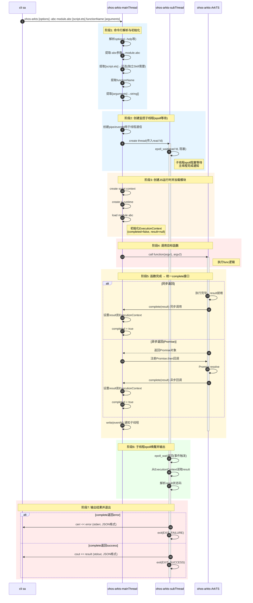

# ohos-arkts 设计文档

> **说明**：本文档为 ohos-arkts 模块的**架构设计文档**，描述最终目标架构及实现方案。示例代码展示了各阶段的参考实现，实际代码应逐步按此设计实现。

## 1. 设计目标

提供一种命令行工具 `ohos-arkts`，用于执行 ArkTS 脚本中的指定函数，支持：
- **同步返回**：函数直接返回结果
- **Promise 返回**：函数返回 Promise，工具等待 Promise resolve
- **显式完成**：函数调用 `completeArkTsTool()` 显式通知完成

## 2. 命令行接口

### 2.1 使用格式

```
ohos-arkts [options] -abc module.abc [script.ets] functionName [arguments]
```

| 参数 | 说明 | 必需 | 示例 |
|------|------|------|------|
| `-abc module.abc` | ABC 文件路径 | 是 | `-abc /data/scripts/test.abc` |
| `[script.ets]` | 脚本类名（仅独立 Skill） | 否 | `script` |
| `functionName` | 要执行的函数名 | 是 | `FunctionA` |
| `[arguments]` | 函数参数（字符串数组） | 否 | `arg1 arg2 arg3` |
| `[options]` | 可选参数 | 否 | `--help` |

### 2.2 选项

| 选项 | 说明 |
|------|------|
| `-h, --help` | 显示帮助信息 |

### 2.3 示例

```bash
# 应用 Skill（无 script 类，静态函数）
ohos-arkts -abc /data/app/sa.abc calculate "100" "200"

# 独立 Skill（有 script 类）
ohos-arkts -abc /data/skills/myskill.abc MySkill process "input.json"

# 带多个参数
ohos-arkts -abc /data/app/test.abc process "arg1" "arg2" "arg3"
```

## 3. 开发者代码格式

### 3.1 独立 Skill（有 script 类）

一个 ABC 可打包多个 ETS 文件，每个文件对应一个 script 类。

```typescript
// script.ets（类名必须与文件名相同）
export default class script {
    FunctionA(a: string[]): string {
        const result = doSomething(a);
        return JSON.stringify({ success: true, data: result });
    }

    AsyncFunction(a: string[]): Promise<string> {
        return new Promise((resolve) => {
            setTimeout(() => {
                resolve(JSON.stringify({ success: true, data: "done" }));
            }, 1000);
        });
    }

    ManualComplete(a: string[]): void {
        const result = doSomething(a);
        completeArkTsTool(JSON.stringify({ success: true, data: result }));
    }
}
```

### 3.2 应用 Skill（无 script 类）

一个 ABC 只能打包一个 ETS 文件，函数必须是静态的。

```typescript
// main.ets
@Entry
@Component
struct MainComponent {
    // ...
}

export function FunctionA(a: string[]): string {
    const result = doSomething(a);
    return JSON.stringify({ success: true, data: result });
}

export function AsyncFunction(a: string[]): Promise<string> {
    return new Promise((resolve) => {
        setTimeout(() => {
            resolve(JSON.stringify({ success: true, data: "done" }));
        }, 1000);
    });
}
```

## 4. 整体流程




---

**关键设计确认：**

| 设计点 | 实现方式 | 说明 |
|--------|----------|------|
| **线程通知** | `eventfd/pipe + epoll_wait` | 子线程阻塞等待，无空轮询，主线程完成时 `write(eventfd)` 唤醒 |
| **超时机制** | ❌ 不设置 | 函数执行无限期等待，依赖调用方或上层控制 |
| **结果归一** | 统一 `complete(result)` | 无论同步/异步，最终都收敛到同一出口，result 内含状态码区分 success/error |
| **IO 职责** | Monitor 统一输出 | 主线程专注 JS 执行，子线程负责所有 stdout/stderr 输出与进程退出 |

---

**`complete` 接口的 result 结构建议：**

```cpp
// 统一返回结构，JS侧和C++侧共享
struct CompleteResult {
    int32_t code;           // 0=success, 非0=error code
    std::string message;    // error描述或success提示
    napi_value data;        // 实际返回数据(JSON序列化)
};
```

这样 Monitor 侧只需判断 `code == 0` 决定走 `stdout` 还是 `stderr`
