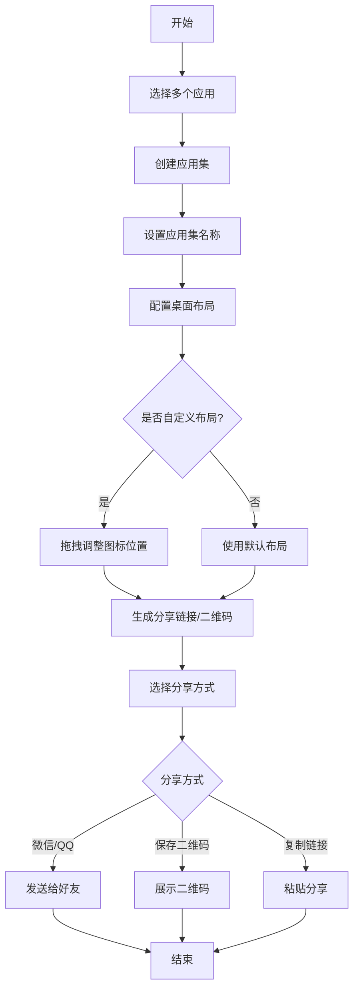
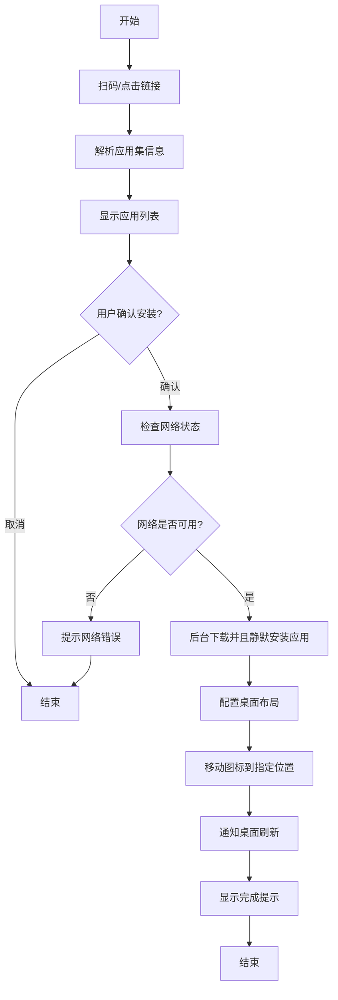
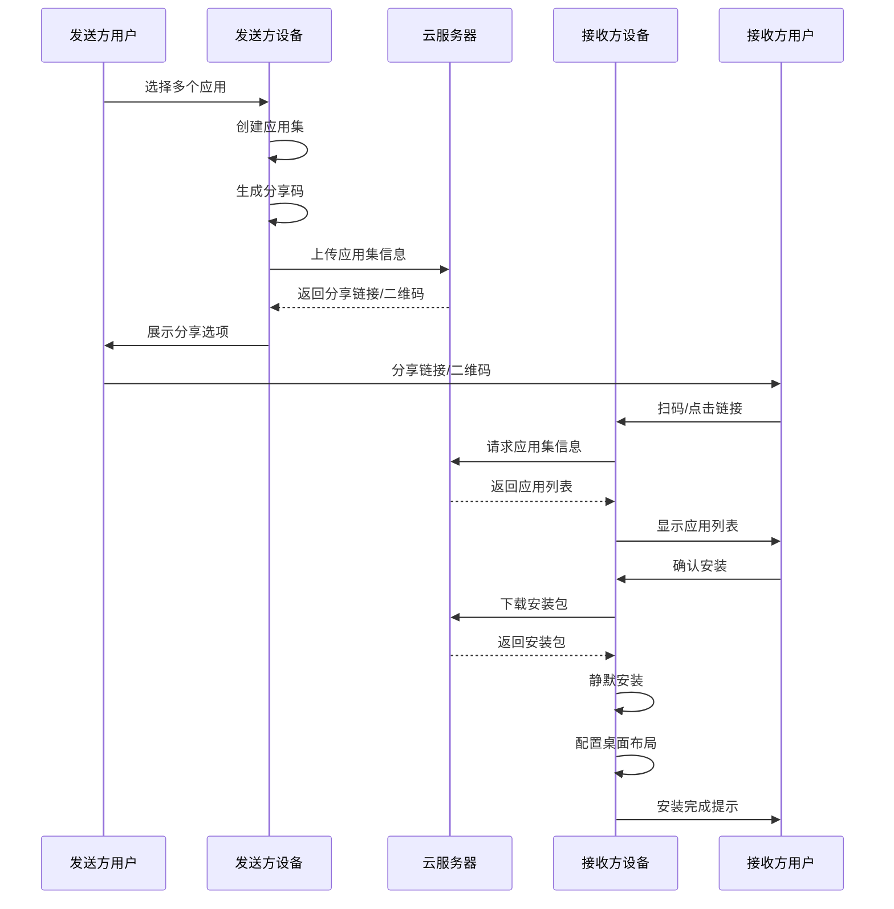

# 一键分享安装包

## 痛点

向父母或朋友推荐一个好用但小众的应用组合（如"健身+饮食+饮水"），对方需要一个个搜索、下载，过程复杂。

## 创新方案

用户可以将自己手机上几个常用的应用，打包成一个专属的应用集，并生成一个链接或二维码分享给好友。对方扫码后，系统会读取这个"安装包清单"，在后台静默安装所有这些应用，并自动按预设布局摆放到桌面，实现"好应用，一码分享"。

---

## 查重分析报告

### 检索关键词

- 应用打包分享、一键安装多个应用、二维码分享应用集
- 批量应用安装包分享、应用集一键发送、静默安装布局
- 应用推荐分享、安装包列表分享、桌面布局自动配置
- 华为手机克隆、小米换机助手、应用迁移专利
- 应用分享方法、批量安装应用程序专利

### 现有技术对比

#### 1. 换机迁移类技术

| 技术名称 | 技术特点 | 与本方案区别 |
|---------|---------|-------------|
| 华为手机克隆 | 整机数据迁移，旧手机到新手机 | 面向换机场景，迁移所有应用和数据，非选择性分享 |
| 小米换机助手 | 整机应用和数据迁移 | 同上，不具备社交分享属性 |
| OPPO手机搬家 | 整机迁移方案 | 同上 |

**结论**：换机迁移技术是整机级别的数据迁移，场景是"换新手机"，而本方案是"应用推荐分享"，场景是"向朋友推荐好用的应用组合"，两者应用场景和技术目标完全不同。

#### 2. 应用分享类技术

| 技术名称 | 技术特点 | 与本方案区别 |
|---------|---------|-------------|
| 应用商店分享功能 | 分享单个应用的下载链接 | 只能分享单个应用，无法打包多个应用 |
| 微信应用推荐 | 发送应用名称或链接 | 需要用户手动搜索安装，无静默安装 |
| 应用备份恢复 | 本地备份应用数据 | 面向数据备份，非社交分享场景 |

**结论**：现有应用分享功能只能分享单个应用，且接收方需要手动搜索、下载、安装，无法实现"一键安装多个应用"的便捷体验。

#### 3. 批量安装类技术

| 技术名称 | 技术特点 | 与本方案区别 |
|---------|---------|-------------|
| 企业MDM批量部署 | 企业统一推送应用安装 | 面向企业管理场景，非个人社交分享 |
| 应用市场批量下载 | 可选择多个应用下载 | 无分享功能，无桌面布局配置 |

**结论**：批量安装技术主要面向企业管理场景，不具备个人社交分享属性，也没有桌面布局自动配置功能。

### 创新点分析

本专利方案的核心创新点：

1. **应用集概念**：用户可自主选择多个应用，打包成一个"应用集"，这是对传统单应用分享的重大突破。

2. **社交化分享**：生成链接或二维码，通过社交渠道分享给好友，实现"好应用，一码分享"的便捷体验。

3. **静默安装**：接收方扫码后，系统在后台静默安装所有应用，无需用户逐个确认，大幅降低操作复杂度。

4. **桌面布局自动配置**：安装完成后，自动按预设布局将应用图标摆放到桌面，实现"开箱即用"的体验。

5. **场景化应用推荐**：支持按场景（如健身、学习、娱乐）打包应用组合，满足用户个性化推荐需求。

### 查重结论

经过全面检索和分析，**未发现与本专利方案完全相同的技术方案**。本方案的创新点在于：

- 将"应用组合分享"与"一键静默安装"相结合
- 引入"应用集"概念，支持多应用打包分享
- 实现桌面布局的自动配置
- 面向社交推荐场景，而非换机迁移或企业管理场景

本专利方案具有明显的新颖性和创造性，建议继续推进专利申请工作。

---

## 技术实现方案（基于OpenHarmony）

### 1. 应用集创建模块

```cpp
// 应用集数据结构
struct AppCollection {
    std::string collectionId;           // 应用集唯一标识
    std::string collectionName;         // 应用集名称（如"健身必备"）
    std::vector<AppInfo> appList;       // 应用列表
    DesktopLayout layout;               // 桌面布局配置
    std::string shareCode;              // 分享码
    std::string qrCodeUrl;              // 二维码链接
};

struct AppInfo {
    std::string bundleName;             // 应用包名
    std::string appName;                // 应用名称
    std::string version;                // 版本号
    std::string downloadUrl;            // 下载地址
    int iconPosition;                   // 图标位置
};
```

### 2. 分享链接生成

```cpp
// 生成分享链接和二维码
int GenerateShareInfo(AppCollection& collection) {
    // 序列化应用集信息
    std::string jsonData = SerializeCollection(collection);

    // 生成短链接
    collection.shareCode = GenerateShortCode();
    collection.qrCodeUrl = "appshare://collection/" + collection.shareCode;

    // 上传到云端服务器
    UploadToCloud(collection.shareCode, jsonData);

    return ERR_OK;
}
```

### 3. 静默安装实现

```cpp
// 批量静默安装
int BatchSilentInstall(const std::vector<AppInfo>& appList) {
    for (const auto& app : appList) {
        // 检查应用是否已安装
        if (IsAppInstalled(app.bundleName)) {
            continue;
        }

        // 后台下载安装包
        std::string apkPath = DownloadInBackground(app.downloadUrl);

        // 静默安装
        SilentInstall(apkPath);
    }
    return ERR_OK;
}
```

### 4. 桌面布局配置

```cpp
// 自动配置桌面布局
int ConfigureDesktopLayout(const DesktopLayout& layout) {
    for (const auto& item : layout.items) {
        // 移动应用图标到指定位置
        MoveAppIcon(item.bundleName, item.pageIndex, item.position);
    }

    // 通知桌面刷新
    NotifyLauncherRefresh();
    return ERR_OK;
}
```

### 5. 完整流程

本方案的整体流程分为发送方和接收方两个部分，通过云服务器进行数据中转，实现应用集的分享与批量部署。

#### 流程概述

**发送方流程**：用户在设备上选择多个想要推荐的应用，创建一个应用集，并设置应用集名称和桌面布局。系统生成分享链接或二维码后，用户可以通过微信、QQ等社交软件分享给好友，也可以保存二维码图片或复制链接进行分享。

**接收方流程**：接收方用户扫描二维码或点击链接后，系统从云服务器获取应用集信息并展示应用列表。用户确认安装后，系统在后台自动下载并静默安装所有应用，安装完成后自动按照预设布局将应用图标摆放到桌面指定位置，最后显示完成提示。

**整体交互**：发送方设备将应用集信息上传到云服务器，云服务器生成分享标识返回给发送方。接收方设备通过分享标识从云服务器获取应用列表，然后从应用商店服务器下载安装包进行静默安装。

#### 发送方流程



#### 接收方流程

接收方流程从用户扫码或点击链接开始，经过应用集解析、用户确认、批量安装、布局配置等步骤，最终完成整个部署过程。关键点在于：

1. **用户确认机制**：展示应用列表供用户查看，用户可选择取消或确认安装
2. **网络状态检测**：安装前检查网络是否可用，确保下载过程顺利进行
3. **静默安装**：后台自动完成所有应用的下载和安装，无需用户逐个确认
4. **布局自动配置**：安装完成后，自动将应用图标移动到预设位置，实现"开箱即用"



#### 整体交互流程

时序图展示了发送方用户、发送方设备、云服务器、接收方设备、接收方用户五个角色之间的完整交互过程。整个流程分为两个阶段：

**分享阶段**：
1. 发送方用户在设备上选择多个应用
2. 发送方设备创建应用集并生成分享码
3. 发送方设备将应用集信息上传到云服务器
4. 云服务器返回分享链接/二维码
5. 发送方用户通过社交软件分享给接收方用户

**安装阶段**：
1. 接收方用户扫码或点击链接
2. 接收方设备从云服务器请求应用集信息
3. 云服务器返回应用列表
4. 接收方用户确认安装
5. 接收方设备从云服务器下载安装包
6. 接收方设备执行静默安装和桌面布局配置
7. 向接收方用户显示安装完成提示



---

## 专利申请建议

### 权利要求方向

1. **独立权利要求**：一种应用集分享安装方法，包括：创建包含多个应用信息的应用集；生成分享链接或二维码；接收方解析应用集信息后静默安装所有应用；自动配置桌面布局。

2. **从属权利要求**：
   - 应用集包含桌面布局配置信息
   - 支持场景化应用组合推荐
   - 支持增量更新应用集内容
   - 支持应用集订阅和更新提醒

### 申请策略

- 申请类型：发明专利
- 技术领域：移动终端应用管理、人机交互
- 核心创新点：应用集概念、社交化分享、静默安装、桌面布局自动配置
