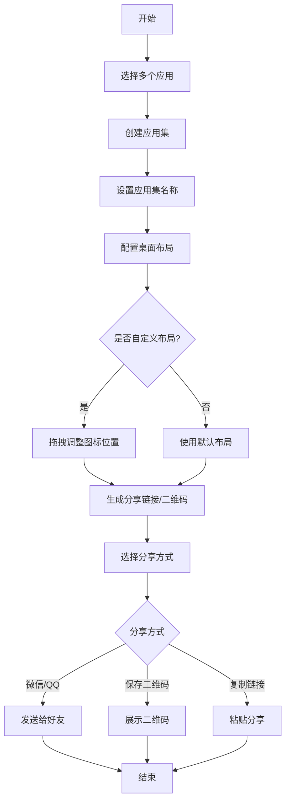
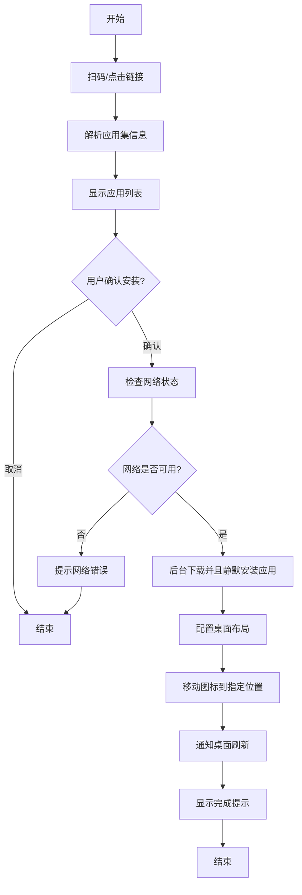
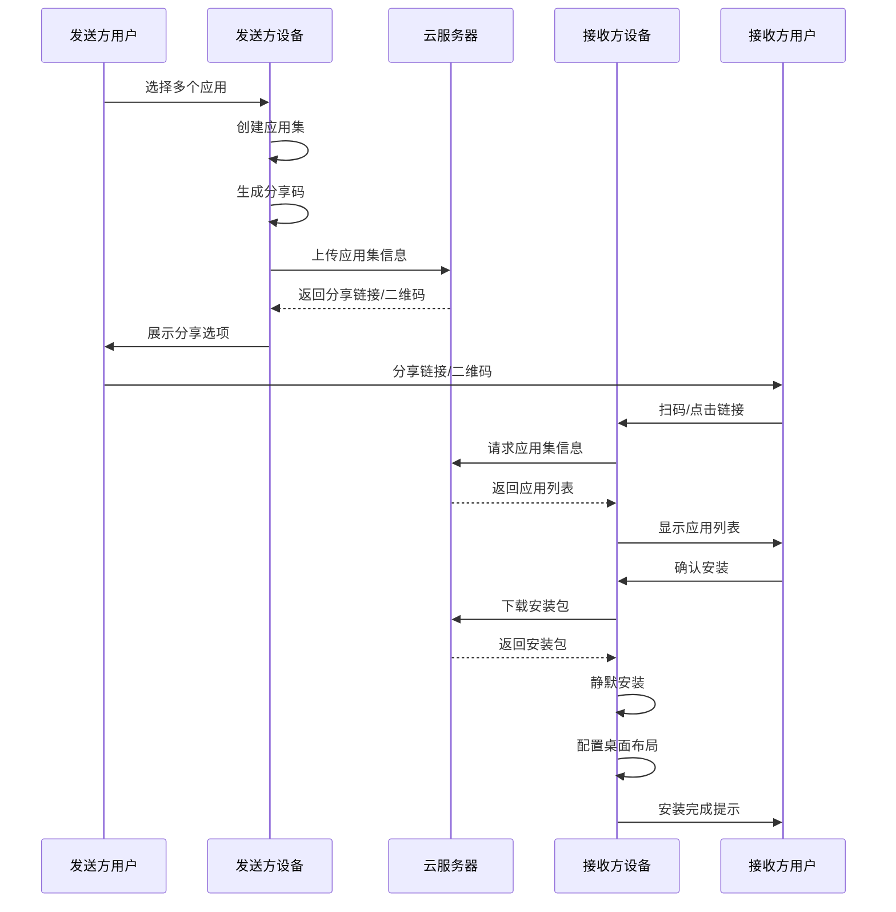

# 一键分享安装包

## 痛点

向父母或朋友推荐一个好用但小众的应用组合（如"健身+饮食+饮水"），对方需要一个个搜索、下载，过程复杂。

## 创新方案

用户可以将自己手机上几个常用的应用，打包成一个专属的应用集，并生成一个链接或二维码分享给好友。对方扫码后，系统会读取这个"安装包清单"，在后台静默安装所有这些应用，并自动按预设布局摆放到桌面，实现"好应用，一码分享"。

---

## 查重分析报告

### 检索关键词

- 应用打包分享、一键安装多个应用、二维码分享应用集
- 批量应用安装包分享、应用集一键发送、静默安装布局
- 应用推荐分享、安装包列表分享、桌面布局自动配置
- 华为手机克隆、小米换机助手、应用迁移专利
- 应用分享方法、批量安装应用程序专利

### 现有技术对比

#### 1. 换机迁移类技术

| 技术名称 | 技术特点 | 与本方案区别 |
|---------|---------|-------------|
| 华为手机克隆 | 整机数据迁移，旧手机到新手机 | 面向换机场景，迁移所有应用和数据，非选择性分享 |
| 小米换机助手 | 整机应用和数据迁移 | 同上，不具备社交分享属性 |
| OPPO手机搬家 | 整机迁移方案 | 同上 |

**结论**：换机迁移技术是整机级别的数据迁移，场景是"换新手机"，而本方案是"应用推荐分享"，场景是"向朋友推荐好用的应用组合"，两者应用场景和技术目标完全不同。

#### 2. 应用分享类技术

| 技术名称 | 技术特点 | 与本方案区别 |
|---------|---------|-------------|
| 应用商店分享功能 | 分享单个应用的下载链接 | 只能分享单个应用，无法打包多个应用 |
| 微信应用推荐 | 发送应用名称或链接 | 需要用户手动搜索安装，无静默安装 |
| 应用备份恢复 | 本地备份应用数据 | 面向数据备份，非社交分享场景 |

**结论**：现有应用分享功能只能分享单个应用，且接收方需要手动搜索、下载、安装，无法实现"一键安装多个应用"的便捷体验。

#### 3. 批量安装类技术

| 技术名称 | 技术特点 | 与本方案区别 |
|---------|---------|-------------|
| 企业MDM批量部署 | 企业统一推送应用安装 | 面向企业管理场景，非个人社交分享 |
| 应用市场批量下载 | 可选择多个应用下载 | 无分享功能，无桌面布局配置 |

**结论**：批量安装技术主要面向企业管理场景，不具备个人社交分享属性，也没有桌面布局自动配置功能。

### 创新点分析

本专利方案的核心创新点：

1. **应用集概念**：用户可自主选择多个应用，打包成一个"应用集"，这是对传统单应用分享的重大突破。

2. **社交化分享**：生成链接或二维码，通过社交渠道分享给好友，实现"好应用，一码分享"的便捷体验。

3. **静默安装**：接收方扫码后，系统在后台静默安装所有应用，无需用户逐个确认，大幅降低操作复杂度。

4. **桌面布局自动配置**：安装完成后，自动按预设布局将应用图标摆放到桌面，实现"开箱即用"的体验。

5. **场景化应用推荐**：支持按场景（如健身、学习、娱乐）打包应用组合，满足用户个性化推荐需求。

### 查重结论

经过全面检索和分析，**未发现与本专利方案完全相同的技术方案**。本方案的创新点在于：

- 将"应用组合分享"与"一键静默安装"相结合
- 引入"应用集"概念，支持多应用打包分享
- 实现桌面布局的自动配置
- 面向社交推荐场景，而非换机迁移或企业管理场景

本专利方案具有明显的新颖性和创造性，建议继续推进专利申请工作。

---

## 本发明的技术保护点

本发明主要保护一种应用集合的分享与批量部署方法/系统，主要保护点在于：

**针对现有应用分享技术只能分享单个应用、接收方需手动逐个安装的问题，提出一种应用集打包分享机制**：将用户选择的多个应用及其标识信息、版本信息、来源信息打包成一个完整的安装包清单，该清单不仅包含应用列表，还包含预设的桌面布局信息，使得多个应用可以作为一个整体进行分享和部署。

次要保护点在于：

1. **分享标识生成机制**：在主要保护点的基础上，将安装包清单上传至云端服务器并生成唯一的分享标识（二维码或链接），接收方通过扫描或点击该标识即可从云端获取完整的应用集信息，实现了分享信息与应用安装包的解耦，降低了分享链路的数据传输量。

2. **批量静默安装机制**：在主要保护点的基础上，接收端解析安装包清单后，在后台依次下载并静默安装所有应用，期间无需用户逐个确认安装操作，系统自动检测已安装应用并处理版本更新，大幅降低了批量安装的操作复杂度。

3. **桌面布局自动配置机制**：在主要保护点的基础上，安装完成后系统根据安装包清单中的预设布局信息，自动将应用图标移动到桌面指定位置，包括检测桌面可用空间、处理空间不足情况、通知桌面刷新等步骤，使接收方获得与分享方一致的桌面布局体验。

4. **权限验证与安全机制**：在主要保护点的基础上，分享方可设置访问权限（密码、有效期、访问次数限制），接收端在解析安装包清单前进行权限验证，同时验证应用来源的可信度，确保分享和安装过程的安全性。

---

## 技术点取证分析

针对上述技术保护点，若某厂商产品涉嫌使用本发明技术，可通过以下手段进行取证：

### 一、产品演示取证

**适用保护点**：主要保护点（应用集打包分享机制）、次要保护点3（桌面布局自动配置）

**取证方法**：

1. **应用集创建演示**：
   - 打开疑似侵权产品的应用管理界面
   - 观察是否存在"多选应用"、"创建应用集"、"打包分享"等功能入口
   - 录屏记录用户选择多个应用并创建应用集的完整过程
   - 重点记录应用集名称设置、布局配置等界面元素

2. **分享功能演示**：
   - 完成应用集创建后，观察是否生成二维码或分享链接
   - 录屏记录分享标识的生成过程和展示形式
   - 记录分享渠道（微信、QQ、短信等）

3. **接收安装演示**：
   - 使用另一台设备扫描二维码或点击链接
   - 录屏记录应用列表展示、用户确认、安装进度
   - **关键取证点**：观察安装过程中是否出现逐个确认弹窗，若无则证明使用了静默安装
   - 安装完成后，观察桌面图标是否自动排列到预设位置

4. **对比测试**：
   - 使用本发明方案和疑似侵权产品分别进行相同操作
   - 对比两者的功能流程、界面交互、用户体验
   - 若核心流程一致，可作为侵权证据

### 二、抓包日志取证

**适用保护点**：次要保护点1（分享标识生成机制）、次要保护点2（批量静默安装机制）

**取证方法**：

1. **网络抓包分析**：

   使用Charles、Fiddler或Wireshark等抓包工具，配置手机代理后进行抓包：

   ```
   # 抓包步骤
   1. 配置手机HTTP/HTTPS代理指向抓包工具
   2. 安装抓包工具的CA证书（用于解密HTTPS）
   3. 在疑似侵权产品上执行应用集分享操作
   4. 在接收设备上执行扫码安装操作
   5. 分析抓包数据
   ```

   **关键数据分析**：

   - **应用集上传请求**：查找向云端服务器上传应用集信息的请求
     - 请求URL特征：可能包含`/collection`、`/appset`、`/share`等路径
     - 请求体特征：JSON格式，包含多个应用的bundleName、version、downloadUrl等字段
     - 若请求体包含`layout`、`positions`等布局字段，则证明使用了桌面布局配置技术

   - **分享标识返回**：分析服务器响应
     - 响应体中是否包含短链接、分享码、二维码数据
     - 记录分享标识的格式和生成规则

   - **应用集下载请求**：接收端扫码后的请求
     - 请求URL中是否包含分享标识
     - 响应体是否返回完整的应用列表和布局信息

   - **批量下载请求**：观察应用安装包的下载请求
     - 是否连续发起多个下载请求（证明批量下载）
     - 下载是否在后台进行（无用户交互）

2. **系统日志分析**：

   在Android/OpenHarmony设备上获取系统日志：

   ```
   # Android设备
   adb logcat -v time > system_log.txt

   # OpenHarmony设备
   hilog > system_log.txt
   ```

   **关键日志特征**：

   - **应用集创建日志**：
     ```
     // 搜索关键词：collection、appset、bundle
     01-15 10:30:00.123 AppShareManager I: CreateAppCollection: collectionId=xxx, appCount=3
     01-15 10:30:00.456 AppShareManager I: AddAppToCollection: bundleName=com.example.fitness
     01-15 10:30:00.789 AppShareManager I: SetLayoutConfig: layoutType=grid, columns=3
     ```

   - **静默安装日志**：
     ```
     // 搜索关键词：silent、install、batch
     01-15 10:31:00.123 PackageManager I: SilentInstall: packageName=com.example.fitness
     01-15 10:31:05.456 PackageManager I: SilentInstall: packageName=com.example.diet
     01-15 10:31:10.789 PackageManager I: SilentInstall: packageName=com.example.water
     ```

   - **布局配置日志**：
     ```
     // 搜索关键词：layout、desktop、icon、position
     01-15 10:32:00.123 LauncherManager I: MoveIconToPosition: app=com.example.fitness, row=0, col=0
     01-15 10:32:00.456 LauncherManager I: MoveIconToPosition: app=com.example.diet, row=0, col=1
     01-15 10:32:00.789 LauncherManager I: NotifyLauncherRefresh
     ```

### 三、反编译分析

**适用保护点**：全部技术保护点

**取证方法**：

1. **APK/HAP包获取**：
   ```
   # Android APK获取
   adb shell pm list packages -f  # 查找目标应用路径
   adb pull /data/app/xxx/base.apk  # 提取APK

   # OpenHarmony HAP获取
   hdc shell bm dump -n <bundleName>  # 查询应用信息
   hdc file recv /data/app/xxx/xxx.hap  # 提取HAP
   ```

2. **反编译操作**：
   ```
   # Android APK反编译
   jadx -d output_dir target.apk
   apktool d target.apk -o output_dir

   # OpenHarmony HAP反编译
   unzip xxx.hap -d hap_dir
   # 分析hap_dir中的so文件和资源文件
   ```

3. **关键代码特征搜索**：

   在反编译后的代码中搜索以下特征：

   **应用集数据结构**：
   ```java
   // 搜索关键词：AppCollection、AppSet、AppBundle
   class AppCollection {
       String collectionId;
       String collectionName;
       List<AppInfo> appList;      // 多个应用列表
       LayoutConfig layout;        // 布局配置
       String shareCode;
   }
   ```

   **安装包清单生成**：
   ```java
   // 搜索关键词：manifest、generateShare、serialize
   public String generateManifest(AppCollection collection) {
       JSONObject manifest = new JSONObject();
       manifest.put("collectionName", collection.getName());
       manifest.put("applications", collection.getAppList());
       manifest.put("layout", collection.getLayout());
       return manifest.toString();
   }
   ```

   **静默安装调用**：
   ```java
   // 搜索关键词：silentInstall、installPackage、batchInstall
   public void batchSilentInstall(List<AppInfo> apps) {
       for (AppInfo app : apps) {
           PackageManager pm = getPackageManager();
           pm.installPackage(app.getDownloadUrl(), null);  // 无需用户确认
       }
   }
   ```

   **布局配置代码**：
   ```java
   // 搜索关键词：moveIcon、setLayout、desktopPosition
   public void configureLayout(LayoutConfig layout) {
       for (LayoutItem item : layout.getItems()) {
           launcher.moveIcon(item.getPackageName(), item.getRow(), item.getCol());
       }
       launcher.refresh();
   }
   ```

4. **云端接口分析**：

   在反编译代码中查找网络请求相关代码：
   ```
   // 搜索URL特征
   - "appshare://collection/"
   - "/api/collection/upload"
   - "/api/collection/download"
   - "shareCode"、"qrCode"等字段
   ```

### 四、数据库/文件分析

**适用保护点**：主要保护点（应用集打包分享机制）

**取证方法**：

1. **应用数据目录分析**：
   ```
   # Android
   adb shell run-as <package_name>
   cd /data/data/<package_name>/

   # OpenHarmony
   hdc shell
   cd /data/app/el2/100/base/<bundle_name>/
   ```

2. **关键文件搜索**：
   ```
   # 搜索应用集配置文件
   find . -name "*collection*" -o -name "*appset*" -o -name "*share*"

   # 搜索JSON配置文件
   find . -name "*.json" | xargs grep -l "appList\|layout\|shareCode"
   ```

3. **数据库分析**：
   ```
   # 查找SQLite数据库
   find . -name "*.db"

   # 分析数据库结构
   sqlite3 xxx.db
   .tables
   .schema app_collection
   select * from app_collection;
   ```

   若发现包含`app_collection`、`layout_config`等表结构，可证明使用了应用集打包技术。

### 五、产品手册/宣传材料取证

**适用保护点**：全部技术保护点

**取证方法**：

1. **官方宣传材料**：
   - 收集产品官网、应用商店页面的功能介绍
   - 查找"一键分享"、"批量安装"、"应用集"等功能描述
   - 截图保存作为证据

2. **用户手册/帮助文档**：
   - 查找产品使用说明书、帮助文档
   - 搜索应用分享相关章节
   - 记录功能描述和操作步骤

3. **营销视频/演示**：
   - 收集官方发布的产品演示视频
   - 分析视频中展示的分享安装流程
   - 若流程与本发明一致，可作为侵权证据

### 六、取证报告模板

完成取证后，应形成完整的取证报告：

```
【取证报告】

一、取证对象
- 产品名称：xxx
- 版本号：x.x.x
- 厂商：xxx公司

二、取证时间
- 2026年x月x日

三、取证方法
- [ ] 产品演示取证
- [ ] 抓包日志取证
- [ ] 反编译分析
- [ ] 数据库/文件分析
- [ ] 产品手册取证

四、取证发现

1. 应用集打包分享机制（主要保护点）
   - 证据：[具体证据描述]
   - 证据文件：[截图/日志/代码片段]

2. 分享标识生成机制（次要保护点1）
   - 证据：[具体证据描述]
   - 证据文件：[截图/日志/代码片段]

...（其他保护点）

五、结论
基于以上取证分析，疑似侵权产品使用了本发明的以下技术点：
- [列出对应的技术保护点]

六、附件
- 录屏文件：xxx.mp4
- 抓包文件：xxx.pcap
- 日志文件：xxx.log
- 反编译代码：xxx/
```

---

## 技术实现方案（基于OpenHarmony）

### 1. 应用集创建模块

```cpp
// 应用集数据结构
struct AppCollection {
    std::string collectionId;           // 应用集唯一标识
    std::string collectionName;         // 应用集名称（如"健身必备"）
    std::vector<AppInfo> appList;       // 应用列表
    DesktopLayout layout;               // 桌面布局配置
    std::string shareCode;              // 分享码
    std::string qrCodeUrl;              // 二维码链接
};

struct AppInfo {
    std::string bundleName;             // 应用包名
    std::string appName;                // 应用名称
    std::string version;                // 版本号
    std::string downloadUrl;            // 下载地址
    int iconPosition;                   // 图标位置
};
```

### 2. 分享链接生成

```cpp
// 生成分享链接和二维码
int GenerateShareInfo(AppCollection& collection) {
    // 序列化应用集信息
    std::string jsonData = SerializeCollection(collection);

    // 生成短链接
    collection.shareCode = GenerateShortCode();
    collection.qrCodeUrl = "appshare://collection/" + collection.shareCode;

    // 上传到云端服务器
    UploadToCloud(collection.shareCode, jsonData);

    return ERR_OK;
}
```

### 3. 静默安装实现

```cpp
// 批量静默安装
int BatchSilentInstall(const std::vector<AppInfo>& appList) {
    for (const auto& app : appList) {
        // 检查应用是否已安装
        if (IsAppInstalled(app.bundleName)) {
            continue;
        }

        // 后台下载安装包
        std::string apkPath = DownloadInBackground(app.downloadUrl);

        // 静默安装
        SilentInstall(apkPath);
    }
    return ERR_OK;
}
```

### 4. 桌面布局配置

```cpp
// 自动配置桌面布局
int ConfigureDesktopLayout(const DesktopLayout& layout) {
    for (const auto& item : layout.items) {
        // 移动应用图标到指定位置
        MoveAppIcon(item.bundleName, item.pageIndex, item.position);
    }

    // 通知桌面刷新
    NotifyLauncherRefresh();
    return ERR_OK;
}
```

### 5. 完整流程

本方案的整体流程分为发送方和接收方两个部分，通过云服务器进行数据中转，实现应用集的分享与批量部署。

#### 流程概述

**发送方流程**：用户在设备上选择多个想要推荐的应用，创建一个应用集，并设置应用集名称和桌面布局。系统生成分享链接或二维码后，用户可以通过微信、QQ等社交软件分享给好友，也可以保存二维码图片或复制链接进行分享。

**接收方流程**：接收方用户扫描二维码或点击链接后，系统从云服务器获取应用集信息并展示应用列表。用户确认安装后，系统在后台自动下载并静默安装所有应用，安装完成后自动按照预设布局将应用图标摆放到桌面指定位置，最后显示完成提示。

**整体交互**：发送方设备将应用集信息上传到云服务器，云服务器生成分享标识返回给发送方。接收方设备通过分享标识从云服务器获取应用列表，然后从应用商店服务器下载安装包进行静默安装。

#### 发送方流程



#### 接收方流程

接收方流程从用户扫码或点击链接开始，经过应用集解析、用户确认、批量安装、布局配置等步骤，最终完成整个部署过程。关键点在于：

1. **用户确认机制**：展示应用列表供用户查看，用户可选择取消或确认安装
2. **网络状态检测**：安装前检查网络是否可用，确保下载过程顺利进行
3. **静默安装**：后台自动完成所有应用的下载和安装，无需用户逐个确认
4. **布局自动配置**：安装完成后，自动将应用图标移动到预设位置，实现"开箱即用"



#### 整体交互流程

时序图展示了发送方用户、发送方设备、云服务器、接收方设备、接收方用户五个角色之间的完整交互过程。整个流程分为两个阶段：

**分享阶段**：
1. 发送方用户在设备上选择多个应用
2. 发送方设备创建应用集并生成分享码
3. 发送方设备将应用集信息上传到云服务器
4. 云服务器返回分享链接/二维码
5. 发送方用户通过社交软件分享给接收方用户

**安装阶段**：
1. 接收方用户扫码或点击链接
2. 接收方设备从云服务器请求应用集信息
3. 云服务器返回应用列表
4. 接收方用户确认安装
5. 接收方设备从云服务器下载安装包
6. 接收方设备执行静默安装和桌面布局配置
7. 向接收方用户显示安装完成提示



---

## 专利申请建议

### 权利要求方向

1. **独立权利要求**：一种应用集分享安装方法，包括：创建包含多个应用信息的应用集；生成分享链接或二维码；接收方解析应用集信息后静默安装所有应用；自动配置桌面布局。

2. **从属权利要求**：
   - 应用集包含桌面布局配置信息
   - 支持场景化应用组合推荐
   - 支持增量更新应用集内容
   - 支持应用集订阅和更新提醒

### 申请策略

- 申请类型：发明专利
- 技术领域：移动终端应用管理、人机交互
- 核心创新点：应用集概念、社交化分享、静默安装、桌面布局自动配置
